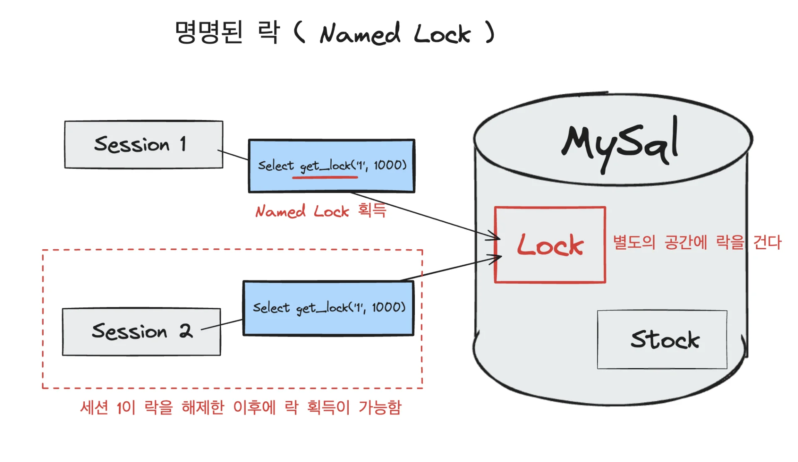

> 🤔 
> 
> <a id="094eda9b0fe182fb903e812083ab4958"></a>
> 
> <strong>데이터베이스를 활용한 데이터 정합성을 맞추는 방법 (3가지)</strong>
> 
> - Pessimistic Lock ( 비관적 락 )
> 
> - Optimistic Lock ( 낙관적 락 ) 
> 
> - <strong>Name Lock ( 명명된 락)</strong>

> ⚠️ 
> 
> <a id="5d4eda9b0fe1826ea05d017d99e95095"></a>
> 
> <strong>실제 사용 시, 데이터 소스를 분리해서 사용</strong>해야 한다&#46; 
> 
> <a id="f22eda9b0fe1825c900d018aa3b9882f"></a>
> 
> <strong>같은 서비스 사용 시, </strong><strong><u>커넥션 풀이 부족</u></strong><strong>해지는 현상이 발</strong>생될 수 있다&#46;<br>따라서 <strong><u>실무에서는 데이터 소스를 분리</u></strong>해서 사용해야 한다&#46; 

<a id="497eda9b0fe18363b8a281e3c367cfa7"></a>

## Named Lock (명명된 락)

---

> 📖 
> 
> <a id="a58eda9b0fe1822b98fb8199cb96b5e4"></a>
> 
> 네임드 락은 <strong><u>이름을 가진 metadata locking</u></strong> 이다&#46;
> 
> <a id="2f2eda9b0fe182d2924601689b5a244e"></a>
> 
> <strong><u>이름을 가진 lock을 획득</u></strong><u>한 후 </u><strong><u>해제할 때까지 다른 세션은 이 lock을 획득할 수 없</u></strong>도록 한다&#46; 
> 
> - 
> 
> -  Named Lock은 DB 락이 아니라 <u>분산 뮤텍스</u>이며, 트랜잭션과 독립적이기 때문에 lifecycle을 명확히 분리해야 안전하다&#46;

<a id="3a7eda9b0fe1825d860a81d521cf5ae6"></a>

### Named Lock (명명된 락) 개념


<a id="b65eda9b0fe18294bdf401d685b7bc4e"></a>

<code>명명된 락(Named Lock)</code>은  <code>비관적 락(pessimistic lock)</code>과 유사하다&#46; 

<a id="8f0eda9b0fe1833c99c7818c23c39d52"></a>

그러나 차이점은 <code>비관적 락(pessimistic lock)</code>은 <strong><u>로우</u></strong>나 <strong><u>테이블 단위</u></strong>로 락을 걸지만,<code>명명된 락(Named Lock)</code>은 로우나 테이블 단위가 아닌 <strong><u>메타데이터의 락킹</u></strong>을 한다는 것에 있다&#46; 

<a id="97ceda9b0fe182cfb6b101291e131f38"></a>

주의할 점으로는 <strong>트랜잭션이 종료될 때까지</strong><strong><u> lock이 자동으로 해제되지 않</u></strong><strong>기 때문에 </strong><strong><u>별도의 명령어로 해제</u></strong><strong><u>를 수행</u></strong>해주거나<br><strong><u> 선점시간이 끝</u></strong>나야 해제된다&#46; 

<a id="ce0eda9b0fe18313acf9819234debb6d"></a>

MySQL에서는 <code>get&#45;lock</code> 명령어를 통해<strong> </strong><strong><u>Named Lock을 획득</u></strong>할 수 있고, <code>release&#45;lock</code>명령어를 통해 <strong><u>lock을 해제</u></strong>할 수 있다&#46; 

- <strong>Named Lock 획득&#58; </strong><strong><code>get&#45;lock</code></strong>

- <strong>Named Lock 해제&#58; </strong><strong><code>release&#45;lock</code></strong>

<a id="217eda9b0fe18310ad8f81416485bda2"></a>

### 스프링에서의 Named Lock 사용

> ✏️ 
> 
> <a id="1feeda9b0fe1822197b18196591f5e0e"></a>
> 
> 같은 데이터 소스를 사용하면 커넥션 풀이 부족해지는 현상으로 인해 다른 서비스에도 영향을 줄수 있다&#46; 
> 
> <a id="a34eda9b0fe1834f85d281e361e6a8e2"></a>
> 
> 따라서 <u>실제 실무 활용 시, 데이터 소스를 분리해서 사용</u>해야 한다 &#46;
> 
> <a id="e8beda9b0fe182d4833a81a39773aeec"></a>
> 
> 편의성을 위해  Stock Enity를 사용하지만, <strong><u>실무에서는 별도의 JDBC를 사용</u></strong>해야한다&#46; 

<a id="c26eda9b0fe18299b53281b491efcaee"></a>

```java
public interface LockRepository extends JpaRepository<Stock, Long> {
    @Query(value = "select get_lock(:key, 3000)", nativeQuery = true)
    void getLock(String key);

    @Query(value = "select release_lock(:key)", nativeQuery = true)
    void releaseLock(String key);
}
```

<a id="ecbeda9b0fe18282bc7b019c6c00ee83"></a>

```java
@Component
public class NamedLockStockFacade {

    private final LockRepository lockRepository;

    private final StockService stockService;

    public NamedLockStockFacade(LockRepository lockRepository, StockService stockService) {
        this.lockRepository = lockRepository;
        this.stockService = stockService;
    }

    @Transactional
    public void decrease(Long id, Long quantity) {
        try {
            lockRepository.getLock(id.toString());  // 락 획득
            stockService.decrease(id, quantity);  // 락 획득 이후, 재고 감소 처리
        } finally {
            lockRepository.releaseLock(id.toString());  // 로직 종료 후, 락 해제
        }
    }
}
```

<a id="ddceda9b0fe1839c9d85812675df23b3"></a>

### 코드 예제

<details>
<summary>&#91; 코드 &#93; LockRepository</summary>

<a id="e56eda9b0fe18219943481a429cc9507"></a>

```java
public interface LockRepository extends JpaRepository<Stock, Long> {
    @Query(value = "select get_lock(:key, 3000)", nativeQuery = true)
    void getLock(String key);

    @Query(value = "select release_lock(:key)", nativeQuery = true)
    void releaseLock(String key);
}
```

- 네이티브 쿼리를 통한 named lock 획득 및 해제 메서드 정의

</details>

<details>
<summary>&#91; 코드 &#93; NamedLockStockFacad</summary>

<a id="f59eda9b0fe18226a31d81dff448c607"></a>

```java
@Component
public class NamedLockStockFacade {

    private final LockRepository lockRepository;

    private final StockService stockService;

    public NamedLockStockFacade(LockRepository lockRepository, StockService stockService) {
        this.lockRepository = lockRepository;
        this.stockService = stockService;
    }

    @Transactional
    public void decrease(Long id, Long quantity) {
        try {
            lockRepository.getLock(id.toString());  // 락 획득
            stockService.decrease(id, quantity);  // 락 획득 이후, 재고 감소 처리
        } finally {
            lockRepository.releaseLock(id.toString());  // 로직 종료 후, 락 해제
        }
    }
}
```

</details>

<details>
<summary>&#91; 코드 &#93; StockService&#46;decrease() &#45; 트랜잭션 전파 속성 변경</summary>

<a id="bd7eda9b0fe183f3bb2f012ad029eff6"></a>

```java
package com.example.stock.service;

import com.example.stock.domain.Stock;
import com.example.stock.repository.StockRepository;
import org.hibernate.annotations.Synchronize;
import org.springframework.scheduling.annotation.Async;
import org.springframework.stereotype.Service;
import org.springframework.transaction.annotation.Propagation;
import org.springframework.transaction.annotation.Transactional;

@Service
public class StockService {

    private final StockRepository stockRepository;

    public StockService(StockRepository stockRepository) {
        this.stockRepository = stockRepository;
    }

    // 부모의 트랜잭션과 별도로 실행되어야 하기 때문에, Propagation.REQUIRES_NEW 적용
        // REQUIRES_NEW: 현재 진행 중인 트랜잭션과 독립적으로 새로운 트랜잭션을 시작하도록 강제함
    @Transactional(propagation = Propagation.REQUIRES_NEW)
    public void  decrease(Long id, Long quantity) {
        Stock stock = stockRepository.findById(id).orElseThrow();
        stock.decrease(quantity);

        stockRepository.saveAndFlush(stock);
    }
}
```

- 자식 트랜잭션을 독립적으로 선언
    - 트랜잭션 전파 속성 변경&#58; <code>REQUIRES(기본값)</code> &#45;&#62; <code>REQUIRES&#95;NEW</code>

</details>

<details>
<summary>&#91; 코드 &#93; NamedLockStockFacadeTest</summary>

<a id="1beeda9b0fe1836ca85d810b81fa80fc"></a>

```java
package com.example.stock.facade;

import com.example.stock.domain.Stock;
import com.example.stock.repository.StockRepository;
import org.junit.jupiter.api.AfterEach;
import org.junit.jupiter.api.BeforeEach;
import org.junit.jupiter.api.Test;
import org.springframework.beans.factory.annotation.Autowired;
import org.springframework.boot.test.context.SpringBootTest;

import java.util.concurrent.CountDownLatch;
import java.util.concurrent.ExecutorService;
import java.util.concurrent.Executors;

import static org.junit.jupiter.api.Assertions.*;

@SpringBootTest
class NamedLockStockFacadeTest {

    @Autowired
    private NamedLockStockFacade namedLockStockFacade;

    @Autowired
    private StockRepository stockRepository;

    @BeforeEach
    public void before() {
        stockRepository.saveAndFlush(new Stock(1L, 100L));
    }

    @AfterEach
    public void after() {
        stockRepository.deleteAll();
    }

    // Fixme: 실패 - 결과값이 기대값과 다름 (원인 찾지 못함) -> 원인 찾고, 수정 핖요
    @Test
    public void 동시에_100명_주문() throws InterruptedException {
        int threadCount = 100;
        ExecutorService executorService = Executors.newFixedThreadPool(100);
        CountDownLatch latch = new CountDownLatch(threadCount);

        for (int i = 0; i < threadCount; i++) {
            executorService.submit(() -> {
                try {
                    namedLockStockFacade.decrease(1L, 1L);
                } finally {
                    latch.countDown();
                }
            });
        }
        latch.await();

        Stock stock = stockRepository.findById(1L).orElseThrow();

        // 100 - (100 * 1) = 0
        assertEquals(0, stock.getQuantity());
    }
}
```

</details>

<a id="805eda9b0fe182688d8081243399615c"></a>

### 의문점 

<details>
<summary>🧐 Named Lock은 DB에서 별도의 공간에서 Lock 관리한다&#46; 그러면 별도에 공간에 lock을 선언하는 것이 어떻게 다른 쓰레드의 Stock 데이터 접근을 컨트롤할 수 있는가? </summary>



> ✏️ 
> 
> <a id="33eeda9b0fe1800794dfe02fe2bdc3ee"></a>
> 
> Named Lock은 데이터를 잠그는 게 아닌, <strong><u>접근 자체를 직렬화(serialization)</u></strong>한다즉,  해당 작업을 수행할 수 있는 권한을 부여하는 것과 같다&#46; 

<a id="33eeda9b0fe1802b8faad458bb476d6e"></a>

```java
lock("stock:1")   // GET_LOCK

// 여기 들어온 쓰레드만 실행 가능
updateStock()

unlock("stock:1") // RELEASE_LOCK
```

- <strong>애플리케이션 레벨에서 동기화 보장</strong>한다&#46;

<details>
<summary><strong>비교 &#45;Named lock, Row Lock (비관적 락)</strong></summary>

> 
> 
> <a id="33eeda9b0fe18030a01bd5d931c9023f"></a>
> 
> 비유
> 
> - Row Lock → “문 자체에 자물쇠”
> 
> - Named Lock → “열쇠를 한 명에게만 줌

- <strong>Named Lock</strong>
    <a id="33eeda9b0fe180bebca5d58cdb8e5739"></a>

    ```sql
    SELECT GET_LOCK('stock:1', 10);
    ```

    - DB 내부의 <strong>lock table (metadata 영역)</strong> 에 lock 생성

    - 이 이름을 가진 lock은 하나의 세션만 소유 가능

<a id="33eeda9b0fe18015b8f1e9019428a285"></a>

<br>

- 일반적인 row lock (비관적 락)
    <a id="33eeda9b0fe18063a8abd7ef76733f44"></a>

    ```sql
    SELECT * FROM stock WHERE id = 1 FOR UPDATE;
    ```

    - 실제 <strong>row에 lock</strong>

    - DB 엔진이 직접 충돌 제어

</details>

</details>

<details>
<summary>🧐 위에 말하는 별도의 공간이 <strong><u>metadata를 말하는 것인가?</u></strong></summary>

<a id="33eeda9b0fe18054b211fa9129961c4d"></a>

맞다, 정확히는 <strong><u>DB 내부의 Lock 관리 시스템 (metadata 영역)</u></strong>이다&#46; 

<a id="33eeda9b0fe18026ba6de3afc3ceebb9"></a>

⇒  별도 공간 = <strong>DB 엔진 내부 Lock Registry (메타데이터 영역)</strong>

- MySQL 기준
    <a id="33eeda9b0fe1808985d2d413145fa03f"></a>

    Named Lock은 내부적으로 아래 영역에서 관리한다

    - <strong>performance&#95;schema&#46;metadata&#95;locks</strong>

    - <strong>내부 Lock manager</strong>

- 특징
    - 테이블/row와 무관

    - 전역 namespace

    - connection 기반

</details>

<details>
<summary>🧐 데이터 소스란 무엇인가? 또한 데이터소스를  분리함으로써 어떤한 장점과 단점을 얻을 수 있는가?</summary>

> <strong>🧐 데이터 소스란 무엇인가?</strong>

> ✏️ 
> 
> <a id="f22eda9b0fe182999494813b1a5fb36b"></a>
> 
> <code>데이터 소스</code>란 <strong><u>DB Connection을 관리</u></strong>하는<strong><u> </u></strong><strong>추상화 객체</strong>이다&#46;

<a id="fbbeda9b0fe182e8a88a81634531e230"></a>

<strong>Spring 기준</strong>

<a id="936eda9b0fe1827a9ece815966596ae7"></a>

```plaintext
DataSource -> Connection Pool -> DB Connection
```

<a id="a6aeda9b0fe18349a37001fa0385dd44"></a>

<strong>역할</strong>

- 커넥션 생성

- 커넥션 풀 관리

- 트랜잭션 연결

> 🧐 <strong>왜 Named Lock에서 DataSource를 분리하냐?</strong>

> 
> 
> <a id="33eeda9b0fe18040b506cf7d9eeb29c3"></a>
> 
> <strong>같은 Connection에서 ‘lock &#43; business’를 같이 쓰면</strong>
> 
> 1. <strong>lock 해제 시점과 commit 시점이 꼬인다</strong>
> 
> 1. <strong>Connection 점유 시간이 길어져 병목이 생긴다</strong>
> 
> 1. <strong>동시성 제어가 깨질 수 있다 (가장 치명적)</strong>

<details>
<summary>문제점 1) <strong>commit 전에 lock이 풀린다</strong></summary>

- 아래 참조

</details>

<details>
<summary>문제점 2) <strong>Connection 점유 문제 (성능 문제)</strong></summary>

- <strong>같은 Connection을 쓰면</strong>
    <a id="33eeda9b0fe18052acfccded3b05bdcb"></a>

    ```plaintext
    Thread A
     ├── lock 획득
     ├── 외부 API 호출 (2초)
     ├── DB update
     ├── commit
     ├── unlock
    ```

    - 위 동작 동안 connection을 계속 점유

    - Lock도 계속 점유

    <a id="33eeda9b0fe1803ea655cb0c0199e0e9"></a>

    따라서 다른 Thead 대기 및 Connection Pool 고갈 문제가 발생될 수 있다&#46; 

</details>

<details>
<summary>문제점 3)<strong> Deadlock / 병목 문제</strong></summary>

- 상황
    <a id="33eeda9b0fe180e8a43eee5e8bbb8907"></a>

    ```plaintext
    Thread A: lock(stock:1)
    Thread B: lock(stock:2)

    Thread A → stock:2 접근
    Thread B → stock:1 접근
    ```

    - Connection이 묶여있으면&#58;
        - lock &#43; transaction이 얽힘

        - deadlock 발생 확률 증가

</details>

- 해결) DataSource 분리
    <a id="33eeda9b0fe180218169fc5d95138792"></a>

    ```plaintext
    GET_LOCK      → Connection 1 (잠깐)
    UPDATE/COMMIT → Connection 2 (트랜잭션 동안)
    RELEASE_LOCK  → Connection 1 (재사용 or 짧은 호출)
    ```

    - Connection Pool에서 가져왔다가 <strong>바로 반환</strong>

    - 대부분 <strong>짧은 쿼리 2&#126;3개 수준</strong>

- <strong>실제 비용</strong> 생각보다 크지 않다<br> →  네트워크 2번 추가 수준
    - <code>GET&#95;LOCK</code>&#58; 1 round&#45;trip

    - <code>RELEASE&#95;LOCK</code>&#58; 1 round&#45;trip

</details>

<details>
<summary>🧐 Database에 commit 되기 전, 락이 풀리는 현상이 발생된다&#46; 그렇다면 왜 commit 되기 전 락이 풀리는가?</summary>

- 참조&#58; ‣

<a id="33eeda9b0fe18089bcf3f5888c5d4a29"></a>

네임드 락에서 트랜잭션 전파 속성은 <code>REQUIRED</code>(기본값) 가 아닌 <code>REQUIRES&#95;NEW</code> 변경해 독립적으로 트랜잭션을 분리한다

<a id="33eeda9b0fe180eca385e7e558630c8a"></a>

그 이유는 부모의 트랜잭션과 동일한 범위로 묶인다면 Synchronized 와 같은 문제가 발생기 떄문이다&#46;

<a id="33eeda9b0fe180b9bcb7d681aa236739"></a>

즉, Database 에 commit 되기전에 락이 풀리는 현상이 발생된다&#46; 그렇다면 왜 commit 되기 전에 락이 풀리는가?

> <strong>🧐 왜  commit 되기전에 락이 풀리는가?</strong>

<a id="33eeda9b0fe1804cb259ccd6b982bdba"></a>

실제 실행 순서

<a id="33eeda9b0fe1809a8096fdba72f5bebb"></a>

```java
1. GET_LOCK
2. UPDATE stock
3. RELEASE_LOCK   ← ⚠️ 먼저 실행됨
4. COMMIT         ← 아직 안됨
```

<a id="33eeda9b0fe180579b06dbcb222a8d68"></a>

이때 발생하는 상황

<a id="33eeda9b0fe1800dad49cf0a3907d347"></a>

```plaintext
Thread B
 ├── GET_LOCK 성공 (이미 풀림)
 ├── SELECT stock
```

1. <code>Thead A</code> 에서 <strong><u>commit 전 lock이 먼저 풀</u></strong>리기 때문에 <code>Thead B</code>에서 락을 획득하고 작업을 진행한다&#46; 

1. 그러나 <code>Thead A</code>의 <u>변경 내용이 아직 반영되지 않</u>았기 때문에 <code>Thead B</code>는 <strong><u>이전 데이터 기반으로 작업</u></strong>하여 <strong><u>데이터의 무결성이 깨진다</u></strong>&#46; 

<a id="aeaeda9b0fe18269acf901140ec4543c"></a>

⇒  <strong>동시성 깨짐 (Lost Update / Dirty Read 유사 문제)</strong>

</details>
