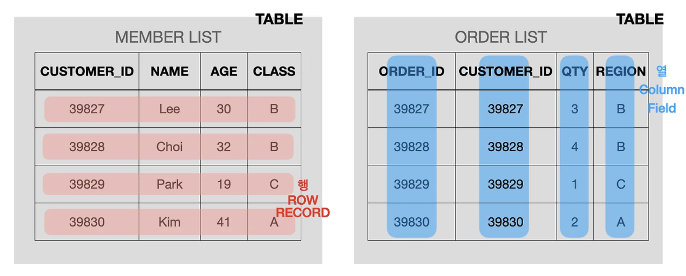

<a id="109eda9b0fe180cfac85dd3e6c1708af"></a>

## 문제

<a id="109eda9b0fe180da8fa2f6f91c3e6e5b"></a>

다음은 종합병원의 진료 예약정보를 담은 <code>APPOINTMENT</code> 테이블입니다&#46;

<a id="109eda9b0fe180109d79fac4587cb194"></a>

<code>APPOINTMENT</code> 테이블은 다음과 같으며 <code>APNT&#95;YMD</code>, <code>APNT&#95;NO</code>, <code>PT&#95;NO</code>, <code>MCDP&#95;CD</code>, <code>MDDR&#95;ID</code>, <code>APNT&#95;CNCL&#95;YN</code>, <code>APNT&#95;CNCL&#95;YMD</code>는 각각 <strong>진료예약일시</strong>, <strong>진료예약번호</strong>, <strong>환자번호</strong>, <strong>진료과코드</strong>, <strong>의사ID</strong>, <strong>예약취소여부</strong>, <strong>예약취소날짜</strong>를 나타냅니다&#46;

|  |  |  |
| --- | --- | --- |
| Column name | Type | Nullable |
| APNT&#95;YMD | TIMESTAMP | FALSE |
| APNT&#95;NO | NUMBER(5) | FALSE |
| PT&#95;NO | VARCHAR(10) | FALSE |
| MCDP&#95;CD | VARCHAR(6) | FALSE |
| MDDR&#95;ID | VARCHAR(10) | FALSE |
| APNT&#95;CNCL&#95;YN | VARCHAR(1) | TRUE |
| APNT&#95;CNCL&#95;YMD | DATE | TRUE |

---

<a id="109eda9b0fe180eab501e0215a9d80da"></a>

### 문제

<a id="35efeed694824bf48837dfdc4bdc6df8"></a>

<code>APPOINTMENT</code> 테이블에서 <strong>2022년 5월</strong>에 예약한 환자 수를 <strong>진료과 코드별로 조회</strong>하는 SQL문을 작성해주세요&#46;

<a id="ca55e201ce634d5481073f71ee3a4f81"></a>

이때, 컬럼명은 <code>&#39;진료과코드&#39;</code>, <code>&#39;5월예약건수&#39;</code>로 지정해주시고 결과는 진료과별 예약한 환자 수를 기준으로 <strong>오름차순 정렬</strong>하고, 예약한 환자 수가 같다면 <strong>진료과 코드를 기준</strong>으로 오름차순 정렬해주세요&#46;

---

<a id="893df64438124d5696bd26f8ca9f8b1d"></a>

### 예시

<a id="109eda9b0fe180008bbdee6bee5463fc"></a>

<code>APPOINTMENT</code> 테이블이 다음과 같을 때&#58;

|  |  |  |  |  |  |  |
| --- | --- | --- | --- | --- | --- | --- |
| APNT&#95;YMD | APNT&#95;NO | PT&#95;NO | MCDP&#95;CD | MDDR&#95;ID | APNT&#95;CNCL&#95;YN | APNT&#95;CNCL&#95;YMD |
| 2022&#45;04&#45;14 09&#58;30&#58;00&#46;000 | 47 | PT22000064 | GS | DR20170123 | N | NULL |
| 2022&#45;04&#45;15 10&#58;30&#58;00&#46;000 | 48 | PT22000065 | OB | DR20100231 | N | NULL |
| 2022&#45;05&#45;15 17&#58;30&#58;00&#46;000 | 49 | PT22000086 | OB | DR20100231 | N | NULL |
| 2022&#45;05&#45;18 10&#58;30&#58;00&#46;000 | 52 | PT22000019 | GS | DR20100039 | N | NULL |
| 2022&#45;05&#45;19 12&#58;00&#58;00&#46;000 | 53 | PT22000020 | FM | DR20010112 | N | NULL |
| 2022&#45;05&#45;22 08&#58;30&#58;00&#46;000 | 54 | PT22000021 | GS | DR20100039 | N | NULL |
| 2022&#45;05&#45;04 10&#58;30&#58;00&#46;000 | 56 | PT22000023 | FM | DR20090112 | N | NULL |
| 2022&#45;05&#45;14 15&#58;30&#58;00&#46;000 | 57 | PT22000074 | CS | DR20200012 | N | NULL |
| 2022&#45;05&#45;24 15&#58;30&#58;00&#46;000 | 58 | PT22000085 | CS | DR20200012 | N | NULL |
| 2022&#45;05&#45;28 10&#58;00&#58;00&#46;000 | 60 | PT22000092 | OS | DR20100031 | N | NULL |

<a id="1290386c21d142d8926b006086c5d34a"></a>

SQL을 실행하면 다음과 같이 출력되어야 합니다&#58;

|  |  |
| --- | --- |
| 진료과코드 | 5월예약건수 |
| OB | 1 |
| OS | 1 |
| CS | 2 |
| FM | 2 |
| GS | 2 |

<a id="6ef147e0b11d4205937db3f7903c958c"></a>

## 풀이 

<details>
<summary>문제 예시 데이터 </summary>

|  |  |  |  |  |  |  |
| --- | --- | --- | --- | --- | --- | --- |
| APNT&#95;YMD | APNT&#95;NO | PT&#95;NO | MCDP&#95;CD | MDDR&#95;ID | APNT&#95;CNCL&#95;YN | APNT&#95;CNCL&#95;YMD |
| 2022&#45;01&#45;03 13&#58;00&#58;00 | 1 | PT22000009 | CS | DR20090029 | N |  |
| 2022&#45;01&#45;13 09&#58;00&#58;00 | 3 | PT22000006 | CS | DR20090001 | N |  |
| 2022&#45;01&#45;13 09&#58;30&#58;00 | 4 | PT22000001 | CS | DR20090001 | N |  |
| 2022&#45;01&#45;13 13&#58;30&#58;00 | 5 | PT22000007 | CS | DR20090001 | Y | 2022&#45;01&#45;10 00&#58;00&#58;00 |
| 2022&#45;01&#45;13 15&#58;30&#58;00 | 6 | PT22000005 | CS | DR20090001 | Y | 2022&#45;01&#45;11 00&#58;00&#58;00 |
| 2022&#45;01&#45;03 11&#58;00&#58;00 | 7 | PT22000002 | NP | DR20100011 | N |  |
| 2022&#45;01&#45;03 11&#58;00&#58;00 | 8 | PT22000003 | OS | DR20090231 | N |  |
| 2022&#45;01&#45;22 08&#58;30&#58;00 | 9 | PT22000004 | NP | DR20100011 | N |  |
| 2022&#45;01&#45;29 15&#58;30&#58;00 | 10 | PT22000009 | CS | DR20090001 | Y | 2022&#45;01&#45;20 00&#58;00&#58;00 |
| 2022&#45;01&#45;29 10&#58;30&#58;00 | 11 | PT22000012 | FM | DR20090112 | N |  |
| 2022&#45;01&#45;29 15&#58;30&#58;00 | 12 | PT22000011 | FM | DR20190102 | N |  |
| 2022&#45;02&#45;01 15&#58;30&#58;00 | 13 | PT22000009 | CS | DR20200012 | N |  |
| 2022&#45;02&#45;13 11&#58;00&#58;00 | 14 | PT22000002 | NP | DR20100011 | N |  |
| 2022&#45;02&#45;23 11&#58;00&#58;00 | 15 | PT22000003 | OS | DR20090231 | N |  |
| 2022&#45;02&#45;14 09&#58;00&#58;00 | 16 | PT22000013 | CS | DR20090029 | N |  |
| 2022&#45;02&#45;14 09&#58;30&#58;00 | 17 | PT22000014 | GS | DR20170123 | N |  |
| 2022&#45;02&#45;05 10&#58;00&#58;00 | 18 | PT22000015 | OS | DR20150231 | N |  |
| 2022&#45;02&#45;05 17&#58;30&#58;00 | 19 | PT22000016 | OB | DR20160031 | N |  |
| 2022&#45;02&#45;13 12&#58;30&#58;00 | 20 | PT22000017 | DR | DR20160039 | Y | 2022&#45;02&#45;04 00&#58;00&#58;00 |
| 2022&#45;02&#45;13 11&#58;30&#58;00 | 21 | PT22000018 | GS | DR20100032 | Y | 2022&#45;02&#45;10 00&#58;00&#58;00 |
| 2022&#45;02&#45;13 10&#58;00&#58;00 | 22 | PT22000019 | GS | DR20100039 | N |  |
| 2022&#45;02&#45;13 12&#58;00&#58;00 | 23 | PT22000020 | FM | DR20010112 | N |  |
| 2022&#45;02&#45;22 08&#58;30&#58;00 | 24 | PT22000021 | GS | DR20100039 | N |  |
| 2022&#45;03&#45;23 15&#58;30&#58;00 | 25 | PT22000022 | FM | DR20100102 | Y | 2022&#45;03&#45;20 00&#58;00&#58;00 |
| 2022&#45;03&#45;24 10&#58;30&#58;00 | 26 | PT22000023 | FM | DR20090112 | N |  |
| 2022&#45;03&#45;24 15&#58;30&#58;00 | 27 | PT22000024 | CS | DR20200012 | N |  |
| 2022&#45;03&#45;24 15&#58;30&#58;00 | 28 | PT22000025 | CS | DR20200012 | N |  |
| 2022&#45;03&#45;30 11&#58;00&#58;00 | 29 | PT22000001 | OS | DR20100031 | N |  |
| 2022&#45;03&#45;29 10&#58;00&#58;00 | 30 | PT22000002 | OS | DR20100031 | N |  |
| 2022&#45;03&#45;03 09&#58;00&#58;00 | 31 | PT22000018 | CS | DR20090029 | N |  |
| 2022&#45;04&#45;13 15&#58;30&#58;00 | 43 | PT22000019 | CS | DR20200012 | N |  |
| 2022&#45;04&#45;04 11&#58;00&#58;00 | 44 | PT22000022 | NP | DR20100011 | N |  |
| 2022&#45;05&#45;18 10&#58;30&#58;00 | 52 | PT22000019 | GS | DR20100039 | N |  |
| 2022&#45;05&#45;19 12&#58;00&#58;00 | 53 | PT22000020 | FM | DR20010112 | N |  |
| 2022&#45;05&#45;22 08&#58;30&#58;00 | 54 | PT22000021 | GS | DR20100039 |  |  |
| 2022&#45;05&#45;23 15&#58;30&#58;00 | 55 | PT22000012 | FM | DR20100102 | Y | 2022&#45;05&#45;16 00&#58;00&#58;00 |
| 2022&#45;06&#45;03 09&#58;00&#58;00 | 63 | PT22000016 | CS | DR20090001 | N |  |
| 2022&#45;06&#45;23 09&#58;30&#58;00 | 64 | PT22000021 | CS | DR20190029 | N |  |
| 2022&#45;06&#45;23 11&#58;00&#58;00 | 67 | PT22000022 | NP | DR20100011 | N |  |
| 2022&#45;12&#45;30 12&#58;00&#58;00 | 119 | PT22000001 | OS | DR20100031 | N |  |
| 2022&#45;12&#45;29 11&#58;00&#58;00 | 120 | PT22000002 | OS | DR20100031 | N |  |

</details>

<a id="109eda9b0fe180b5bd67d9e01e2ede86"></a>

### 풀이1

<details>
<summary>🧐 예약이 취소가 된 경우를 제거</summary>

- 예약취소(<code>APNT&#95;CNCL&#95;YN &#33;= ‘Y</code>)’가 된 경우 필터링 

- 즉, <code>APNT&#95;CNCL&#95;YN</code>이 ‘<code>N</code>’ 또는 <code>NULL</code>인 경우

<a id="109eda9b0fe18028859ef3aa4fffdaab"></a>

```sql
AND APNT_CNCL_YN != 'Y'
```

</details>

<details>
<summary><strong>필드명 변경&#58; </strong><strong><code>필드 as 이름</code></strong></summary>

<a id="00dc8e67f3ce47a29188f44d4d1bcf90"></a>

```sql
SELECT MCDP_CD as 진료과코드
```

<a id="1ae119e1e7ad427f897b63ff58312a7d"></a>

위와 같이  기존 테이블의 필드명을 재할당 처리 가능

</details>

<details>
<summary>22년 5월 예약 건 수 조회</summary>

<a id="109eda9b0fe180829556c038570bb704"></a>

```sql
SELECT *
FROM 
    APPOINTMENT
WHERE 
    APNT_YMD >= '2022-05-01 00:00:00' 
    AND APNT_YMD < '2022-06-01 00:00:00';
```

- 조회 결과

|  |  |  |  |  |  |  |
| --- | --- | --- | --- | --- | --- | --- |
| APNT&#95;YMD | APNT&#95;NO | PT&#95;NO | MCDP&#95;CD | MDDR&#95;ID | APNT&#95;CNCL&#95;YN | APNT&#95;CNCL&#95;YMD |
| 2022&#45;05&#45;18 10&#58;30&#58;00 | 52 | PT22000019 | GS | DR20100039 | N |  |
| 2022&#45;05&#45;19 12&#58;00&#58;00 | 53 | PT22000020 | FM | DR20010112 | N |  |
| 2022&#45;05&#45;22 08&#58;30&#58;00 | 54 | PT22000021 | GS | DR20100039 |  |  |
| 2022&#45;05&#45;23 15&#58;30&#58;00 | 55 | PT22000012 | FM | DR20100102 | Y | 2022&#45;05&#45;16 00&#58;00&#58;00 |

</details>

<details>
<summary>그룹화&#58; <code>GROUP BY 필드</code></summary>

- 진료과 코드(<code>MCDP&#95;CD</code>) 필드를 기준으로  데이터를 그룹화

- <code>COUNT(&#42;)</code>&#58; 각 그룹에 포함된 레코드 수, 즉 예약 건수를 계산

<a id="fa67f5fc19fd430ba12138540d70b0d7"></a>

```sql
SELECT MCDP_CD as 진료과코드, COUNT(*) as 5월예약건수
FROM APPOINTMENT
GROUP BY MCDP_CD;
```

- 쿼리 실행 결과 
    |  |  |
    | --- | --- |
    | 진료과코드 | 5월예약건수 |
    | CS | 14 |
    | NP | 5 |
    | OS | 7 |
    | FM | 7 |
    | GS | 6 |
    | OB | 1 |
    | DR | 1 |

</details>

<details>
<summary>내림차순, 오름차순&#58; <code>ORDER BY 필드, …</code></summary>

- ORDER BY를 통해 해당하는 필드를 정렬함

- 기본값&#58; 오름차순(ASC)

- 앞에 오는 필드부터 정렬, 해당하는 필드의 값이 같을 시 그 다음 필드를 기준으로 정렬 

<details>
<summary><code>ORDER BY </code> 예시</summary>

<a id="10aeda9b0fe180ba9c5bc2e22b2a3c52"></a>

```sql
ORDER BY 5월예약건수 DESC, 진료과코드 ASC(기본값 생략가능)
```

- <strong><u>5월예약건수</u></strong>의 필드의 레코드들을 내림차순으로 정렬

- 만약 같은 값을 가지는 레코드들이 있다면 <br><strong><u>진료과코드</u></strong>의 레코드들을 오름차순으로 정렬 

</details>

</details>

<a id="35d52f98892c42878a1a4628fc6e9163"></a>

```sql
SELECT 
    MCDP_CD AS 진료과코드, 
    COUNT(PT_NO) AS 5월예약건수
FROM 
    APPOINTMENT
WHERE 
    APNT_YMD >= '2022-05-01 00:00:00' 
    AND APNT_YMD < '2022-06-01 00:00:00'
GROUP BY 
    MCDP_CD
ORDER BY 
    5월예약건수 ASC,
    진료과코드 ASC;
```

<a id="10aeda9b0fe18051ace6cd8d15851118"></a>

### 풀이2

<details>
<summary>🧐 취소된 예약 필터링 </summary>

- 취소된 예약(APNT&#95;CNCL&#95;YN = &#39;Y&#39;)은 제외하고 예약을 조회함

<a id="97a713a8dbd14363a2d9bffc552befd6"></a>

```sql
WHERE APNT_CNCL_YN != 'Y'
```

</details>

<details>
<summary><strong>필드명 변경&#58; </strong><strong><code>필드 as 이름</code></strong></summary>

<a id="10aeda9b0fe18034b84af16991ea1cd3"></a>

```sql
SELECT MCDP_CD as 진료과코드
```

<a id="edbd32db37094530a36119dc8f1c448a"></a>

위와 같이  기존 테이블의 필드명을 재할당 처리 가능

</details>

<details>
<summary>🧐 필드, 레코드 </summary>



</details>

<details>
<summary>필터링&#58; <code>WHERE 필드 LIKE 키워드</code></summary>

<a id="10aeda9b0fe18030ab62c3a062b7204b"></a>

```sql
WHERE APNT_YMD LIKE '2022-05%'
```

<a id="10aeda9b0fe180db9010d75d5d7e5f34"></a>

ANT&#95;YMD 필드의 레코드들을  해당 키워드로 ‘2022&#45;05%’ 필터링

</details>

<details>
<summary><strong>🧐 그룹화&#58; </strong><strong><code>GROUP BY</code></strong></summary>

-  데이터를 <strong><u>특정 컬럼의 값을 기준으로 그룹화</u></strong>할 때 사용되며<br>그룹화된 데이터에 대해 <strong><u>COUNT, SUM, AVG 등 집계 함수</u></strong>를 <strong>적용</strong>할 수 있다&#46;

- 주로 <strong><u>특정 컬럼의 값</u></strong>에 따라 <strong><u>데이터 집합을 묶</u></strong>고, <strong><u>각 그룹에 대한 집계 결과를 계산</u></strong>할 때 사용한다&#46;

<details>
<summary>ex) <br></summary>

<details>
<summary><strong>테이블 예시</strong></summary>

| APNT&#95;YMD | APNT&#95;NO | PT&#95;NO | MCDP&#95;CD | MDDR&#95;ID | APNT&#95;CNCL&#95;YN | APNT&#95;CNCL&#95;YMD |
| --- | --- | --- | --- | --- | --- | --- |
| 2022&#45;05&#45;18 10&#58;30&#58;00 | 52 | PT22000019 | GS | DR20100039 | N |  |
| 2022&#45;05&#45;19 12&#58;00&#58;00 | 53 | PT22000020 | FM | DR20010112 | N |  |
| 2022&#45;05&#45;22 08&#58;30&#58;00 | 54 | PT22000021 | GS | DR20100039 |  |  |
| 2022&#45;05&#45;23 15&#58;30&#58;00 | 55 | PT22000012 | FM | DR20100102 | Y | 2022&#45;05&#45;16 00&#58;00&#58;00 |

</details>

<details>
<summary><strong>SQL Query</strong></summary>

- <strong>취소되지 않은 예약</strong>(<code>APNT&#95;CNCL&#95;YN &#33;= &#39;Y&#39;</code>)만 필터링

- (GROUP BY MCDP&#95;CD), 각 그룹에 대해 예약 건수를 계산

<a id="10aeda9b0fe180daa56bf94df6dfde1e"></a>

```sql
SELECT MCDP_CD, COUNT(*) AS 예약건수
FROM APPOINTMENT
WHERE APNT_CNCL_YN != 'Y'
GROUP BY MCDP_CD;
```

</details>

<details>
<summary><strong>GROUP BY 결과 </strong></summary>

| MCDP&#95;CD | 예약건수 |
| --- | --- |
| FM | 1 |
| GS | 1 |

</details>

</details>

</details>

<details>
<summary>그룹화&#58; <code>GROUP BY 필드</code></summary>

- 진료과 코드(<code>MCDP&#95;CD</code>) 필드를 기준으로  데이터를 그룹화

- <code>COUNT(&#42;)</code>&#58; 각 그룹에 포함된 레코드 수, 즉 예약 건수를 계산

<a id="9d20ec5032bc4f309051348c38b000bd"></a>

```sql
SELECT MCDP_CD as 진료과코드, COUNT(*) as 5월예약건수
FROM APPOINTMENT
GROUP BY MCDP_CD;
```

- 쿼리 실행 결과 
    |  |  |
    | --- | --- |
    | 진료과코드 | 5월예약건수 |
    | CS | 14 |
    | NP | 5 |
    | OS | 7 |
    | FM | 7 |
    | GS | 6 |
    | OB | 1 |
    | DR | 1 |

</details>

<details>
<summary>내림차순, 오름차순&#58; <code>ORDER BY 필드, …</code></summary>

- ORDER BY를 통해 해당하는 필드를 정렬함

- 기본값&#58; 오름차순(ASC)

- 앞에 오는 필드부터 정렬, 해당하는 필드의 값이 같을 시 그 다음 필드를 기준으로 정렬 
    - ex) <code>ORDER BY 5월예약건수 DESC, 진료과코드 ASC(기본값 생략가능)</code>
        - <strong><u>5월예약건수</u></strong>의 필드의 레코드들을 내림차순으로 정렬

        - 만약 같은 값을 가지는 레코드들이 있다면 <br><strong><u>진료과코드</u></strong>의 레코드들을 오름차순으로 정렬 

</details>

<a id="10aeda9b0fe180ecb642dc778a05a207"></a>

```sql
SELECT MCDP_CD as 진료과코드, COUNT(*) as 5월예약건수
FROM APPOINTMENT
WHERE APNT_YMD LIKE '2022-05%'
GROUP BY MCDP_CD
ORDER BY 5월예약건수, 진료과코드
```
