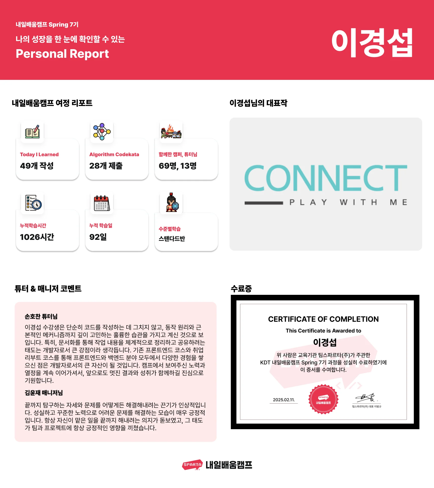
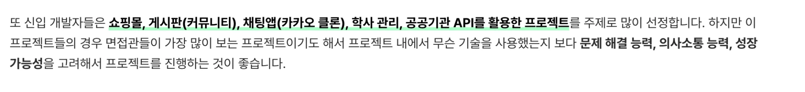

> /icons/push-pin_blue.svg 
> 
> 
> 
> <a href="https://beautiful-college-c84.notion.site/2906883519bf4b2d9c3c8122a8a24158?pvs=25">내일 배움 캠프 ( 백엔드 코스 7기 )</a>
> 
> > 기간&#58; 24&#46;09&#46;22(일) &#126; 25&#46;02&#46;12(화) 
> 
> 

> 
수료증

> 
> 
> 
> 

### 강의 정리 

[ERD 작성 연습해보기](#/post/130eda9b-0fe1-8000-a0b8-ef905010a267)

[엑셀보다 쉽고 빠른 SQL](#/post/108eda9b-0fe1-8075-8c0d-d40a042cccae)

[웹개발 종합반](#/post/108eda9b-0fe1-803f-ae2d-e5bad20dbb35)

<a href="#/post/1c3eda9b-0fe1-818f-97a3-c9faaae63332">페이지</a> 

[[sparta] 스프링 기초](#/post/12eeda9b-0fe1-8050-a68b-f51dffb05df2)

[[sparta] 스프링 숙련](#/post/13ceda9b-0fe1-8067-9531-e4fdae3568a2)

[[sparta] 스프링 심화](#/post/149eda9b-0fe1-8010-9b0f-dc35331888ed)

[[ sparta ] JPA 실무 스프링 백엔드 - 심화형](#/post/158eda9b-0fe1-8083-a08b-e1249279d10f)

<a href="#/post/1c3eda9b-0fe1-8156-b449-f8e742a95d76">페이지</a> 

<a href="#/post/1c3eda9b-0fe1-81b0-b5b3-cdd0065097a4">페이지</a> 

<a href="#/post/1c3eda9b-0fe1-8115-b158-c17d844ab16c">페이지</a> 

[[ sparta ] AWS](#/post/158eda9b-0fe1-80e4-9ed4-fbb6c1a12b3b)

[[ Inflearn ] 동시성 제어](#/post/165eda9b-0fe1-8072-b168-fab7f9ef1bfa)

### 프로젝트 

사전 캠프

[스파르타 백엔드 취업 설명회](#/post/6633c7fd-94cc-4012-83a9-0da5964b7be2)

[Spring 사전캠프 퀘스트 모음집](#/post/10aeda9b-0fe1-80df-a9e7-c0a68dc3edaa)

퀘스트 (추가 문제)

[1) SQL 문법 연습](#/post/10aeda9b-0fe1-80c3-9114-e5ad96c892b3)

 2)SQL 실전&#33; 실제 DB 적용

[Lv1. 데이터 속 김서방 찾기](#/post/fffeda9b-0fe1-813d-b065-c7b87dd945eb)

[Lv2. 날짜별 획득포인트 조회하기](#/post/fffeda9b-0fe1-814b-8292-f63287183fce)

[Lv3. 이용자의 포인트 조회하기](#/post/fffeda9b-0fe1-81bd-888a-c25ff6d2499d)

[Lv4. 단골 고객님 찾기](#/post/fffeda9b-0fe1-81a8-a86a-db1556ad5b70)

[Lv4. 가장 높은 월급을 받는 직원은?](#/post/fffeda9b-0fe1-8127-82d2-d3b05d34bef7)

[Lv5. 가장 많이 팔린 품목은?](#/post/fffeda9b-0fe1-8179-bfc7-ca54b0eabcf8)

[Lv5. 예산이 가장 큰 프로젝트는?](#/post/fffeda9b-0fe1-8109-a0b8-faf0a0d1cf29)

[1.  팀 페이지](#/post/112eda9b-0fe1-8033-8997-e02f022bee43)

[2. 계산기](#/post/119eda9b-0fe1-8087-a760-f65c0adf7471)

[3. 숫자 야구 게임](#/post/126eda9b-0fe1-8018-bac8-f61d440b8857)

[4. 일정 관리 앱 v1](#/post/12eeda9b-0fe1-80f4-a546-d62ca61b62ff)

[5.  일정 관리 앱 v2](#/post/13ceda9b-0fe1-8072-96ee-d0a057cf1a4b)

[6. 뉴스피드 프로젝트](#/post/143eda9b-0fe1-80d4-8d62-d2d05c226a9f)

[7. 통화 변환 앱](#/post/14aeda9b-0fe1-80fe-aa6c-d5d5adc42f01)

[8. 아웃소싱 프로젝트](#/post/14aeda9b-0fe1-80f2-a26e-d08048767e3b)

[9.  플러스 주차 개인 프로젝트](#/post/158eda9b-0fe1-80fa-96f1-eb2bd6377a5c)

[10.  Trello 프로젝트](#/post/165eda9b-0fe1-8012-bd01-cd9331c2dbdb)

[11.  최종 프로젝트](#/post/150eda9b-0fe1-80f6-a291-ebca5668faf2)

### 특강 정리

[Git  인텔리제이 사용법](#/post/14beda9b-0fe1-8009-a94e-f0eef884937b)

[학습법 특강](#/post/14beda9b-0fe1-8059-a49b-de8cd3c84cd6)

[연봉 1억 대기업 개발자 되는법](#/post/153eda9b-0fe1-80ae-8113-f9c35471b761)

[자바 컨벤션](#/post/129eda9b-0fe1-80a6-ba93-f275b2675991)

[객체지향 특강](#/post/123eda9b-0fe1-8098-8da3-f1ecce8c6ade)

[알고리즘 세션](#/post/13ceda9b-0fe1-803c-8c6b-f40279c5773b)

[알고리즘 심화 ( BFS, DFS )](#/post/13ceda9b-0fe1-8028-bb9f-e4ae777f8015)

[데이터베이스 특강 1](#/post/136eda9b-0fe1-80bd-929f-df3c6d2a949e)

[데이터베이스 특강 2 ( 정리 중 )](#/post/152eda9b-0fe1-807b-9fea-d50a10c7203e)

[특강 - 성능 최적화 1](#/post/15aeda9b-0fe1-8087-9e04-e68f43e8220a)

[특강 - 성능 최적화 2](#/post/15feda9b-0fe1-8026-b661-dfdd9ac49e7c)

[특강 - 테스코드 2](#/post/15eeda9b-0fe1-80cd-8c02-deb09f4b832e)

[특강 - 테스트 코드 3](#/post/168eda9b-0fe1-80ec-b88e-c9d14b9df668)

[CS 특강 - redis 특강](#/post/181eda9b-0fe1-8060-8ce0-deab3cee0b8c)

[CS 특강 - 동시성 제어](#/post/181eda9b-0fe1-8022-9a45-df4626ecb5bb)

[특강 - 인증/인가 HandlerInterceptor](#/post/158eda9b-0fe1-804a-a2e7-efe36de496cd)

---

보류

[CS 특강 - oop & 디자인 패턴 ( 정리 전 )](#/post/13ceda9b-0fe1-80bc-9f2a-f77cf3b45ca0)

[CS 특강 - 네트워크 ( 정리 중 )](#/post/14beda9b-0fe1-80c3-abfd-ffeac02d517a)

[특강 - 테스코드 1 ( 정리 중 )](#/post/15beda9b-0fe1-80d0-b9a2-c709c70e6e1b)

[CS 특강 - 배포 특강 ( 정리 전 )](#/post/16deda9b-0fe1-80c9-87d1-d995e9742aaf)

> 베이직

[1. 웹 기초](#/post/c7175dfc-5457-4815-b699-7567feea87aa)

[2. 스프링 - Controller](#/post/c788f2dd-ee0c-43c4-ab79-bc64c9d0eb95)

[3. 데이터베이스](#/post/9a084a4b-84c6-44c9-9b26-944626c61985)

[4. 데이터베이스 실습](#/post/421fc623-46ee-4693-9795-bb61ec6726a0)

[5. JPA](#/post/a879820e-6b13-4846-9a5e-85fb5f0cffac)

[6.  JPA 연관관계](#/post/73d2012f-547b-4cfa-b4fd-e7e73a54e34f)

[7. Session](#/post/150eda9b-0fe1-8088-a114-e6a1579d1b3c)

[8. DispatcherServlet](#/post/150eda9b-0fe1-804d-90ab-ee7e9e88f070)

> 스탠다드

[1. 실무 업무 진행 과정](#/post/135eda9b-0fe1-8003-9c3a-da02717e401b)

[2. API 명세서](#/post/135eda9b-0fe1-8072-89e3-d8253a413e2d)

[3. Git, Github](#/post/5b817dab-e648-4185-9c75-6a0cc78f3a05)

[6. 정규식 활용](#/post/143eda9b-0fe1-80c3-a2fa-d7e3eb17b9a3)

[8. 트랜잭션](#/post/14aeda9b-0fe1-8098-af4a-eaa929331ae4)

[12. MSA 와 API 통신](#/post/158eda9b-0fe1-8068-99ad-dc0ea50592ea)

> 챌린지

[1. 멀티스레딩 및 동시성 제어  ( 정리 전 )](#/post/135eda9b-0fe1-8050-95bf-fb452bd66649)

[2.  Spring Framework](#/post/142eda9b-0fe1-8070-8716-d371e3ece9d6)

[3. Spring, 톰캣 ( 정리 전 )](#/post/150eda9b-0fe1-8093-8881-d7a3f4fe2e9b)

[4. 성능 최적화  ( 정리 전 )](#/post/150eda9b-0fe1-802f-ab60-d52923e9ae38)

[클라우드, Docker ( 정리 중 )](#/post/21eeda9b-0fe1-8082-a6d0-e94a0ba58bfd)

---

보류

[4. Enum 실무 활용 ( feat. 람다 ) ( 정리 전 )](#/post/150eda9b-0fe1-80ab-82f5-c5061983497b)

[5. Interface와 Generic ( 정리 전 )](#/post/150eda9b-0fe1-8016-9ae8-d07c1f1c224c)

[7. 예외처리  ( 정리 중 )](#/post/146eda9b-0fe1-80c5-a5de-d63e7ce02d00)

[9. Optional ( 정리 전 )](#/post/150eda9b-0fe1-8019-8fb4-d5b5e58873f3)

[10. 테스트  ( 정리 전 )](#/post/151eda9b-0fe1-8039-81f9-ea1f002e9ed4)

[11. 로그와 모니터링  ( 정리 전 )](#/post/154eda9b-0fe1-80c7-9bbe-d3baf9e676bb)

[14 - 시큐리티 ( 정리 전 )](#/post/15feda9b-0fe1-8071-93a9-d17c740e2d4b)

[16. 대용량 트래픽 ( 정리 전 )](#/post/166eda9b-0fe1-80b9-9c2f-d14a90442c0f)

### 포스팅

[피드백](#/post/140eda9b-0fe1-8086-8056-d5d7e877745f)

[내일배움캠프 1on1 - 이경섭](#/post/11aeda9b-0fe1-80b0-95ec-d32083e518c5)

[TIL](#/post/10aeda9b-0fe1-8045-a8c4-f10918253453)

[데일리 스크럼](#/post/121eda9b-0fe1-803e-a623-d7581884b36b)

[To Do List](#/post/123eda9b-0fe1-800e-ab1a-e664218f399d)

[KPT 회고](#/post/117eda9b-0fe1-8069-990a-ca176f1b90d1)

[인텔리제이 - 여러줄 한번에 지정하기](#/post/159eda9b-0fe1-80bb-9406-eaecfcff7d13)

다짐

> 💬 
> 
> 

> 
다짐

> 
> 
> 
> 진짜 이 프로세스를 니가 직접 만든다면 수많은 시간과 비용이 들어가야 된다&#46;
> 
> 
> 
> 그런데 이렇게 무료로  참여해서 할 수 있다는 건 정말 니가 시대를 잘 태어나서 누리는 큰 행복이다&#46; 
> 
> 
> 
> 항상 이 점을 잊지말고 힘들거나 포기하고 싶으면 다시 이 글을 보고 마음을 다 잡아라 
> 
> 
> 
> ‘넌 너무 복에 겨운 일을 겪고 있다’ 리고 깨달아라
> 
> 
> 
> 고생했고 못할 수 있지만, 포기하지 않을 거고 결국 잘하게 될 거다&#46; 
> 
> 
> 
> 잊지말고 항상 최선을 다해라&#46;  화이팅이다&#33;
> 
> 

> 
> 

> 
공부 팁

> 
> [공부 효율 팁](#/post/117eda9b-0fe1-8013-9481-ea2b741f399a)
> 
> [질문을 통한 학습법 - 짐퀵](#/post/123eda9b-0fe1-80a0-bb6e-ff95afa60e73)
> 
> [빠르게 배우는 6가지 방법ㅣ짐퀵 |](#/post/123eda9b-0fe1-8059-9535-f6ffd114b294)
> 
> [공부하고 있다는 착각](#/post/123eda9b-0fe1-805e-8f02-d961a1e85d9c)
> 
> - <a href="https://www.youtube.com/shorts/AQb239W2FXE">픽셀 하나하나 조이는 작업을 해야 한다, 습관을 만들기 전까지는 체크리스트에 의존해라</a>
> 
> - <a href="https://www.youtube.com/shorts/218VrP4hiq0">GPT 사용 팁 &#45; 논문</a>
> 
> [천재들의 어려운 내용을 학습하는 방법(파인만 기법)](#/post/3d81a441-7d3b-4ba7-ae34-860263bf8c47)
> 
> [개발자 면접관이 중요하게 보는한 가지](#/post/148eda9b-0fe1-800e-ac45-c1ed36ece683)
> 
> 

### 문제 

[git 연습하기](#/post/128eda9b-0fe1-8072-9af0-d8a4a687b8b7)

[SQL 문제](#/post/108eda9b-0fe1-8062-a1dd-d109a93eca65)

[알고리즘 문제](#/post/108eda9b-0fe1-8012-8918-f965717c8fce)

### 커리어톤 &#45; 이력서 

Tip

[모의면접](#/post/17beda9b-0fe1-80f5-92c9-e857534b2a83)

[커리어 코칭](#/post/13deda9b-0fe1-80e6-b90b-d6c9e1b05367)

[커리어톤 설명](#/post/196eda9b-0fe1-8026-ba88-e37e0941dc1c)

[커리어톤 OT](#/post/197eda9b-0fe1-803c-9fbd-ff2df68bf23f)

[이력서 특강](#/post/198eda9b-0fe1-809f-9cb2-ea5932a9a14e)

### 추가

[HTTPS](#/post/175eda9b-0fe1-8080-9dbf-e67e9f4d0908)

[JVM, JRE, JDK](#/post/175eda9b-0fe1-8010-b263-cdb4a94a0244)

[SSE ( Server Sent Event )](#/post/168eda9b-0fe1-80f8-b856-f9957114c07e)
