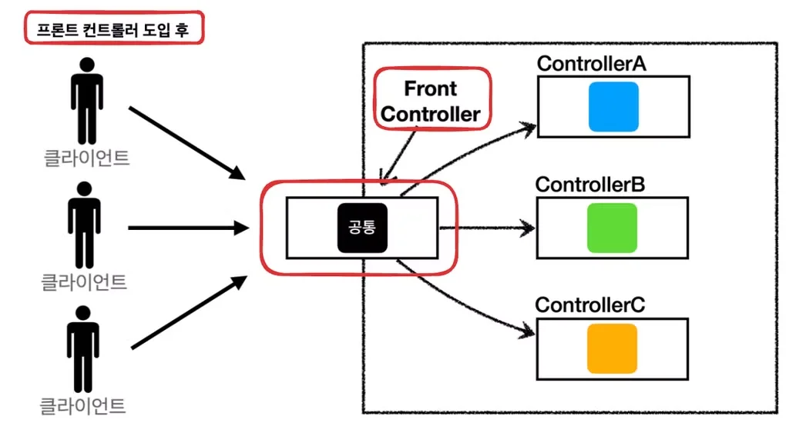

<details>
<summary>일반적으로 Thymeleaf 설정 파일에 기본 경로가 설정되어 있고, 해당 파일의 경로와 확장자가 추가된다&#46; </summary>

<a id="ccb32345bcfc4374a10618c2c2337d34"></a>

```java
spring.thymeleaf.prefix=classpath:/templates/
spring.thymeleaf.suffix=.html
```

<details>
<summary>ex)</summary>

<a id="34c0d468daad487a91131e63f61e96ca"></a>

```java
@Controller
public class MyController {
    @GetMapping("/example")
    public String example(Model model) {
        model.addAttribute("message", "Hello, Thymeleaf!");
        return "example"; // 반환된 뷰 이름
    }
}
```

<a id="a8c7322621a644ddb224cf57ef1be92e"></a>

위 메서드에서 반환된 뷰 이름인 ‘example’은 <code>classpath&#58;/templates/example&#46;html</code> 로 해석된다&#46; 

</details>

</details>

> 💡 
> 
> <a id="fffeda9b0fe181b397e8f899a452a41d"></a>
> 
> PDS 다이어리 참조

<a id="fffeda9b0fe1814691c0cab6addd0067"></a>

### PlAN ( 오늘 학습할 내용들 )

---

- [x] 오후 5시 30분  &#45; 매니저님 하고  1&#58;1  면담

- [x] JPA 활용1 &#45; ch7 웹 계층 개발 

- [ ] <del>SQL 강의 5주차 정리 및 학습하기  </del>

- [ ] <del>SQL 문제 풀기 ( 2 ) </del>

- [ ] <del>알고리즘 문제 풀기 (2 )</del>

<a id="fffeda9b0fe1811b93e9f81064c7200b"></a>

### DO 

---

- 1대1 면답 30분 정도 진행함 
    <a id="fffeda9b0fe1816b962cc798e501f0ed"></a>

    <a href="#/post/10eeda9b-0fe1-8041-9d23-d98ef81467fd">페이지</a> 

<details>
<summary>Spring MVC</summary>

<a id="10eeda9b0fe180359fadc457dbc423e8"></a>

Controller에서 thymeleaf를 통해 view 렌더링 로직 작성 중, 

<a id="10eeda9b0fe1800cb1e7db8c1f5ed507"></a>

내부 동작이 궁금하여 학습을 함

- 예전에 한번 정리 했었으나 그때는 자세히 이해를 하지 못해 다시 복습함&#46;
    > <a href="https://beautiful-college-c84.notion.site/2d9c8b83f9ec4f2b89a1df5d92d20a18">페이지</a>, <a href="https://beautiful-college-c84.notion.site/1b7f90570a2b4ef3bb0a1d3d8969c6c3">페이지</a> 

- 학습 내용
    <details>
    <summary>🧐 어떻게 model에 담은 객체들이 thymeleaf를 통해 뷰에 바인딩 될 수 있는가?</summary>

    

    - 사용자가 브라우저를 통해 HTTP GET 요청 메세지를 보내면, 스프링 MVC의 <code>DispaatcherServlet</code>이 해당 요청을 받아 <code>HandlerMapping</code>을 사용하여 <strong><u>요청 받은 url</u></strong>에 <u>매핑되는 Controller의 메서드를 찾는다&#46;</u>

    - 호출된 <code>Controller의 메서드</code>에서 <code>Model</code>에 <strong><u>데이터를 담</u></strong>고 <strong><u>뷰 이름을 반</u></strong>환한다&#46; 
        <a id="10eeda9b0fe18085a383c5f0f23a4298"></a>

        이때, Model에 담긴 데이터가 <strong><u>Thymeleaf에 전달</u></strong>된다&#46; 

    - 반환된 뷰 이름은 DispatcherServlet전달되고 DispatcherServlet은 <code>ViewResolver</code>를 사용하여 <strong><u>해당 이름의 뷰(예&#58; Thymeleaf 템플릿 파일)를 찾</u></strong>는다&#46; 
        <details>
        <summary>일반적으로 Thymeleaf 설정 파일에 기본 경로가 설정되어 있고, 해당 파일의 경로와 확장자가 추가된다&#46; </summary>

        <a id="7e0fce69da334ebb8a782bbce5e38e97"></a>

        ```java
        spring.thymeleaf.prefix=classpath:/templates/
        spring.thymeleaf.suffix=.html
        ```

        <details>
        <summary>ex)</summary>

        <a id="92676872910749fbb09e5b978f098424"></a>

        ```java
        @Controller
        public class MyController {
            @GetMapping("/example")
            public String example(Model model) {
                model.addAttribute("message", "Hello, Thymeleaf!");
                return "example"; // 반환된 뷰 이름
            }
        }
        ```

        <a id="49e24611200a4c59b744f7efd9a8206b"></a>

        위 메서드에서 반환된 뷰 이름인 ‘example’은 <code>classpath&#58;/templates/example&#46;html</code> 로 해석된다&#46; 

        </details>

        </details>

    - <code>ViewResolver</code>가 적절한 Thymeleaf 뷰를 찾으면, 해당 템블릿을 <code>ThymeleafView</code>가 처리한다&#46; 
        - ViewResolver가 Thymeleaf 템플릿 파일을 찾아야 할 때, 하위 구현체인 <code>ThymeleafViewResolver</code>를 호출한다&#46; 

    - 이때 Model에 담긴 데이터가 Thymeleaf에 전달되며 Thymeleaf 엔진은 해당 데이터를 사용해 템플릿에 동적으로 바인딩하여 렌더링 후, DispatcherServlet 전달하며 이를, HTTP 응답 메세지에 담아 보낸다&#46; 

    </details>

    <details>
    <summary>dispatcherServlet은 <code>프론트 컨트롤러 패턴</code>을 통해 구현되었다&#46; </summary>

    

    <a id="10eeda9b0fe180839187cade37f26917"></a>

    아래는 프론터 컨트롤러 패턴을 사용하여 간단하게 하나의 서블릿으로 컨트롤러를 처리하는 예시이다&#46; 

    <a id="10eeda9b0fe180f7ac0cfca87f770f73"></a>

    ```java
    @WebServlet(name = "frontControllerServletV1", urlPatterns = "/front-controller/v1/*")
    public class FrontControllerServletV1 extends HttpServlet {

        private Map<String, ControllerV1> controllerMap = new HashMap<>();

        public FrontControllerServletV1()  {
            controllerMap.put("/front-controller/v1/members/new-form", new MemberFormControllerV1());
            controllerMap.put("/front-controller/v1/members/save", new MemberSaveControllerv1());
            controllerMap.put("/front-controller/v1/members", new MemberListControllerV1());
        }

        @Override
        protected void service(HttpServletRequest request, HttpServletResponse response) throws ServletException, IOException {

            System.out.println("FrontControllerServletV1.service");
            String requestURI = request.getRequestURI();

            ControllerV1 controller = controllerMap.get(requestURI);

            if (controller == null){
                response.setStatus(HttpServletResponse.SC_NOT_FOUND);
                return;
            }

            controller.process(request, response);
        }
    }
    ```

    <a id="10eeda9b0fe1805d8cdec37c9f649e6d"></a>

    이와 같이 dispatcherServlet은 프론트 컨트롤러 패턴으로 구현되어 요청받은 url을 하나의 서블릿으로 처리하여 컨트롤러를 호출하여 효율적으로 url에 맞는 컨트롤러 매서드를 매핑시킨다&#46; <br>

    </details>

    <details>
    <summary>🧐 ThymeleafViewResolver(viewResolver)는 어떻게 Thymeleaf 템플릿 파일 찾는가?</summary>

    <details>
    <summary>&#91; 코드 &#93; ThymeleafViewResolver (주석 제거 )</summary>

    <a id="11e055e04c634cbfab00a6e53a23e8c4"></a>

    ```java
    public class ThymeleafViewResolver
         extends AbstractCachingViewResolver
            implements Ordered {
            
        private static final Logger vrlogger = LoggerFactory.getLogger(org.thymeleaf.spring6.view.ThymeleafViewResolver.class);


        public static final String REDIRECT_URL_PREFIX = "redirect:";


        public static final String FORWARD_URL_PREFIX = "forward:";

        private boolean redirectContextRelative = true;
        private boolean redirectHttp10Compatible = true;

        private boolean alwaysProcessRedirectAndForward = true;

        private boolean producePartialOutputWhileProcessing = AbstractThymeleafView.DEFAULT_PRODUCE_PARTIAL_OUTPUT_WHILE_PROCESSING;

        private Class<? extends AbstractThymeleafView> viewClass = ThymeleafView.class;
        private String[] viewNames = null;
        private String[] excludedViewNames = null;
        private int order = Integer.MAX_VALUE;


        private final Map<String, Object> staticVariables = new LinkedHashMap<String, Object>(10);
        private String contentType = null;
        private boolean forceContentType = false;
        private String characterEncoding = null;

        private ISpringTemplateEngine templateEngine;


        public ThymeleafViewResolver() {
            super();
        }
        
        public void setViewClass(final Class<? extends AbstractThymeleafView> viewClass) {
            if (viewClass == null || !AbstractThymeleafView.class.isAssignableFrom(viewClass)) {
                throw new IllegalArgumentException(
                        "Given view class [" + (viewClass != null ? viewClass.getName() : null) +
                                "] is not of type [" + AbstractThymeleafView.class.getName() + "]");
            }
            this.viewClass = viewClass;
        }


        protected Class<? extends AbstractThymeleafView> getViewClass() {
            return this.viewClass;
        }


        public ISpringTemplateEngine getTemplateEngine() {
            return this.templateEngine;
        }


        public void setTemplateEngine(final ISpringTemplateEngine templateEngine) {
            this.templateEngine = templateEngine;
        }


        public Map<String,Object> getStaticVariables() {
            return Collections.unmodifiableMap(this.staticVariables);
        }


        public void addStaticVariable(final String name, final Object value) {
            this.staticVariables.put(name, value);
        }


        public void setStaticVariables(final Map<String, ?> variables) {
            if (variables != null) {
                for (final Map.Entry<String, ?> entry : variables.entrySet()) {
                    addStaticVariable(entry.getKey(), entry.getValue());
                }
            }
        }


        public void setOrder(final int order) {
            this.order = order;
        }


        public int getOrder() {
            return this.order;
        }


        public void setContentType(final String contentType) {
            this.contentType = contentType;
        }


        public String getContentType() {
            return this.contentType;
        }


        public boolean getForceContentType() {
            return this.forceContentType;
        }


        public void setForceContentType(final boolean forceContentType) {
            this.forceContentType = forceContentType;
        }


        public void setCharacterEncoding(final String characterEncoding) {
            this.characterEncoding = characterEncoding;
        }


        public String getCharacterEncoding() {
            return this.characterEncoding;
        }


        public void setRedirectContextRelative(final boolean redirectContextRelative) {
            this.redirectContextRelative = redirectContextRelative;
        }


        public boolean isRedirectContextRelative() {
            return this.redirectContextRelative;
        }
        
        public void setRedirectHttp10Compatible(final boolean redirectHttp10Compatible) {
            this.redirectHttp10Compatible = redirectHttp10Compatible;
        }


        public boolean isRedirectHttp10Compatible() {
            return this.redirectHttp10Compatible;
        }


        public void setAlwaysProcessRedirectAndForward(final boolean alwaysProcessRedirectAndForward) {
            this.alwaysProcessRedirectAndForward = alwaysProcessRedirectAndForward;
        }


        public boolean getAlwaysProcessRedirectAndForward() {
            return this.alwaysProcessRedirectAndForward;
        }


        public boolean getProducePartialOutputWhileProcessing() {
            return this.producePartialOutputWhileProcessing;
        }


        public void setProducePartialOutputWhileProcessing(final boolean producePartialOutputWhileProcessing) {
            this.producePartialOutputWhileProcessing = producePartialOutputWhileProcessing;
        }


        public void setViewNames(final String[] viewNames) {
            this.viewNames = viewNames;
        }


        public String[] getViewNames() {
            return this.viewNames;
        }


        public void setExcludedViewNames(final String[] excludedViewNames) {
            this.excludedViewNames = excludedViewNames;
        }


        public String[] getExcludedViewNames() {
            return this.excludedViewNames;
        }


        protected boolean canHandle(final String viewName, @SuppressWarnings("unused") final Locale locale) {
            final String[] viewNamesToBeProcessed = getViewNames();
            final String[] viewNamesNotToBeProcessed = getExcludedViewNames();
            return ((viewNamesToBeProcessed == null || PatternMatchUtils.simpleMatch(viewNamesToBeProcessed, viewName)) &&
                    (viewNamesNotToBeProcessed == null || !PatternMatchUtils.simpleMatch(viewNamesNotToBeProcessed, viewName)));
        }
        
        
        @Override
        protected View createView(final String viewName, final Locale locale) throws Exception {
            if (!this.alwaysProcessRedirectAndForward && !canHandle(viewName, locale)) {
                vrlogger.trace("[THYMELEAF] View \"{}\" cannot be handled by ThymeleafViewResolver. Passing on to the next resolver in the chain.", viewName);
                return null;
            }
            if (viewName.startsWith(REDIRECT_URL_PREFIX)) {
                vrlogger.trace("[THYMELEAF] View \"{}\" is a redirect, and will not be handled directly by ThymeleafViewResolver.", viewName);
                final String redirectUrl = viewName.substring(REDIRECT_URL_PREFIX.length(), viewName.length());
                final RedirectView view = new RedirectView(redirectUrl, isRedirectContextRelative(), isRedirectHttp10Compatible());
                return (View) getApplicationContext().getAutowireCapableBeanFactory().initializeBean(view, REDIRECT_URL_PREFIX);
            }
            if (viewName.startsWith(FORWARD_URL_PREFIX)) {
                vrlogger.trace("[THYMELEAF] View \"{}\" is a forward, and will not be handled directly by ThymeleafViewResolver.", viewName);
                final String forwardUrl = viewName.substring(FORWARD_URL_PREFIX.length(), viewName.length());
                return new InternalResourceView(forwardUrl);
            }
            if (this.alwaysProcessRedirectAndForward && !canHandle(viewName, locale)) {
                vrlogger.trace("[THYMELEAF] View \"{}\" cannot be handled by ThymeleafViewResolver. Passing on to the next resolver in the chain.", viewName);
                return null;
            }
            vrlogger.trace("[THYMELEAF] View {} will be handled by ThymeleafViewResolver and a " +
                    "{} instance will be created for it", viewName, getViewClass().getSimpleName());
            return loadView(viewName, locale);
        }
    	
    // 너무 기니까 인식이 안됨...
    ```

    <a id="ab90b9030e6f466f9beee74e314b03f2"></a>

    ```java
        @Override
        protected View loadView(final String viewName, final Locale locale) throws Exception {

            final AutowireCapableBeanFactory beanFactory = getApplicationContext().getAutowireCapableBeanFactory();

            final boolean viewBeanExists = beanFactory.containsBean(viewName);
            final Class<?> viewBeanType = viewBeanExists? beanFactory.getType(viewName) : null;

            final AbstractThymeleafView view;
            if (viewBeanExists && viewBeanType != null && AbstractThymeleafView.class.isAssignableFrom(viewBeanType)) {

                final BeanDefinition viewBeanDefinition =
                        (beanFactory instanceof ConfigurableListableBeanFactory ?
                                ((ConfigurableListableBeanFactory)beanFactory).getBeanDefinition(viewName) :
                                null);

                if (viewBeanDefinition == null || !viewBeanDefinition.isPrototype()) {
                    final AbstractThymeleafView viewInstance = BeanUtils.instantiateClass(getViewClass());
                    view = (AbstractThymeleafView) beanFactory.configureBean(viewInstance, viewName);
                } else {
                    view = (AbstractThymeleafView) beanFactory.getBean(viewName);
                }

            } else {

                final AbstractThymeleafView viewInstance = BeanUtils.instantiateClass(getViewClass());

                if (viewBeanExists && viewBeanType == null) {

                    beanFactory.autowireBeanProperties(viewInstance, AutowireCapableBeanFactory.AUTOWIRE_NO, false);
                    beanFactory.applyBeanPropertyValues(viewInstance, viewName);
                    view = (AbstractThymeleafView) beanFactory.initializeBean(viewInstance, viewName);

                } else {

                    beanFactory.autowireBeanProperties(viewInstance, AutowireCapableBeanFactory.AUTOWIRE_NO, false);
                    view = (AbstractThymeleafView) beanFactory.initializeBean(viewInstance, viewName);

                }

            }

            view.setTemplateEngine(getTemplateEngine());
            view.setStaticVariables(getStaticVariables());


            if (view.getTemplateName() == null) {
                view.setTemplateName(viewName);
            }

            if (!view.isForceContentTypeSet()) {
                view.setForceContentType(getForceContentType());
            }
            if (!view.isContentTypeSet() && getContentType() != null) {
                view.setContentType(getContentType());
            }
            if (view.getLocale() == null && locale != null) {
                view.setLocale(locale);
            }
            if (view.getCharacterEncoding() == null && getCharacterEncoding() != null) {
                view.setCharacterEncoding(getCharacterEncoding());
            }
            if (!view.isProducePartialOutputWhileProcessingSet()) {
                view.setProducePartialOutputWhileProcessing(getProducePartialOutputWhileProcessing());
            }

            return view;

        }

    }
    ```

    </details>

    ---

    <details>
    <summary>1&#46; <strong><code>createView()</code></strong><strong>&#58; 뷰 이름 확인 및 처리</strong></summary>

    <details>
    <summary><strong>&#91; 코드 &#93; creatView()</strong></summary>

    <a id="10eeda9b0fe1808bac77d012b2d1a832"></a>

    ```java
    @Override
    protected View createView(final String viewName, final Locale locale) throws Exception {
        // First possible call to check "viewNames": before processing redirects and forwards
        if (!this.alwaysProcessRedirectAndForward && !canHandle(viewName, locale)) {
            vrlogger.trace("[THYMELEAF] View \"{}\" cannot be handled by ThymeleafViewResolver. Passing on to the next resolver in the chain.", viewName);
            return null;
        }
        // Process redirects (HTTP redirects)
        if (viewName.startsWith(REDIRECT_URL_PREFIX)) {
            vrlogger.trace("[THYMELEAF] View \"{}\" is a redirect, and will not be handled directly by ThymeleafViewResolver.", viewName);
            final String redirectUrl = viewName.substring(REDIRECT_URL_PREFIX.length(), viewName.length());
            final RedirectView view = new RedirectView(redirectUrl, isRedirectContextRelative(), isRedirectHttp10Compatible());
            return (View) getApplicationContext().getAutowireCapableBeanFactory().initializeBean(view, REDIRECT_URL_PREFIX);
        }
        // Process forwards (to JSP resources)
        if (viewName.startsWith(FORWARD_URL_PREFIX)) {
            // The "forward:" prefix will actually create a Servlet/JSP view, and that's precisely its aim per the Spring
            // documentation. See http://docs.spring.io/spring-framework/docs/4.2.4.RELEASE/spring-framework-reference/html/mvc.html#mvc-redirecting-forward-prefix
            vrlogger.trace("[THYMELEAF] View \"{}\" is a forward, and will not be handled directly by ThymeleafViewResolver.", viewName);
            final String forwardUrl = viewName.substring(FORWARD_URL_PREFIX.length(), viewName.length());
            return new InternalResourceView(forwardUrl);
        }
        // Second possible call to check "viewNames": after processing redirects and forwards
        if (this.alwaysProcessRedirectAndForward && !canHandle(viewName, locale)) {
            vrlogger.trace("[THYMELEAF] View \"{}\" cannot be handled by ThymeleafViewResolver. Passing on to the next resolver in the chain.", viewName);
            return null;
        }
        vrlogger.trace("[THYMELEAF] View {} will be handled by ThymeleafViewResolver and a " +
                        "{} instance will be created for it", viewName, getViewClass().getSimpleName());
        return loadView(viewName, locale);
    }
    ```

    </details>

    <a id="017ba66059054daaa203bbc095246af8"></a>

    ThymeleafViewResolver는 <strong>뷰 이름</strong>을 받아서 그에 해당하는 <strong>View 객체</strong>를 반환한다 

    <a id="10eeda9b0fe180979495cff59331168f"></a>

    즉, createView() 메소드는 다음과 같은 역할을 한다&#46;

    - <strong>리다이렉트</strong> or <strong>포워드 요청</strong> 처리
        - 뷰 이름이 redirect&#58; 또는 forward&#58;로 시작하는지 확인

        - 만약 redirect&#58;로 시작하면, RedirectView를 생성해 반환

        - 만약 forward&#58;로 시작하면, InternalResourceView를 반환&#46;

    - <strong>뷰 이름에 해당하는 템플릿을 처리할 수 있는지 확인</strong>
        - canHandle() 메소드로 뷰 이름을 처리할 수 있는지 확인

    - <strong>뷰를 직접 처리해야 하는 경우</strong>
        - 위 두 가지가 아닌 경우에는, 실제로 loadView() 메소드를 호출해 템플릿 파일을 찾아 뷰를 로드

    <a id="8fb4d0e76c9847aba4a7632b3ad0b212"></a>

    ```java
    @Override
    protected View createView(final String viewName, final Locale locale) throws Exception {
        if (!this.alwaysProcessRedirectAndForward && !canHandle(viewName, locale)) {
            return null; // Thymeleaf가 이 뷰를 처리하지 않음
        }
        // redirect: 또는 forward: 처리
        if (viewName.startsWith(REDIRECT_URL_PREFIX)) {
            // RedirectView 처리
            ...
        }
        if (viewName.startsWith(FORWARD_URL_PREFIX)) {
            // InternalResourceView 처리
            ...
        }
        return loadView(viewName, locale); // Thymeleaf 템플릿을 찾고 뷰를 로드
    }
    ```

    </details>

    <details>
    <summary>2&#46; <strong><code>loadView()</code></strong><strong>&#58; 실제 뷰 로드</strong></summary>

    <details>
    <summary>&#91; 코드 &#93; loadView()</summary>

    <a id="10eeda9b0fe18041b93cef961537b137"></a>

    ```java
    @Override
    protected View loadView(final String viewName, final Locale locale) throws Exception {

        final AutowireCapableBeanFactory beanFactory = getApplicationContext().getAutowireCapableBeanFactory();

        final boolean viewBeanExists = beanFactory.containsBean(viewName);
        final Class<?> viewBeanType = viewBeanExists? beanFactory.getType(viewName) : null;

        final AbstractThymeleafView view;
        if (viewBeanExists && viewBeanType != null && AbstractThymeleafView.class.isAssignableFrom(viewBeanType)) {
           
            final BeanDefinition viewBeanDefinition =
                    (beanFactory instanceof ConfigurableListableBeanFactory ?
                            ((ConfigurableListableBeanFactory)beanFactory).getBeanDefinition(viewName) :
                            null);

            if (viewBeanDefinition == null || !viewBeanDefinition.isPrototype()) {

                final AbstractThymeleafView viewInstance = BeanUtils.instantiateClass(getViewClass());
                view = (AbstractThymeleafView) beanFactory.configureBean(viewInstance, viewName);
            } else {
                
                view = (AbstractThymeleafView) beanFactory.getBean(viewName);
            }

        } else {

            final AbstractThymeleafView viewInstance = BeanUtils.instantiateClass(getViewClass());

            if (viewBeanExists && viewBeanType == null) {
                
                beanFactory.autowireBeanProperties(viewInstance, AutowireCapableBeanFactory.AUTOWIRE_NO, false);
                
                beanFactory.applyBeanPropertyValues(viewInstance, viewName);
                
                view = (AbstractThymeleafView) beanFactory.initializeBean(viewInstance, viewName);

            } else {
                
                beanFactory.autowireBeanProperties(viewInstance, AutowireCapableBeanFactory.AUTOWIRE_NO, false);
                
                view = (AbstractThymeleafView) beanFactory.initializeBean(viewInstance, viewName);

            }

        }

        view.setTemplateEngine(getTemplateEngine());
        view.setStaticVariables(getStaticVariables());


        
        if (view.getTemplateName() == null) {
            view.setTemplateName(viewName);
        }

        if (!view.isForceContentTypeSet()) {
            view.setForceContentType(getForceContentType());
        }
        if (!view.isContentTypeSet() && getContentType() != null) {
            view.setContentType(getContentType());
        }
        if (view.getLocale() == null && locale != null) {
            view.setLocale(locale);
        }
        if (view.getCharacterEncoding() == null && getCharacterEncoding() != null) {
            view.setCharacterEncoding(getCharacterEncoding());
        }
        if (!view.isProducePartialOutputWhileProcessingSet()) {
            view.setProducePartialOutputWhileProcessing(getProducePartialOutputWhileProcessing());
        }

        return view;

    }
    ```

    </details>

    > Thymeleaf 템플릿 파일을 로드하고, 템플릿 엔진에 전달할 ThymeleafView<strong> 객체</strong>를 생성한다&#46;

    <a id="6f8c14f5adc74cf0899735ba30ab3d2a"></a>

    템플릿 파일을 찾는 방식은 크게 두 가지이다&#46; 

    - 1&#46; <strong>뷰 이름에 해당하는 빈(Bean)이 있는 경우</strong>
        - 스프링의 빈 팩토리에서 뷰 이름과 일치하는 빈을 찾고, 그 빈이 Thymeleaf 뷰인지 확인

        - 일치하는 경우 해당 빈을 사용해 뷰를 설정

    - 2&#46; <strong>뷰 이름에 해당하는 빈이 없는 경우</strong>
        - viewClass(기본적으로 ThymeleafView&#46;class)로 새로운 뷰 객체를 생성, 이를 빈 팩토리에서 초기화

        - 이후, 이 뷰 객체에 <strong>템플릿 엔진</strong>과 <strong>정적 변수</strong> 등을 설정하고, 최종적으로 템플릿 이름을 설정

    <a id="919af0d4547c4a9b8482e8fe40a4da8b"></a>

    ```java
    @Override
    protected View loadView(final String viewName, final Locale locale) throws Exception {
        // 스프링 빈 팩토리에서 뷰 이름과 일치하는 빈이 있는지 확인
        final boolean viewBeanExists = beanFactory.containsBean(viewName);

        final AbstractThymeleafView view;
        if (viewBeanExists && viewBeanType != null && AbstractThymeleafView.class.isAssignableFrom(viewBeanType)) {
            view = (AbstractThymeleafView) beanFactory.getBean(viewName);
        } else {
            // 새 뷰 객체 생성
            view = BeanUtils.instantiateClass(getViewClass());
            beanFactory.autowireBeanProperties(view, AutowireCapableBeanFactory.AUTOWIRE_NO, false);
            beanFactory.initializeBean(view, viewName);
        }

        // 템플릿 엔진 설정
        view.setTemplateEngine(getTemplateEngine());
        view.setTemplateName(viewName); // 템플릿 파일 이름 설정 (viewName에 해당)

        return view; // Thymeleaf 뷰 객체 반환
    }
    ```

    </details>

    <details>
    <summary>3&#46; 템플릿 찾는 과정</summary>

    <a id="4cd629662f1c4023be7e6959340da75d"></a>

    <code>view&#46;setTemplateName(viewName)</code> 부분에서 <strong><u>뷰 이름</u></strong>을 템플릿 파일 이름으로 사용하며

    <a id="9dbf076e0cea41e9aaae86487aac5ecf"></a>

    Thymeleaf 템플릿 엔진은 기본적으로 설정된 <strong>템플릿 경로</strong>와 뷰 이름을 조합하여 템플릿 파일을 찾는다&#46; 

    - 예를 들어, 뷰 이름이 <code>home</code>이면 ThymeleafViewResolver는 기본적으로 <code>/templates/home&#46;html</code>이라는 템플릿 파일을 찾는다&#46;

    - 이 경로는 보통 ThymeleafViewResolver<strong>의 </strong>prefix<strong>와 </strong>suffix<strong> 속성</strong>에 의해 결정된다&#46; 

    - 예를 들어, prefix가 /templates/이고 suffix가 &#46;html로 설정되어 있으면, home이라는 뷰 이름은 /templates/home&#46;html 템플릿 파일을 가리킨다&#46; 
        <a id="5a8194b01710498482fec35861f4b70d"></a>

        ```java
        @Bean
        public ViewResolver thymeleafViewResolver() {
            ThymeleafViewResolver resolver = new ThymeleafViewResolver();
            resolver.setTemplateEngine(templateEngine()); // 템플릿 엔진 설정
            resolver.setPrefix("/templates/");
            resolver.setSuffix(".html");
            return resolver;
        }
        ```

    </details>

    </details>

    <details>
    <summary>ch7 &#45; 웹 계층 주문 도메인 개발 </summary>

    > <a href="https://beautiful-college-c84.notion.site/2d9c8b83f9ec4f2b89a1df5d92d20a18">페이지</a> 

    - 상품 주문

    - 상품 주문 검색

    - 주문 취소

    <a id="10eeda9b0fe180c58f22c95e992ff0b2"></a>

    github, notion 정리 완

    </details>

</details>

<a id="fffeda9b0fe181ad9134e9f607efd9dc"></a>

### SEE ( 피드백 )

---

- 늦잠 잠… 오전 날라감…

- 중간에 의문점들이 너무 많아서 딴길로 많이 샘… 그래도 복습도 하는 좋은 시간이었음

- <del>내일 바삐 움직여야 된다&#46;&#46;  ⇒ 컨디션이 않좋아서 잠만 잠… —&#62; 그래도 운동은 했음</del>
    - <del>SQL 강의 5주차</del>

    - <del>SQL 문제 </del>

    - <del>알고리즘 문제</del>
