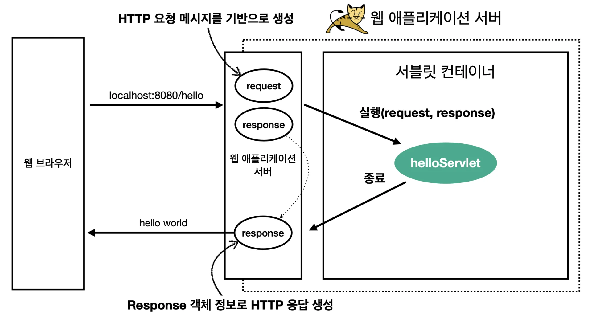
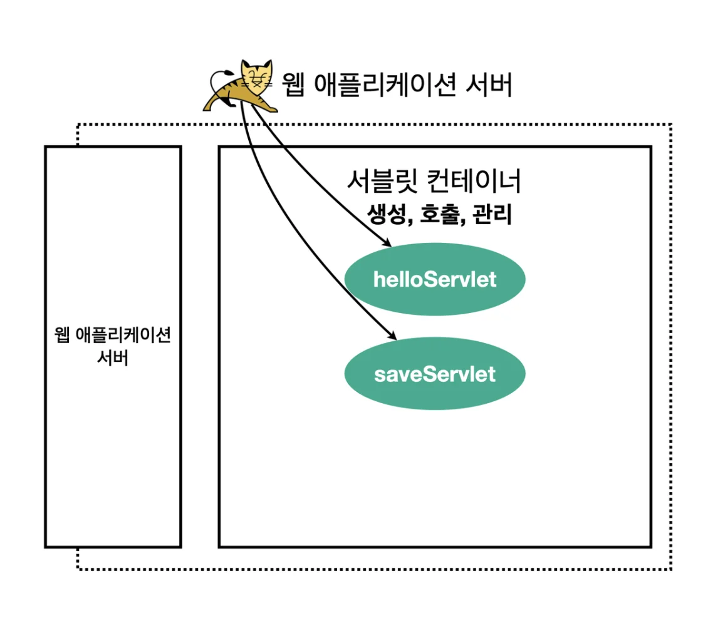

> 내일배움캠프 스프링 7기 1주차 &#45; 1일(월) 

<a id="111eda9b0fe1801c89a9f8b4a60b8f5c"></a>

오늘은 본 캠프 첫주차이다&#46; 

<a id="111eda9b0fe180b7b90dd7ba63216b80"></a>

너무 오랜만에 프론트를 다뤄 봐서 익숙해 지는데, 시간이 걸렸다&#46;

<a id="111eda9b0fe180b7b0c9c9c3003155cc"></a>

특히 intellij 만 쓰다가 vscode를 너무 오랜만에 사용해 봐서 단축키 때문에 고생 좀 했다&#46; 

<a id="111eda9b0fe180dc9979edc3cc231d29"></a>

공부할게 참 많은데, 여기에다가 시간을 쏟는게 참… 너무 아깝기도하고 아쉽기도 하다&#46;

<a id="111eda9b0fe180209294d9335c9e8096"></a>

그래도 나름 재밌게 오랜만에 css 가지고 놀아봤다&#46; 나쁘지 않았음

<a id="111eda9b0fe180ec8a28ebcae5ee2ce1"></a>

학습이 끝나고 씻고나서 추가 학습 진행함  ( 22시  &#126; 24시 )

- 전에 학습할 떄는 잘 이해가 안 됐는데, 이번에는 확실히 이해함

- 주기적으로 복습  및 재정리 필요

<a id="111eda9b0fe180108bcfdb7a0f95c1b6"></a>

### 학습내용

---

<details>
<summary><strong>jquery 문법</strong></summary>

- 선택자 = <code>document&#46;getElement&#46;&#46;&#46;()</code>
    - <strong>ID 선택</strong>&#58; <code>&#36;(&#39;&#35;id&#39;)</code>

    - <strong>클래스 선택</strong>&#58; <code>&#36;(&#39;&#46;class&#39;)</code>

    - <strong>태그 선택</strong>&#58; <code>&#36;(&#39;tag&#39;)</code>

    - <strong>속성 선택</strong>&#58; <code>&#36;(&#39;&#91;attribute=&#34;value&#34;&#93;&#39;)</code><br>

- 메서드 
    - &#46;<code>val()</code>&#58; 해당하는 요소의 value 값 가져옴, form 데이터에서 입력값을 가져올 때 사용

    - <code>&#46;text()</code>&#58; 요소의 텍스트를 가져오거나 설정합니다&#46;

    - <code>&#46;html()</code>&#58; 요소의 HTML 내용을 가져오거나 설정합니다&#46;

    - <code>&#46;css()</code>&#58; CSS 속성을 가져오거나 설정합니다&#46;

    - <code>&#46;attr()</code>&#58; 속성을 가져오거나 설정합니다&#46;

    - <code>&#46;addClass()</code><strong>, </strong><code>&#46;removeClass()</code>&#58; 클래스를 추가하거나 제거합니다&#46;

    - <code>&#46;show()</code><strong>, </strong><code>&#46;hide()</code>&#58; 요소를 보이게 하거나 숨깁니다&#46;
        - toggle()

    - <code>&#46;fadeIn()</code><strong>, </strong><code>&#46;fadeOut()</code>&#58; 서서히 나타나거나 사라지게 합니다&#46;

- 이벤트 처리
    <a id="111eda9b0fe180cfa7a1d406ede68ad2"></a>

    ```css
    $('#button-id').click(function() {
    		// 버튼 클릭 시 실행할 코드
    });
    ```

- AJAX
    <a id="111eda9b0fe1803fb5eed0764bf6a330"></a>

    HTTP 요청 

    <a id="111eda9b0fe180e19f49d32a9af9a386"></a>

    ```css
    $.ajax({
        url: 'https://api.example.com/data',
        type: 'GET',
        success: function(data) {
            console.log(data);
        },
        error: function(error) {
            console.error('에러 발생:', error);
        }
    });
    ```

- fetch
    <a id="111eda9b0fe18006bcc4df6bd5a87700"></a>

    ```css
    fetch('https://api.example.com/data') // 요청할 URL
        .then(response => {
            if (!response.ok) {
                throw new Error('Network response was not ok');
            }
            return response.json(); // JSON 형식으로 변환
        })
        .then(data => {
            console.log(data); // 성공적으로 데이터를 받아온 경우
        })
        .catch(error => {
            console.error('There was a problem with the fetch operation:', error); // 오류 처리
        });
    ```

</details>

<details>
<summary>RESTful API</summary>

- HTTP 메서드와 URL이 결합 →  CRUD(Create, Read, Update, Delete) 작업을 수행
    - HTTP 메서드
        - get

        - post, put, 

        - delete

</details>

> 추가 학습

<details>
<summary>MVC &#45; 서블릿 복습 및 재정리</summary>

> <a href="https://beautiful-college-c84.notion.site/1b7f90570a2b4ef3bb0a1d3d8969c6c3">페이지</a> &#45; <a href="https://beautiful-college-c84.notion.site/aab961c4454048bead11c7980a27862a">페이지</a> &#45; 서블릿

<a id="111eda9b0fe18075bd38dda7cea3282c"></a>

## 서블릿

<details>
<summary>🧐 웹 애플리케이션 서버 직접 구현</summary>

- 1&#46; TCP/IP 연결을 위한 로직 작성 

- HTTP 메서드 → 말그래도 텍스트이다&#46; 즉, 직접 잘라서 파싱을 하면 된다
    <a id="33ec74fbb5614a69b31042d9875f45cd"></a>

    &#46;  &#46;  &#46; (노가다&#46;&#46;)


</details>

<details>
<summary>서블릿을 지원하는 WAS 사용</summary>

> 서버를 직접 구현 시, 아래의 일들을 다 자동화해준다&#46; 


- 서버 TCP/IP 대기, 소캣 연결

<details>
<summary>HTTP 요청 메세지 파싱</summary>

- HTTP 메서드, URL  (RESTfull)

- Content&#45;type

- 메세지 바디 

</details>

- HTTP 응답 메세지 생성

- TCP/IP 응답 전달 및 소캣 종료

</details>

<details>
<summary>서블릿 </summary>


- <code>urlPatterns(/hello)</code>의 <strong><u>URL 호출</u></strong>되면 <strong><u>서블릿 코드 실행</u></strong>

- HTTP 요청 정보&#58; <code>HttpServeltRequest</code>

- HTTP 응답 정보&#58; <code>HttpServletResponse</code>
    <a id="a45cc23299cf4480851b8bdbe72c2b1f"></a>

    ⇒  헤당 서블릿을 통해 HTTP 스펙을 매우 편리하게 사용할 수 있다&#46; 

</details>

<details>
<summary>서블릿 사용 과정</summary>



1. 브라우저로부터 HTTP 요청(<code>hocalhost&#58;8080/hello</code> ) 받음

1. 요청 메세지를 기반으로 WAS(Web Application Server)에서  <code>request</code>, <code>response</code> 객체 생성

1. request, response 객체를 파라미터로 넘기면서 서블릿(helloServlet) 실행
    - 개발자는 Request 객체에서 HTTP 요청 정보를 편리하게 꺼내서 사용함

    - 또한 Response 객체에 HTTP 응답 정보를 편리하게 입력함

1. 서블릿 종료 시, WAS는<u> response 객체를 해석</u>하여 <strong><u>응답 메세지 생성</u></strong>, 웹 브라우저에 전달

</details>

<details>
<summary>서블릿 컨테이너</summary>



- 톰캣처럼 <strong><u>서블릿을 지원하는 WAS</u></strong>를 서블릿 컨테이너라 한다&#46; 
    - WAS 안에 있는 <strong><code>서블릿 컨테이너</code></strong>에서 <u>서블릿 객체를 자동으로 생성</u><strong> 및 </strong><strong><u>호출</u></strong>

- 서블릿 객체의 <strong><u>생명주기</u></strong>(<code>생성</code>, <code>초기화</code>, <code>호출</code>, <code>종료</code>) 관리
    - 서블릿 컨테이너 종료 시, 서블릿도 함께 종료된다&#46; 

- 서블릿 객체를 <strong><u>싱글톤</u></strong>으로 관리
    <details>
    <summary>🧐 하나의 서블릿으로 모든 요청이 처리된다면 <strong><u>여러개의 요청이 한번에 들</u></strong>어왔을 때, 어떻게 처리되는가? (동시성 문제)  </summary>

    - was에서 생성하여 <strong><u>서블릿이 파라미터로 받</u></strong>는 <code>request</code>, <code>response</code> 객체는<strong><u> 요청마다  항상 새로 생성</u></strong>된다&#46;

    - 그러나 서블릿은 resquest, reponse를 파싱하고 HTTP 메세지를 생성하는, 항상 동일한 로직을 수행하기 때문에 매번 새로 생성할 필요없이 하나의 인스텬스를 재활용한다&#46; (싱글톤)

    - 그러다보니 여기서 의문점이 생긴다&#46;
        > ‘여러개의 요청을 한번에 처리해야 하는 경우는 어떻게 동작되는가?’

        <a id="3e51fabf8e2a415dab46e48133a7155f"></a>

        그래서 <strong><u>동시 요청을 위한 멀티 쓰레드 처리를 지원</u></strong>한다&#46; <br>

    </details>

    - 고객의 요청이 올 때마다 계속 객체를 생성하는 것은 비효율이다&#46; <br><u>최초 로딩 시점에 서블릿 객체를 미리 생성</u> 후, 재활용한다&#46;<br>따라서 <strong><u>모든 고객 요청</u></strong>은 <strong><u>동일한 서블릿 객체  인스턴스 접근</u></strong>하여 처리된다&#46;
        - <code>공유 변수</code> 사용 주의 

- JSP도 서블릿으로 변환되어 사용된다&#46;

- 동시 요청을 위한 멀티 쓰레드 처리 지원

</details>

</details>
