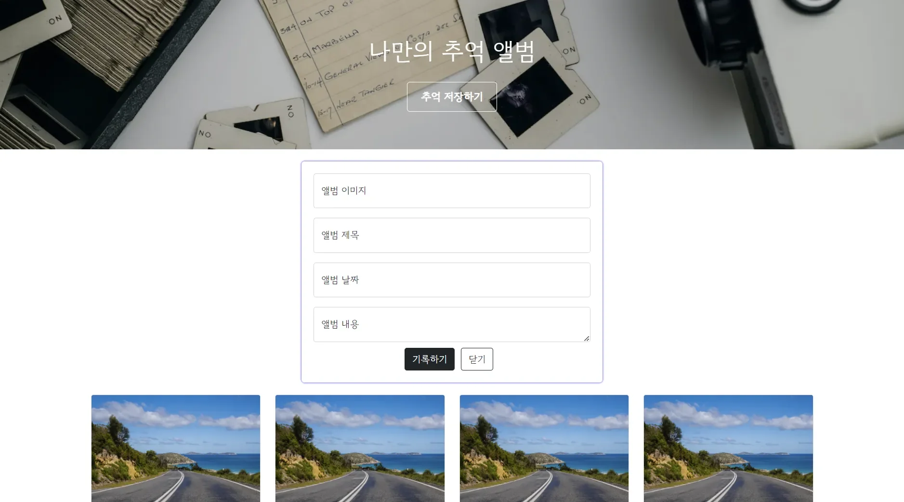

> 💡 
> 
> <a id="bf20d0dcb1c744d4a872aa7c300d5794"></a>
> 
> 간단한 프로젝트 만들기
> 
> - bootstrap 
> 
> - 구글 폰트 



<details>
<summary>부트스트랩 적용</summary>

<a id="111eda9b0fe1802d99b6cbeaae1bd6f0"></a>

<a href="https://getbootstrap.com/docs/5.3/getting-started/introduction/">Dos &#45; Quick start</a>

</details>

- 구글 폰트 적용


<details>
<summary>요소 가운데 정렬</summary>

<a id="111eda9b0fe18074baeddd22ee207cba"></a>

```css
display: flex;
align-items: center;
justify-content: center;
flex-direction: column;
```

</details>
