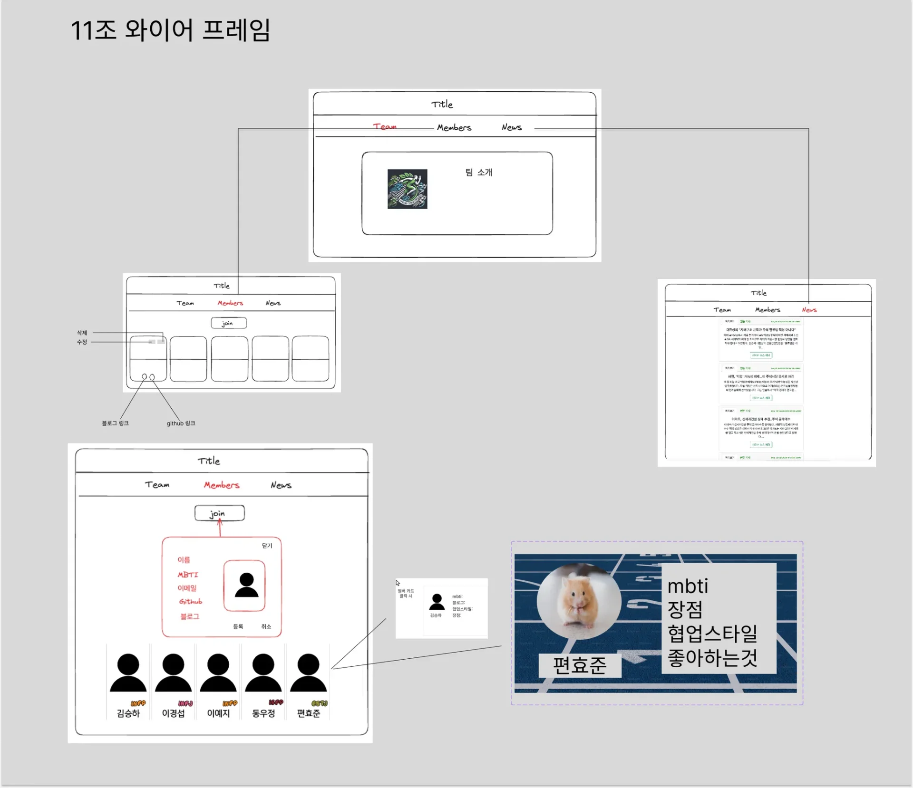
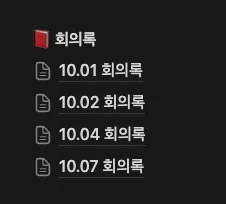

> 📌 
> 
> 
> 
> 내일배움캠프&#95;스프링 7기 1주차 팀프로젝트 기간&#58; 24년 9월 30일 &#126; 10월 7일
> 
> - <a href="https://beautiful-college-c84.notion.site/1112dc3ef51481c2b268d582affd9a4f?pvs=25">팀 노션 페이지 (11조)</a>

### 와이어 프레임

---

### 기능

---

- 팀 페이지

- 멤버 카드 CRUD

- 멤버별 상세보기 

- OPEN API(Naver) 뉴스 레터 읽어오기
    > 내가 담당한 기능

    

    <a href="#/post/112eda9b-0fe1-80db-840b-c632584b8f15">페이지</a> &#58; jquey, fetch

    

    <a href="#/post/112eda9b-0fe1-80b5-99f5-c0a379c515c3">페이지</a> &#58; firebase

    

     <a href="#/post/115eda9b-0fe1-804b-89c4-e4101d9bec0e">페이지</a> &#58; spring, restTemplate

    

    <a href="https://beautiful-college-c84.notion.site/116eda9b0fe180b3b20bfc7a98bf17e5">페이지</a> &#58; HTTPS

    

    <a href="#/post/118eda9b-0fe1-8015-98d4-def1db313635">페이지</a> &#58;  발표, 기능 피드백 

### 느낀 점 및  개선 점

---

코드 컨벤션

코드 컨벤션을 안 정했더니 기능을 합치는데 있어 충돌되는 부분들이 너무 많다&#46;

이렇게 작은 프로젝트인데도 이러니…&#46;  조금만 커지면 진짜 상상도 하기 싫다

→ 팀프로젝트 전 무조건 <code>코드 컨벤션</code>부터  정하기

- 기능별 &#45; 폴더명칭, 파일 명칭(&#46;html, &#46;css, &#46;js, &#46;java …)
    - 명칭&#58; camel case, underbar 등등 

- git 커밋 메세지 컨벤션

- 특히 커밋 전 팀원들에게 물어보고 커밋하기 → 충돌 방지
    - 커밋 좀 막하지 말고 작업 내역 좀 한번 더 정리해서 올리기

이 내용 최원빈 튜터님에게 여쭤보기 

협업

- 팀 노션 페이지 만들기 

- 피그마 &#45; 팀원들 초대해서 협업해보기 

- gitbub 저장소 만들고 팀원들 초대

- 카카오톡 오픈 채팅방 만들고 팀원들 초대

- PPT 템플릿 사용하고 대본 작성 해보기 
    - 미리 캔버스 

팀 발표 개선점 

> 우선 발표가 4분 제한이 아니었다… 내용을 뺼 이유가 없었다&#46; 

- 대본 필요… 중간에 한번 저니까 아무 생각이 안난다&#46; 

- 팀 소개 &#45; 팀원 소개  ( 이 내용을 빼먹음)

- 각 팀마다 맡은 부분, 구현한 내용을 자세히 설명하지 않았다&#46; 

- 트러블 슈팅에 대한 내용을 아에 적지 않았다… 쓸 내용 참 많았는데
    

    기능 구현에 대한 소개를 자세히 진행하고 → 트러블 슈팅에 대한 내용을 빼먹었다&#46;

    

    아니&#33; 발표 4분이라고 해서 내용 다 뺐는데 이런…

- 발표 &#45; 팀원들끼리 번갈아가면서 진행 

- 팀간의 커뮤니케이션  
    - 노션 페이지 → 회의 기록
        

- 강의 외의 기능을 개발하여 더하는 것 중요

고생을 많이 한 것 같은데… 어필이 안되서 너무 아쉽다… 그냥 다 적을껄…

기능에 대한 개선점

ip 주소 

스프링을 사용해 로컬에 서버를 만들어 내 로컬네트워크 아이 naver api를 가져와 로컬 환경에서는 정상적으로 동작하지만

외부 환경에서는 요청 자체를 받아들이지 못한다&#46; 

→ 어떻게 해결하는가?

박진상 튜터님

로컬 아이피로 되어 있어, 로컬 환경에서는 접근이 가능하나, 

방화벽 접근을 뚫어주는면 가능하나, 클라우드 서비스에 사용하는 것이 좋다&#46;

- 과거에 이해가 안되었던 내용을 복습 

- TCP/IP

- 방화벽 &#45; 인바운드, 아웃바운드

- 베포자동화 &#45; 데브옵스 

