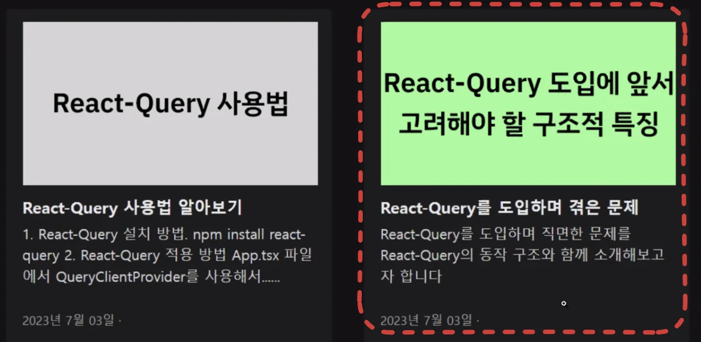

- 팀원들간의 의사소통 문제
    - 구두로만 전했더니 내가 의도한 생각과 다르게 얘기가 전달이 됨
        

        ⇒ 정확한 의사 소통을 위해 문서 및 추가 자료를 제시하여 의사 전달

→ 문제 해결 능력

- TIL 부담 줄이는 법
    - 공부, 프로젝트 <strong><u>진행 중</u></strong> 모든 생각과 과정을 <strong><u>동시에</u></strong> 기록하기

    - 문제 → 어떤 시도, 어떤 시도 … ⇒ 질문

정리

취업 == 증명

일단 작성하기

발전 시키기

⇒  특히) 프로젝트 회고

