> 내일배움캠프 스프링 7기 1주차 &#45; 2일(24&#46;10&#46;01)

- [x] 웹 종합반 강의 &#45; 4주차, 5주차

- [x] 팀프로젝트 기능 구현 &#45; open api(naver)로 데이터 받아와 뷰 구현

- [x] CORS 정리 → preflight request 정리

- [ ] <del>스프링 MVC &#45; 동시 요청&#95; 멀티 쓰레드 학습</del>   ← firebase Dos 보느라 못함&#46;&#46; 

<a id="112eda9b0fe18066ade9d80337674bfe"></a>

 

<a id="112eda9b0fe180b6bde8f2ea0b0bd39e"></a>

### 학습 및 작업 내용

---

<details>
<summary>🧐  <strong>CORS(Cross&#45;Origin Resource Sharing) 에러</strong></summary>

<a id="123eda9b0fe1803a8e04e9b1f0bfd2d5"></a>

‣

<a id="112eda9b0fe1800591e2ecde954a3438"></a>

웹 애플리케이션에서 <strong><u>다른 도메인(출처)에 있는 리소스에 접근</u></strong>하려 할 때 발생하는  문제이다&#46;<br><strong>브라우저 보안 정책</strong> 중 하나인 <strong><u>동일 출처 정책(Same&#45;Origin Policy</u></strong><strong>)</strong> 때문에 발생하는데, <br>이 정책은 <strong><u>웹 페이지가 자신이 로드된 출처(origin)와 다른 출처에서 리소스를 요청하는 것을 제한</u></strong>한다&#46;

- <strong>출처(Origin)&#58; 프로토콜, 도메인, 포트 </strong>

<a id="112eda9b0fe1805ab520fa2fcfe7d022"></a>

웹 브라우저는 <u>보안</u>을 위해 <strong><u>다른 출처에서 리소소를 요청</u></strong>할 때, <strong><u>서버가 요청을 허용하는지 확인</u></strong>해야 하는데, 이때 <strong><u>서버가 올바른 CORS헤더를 반환하지 않</u></strong>으면 <strong>브라우저는 </strong><strong><u>요청을 차단</u></strong><strong>하고 </strong><strong><u>CORS 에러</u></strong>를 <strong>발생</strong>시킨다&#46; 

<details>
<summary>ex) CORS 에러 메세지 </summary>

<a id="112eda9b0fe180b99d9fdc75eb28f2a7"></a>

```javascript
Access to fetch at 'https://openapi.naver.com/v1/search/news.json' from origin 'null' has been blocked by CORS policy: Response to preflight request doesn't pass access control check: No 'Access-Control-Allow-Origin' header is present on the requested resource. If an opaque response serves your needs, set the request's mode to 'no-cors' to fetch the resource with CORS disabled.
```

</details>

<details>
<summary><strong>서버에서 CORS 설정</strong></summary>

- 기본적인 CORS 헤더&#58; <code>Access&#45;Control&#45;Allow&#45;Origin</code>
    <a id="112eda9b0fe180099869f5efb30354f7"></a>

    ```plaintext
    // 특정 출처 허용
    Access-Control-Allow-Origin: http://example.com

    // 모든 출처 허용
    Access-Control-Allow-Origin: *
    ```

- CORS 설정에 허용할 요청 메소드나 헤더 명시 
    <a id="112eda9b0fe180b4a0cacde2aefc08d1"></a>

    ```plaintext
    Access-Control-Allow-Methods: GET, POST
    Access-Control-Allow-Headers: Content-Type
    ```

- 프리플라이트 요청(Preflight Request)
    > 자세한 내용은 아래 포스팅 참조

    <a id="112eda9b0fe180d3953cd0a40f15d434"></a>

    특정 요청(예&#58; PUT, DELETE, PATCH 등)은 브라우저가 <strong>프리플라이트 요청</strong>을 보내 서버가 이 요청을 허용하는지 먼저 확인, 서버는 여기에 대해 적절한 응답을 해야 한다&#46; 

    <details>
    <summary>ex) 응답 예시 </summary>

    <a id="112eda9b0fe18041892ad5da7522bf4e"></a>

    ```java
    OPTIONS /data HTTP/1.1
    Access-Control-Allow-Origin: http://example.com
    Access-Control-Allow-Methods: GET, POST, PUT, DELETE
    Access-Control-Allow-Headers: Content-Type
    Access-Control-Max-Age: 86400
    ```

    </details>

- 스프링부트 CORS 설정
    - <code>&#64;CrossOrigin</code>

    <details>
    <summary><code>WebMvcConfigurer </code></summary>

    <a id="112eda9b0fe18057a26bc85d36e261c5"></a>

    ```java
    @Configuration
    public class WebConfig implements WebMvcConfigurer {

        @Override
        public void addCorsMappings(CorsRegistry registry) {
            registry.addMapping("/**")
                    .allowedOrigins("http://example.com")  // 허용할 출처 설정
                    .allowedMethods("GET", "POST", "PUT", "DELETE")  // 허용할 HTTP 메소드 설정
                    .allowedHeaders("*")  // 허용할 헤더 설정
                    .allowCredentials(true);  // 인증 관련 정보 허용
        }
    }
    ```

    </details>

- <strong>클라우드 환경</strong>
    > 나중에 추가 학습

    - AWS API Gateway 또는 Nginx 같은 리버스 프록시 서버에서도 CORS 설정이 가능

</details>

</details>

<details>
<summary>🧐  <strong>프리플라이트 요청 ( Preflight Request )</strong></summary>

> 말 그래로<em><strong> ‘미리 날려보는 요청’</strong></em>  즉, <strong><u>사전 확인  요청</u></strong>

<a id="112eda9b0fe1801092fbee8bd2ddd260"></a>

CORS(Cross&#45;Origin Resource Sharing)에서 브라우저가 서버에 특정 조건을 만족하는 요청을 보내기 전에, 서버가 <strong><u>해당 요청을 허용하는지 미리 확인하는 요청</u></strong>이다&#46; 

<a id="112eda9b0fe180e7a529d77f041ec471"></a>

주로<strong> 안전하지 않</strong>는 HTTP 요청(예&#58; <code>PUT</code>, <code>DELETE</code> 등) 이나 <strong><u>커스텀 헤더가 포함된 요청 </u></strong>시 발생된다&#46; <br>이를 통해 <strong><u>보안</u></strong> 문제를 방지하고, <strong><u>허가되지 않은 요청이 서버로 전달되는 것을 막</u></strong>는다&#46; <br>프

<details>
<summary><strong>프리플라이트(Preflight Request) 요청 동작 방식</strong></summary>

1. 프로플라이트 요청
    - 브라우저는 실제 요청을 보내기 전에, <strong>OPTIONS</strong> 메소드로 프리플라이트 요청을 서버에 보낸다&#46;

    - &#46; 이 요청은 서버가 요청을 허용하는지 확인하기 위한 <strong><u>“사전 요청”</u></strong>이다&#46; 
        <a id="112eda9b0fe180758ebaead3661d114a"></a>

        ```java
        OPTIONS /api/data HTTP/1.1
        Origin: http://example.com
        Access-Control-Request-Method: PUT
        Access-Control-Request-Headers: Content-Type
        ```

1. 프로플라이트 응답
    - 서버는 이 프리플라이트 요청에 응답하여, 해당 요청을 허용할 수 있는지 여부를 나타내는 <strong>CORS 응답 헤더</strong>를 포함하여 반환한다&#46;
        <a id="112eda9b0fe180e1aceada250e40e224"></a>

        ```plaintext
        HTTP/1.1 204 No Content
        Access-Control-Allow-Origin: http://example.com
        Access-Control-Allow-Methods: GET, POST, PUT, DELETE
        Access-Control-Allow-Headers: Content-Type
        ```

<a id="112eda9b0fe1807cbeb6f2845742fbf0"></a>

<br>3&#46; 브라우저 응답

- 브라우저는 서버의 응답을 보고, 실제 요청을 보낼 수 있는지 판단

-  만약 <strong><u>서버가 요청을 허용(</u></strong><strong><code>Access&#45;Control&#45;Allow…</code></strong><strong>)</strong>하면 이후 <strong><u>실제 요청이 서버로 전송</u></strong>
    <details>
    <summary>ex) 실제 요청</summary>

    <a id="112eda9b0fe180d5b6fbeeb157424363"></a>

    ```plaintext
    PUT /api/resource HTTP/1.1
    Host: example.com
    Origin: http://yourwebsite.com
    Content-Type: application/json
    ```

    </details>

</details>

<details>
<summary>서버 응답 허용 헤더 </summary>

- <code>Access&#45;Control&#45;Allow&#45;Origin</code>&#58; 요청 출처를 허용할지 여부

- <code>Access&#45;Control&#45;Allow&#45;Methods</code>&#58; 허용할 HTTP 메서드 ( ex&#46; GET, POST, PUT …)

- <code>Access&#45;Control&#45;Allow&#45;Headers</code>&#58; 허용할 커스텀 헤더

- <code>Access&#45;Control&#45;Max&#45;Age</code>&#58; 브라우저가 프리플라이트 요청의 응답을 <strong><u>캐시</u></strong>할 시간 (단위&#58; 초)

</details>

<details>
<summary><strong>실무</strong></summary>

- <strong>필수적인 보안 절차</strong>
    - 프리플라이트 요청은 보안성을 높이기 위한 브라우저 측의 보호 메커니즘이다&#46; 

    - 서버가 허용하지 않는 요청을 사전에 차단할 수 있다&#46;

- <strong>성능 영향</strong>
    - 프리플라이트 요청은 추가적인 네트워크 요청이므로, 성능에 영향을 줄 수 있다&#46;

    - 따라서 서버에서 <code>Access&#45;Control&#45;Max&#45;Age </code>값을 설정하여 <strong><u>응답을 캐시</u></strong>하면 불필요한 프리플라이트 요청을 줄일 수 있다&#46;

</details>

</details>

<a id="112eda9b0fe180fc90faf5cc96c32535"></a>

### <a href="https://developers.naver.com/main/">open api ( naver ) </a>를 사용한 뉴스레터 뷰 기능 개발

<details>
<summary>애플리케이션 등록</summary>

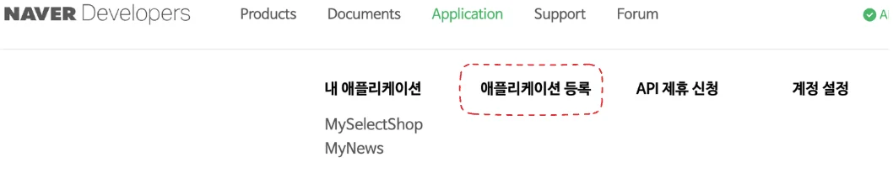

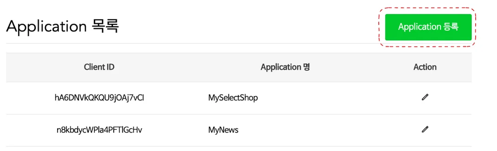

- 신청
    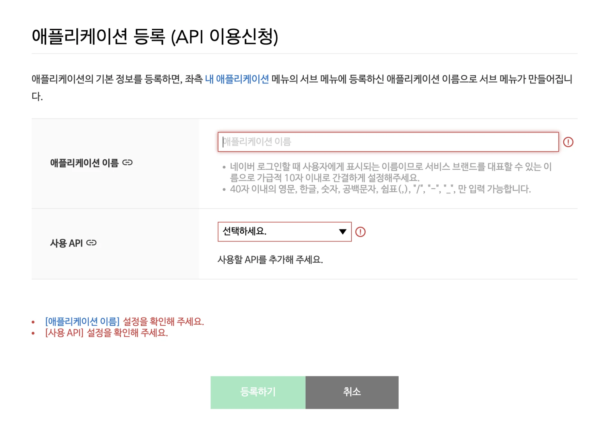

- 뉴스 데이터를 가져오려고 하기 때문에  사용 AP에 ‘검색’을 입력함
    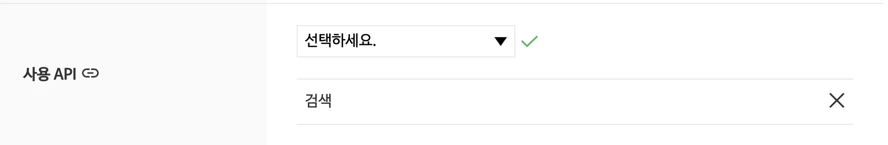

</details>

<details>
<summary><a href="https://developers.naver.com/docs/serviceapi/search/news/news.md#%EB%89%B4%EC%8A%A4">Doucuments &#45; 검색 &#45; 뉴스 </a></summary>

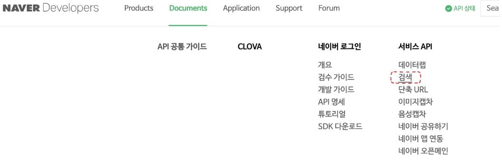

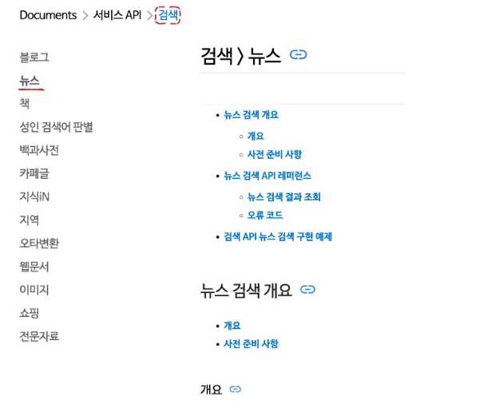

</details>

- 해당 DOC에 들어가면 <code>요청 URL</code> 과 <code>HTTP 요청 메세지</code> 예시를 명시해 놓았다&#46; 
    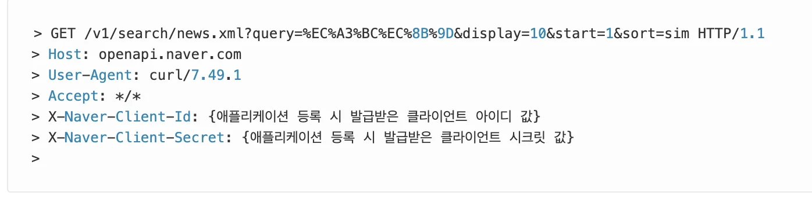

    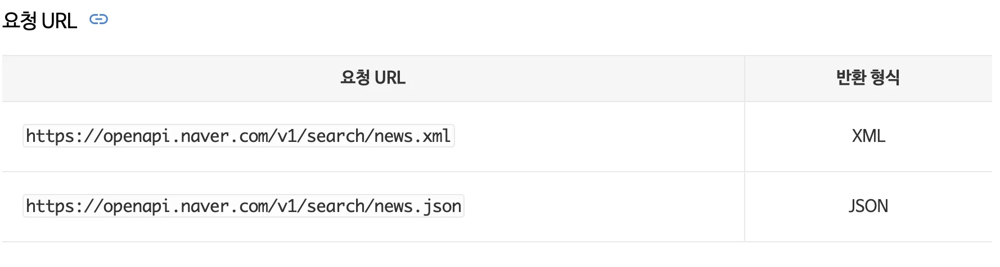

- 해당 내용을 참조하여 아래와 같이 fetch를 활용해 요청 메세지를 보냈다&#46; 
    <details>
    <summary>클라이언트 아이디, 시크릿 키 </summary>

    - 애플리케이션을 등록하면 상단 &#91; 애플리케이션  &#45; 내 애플리케이션 &#93;에  아래와 같이 내가 생성한 애플리케이션이 활성화 된 것을 확인할 수 있다&#46; 
        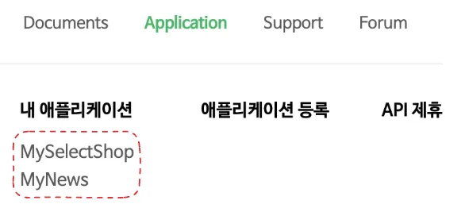

    - 사용하려는 애플리케이션 클릭
        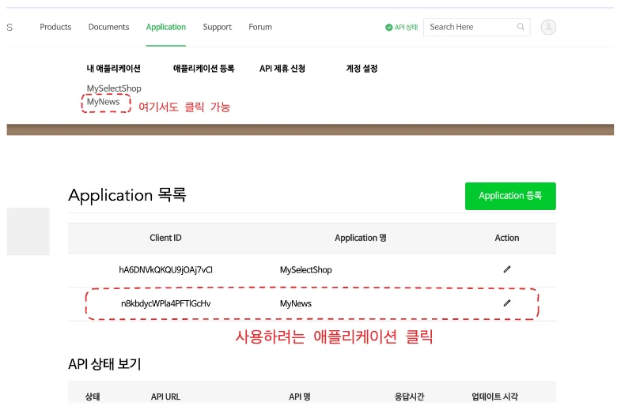

    - 해당하는 애플리케이션의 <code>클라인트 ID</code>, <code>클라이언트 secret key</code>  값 확인
        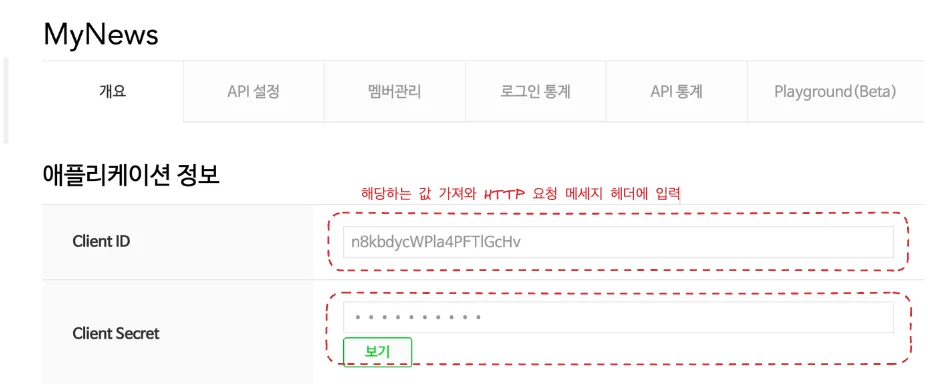

    </details>

    <a id="112eda9b0fe18023a0dbc1ca5133bfe0"></a>

    ```javascript
    (function () {
    				// HTTP 요청메세지 헤더에 들어갈, 인증을 위한 값들
    	      const clientId = "클라이언트 아이디 입력";
            const clientSecret = "클라이언트 시크릿 키 입력";

            // 네이버 API 요청 URL
            const url =
              "https://openapi.naver.com/v1/search/news.json?query=%EC%A3%BC%EC%8B%9D&display=10&start=1&sort=sim";

            fetch(proxyUrl + url, {
              method: "GET",               // HTTP 메서드 - GET 
              headers: {                   // 요청 메세지 헤더 값 설정
                "X-Naver-Client-Id": clientId,
                "X-Naver-Client-Secret": clientSecret,
              },
            })
              .then((response) => {
                if (!response.ok) {
                  throw new Error(
                    "Network response was not ok " + response.statusText
                  );
                }
                return response.json();
              })
              .then((data) => {
    		          console.log(data)
              })
              .catch((error) => {
                console.error(
                  "There was a problem with the fetch operation:",
                  error
                );
              });
          });
    ```

- 그러나 해당 요청 시, <strong><u>CORS(Cross&#45;Origin Resource Sharing) 에러</u></strong>가 발생 되었다&#46; 
    <a id="112eda9b0fe18011ab47ea3a72a8ddf6"></a>

    해당 내용을 찾아보니<strong> 네이버 API</strong>는 <u>‘클라이언트 측에서 직접 호출 시, CORS 정책을 허용하지 않는다’</u>해서 발생한 오류였다&#46;

    > <strong>🧐 CORS(Cross&#45;Origin Resource Sharing) 에러</strong><strong> &#45; 자세한 내용은 위 포스팅 참조</strong>

    <a id="112eda9b0fe1802bb379e3544345a074"></a>

    해당 문제를 해결하기 위해서는 <u>백엔드에서 api를 호출하는 방법</u>이나 아니면 <strong><u>프록시 서버를 통해 중간에 대리로 api를 요청 방법</u></strong><strong> 등 클라이언트가 아닌 다른 곳을 통해 api 요청을 하여 받아오는 것으로 해결을 해야했다&#46;</strong>

    <a id="112eda9b0fe18088a9ddd1eed41160df"></a>

    우선 팀프로젝트 자체가 미니프로젝트이고, 앱이 굉장히 작고 단순하여 백엔드가 없이 클라이언트에서 모든 로직을 처리하는 <strong><u>‘클라이언트 사이드 렌더링’</u></strong> 방식이었기 때문에 두번째 방법인 <em><strong><u>프록시 서버 </u></strong></em>를 통해 대신 api 요청을 받아오는 형태로 해결헀다&#46;  코드는 아래와 같다&#46; 

    >  <strong>프록시 서버가 클라이언트 대신 요청을 처리하고, 요청을 원래 목적지로 전달한 후 응답을 다시 클라이언트로 반환한다&#46;</strong>

    <details>
    <summary>🧐 <code>fetch(proxyUrl &#43; url&#46;&#46;</code>  </summary>

    <a id="112eda9b0fe180e8b013e09b85d1eb1e"></a>

    2번의 네트워킹 요청을 발생시킨다&#46; 

    - <strong>첫 번째 요청</strong>&#58; 클라이언트(브라우저)가 프록시 서버(<code>https&#58;//corsanywhere&#46;herokuapp&#46;com/</code>)로 요청을 보낸다&#46;

    - <strong>두 번째 요청</strong>&#58; 프록시 서버는 클라이언트가 보낸 요청을 대신해서 원래 목적지(<code>https&#58;//openapi&#46;naver&#46;com/v1/search/news&#46;json</code>)에 요청을 보낸다&#46; <br>이 요청은 네이버 API 서버에 도달하고, 해당하는 응답을 반환 받아 <br>프록시 서버를 통해 클라이언트로 전달된다&#46; 

    </details>

    <a id="112eda9b0fe1807abd69ee85590fb391"></a>

    ```javascript
    $(function () {
            const clientId = "n8kbdycWPla4PFTlGcHv";
            const clientSecret = "DQJeMhw0Sp";

            // CORS 프록시 URL 추가
            const proxyUrl = "https://cors-anywhere.herokuapp.com/";

            // 네이버 API 요청 URL
            const url =
              "https://openapi.naver.com/v1/search/news.json?query=%EC%A3%BC%EC%8B%9D&display=10&start=1&sort=sim";

            fetch(proxyUrl + url, {
              method: "GET",
              headers: {
                "X-Naver-Client-Id": clientId,
                "X-Naver-Client-Secret": clientSecret,
              },
            })
              .then((response) => {
                if (!response.ok) {
                  throw new Error(
                    "Network response was not ok " + response.statusText
                  );
                }
                return response.json();
              })
              .then((data) => {
    	            // 받아온 데이터 가공 
              .catch((error) => {
                console.error(
                  "There was a problem with the fetch operation:",
                  error
                );
              });
          });
    ```

- 프록시 서버를 통해 데이터를 정상적으로 받아왔기 때문에, 아래와 같이 뷰 로직에 데이터를 넣고 요소를 생성하였다&#46;
    > 부트스트랩을 사용

    <a id="112eda9b0fe180d38281cbb51b6068aa"></a>

    ```javascript
    data.items.forEach((item) => {
          let temp_html = `
            <div class="card text-center">
              <div class="card-header">
                <ul class="nav nav-tabs card-header-tabs">
                  <li class="nav-item">
                    <a class="nav-link active" aria-current="true" href="#">미리보기</a>
                  </li>
                  <li class="nav-item green">
                    <a class="nav-link" href=${item.originallink}>원본 기사</a>
                  </li>
                  <li class="nav-item green" id="time">${item.pubDate}</li>
                </ul>
              </div>
              <div class="card-body">
                <h5 class="card-title">${item.title}</h5>
                <p class="card-text">${item.description}</p>
                <a href=${item.link} class="btn btn-outline-success">네이버 뉴스 레터 </a>
              </div>
            </div>
          `;
          $("#news_cards").append(temp_html);
        });
      })
    ```

    - 결과 화면
        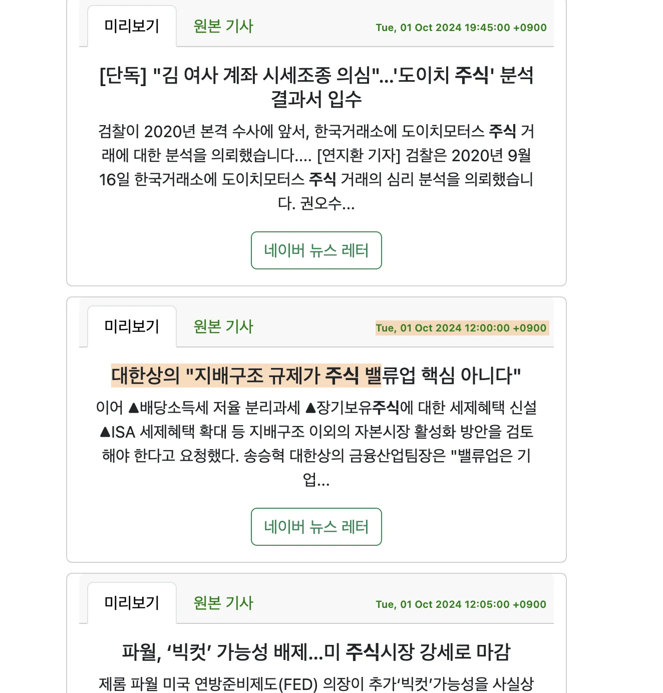

<a id="112eda9b0fe1803cb201cf6fd99e5fe9"></a>

### 피드백 및 하루 정리

---

<a id="112eda9b0fe180ffb5c9d42d7b4dc05b"></a>

이틀차인데 좀 힘들다… 확실히 아직 적응이 안돼서 그런가 몸이 너무 욱씬욱씬 거린다…

<a id="112eda9b0fe1801ca9eede09365d27bc"></a>

그래도 나름 잘하고 있다&#46; 멈춰 있지 않는 것만으로도 만족한다 

<a id="112eda9b0fe180fdbbded1d0a64e8f04"></a>

화이팅이다

- 스프링 MVC &#45; 동시 요청&#95; 멀티 쓰레드 학습  
    <a id="112eda9b0fe180e785aaeffefa2cb086"></a>

    update, delete 로직 구현을 위해 firebase Doc를 계속 뒤졌는데

    <a id="112eda9b0fe18000971ae7907ece5acb"></a>

    Doc 가 예전과 다른게 많이 변했다 → 해당 내용이 어딨는지 모르겠음

    <a id="112eda9b0fe180ce9547fbd0ee5ef8a5"></a>

    더 뒤져봐야 할 듯 하다&#46;
