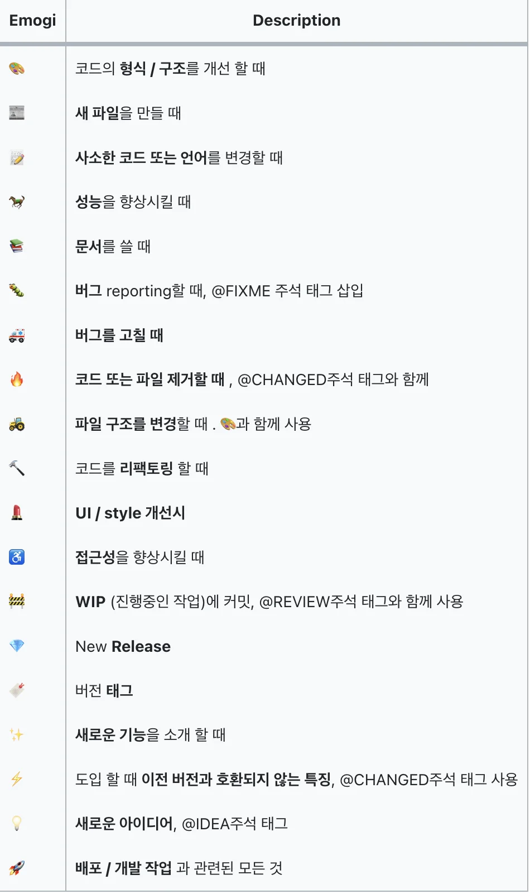
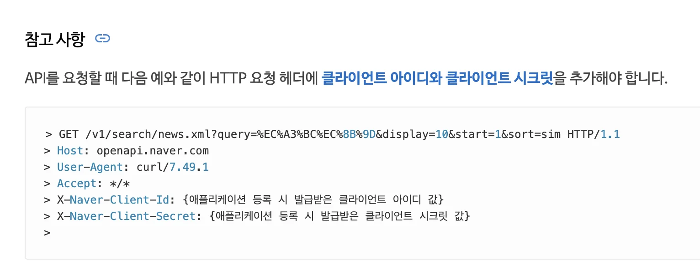
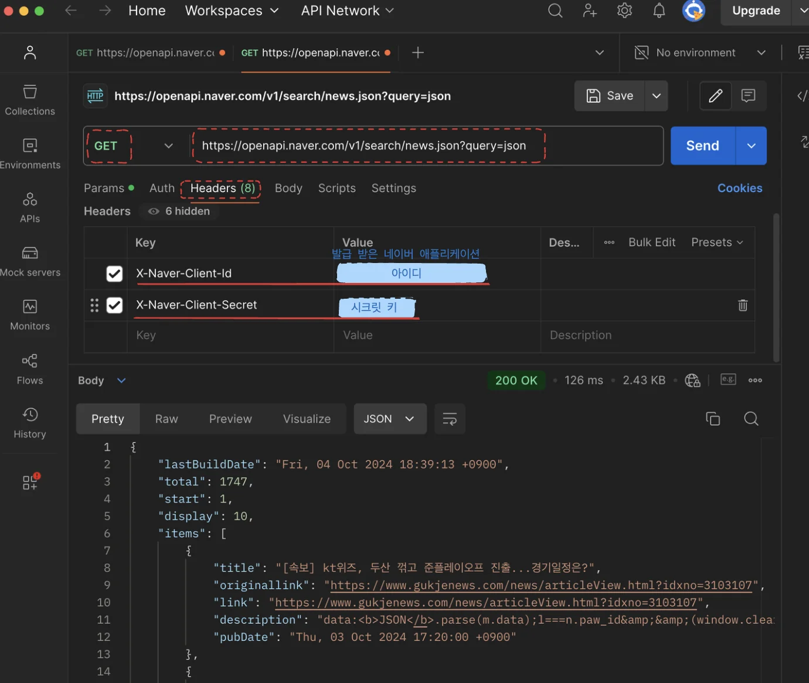
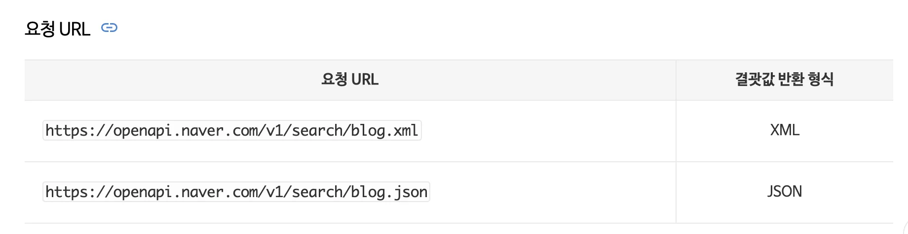
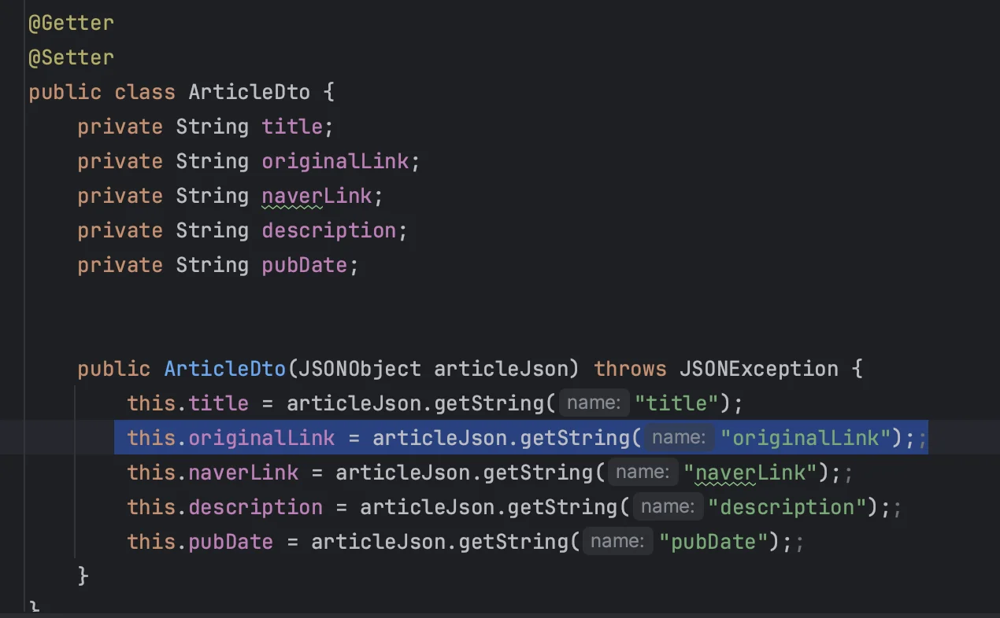
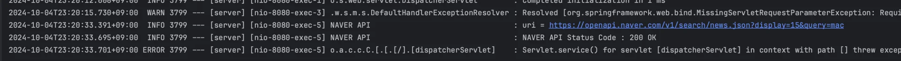
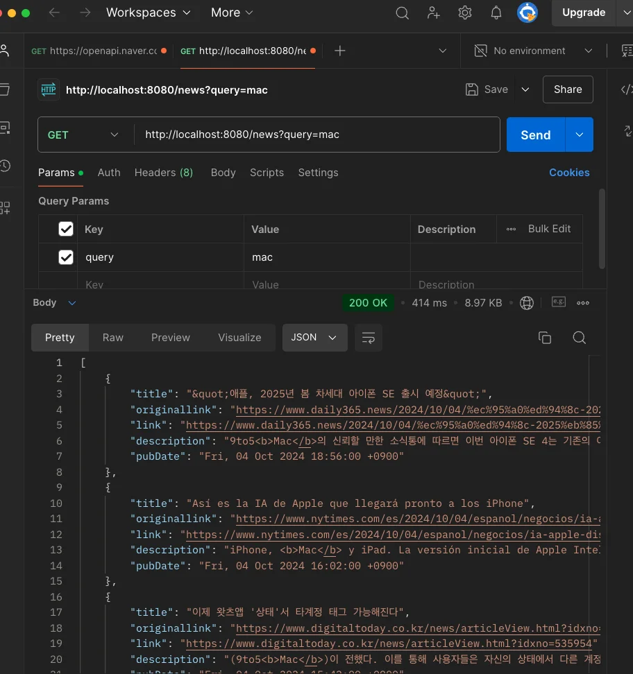
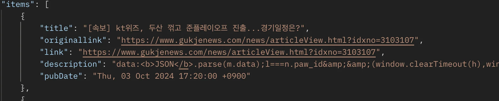

<details>
<summary>최원빈 튜터님 &#45; 피드백,  학습 진행을 위한 방향성 </summary>

<details>
<summary>발표 준비</summary>

- 프로젝트를 통해 배운점

- 웹 전체의 동작 흐름
    - http 메서드

    - TCP/IP

    - 특히 협업에 관한 배운점 
        - git에 대한 팀프로젝트의 이점에 대해서 (버전)

</details>

- 이 프로젝트, 과제 → 어떤 점을 배워야 할지? 

- 이러한 플러그를 세우고 진행해야 한다&#46; 

- 과제 시작 전, 목표(어떤 점을 배워야 하는가)를 설정하고 끝나고 피드백 진행

- 내가 설정한 목표에 대하 미흡한 점들은 튜터님에게 피드백을 요청하여 개선
    - 내가 세운 목표를 달성하지 못한 경우
        - 다음 주차에 튜터님들에게 도움을 받으면서 어떻게 같이 진행할 수 있을지

        - 어떻게 부족한 부분들을 더 좋게 채울 수 있고, 나아갈 수있는지 

</details>

<a id="115eda9b0fe1817887bdd487ce80b570"></a>

### git 커밋 컨벤션

<details>
<summary>reference</summary>

- ‣

- ‣

- ‣

- ‣

</details>

<details>
<summary>git 커밋 컨벤션</summary>

> <strong><a href="https://udacity.github.io/git-styleguide/">유다시티의 커밋 메시지 스타일 가이드를 참</a></strong><strong>조</strong>

<details>
<summary>commit  메세지 구조</summary>

> 기본적인 커밋 메세지 구조&#58; <code>제목</code>, <code>본문</code>, <code>꼬리말</code>

<a id="115eda9b0fe180caae62c8046fdfb7c5"></a>

```plaintext
type : subject

body 

footer
```

</details>

<details>
<summary><strong>Commit Type</strong></summary>

> Type&#58; <strong><code>태그 &#58; 제목</code></strong> 

- <code>feat</code>&#58; 새로운 기능 추가

- <code>fix</code>&#58; 버그 수정

- <code>docs</code>&#58; 문서 수정

- <code>style</code>&#58; 코드 포맷팅, 세미콜론 누락, 코드 변경이 없는 경우

- <code>refactor</code>&#58; 코드 리펙토링

- <code>test</code>&#58; 테스트 코드, 리펙토링 테스트 코드 추가

- <code>chore</code>&#58; 빌드 업무 수정,&#46; 패키지 매니저 수정

</details>

<details>
<summary>Suibject</summary>

<a id="115eda9b0fe1802baa41f48fc67e37be"></a>

제목

</details>

</details>

<details>
<summary><strong>Commit Message Emogji</strong></summary>

- 이미지를 통해 커밋 type을 정의 



</details>

<a id="f65a8fc2d8094edebf7ed70715abcdef"></a>

### 기능) naver api 뉴스 기사 

<a id="a4bcf3983aab417da09fa650419eaa56"></a>

이번 주 팀프로젝에서 내가 담당한 기능이다&#46; 

<details>
<summary>&#91; 코드 &#93;  <code>JS</code>&#58;  naver api를 사용한 뉴스 데이터 GET 요청, 및  동적으로 DOM 생성</summary>

<a id="748a58c7436949b6b9f948eaf40875a2"></a>

```java
// 네이버 opi
$(function () {
  const clientId =  {아이디} ; 
  const clientSecret = {시크릿 키};

  // CORS 프록시 URL 추가
  const proxyUrl = "https://cors-anywhere.herokuapp.com/";

  // 네이버 API 요청 URL
  const url =
    "https://openapi.naver.com/v1/search/news.json?query=%EC%A3%BC%EC%8B%9D&display=10&start=1&sort=sim";

  fetch(proxyUrl + url, {
    method: "GET",
    headers: {
      "X-Naver-Client-Id": clientId,
      "X-Naver-Client-Secret": clientSecret,
    },
  })
    .then((response) => {
      if (!response.ok) {
        throw new Error("Network response was not ok " + response.statusText);
      }
      return response.json();
    })
    .then((data) => {
      data.items.forEach((item) => {
        let temp_html = `
            <div class="card text-center">
                <div class="card-header">
                <ul class="nav nav-tabs card-header-tabs">
                    <li class="nav-item">
                    <a class="nav-link active" aria-current="true" href="#">미리보기</a>
                    </li>
                    <li class="nav-item">
                    <a class="nav-link" href=${item.originallink}>원본 기사</a>
                    </li>
                    <li class="nav-item" id="time">${item.pubDate}</li>
                </ul>
                </div>
                <div class="card-body">
                <h5 class="card-title">${item.title}</h5>
                <p class="card-text">${item.description}</p>
                <a href=${item.link} class="btn btn-outline-primary">뉴스 확인하기</a>
                </div>
            </div>
            `;
        $("#news_cards").append(temp_html);
      });
    })
    .catch((error) => {
      console.error("There was a problem with the fetch operation:", error);
    });
});

```

</details>

<a id="d7c70436ee6f47379314fdd0e9d8cd63"></a>

### 문제 발생 및 해결

---

<a id="116eda9b0fe18066a1def5d7cd996be5"></a>

간단한 미니프로젝트로  따로 서버를 붙이지 않고 NoSQL인 firebase만 붙여서 진행을 하였기 때문에, naver api 사용  시 발생한 CORS 오류를 외부 프록시 서버(cors&#45;anywhere)를 통해 진행하였다&#46; 

<a id="116eda9b0fe1800c9d00ef04646f55c0"></a>

그러나 팀 github 저장소에 업로드해 gihub&#45;page로  베포를 진행한 결과,  프록시 서버인 (cors&#45;anywhere)가 정상적으로 동작하지 않아 요청에 대한 응답을 받아올 수 없었다&#46; 

<a id="116eda9b0fe180a5b272c28b2ef54073"></a>

따라서<strong> 튜터님에게 상담한 결과, 로컬 서버를 통해 요청을 받아 클라이언트로 응답해주는 형태로  설계를 수정했다&#46;</strong>

<a id="116eda9b0fe1808da0abfc0701923413"></a>

로컬 서버 개발은 스프링을 사용하여 진행하였고, 데이터를 요청해서 read만 하는 로직이기 때문에 간단하게 GET요청만 처리하는 컨트롤러를 하나 만들어 클라이언트로부터 요청을 받아 RestTemplate을 사용하여 naver 서버에서 요청한 데이터를 받고 포맷하여 클라이언트로 응답 전달했다&#46;

<details>
<summary>postman &#45; naver api 테스트 </summary>

- <a href="https://developers.naver.com/docs/serviceapi/search/news/news.md#%EB%89%B4%EC%8A%A4">naver api </a> get 요청 시 아래와 같이 <strong><u>인증</u></strong>을 위해 <strong><u>HTTP 요청 헤더</u></strong>에 발급받은 애플리케이션의 <strong><u>클라이언트 아이디 </u></strong>와 <strong><u>시크릿 키</u></strong>를 추가해야 한다&#46;
    

- postman을 통한 http 요청 테스트시 아래와 같이 header에 클라이언트 아이디와 시크릿 키를 추가해 요청을 보내면 정상적으로 응답을 받아오는 것을 확인할 수 있다&#46;
    

</details>

<a id="1712c283b6624069bcd75e60c1c09c07"></a>

### 서버(스프링) 

<details>
<summary>🧐 실제 반환 받는 JSON 데이터에서 알아서 스프링이 DTO 포맷에 맞춰 데이터를 필터링 해준다&#46; 내부 동작 방식이 어떻게 되는가?</summary>

<a id="120eda9b0fe180778e4df3442cb3f155"></a>

크게 아래 3가지 요소에 의해 이루어 진다&#46;

- HTTPMessageConverter

- ObjectMapper(Jackson)

- Reflection

<details>
<summary>1&#46;  요청 수신, 데이터 처리</summary>

<a id="120eda9b0fe18012959bc557e0fa0b2d"></a>

클라이언트로부터 JSON 데이터 수신

- &#64;RequestBody&#58; JSON → userDTO 변환
    - ‘HTTP 요청 메세지(POST) &#45; Body’ 에 있는 json 데이터 가져와 DTO로 변환

<a id="120eda9b0fe180ec86a3d5edca1d10cd"></a>

```java
@PostMapping("/user")
public ResponseEntity<String> createUser(@RequestBody UserDTO userDTO) {
    // userDTO 내부에 클라이언트의 JSON 데이터가 바인딩됨
    return ResponseEntity.ok("User created");
}
```

</details>

<details>
<summary>2&#46; HttpMessageConverter </summary>

- Spring은 요청 본문(Body)의 데이터를 처리할 때, HttpMessageConverter를 사용한다&#46;
    <a id="120eda9b0fe180e8a1ddd0fe5acdd3e3"></a>

    즉, &#64;RequestBody를 통한 <strong><u>JSON 데이터의 DTO 변환</u></strong>은 <strong><u>HttpMessageConverter를 사용</u></strong>하여 이뤄진다&#46;

    - 정확히는 <code>MappingJackson2HttpMessageConverter</code>에서 <strong><u>Jackson 라이브러리</u></strong>의 <code>ObjectMapper</code> 사용

- JSON → 콘텐츠 타입&#58; <code>application/json</code>
    - ⇒  <code>MappingJackson2HttpMessageConverter</code>

- 해당 메세지 컨버터는 Jackson 라이브러리의 ObjectMapper를 사용해 JSON 데이터를 Java 객체(DTO)로 변환한다&#46;  

</details>

<details>
<summary>3&#46; <strong>Jackson의 ObjectMapper와 Reflection</strong></summary>

- Reflection
    - Java 런타임에서 클래스나 메서드, 필드에 대해 동적으로 접근하는 기술

- <code>ObjectMapper</code>가 <code>reflection</code><strong>을 사용하여 </strong><strong><u>JSON 문자열을 파싱할 때,</u></strong> <strong><u>DTO 클래스의 필드 이름</u></strong>과 <strong><u>JSON 키 값</u></strong>을 <strong><u>비교</u></strong>하여 <strong><u>자동으로 매핑</u></strong>한다&#46;
    > ⚠️ 
    > 
    > <a id="ee5502236d4f465e95aea10862cfcfe2"></a>
    > 
    > <strong><u>DTO 필드명</u></strong>과 <strong><u>JSON 키 값</u></strong>이 <strong><u>동일</u></strong>해야 함

    <details>
    <summary>ex)</summary>

    <details>
    <summary>json</summary>

    <a id="120eda9b0fe18061be36eebd86c40fb6"></a>

    ```json
    {
      "name": "John",
      "age": 30
    }
    ```

    </details>

    <details>
    <summary>DTO</summary>

    <a id="120eda9b0fe180b09cebc26fd7338e35"></a>

    ```java
    @Getter @Setter
    public class UserDTO {
        private String name;
        private int age;
    }
    ```

    </details>

    </details>

</details>

<details>
<summary>4&#46; DTO,  필터링 </summary>

- DTO 클래스에 정의된 필드만 매핑
    - 선언되지 않은 필드는 무시

    <details>
    <summary>ex)</summary>

    > json 데이터에 정의된 ‘extraField’ 데이터는 DTO에 해당하는 필드가 존재하지 않기 때문에 무시된다&#46; 

    <details>
    <summary>json</summary>

    <a id="f54507de3ae74705ba4c693ded8856f4"></a>

    ```json
    {
      "name": "John",
      "age": 30,
      "extraField": "This won't be mapped" // DTO에 정의되지 않은 필드 -> 무시
    }
    ```

    </details>

    <details>
    <summary>DTO</summary>

    <a id="51d05ded40a24dce812b19df0a350821"></a>

    ```java
    @Getter @Setter
    public class UserDTO {
        private String name;
        private int age;
    }
    ```

    </details>

    </details>

</details>

</details>

<details>
<summary>🧐 스프링부트 &#45; 기본 메세지 컨버터 </summary>

<a id="115eda9b0fe1803fae4bfd5c4ca0e93c"></a>

<strong>HttpMessageConverter </strong>

> 0부터 우선순위가 가장 높다&#46;

<details>
<summary>0 = <code>ByteArrayHttpMessageConverter</code></summary>

<details>
<summary><code>byte&#91;&#93;</code> 데이터 처리 </summary>

- 클래스 타입&#58; <code>byte&#91;&#93;</code>

- 미디어타입&#58; <code>&#42;/&#42;</code>

</details>

- 가정 먼저 처리, byte타입이 아닌 경우 다음 우선순위인 <code>StringHttpMessageConverter</code>로 넘김

<details>
<summary>ex)</summary>

- 요청
    - <code>&#64;RequestBody byte&#91;&#93; data</code>

- 응답
    - &#64;ResponseBody return byte&#91;&#93;

    - 쓰기 미디어 타입&#58; <code>application/octet&#45;stream</code>

</details>

</details>

<details>
<summary>1 = <code>StringHttpMessageConverter</code></summary>

<details>
<summary><code>String</code> 데이터 처리</summary>

- 클래스 타입&#58; <code>String</code>

- 미디어타입&#58; <code>&#42;/&#42;</code>

</details>

- byte → String  아닌 경우 아래로 

<details>
<summary>ex)</summary>

- 요청
    - <code>&#64;RequestBody String data</code>

- 응답
    - <code>&#64;ResponseBody return  “ok”;</code> 

    - 쓰기 미디어타입&#58; <code>text/plain</code>

</details>

</details>

<details>
<summary> 2 = <code>MappingJackson2HttpMessageConverter</code></summary>

<details>
<summary><code>application/json</code> 데이터 처리</summary>

- 클래스 타입&#58; <code>객체</code> or <code>HashMap</code>

- 미디어타입&#58; <code>application/json</code>

</details>

<details>
<summary>ex)</summary>

- 요청 
    - <code>&#64;RequestBody HelloData data</code>

- 응답
    - <code>&#64;ResponseBody return helloData</code>

    - 쓰기 미디어타입&#58; <code>application/json</code>

</details>

</details>

</details>

<details>
<summary>🧐 Controller에서 요청을 받고 DTO(Data Transfer Object)로  return(응답) 시, 어떻게 DTO(객체)가 JSON으로 변환되며 HTTP 응답 메세지에 담기는가?</summary>

> <a href="https://beautiful-college-c84.notion.site/893d5c525fe8457191930e08c950786d">페이지</a> &#45; HTTP 메세지 컨버터

<a id="019be5e93fe94661bb8eed99c32f9992"></a>

DTO가 JSON으로 변환되는 과정은 Spring Framework의 <strong><code>HttpMessageConverter</code></strong>에 의해 이루어진다&#46;

- &#91; DTO → JSON &#93; 변환 과정
    - 1&#46; Controller에서 DTO 반환
        <a id="115eda9b0fe18044a2abc9aa05535d81"></a>

        아래와 같이 Spring Controller에서 DTO 객체를 반환

        <a id="115eda9b0fe180c5a7d6d0167377f4fa"></a>

        ```java
        @RestController
        public class UserController {
            @GetMapping("/user")
            public UserDTO getUser() {
                return new UserDTO("John", "Doe");
            }
        }
        ```

    - 2&#46; Spring의 HttpMessageConverter 동작 
        <a id="115eda9b0fe18086b4cfdc73bfa6f66d"></a>

        반환된 DTO 객체를 클라이언트로 전달하기 위해서는 적절한 형식(JSON …)으로 변환해야 한다&#46; <br>이때, HttpMessageConverter가 동작하는데, 

        <a id="115eda9b0fe180dcb934ede6faac769b"></a>

        스프링부트에는 <strong><code>MappingJackson2HttpMessageConverter</code></strong>가 등록되어 있어, 컨트롤러가 반환한<strong><u> Java 객체(DTO)를 JSON으로 변환</u></strong>해 준다&#46;

        - MappingJackson2HttpMessageConverter는 Jackson 라이브러리를  사용하여 Java 객체를 JSON으로 변환한다&#46; 

        - 이 과정에서 ObjectMapper를 사용하여 DTO  객체를 JSON 문자열로 직렬화(Serialization)한다&#46;
            - ex)

            <a id="115eda9b0fe180faba54d62939e41e5b"></a>

            ```json
            // UserDTO("John", "Doe") 직렬화(json 변환)
            {
            	"firstName": "John",
            	"lastName": "Doe"
            }
            ```

    - 3&#46; 응답 전송
        <a id="115eda9b0fe1801eb854fc68d8bd72ba"></a>

        <strong>변환된 JSON 데이터는 HTTP 응답 본문에 담겨 클라이언트에게 전송된다&#46; <br>이때, 응답의 </strong><strong><code>Content&#45;Type</code></strong><strong>은 </strong><strong><code>application/json</code></strong><strong>으로 설정된다&#46; </strong>

</details>

<details>
<summary>🧐 직렬화, 역직렬화</summary>

<details>
<summary><strong>직렬화(Serialization)</strong></summary>

- Java 객체와 같은 데이터를 <strong><u>바이트 스트림</u></strong>으로 변환하는 과정

- 이 바이트 스트림은 <strong><u>파일에 저장</u></strong>되거나 <strong><u>네트워크를 통해 전송</u></strong>될 수 있다&#46;

- 웹 애플리케이션에서는 주로 JSON, XML 형태로 직렬화하여 데이터를 주고 받는다&#46; 
    - ex)<a href="https://developers.naver.com/docs/serviceapi/search/blog/blog.md#%EC%9A%94%EC%B2%AD-url"> 네이버 API &#45; xml, json</a>
        

<details>
<summary>ex) <strong>Java 객체 → JSON 변환 과정(직렬화)</strong></summary>

<a id="115eda9b0fe180dd99dff42aef885ed8"></a>

```java
UserDTO user = new UserDTO("John", "Doe");

ObjectMapper objectMapper = new ObjectMapper();
String jsonString = objectMapper.writeValueAsString(user);

System.out.println(jsonString);
```

<a id="115eda9b0fe180e4a3d3ca55d4711f48"></a>

```json
{
  "firstName": "John",
  "lastName": "Doe"
}
```

</details>

</details>

<details>
<summary><strong> 역직렬화(Deserialization)</strong></summary>

- <strong><u>직렬화된 데이터</u></strong><strong>를 다시 </strong><strong><u>Java 객체로 변환</u></strong>하는 과정

- 사용 예시 
    - <strong>REST API 응답/요청 처리</strong>&#58;

    - <strong>데이터 저장/로드</strong>

<details>
<summary>ex)</summary>

<a id="115eda9b0fe180cfa21ddd4d7c772ce9"></a>

```java
String jsonString = "{\"firstName\":\"John\", \"lastName\":\"Doe\"}";

ObjectMapper objectMapper = new ObjectMapper();
UserDTO user = objectMapper.readValue(jsonString, UserDTO.class);

System.out.println(user.getFirstName());  // 출력: John
```

</details>

</details>

</details>

<details>
<summary><code>&#64;Controller</code>, <code>&#64;RestController</code> 차이점</summary>

<details>
<summary><code>&#64;Controller</code>&#58; 뷰(html) 반환</summary>

-  <u>뷰(HTML)를 반환</u>

- 서버가 <strong><u>템플릿 엔진(예&#58; Thymeleaf, JSP)을 사용</u></strong>하여 <strong><u>HTML 페이지를 렌더링</u></strong>할 때 사용

- 예시)
    <a id="115eda9b0fe18006a669ccfc2dd4d4d4"></a>

    ```java
    @Controller
    public class HomeController {

        @GetMapping("/")
        public String home() {
            return "index"; // 뷰 템플릿 (index.htmnl) 반환
        }
    }
    ```

</details>

<details>
<summary><code>&#64;RestController</code>&#58; 데이터(String, JSON, xml &#46;&#46;&#46;) 반환</summary>

- <strong><u>RESTful 웹 서비스</u></strong>를 만들기 위한 컨트롤러
    - &#64;RestController&#58; <code>&#64;Controller</code> &#43; <code>&#64;ResponseBody</code>

-  즉, <strong><u>데이터(</u></strong><strong><u><code>JSON</code></u></strong><strong><u>, </u></strong><strong><u><code>XML</code></u></strong><strong><u> 등)를  클라이언트에게 반환</u></strong>

- HTML과 같은 뷰를 반환하지 않고, 메서드가 반환 값이  그대로 HTTP 응답의 본문(body)에 포함됨

- 예시)
    - String
        <a id="115eda9b0fe180bab7a7c71a8659e052"></a>

        ```java
        @RestController
        public class HomeController {

            @GetMapping("/")
            public String home() {
                return "Hello, World!"; //  String 반환
        }
        ```

    - Json
        <a id="115eda9b0fe1805c87e6fdb3085b3bbb"></a>

        ```java
        @RestController
        public class ApiController {

            @GetMapping("/api/data")
            public List<String> getData() {
                return List.of("Apple", "Banana", "Cherry");
            }
        }
        ```

</details>

</details>

<details>
<summary>🤬 Error &#45; naver API 에게 응답은 정상적으로 가져오지만, JSON 데이터 DTO로 변환 시 오류가 발생함</summary>

- 오류  메세지 및 코드
    <a id="115eda9b0fe1802b907cd46e685741fb"></a>

    ```java
    org.json.JSONException: JSONObject["originalLink"] not found.
    ```

    

<a id="115eda9b0fe180c2aa18d337c106003f"></a>

받아오는 JSON 객체에서  “originalLink” 키를 찾을 수 없어 발생한 오류임



<a id="115eda9b0fe180bb8a48fd363a8f3f7e"></a>

위와 같이 출력된 로그 내용을 보면 naver api에서는 값을 정상적으로  받아오는 것을 확인할 수 있음 ( <code>Status Code&#58; 200 OK</code>) 

<a id="115eda9b0fe18030bd03ed4543980df9"></a>

따라서 응답 메세지의 본문, 즉 JSON 데이터를 로그로 출력해봄

<a id="115eda9b0fe1801d967ff6017e5011ed"></a>

```java
log.info(responseEntity.getBody());
```

<details>
<summary>출력 로그 데이터</summary>

<a id="115eda9b0fe18025b027c696bfa90fe4"></a>

```json
"lastBuildDate":"Fri, 04 Oct 2024 23:43:02 +0900",
	"total":46352,
	"start":1,
	"display":15,
	"items":[
		{
			"title":"&quot;애플, 2025년 봄 차세대 아이폰 SE 출시 예정&quot;",
			"originallink":"https:\/\/www.daily365.news\/2024\/10\/04\/%ec%95%a0%ed%94%8c-2025%eb%85%84-%eb%b4%84-%ec%b0%a8%ec%84%b8%eb%8c%80-%ec%95%84%ec%9d%b4%ed%8f%b0-se-%ec%b6%9c%ec%8b%9c-%ec%98%88%ec%a0%95\/",
			"link":"https:\/\/www.daily365.news\/2024\/10\/04\/%ec%95%a0%ed%94%8c-2025%eb%85%84-%eb%b4%84-%ec%b0%a8%ec%84%b8%eb%8c%80-%ec%95%84%ec%9d%b4%ed%8f%b0-se-%ec%b6%9c%ec%8b%9c-%ec%98%88%ec%a0%95\/",
			"description":"9to5<b>Mac<\/b>의 신뢰할 만한 소식통에 따르면 이번 아이폰 SE 4는 기존의 아이폰 SE 모델과는 크게 달라진 디자인과 성능을 갖출 것으로 예상된다. 지금까지의 아이폰 SE가 아이폰 8을 닮은 구식 디자인을 유지했던 것과... ",
			"pubDate":"Fri, 04 Oct 2024 18:56:00 +0900"
		},
		{
			"title":"Así es la IA de Apple que llegará pronto a los iPhone",
			"originallink":"https:\/\/www.nytimes.com\/es\/2024\/10\/04\/espanol\/negocios\/ia-apple-dispositivos.html?partner=naver",
			"link":"https:\/\/www.nytimes.com\/es\/2024\/10\/04\/espanol\/negocios\/ia-apple-dispositivos.html?partner=naver",
			"description":"iPhone, <b>Mac<\/b> y iPad. La versión inicial de Apple Intelligence, que Apple está publicando como... y <b>Mac<\/b> lanzados en los últimos cuatro años. Estas son las herramientas que te serán más... ",
			"pubDate":"Fri, 04 Oct 2024 16:02:00 +0900"
		},
		{
			"title":"이제 왓츠앱 '상태'서 타계정 태그 가능해진다",
			"originallink":"https:\/\/www.digitaltoday.co.kr\/news\/articleView.html?idxno=535954",
			"link":"https:\/\/www.digitaltoday.co.kr\/news\/articleView.html?idxno=535954",
			"description":"(9to5<b>Mac<\/b>)이 전했다. 이를 통해 사용자들은 자신의 상태에서 다른 계정을 언급하고 태그 할 수 있게 됐으며... 앱이 설치되어 있는지 확인해야 한다. 아이폰 및 맥(<b>Mac<\/b>)용 왓츠앱은 앱 스토어에서 무료로 다운로드할 수 있다.",
			"pubDate":"Fri, 04 Oct 2024 15:42:00 +0900"
		},
		{
			"title":"[ISEC 2024 미리보기] 지란지교소프트, 1만3,000개 기업이 선택한 DLP ‘오...",
			"originallink":"http:\/\/www.boannews.com\/media\/view.asp?idx=132901&kind=",
			"link":"http:\/\/www.boannews.com\/media\/view.asp?idx=132901&kind=",
			"description":"또한 맥(<b>Mac<\/b>)OS 버전도 활용 가능하기 때문에 윈도우와 맥OS 모두의 정보유출 위협을 해결하고 맥OS를 사용하는 임직원을 둔 회사의 니즈를 충족하고 있다. 현재 국내 최다인 1만3,000여개 고객사를 확보하고 있다.최근... ",
			"pubDate":"Fri, 04 Oct 2024 15:28:00 +0900"
		},
		{
			"title":"'NBA 2K25 아케이드 에디션' 출시…커스터마이징 기능 추가",
			"originallink":"https:\/\/www.digitaltoday.co.kr\/news\/articleView.html?idxno=535909",
			"link":"https:\/\/www.digitaltoday.co.kr\/news\/articleView.html?idxno=535909",
			"description":"NBA 2K25 아케이드 에디션은 애플 아케이드를 통해 아이폰, 아이패드, 맥(<b>Mac<\/b>), 애플TV 및 애플 비전 프로에서 즐길 수 있다. 이 게임 서비스는 1개월 무료 평가판과 함께 월 구독료 6.99달러(약 9320원)로 이용할 수... ",
			"pubDate":"Fri, 04 Oct 2024 14:20:00 +0900"
		},
		{
			"title":"언리얼 엔진, 로열티 인하 및 5.5 버전 프리뷰 출시 발표",
			"originallink":"https:\/\/www.inven.co.kr\/webzine\/news\/?news=299778",
			"link":"https:\/\/m.sports.naver.com\/esports\/article\/442\/0000176298",
			"description":"기준에 대해 살펴보면, 에픽게임즈 스토어에서 먼저 게임을 출시한 후 해당 플랫폼(PC, <b>Mac<\/b>, 안드로이드)의 다른 스토어에 출시하거나, 에픽게임즈 스토어와 해당 플랫폼의 다른 스토어에 동시에 출시하는 경우에는... ",
			"pubDate":"Fri, 04 Oct 2024 12:30:00 +0900"
		},
		{
			"title":"울프스, 애플TV+서 인기몰이…조지 클루니·브래드 피트 주연",
			"originallink":"https:\/\/www.digitaltoday.co.kr\/news\/articleView.html?idxno=535865",
			"link":"https:\/\/www.digitaltoday.co.kr\/news\/articleView.html?idxno=535865",
			"description":"2일(이하 현지시간) IT매체 나인투파이브맥(9to5<b>Mac<\/b>)에 따르면 지난달 27일 공개된 영화는 조지 클루니, 브래드 피트 등의 배우 흥행 파워와 존 왓츠 감독의 참여 덕분에 TV+ 영화 데뷔작 중 가장 주목받았다. '울프스'는... ",
			"pubDate":"Fri, 04 Oct 2024 11:16:00 +0900"
		},
		{
			"title":"[더벨][다시 뛰는 엠벤처투자]'경영권 분쟁·거래정지' 고된 행군…재기...",
			"originallink":"https:\/\/www.thebell.co.kr\/free\/content\/ArticleView.asp?key=202410021228122240103531",
			"link":"https:\/\/www.thebell.co.kr\/free\/content\/ArticleView.asp?key=202410021228122240103531",
			"description":"또 2012년에는 국내 최초로 이스라엘과의 공동운용 펀드인 '<b>MaC<\/b> 펀드'를 결성하며 주목을 받았다. 엠벤처투자에 변화가 생기기 시작한 것은 지난해부터다. 사모펀드(PE) 수앤파트너스가 제3자배정 유상증자를 통해 주요... ",
			"pubDate":"Fri, 04 Oct 2024 10:12:00 +0900"
		},
		{
			"title":"가을처럼 풍성한 뷰티 신제품! 10월 NEWNEW 캘린더 (Beauty)",
			"originallink":"https:\/\/www.marieclairekorea.com\/newnew\/2024\/10\/newnew_beauty\/?utm_source=naver&utm_medium=partnership",
			"link":"https:\/\/www.marieclairekorea.com\/newnew\/2024\/10\/newnew_beauty\/?utm_source=naver&utm_medium=partnership",
			"description":"–  <b>MAC<\/b>, 스튜디오 래디언스 세럼광 컨실러 서늘한 환절기에 피부 각질이 부각되는 컨실러를 사용하기 꺼려진다면 <b>MAC<\/b>의 신제품 스튜디오 래디언스 세럼광 컨실러를 추천합니다. 완벽한 커버력에 스킨케어 성분이 더해져... ",
			"pubDate":"Fri, 04 Oct 2024 09:32:00 +0900"
		},
		{
			"title":"[Well-curated] Chicken on skewers, tightrope walking and moon balloon",
			"originallink":"https:\/\/www.koreaherald.com\/view.php?ud=20241003050215",
			"link":"https:\/\/n.news.naver.com\/mnews\/article\/044\/0000261805?sid=104",
			"description":"At Gallery <b>Mac<\/b>, around 40 illustrations, comic strips and character sculptures will be on display, while Studio 3 will screen Moomin animations. A variety of interactive activities, including a... ",
			"pubDate":"Fri, 04 Oct 2024 09:02:00 +0900"
		},
		{
			"title":"애플, 비전OS 업데이트 출시…수정사항 보니",
			"originallink":"https:\/\/www.digitaltoday.co.kr\/news\/articleView.html?idxno=535819",
			"link":"https:\/\/www.digitaltoday.co.kr\/news\/articleView.html?idxno=535819",
			"description":"3일(현지시간) IT매체 나인투파이브맥(9TO5<b>MAC<\/b>)은 이번에 업데이트된 버전에는 새로운 기능은 없지만 기기의 안정성을 높이기 위해 여러 버그가 수정됐다고 전했다. 새 버전에서 수정된 버그로는 사파리 접속시 동영상... ",
			"pubDate":"Fri, 04 Oct 2024 08:46:00 +0900"
		},
		{
			"title":"McDonald’s Boo Buckets Return for Halloween 2024 in New Colors and Desi...",
			"originallink":"https:\/\/www.econotimes.com\/McDonalds-Boo-Buckets-Return-for-Halloween-2024-in-New-Colors-and-Designs-1689448",
			"link":"https:\/\/www.econotimes.com\/McDonalds-Boo-Buckets-Return-for-Halloween-2024-in-New-Colors-and-Designs-1689448",
			"description":"McDonald’s Unveils New 2024 Menu Items, Including Chicken Big <b>Mac<\/b> and Mini McFlurry... Classic Big Burgers McDonald’s is known for its iconic big burgers like the Big <b>Mac<\/b> and McChicken. Now... ",
			"pubDate":"Fri, 04 Oct 2024 05:10:00 +0900"
		},
		{
			"title":"As restaurants revolt over commission fees, delivery apps blame each othe...",
			"originallink":"https:\/\/koreajoongangdaily.joins.com\/news\/2024-10-03\/business\/industry\/As-restaurants-revolt-over-commission-fees-delivery-apps-blame-each-other\/2147570",
			"link":"https:\/\/n.news.naver.com\/mnews\/article\/640\/0000059702?sid=101",
			"description":"A McDonald’s Big <b>Mac<\/b>, for instance, costs 7,200 won ($5.40) when bought in a restaurant but 8,500 won on delivery apps. Burger chain Lotteria also hiked the price of its delivered combo meals... ",
			"pubDate":"Thu, 03 Oct 2024 20:04:00 +0900"
		},
		{
			"title":"How Tory Burch Gets Ready",
			"originallink":"https:\/\/www.nytimes.com\/2024\/10\/03\/t-magazine\/tory-burch-makeup-skin-care-beauty.html?partner=naver",
			"link":"https:\/\/www.nytimes.com\/2024\/10\/03\/t-magazine\/tory-burch-makeup-skin-care-beauty.html?partner=naver",
			"description":"I use a <b>MAC<\/b> blush called Dainty, which feels like you’re outside on a fresh day with cool air, and then add a little Guerlain bronzing powder. I do like eyeliner. I found a new one by Mally in... ",
			"pubDate":"Thu, 03 Oct 2024 18:08:00 +0900"
		},
		{
			"title":"햄버거의 원조는 미국? 독일?",
			"originallink":"http:\/\/www.hapt.co.kr\/news\/articleView.html?idxno=163204",
			"link":"http:\/\/www.hapt.co.kr\/news\/articleView.html?idxno=163204",
			"description":"빅맥 지수(The Big <b>Mac<\/b> Index)라는 경제 용어가 있다. 전 세계 어디서나 맥도날드 햄버거를 접할 수 있기 때문에 각국에서 팔리는 빅맥의 값을 알면 물가수준 및 구매력을 쉽게 비교해 볼 수 있다는 것이다. 햄버거는... ",
			"pubDate":"Thu, 03 Oct 2024 08:52:00 +0900"
		}
	]
}
```

</details>

<a id="115eda9b0fe1804582adc82bcdfdd539"></a>

출력된 로그 데이터를 확인한 결과  key 값을 잘못 입력한 것을 확인함 

- originalLink → originallink

- naverLink → link<br>

<a id="115eda9b0fe180eda265c276cf21e595"></a>

postman 테스트 결과 아래와 같이 정상적으로 데이터를 받아오는 것을 확인함 



</details>

<details>
<summary>🤬 Error &#45; 로컬 네트워크 환경(IP&#58;192&#46;168&#46;x&#46;x)으로 클라이언트와 HTTP 통신 진행 시, <strong>CORS(Cross&#45;Origin Resource Sharing)</strong></summary>

<a id="115eda9b0fe180289b6ad350e000dd73"></a>

vs&#45;code의 플러그인인 live Server 를 사용하여 클라이언트 렌더링 후 , 웹 브라우저 환경에서 HTTP 통신 진행 시, CORS 오류가 발생함

<a id="115eda9b0fe180c3890fd65c94c94a0e"></a>

스프링부트에서는 아래와같은 방법으로 Host의 접근을 허용하여 해결함 

> Spring Boot CORS 설정

<details>
<summary>1&#46; <strong><code>&#64;CrossOriging</code></strong></summary>

- &#64;CrossOrigin(origins = <u>요청을 허락할 URL설정</u> )

- ex)
    <a id="115eda9b0fe180389352e0a1ae04419d"></a>

    ```json
    @RestController
    @CrossOrigin(origins = "http://127.0.0.1:5501") // 요청을 허용할 출처 설정
    public class NewsController {

        @GetMapping("/news")
        public String getNews(@RequestParam String query) {
            // 뉴스 데이터를 반환하는 로직
            return "News data for query: " + query;
        }
    ```

</details>

<details>
<summary>2&#46; <strong>전역 CORS 설정</strong></summary>

- WebMvcConfigurer 구현하여 전역 설정

- ex) 
    <a id="115eda9b0fe180a18663ee431497a55b"></a>

    ```json
    import org.springframework.context.annotation.Bean;
    import org.springframework.context.annotation.Configuration;
    import org.springframework.web.servlet.config.annotation.CorsRegistry;
    import org.springframework.web.servlet.config.annotation.WebMvcConfigurer;

    @Configuration
    public class WebConfig implements WebMvcConfigurer {
        
        @Override
        public void addCorsMappings(CorsRegistry registry) {
            registry.addMapping("/**") // 모든 경로에 대해 허용
                    .allowedOrigins("http://127.0.0.1:5501") // 요청을 허용할 출처 설정
                    .allowedMethods("GET", "POST", "PUT", "DELETE", "OPTIONS")
                    .allowCredentials(true);
        }
    }
    ```

</details>

<details>
<summary>application&#46;properties, application&#46;yml</summary>

<a id="115eda9b0fe1807dbcbdf0b30e310ec0"></a>

```json
# CORS 설정
spring.web.cors.allowed-origins=http://localhost:8080
spring.web.cors.allowed-methods=GET,POST,PUT,DELETE
spring.web.cors.allow-credentials=true
```

<a id="115eda9b0fe180f3a572ec5d85152a67"></a>

```json
spring:
  web:
    cors:
      allowed-origins: "http://localhost:8080"
      allowed-methods: 
        - GET
        - POST
        - PUT
        - DELETE
      allow-credentials: true
```

</details>

<a id="115eda9b0fe180e894d5f3bff32f8b36"></a>

1개의 컨트롤러만 사용하기 때문에 첫번째 방법으로 해결함

</details>

---

<details>
<summary>&#91; 코드 &#93;</summary>

<details>
<summary><code>Dto</code>&#58;  ArticleDto</summary>

<details>
<summary>응답 JSON 데이터 형식</summary>



</details>

> ⚠️ 
> 
> <a id="c2be94c1786a400790da796ce7f50a1c"></a>
> 
> 받아오는 JSON 데이터와 <strong><u>동일한</u></strong><strong> key 명을 사용</strong>해야 한다&#46; 

<a id="5ab9096ae43146188e595bc09bfe5d85"></a>

```java
package com.proxy.server.naverapi;

import lombok.Getter;
import lombok.Setter;
import org.json.JSONException;
import org.json.JSONObject;

@Getter
@Setter
public class ArticleDto {
    private String title;
    private String originallink;
    private String link;
    private String description;
    private String pubDate;

		// 	
    public ArticleDto(JSONObject articleJson) throws JSONException {
        this.title = articleJson.getString("title");
        this.originallink = articleJson.getString("originallink");
        this.link = articleJson.getString("link");
        this.description = articleJson.getString("description");
        this.pubDate = articleJson.getString("pubDate");
    }
}
```

</details>

<details>
<summary><code>Controller</code>&#58; NaverAPIController</summary>

<a id="e339b42708f64918be16f99f19ed406b"></a>

```java
package com.proxy.server.naverapi;

import lombok.RequiredArgsConstructor;
import org.json.JSONException;
import org.springframework.web.bind.annotation.CrossOrigin;
import org.springframework.web.bind.annotation.GetMapping;
import org.springframework.web.bind.annotation.RequestParam;
import org.springframework.web.bind.annotation.RestController;

import java.util.List;

@RestController
@CrossOrigin(origins = "http://127.0.0.1:5501")  // 요청을 허용할 출처 설정
@RequiredArgsConstructor
public class NaverAPIController {

    private final NaverAPIService naverAPIService;

    @GetMapping("/news")
    public List<ArticleDto> searchItems(@RequestParam String query) throws JSONException {
        return naverAPIService.searchArticles(query);
    }
}
```

</details>

<details>
<summary><code>Service</code>&#58; NaverAPIService</summary>

<a id="4bb250e24c29458bab6b3a6a960b33df"></a>

```java
package com.proxy.server.naverapi;

import lombok.extern.slf4j.Slf4j;
import org.json.JSONArray;
import org.json.JSONException;
import org.json.JSONObject;
import org.springframework.boot.web.client.RestTemplateBuilder;
import org.springframework.http.RequestEntity;
import org.springframework.http.ResponseEntity;
import org.springframework.stereotype.Service;
import org.springframework.web.client.RestTemplate;
import org.springframework.web.util.UriComponentsBuilder;

import java.net.URI;
import java.util.ArrayList;
import java.util.List;


@Slf4j(topic ="NAVER API")
@Service
public class NaverAPIService {

    private final RestTemplate restTemplate;

    // restTemplate 생성
    public NaverAPIService(RestTemplateBuilder builder){
        this.restTemplate = builder.build();
    }

    public List<ArticleDto> searchArticles(String query) throws JSONException {
        // 요청 URL 생성
        URI uri = UriComponentsBuilder
                .fromUriString("https://openapi.naver.com")
                .path("/v1/search/news.json")
                .queryParam("display", 15)
                .queryParam("query", query)
                .encode()
                .build()
                .toUri();

        log.info("uri = " + uri);   // 생성된 URI log 출력

        // HTTP 요청 메세지 생성
        RequestEntity<Void> requestEntity = RequestEntity
                .get(uri)
                .header("X-Naver-Client-Id", "n8kbdycWPla4PFTlGcHv")
                .header("X-Naver-Client-Secret", {시크릿 키})
                .build();

        // restTemplate.exchange()를 통해 HTTP GET 요청을 날려 응답 메세지 받아옴
        // 받아온 메세지는 String( JSON ) 형태이기 때문에, 클라이언트로 보낼
        ResponseEntity<String> responseEntity = restTemplate.exchange(requestEntity, String.class);

        // HTTP 응답 메세지 - 상태코드 확인
        // ex) 정상 응답: 200 OK, 오류: 404 Not Found
        log.info("NAVER API Status Code : " + responseEntity.getStatusCode());

        // HTTP 응답 메세지 - 본문(json) 확인
//        log.info(responseEntity.getBody());

        return fromJSONtoItems(responseEntity.getBody());
    }

    private List<ArticleDto> fromJSONtoItems(String responseEntity) throws JSONException {
        JSONObject jsonObject = new JSONObject(responseEntity);
        JSONArray items = jsonObject.getJSONArray("items");
        List<ArticleDto> articleDtoList = new ArrayList<>();


        // 인덱스를 이용해 반복문 작성
        for (int i = 0; i < items.length(); i++) {
            JSONObject item = items.getJSONObject(i);  // 안전하게 JSONObject로 변환
            ArticleDto articleDto = new ArticleDto(item);
            articleDtoList.add(articleDto);
        }

        return articleDtoList;
    }
}

```

</details>

</details>

<a id="115eda9b0fe18097b991d595d9c43c8f"></a>

### 클라이언트

<details>
<summary>&#91; 코드 &#93; <strong><code>JS</code></strong><strong>&#58;  로컬 서버로 api 요청하여 JSON 데이터  응답</strong></summary>

<a id="115eda9b0fe18064a2abd640c447f7ab"></a>

```json
const myIpAddress = {로컬 네트워크 IP 주소 };
const portNumber = { 실행 중 서버 포트 번호};
let query = "";

// 검색 이벤트 발생 시 fetch 요청
$("#newsFetchButton").on("click", () => {
  // query 예외처리
  quer = "";
  query = $("#searchQuery").val();
  if (query === "") {
    alert("검색할 단어를 입력해주세요");
    return;
  }
  getNewsByQuery(myIpAddress, portNumber, query);
});

// HTTPs GET 요청
// 2) gitbub 베포 시 오류 발생:  http -> https
function getNewsByQuery(host, port, query) {
  const url = `https://${host}:${port}/news?query=${query}`;

  console.log(url);

  fetch(url)
    .then((response) => {
      if (!response.ok) {
        throw new Error("Network response was not ok " + response.statusText);
      }
      return response.json();
    })
    .then((data) => {
      const newsCardsContainer = $("#news_cards");
      newsCardsContainer.empty(); // 추가 검색 시, DOM 업데이트가 안되는 오류가 발생 -> 재요청 시 DOM 삭제 후 생성
      data.forEach((item) => renderNewsCard(item, newsCardsContainer));
    })
    .catch((error) => {
      console.error("There was a problem with the fetch operation:", error);
    });
}

// News_Card DOM 동적 생성
function renderNewsCard(item, parentDom) {
  let temp_html = `
    <div class="card text-center">
        <div class="card-header">
        <ul class="nav nav-tabs card-header-tabs">
            <li class="nav-item">
            <a class="nav-link active" aria-current="true" href="#">미리보기</a>
            </li>
            <li class="nav-item">
            <a class="nav-link" href=${item.originallink}>원본 기사</a>
            </li>
            <li class="nav-item" id="time">${item.pubDate}</li>
        </ul>
        </div>
        <div class="card-body">
        <h5 class="card-title">${item.title}</h5>
        <p class="card-text">${item.description}</p>
        <a href=${item.link} class="btn btn-outline-primary">뉴스 확인하기</a>
        </div>
    </div>
    `;
  parentDom.append(temp_html);
}

```

</details>
