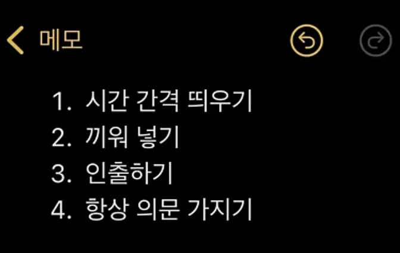

1. 시간간격 띄우기
    - &#91;금요일&#93; 저녁 3시간 공부 → <strong><u>&#91; 월, 수, 금&#93; 1시간 </u></strong>

    - 간격은 많이 띄울수록 좋다

1. 끼워 넣기
    - 공부하다가 ‘<strong><u>이해가 너무 안되는데?’</u></strong> 상태가 오는 건 

    - <u>더이상 내 장기기억으로는 해석이 안된다</u>는 뜻이다&#46;

    - 그래서 한 파트만 주구장창 파는 게 아닌 <strong><u>중간에 다른 파트를 끼워 넣으면서 공부해는 게 좋</u></strong>다&#46;

    - ex) 수학 &#45; 단일 개념보다는 <u>&#91; 함수, 수열, 도형 &#93; 으로 번갈아가면서 푸는 것</u>이 좋다&#46; 

1. 인출하기
    - 공부 못하는 사람들이 가장 못하는 것이다&#46;

    - <strong><u>공부</u></strong>는 머리에 집어넣는게 아닌 <strong><u>꺼내는 것</u></strong>이다&#46; 

    - 같은 한자를 10번, 20번 쓰는 것보다 <strong><u>10개의 한자를 놓고 가리고 천천히 3번씩만 돌아가면서 쓰면</u></strong> 다 외울 수 있다&#46; 

1.  항상 의문 가지기
    - 공부 중인 내용에 대해 ‘왜?”, “어떻게?” 꼬리에 꼬리를 무는 질문을 계속 던져야 한다&#46; 

    - 이렇게 하면 내용이 유기적으로 연결되어 기억도 잘난다&#46;
