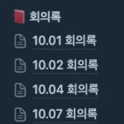
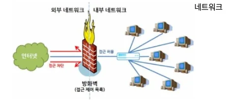
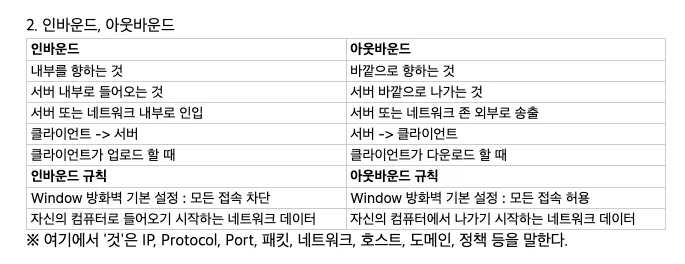

> 💡 
> 
> 
> 
> PDS 다이어리 참조

### PlAN ( 오늘 학습할 내용들 )

---

- [x] 팀 발표 피드백 

- [x] 네트워크 복습 &#45; TCP/IP

- [x] 방화벽 &#45; 인바운드 / 아웃바운드

### DO 

---

이번 주차 피드백  

> <a href="https://beautiful-college-c84.notion.site/1112dc3ef514811f95fcd19ac480f795?pvs=25">1주차 팀(11조) 노션</a> &#45; 발표자료

발표 피드백 

팀의 대표로 발표를 진행  → 대본을 간략하게 적으니 중간에 막혔을 때, 뇌정지가 옴… 

안 떨릴 줄 알았는데, 막상 발표를 하니 엄청 떨렸다… 

그리고 생각보다 다른 팀들이 준비를 잘해서 놀랐다&#46; 

다음 발표는 이번 피드백을 통해 더 잘해야 한다&#46; 

- 대본 작성하기, 작성 후 팀원들 앞에서 발표를 진행하며 피드백 받기

- 발표한 팀 중 팀원 두분이서 발표를 진행함&#46; 
    - 협동심 측면에서 좋은 모습이었음

자료준비 피드백

- 팀, 팀원 소개 페이지

- 각 팀원마다 구현한 기능

- 기능 &#45; 트러블 슈팅  
    - 내가 개발한 부분에 대한 어필을 하나도 못함

    - 이게 너무 아쉽다… 진짜 고생했는데 하나도 담질 못했다&#46; 

    - 팀 발표 영상 4분 제한 때문에 못담았는데, 이게 너무 아쉬웠다&#46; 

팀 노션 피드백

-  회의록 작성 및 기록
    

- 튜터님 피드백&#58;  강의 외 기능을 개발해 보는 것이 중요하다&#46; 

구현한 기능에 대한 피드백 

- 네이버 뉴스 기사 검색 기능
    

    로컬 서버를 스프링으로 구현하여  restTemplate를 사용하여 Naver api 에서 데이터를 받아와 클라이언트로  보내줬다&#46; 

    

    내 로컬 테스트에서는 베포한 github page에서도 정상 동작했으나  외부 요청은 아래 처리가 되지 않았다&#46; ( 외부 요청은 서버로 넘어오지도 못함 )

    

    이 부분에 대해서 계속 고민을 하다가 박진상 튜터님에게 도움을 받았다&#46; 

    

    <strong><u>로컬 방화벽 설정때문에 외부에서 서버(스프링)로부터의 요청이 차단</u></strong>되는 것 같다고 설명해주시면서 로컬 방화벽 환경을 해제하면서까지 진행하는 것은 좋지 않은 방법이라고 피드백 주셨다&#46; 

    

    그러면서 네트워크 &#45; TCP/IP, 방화벽 &#45; 인바운드/아웃바운드,  클라우드, 베포 자동화를 위한 CI/CD 등  개발 공부를 진행하면서 부족한 부분들을 개선하려고 하면서 공부를 하다보면 위와 같은 개념들을 자연스럽게 찾아보게 되고 지금과 같은 방법보다 더 좋은 방식으로 문제를 해결할 수 있다라고 도움을 주셨다&#46; 

    

    그래서 우선은 말씀해주신 방화벽에 관한 개념을 학습 및 정리를 진행했다&#46; 

방화벽  &#45; 인바운드 / 아웃바운드

reference

‣

- 방화벽이란?
    

    
🧐 병목 현상

    - 시스템 내에서 특정 부분이 전체 성능을 제한하는 현상

    - 마치 병의 목이 좁아 액체가 천천히 나오는 것 처럼 특정 지점이 느리면 전체 작업 속도가 해당 지점에 의해 제한되는 현상이다 

    

    

    - 네트워크 단계의 인터넷 보안 시스템 가운데 가장 널리 쓰이는 방법

    -  외부로부터 침입을 막는 벽으로 표현함

    - 방화벽은 물리적으로 네트워크를 연결하고 절단시키는 구조를 갖고 있어  응용프로그램을 고칠 필요없이 쉽게 사용 가능하다&#46;

    - 네트워크에 흘러다니는 모든 패킷(L3, 인터넷 계층의 데이터 전송단위)을 검사함으로써 해킹과 같은 외부 침입을 근본적으로 막을 수있다는 장점이 있다&#46;

    - 또한 관리자가 규칙을 정하면, 그에 따라 탄력적으로 운용되기 때문에 온라인 상황에서는 내 외부의 접속 상황을 감시할 수있어 병목 현상을 파악하는데 활용할 수있다&#46;  

    

### SEE ( 피드백 )

---

- 너무 피곤해서 일찍 잠&#46;&#46;
