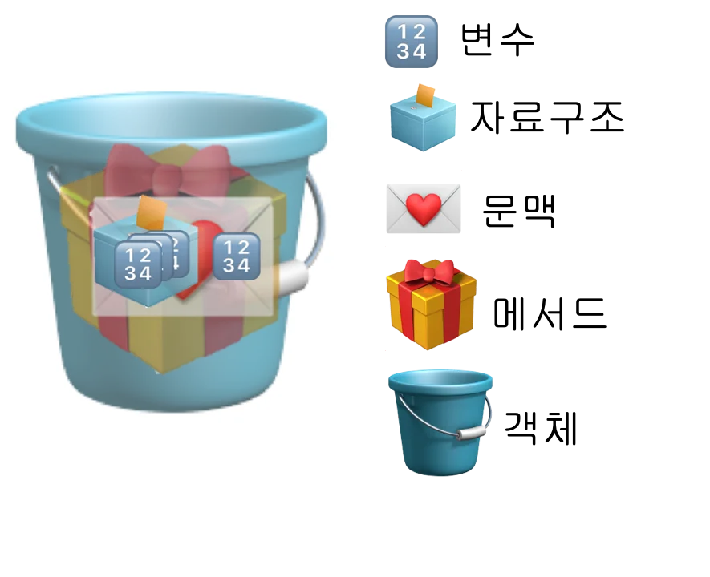
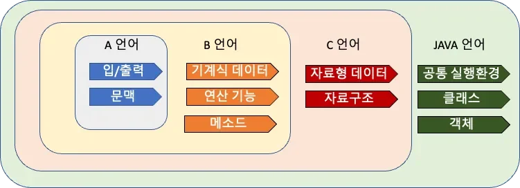
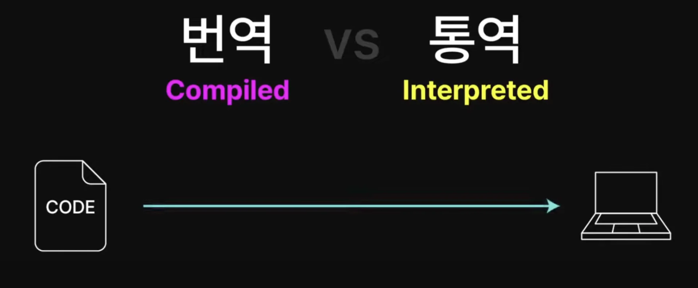
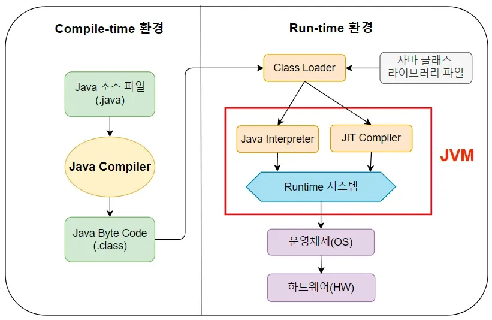
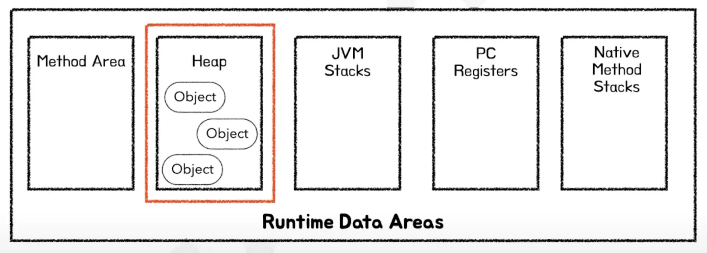
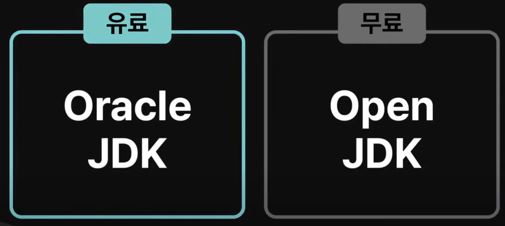

> 💡 
> 
> 
> 
> PDS 다이어리 참조

### PlAN ( 오늘 학습할 내용들 )

---

- [x] JVM

- [x] JRE

- [x] JDK 

### DO ( 오늘 공부한 내용)

---

> <a href="https://beautiful-college-c84.notion.site/213de689e18f49d7bfbbb2d46e7663d8">페이지</a> 

자바 역사, 특징

- ‘언어’는 사람과 사람과의 소통을 위해 사용된다&#46;  이렇듯 프로그래밍 ‘언어&#39;도 사람과 컴퓨턴 간에  소통을 위해 사용된다 
    > 컴퓨터는 <code>‘0’</code> 과 ‘<code>1’ </code>밖에 이해하지 못한다&#46; 

- 프로그래밍의 모든 것은 시스템이며 시스템은 <code>input</code>  과 <code>output</code>으로 이루어진다&#46; 
    -  동일한 input 값 입력 시, 동일한 output 값 도출 
        

언어의 역사

🧐 기계식 데이터 타입과, 자료형 데이터 타입의 차이는?

기계식 데이터 타입

- <u>하드웨어</u>가 실제로 데이터를 처리하는 방식과 관련된 데이터 타입 즉, <strong><u>CPU</u></strong>와 <strong><u>메모리</u></strong>에서 <strong><u>사용</u></strong>하는 <u>데이터 표현 방식</u>
    - 비트 (bit), 바이트 (byte), 워드 (word) 등

- 실제로 메모리에서 데이터를 0과 1로 어떻게 저장하고 해석하는지와 관련되어 있다&#46;
    - 32비트 시스템 → 정수형 데이터가 32 비트로 표현됨

자료형 데이터 타입 

- <strong>프로그래밍 언어</strong>에서 데이터를 정의하고 사용하는 방식
    - 기본형 타입&#58; int, double, char  등

    - 침조형 타입&#58; List, Map

??

- 8비트, 1바이트 → char 타입

- 16비트, 2바이트 → short 타입

- 32비트, 4바이트 → int 타입

- 64비트, 8바이트 → long 타입

A 언어

- 첫 개발 언어라는 의미 → A Programming Language의 약자

- 발표&#58; 1960년

- 핵심 기능
    - <code>I/O</code>, <code>문맥</code>

    - 프로그램(시스템)을 만들기 위한 기본적인 기능(<code>I/O</code>, <code>문맥</code>)만 구현됨

B 언어

- Bell 사에서 개발  → B  언어 

- 발표&#58; 1960년

- 핵심 기능
    - A 언어 기능( <code>I/O</code>, <code>문맥</code>)  &#43; <code>기계식 데이터 타입</code>, <code>연산 기능</code>, <code>메서드</code> 

    - 기본 기능(<code>I,O</code>, <code>문맥</code>)에 데이터를 담을 수 있는 <code>타입</code>이 생시고, 데이터를 <code>연산</code>하고 묶어서 관리할 수 있는 <code>메서드</code> 구현이 가능해짐

C 언어

- B언어에 비해 더 좋은 언어라는 의미로 알파벳 B 다음인 알파벳 C를 따서 C언어

- 발표&#58; 1970년

- 핵심 기능
    -  B 언어 기능 &#43;  <code>자료형 데이터 타입</code> &#43; <code>자료구조</code>

    - B언어의 기능에 <strong>다양한 </strong><u>데이터 타입</u><strong>을 정의</strong>하고 <strong><u>자료구조</u></strong><strong>를 담</strong>을 수 있게 됨

Java 언어

- 어디서나 마시는 커피처럼 어디서나 동작 가능한, 자바 커피에서 이름을 따서 만든 Java 언어

- 발표&#58; 1990년

- 핵심 기능
    -  C언어 기능 &#43; <code>공통 실행환경(JVM)</code> &#43; <code>클래스</code> &#43; <code>객체(인스턴스)</code>

🧐 Compiled, Interpreted, java 특성

컴파일(번역)

- 코드를 실행 전, <code>미리</code> 컴퓨터가 읽을 수 있는 언어로 변환

- 번역 과정이 번거롭지만, 이 과정에서 많은 문제들이 걸러지고, 실행 속도가 빠르다&#46; 

인터프리터(통역)

- 사람이 작성한 코드가 컴퓨터로 전달되어, 통역을 해주는 프로그램인 인터프린터가 
    

    실시간으로(한줄 씩) 번역하여 컴퓨터에게 전달돼 실행이 됨

- 개발이 더 간편하지만, 오류에 취약하며, 실행이 더 느림

C 계열 과, Java 등 언어들을 미리 번역되는 컴파일 되는 언어이다&#46; 

JVM ( Java Virtual Mashine )

Reference

- ‣

- ‣

- 위와 같이 <strong><u>자바로 작성한 코드</u></strong>가 <strong><u>자바 컴파일러</u></strong>에 의해  <strong><u>자바 바이트 코드로 변경</u></strong>되고 <strong><u>변경된 바이트 코드</u></strong>가 <strong><u>JVM</u></strong>에 의해 <strong><u>어느 운영체제에서든 실행될 수 있게 변환</u></strong>되어 실행된다&#46; 

- 따라서 사용하는 기기에 JVM이라는 프로그램을 설치하면 어느 운영체제인지, 어떤 언어인지 신경쓰지 않고 편리하게 코드의 실행이 가능하게 한다&#46; 

- JVM은 자바외에도 코틀린, 스칼라, 그루비, Clojure 등의 다른 언어들도 사용 가능하다&#46; 
    - 컴파일 시 <strong><u>자바바이트 코드</u></strong> 변환되기 때문에 가능하다&#46; 

구성

바이트 코드

- 자바 코드(<code>&#46;java</code>)가 컴파일러를 통해 자바 바이트 코드(<code>&#46;class</code>) 변환되어 클래스 로더로 넘어간다&#46; 

인터프리터

- 운영체제가 읽은 바이트 코드기기(기계)가 실행할 수 있는 기계어로 번역

- 변환된 <strong><u>바이트 코드는</u></strong> 인터프리터를 통해 기계어로 변환되어 CPU에 작업을 할당한다&#46;  

JIT 컴파일러

- 빠른 java &#46;class 코드 해석기

- 인터프리터의 효율을 높여주는 서포터 해석기 이다&#46; 

메모리영역

- Java 데이터를 저장하는 영역

- 운영체제로 부터 JVM이 할당받은 메모리 영역

클래스 로더

- java <code>&#46;class</code> 바이트 코드를 JVM의 메모리 영역이 Runtime Data Area로  넘겨준다&#46; 

가비지 컬렉터

Heap 

- 런타임에 생성되는 모든 객체들이 저장된다&#46; 

- Heap 메모리 영역에서 런타임 시에 생성된 객체들을 주기적으로 정리한다&#46; 

JRE  ( Java Runtime Environment, 자바 실행 환경 )

- 자바로 짠 코드를 실행 시에는 JRE가 설치되어 있어야 한다&#46; 

JRE에는 Java의 표준 라이브러리가 포함되어 있다&#46;

만약 자바가 요리라면, 표준 라이브러리는 요리 기초 가이드북이다&#46;

- 기초 요리 가이드북이 야채의 채써는 방법, 양념장은 어떻게 만드는지, 오븐은 어떻게 쓰는지 등 기초적인 요리 방법에 대해 알려주듯이 

- 자바 표준 라이브러리는  자바 개발 시 사용되는 산술 기능, 출력 기능, 통신 기능 등 널리 사용되는  기초 기능들을 기본으로 제공하여 편리하게 개발할 수있게 해준다&#46; 
    

- 각 종 설정 파일 등 자바 바이트 코드 실행에 필요한 요소들도 포함 된다&#46; 

- <strong>JRE</strong>는 <code>&#46;class</code> 파일만 실행 가능
    - <strong><u>JDK</u></strong> 가  자바 컴파일러(<code>javac</code> 명령)를 통해 자바 코드(<code>&#46;java</code> )을 실행 가능한 자바 바이트 코드(<code>&#46;class</code>) 변환

JDK ( Java Development Kit )

- 개발자가 자바로 프로그래밍하는 전 과정을 도와주는 자바 코드 제작 키트
    - 자바 컴파일러(번역) &#45; 자바 코드 → 자바 바이트 코드

    - 디버거 &#45; 자바  코드를 하나하나 뜯어보고 문제가 없는지 살필 수 있게 도와줌

    - JAR &#45; 컴파일러가 번역한 자바바이트 코드 압축 
        > AWS 사용 시 JAR로 코드를 변경하여 업로드하라는 말이  AWS에서 할당 받은 외부 컴퓨터에서 실행할 수 있게 내 코드를 컴파일 시켜 자바 바이트 코드로 만든 후 JAR로 압축하여 업로드하라는 말이었음, 드디어 이해함

    - 프로파일러 &#45; 성능 모니터링

- JDK 통해 자바를 개발하고 테스트하고 실행한다&#46;  이것이 자바로 코딩 시 왜 JDK를 설치하는지에 대한 이유이다&#46; 

오라클 

> 🧐 그렇다면 어디서 자바와 JDK를 만들고 관리하는가?

Java

- 현재 자바 언어는 오라클이라는 회사에서 맡아 관리하고 있다&#46; 

LTS&#58; 장기 지원 버전

- 빅맥, 와퍼, 한우불고기 버거 같은 스테디 셀러들 처럼 오래쓰라고 제대로 각 잡고 만든 버전이다&#46;

- 업데이트, 보안 수정이 장기간 제공되기 때문에, 실무 개발 시 안정적인 LTS 버전을 사용한다&#46; 

실험 버전 

- 이벤트 메뉴들처럼 잠깐 반짝이고 사라지는 한정 메뉴들처럼 다음 LTS를 위한 실험 버전들이다&#46; 

- 새로운 기능들을 맛볼순 있으나, 버전 지원이 짧기 때문에 실제품에는 잘 사용하지 않는다&#46; 

JDK

JDK 유료, 무료 버전

- 유료 버전에 보다 많은 기능을 제공 

- Open JDK도 개인이나 소규모 회사에서 사용하기에 충분한 안전성을 가지고 있다&#46; 

JDK는 오라클에서만 만드는 것이 아닌, 다양한 회사들이 무료 또는 유료로 제공하고 있다&#46; 

- 즉, 자바의 언어와 표준은 오라클에서 관리하지만 자바로 소프트웨어를 개발하고 실행하는 JDK는 다양한 곳에서 만들어져 출시된다&#46; 
    - <a href="http://whichjdk.com">whichjdk&#46;com</a> 에서 각각의 특성과 권장 용도를 살펴볼 수 있다&#46; 
        - ex) Amazon Corretto → AWS 환경에서 동작하는데 최적화

- 따라서 어느 용도로, 어느 규모의 조직이나 회사에 따라 자바 프로그램을 개발하고 사용할 것인가에 따라 그에 맞는 JDK를 사용하면 된다&#46; 

### SEE ( 피드백 )

---

- JVM
    - JVM 이전에 한번 공부하다가 이해가 안되서 보류한 내용인데, 이번 기회에 다시 도전했다&#46;

    - 어렵지만 그래도 생각보다 할만해서 굉장히 놀라웠다&#46;  

    - 물론 완전히 이해하지는 못했지만 계속 공부하면서 학습하다보면 언젠가는 코드로도 만들어볼 날이 오겠지…

- 컨디션
    - 굉장히 피곤하다 저번 주 과제 때문에 주말에도 계속 작업을 했더니 몸이 피로가 쌓였다&#46; 

    - 내일은 좀 푹 쉬어야겠음
