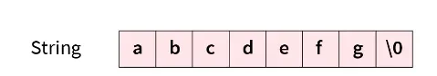
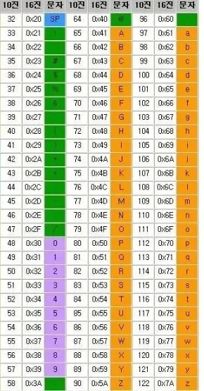

> 💡 
> 
> <a id="11beda9b0fe18184a643ef96199264ad"></a>
> 
> PDS 다이어리 참조

<a id="11beda9b0fe18115aa70fc7fa3154390"></a>

### PlAN ( 오늘 학습할 내용들 )

---

- [x] 자바 문법 &#45; 1주차 학습

- [x] 자바 문법 &#45; 2주차 학습

- [x] Linked List 자바 구현

<a id="11beda9b0fe181da84a3c5338eb58af5"></a>

### DO ( 오늘 공부한 내용)

---

> <a href="https://beautiful-college-c84.notion.site/213de689e18f49d7bfbbb2d46e7663d8">페이지</a> &#45; 1주차, 2주차

<details>
<summary>1주차</summary>

<details>
<summary>변수&#58; 재할당 가능</summary>

<a id="11ceda9b0fe1808cbc9cd571e12ec6e1"></a>

```java
타입 변수명       // 선언
변수명 = 값;     // 할당
타입 변수명 = 값; // 초기화
```

</details>

<details>
<summary>상수&#58; final 키워드, 재할당 불가</summary>

<a id="11ceda9b0fe180fe8963ca70a931ec2b"></a>

```java
final int number = 10;  // 상수 선언

number = 11; // Error, 재할당 불가
```

</details>

<details>
<summary>타입</summary>

<details>
<summary>기본형</summary>

- 논리형&#58; true, false

- 문자형&#58; char, <code>‘’</code>

<details>
<summary>정수형</summary>

- byte&#58;(1byte)&#58; &#45;128 &#126; 127

- short(2byte)&#58;  &#45;32,768 &#126; 32,767

- int(4byte)&#58; &#45;21억 &#126; 21억

- long(8byte)&#58; 9백경,  끝에L

</details>

<details>
<summary>실수형</summary>

- float(4byte)&#58; 소수점 7번쨰

- double(8byte)&#58;  소수점 16번째

</details>

</details>

<details>
<summary>참조형</summary>

- String

- Array, List, Object

</details>

<details>
<summary>래퍼클래스</summary>

- 기본형 클래스로 감싸, 객체지향 특성 사용

- Character …


</details>

</details>

<details>
<summary>문자, 문자열</summary>

<details>
<summary>선언</summary>

<details>
<summary>문자&#58; char, <code>‘’</code></summary>

<a id="11ceda9b0fe18042a33ffd6142ebf2d1"></a>

```java
char ch1 = 'a';
```

</details>

<details>
<summary>문자열&#58; String,  <code>“”</code></summary>

<a id="11ceda9b0fe1800bb6c3ca82d33bb8a2"></a>

```java
String str1 = "abc";
```

</details>

</details>

<details>
<summary>저장</summary>

- 문자&#58; 문자 한개, 1byte, 길이 고정

- 문자열&#58; 길이 고정 X, &#92;0 끝을 내림



</details>

</details>

<details>
<summary>형변환</summary>

- 직접 형변환&#58; 캐스팅<code>()</code>
    <details>
    <summary>숫자 ↔ 문자</summary>

    <details>
    <summary>ASCII </summary>

    

    </details>

    <a id="11ceda9b0fe1805ea539c93a006a0923"></a>

    ```java
    // 숫자 -> 문자
    int i1 = 97;
    char c1 = (char) i1;
    System.out.println(c1); // a

    // 문자 -> 숫자
    char c2 = a;
    int i2 = (int) c2;
    System.out.println(i2);  // 97
    ```

    </details>

    <details>
    <summary>실수 → 정수&#58; 소수점 날림</summary>

    <a id="11ceda9b0fe1802a8529c1b352a859cd"></a>

    ```java
    float f1 = 1.999;
    int i1 = (int) f1;

    System.out.println(i1);   // 1;
    ```

    </details>

- 자동형변환

<details>
<summary>저장&#58; 작은 크기 → 큰 크기</summary>

- byte → int
    <a id="11ceda9b0fe180d5a339c7d328bfcfcf"></a>

    ```java
    byte byteNum = 10;
    int intNum = byteNum    // byte -> int 형변환
    System.out.println(intNum);  // 10;
    ```

- char(1byte)→ int(4byte)
    <a id="11ceda9b0fe180bc90b1e4d5eb1f02e7"></a>

    ```java
    char char1 = 'a';
    intNum = char1;  // char -> int 형변환
    System.out.println(intNum);  // 97  
    ```

- int(4byte) → long(8byte)
    <a id="11ceda9b0fe180f88e8cd5b09df02587"></a>

    ```java
    int intNum = 200;
    long longNum = intNum  // int  -> long 형변환
    System.out.println(doubleNum);   //  200
    ```

- int(4byte) → double(8byte)
    <a id="e787b8f0be5d41ee86b39c8cb1e11809"></a>

    ```java
    int intNum = 200;
    double doubleNum = intNum  // int  -> double 형변환
    System.out.println(doubleNum);   //  200.0  (소수점이 추가된 실수출력)
    ```

</details>

<details>
<summary>계산&#58; 작은 크기 → 큰 크기</summary>

- int(4byte) <code>&#43;</code> double(8byte) = double
    <a id="11ceda9b0fe180e2b725ecf7139879b6"></a>

    ```java
    int intNum = 10;
    double doubleNum = 5.5;
    double result1 = intNum + doubleNum;   // double로 형변환
    System.out.println(result1);   // 15.5
    ```

- int / int = 정수 ( 소수점 버려짐)
    <a id="11ceda9b0fe180e792bede8042219f71"></a>

    ```java
    int intNum = 10;
    int result2 = 10 / 4;
    System.out.println(result2);  // 2, 소수점 버려짐
    ```

- int / float(실수)  = float( 실수 )
    <a id="11ceda9b0fe180eaa090c276de85dd19"></a>

    ```java
    intNumber = 10;
    double result3 = intNumber / 4.0; // double형 연산 -> 소수점 저장

    System.out.println(result3)      // 2.5 
    ```

</details>

</details>

</details>

<details>
<summary>2주차 </summary>

<details>
<summary>조건문</summary>

- if

- switch &#45; case

</details>

<details>
<summary>반복문</summary>

- for

- for&#45;each

- while

- break

- continue

</details>

<details>
<summary>배열</summary>

- 얕은 복사, 깊은 복사

- 일차원 배열

- 다차원 배열

- 가변 배열

</details>

<details>
<summary>컬렉션</summary>

- ArrayList

- LinkedList

- Statck

- Queue

- Set

- 

</details>

</details>

<details>
<summary>LinkedList  자바 구현</summary>

<a id="11ceda9b0fe180578d38d7a9dea30116"></a>

```java

import java.util.ArrayList;
import java.util.List;
import java.util.Scanner;


class Node {
    protected int val;
    protected Node next;

    Node(int val, Node next) {
        this.val = val;
        this.next = next;
    }

}

class LinkedList {
    private static Node head = null;

    // 생성
    public void add(int value) {
        // LinkedList 초기화
        if(head == null){
            head = new Node(value, null);
            return;
        }

        Node node = head;
        while(node.next != null){
            node = node.next;
        }

        node.next = new Node(value, null);
    }

    // 조회
    public int get(int index){
        if(head == null){
            System.out.println("조회할 노드개 존재하지 않습니다.");
            return -1;
        }

        Node node = head;
        while(index>0){
            node = node.next;
            index--;
        }


        return node.val;
    }


    // 수정
    public void update(int index, int value){
        if(index < 0) {
            System.out.println("index는 0이상부터 가능합니다.");
            return;
        }

        int prtIdx = index;

        Node node = head;

        while(index>0){
            if(node.next==null){
                System.out.println("해당하는 index = " + prtIdx + " 의 노드는 존재하지 않습니다.");
                return;
            }
            node = node.next;
            index--;
        }
        node.val=value;

        System.out.println(prtIdx + "번째 node 값이 " + value +"로 수정 됐습니다.");
    }

    // 제거
    public int remove(){
        if(head==null){
            System.out.println("삭제할 노드가 존재하지 않습니다.");
            return -1;
        }
        Node node = head;

        head = node.next;
        return node.val;
    }
}
public class Main {
    public static void main(String[] args) {
        LinkedList list = new LinkedList();
        list.add(1);
        list.add(2);
        list.add(3);

        // 조회
        System.out.println(list.get(2));  // 3
        System.out.println(list.get(1));  // 2
        System.out.println(list.get(0));  // 1

        // 수정
        list.update(1, 5);
        System.out.println(list.get(1));  // 5

        // 삭제
        System.out.println(list.remove());  // 2
        System.out.println(list.remove());  // 3 , update
        System.out.println(list.remove());  // 0
        System.out.println(list.remove());  // -1

    }
}

```

</details>
