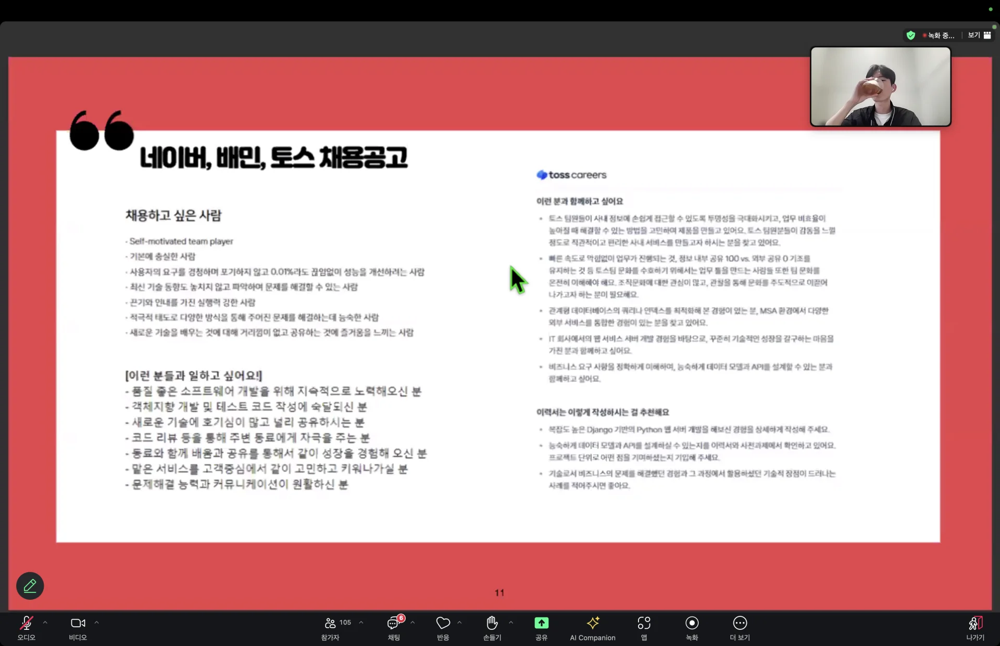
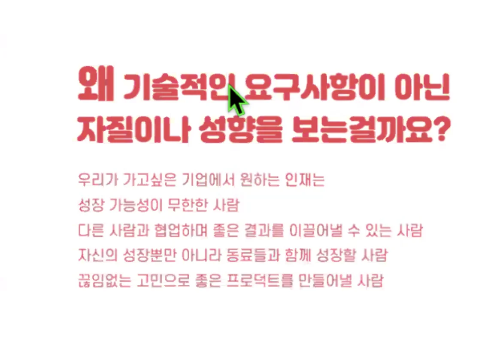
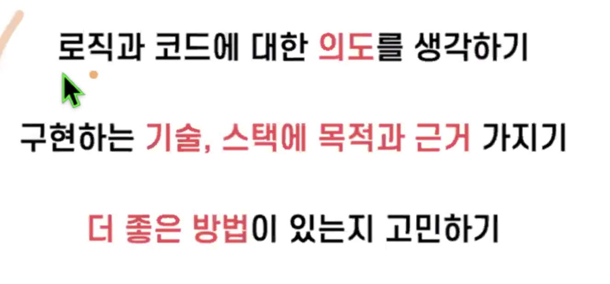
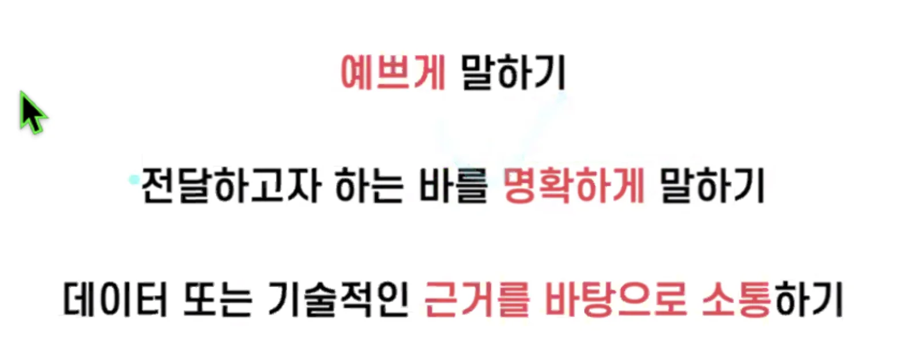

### 코더가 아닌 개발자가 되는 법

개발을 진행하면 정말 많은 문제들을 마주하게 된다&#46;

- 문제 인식 → 이 문제를 해결하기 위해 어떠한 선택을 했는지
    

    → 옳은 선택인지, 아닌지

    

    ⇒ 기록

    - 문제 인식

    - 의사 결정 과정

    

    ⇒ 비슷한 문제를 마주치면 더 빠르게 해결

- 좋은 팀을 만드는데 → 굉장히 오래 걸림
    - 잘못된 팀원 → 팀이 망가짐

    - 단기간에 보여지는 실력도 보지만

    - 이 사람이 얼마나 자기 성장을 위해 얼마나 꾸준히 노력하는지 

    - 이사람의 사고의  깊이가 어느  정도까지 되는지

    

    ⇒ 하루 공부 잘 정리하기

- 배운 내용 복습 → 사고력, 구현력 중점적으로 단련

- 기술적인 의사결정, 기술적 고민

- 어떤 프로젝트, 어떤 기능 → 이 부분을 구현하기 위해 이러한 선택을 했다&#46;

- 이 과정과, 트레이드 오프를 고려했을 때, 이러한 선택이효율적이라 생각했다&#46; 

- 주니어 개발자
    - 레거시 코드 개선 (빡셈)

    - 동료와 소통하며 원활한 협업

- 좋은 개발자에 대한 수요는 항상 있다&#46; 
    - 

기록 남기기 ⇒TIL, WIL, 알고리즘

- 하드스킬&#58; 개발 기술

-  소프트 스킬&#58; 협업 관련 기술

- 신입을 뽑는다면 어떤 것을 제일 많이 보는가?
    - 1&#46;  문제 해결 능력
        - 문제를 인식하는 능력
            - 내 서비스 안에서 문제가 발생했을 때, 어떻게 이 문제를 인식하는가?

            - 이 문제가 어떤 측면 때문에 발생하고, 이 문제를 해결하기 위해 무엇을 할 수 있는가?

    - 2&#46; 커뮤니케이션이 안 불편한 사람
        - 팀의 활동이다&#46; 의사소통이 잘 되지 않으면, 힘들다

        - 동문서답

### 하드(기술) 스킬 기르기 (<code>왜?</code>)

- 로직과 코드에 대한 의도를 생각하기

- 구현하는 기술, 스택에 목적과 근거 가지기
    - 내가 구현한 기능에 대한 근거를 생각하기 

    - ‘이걸 왜 이렇게 구현 했냐면’

- 더 좋은 방법이 있는지 고민하기
    - 디자인 문서 
        - 개발 시, 하나의 프레임 워크만 아닌 대안들을 2 3개를 가져간다&#46;

        - 장, 단점을 정의 및 고민 

### 소프트 스킬&#58; 커뮤니케이션(협업)

- 예쁘게 말하기&#58; 돌려서 돌려서 말하기 

- 명확하게 말하기
    - 두괄식 

- 데이터 또는 기술적인 근거를 바탕으로 소통하기 

### 내배캠 9to9 학습 방법
