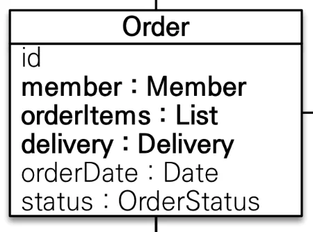
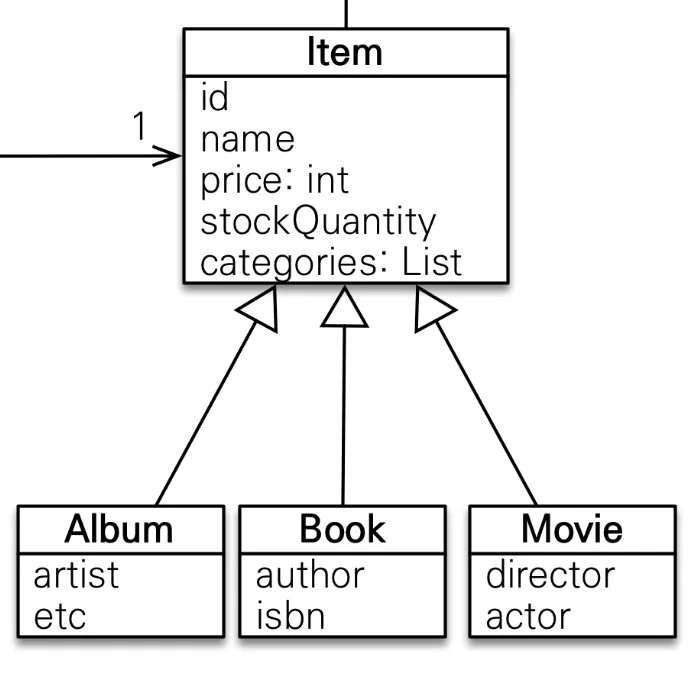
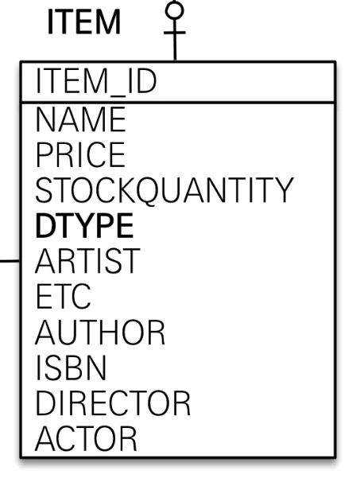
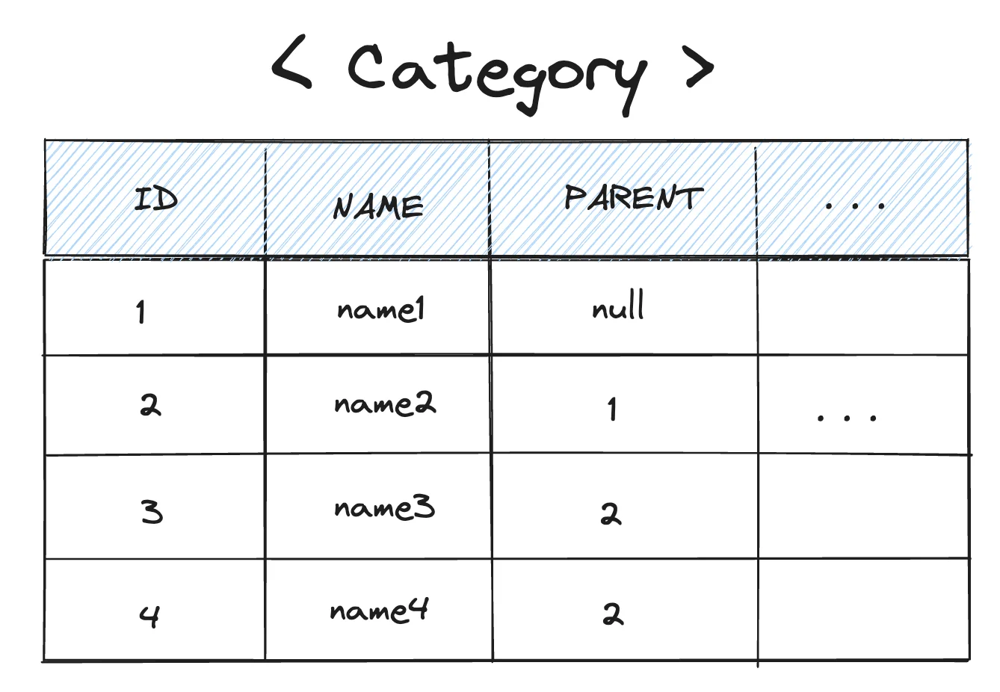
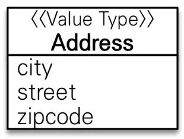

> 💡 
> 
> <a id="11feda9b0fe1810da7c9f6f974ad18c0"></a>
> 
> PDS 다이어리 참조

<a id="11feda9b0fe181598fdce1c1f3845379"></a>

### PlAN ( 오늘 학습할 내용들 )

---

- [x] 자바 문법 &#45; 3주차 정리

- [x] &#91;인프런&#93; JPA2 활용 &#45; 프로젝트 설정  

- [ ] &#91;인프런&#93; JPA2 활용 &#45;  ch1 정리

<a id="11feda9b0fe1813886cac18a617e864a"></a>

### DO ( 오늘 공부한 내용)

---

<details>
<summary>자바 문법 종합</summary>

> <a href="https://beautiful-college-c84.notion.site/213de689e18f49d7bfbbb2d46e7663d8">페이지</a> &#45; 3주차 정리

<details>
<summary>3주차 </summary>

- 클래스
    - 인스턴스

    - 필드

    - 메서드

    - 생성자

- 오버로딩

- this, this()

- 접근 제어자

</details>

</details>

<details>
<summary>JPA</summary>

> <a href="https://beautiful-college-c84.notion.site/535e1db7661e408ca2eaddee3e8dc2b0">페이지</a> 

<details>
<summary>기본 도메인 설정 </summary>


</details>

<details>
<summary>&#91; 코드 &#93; domain</summary>

<details>
<summary><strong>회원 ( Member )</strong></summary>


<details>
<summary><strong>&#91; 코드 &#93; Member</strong></summary>

- Id 값 자동 생성&#58; <code>&#64;GeneratedValue(strategy = GenerationType&#46;xxx)</code>

<details>
<summary>값 타입(임베디드)&#58; <code>&#64;Embaddatble</code>, <code>&#64;Embadded</code></summary>

- 값 타입(임베디드)를 통해 특정 속성을 가지는 필드들을 캡슐화 처리

</details>

<details>
<summary><code>1&#58;N</code> 연관관계 매핑 &#58;  <code>&#64;OneToMany</code></summary>

- <code>&#64;OneToMany</code>는 지연로딩이 default 값이다&#46; 따라서 그냥 사용하면 된다&#46; 
    

</details>

<a id="11feda9b0fe1813aaffef149d38c5670"></a>

```java
package com.prac.jpa1.domain.member;


import com.prac.jpa1.domain.order.Order;
import jakarta.persistence.*;
import lombok.Getter;
import lombok.NoArgsConstructor;
import lombok.Setter;

import java.util.ArrayList;
import java.util.List;

@Entity
@Getter
@Setter  // 작은 프로젝트라서 사용, 실무에서는 생성자를 통해서만 주입
public class Member {

    @Id @GeneratedValue
    @Column(name="member_id")
    private Long id;

    private String name;

    @Embedded
    private Adress adress;  // ?? 왜 오류가 나지? -> 값 타입(임베디드) 설정을 하지 않음

    @OneToMany(mappedBy = "member")
    private List<Order> orders = new ArrayList<>();
}

```

</details>

</details>

<details>
<summary><strong>주문 ( Order )</strong></summary>



<details>
<summary><strong>&#91; 코드 &#93; Order</strong></summary>

<details>
<summary><code>&#64;Table(name=”orders”)</code></summary>

- 테이블명이 <code>ORDER</code> 가 아니라 <code>ORDERS</code> 인 것은 데이터베이스가 <code>order by</code> 때문에 <strong>예약어</strong>로 잡고 있는 경우가 많다&#46; 그래서 관례상 <code>ORDERS</code> 를 많이 사용한다&#46;

</details>

- Id 값 자동 생성&#58; <code>&#64;GeneratedValue(strategy = GenerationType&#46;xxx)</code>

<details>
<summary><code>N&#58;1</code> 연관관계 매핑&#58; <code>&#64;ManyToOne</code>, <code>&#64;JoinColumn</code></summary>

<details>
<summary><code>&#64;ManyToOne(</code><u><code>fetch = FetchType&#46;</code></u><strong><u><code>LAZY</code></u></strong><code>)</code></summary>

>  <a href="https://beautiful-college-c84.notion.site/2bebc99a09834df2a642b4bc666d2066">페이지</a> 

- <code>&#64;ManyToOne</code>은  즉시로딩(<strong>EAGER</strong>)이 기본 값 이다&#46;<br> 따라서  <strong><u>지연로딩(LAZY) 설정</u></strong>을 해줘야 한다&#46;
    

</details>

<details>
<summary><code>&#64;JoinColumn</code></summary>

> 참조&#58; <a href="https://beautiful-college-c84.notion.site/7d26ece339534ec6960b3bba44c0a813">페이지</a> &#45; <code>&#64;JoinColumn</code> 

- 회원(Member) 엔티티와의 다대일 연관관계가 형성된다&#46;
    - Member &#58; Order = <code>1 &#58; N</code>

- 연관관계의 매핑이 테이블의 Join 과 유사한 방식으로 동작하기 위해서는 <br><u><code>N</code></u><u> 관계를 가지는 엔티티</u>를<strong> </strong><strong><code>연관관계의 주인</code></strong>으로 설정해야 한다&#46; 
    > 참조&#58; <a href="https://beautiful-college-c84.notion.site/7d26ece339534ec6960b3bba44c0a813">페이지</a> &#45; <code>&#64;OneToMany</code> &#95;<code>1=연관관계의 주인</code>

- 즉, <u><code>N</code></u><u> 관계를 가지는 엔티티</u>에 <code>&#64;JoinColumn</code>을 사용하여 연관관계를 형성할 다른 주체(엔티티)를 지정해줘야 한다&#46;

- 지정하려는 엔티티는<code> id 값(PK)</code>으로 구분되며 해당하는 id 값은 테<strong><u>이블 반영 시 </u></strong><code>외래 키(Foreign key)</code>로 매핑되어 <strong><u>두 테이블을 join 처리</u></strong>한다&#46; 


</details>

</details>

<details>
<summary><code>1&#58;N</code> 연관관계 매핑&#58; <code>&#64;OneToMany(</code><strong><u><code>mappedBy</code></u></strong><code>=””)</code></summary>

- 양방향 연관관계 매핑을 형성하기 위해서는 아래와 같다&#46;
    <a id="11feda9b0fe1817cbeb5e19bbe0e6537"></a>

    ```java
    @OneToMany(mapppedBy="연관관계 주인 필드명")
    ```

    <details>
    <summary>🧐 연관관계 주인 필드명</summary>

    <a id="11feda9b0fe181d194c1e5c1fe048ec0"></a>

    ‘연관관계 주인 필드명’은 말 그대로 ‘연관관계의 주인의 필드 이름’을 말한다&#46;

    <a id="11feda9b0fe181489a1bdc49bfabe5fc"></a>

    아래의 예시에서는 OrderItem에서의 <code>&#64;ManyToOne</code> Anotation을 가진, 연관관계의 주인인 필드의 이름 즉, order를 말한다&#46; 

    - OrderItem
        <a id="11feda9b0fe1815487faffb8e93e181a"></a>

        ```java
        public class OrderItem {

            @Id @GeneratedValue(strategy = GenerationType.IDENTITY)
            @Column(name="order_item_id")
            private Long id;

            @ManyToOne
            @JoinColumn(name="order_id")
            private Order order;
        ```

    <a id="11feda9b0fe181a8a578f18e194a73e9"></a>

    해당하는 <strong><u>연관관계의 주인 필드명</u></strong>인 <code>order</code>를 <code>&#64;OneToMany</code>의 <code>mappedBy</code> 속성에 명시하여 양방향 연관관계를 형성시킬 수 있다&#46;

    - Order
        <a id="11feda9b0fe181e4a044e3fc021857dc"></a>

        ```java
        public class Order {

        		.  .  .

        		@OneToMany(mappedBy = "order")
            private List<OrderItem> orderItems = new ArrayList<>();
        ```

    </details>

<details>
<summary>양방향 연관관계 매핑(역방향 참조)</summary>

> ☝🏻 해당 참조값은 엔티티에서만 형성되는 연관관계이다&#46; 
> 
> <a id="11feda9b0fe1816898a4cde8795e9459"></a>
> 
> 테이블에서는 반영되지 않는다&#46;
> 
> <a id="11feda9b0fe181fca78fcc6ccab41ea5"></a>
> 
> 즉, 해당 필드는 읽기 전용 속성이며, 데이터의 변경이 일어나도 테이블에 반영되지 않는다 
> 
> - 양방향 &#45; 역방향 참조  <code>mappedBy</code>
>     
> 
>     > 👉🏻 <strong>양방향 연관관계&#58; 역방향 참조 </strong><strong><code>mappedBy</code></strong>
>     > 
>     > <a id="11feda9b0fe1819da75fc7af2d6975b4"></a>
>     > 
>     > 읽기만 가능 ( 해당 엔티티가 수정되어도 DB에 적용되지 않음 )
>     > 
>     > - <strong><code>&#64;OneToMany( mappedBy = {연관관계 주인 필드명})</code></strong>

</details>

- 지연로딩(LAZY)가 기본 값이므로 그냥 사용

</details>

<details>
<summary><code>1&#58;1</code> 연관관계 매핑&#58; <code>&#64;OneToOne</code></summary>

<a id="11feda9b0fe181eb92a5ea2e9b52e4dd"></a>

```java
@OneToOne(fetch = FetchType.LAZY)
@JoinColumn( name="연관관계를 형성할 테이블의 PK명" )


@OneToOne( mappedBy="연관관계 주인 필드명", fetch = FetchType.LAZY )
```

- 연관관계의 주인을 둘 다 명시할 수 있다&#46; 

- <code>&#64;ManyToOne</code>, <code>&#64;OneToMany</code> 와 설정 방식은 동일하다&#46;

</details>

<details>
<summary>영속성 전이 ( <strong>Cascasde</strong> ) </summary>

<a id="11feda9b0fe181a59bbfc9c60b54eddf"></a>

```java
@OneToMany(mappedBy = "", cascade = CascadeType.ALL)
```

- 부모 엔티티 저장 시 연관되어 있는 하위 자식 엔티티까지 한번에 저장한다&#46;

- 즉, <code>1&#58;N</code> 연관관계에서 1의 관계를 가지는 엔티티가 저장될 때, N의 관계를 갖는 엔티티를 한번에 저장한다&#46;<br>

</details>

<details>
<summary><code>Enum</code> OrderStatus&#58; <em><code>ORDER</code></em>, <em><code>CANCEL</code></em></summary>

<details>
<summary><code>&#64;Enumerated(EnumType&#46;STRING)</code></summary>

> 참조&#58; <a href="https://beautiful-college-c84.notion.site/d71e7c87b92a4c4f8aad3f3aefde8e9f">페이지</a> 

<details>
<summary><strong>enum 타입 매핑 &#45; &#64;Enumerated(EnumType</strong><strong>&#46;</strong><em><strong>STRING</strong></em><strong>)</strong></summary>

- <strong>자바 enum 타입을 매핑할 때 사용</strong>
    - DB에는 enum 타입이 존재하지 않음, 따라서 <code>&#64;Enumerated</code>를 통해 사용함

<details>
<summary>🧐 default&#58; <code>EnumType&#46;ORDINAL;</code> </summary>

<a id="11feda9b0fe181aca509c8a889cc1223"></a>

```java
@Target({ElementType.METHOD, ElementType.FIELD})
@Retention(RetentionPolicy.RUNTIME)
public @interface Enumerated {
    EnumType value() default EnumType.ORDINAL;
}
```

</details>

| 속성  | 설명  | 기본값 |
| --- | --- | --- |
| value  | • EnumType&#46;ORDINAL&#58; enum 순서를 데이터베이스에 저장<br>• EnumType&#46;STRING&#58; enum 이름을 데이터베이스에 저장 | EnumType&#46;ORDINAL |

> ⚠️ <strong>STRING 사용 </strong>
> 
> > &#64;Enumerated(<strong>EnumType&#46;</strong><em><strong>STRING</strong></em><strong>)</strong>
> 
> <a id="11feda9b0fe181828bd8ef4bb76d28b2"></a>
> 
> ```java
> @Entity
> public class Member {
>    .  .  .
> 	
> 		@Enumerated(EnumType.STRING)
> 		private RoleType roleType;
> ```
> 
> <a id="11feda9b0fe18139a9ffc471c4a524be"></a>
> 
> String 사용 시, 아래와 같이 String 타입으로 저장되어 값이 추가되어도 기존의 값과 충돌하지 않음
> 
> 
> 
> <details>
> <summary><strong>사용 X </strong><strong>&#45;</strong><strong> </strong><strong>&#64;Enumerated(EnumType&#46;</strong><strong>ORIDINAL</strong><strong>)</strong></summary>
> 
> > oridinal 타입은<strong> Integer 타입으로 생성</strong>된다&#46; 따라서 추가 요구사항(guest)을 더하여 DB 값을 저장할 경우 <strong>기존의 값과 충돌</strong>되는 오류가 발생한다&#46; <br>→ 운영 서버에서 사용 시, 해결 불가능한 버그 발생함
> 
> 
> 
> </details>

</details>

</details>

</details>

<details>
<summary>연관관계 메서드</summary>

- JPA의 객체지향 컨셉을 활용한 방법

- 양방향 연관관계 시, 연관관계 메서드를 통해 한번에 참조값을 설정한다&#46;

<details>
<summary>&#91; 코드 &#93; addMember</summary>

- ManyToOne
    <details>
    <summary>역방향 연관관계 설정</summary>

    <a id="11feda9b0fe18140aadada4232da5ad5"></a>

    <code>1의 관계</code>를 갖는 Member 엔티티에서 orders를 가져와 member를  넣어줌

    <a id="11feda9b0fe18175aa61d630efd3b1cc"></a>

    ```java
    @Entity
    @Getter
    @Setter
    public class Member {

    			.  .  .

    		@OneToMany(mappedBy = "member")
        private List<Order> orders = new ArrayList<>();
    ```

    <a id="11feda9b0fe181bf9ee0fda8fdbe09d0"></a>

    ```java
    member.getOrders.add(this);
    ```

    </details>

<a id="11feda9b0fe181a3aa82f117d3e4d79c"></a>

```java
public void addMember(Member member){
		this.member = member;
		member.getOrders.add(this);
}
```

</details>

<details>
<summary>&#91; 코드 &#93; addOrderItem</summary>

- OneToMany
    <details>
    <summary>정방향 연관관계 설정</summary>

    - <code>orderItems(List&#60;OrderItem&#62;)</code>에 인자로 받는 orderItem 넣어줌
        <a id="11feda9b0fe181fcbfd9ef71da118648"></a>

        ```java
        @OneToMany(mappedBy = "order", cascade = CascadeType.ALL)
        private List<OrderItem> orderItems = new ArrayList<>();
        ```

    </details>

<a id="11feda9b0fe18146bedfed422b62d292"></a>

```java
public void addOrderItem(OrderItem orderItem) {
		orderItems.add(orderItem);
		orderItem.setOrder(this);
}
```

</details>

<details>
<summary>&#91; 코드 &#93; setDelivery</summary>

- OneToOne

<a id="11feda9b0fe181d1909bf071c8bc08a3"></a>

```java
public void setDelivery(Delivery delivery) {
		this.delivery = delivery;
		delivery.setOrder(this);
}
```

</details>

</details>

<a id="11feda9b0fe181bf82bbc0fec0dcca54"></a>

```java
package com.prac.jpa1.domain;

import com.prac.jpa1.domain.enums.OrderStatus;
import jakarta.persistence.*;
import lombok.Getter;
import lombok.NoArgsConstructor;
import lombok.Setter;

import java.time.LocalDateTime;
import java.util.ArrayList;
import java.util.List;

@Entity
@Table(name = "orders")
@Getter @Setter
public class Order {

    @Id @GeneratedValue
    @Column(name="order_id")
    private Long id;

    @ManyToOne(fetch = FetchType.LAZY)
    @JoinColumn(name = "member_id")
    private Member member;

    @OneToMany(mappedBy = "order", cascade = CascadeType.ALL)
    private List<OrderItem> orderItems = new ArrayList<>();

    @OneToOne(cascade = CascadeType.ALL, fetch = FetchType.LAZY)
    @JoinColumn(name="delivery_id")
    private Delivery delivery;

    private LocalDateTime orderDate;

    @Enumerated(EnumType.STRING)
    private OrderStatus status;


    //== 연관관계 메서드 ==//
    public void addMember(Member member) {
        this.member = member;
        member.getOrders().add(this);
    }

    public void addOrderItem(OrderItem orderItem) {
        orderItems.add(orderItem);
        orderItem.setOrder(this);
    }

    public void setDelivery(Delivery delivery) {
        this.delivery = delivery;
        delivery.setOrder(this);
    }
}

```

</details>

</details>

<details>
<summary><strong>주문상품 ( OrderItem )</strong></summary>

> <strong><u>다대다 연관관계 재설계</u></strong>를 위한 <strong><u>중간 테이블</u></strong>


<details>
<summary><strong>&#91; 코드 &#93; OrderItem</strong></summary>

<a id="11feda9b0fe181eaa932c8d6efa5b492"></a>

```java
package com.prac.jpa1.domain.order;

import com.prac.jpa1.domain.Item;
import jakarta.persistence.*;
import lombok.Getter;
import lombok.NoArgsConstructor;
import lombok.Setter;

@Entity
@Table(name ="order_item")
@Getter @Setter
public class OrderItem {

    @Id @GeneratedValue
    @Column(name="order_item_id")
    private Long id;
		
		@ManyToOne(fetch = FetchType.LAZY)
    @JoinColumn(name="item_id")
    private Item item;            // 주문 상품

    @ManyToOne(fetch = FetchType.LAZY)
    @JoinColumn(name="order_id")
    private Order order;          // 주문

    private Integer orderPrice;   // 주문 가격
    private Integer count;        // 주문 수량
}

```

</details>

</details>

<details>
<summary><strong>상품 ( Item )</strong></summary>



- 상속 매핑을 통한 아이템 세분화 
    > → <a href="https://beautiful-college-c84.notion.site/070557e94e574a5fb32b95322586d05e">페이지</a> &#45; 상속 매핑

    <details>
    <summary>단일 테이블 전략</summary>

    

    - <code>&#64;Inheritance(strategy = InheritanceType&#46;SINGLE&#95;TABLE)</code>

    - or <code>&#64;Ingeritance</code>
        <details>
        <summary><code>defualt</code>&#58; 단일테이블</summary>

        

        </details>

    > 중복과 명시성 중 명시적인 표현이 훨씬 더 중요하다고 하셨다&#46;<br>따라서 default 값이 single table 전략임에도 명시적으로 표현하기 위해 &#64;Inheritance에 stratey의 타입을 <code>SINGLE&#95;TABLE</code>로 표현했다&#46;

    <a id="11feda9b0fe1812aa7bbd201bcb905ea"></a>

    ```java
    @Inheritance(strategy = InheritanceType.SINGLE_TABLE) 
    ```

    </details>

    <details>
    <summary>Type 컬럼을 통한 하위 엔티티 구분&#58; <code>&#64;DiscriminatorColumn</code>, <code>&#64;DiscriminatorValue</code></summary>

    <a id="11feda9b0fe181aea45fc6c32ce2bdfe"></a>

    단일 테이블 전략은 상속 처리되는 모든 엔티티들을 합쳐서 하나의 테이블로 만드는 전략이다&#46; <br>따라서 각 하위 엔티티들을 구분할 컬럼 및 값을 설정 해줘야 한다&#46; &#46;

    ---

    <details>
    <summary>상속처리 되는 상위 엔티티&#58; <code>Item</code>     </summary>

    - <code>&#64;DiscriminatorColumn</code>&#58;  타입 컬럼명 설정

    <a id="11feda9b0fe18101874dc3c1032254ba"></a>

    ```java
    @Entity
    @Inheritance
    @DiscriminatorColumn(name = "ITME_TYPE")
    public abstract class Item {

    		.  .  . 
    ```

    </details>

    <details>
    <summary>상속 받는 하위 엔티티들&#58; <code>Album</code>, <code>Book</code>, <code>Movie</code></summary>

    - <code>&#64;DiscriminatorValue</code>를 통해 타입 컬럼의 값 설정 <br> 즉, 구분할 하위 엔티티 이름 명시 

    <a id="11feda9b0fe18197af3ce6c96e436257"></a>

    ```java
    @Entity
    @DiscriminatorValue("Movie")
    public class Movie extends Item {
    		. . .
    ```

    </details>

    </details>

<details>
<summary><strong>&#91; 코드 &#93; Item ( 상위 엔티티 )</strong></summary>

- 단일테이블 전략&#58; <code>&#64;Inheritance(strategy = InheritanceType&#46;</code><em><code>SINGLE&#95;TABLE</code></em><code>)</code>

<details>
<summary><code>&#64;DiscriminatorColumn(name=””)</code> </summary>

<a id="11feda9b0fe1818db9a5e163d021d125"></a>

하위 엔티티의 타입 값이 담길 <strong><u>컬럼 </u></strong>생성

<details>
<summary><code>&#64;DiscriminatorValue(name=””)</code></summary>

<a id="11feda9b0fe181a3adbceed805f2b408"></a>

해당 Anotation으로 하위 엔티티의 타입 값을 명시 그러면 위에 생성한 컬럼에 해당 값이 할당된다&#46;<br>

</details>

</details>

<details>
<summary><code>&#64;ManyToMany </code>( 실무에선 안씀 )</summary>

- 역방향 참조값&#58; 이전 <code>&#64;OneToMany</code>와 동일하게 mappedBy 속성값만 명시
    <a id="11feda9b0fe181648817c7d42f1c9c49"></a>

    ```java
    @ManyToMany(mappedBy = "items")
    private List<Category> categories = new ArrayList<>();
    ```

</details>

<details>
<summary>&#64;ManyToMany → &#64;ManyToOne , &#64;OneToMany</summary>

> 위 정리 내용 참조

</details>

<a id="11feda9b0fe1811cb3c9feb703166cc1"></a>

```java

package com.prac.jpa1.domain;

import jakarta.persistence.*;
import lombok.Getter;
import lombok.Setter;

import java.util.ArrayList;
import java.util.List;

@Entity
@Inheritance
@DiscriminatorColumn(name = "ITME_TYPE")
@Getter @Setter
public abstract class Item {

    @Id @GeneratedValue
    @Column(name = "item_id")
    private Long id;
    
    private String name;
    private int price;
    private int  stockQuantity;

		@ManyToMany(mappedBy = "items")
    private List<Category> categories = new ArrayList<>();
}

```

</details>

---

<details>
<summary>&#91;<strong> 코드 &#93; Album </strong></summary>

<a id="11feda9b0fe1816ba579d74a8252538f"></a>

```java
package com.prac.jpa1.domain.items;

import com.prac.jpa1.domain.Item;
import jakarta.persistence.DiscriminatorValue;
import jakarta.persistence.Entity;
import lombok.Getter;
import lombok.Setter;

@Entity
@DiscriminatorValue("Album")
@Getter @Setter
public class Album extends Item {

    private String artist;
    private String etc;
}

```

</details>

<details>
<summary><strong>&#91; 코드 &#93; Book</strong></summary>

<a id="11feda9b0fe181c7835ffeff07081756"></a>

```java
package com.prac.jpa1.domain.items;

import com.prac.jpa1.domain.Item;
import jakarta.persistence.DiscriminatorValue;
import jakarta.persistence.Entity;
import lombok.Getter;
import lombok.Setter;

@Entity
@DiscriminatorValue("Book")
@Getter @Setter
public class Book extends Item {
    
    private String author;
    private String isbn;
}

```

</details>

<details>
<summary><strong>&#91; 코드 &#93; Movie</strong></summary>

<a id="11feda9b0fe181469861fe39ccab7941"></a>

```java
package com.prac.jpa1.domain.items;

import com.prac.jpa1.domain.Item;
import jakarta.persistence.DiscriminatorValue;
import jakarta.persistence.Entity;
import jdk.jfr.Enabled;
import lombok.Getter;
import lombok.Setter;

import java.util.ArrayList;
import java.util.List;

@Entity
@DiscriminatorValue("Movie")
@Getter @Setter
public class Movie extends Item {

    private String director;
    private String actor;
}

```

</details>

</details>

<details>
<summary><strong>카테고리 ( Category )</strong></summary>


<details>
<summary>🧐 필드를 <code>부모&#45;자식 관계(트리 구조)</code>로 설계하는 방법</summary>

<details>
<summary>🧐 영속성 전이 ( cascade )</summary>

> <strong><u>상위 부모 엔티티(Parent)</u></strong> 저장(persist) → <u>하위 자식 엔티티(</u><strong><u>Child)도 함께 저장</u></strong>

<a id="11feda9b0fe18156b562e84156d2b6cb"></a>

```java
// Parent 
@OneToMany(mappedBy = "parent", cascade = CascadeType.ALL)
private List<Child> childList = new ArrayList<>();
```

</details>

<details>
<summary>🧐 고아객체  ( orphanRemoval )</summary>

> 부모 엔티티와 <strong><u>연관관계가 끊</u></strong>어진 <strong><u>자식 엔티티</u></strong>를 <strong>자동</strong>으로 <strong>삭제</strong>

<details>
<summary>고아 객체(orphanRemoval) 적용</summary>

<a id="11feda9b0fe181be9f5cf644b2955007"></a>

```java
@OneToMany(mappedBy = "parent", orphanRemoval = true, cascade = CascadeType.ALL)
private List<Child> childList = new ArrayList<>();
```

</details>

<details>
<summary>동작</summary>

- <code>orphanRemoval = true</code> 설정
    <a id="11feda9b0fe18195828fe1933f51d0a8"></a>

    ```java
    // Parent
    @OneToMany(mappedBy = "parent", orphanRemoval = true, cascade = CascadeType.ALL)
    private List<Child> childList = new ArrayList<>();
    ```

- 부모 엔티티 조회 후, 해당 리스트에서 자식 엔티티를 컬렉션에서 제거
    <a id="11feda9b0fe1810cbe27fc22b00455ea"></a>

    ```java
    // JpaMain
    Parent findParent = em.find(Parent.class, parent.getId());
    findParent.getChildList().remove(0); // 자식 엔티티, 컬렉션에서 제거
    ```

- <strong>자동으로 </strong><strong><code>delete</code></strong><strong> </strong>쿼리를 날려 해당 데이터를 테이블에서 삭제
    <a id="11feda9b0fe181b49675eb7a83358e9c"></a>

    ```sql
    Hibernate: 
        /* delete for jpabook.jpashop.domain.enums.Child */delete 
        from
            Child 
        where
            id=?
    ```

</details>

</details>

<details>
<summary>🧐 엔티티를 생성하지 않고 필드로만 존재하는 값들이 어떻게 엔티티와 같이 연관관계를 형성하는가? </summary>

> 질문  재정의) 🧐 필드 값으로 어떻게 계층적(부모&#45;자식) 데이터 모델링 형성하는가?

- 한 테이블 내에 존재하는 데이터들을 <code>parent(Category)</code>라는 컬럼을 추가하여  계층적(부모&#45;자식 관계)으로 데이터를 모델링 하였다&#46; 
    - <strong><code>계층적 데이터 모델링</code></strong><code>(Hierarchical Data Modeling)</code>

- 아래와 같이 한 테이블에서 <code>PARENT</code> 라는 필드를 통해 추상적인 계층구조를 형성한다&#46; 
    


- ex) 
    <details>
    <summary>Category</summary>

    <a id="11feda9b0fe181efa123c08978f45ed5"></a>

    ```java
    @Entity
    @Getter @Setter
    @NoArgConstructor
    public class Category {

        @Id
        @GeneratedValue(strategy = GenerationType.IDENTITY)
        private Long id;

        private String name;

        // 부모 카테고리의 ID를 저장하는 필드
        private Long parentId;

        public Category(String name, Long parentId) {
            this.name = name;
            this.parentId = parentId;
        }
    }
    ```

    </details>

    <details>
    <summary>테스트 코드</summary>

    <a id="11feda9b0fe181b7a59cf955d6f76d35"></a>

    ```java
    Category node1 = new Category("name1", null);
    Category node2 = new Category("name2", node1.getId());
    Category node3 = new Category("name3", node2.getId());
    Category node4 = new Category("name4", node2.getId());
    ```

    </details>

    <details>
    <summary>생성된 테이블</summary>

    | id | name | parentId |
    | --- | --- | --- |
    | 1 | name1 | null |
    | 2 | name2 | 1 |
    | 3 | name3 | 2 |
    | 4 | name4 | 2 |

    </details>

    <details>
    <summary>트리구조(<code>추상 자료형(ADT, Abstract Data Type)</code>) 형성</summary>

    

    </details>

    <a id="11feda9b0fe181d3847fd0a2f59b5953"></a>

    트리는 추상 자료형 이다&#46; 즉, 배열과 같이 메모리 상에서 물리적으로 연속성을 가지는 자료형 아닌 객체 간에 참조값을 통한 개념적인(추상적인) 관계로 설계되는 자료형이다&#46;

</details>

<details>
<summary>🧐 id 값이 아닌 Category 엔티티 전체를 담아 표현하는가? <br>     너무 무겁게 설계하는 것이 아닌가?</summary>


</details>

<a id="11feda9b0fe181eb9052cb69fb18b7be"></a>

```java
@Entity
public class Category {

			.  .  .

	 // 부모 카테고리를 참조
    @ManyToOne(fetch = FetchType.LAZY)
    @JoinColumn(name = "parent_id")
    private Category parent;

    // 자식 카테고리들을 참조
    @OneToMany(mappedBy = "parent", cascade = CascadeType.ALL, orphanRemoval = true)
    private List<Category> children = new ArrayList<>();
    
```

</details>

<details>
<summary><strong>&#91; 코드 &#93; Category</strong></summary>

<details>
<summary><code>&#64;ManyToMany</code> (실무 사용 X)</summary>

- 정방향 연관관계 설정
    > <code>&#64;ManyToMany</code>는 실무에선 사용하면 안된다&#46; 자세한 내용은 위 정리 내용 참조

    > 역방향 설정은 mappedBy 설정하는 것과 동일하다&#46;

    <a id="11feda9b0fe181539454f0d2a1f991af"></a>

    ```java
    @ManyToMany
    @JoinTable(name="category_item",
            joinColumns = @JoinColumn(name="item_id"),
            inverseJoinColumns = @JoinColumn(name="category_id")
    )
    private List<Item> items = new ArrayList<>();
    ```

</details>

<a id="11feda9b0fe18132894bc67901a8df30"></a>

```java
package com.prac.jpa1.domain;

import jakarta.persistence.*;
import lombok.Getter;
import lombok.Setter;

import java.util.ArrayList;
import java.util.List;

@Entity
@Getter @Setter
public class Category {

    @Id
    @GeneratedValue
    @Column(name = "category_id")
    private Long id;

    private String name;

    @ManyToMany
    @JoinTable(name="category_item",
            joinColumns = @JoinColumn(name="item_id"),
            inverseJoinColumns = @JoinColumn(name="category_id")
    )
    private List<Item> items = new ArrayList<>();


    // 부모 카테고리를 참조
    @ManyToOne(fetch = FetchType.LAZY)
    @JoinColumn(name = "parent_id")
    private Category parent;

    // 자식 카테고리들을 참조
    @OneToMany(mappedBy = "parent", cascade = CascadeType.ALL, orphanRemoval = true)
    private List<Category> child= new ArrayList<>();

    //==연관관계 메서드==//
    public void addChildCategory(Category child){
        this.child.add(child);
        child.setParent(this);
    }
}

```

</details>

</details>

<details>
<summary><strong>배달 ( Delivery )</strong></summary>


<details>
<summary><strong>&#91; 코드 &#93; Delivery</strong></summary>

<details>
<summary>값 타입( 임베디드)&#58; <code>&#64;Embaddable</code>, <code>&#64;Embadded</code></summary>

- 값 타입을 통한 특정 속성을 가지는 필드들 캡슐화
    <details>
    <summary>예시) 임베디드 적용 </summary>

    <details>
    <summary>Address</summary>

    <a id="11feda9b0fe1819093edcb86804fea9a"></a>

    ```java
    @Getter
    @Embeddable
    @NoArgsConstructor
    public class Adress {

        private String city;
        private String street;
        private String zipcode;
    ```

    </details>

    <details>
    <summary>Delivery</summary>

    <a id="11feda9b0fe1814ca351f429f741cff6"></a>

    ```java
    public class Delivery {

    		.  .  .
     
        @Embedded
        private Adress adress;
    ```

    </details>

    </details>

</details>

<details>
<summary><code>Enum</code> DeliveryStatus&#58;  <em><code>DELIVERY</code></em>, <em><code>COMPLETE</code></em></summary>

<details>
<summary><code>&#64;Enumerated(EnumType&#46;STRING)</code></summary>

> 참조&#58; <a href="https://beautiful-college-c84.notion.site/d71e7c87b92a4c4f8aad3f3aefde8e9f">페이지</a> 

<details>
<summary><strong>enum 타입 매핑 &#45; &#64;Enumerated(EnumType</strong><strong>&#46;</strong><em><strong>STRING</strong></em><strong>)</strong></summary>

- <strong>자바 enum 타입을 매핑할 때 사용</strong>
    - DB에는 enum 타입이 존재하지 않음, 따라서 <code>&#64;Enumerated</code>를 통해 사용함

<details>
<summary>🧐 default&#58; <code>EnumType&#46;ORDINAL;</code> </summary>

<a id="11feda9b0fe181efa278ea809882ec51"></a>

```java
@Target({ElementType.METHOD, ElementType.FIELD})
@Retention(RetentionPolicy.RUNTIME)
public @interface Enumerated {
    EnumType value() default EnumType.ORDINAL;
}
```

</details>

| 속성  | 설명  | 기본값 |
| --- | --- | --- |
| value  | • EnumType&#46;ORDINAL&#58; enum 순서를 데이터베이스에 저장<br>• EnumType&#46;STRING&#58; enum 이름을 데이터베이스에 저장 | EnumType&#46;ORDINAL |

> ⚠️ <strong>STRING 사용 </strong>
> 
> > &#64;Enumerated(<strong>EnumType&#46;</strong><em><strong>STRING</strong></em><strong>)</strong>
> 
> <a id="11feda9b0fe181719988d14c5ad0f7bf"></a>
> 
> ```java
> @Entity
> public class Member {
>    .  .  .
> 	
> 		@Enumerated(EnumType.STRING)
> 		private RoleType roleType;
> ```
> 
> <a id="11feda9b0fe1818aba3dffe6c58c9ce6"></a>
> 
> String 사용 시, 아래와 같이 String 타입으로 저장되어 값이 추가되어도 기존의 값과 충돌하지 않음
> 
> 
> 
> <details>
> <summary><strong>사용 X </strong><strong>&#45;</strong><strong> </strong><strong>&#64;Enumerated(EnumType&#46;</strong><strong>ORIDINAL</strong><strong>)</strong></summary>
> 
> > oridinal 타입은<strong> Integer 타입으로 생성</strong>된다&#46; 따라서 추가 요구사항(guest)을 더하여 DB 값을 저장할 경우 <strong>기존의 값과 충돌</strong>되는 오류가 발생한다&#46; <br>→ 운영 서버에서 사용 시, 해결 불가능한 버그 발생함
> 
> 
> 
> </details>

</details>

</details>

</details>

<a id="11feda9b0fe1816aa074f5478bcb3074"></a>

```java
,package com.prac.jpa1.domain;

import com.prac.jpa1.domain.enums.DeliveryStatus;
import com.prac.jpa1.domain.member.Adress;
import jakarta.persistence.*;
import lombok.Getter;
import lombok.NoArgsConstructor;
import lombok.Setter;

@Entity
@Getter
@Setter
@NoArgsConstructor
public class Delivery {

    @Id @GeneratedValue
    @Column(name="delivery_id")
    private Long id;
    
    @OneToOne(mappedBy = "delivery", fetch = FetchType.LAZY)
    private Order order;

    @Embedded
    private Adress adress;

    @Enumerated(EnumType.STRING)
    private DeliveryStatus status;
}
```

</details>

</details>

<details>
<summary><strong>주소 ( Address ) &#45;  값 타입 </strong></summary>

>  Embedded 값 타입으로 <strong><u>캡슐화</u></strong><br>→ <a href="https://beautiful-college-c84.notion.site/ab86407e7e674143adf0dd5cfe593c95">페이지</a> 



> ⚠️ 
> 
> <a id="11feda9b0fe18184902fccda15d90503"></a>
> 
> 값 타입 값들은 모두 <strong><u>생성자(constructor)로 초기화</u></strong>하여 <strong><u>변경 불가능</u></strong>하게 설계해야 한다&#46; ( <strong><u>Setter 사용 X</u></strong>)<strong> </strong>

<details>
<summary><strong>&#91; 코드 &#93; Address</strong></summary>

- 값 타입(임베디드)&#58;  <code>&#64;Embaddable</code>, <code>&#64;Embadded</code>

<a id="11feda9b0fe181d4a5c4fcfcd4ed6001"></a>

```java
package com.prac.jpa1.domain.member;


import jakarta.persistence.Embeddable;
import lombok.Getter;
import lombok.NoArgsConstructor;

// @Entity X =>  값 타입, 엔티티 X
@Embeddable          // 값 타입 명시
@NoArgsConstructor   // 기본 생성자 필수 
@AllArgsConstructor
@Getter
public class Adress {

    private String city;
    private String street;
    private String zipcode;
		
		/** 생성자를 통한 값 초기화
		*    -> @AllArgsConstructor 대체
		*/
    // public Adress(String city, String street, String zipcode) {
    //    this.city = city;
    //    this.street = street;
    //    this.zipcode = zipcode;
    // }
}
```

</details>

</details>

<details>
<summary><strong>Enum 타입</strong></summary>

- 선언&#58; <code>public enum 이름{ 타입1, 타입2 &#46;&#46;&#46; }</code>

<details>
<summary><strong>&#91; 코드 &#93; DeliveryStatus</strong></summary>

<a id="11feda9b0fe1817f8c9ee94f3d86fba4"></a>

```java
package com.prac.jpa1.domain.enums;

public enum DeliveryStatus {
    READY,   // 배송 중
    COMP    // 배송 완료
//
}
```

</details>

<details>
<summary><strong>&#91; 코드 &#93; OrderStatus</strong></summary>

<a id="11feda9b0fe1815b9975c9a3d6b54014"></a>

```java
package com.prac.jpa1.domain.enums;

public enum OrderStatus {
    ORDER,    // 주문
    CANCEL,   // 취소
}

```

</details>

</details>

</details>

</details>

<details>
<summary>리플랙션</summary>

- JPA 엔티티 생성 시 기본 생성자 필수 → 리플렉션

- 자바의 기본 기능

- 런타임 시에 객체의 메타데이터(속성, 메서드)를 접근 및 조작하기 위한 기술

- 런타입 시, 동적으로 객체를 다룰 때 사용

- 구체적인 동작이 궁금해서 튜터님께 질문한 결과 Jackson 라이브러리가 리플렉션에 한 예라고 설명해주시면서 해당 코드를 찾아보는 것을 추천 받았다&#46;
    - 시간 좀 남을 때, Jackson 라이브러리 &#45; 코드 좀 뒤져보자 

</details>

<a id="11feda9b0fe1814288caf8eafc16b7eb"></a>

### SEE 

---

- 음… 요세 학습 속도가 너무 느리다&#46;&#46; 

- 정신차려라 할거 많다

- 충분히 다 끝낼 수 있던 양이었다… 이렇게 하면 안된다

- 야식을 먹으니까 잠을 너무 늦게 자고, 수면의 질도 안좋다&#46;

- 아침 일찍 일어나기
