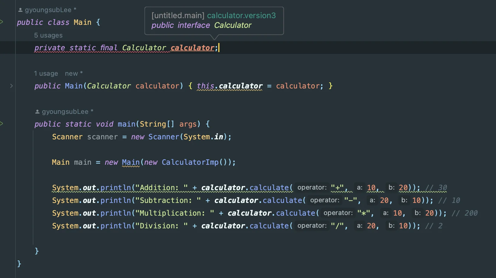
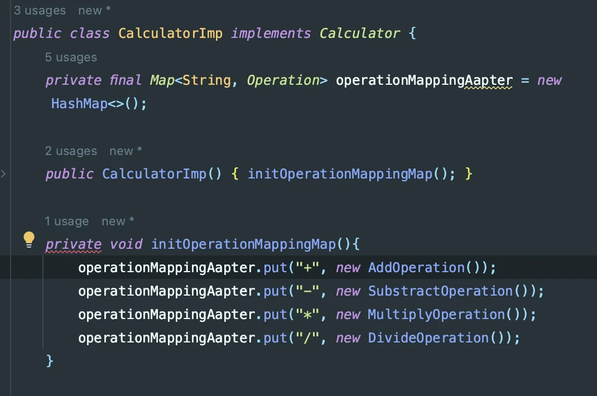

> 💡 
> 
> <a id="120eda9b0fe18126a249c72eb5a13af5"></a>
> 
> PDS 다이어리 참조

<a id="120eda9b0fe181ccb588d0f4b44d3365"></a>

### PlAN ( 오늘 학습할 내용들 )

---

- 과제) 계산기 
    - [x] calculator 클래스 &#45; 생성자 주입으로 수정 → DIP 준수

    - [x] 입력값 받는 코드 및 추가 연산 반복 처리 추가 필요 

    - [ ] <del>enum, 제네릭 적용</del>

    - [ ] <del>JPA2 &#45; ch1 (빨리 해야 된다&#33;) </del>

<a id="120eda9b0fe181b6b745f7ded9f7f51a"></a>

### DO ( 오늘 공부한 내용)

---

- 알고리즘 학습
    - &#91; <code>9&#58;20 </code>&#126; <code>10&#58;20</code> &#93; 약 한 시간 정도 문제풀이 진행함

    - 근 1년만에 푸는 알고리즘 문제인데, 문제 난이도가 아직까지는 너무 쉽다&#46;

    - 오랜만에 알고리즘 문제 푸니 되게 재밌었음

    - 내일도 한 &#91;5 &#126; 10 문제&#93; 정도 진행 예정
        <details>
        <summary>푼 알고리즘 문제</summary>

        > <a href="#/post/108eda9b-0fe1-8012-8918-f965717c8fce">페이지</a> 

        - <a href="https://beautiful-college-c84.notion.site/f169ff99f8054799af362e400e85ba7b">페이지</a> 

        - <a href="https://beautiful-college-c84.notion.site/108eda9b0fe1801f8e1fe9e527856053">페이지</a> 

        - <a href="https://beautiful-college-c84.notion.site/108eda9b0fe18037af7fc32fff952ac7">페이지</a> 

        - <a href="https://beautiful-college-c84.notion.site/108eda9b0fe18047bd81d49520901f6d">페이지</a> 

        - <a href="https://beautiful-college-c84.notion.site/108eda9b0fe180c9b213d729616a1460">페이지</a> 

        - <a href="https://beautiful-college-c84.notion.site/108eda9b0fe1802eb85cc9d8dff3a33a">페이지</a> 

        </details>

- 과제) 계산기 
    <details>
    <summary>DIP 준수를 위한 Calculator 클래스의 interface 설계 </summary>

    <details>
    <summary>🧐 final 키워드 &#45; 초기화 유무,  &#91; 스프링부트, 자바 &#93; 환경에서 차이점 발생</summary>

    <details>
    <summary>아래와 같이 자바 환경에서 final 키워드 사용 시 컴파일 오류(초기화)가 발생함</summary>

    

    </details>

    <details>
    <summary>스프링부트 환경에서의 final 키워드 사용 &#45; 컴파일 오류 X</summary>

    <a id="121eda9b0fe1804caa0cdf65d7681f96"></a>

    ```java
    @RequiredArgsConstructor
    public class NaverAPIController {

        private final NaverAPIService naverAPIService;

        @GetMapping("/news")
        public List<ArticleDto> searchItems(@RequestParam String query) throws JSONException {
            return naverAPIService.searchArticles(query);
        }
    }
    ```

    </details>

    </details>

    <details>
    <summary>Calculator 인터페이스 설계 및 구현 &#45; 1차</summary>

    <details>
    <summary>🧐 <code>오버라이드</code>된 메서드 &#45;  <code>private</code> 선언 불가</summary>

    <details>
    <summary><strong>🤬 오류) Calculator의 어댑터 생성 메서드를 인터페이스로 정의 후 </strong><strong><u><code>private</code></u></strong><strong><u>으로 선언하여 오버라이드 </u></strong><strong>처리하려고 함</strong></summary>

    <a id="121eda9b0fe180dfa47ce30acbd1bba1"></a>

    ```java
    public interface Calculator {
    			
    		void initOperationMappingMap();
    		
    		.   .   .
    ```

    <a id="121eda9b0fe18081be3bd9665908f453"></a>

    ```java
    public class CalculatorImp implements Calculator {
    		// 어댑터 생성
        private final Map<String, Operation> operationMappingAapter = new HashMap<>();
    		
    		// 샹성자 ->  인스턴스 생성 시 자동 생성
        public CalculatorImp() {
            initOperationMappingMap();
        }

    		// 각 연산자 처리 클래스 어댑터에 저장
        private void initOperationMappingMap(){   // private 선언이 안됨,ㅠ
            operationMappingAapter.put("+", new AddOperation());
            operationMappingAapter.put("-", new SubstractOperation());
            operationMappingAapter.put("*", new MultiplyOperation());
            operationMappingAapter.put("/", new DivideOperation());
        }
        
    	    .  .  .
    ```

    </details>

    - 어댑터 생성 메서드는 인스턴스 생성 시에 호출되어 각 연산자에 따른 인스턴스를 생성하고  이후 <u>외부에서의 변경 금지</u>를 위해 <code>private</code>으로 선언하여 설계함

    - DIP 준수를 위해, 인터페이스에서 형식 정의 후 <code>private</code> 으로 오버라이드 하려고 했더니 컴파일 오류가 발생되었다&#46; 

    <details>
    <summary> 🧐 왜 private 으로 선언하여 오버라이드 시, 컴파일 오류가 발생되는가? </summary>

    

    </details>

    > ☝🏻 
    > 
    > <a id="08d5163a202a4e8cb806c88e1ccca279"></a>
    > 
    > 인터페이스의 모든 메서드는 <strong><u>추상 메서드</u></strong><strong><u>( </u></strong><strong><u><code>public abstract</code></u></strong><strong><u>)</u></strong>로 설계된다&#46;
    > 
    > <a id="121eda9b0fe18082a792e048a7b38654"></a>
    > 
    > 따라서 <strong><u>인터페이스에서 정의된 메서드</u></strong>는 <strong><u>상속 시, 반드시 구현</u></strong>( <code>오버라이드</code>)되어야 한다&#46; 

    <a id="121eda9b0fe1801da247cd09fb8d30b8"></a>

    <u>인터페이스</u>는 <strong><u>구현</u></strong><strong><u>을 </u></strong><strong><u>강제</u></strong><strong><u>하는 계약을 정의</u></strong>한다&#46; 

    <a id="121eda9b0fe18069b77ff177231b6f6a"></a>

    이는, <strong><u>외부에서 사용할 수 있는 메서드</u></strong>들이라는 의미이다&#46; 따라서 해당 메서드들은 반드시 <strong><code>공개(public)</code></strong><strong> </strong>되어야 한다&#46;

    </details>

    <details>
    <summary>🧐 인터페이스에 변수 정의 시, 초기화 필수</summary>

    <details>
    <summary>🤬 오류1) 어댑터로 사용할 <code>Map</code>을 <strong><u>인터페이스에 정의 후 구현</u></strong>하려고 함</summary>

    <a id="121eda9b0fe1807783cec5e99475997e"></a>

    ```java
    public interface Calculator {

        Map<String, Operation> operationMappingAapter;
        
        . . .
    ```

    </details>

    <a id="121eda9b0fe18056b6b3cb364f126742"></a>

    그러나 인터페이스의 변수는 <code>public static final</code>로 선언된다&#46; 

    <a id="121eda9b0fe18081bd43ddcecdbdd9ab"></a>

    즉, <strong><u>상수만 정의 가능</u></strong>하다&#46;  따라서 <strong><u>초기화 하지 않을 시, 컴파일 오류가 발생</u></strong>한다&#46; 

    <details>
    <summary>🤬 오류2) <code>null</code> 값으로 초기화 후, 구현 시 값 할당 </summary>

    <a id="121eda9b0fe18051a4b5d956555f3eaf"></a>

    ```java
    public interface Calculator {
        Map<String, Operation> operationMappingAdapter = null;  // null로 초기화
    }
    ```

    </details>

    <a id="121eda9b0fe180c49919d09728ebe932"></a>

    null은 비어있는 ‘<strong><u>값’</u></strong> 이다&#46; 따라서<u> null 로 초기화 후 값을 할당</u>하는 것은 <strong><u>‘재할당’</u></strong> 처리이며 이는, <u><code>f</code></u><strong><u><code>inal</code></u></strong><strong><u> 키워드로 선언된 상수에서는 불가능</u></strong>하다&#46;

    </details>

    <details>
    <summary>🧐 Operation 인터페이스 &#45; 오버로딩, <strong><u>기존 설계 변경됨</u></strong></summary>

    <details>
    <summary><strong>🤬 오류) 두 인터페이스를 </strong><strong><u><code>오버로딩</code></u></strong><strong>을 사용하여 하나로  합침</strong></summary>

    <details>
    <summary>operation</summary>

    <a id="121eda9b0fe180499c58c9b76406f6ca"></a>

    ```java
    public interface Operation {
        double calculate(double a, double b);
    }
    ```

    </details>

    <details>
    <summary>calculator</summary>

    <a id="121eda9b0fe180578efbc51a003f6297"></a>

    ```java

    public interface Calculator {

        
    }

    ```

    </details>

    ---

    <details>
    <summary>operation &#45; 오버로딩</summary>

    <a id="38343fc3cb3b43a3824e3fe704151a95"></a>

    ```java
    public interface Operation {
        double calculate(double a, double b);
        
        // 오버로딩
        double calculate(String operator, double a, double b);
    }
    ```

    </details>

    </details>

    <a id="121eda9b0fe180abb9b7f65cabe17149"></a>

    오버로딩을 사용한 인터페이스 통합 

    <a id="121eda9b0fe180648f07f0ce33609c41"></a>

    →   ‘오버로딩’ 된 동일한 이름을 가진 2개의 추상 메서드가 생긴다&#46; 

    <a id="121eda9b0fe1809e836ef02262987a8c"></a>

    따라서 기존 &#60;interface&#62; Operation를 구현하여 생성한 모든 클래스에 <strong><u>추가로 오버로딩된 메서드를 구현</u></strong>해야한다&#46; 

    <a id="121eda9b0fe180848b79de566a2f1e09"></a>

    해당 설계는 바로 폐기함

    </details>

    ---

    <details>
    <summary>&#91; 코드 &#93;</summary>

    <details>
    <summary>&#60; interface &#62; Calculator</summary>

    <a id="121eda9b0fe180989e2ec6d8882b3dd4"></a>

    ```java
    public interface Calculator {

        Map<String, Operation> operationMappingAapter = null;
        void initOperationMappingMap();
        double calculate(String operator, double a, double b);
    }
    ```

    </details>

    <details>
    <summary>CalculatorImp</summary>

    <a id="121eda9b0fe180469a2eee6a54f8a4ba"></a>

    ```java
    package calculator.version3;


    import calculator.version3.operation.*;

    import java.util.HashMap;
    import java.util.Map;


    public class CalculatorImp implements Calculator {
        private final Map<String, Operation> operationMappingAapter = new HashMap<>();

        public CalculatorImp() {
            initOperationMappingMap();
        }

        private void initOperationMappingMap(){   // private 선언이 안됨,ㅠ
            operationMappingAapter.put("+", new AddOperation());
            operationMappingAapter.put("-", new SubstractOperation());
            operationMappingAapter.put("*", new MultiplyOperation());
            operationMappingAapter.put("/", new DivideOperation());
        }


        @Override
        public double calculate(String operator, double a, double b){
            Operation mappingOperation = operationMappingAapter.get(operator);
            if (mappingOperation == null) {
                throw new UnsupportedOperationException("Unknown operation: " + operator);
            }
            return mappingOperation.calculate(a, b);
        }
    }
    ```

    </details>

    </details>

    </details>

    <details>
    <summary>Calculator 인터페이스 설계 및 구현 &#45; 2차</summary>

    - <code>Map</code>&#58; 어댑터를 저장할 

    - <code>initOperationMappingMap()</code>
        - 인스턴스 생성 시, 어댑터를 생성

        - 외부 수정되는 경우를 제한하기 위해 <code>private</code>으로  선언

    <a id="121eda9b0fe180c696b6d30baee589f0"></a>

    오류가 발생한 두 필드와 메서드를 인터페이스에서 제거 후 , 클래스 단계에서 구체화 시킴

    ---

    <details>
    <summary>&#91; 코드 &#93;</summary>

    <details>
    <summary>&#60; interface &#62; Calculator</summary>

    <a id="b21b74f10f8942d99ef62d92d98ee965"></a>

    ```java
    public interface Calculator {

        double calculate(String operator, double a, double b);
    }
    ```

    </details>

    <details>
    <summary>CalculatorImp</summary>

    <a id="af36e2a434ce41368d12b1a4d4cd0cbd"></a>

    ```java

    public class CalculatorImp implements Calculator {
        private final Map<String, Operation> operationMappingAapter = new HashMap<>();

        public CalculatorImp() {
            initOperationMappingMap();
        }

        private void initOperationMappingMap(){   // private 선언이 안됨,ㅠ
            operationMappingAapter.put("+", new AddOperation());
            operationMappingAapter.put("-", new SubstractOperation());
            operationMappingAapter.put("*", new MultiplyOperation());
            operationMappingAapter.put("/", new DivideOperation());
        }


        @Override
        public double calculate(String operator, double a, double b){
            Operation mappingOperation = operationMappingAapter.get(operator);
            if (mappingOperation == null) {
                throw new UnsupportedOperationException("Unknown operation: " + operator);
            }
            return mappingOperation.calculate(a, b);
        }
    }
    ```

    </details>

    </details>

    </details>

    <details>
    <summary>Main 클래스에 interface로 변수 선언 및 생성자로 구현 클래스 주입함 → DIP 준수</summary>

    <a id="121eda9b0fe18035a9a8ce35636f894a"></a>

    ```java
    public class Main {
        private static Calculator calculator;

        public Main(Calculator calculator) {
            this.calculator = calculator;
        }

        public static void main(String[] args) {
            Scanner scanner = new Scanner(System.in);

            Main main = new Main(new CalculatorImp());

            System.out.println("Addition: " + calculator.calculate("+", 10, 20)); // 30
            System.out.println("Subtraction: " + calculator.calculate("-", 20, 10)); // 10
            System.out.println("Multiplication: " + calculator.calculate("*", 10, 20)); // 200
            System.out.println("Division: " + calculator.calculate("/", 20, 10)); // 2

        }
    }
    ```

    </details>

    </details>

    <details>
    <summary>입력값 받는 코드 및 추가 연산 반복 처리 추가 필요 </summary>

    <details>
    <summary>입력값 받기 </summary>

    <a id="121eda9b0fe180418746ef99689929db"></a>

    ```java
    Scanner sc = new Scanner(System.in);

    System.out.print("첫 번째 숫자를 입력하세요:");
    double num1 = sc.nextInt();

    System.out.print("두 번째 숫자를 입력하세요:");
    double num2 = sc.nextInt();

    System.out.print("사칙연산 기호를 입력하세요: ");
    char operator = sc.next().charAt(0);
    ```

    </details>

    <details>
    <summary> 계산 반복  &#45;  do&#45;while 문, 삼항연산자</summary>

    - 오늘 알고리즘 풀이를 통해 학습한 <code>삼한연산자</code>를 활용함
        - 예전부터 알고 있었는데, 확실히 인지하는 것이랑 활용하는 것은 다른 것 같다&#46; <br>이런 식으로 복습 및 활용을 하면서 익혀야겠다&#46; 

    <a id="121eda9b0fe180cf86efd29f77f77efb"></a>

    ```java
    isCalculationRepeat = s.equals("exit")? false : true;
    ```

    - 이번 &#91;스파르타 &#45;자바 문법&#93; 강의를 통해 새롭게 알게된 <code>do&#45;while</code>을 활용하여 반복 계산 여부를 설계하였다&#46;

    <a id="121eda9b0fe180228e7de019b9b5d472"></a>

    ```java

     Boolean isCalculationRepeat = false;

    double result = 0;

    do {
        if(!isCalculationRepeat) {
            result = calculator.calculate(operator, num1, num2);
        } else {
            System.out.print("계산을 추가할 숫자를 입력하세요:");
            double repeatNum = sc.nextInt();

            System.out.print("추가 사칙연산 기호를 입력하세요: ");
            char repeatOperator = sc.next().charAt(0);

            double n = calculator.calculate(repeatOperator, result, repeatNum);
            result = n;
        }

        System.out.println("더 계산하시겠습니까? (exit 입력 시 종료)");
        String s = sc.next();

        isCalculationRepeat = s.equals("exit")? false : true;

    }  while(isCalculationRepeat);
    ```

    </details>

    <details>
    <summary>&#91; 전체 코드 &#93; &#45; Main</summary>

    <a id="121eda9b0fe1804689fbea56dc033476"></a>

    ```java
    public class Main {
        private static Calculator calculator;

        public Main(Calculator calculator) {
            this.calculator = calculator;
        }

        public static void main(String[] args) {
            Scanner sc = new Scanner(System.in);

            Main main = new Main(new CalculatorImp());


            System.out.print("첫 번째 숫자를 입력하세요:");
            double num1 = sc.nextInt();

            System.out.print("두 번째 숫자를 입력하세요:");
            double num2 = sc.nextInt();

            System.out.print("사칙연산 기호를 입력하세요: ");
            char operator = sc.next().charAt(0);

            Boolean isCalculationRepeat = false;

            double result = 0;

            do {
                if(!isCalculationRepeat) {
                    result = calculator.calculate(operator, num1, num2);
                } else {
                    System.out.print("계산을 추가할 숫자를 입력하세요:");
                    double repeatNum = sc.nextInt();

                    System.out.print("추가 사칙연산 기호를 입력하세요: ");
                    char repeatOperator = sc.next().charAt(0);

                    double n = calculator.calculate(repeatOperator, result, repeatNum);
                    result = n;
                }

                System.out.println("더 계산하시겠습니까? (exit 입력 시 종료)");
                String s = sc.next();

                isCalculationRepeat = s.equals("exit")? false : true;

            }  while(isCalculationRepeat);


            System.out.println("결과 값 = " + result );
        }
    }
    ```

    </details>

    </details>

<details>
<summary>서영우 튜터님께 질문 &#45; Git commit  → git flow 전략</summary>

> 강의를 들으면서 종종 실무에서는 &#91; 운영브랜치, 개발 브랜치, 테스트 브랜치 &#93;를 나눠서 개발을 한다는 것을 들었고, git flow 전략도 어느 정도는 인지하고 있었음

<details>
<summary>질문 내용</summary>

- git commit 메세지를 어떻게 하면 더 명확하게 작성할 수 있는가?

- ‘작업 내용을 어떻게 명확하게 나눠서 커밋을 작성 해야 하는가’ 잘 이해가 안간다&#46;

</details>

<details>
<summary>답변 내용</summary>

- 신입 개발자에게도 많이 물어보는 중요한 내용이라고 하시면서 git flow 전략까지 추가로 설명해주셨다&#46;
    <details>
    <summary>Git flow 전략</summary>

    - 우선 실무에서는 협업 시에 하나의 브랜치에서 진행하지 않는다&#46; 

    - <code>베포용(마스터) 브런치</code>, <code>기능 개발 브런치</code>, <code>테스트 브랜치</code>
        - 기능 개발이 끝나면 테스트 브랜치( QA 브랜치, QA 엔지니어) 테스트 및 버그 확인 후
            - 이상이 있는 경우, 다시 개발 브런치에서 수정 후 다시 테스트 브랜치로 

            - 이상이 없는 경우, 배포(마스터) 브랜치로 PR(Pull Request)를 날려 기능을 포함

    </details>

    <details>
    <summary>커밋 메시지의 경우</summary>

    - 실무에서는  보통 <code>/</code> 를 사용하여 계층형으로 커밋 메세지를  작성한다고 하심 
        - 기능 개발,  보통 파일 단위로 나눠서 작성한다고 하셨음
            - ex) feat &#58; feature/file upload/ 개발자 명 &#126;&#126;&#126;

        - 업로드된 file이 수정되는 경우는 refactor 키워드를 사용
            - ex) refactor/loginPage/개발자 명 &#126;&#126;&#126;

    </details>

    <details>
    <summary>커밋 메세지 &#45; 실무 </summary>

    - 작업이 이것 저것 섞이는 경우가 있다&#46; 그런 경우 한번에 처리하는 경우도 있다고 하심

    - 업무 마다, 회사마다 commit 작성은 다르기 때문에, 취업하면 우선 그 회사의 브런치부터 까보라고 하심 
        - 해당 브런치 분석하면서 ‘커밋 컨벤션’, ‘커밋 메세지 성향’을 파악

        - 보통은 2개의 브랜치를 가지고 있으며, 3개(테스트 브랜치까지) 있는 경우는 큰 회사인 경우 라고 하셨음

        - 추가로<strong><u> 브런치가 하나</u></strong>인 회사는 도망가라고 하심

    </details>

    <details>
    <summary>번외) 급한 기능  개발인 경우 &#45; 버그(핫) 픽스 브랜치</summary>

    - 해당 비지니스에 치명적인 버그인 경우, 급하게 브런치를 하나 만들어 진행함

    - 시니어급 개발자가 바로 마스터(운영) 브랜치에서 해당 내용을 가져와 버그를 잡는다고 함
        - ex) 카카오 &#45; 채팅 버그 

    </details>

</details>

</details>

<a id="120eda9b0fe181b8b8f5d1b0058eed7a"></a>

### SEE ( 피드백 )

---

- 생각보다 과제를 개발하는데 너무 시간이 걸렸다… 
    - 자바 문법을 어느 정도 많이 안다고 오만했다… 다 한번씩은 보고 들은 내용이지만, 진짜 개발을 통해 구현하려고 하니, 너무 자잘한 오류들이 많다&#46;  

    - &#91; 스프링부트 &#45; 롬복 &#93; 을 사용해서 대충 다 해결했는데…  DIP로 설계하는데 이렇게 시간이 많이 걸릴 줄이야… 

    - 자버 문법을 다시 한번 꼼꼼히 학습을 해야 할 듯 싶다&#46;

- enum, 제네릭 적용
    - 해당 내용은 &#91; 문법 강의 4주차&#93; 부터 먼저 끝내고 진행해야 겠다&#46;

    - DIP 적용에서 &#60;3주차 &#45; interface&#62; 를 완전히 이해했다면 이렇게 오래 걸리지 않았을 것이다…

- 급한 마음만 앞서니까 제대로된 학습이 이루어 지지 않는다&#46; 
    - 특히 interface에 관해 제대로 학습 했으면 DIP 설계 같은 경우 이렇게 시간이 오래 걸리지 않았다&#46;

    - 내가 제대로 이해했는지, 다시 한번 점검하고 제대로 정리할 필요가 있다&#46; 

- 우선 &#91; 스파르타 강의 &#43; 과제&#93; 부터 끝내고 시간 남을 때, 인프런 로드맵을 진행하는 걸로 방향성을 수정해야 겠다&#46;
