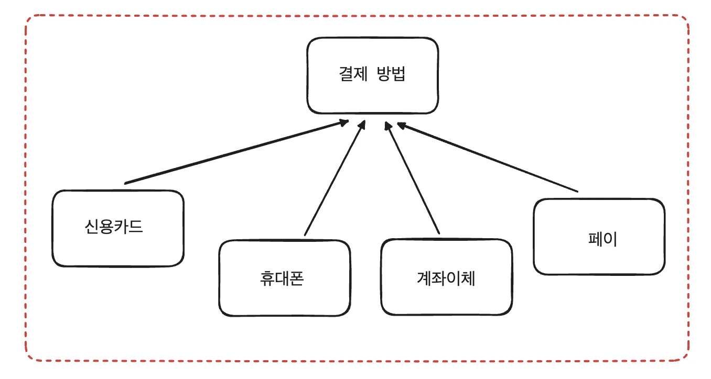
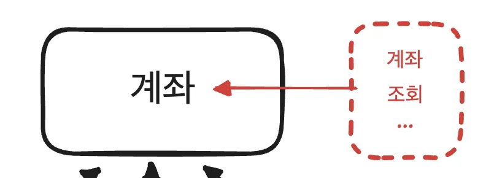
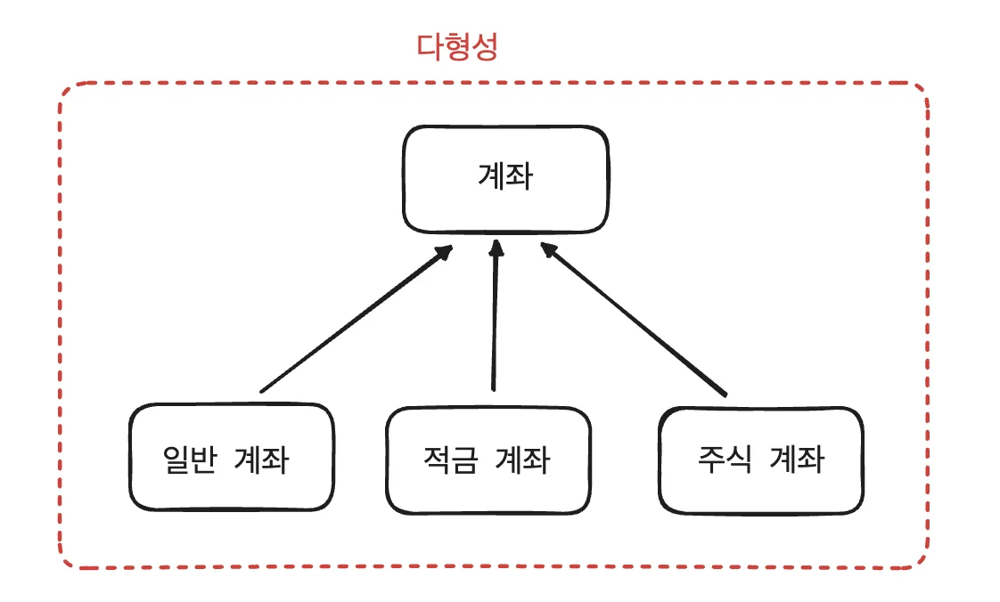

> 💡 
> 
> <a id="122eda9b0fe1819db19bc32a6e8e013e"></a>
> 
> PDS 다이어리 참조

<a id="122eda9b0fe18123928aeb6a6bccc19b"></a>

### PlAN 

<details>
<summary>✎ To Do list</summary>

[과제 피드백](#/post/123eda9b-0fe1-8045-a02f-e9dd4cb1bcac)

[스파르타 강의 - 5주차 정리](#/post/123eda9b-0fe1-8070-aa17-c1ebca1ffdad)

[스파르타 강의 - 4주차 정리](#/post/123eda9b-0fe1-8002-afe6-c59b29473cfe)

[스파르타 강의 - 3주차 정리](#/post/e6f6b9b3-f5df-4a20-99d2-ec4c660660d5)

[학습법 특강](#/post/8cc80a40-6bbe-4359-aa89-d2faeb008438)

[알고리즘 세션 ( 김재연 튜터님 )](#/post/94129552-a537-47ad-b3ab-011939927306)

[자바 문법 정리 프로젝트 폴터 재구화 필요](#/post/123eda9b-0fe1-802e-a650-eee8fdaaa125)

[static 으로 선언한 변수와 메서드는 그렇지 않은 변수와 메서드와 JVM - 런타임 영역에서 어떠한 차이를 보이는가?](#/post/123eda9b-0fe1-8067-986b-c8aeed0ef6ab)

[DB 필터 및 연동](#/post/123eda9b-0fe1-80b5-b09f-ca8e78df902a)

[인프런 - QueryDSL](#/post/15beda9b-0fe1-8003-bbd2-e937129105c5)

[캐시](#/post/15beda9b-0fe1-8068-9a95-fe8ca90e3bcf)

[성능 최적화 1](#/post/15beda9b-0fe1-8036-bfd6-d11021a5feed)

[테스트코드1](#/post/15beda9b-0fe1-8041-b8d7-d575a008ef6a)

[AWS](#/post/158eda9b-0fe1-8066-a42b-e134791ec95a)

[Docker](#/post/158eda9b-0fe1-8053-95de-e2637f4ba74f)

[스프링 심화](#/post/158eda9b-0fe1-8042-90e7-f66d372f6b78)

[정규삭](#/post/151eda9b-0fe1-80ea-84a0-f3d6f5379001)

[디자인 패턴](#/post/14beda9b-0fe1-800f-b351-daf03a3d948a)

[트랜잭션](#/post/14aeda9b-0fe1-804a-9711-e25e833b1eac)

[API, ERD, 도메인, 엔티티 설계도 작성](#/post/14aeda9b-0fe1-8047-8037-ce7e618d347f)

[프로젝트 생성](#/post/14aeda9b-0fe1-8011-a294-f6799b2886a1)

[통화 변환 앱](#/post/14aeda9b-0fe1-80f8-bea6-c982d3367ad7)

[JPQL](#/post/149eda9b-0fe1-803e-b577-d8a341c6e57a)

[JPA 연관관계](#/post/149eda9b-0fe1-8082-ae5d-ed7df1e2922f)

[MessageConverter](#/post/149eda9b-0fe1-8047-8468-c38436b356cd)

[스프링 심화](#/post/149eda9b-0fe1-80a3-81fd-ca619a417c5f)

[발표하기](#/post/149eda9b-0fe1-80a6-ac7f-c2647fcdc614)

[발표 준비](#/post/145eda9b-0fe1-80fa-aa53-d76b0edddab6)

[회원 탈퇴 api](#/post/145eda9b-0fe1-8035-8832-d323d54fdbbc)

[인증/인가 구현](#/post/145eda9b-0fe1-8077-89b1-e59524f538f5)

[petstagram](#/post/145eda9b-0fe1-8025-9f5e-f195f0693c46)

[일정관리 앱 V2](#/post/13ceda9b-0fe1-801c-96e3-f208b15510e9)

[JPA](#/post/13ceda9b-0fe1-80f4-9cf4-e5b5868f5d49)

[인증/인가](#/post/13ceda9b-0fe1-803f-b748-d39d8f4e4994)

[Validation](#/post/13ceda9b-0fe1-80f4-af34-c3c723fe7e7a)

[스프링](#/post/13ceda9b-0fe1-80bf-b0d3-cf55bac10bb6)

[스프링 숙련](#/post/13ceda9b-0fe1-80ba-810b-d12d8ecea477)

[자바 - 스트림](#/post/13beda9b-0fe1-8090-9b5c-e5acc0900c33)

[피드백](#/post/13beda9b-0fe1-809b-a8c2-c660eafa6b6f)

[도전 기능 구현](#/post/138eda9b-0fe1-802a-a1f6-dc544ebdbc4a)

[피드백 적용](#/post/138eda9b-0fe1-805b-9a53-d5d9708243ad)

[예외처리](#/post/138eda9b-0fe1-80b3-8286-dd76bca2f044)

[javaDos 형식 주석 작성](#/post/138eda9b-0fe1-8035-9a92-ddf597ff8927)

[필수 기능 구현](#/post/138eda9b-0fe1-805b-8caf-cf8eaf0c8fc9)

[멀티스레딩 및 동시성제어](#/post/138eda9b-0fe1-8079-9e3b-f074987367ef)

[자바 내장 메서드](#/post/136eda9b-0fe1-8040-a054-e26073b22ead)

[정규식](#/post/136eda9b-0fe1-8036-a2b7-e7e71a2deb05)

[CS 특강 - 데이터베이스](#/post/136eda9b-0fe1-80ce-a932-d95c858e51af)

[스탠다드 - 2. API 명세서](#/post/135eda9b-0fe1-80fc-ac9c-f096d7db010a)

[ABA Problem](#/post/135eda9b-0fe1-80c0-a5ac-e8968049194f)

[1. 문자열](#/post/134eda9b-0fe1-80cd-a7bd-d44b2ae5050e)

[자바 알고리즘 인터뷰](#/post/134eda9b-0fe1-8003-aa4d-ef8345a2f3b5)

[데이터 모델링](#/post/131eda9b-0fe1-800c-89b2-e0c1f91ac737)

[SQL](#/post/131eda9b-0fe1-80c9-af73-dda7f86f771b)

[API 설계](#/post/131eda9b-0fe1-801b-8563-d0ee1f10d358)

[ERD 설계](#/post/131eda9b-0fe1-803f-bc5e-ce900695b46a)

[6주차 정리](#/post/12eeda9b-0fe1-80d7-8465-d6dba7891dcc)

[5주차 정리](#/post/12eeda9b-0fe1-80bb-bea4-edff13e78e5e)

[4주차 정리](#/post/12eeda9b-0fe1-80e0-a347-ecbb837ae08b)

[3주차 정리](#/post/12eeda9b-0fe1-80ab-bf77-fc2eed517c58)

[2주차 정리](#/post/12eeda9b-0fe1-8043-8a35-c373ba5e14fa)

[1주차 정리](#/post/12eeda9b-0fe1-80be-b848-e8769dac6540)

[강의 노션 페이지 작성](#/post/12eeda9b-0fe1-80f2-8404-f243ccafc38e)

[스프링 기초](#/post/12eeda9b-0fe1-8073-afe2-e68ec781954a)

[과제 노션 페이지 만들기](#/post/12eeda9b-0fe1-8026-9393-c88011051cd9)

[github에 repository 만들기](#/post/12eeda9b-0fe1-809e-86b4-e3afbc13a674)

[발제 보고 요구사항 정리](#/post/12eeda9b-0fe1-8068-8d6c-fa0f03b47539)

[일정관리 앱](#/post/12eeda9b-0fe1-80d1-88bb-efaac9d33682)

[ch 1 -  사용자 수에 따른 규모 확장성](#/post/12deda9b-0fe1-805d-867c-d77224ae9e0a)

[가상 면접 사례로 배우는 대규모 시스템 설계의 기초 1](#/post/12deda9b-0fe1-8079-9c30-d04b8f4e9d50)

[어댑터 패턴](#/post/12ceda9b-0fe1-80f3-a408-ed55df128ac4)

[옵저버 패턴](#/post/12ceda9b-0fe1-8066-8fa7-fcac137668ca)

[전략패턴](#/post/12ceda9b-0fe1-80db-9874-d1f523adb4b4)

[헤드퍼스트 디자인패턴](#/post/12ceda9b-0fe1-80da-8f4a-db20997693e2)

[과제 - 피드백](#/post/12beda9b-0fe1-807e-96db-ff81a288ea03)

[자바 컨벤션](#/post/129eda9b-0fe1-8040-a05e-f8a84dc61763)

[Java 코드 컨밴션 특강 정리](#/post/129eda9b-0fe1-801a-a35f-d3d6468430f1)

[2. 제네릭 - 고급](#/post/128eda9b-0fe1-8064-acc2-cfe9bdda5499)

[Lv 4 구현](#/post/127eda9b-0fe1-80d6-9c17-fad8ba45ee37)

[Lv 3 구현](#/post/127eda9b-0fe1-80e5-b3f0-e2441f3457c1)

[Lv 2 구현](#/post/127eda9b-0fe1-80b7-b0b4-c3a99a668ca4)

[Lv 1 구현](#/post/127eda9b-0fe1-80be-bda5-d6a6b1b344f6)

[10. 순회, 정렬, 전체정리](#/post/127eda9b-0fe1-8044-91e0-e5360674c54d)

[9. Map, Stack, Queue](#/post/127eda9b-0fe1-8041-a4c1-f57e1cf69f63)

[8. Set](#/post/127eda9b-0fe1-8023-9eff-c913601a7d0b)

[7. HashSet](#/post/127eda9b-0fe1-80ed-9ec8-ec3d81f492b6)

[6. Hash](#/post/127eda9b-0fe1-80b8-92d3-d2ac7ee59bdb)

[5. List](#/post/127eda9b-0fe1-80b4-a974-fd07b84e2ca2)

[4. LinkedList](#/post/127eda9b-0fe1-8094-9c5f-c0784243135d)

[3. ArrayList](#/post/127eda9b-0fe1-805d-9daf-db3805c2c788)

[1. 제네릭](#/post/127eda9b-0fe1-8046-8638-dd3ce5d6386c)

[자바 중급 2편](#/post/127eda9b-0fe1-80e3-9579-e87a528a75b0)

[숫자야구게임](#/post/127eda9b-0fe1-8062-bb99-db713e87667a)

[Redis](#/post/126eda9b-0fe1-8074-9d69-e4f99238babd)

[이벤트 기반 구조 ( EDA ) 란 무엇인가?](#/post/124eda9b-0fe1-8095-8e30-f21ecdc2c3ed)

[도메인 주도 개발(DDD) 란 무엇인가?](#/post/124eda9b-0fe1-80fe-8ec9-fbd532d5cc22)

[시스템 설계 시, 클래스의 책임에 대하여](#/post/124eda9b-0fe1-8069-9236-e2762e90aaa7)

[다형성, 추상클래스 활용](#/post/123eda9b-0fe1-8009-88f3-ddef3ec0e5db)

[오브젝트](#/post/123eda9b-0fe1-802b-97b0-f75037d2bd2a)

</details>

> ☝🏻 
> 
> <a id="df7f08be9db84d92b7c6a4fe59ce0012"></a>
> 
> 너무 많은 양 계획 세우지 않기, <code>One Thing</code>

- [x] 알고리즘 카타&#58; <code>9&#58;00 &#126; 10&#58;30</code>
    > <a href="#/post/108eda9b-0fe1-8012-8918-f965717c8fce">페이지</a> 

    <a id="123eda9b0fe180ecb552c81b21add0bd"></a>

    <a href="https://beautiful-college-c84.notion.site/108eda9b0fe1802a9f8dffa5ac1c8112">페이지</a> 

- 노션 블로그 정리
    - [x] 데이터베이스 필터 및 정리

    - [x] To Do List DB 생성 후 연동

    - [x] TIL 카테고리 추가해서 필터 적요

- [x] 질문) 다형성 및 추상 클래스&#45;메서드

- [ ] <del>과제 피드백 정리 → 내일이 아닌 오늘 진행…</del>

<details>
<summary>자바 문법 &#45; 보류</summary>

- [ ] 프로젝트 재구조화

- [ ] 공부양 정하고, pdf 보면서 질문 정리하기

- [ ] 질문 해결하고 기록하기

</details>

<a id="122eda9b0fe181ad9ee7fd6251ce5f22"></a>

### DO

---

- 알고리즘 &#45; 14&#46; 악수의합

<details>
<summary>객체 지향의 특징</summary>

<details>
<summary>🧐 다형성, 추상화, 상속의 관계</summary>



<details>
<summary>추상화</summary>

<details>
<summary>🧐 ‘추상화’란?</summary>

<a id="123eda9b0fe180849e85ea22425fd110"></a>

하나의 물체(개념)을 속성(필드)과 행동(메서드)으로 정의하고 클래스로 만드는 것

</details>

- 상위 개념으로 공통 요소(필드, 메서드)를 정의하는 것

<details>
<summary>ex) 계좌</summary>



<a id="123eda9b0fe1804683f1e2b3561c4323"></a>

```java
class Account {
	private long amount;
	
	public long getAmount() {
		return this.amount;
	}
	
		. ..  
}
```

</details>

</details>

<details>
<summary>다형성</summary>

- 정의한 상위 개념을 상황에 맞게 하위 요소들로 구체하는 것
    <a id="123eda9b0fe180b69703e91972c36dbf"></a>

    그러함으로써 형성되는 구조를 다형성이라 한다&#46;

<details>
<summary>ex) 계좌 → &#91; 일반계좌, 적금계좌, 주식계좌 &#93;</summary>



</details>

</details>

<details>
<summary>상속</summary>

<details>
<summary>🧐 상속이란? </summary>

- 위와 같이 더 상위의 개념에서 형식을 정의하고 하위의 개념에서 가져오거나 구체화하여 사용하는 방법

- 코드의 중복↓, 재사용성, 유지보수성 ↑   

<details>
<summary>상속 키워드</summary>

- extends&#58; 단일 상속
    - (추상)클래스 &#45; 클래스

    - 인터페이스 &#45; 인터페이스

- implements&#58; 다중 상속 
    - 인터페이스 &#45; (추상)클래스

</details>

</details>

- 이렇게 추상화한 상위 개념을  하위 개념들로 구체화하여 다형성을 형성하는 것을 ‘상속’을 통해 이루어 진다&#46; 
    <details>
    <summary>ex) 클래스&#45;클래스 상속</summary>

    

    <a id="123eda9b0fe1807d8654c3e3c862e032"></a>

    ```java
    class Account {
    	private long amount;
    	
    	public long getAmount() {
    		return this.amount;
    	}
    }

    class RegularAccount extends Account {
    	/* ...일반 계좌 내용 추가... */
    }

    class SavingsAccount extends Account {
    	/* ...적금 계좌 내용 추가... */
    }

    class StockAccount extends Account {
    	/* ...주식 계좌 내용 추가... */
    }
    ```

    </details>

    |  |  |  |
    | --- | --- | --- |
    | 특징 | 추상 클래스 | 인터페이스 |
    | 상속 방식 | <code>extends</code> | <code>implements</code> |
    | 다중 상속 | 불가능 (단일 상속만 가능) | 가능 (다중 인터페이스 구현 가능) |
    | 메서드 | 추상 메서드 &#43; 일반 메서드 모두 가능 | 기본적으로 추상 메서드만 가능 (자바 8 이후로는 디폴트 메서드와 정적 메서드 가능) |
    | 필드 | 상태(필드) 가질 수 있음 | 상수만 정의 가능 (인터페이스 내부 필드는 기본적으로 <code>public static final</code>) |

</details>

</details>

</details>

<details>
<summary>질문 주제) 다형성, 추상 클래스 활용</summary>

<a id="123eda9b0fe180e9aa2bce31ca1c522d"></a>

<a href="#/post/123eda9b-0fe1-8009-88f3-ddef3ec0e5db">페이지</a> 

</details>

<a id="122eda9b0fe181019b3ef226894017ba"></a>

### SEE

---

<details>
<summary>질문 피드백</summary>

<a id="123eda9b0fe1802e940ddf41b808b38e"></a>

직접 찾아가서 구두로 질문을 드리는 것보다, 텍스트로 질문을 하고 받는 것이 정리되고 명확한 답변을 얻을 수 있다&#46; 

<a id="123eda9b0fe180c5b317f7e78f5fc0b0"></a>

→ 질문방 자주 활용하기 

<a id="123eda9b0fe180abba39f112efce31e0"></a>

→ 답변이 너무 좋았음 →  강준규 튜터님, 황원욱 튜터님 찾아가서 질문해보기 

</details>

<details>
<summary>작성한 글 업데이트 </summary>

<a id="123eda9b0fe18022bc4fe7a9816a402c"></a>

저번 주에 SOLID 원칙에 대해 학습을 했다&#46; 한번 글로 정리하니 ‘내가 이 개념에 대해 어느 정도 알고 있다’라고 착각을 했다&#46;

- 내가 정리한 포스팅
    - <a href="https://beautiful-college-c84.notion.site/11beda9b0fe180d19947c51365c8c1a9">페이지</a> 

- 튜터님께 추천 받은 포스팅
    - ‣

    - ‣

<a id="123eda9b0fe180f287a5da33884d0c17"></a>

두 내용을 비교하면 많이 부족하다 또한 ‘유튜브’ 영상을 참고하여 정리했을 뿐이지, <br>내가 생각해서 예시를 만들고 작성한 내용이 아니다&#46; 

<a id="123eda9b0fe180f990caf19dde55cdf4"></a>

→ SOLID 원칙 위 블로그 참고하여  내용 보안하기 

</details>

- 질문에 대해 정리하는데 너무 오래걸렸다… 
    - 계속하면 늘겠지&#46;&#46;?
