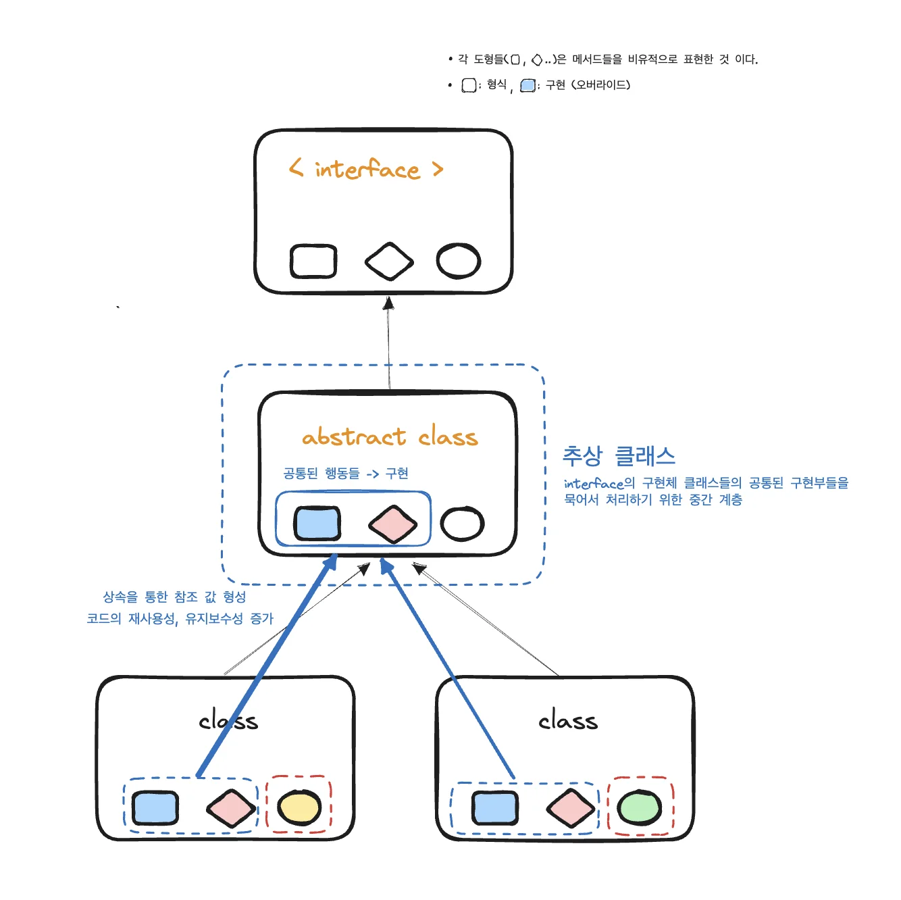
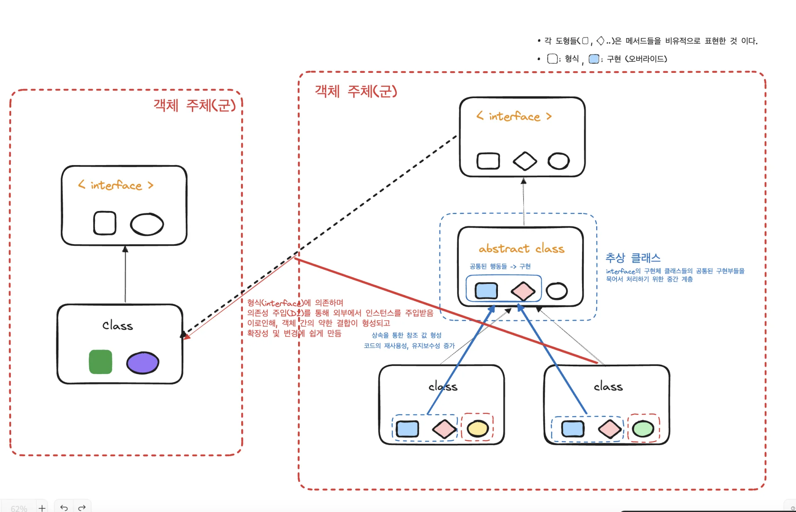

<a id="123eda9b0fe18091864bd483ed3c92a4"></a>

## 다형성, 추상 클래스 활용

---

<a id="e16ec65e0789492d95050459c988c246"></a>

### 질문

---


> <strong><u>질문의 단어를 잘못 선택</u></strong>하였다&#46;  <code>추상 메서드</code> 가 아닌 <code>추상 클래스</code>에 대한 의문점이었다<br>그러나 의도한 답변 내용을 포함해서 오히려 다형성과, 추상 메서드에 관해서도 잘 이해 할 수 있는 답변을 얻었다&#46;

<a id="6e1066f8170546f1a662495e377ba1e1"></a>

### 답변 내용 및  정리

<details>
<summary>답변</summary>

- 강준규 튜터님
    

- 황원욱 튜터님
    

</details>

> 튜터님 답변을 이해하기 위해서 먼저 선행되야 하는 지식들을 정리했다&#46;

<details>
<summary>인터페이스</summary>

- 인터페이스에는 형식만을 정의 할 수 있다&#46; 

- 즉,  메서드의 구현에 대한 내용은 서술하지 못한다&#46;
    - 메서드의 기본 선언 키워드&#58; <code>public abstract</code>, 추상메서드 

- 또한 필드로는 상수만을 선언할 수 있기 때문에, 초기화(값 할당)이 강요된다&#46; <br>이는 상속(구현)을 통해 세부 사항에 따른 값의 구체화에 있어, 변하지 않는 값을 가지는 경우가 아니면 사용하기 어렵다&#46;
    - 필드  기본 선언 키워드&#58;  <code>public static final</code>, 상수

</details>

<details>
<summary>추상 클래스</summary>

- 인스턴스를 직접 생성할 수 없다&#46; 

- 메서드에 대해 구현부를 작성할 수 있다&#46;

- 추상 메서드 선언을 abstract 키워드를 통해 관리 할 수 있다&#46;<br>이로 인해, 상속 처리되는 클래스에 필요한 형식만을 강제 할 수 있다&#46; 

- 여러 객체들의 공통된 행동을 하나의 메서드에 구체화하고 상속을 통해 참조값을 전달<br>공통된 하나 메서드로 관리함으써  코드의 재사용하고, ‘수정’하거나 ‘확장’하는데 있어도 해당하는 하나의 메서드만 수정하면 되기 때문에  유지보수하기에도 용이함

</details>

<details>
<summary>DIP &#45; 의존성 역전 원칙</summary>

> 고수준의 모듈은 저수준의모듈에 의존해서는 안된다&#46;

</details>

<details>
<summary>OCP &#45; 열림/닫힘 원칙</summary>

> 변경에는 닫혀있고 확장에는 열려있어야 한다&#46;

</details>

<details>
<summary>SRP</summary>

> 한 클래스에는 하나의 책임만이 할당되어야 한다&#46;

</details>

> SOLID에 대한 내용은 아래에 자세히 정리함
> 
> - <a href="https://beautiful-college-c84.notion.site/11beda9b0fe180d19947c51365c8c1a9">페이지</a> 

> 답변 정리

<details>
<summary><strong><u>1&#46; 인터페이스</u></strong><u>의 </u><strong><u>메서드</u></strong>는 <strong>추상메서드</strong><strong> </strong>이다&#46; (<strong><code>public abstract</code></strong>로 선언됨 )</summary>

<a id="4a532addea7d41c19a527155a134d83b"></a>

따라서 ‘<strong><u>인터페이스를 사용</u></strong>하여<u> </u><strong><u>객체들 간의 의존성을 줄(약한 결합)</u></strong>이고 <strong><u>유연한 설계</u></strong>를 한다’ 라는 말은<br> ‘<strong><u>추상메서드를 사용</u></strong>하여 <strong><u>객체들 간의 의존성을 줄(약한 결함)</u></strong>이고 <strong><u>유연한 설계</u></strong>를 할 수 있다&#46;’ 라는 말과 동일하다&#46; 

- 추상 메서드는 하위 클래스가 그 메서드에 맞는 구현을 제공하도록 강제할 수 있다&#46;<br>이는 메서드를 신뢰할 수 있게 만들고 다형성을 활용할 수 있게 한다&#46;
    - 메서드를 신뢰할 수 있게 만든다
        - 하위 클래스가 정의한 형식(interface)을 따르도록 강제한다, <br>즉, 의도한 설계대로 구현될 수 있도록 한다&#46;

        - 추상 메서드 → 상속 시, 반드시 오버라이드(구현) 되어야 함

</details>

<details>
<summary>2&#46; 추상 클래스 &#45; 메서드의 사용 </summary>

<details>
<summary>튜터님 설명 내용 정리</summary>

- 인터페이스는 메서드의 구현을 포함할 수 없다&#46;
    -  Java 8 이후에는 <strong>default 메서드</strong>를 통해 일부 구현을 제공하지만 기본적으로는 다르다&#46;

- 추상 클래스, 메서드는 구현의 정도를 나누는 척도이다&#46;

- 추상 클래스는 구현된 메서드를 포함할 수 있어서, 공통적으로 사용되는 기능을 상속받는 하위 클래스들에 공유할 수 있다&#46;

- 추상 클래스에서 공통적인 부분을 처리고, 세부 사항을 하위 클래스에서 처리할 수 있도록 하면 유지보수성과 확장성이 향상된다&#46;

- 추상 메서드는 추상 클래스 내에서 공통된 구현과 상태(필드)를 유지하고 특정 부분만을 하위 클래스에서 구현하도록 한다&#46;

-  추상 클래스는 필드(상태)를 가질 수 있기 때문에 계층적 구조를 형성할 때 주로 사용합니다

- 따라서 추상 클래스나 추상메서드는  상황 맞춰 사용하면 된다&#46;

</details>



- 설명하신 내용을 바탕으로 위와 같이 정리해 보았다&#46;

- 추상 클래스는 인터페이스와 구현 클래스 간의 중간 계층에 위치하여 <br>구현 클래스들의 <strong><u>공통된 부분(메서드, 필드)를 정</u></strong>의하고 상속 처리한다&#46; 
    <a id="2887e20628be4f64a1dcd0c002878f3b"></a>

    이로인해, 유지보수성과 확장성이 향상된다&#46;

- 이는 인터페이스 와는 다른 점인 <strong><u>메서드 구현 가능성</u></strong> 가진 동시에 <code>abstract</code> 키워드를 통해 동일하게  추상 메서드로 만들어 하위 클래스에게 구현을 강제할 수 있기 때문이다&#46;

- 또한 상수만을 가지는 인터페이스 와는 다르게 필드(상태)를 가질 수 있기 때문이다&#46;<br>

</details>

<details>
<summary>3&#46; 다형성에서 말하는 객체(군)와 인터페이스를 통한 유연한 설계</summary>

<details>
<summary>튜터님 설명 내용 정리</summary>

- 보통 다형성을 이야기 할 때 &#39;객체 들 간의 결합&#39;의 주체를 부모 클래스와 자식클래스로 보는 것은 적절치 않을 수 있다&#46;

-  특정 추상클래스와 그 구현체들을 묶어서 다형성에서 이야기하는 하나의 주체로 봐야 한다&#46;

- 인터페이스에 정의된 5가지 행동이 있다고 했을 때 특정 구현을 조급 더 좁혀서 3가지 동작을 정의해도구 2가지 동작의 구현을 해당 클래스를 상속받아 사용하는 다른 사용자에게 넘기고 싶다면 앞에 말한 3가지 동작만 정의해두고 추상메서드를 사용하는 것이다&#46;

-  마찬가지로 비유를 조금 섞으면 인터페이스가 클래스들이 공통된 동작을 따르게 만드는 계약을 정의하는 반면, <strong><u>추상 클래스</u></strong>는 <strong><u>추상 메서드</u></strong>를 통해 <strong>상속 관계</strong>에서 <strong><u>공통된 동작을 구</u></strong><u>현</u>하면서 <strong><u>일부 세부 구현을 자식 클래스에게 위임</u></strong>할 수 있는 방법을 제공한다&#46;

- 인터페이스는 객체 간의 유연한 연결을 위한 <strong>역할</strong>을 정의하는데 사용된다&#46;<br>

</details>



- 다형성에서 말하는 ‘객체 간의 결합’ 에서의 ‘객체(군)’은<strong> </strong><strong><u>인터페이스와 그 하위 클래스들을 포함하는 군체</u></strong>를 말한다&#46; 

- 인터페이스를 통한 유연한 연결(약한 결합)은 객체의 의존성 형성 시 인터페이스(형식)에만 의존하고 해당하는 구현체(인스턴스)를 외부에서 생성하여 주입(의존성 주입, DI)하는 것을 말한다&#46; 
    <a id="cb4c3fc5a1524856a4cd731529cd4da2"></a>

    ```java
    private final 인터페이스 변수명;

    // 스프링 - 롬복: @RequiredArgsConstructor
    Constructor(생성자) (인터페이스 파라미터명) {
    	  this.변수명 = 파라미터명;
    }
    ```

</details>

<details>
<summary>추가) 추상 클래스 상속에 대한 부정적인 측면</summary>

- 최근 들어 상속에 대한 안티패턴에 대한 책들이 나온다&#46; 그러나 아래와 같은 단점을 보안해서 사용한다면 추상 클래스는 코드의 재사용성과 확정성, 유지보수성을 증가시키는 유용한 도구이다&#46; 
    - 단점&#58; 추상 클래스를 구현한 사람의 의도가 상속을 구현하는 사람에게 잘 전해지지 않는 경우가 많음

<details>
<summary>컴포지션 &#45; 책임을 메서드 단위로 분리 </summary>

<a id="6b302099a7f74b529e79e2f3d84704d1"></a>

김영준(Spring&#95;7기) 님께서 <strong>상속을 안티패턴으로 이야기하는, Inheritance의 단점을 지적하면서</strong> <strong>composition</strong> <strong>으로 대처하여 구현하는 관련된 영상 추천해주심</strong>

<a id="2739c4b7c3324040a60a429f5271e282"></a>

‣

> 컴포지션&#58; 상속 없이 코드를 재사용하는 패턴

- 클래스를 래고 조립하듯이 작은 작은 클래스로 나누고 합쳐서 추상화하는 방법 인 것 같다&#46;

- 책임의 단위를 메서드 단위로 더 작게 분리하여 객체로 만들고 필요한 객체에 매개변수로 전달하여 사용한다&#46;

- SRP, ISP, DIP 내용과 동일함

- 더 세분화된 책임으로 나눌 필요가 있을 때, 고려해볼 필요가 있는 개념일 것 같음

</details>

</details>

<a id="1c2cc6a49cec41debf5d0094b1324080"></a>

### 마무리

<a id="1cdf84e8c6704edc89b2c3071d151d7d"></a>

정리하는데 굉장히 오래 걸렸다…

<a id="3e5ebaac7f994389b41b40b44b90a8c4"></a>

 SRP, OCP, DIP, 다형성  &#45; 스프링 강의를 통해서 여러번 배운 내용이지만,

<a id="95626aa8fdc1445f92b17326a11d7fe2"></a>

지식에 대해서 보면서 텍스트로 정리하는 것과 내가 ‘이 개념을 알고 이해하고 있다&#46;’ 라는 것은 많은 차이가 있는 것 같다&#46; 

<a id="a0f8c232bd104cfaa6f0e859ab707adf"></a>

다형성에 대해서 다시 이해하고 추상 클래스의 사용법 및 개념에 대해 이해 및 정리 할 수 있는 값진 시간이었던 것 같다&#46;

<a id="add289c34be945d4906abff358fea6fa"></a>

→ 해당 정리 내용이 올바른 이해인지 피드백 필요
