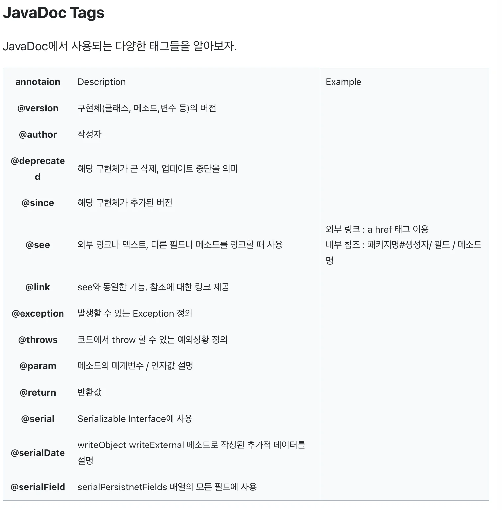
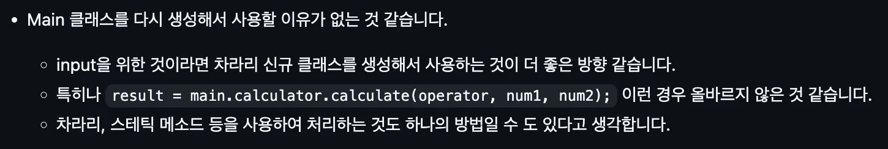
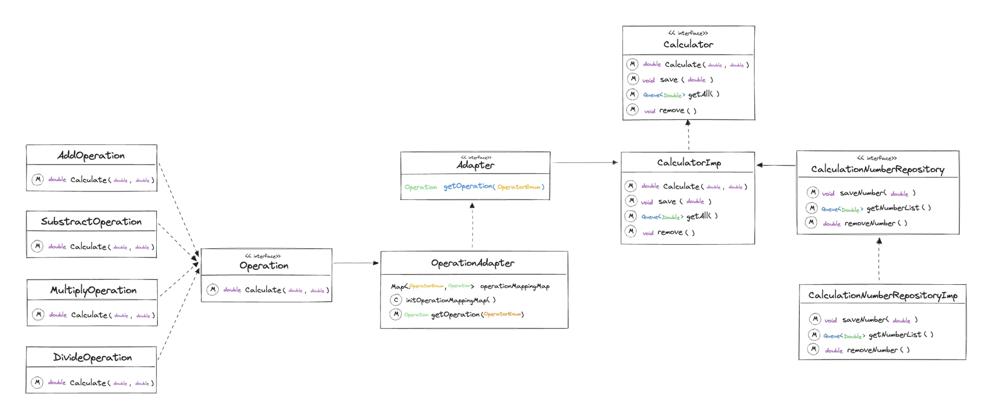
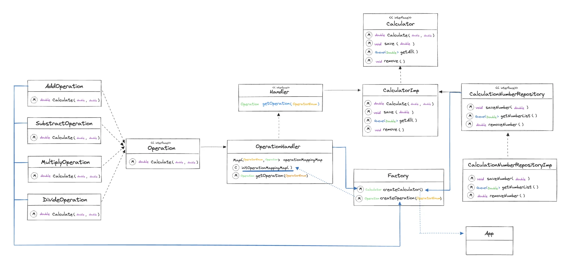
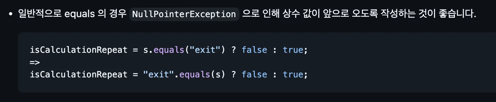
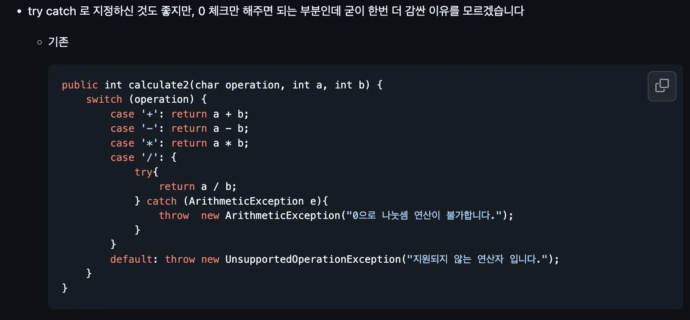
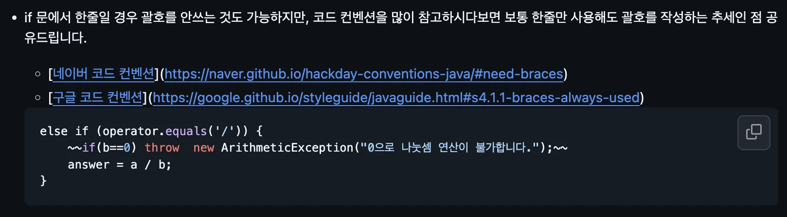

> 💡 
> 
> <a id="123eda9b0fe1812fa5dfc05b5fa8bd8d"></a>
> 
> PDS 다이어리 참조

<a id="123eda9b0fe181d58df0de027f2cbb34"></a>

### PlAN 

<details>
<summary>✎ To Do list</summary>

[과제 피드백](#/post/123eda9b-0fe1-8045-a02f-e9dd4cb1bcac)

[스파르타 강의 - 5주차 정리](#/post/123eda9b-0fe1-8070-aa17-c1ebca1ffdad)

[스파르타 강의 - 4주차 정리](#/post/123eda9b-0fe1-8002-afe6-c59b29473cfe)

[스파르타 강의 - 3주차 정리](#/post/e6f6b9b3-f5df-4a20-99d2-ec4c660660d5)

[학습법 특강](#/post/8cc80a40-6bbe-4359-aa89-d2faeb008438)

[알고리즘 세션 ( 김재연 튜터님 )](#/post/94129552-a537-47ad-b3ab-011939927306)

[자바 문법 정리 프로젝트 폴터 재구화 필요](#/post/123eda9b-0fe1-802e-a650-eee8fdaaa125)

[static 으로 선언한 변수와 메서드는 그렇지 않은 변수와 메서드와 JVM - 런타임 영역에서 어떠한 차이를 보이는가?](#/post/123eda9b-0fe1-8067-986b-c8aeed0ef6ab)

[DB 필터 및 연동](#/post/123eda9b-0fe1-80b5-b09f-ca8e78df902a)

[이벤트 기반 구조 ( EDA ) 란 무엇인가?](#/post/124eda9b-0fe1-8095-8e30-f21ecdc2c3ed)

[도메인 주도 개발(DDD) 란 무엇인가?](#/post/124eda9b-0fe1-80fe-8ec9-fbd532d5cc22)

[시스템 설계 시, 클래스의 책임에 대하여](#/post/124eda9b-0fe1-8069-9236-e2762e90aaa7)

[오브젝트](#/post/123eda9b-0fe1-802b-97b0-f75037d2bd2a)

[인프런 - QueryDSL](#/post/15beda9b-0fe1-8003-bbd2-e937129105c5)

[캐시](#/post/15beda9b-0fe1-8068-9a95-fe8ca90e3bcf)

[성능 최적화 1](#/post/15beda9b-0fe1-8036-bfd6-d11021a5feed)

[테스트코드1](#/post/15beda9b-0fe1-8041-b8d7-d575a008ef6a)

[AWS](#/post/158eda9b-0fe1-8066-a42b-e134791ec95a)

[Docker](#/post/158eda9b-0fe1-8053-95de-e2637f4ba74f)

[스프링 심화](#/post/158eda9b-0fe1-8042-90e7-f66d372f6b78)

[정규삭](#/post/151eda9b-0fe1-80ea-84a0-f3d6f5379001)

[디자인 패턴](#/post/14beda9b-0fe1-800f-b351-daf03a3d948a)

[트랜잭션](#/post/14aeda9b-0fe1-804a-9711-e25e833b1eac)

[API, ERD, 도메인, 엔티티 설계도 작성](#/post/14aeda9b-0fe1-8047-8037-ce7e618d347f)

[프로젝트 생성](#/post/14aeda9b-0fe1-8011-a294-f6799b2886a1)

[통화 변환 앱](#/post/14aeda9b-0fe1-80f8-bea6-c982d3367ad7)

[JPQL](#/post/149eda9b-0fe1-803e-b577-d8a341c6e57a)

[JPA 연관관계](#/post/149eda9b-0fe1-8082-ae5d-ed7df1e2922f)

[MessageConverter](#/post/149eda9b-0fe1-8047-8468-c38436b356cd)

[스프링 심화](#/post/149eda9b-0fe1-80a3-81fd-ca619a417c5f)

[발표하기](#/post/149eda9b-0fe1-80a6-ac7f-c2647fcdc614)

[발표 준비](#/post/145eda9b-0fe1-80fa-aa53-d76b0edddab6)

[회원 탈퇴 api](#/post/145eda9b-0fe1-8035-8832-d323d54fdbbc)

[인증/인가 구현](#/post/145eda9b-0fe1-8077-89b1-e59524f538f5)

[petstagram](#/post/145eda9b-0fe1-8025-9f5e-f195f0693c46)

[일정관리 앱 V2](#/post/13ceda9b-0fe1-801c-96e3-f208b15510e9)

[JPA](#/post/13ceda9b-0fe1-80f4-9cf4-e5b5868f5d49)

[인증/인가](#/post/13ceda9b-0fe1-803f-b748-d39d8f4e4994)

[Validation](#/post/13ceda9b-0fe1-80f4-af34-c3c723fe7e7a)

[스프링](#/post/13ceda9b-0fe1-80bf-b0d3-cf55bac10bb6)

[스프링 숙련](#/post/13ceda9b-0fe1-80ba-810b-d12d8ecea477)

[자바 - 스트림](#/post/13beda9b-0fe1-8090-9b5c-e5acc0900c33)

[피드백](#/post/13beda9b-0fe1-809b-a8c2-c660eafa6b6f)

[도전 기능 구현](#/post/138eda9b-0fe1-802a-a1f6-dc544ebdbc4a)

[피드백 적용](#/post/138eda9b-0fe1-805b-9a53-d5d9708243ad)

[예외처리](#/post/138eda9b-0fe1-80b3-8286-dd76bca2f044)

[javaDos 형식 주석 작성](#/post/138eda9b-0fe1-8035-9a92-ddf597ff8927)

[필수 기능 구현](#/post/138eda9b-0fe1-805b-8caf-cf8eaf0c8fc9)

[멀티스레딩 및 동시성제어](#/post/138eda9b-0fe1-8079-9e3b-f074987367ef)

[자바 내장 메서드](#/post/136eda9b-0fe1-8040-a054-e26073b22ead)

[정규식](#/post/136eda9b-0fe1-8036-a2b7-e7e71a2deb05)

[CS 특강 - 데이터베이스](#/post/136eda9b-0fe1-80ce-a932-d95c858e51af)

[스탠다드 - 2. API 명세서](#/post/135eda9b-0fe1-80fc-ac9c-f096d7db010a)

[ABA Problem](#/post/135eda9b-0fe1-80c0-a5ac-e8968049194f)

[1. 문자열](#/post/134eda9b-0fe1-80cd-a7bd-d44b2ae5050e)

[자바 알고리즘 인터뷰](#/post/134eda9b-0fe1-8003-aa4d-ef8345a2f3b5)

[데이터 모델링](#/post/131eda9b-0fe1-800c-89b2-e0c1f91ac737)

[SQL](#/post/131eda9b-0fe1-80c9-af73-dda7f86f771b)

[API 설계](#/post/131eda9b-0fe1-801b-8563-d0ee1f10d358)

[ERD 설계](#/post/131eda9b-0fe1-803f-bc5e-ce900695b46a)

[6주차 정리](#/post/12eeda9b-0fe1-80d7-8465-d6dba7891dcc)

[5주차 정리](#/post/12eeda9b-0fe1-80bb-bea4-edff13e78e5e)

[4주차 정리](#/post/12eeda9b-0fe1-80e0-a347-ecbb837ae08b)

[3주차 정리](#/post/12eeda9b-0fe1-80ab-bf77-fc2eed517c58)

[2주차 정리](#/post/12eeda9b-0fe1-8043-8a35-c373ba5e14fa)

[1주차 정리](#/post/12eeda9b-0fe1-80be-b848-e8769dac6540)

[강의 노션 페이지 작성](#/post/12eeda9b-0fe1-80f2-8404-f243ccafc38e)

[스프링 기초](#/post/12eeda9b-0fe1-8073-afe2-e68ec781954a)

[과제 노션 페이지 만들기](#/post/12eeda9b-0fe1-8026-9393-c88011051cd9)

[github에 repository 만들기](#/post/12eeda9b-0fe1-809e-86b4-e3afbc13a674)

[발제 보고 요구사항 정리](#/post/12eeda9b-0fe1-8068-8d6c-fa0f03b47539)

[일정관리 앱](#/post/12eeda9b-0fe1-80d1-88bb-efaac9d33682)

[ch 1 -  사용자 수에 따른 규모 확장성](#/post/12deda9b-0fe1-805d-867c-d77224ae9e0a)

[가상 면접 사례로 배우는 대규모 시스템 설계의 기초 1](#/post/12deda9b-0fe1-8079-9c30-d04b8f4e9d50)

[어댑터 패턴](#/post/12ceda9b-0fe1-80f3-a408-ed55df128ac4)

[옵저버 패턴](#/post/12ceda9b-0fe1-8066-8fa7-fcac137668ca)

[전략패턴](#/post/12ceda9b-0fe1-80db-9874-d1f523adb4b4)

[헤드퍼스트 디자인패턴](#/post/12ceda9b-0fe1-80da-8f4a-db20997693e2)

[과제 - 피드백](#/post/12beda9b-0fe1-807e-96db-ff81a288ea03)

[자바 컨벤션](#/post/129eda9b-0fe1-8040-a05e-f8a84dc61763)

[Java 코드 컨밴션 특강 정리](#/post/129eda9b-0fe1-801a-a35f-d3d6468430f1)

[2. 제네릭 - 고급](#/post/128eda9b-0fe1-8064-acc2-cfe9bdda5499)

[Lv 4 구현](#/post/127eda9b-0fe1-80d6-9c17-fad8ba45ee37)

[Lv 3 구현](#/post/127eda9b-0fe1-80e5-b3f0-e2441f3457c1)

[Lv 2 구현](#/post/127eda9b-0fe1-80b7-b0b4-c3a99a668ca4)

[Lv 1 구현](#/post/127eda9b-0fe1-80be-bda5-d6a6b1b344f6)

[10. 순회, 정렬, 전체정리](#/post/127eda9b-0fe1-8044-91e0-e5360674c54d)

[9. Map, Stack, Queue](#/post/127eda9b-0fe1-8041-a4c1-f57e1cf69f63)

[8. Set](#/post/127eda9b-0fe1-8023-9eff-c913601a7d0b)

[7. HashSet](#/post/127eda9b-0fe1-80ed-9ec8-ec3d81f492b6)

[6. Hash](#/post/127eda9b-0fe1-80b8-92d3-d2ac7ee59bdb)

[5. List](#/post/127eda9b-0fe1-80b4-a974-fd07b84e2ca2)

[4. LinkedList](#/post/127eda9b-0fe1-8094-9c5f-c0784243135d)

[3. ArrayList](#/post/127eda9b-0fe1-805d-9daf-db3805c2c788)

[1. 제네릭](#/post/127eda9b-0fe1-8046-8638-dd3ce5d6386c)

[자바 중급 2편](#/post/127eda9b-0fe1-80e3-9579-e87a528a75b0)

[숫자야구게임](#/post/127eda9b-0fe1-8062-bb99-db713e87667a)

[Redis](#/post/126eda9b-0fe1-8074-9d69-e4f99238babd)

[다형성, 추상클래스 활용](#/post/123eda9b-0fe1-8009-88f3-ddef3ec0e5db)

</details>

> ☝🏻 
> 
> <a id="123eda9b0fe181db98f3e729dbc2a888"></a>
> 
> 너무 많은 양 계획 세우지 않기, <code>One Thing</code>

- [ ] 과제 피드백

- [ ] 독서 &#45; 오브젝트 

<a id="123eda9b0fe181838644e125517a6865"></a>

### Do

---

- 디자인패턴
    - <a href="https://beautiful-college-c84.notion.site/69cee85838944138b72e789710574026">페이지</a> 

- 과제 피드백
    [과제 피드백](https://github.com/gyungsubLee/Calculator_with_java/issues/1)

    <details>
    <summary>주석</summary>

    <details>
    <summary>피드백 내용</summary>

    

    </details>

    <details>
    <summary>박진상 튜터님 피드백</summary>

    - 클린코드는 가장 이상적인 작성 방법에 대한 내용이다&#46;

    - 물론 그렇게 할 수 있으면 좋지만, 제약되는 상황이 존재할 수 있다&#46; 

    - 상황을 고려해, 주석 작성이 필요한 경우, 다른 사람들의 이해를 위해 작성을 해주는 것이 좋다&#46;
        - ex) 복잡한 로직

    - 주석으로 To Do 표시
        - 나중에 개발 진행 예정을 나타냄
            - 예를 들어,실제 서비스를 런칭하고 유저들의 반응을 본 후 추가해야되는 기능 같은 경우

            -  ‘To Do’라는 주석 표시를 함으로써 <strong><u>나중에 개발 진행 예정</u></strong>을 명시 할 수 있다&#46;

        - To Do를 표시한 부분만 따로 볼수 있음
            - 해당 방법 정리 필요

    </details>

    > 📌 
    > 
    > <a id="1b2589a59e7b49ed972c3a77ec714a2d"></a>
    > 
    >  주석을 통한 코드의 설명은 코드를 명시적으로 작성하지 않는 것이다&#46; 
    > 
    > <a id="124eda9b0fe180198007d22bb44bf998"></a>
    > 
    >   &#45; 클린코드 &#45;

    - 위 내용을 근거해 <strong><u>의도적으로 주석 작성을 피</u></strong>하고, <code>변수명과</code> <code>메서드명</code>, <code>클래스명</code>을 명시적으로 표현하려고 하였다&#46; 
        - ex) CalculateResultRepository, addResult, getResultList …

    - 이에 대해 ‘어느 정도는 주석 작성을 하는 것이 좋다’ 라는 피드백을 받았다&#46;
        - 클래스, 메서드 단위 정도

        - javadoc 형식 따름

        >  스프링 부트 사용하면 알아서 생성해줌 (인텔리제이 유료버전 때문인가?) <br>→ <code>/&#42;&#42;/</code>

        <details>
        <summary>javaDos Tags</summary>

        

        <details>
        <summary>사용 예시)</summary>

        <a id="124eda9b0fe18092b6f0e47b85b0a124"></a>

        ```java
        /**
        * @param : {@link Queue} 타입의 제품 제공
        * @return : {@line Queue} 타입의 적재되지 않은 제품
        */
        Queue<Supply> load(Queue<Supply> supplies);
        ```

        </details>

        </details>

    </details>

    <details>
    <summary> 중요&#33;)  객체 간의 ‘강한 결합’ 형성 → 책임 분리, 팩토리 메서드 패턴</summary>

    <details>
    <summary>피드백 내용</summary>

    

    </details>

    <details>
    <summary>🧐<strong><u> 강한 결합</u></strong>, 약한 결합</summary>

    <details>
    <summary>🧐 <code>‘강한 결합’ </code>의 <u>단점</u></summary>

    <details>
    <summary>확장성 저하</summary>

    <a id="125eda9b0fe18021af19f2198e2097df"></a>

    새로운 의존성을 추가하거나 기존 의존성을 변경할 때 유연하게 대처하기 어렵다&#46;

    </details>

    <details>
    <summary>테스트 어려움</summary>

    - <strong>단위 테스트 &#45; </strong> Mock 객체, 가짜 객체(Fake Object) 주입 시
        <a id="125eda9b0fe1801fba77e83a909aa7a2"></a>

        직접 객체를 생성하기 때문에, 의존성을 대체할 수단이 없다&#46; 

    - 결국 ‘하나의 단위’로 테스트(단위테스트) 하는 것이 불가능하다&#46;

    </details>

    <details>
    <summary>재사용성 저하</summary>

    <a id="125eda9b0fe180efb74ee8dee3f87118"></a>

    클래스가 특정 의존성에 강하게 결합되어 있으면 다른 환경이나 요구사항에 맞게 재사용하기가 어렵다&#46;

    </details>

    <details>
    <summary>유지보수 비용 증가</summary>

    <a id="125eda9b0fe18017b6ecd5f5ab7bd1bf"></a>

    변경이 발생할 때마다 모든 관련 클래스를 수정해야 하며, 의존성 간의 변경 사항이 코드 전반에 걸쳐 영향을 미치게 된다&#46;

    </details>

    <details>
    <summary>단일 책임 원칙(SRP) 위반</summary>

    <a id="125eda9b0fe1807e8e89e1281fea7473"></a>

    <strong>‘객체 생성 책임’, ‘클래스 본연의 책임’</strong>이 혼재함

    </details>

    </details>

    <a id="125eda9b0fe180288559fce5e91c8ff2"></a>

    클래스 내부에 특정 객체를 직접 생성(new)하면, 그 객체에 강하게 결합 된다&#46; 즉, 두 객체 사이의 영향력이 커진다&#46; (의존성이 커진다&#46;)

    <a id="125eda9b0fe18018b550f2eb0098f173"></a>

    따라서 생성되는 객체의 내부 동작이 변경될 시,  강한 결합을 형성하는 객체도 영향을 받아 동작이 변경될 수 있다&#46; 

    <a id="125eda9b0fe18040b673e12a11fe0e11"></a>

    따라서 객체들 간에는 <strong>‘약한 결합’</strong>을 형성하여 <strong><u>의존성을 낮</u></strong>춰, 코드의 <strong><u>확장 및 변경에 용이하게 설계</u></strong>해야 한다&#46; 

    - ‘약한 결합’은 <code>interface(형식)</code>으로 <strong><u>타입을 정의</u></strong>하고 <strong><u>외부에서 인스턴스 주입 </u></strong><strong><u>( </u></strong><strong><u>의존성 주입 </u></strong><strong><u>)</u></strong> 하여 설계한다&#46;

    - 이는 객체 지향의 <strong><u>다형성</u></strong>, <strong><u>SOLID 원칙</u></strong> 활용한 앱의 복잡성 관리 및 유지보수를 용이하게 하기 위한 방식이다&#46; 

    </details>

    <details>
    <summary>문제 &#45; 스프링 환경 없이 의존성 주입(DI) 시, 클래스 내부에 해당 인스턴스를 생성함</summary>

    - 객체 간의 의존성을 낮추기(약한 결합) 위해 생성자를 통해 의존성을 주입으로 코드를 설계함
        <a id="125eda9b0fe180d59ff7f0cde21d16af"></a>

        ```java
        public class Main {
        	  private final Calculator calculator;
        	  private final CalculationResultRepository repository;
        	
        	  public Main(Calculator calculator, CalculationResultRepository repository) {
        	      this.calculator = calculator;
        	      this.repository = repository;
        	  }
        ```

    -  스프링 환경 없이 순수한 자바를 통해서 구현하려고 하니 아래와 같이 <strong><u>내부에 인스턴스를 생성하고 주입</u></strong>함
        <a id="125eda9b0fe180a38836dabb5e29fdb8"></a>

        ```java
        public static void main(String[] args) {
        	   Main main = new Main(new CalculatorImp(), new CalculationResultRepositoryImp());
        ```

    - <strong><u>내부</u></strong><strong>에</strong>서 <strong><u>의존성(인스턴스)이 주입</u></strong>되기 때문에, 결론적으론 <strong><u><code>강한 결합</code></u></strong><strong><u> 상태</u></strong>가 됨
        - 생성자 주입을 통해 객체 간의 의존성을 낮추려는 의도가 구현되지 않음

    <details>
    <summary><strong><u>main&#46;</u></strong>calculator&#46;calculate( …) </summary>

    <a id="125eda9b0fe180c29d57fcd2659b1d26"></a>

    ```java
    class Main {

    		...
    		
    		public static void main(String args){
    				Main main = new Main();
    				
    				main.calculator.calculate( …)
    				
    				. . .
    ```

    </details>

    </details>

    <details>
    <summary>1&#46;1 설계 변경)  &#45;  Calculator 책임 분리, &#91;데이터 저장, 수정, 삭제&#93; 메서드 추가</summary>

    

    > ⚠️ 
    > 
    > <a id="303567b803bc44d88e8535a64e518a26"></a>
    > 
    > 의존성에 대한 이해가 잘못되었음

    <details>
    <summary>수정사함</summary>

    - Main은 테스트를 위한 클래스이다 <br>따라서 Main에서 생성자 주입을 사용하는 것은 올바르지 않았음
        <a id="125eda9b0fe1808f9013d55a2e188bb0"></a>

        ```java
        public class Main {
            private final Calculator calculator;
            private final CalculationResultRepository repository;

            public Main(Calculator calculator, CalculationResultRepository repository) {
                this.calculator = calculator;
                this.repository = repository;
            }
        ```

    </details>

    <details>
    <summary>Calculator에 Adapter를 매칭하는 책임 분리</summary>

    <details>
    <summary>&#91; 코드 &#93; &#60;interface&#62; Adapter</summary>

    <a id="125eda9b0fe180f59992cad01c11b510"></a>

    ```java
    package calculator.lv2.Adapter;

    import calculator.lv2.enums.OperatorEnum;
    import calculator.lv2.operation.Operation;

    public interface Adapter {

        public Operation getOperation(OperatorEnum operatorType);
    }

    ```

    </details>

    <details>
    <summary>&#91; 코드 &#93; OperationAdapter</summary>

    <a id="72b8330f58dd46a4b0569d6c85ea8b5c"></a>

    ```java
    package calculator.lv2.Adapter;

    import calculator.lv2.enums.OperatorEnum;
    import calculator.lv2.operation.*;

    import java.util.HashMap;
    import java.util.Map;

    public class OperationAdapter implements Adapter {
        private final Map<OperatorEnum, Operation> operationMappingMap= new HashMap<>();

        public OperationAdapter() {
            initOperationMappingMap();
        }

        private void initOperationMappingMap(){
            operationMappingMap.put(OperatorEnum.ADD, new AddOperation());
            operationMappingMap.put(OperatorEnum.MINUS, new SubstractOperation());
            operationMappingMap.put(OperatorEnum.MULTIPLICATION, new MultiplyOperation());
            operationMappingMap.put(OperatorEnum.DIVISION, new DivideOperation());
        }

        @Override
        public Operation getOperation(OperatorEnum operatorType){
            return operationMappingMap.get(operatorType);
        }
    }

    ```

    </details>

    <details>
    <summary>&#91; 코드 &#93; CalculatorImp</summary>

    <a id="8112eab07249490b982e01d6700b7945"></a>

    ```java
    public class CalculatorImp implements Calculator {
        private final OperationAdapter adapter;
        private final CalculationNumberRepository repository;

        public CalculatorImp(OperationAdapter adapter, CalculationNumberRepository repository) {
            this.adapter = adapter;
            this.repository = repository;
        }
    		
        // 계산
        @Override
        public double calculate(char operator, double a, double b){
            OperatorEnum operatorType = OperatorEnum.fromOperator(operator);
            Operation mappingOperation = adapter.getOperation(operatorType);

            if (mappingOperation == null) {
                throw new UnsupportedOperationException("Unknown operation: " + operator);
            }

            return mappingOperation.calculate(a, b);
        }
    }
    ```

    </details>

    </details>

    <details>
    <summary>저장, 수정, 삭제 즉, 데이터를 관리하는 메서드 추가</summary>

    <details>
    <summary>&#91; 코드 &#93; &#60;interface&#62; Calculator</summary>

    <a id="a5644b94e82a46209f931145e5b66da8"></a>

    ```java
    package calculator.lv2;

    import java.util.Queue;

    public interface Calculator {

        double calculate(char operator, double a, double b);
        void save(double number);
        Queue<Double> getAll();
        void remove();
    }

    ```

    </details>

    <details>
    <summary>&#91; 코드 &#93; CalculatorImp</summary>

    <a id="d51cda75def24de0b7ff19a036fd727b"></a>

    ```java
    public class CalculatorImp implements Calculator {
        private final OperationAdapter adapter;
        private final CalculationNumberRepository repository;

        public CalculatorImp(OperationAdapter adapter, CalculationNumberRepository repository) {
            this.adapter = adapter;
            this.repository = repository;
        }
    		
    		    .  .  .

        // 저장
        @Override
        public void save(double number) {
            repository.saveNumber(number);
            System.out.println("계산한 결과 값인  '" + number + "' 가 저장 되었습니다.");
        }

        // 조회
        @Override
        public Queue<Double> getAll() {
            return repository.getNumberList();
        }

        // 삭제
        @Override
        public void remove() {
            double removeNumber = repository.removeNumber();// 맨 처음 요소 제거
            System.out.println("저장된 결과 값인  '" + removeNumber + "' 가 삭제 되었습니다.");
        }
    }
    ```

    </details>

    </details>

    </details>

    <details>
    <summary>1&#46;2 설계 변경)  의존성 주입을 위한 클래스 생성 (팩토리 패턴)</summary>

    > 팩토리 패턴을 사용하여 객체 생성 책임을 다른 클래스로 위임
    > 
    > <a id="125eda9b0fe18005a10cd1c9065caf3a"></a>
    > 
    > <a href="https://beautiful-college-c84.notion.site/69cee85838944138b72e789710574026">페이지</a> 

    

    <details>
    <summary>&#91; 코드 &#93; Factory</summary>

    - 아래와 같이 인스턴스 생성 책임만을 위핸 Factory 클래스를 만듬

    <a id="125eda9b0fe18016b438de3c237dbea3"></a>

    ```java
    package calculator.lv2;

    import calculator.lv2.Adapter.OperationHandler;
    import calculator.lv2.enums.OperatorEnum;
    import calculator.lv2.operation.*;
    import calculator.lv2.repository.CalculationNumberRepositoryImp;

    public class Factory {

        public static Calculator createCalculator() {
            return new CalculatorImp(new OperationHandler(), new CalculationNumberRepositoryImp());
        }

       public static Operation createOperation(OperatorEnum type){
            if(type == OperatorEnum.ADD){
                return new AddOperation();
            } else if(type == OperatorEnum.ADD){
                return new SubstractOperation();
            }  else if(type == OperatorEnum.ADD){
                return new MultiplyOperation();
            }  else {
                return new DivideOperation();
            }
       }
    }
    ```

    </details>

    <details>
    <summary>&#91; 코드 &#93; App</summary>

    <a id="125eda9b0fe18093891ffa6f61d144f2"></a>

    ```java
    class App {
    	private final Calculator calculator;
    	
    	  . . .

    	public static void  main(String[] args) {
            Scanner sc = new Scanner(System.in);

            // Factory에서 의존성이 생성하여 가져옴
            Calculator calculator = Factory.createCalculator();
    			.  .  .
    	}
    }
    ```

    </details>

    <details>
    <summary>&#91; 코드 &#93; OperationHandler</summary>

    <a id="84b3c2465e964a18b5194166c5493519"></a>

    ```java
    public class OperationHandler implements Handler {
        private final Map<OperatorEnum, Operation> operationMappingMap= new HashMap<>();

        public OperationHandler() {
            initOperationMappingMap();
        }

        private void initOperationMappingMap(){
            for (OperatorEnum operatorEnum : OperatorEnum.values()) {
                operationMappingMap.put(operatorEnum, Factory.createOperation(operatorEnum));
            }
        }
        
    	.  .  .
    ```

    </details>

    </details>

    <details>
    <summary>정리 </summary>

    - 맨날 ‘스프링부트 &#45;롬복’을 통해서 간단히 처리하다가, 순수 자바 환경으로 구현하려니 애를 많이 먹었다&#46;

    - 의존성, 책임에 대해 최대한 고려하면서 분리하려고 했다&#46;

    - 아직까지는 많이 어렵다&#46;&#46; 공부가 많이 필요할 듯 싶다&#46;

    </details>

    </details>

    <details>
    <summary><code>&#46;equals()</code> &#45;  NullPointerException </summary>

    <details>
    <summary>피드백</summary>

    

    </details>

    -  <code>&#46;equals()</code>의 경우,  <code>NullPointerException</code>이 발생될 수 있기 때문에 상수값이 앞으로 오도록 작성 해야한다&#46;
        <details>
        <summary><code>s </code>는 입력받는 값이기 때문에, <code>null</code> 값이 들어올 수 있음</summary>

        <a id="124eda9b0fe180dca5ace50623d36b6f"></a>

        ```java
        String s = sc.next();
        ```

        </details>

        <a id="124eda9b0fe180e6bee1ff9590c03eff"></a>

        ```java
        ("exit").equals(s)  ? false : true;
        ```

    </details>

    <details>
    <summary><code>try &#45; catch 문</code> </summary>

    <details>
    <summary>피드백</summary>

    

    </details>

    <details>
    <summary>문제 코드</summary>

    <a id="6a00abebc96042fc8acf5fdb8d862e6c"></a>

    ```java
    public int calculate2(char operation, int a, int b) {
    	  switch (operation) {
    		    case '+': return a + b;
    		    case '-': return a - b;
    		    case '*': return a * b;
    		    case '/': {
    				    // 피드백) 불필요한 try-catch 사용
    		        try {
    		           return a / b;
    		        } catch(ArithmeticException e) {
    		           throw new ArithmeticException("0으로 나눌 수 없습니다.");
    		        }
    		    }
    		    default: throw new UnsupportedOperationException("지원되지 않는 연산자 입니다.");
    		}
    } 
    ```

    </details>

    - try&#45;catch 문으로 감싸 표현함
        -  0 체크만 해주면 되는 부분인데 굳이 한번 더 감싼 이유를 모르겠다는 피드백을 받음, try&#45;catch를 사용하여 오히려 동작에 대한 불필요한 로직이 생겼음

        - 좋지 않은 코드이나, 연습을 위해 한번 작성해봄

    - 아래는 피드백 내용으로 수정한 코드임

    <a id="124eda9b0fe1804eadbbfad9009bdb15"></a>

    ```java
    public int calculate2(char operation, int a, int b) {
        switch (operation) {
            case '+': return a + b;
            case '-': return a - b;
            case '*': return a * b;
            case '/': {
                // 피드백) 요구 사항에 준수
                if(b==0) throw  new ArithmeticException("0으로 나눗셈 연산이 불가합니다.");
                return a / b;
            }
            default: throw new UnsupportedOperationException("지원되지 않는 연산자 입니다.");
        }
    }
    ```

    </details>

    <details>
    <summary>gradle</summary>

    

    - Gradle의 주요 역할은 프로젝트의 <strong>빌드 과정</strong>을 관리하고, 필요한 라이브러리들을 자동으로 <strong>의존성 관리</strong>해 주는 것 이다&#46;

    - 그러나 해당 프로젝트는 순수 자바로만 진행하며, 콘솔을 통해 하나의 클래스에서 단순히 입력값을 받고 연산하여 결과값 출력한다&#46;

    - 따라서 종속되는 라이브러리들이 존재하지 않다&#46; 즉, Gradle이 필요하지 않는다&#46;

    - &#91;JDK,JRE,JVM &#93;을 통해  <code>&#46;java</code> 파일이 <code>&#46;class</code>  변경되어 컴퓨터에서 실행할 수 있는 것이다&#46;

    </details>

    <details>
    <summary>Lv2 &#45; Calculator에 Enum 타입 적용</summary>

    <details>
    <summary>연산자 Enum 타입 </summary>

    <details>
    <summary>&#91; 코드 &#93; OperatorEnum</summary>

    <a id="124eda9b0fe1803dbcc2cc3609a4862f"></a>

    ```java
    package calculator.lv2.enums;

    public enum OperatorEnum {
        ADD('+'),
        MMINUS('-'),
        MULTIPLICATION('*'),
        DIVISION('/');

        private final char symbol;

        OperatorEnum(char symbol) {
            this.symbol = symbol;
        }

        public static OperatorEnum fromOperator(char operator){
            for(OperatorEnum type : OperatorEnum.values()){
                if(type.symbol == operator){
                    return type;
                }
            }
           throw new UnsupportedOperationException("해당아는 연산자가 없습니다. " + operator);
        }
    }

    ```

    </details>

    </details>

    <details>
    <summary>Calculator 적용</summary>

    <details>
    <summary>&#91; 코드 &#93; CalculatorImp</summary>

    <a id="125eda9b0fe1802e9d8dcc834f7863c7"></a>

    ```java
    public class CalculatorImp implements Calculator {
        private final Map<OperatorEnum, Operation> operationMappingAapter = new HashMap<>();

        public CalculatorImp() {
            initOperationMappingMap();
        }

        private void initOperationMappingMap(){
            operationMappingAapter.put(OperatorEnum.ADD, new AddOperation());
            operationMappingAapter.put(OperatorEnum.MINUS, new SubstractOperation());
            operationMappingAapter.put(OperatorEnum.MULTIPLICATION, new MultiplyOperation());
            operationMappingAapter.put(OperatorEnum.DIVISION, new DivideOperation());
        }


        @Override
        public double calculate(char operator, double a, double b){
            OperatorEnum operatorType = OperatorEnum.fromOperator(operator);
            Operation mappingOperation = operationMappingAapter.get(operatorType);

            if (mappingOperation == null) {
                throw new UnsupportedOperationException("Unknown operation: " + operator);
            }

            return mappingOperation.calculate(a, b);
        }
    }
    ```

    </details>

    </details>

    </details>

    <details>
    <summary>if문 컨벤션 </summary>

    

    - <a href="https://naver.github.io/hackday-conventions-java/#need-braces">네이버 코드 컨벤션</a>

    - <a href="https://google.github.io/styleguide/javaguide.html#s4.1.1-braces-always-used">구글 코드 컨벤션</a>

    <a id="feb23a6b92f74cfd9b6a485dc815a7fc"></a>

    ```java
    else if (operator.equals('/')) {
    		// 피드백) 한 줄인 경우 '{}' 생략 가능하지만, 요즘 대기업들의 컨벤션 추세는 괄호를 작성한다.
        if(b==0) throw  new ArithmeticException("0으로 나눗셈연산이 불가합니다.");
        answer = a / b;
    }
    ```

    </details>

    <details>
    <summary>잘못된 표현 수정&#58; 어댑터 패턴 → 전략패턴</summary>

    > <a href="https://beautiful-college-c84.notion.site/99cc549123274073bfde89b5dad2889b">페이지</a>

    <a id="125eda9b0fe18095ba67e191e06f1714"></a>

    디자인 패턴을 잘못 이해하여 서술함

    <a id="125eda9b0fe1805dae0fccfa90af15b5"></a>

    해당 패턴 정확한 학습 필요

    - Adapter → Handler

    - OperationAdapter → OperationHandler

    </details>

<a id="123eda9b0fe181b0896bec78ac9ab131"></a>

### SEE

---

- 디자인 패턴을 적용하는게 힘들기는 한데  꽤 재밌음
    <a id="125eda9b0fe1805dab93fa2dbfd4a8d5"></a>

    ⇒ 디자인패턴 틈틈히 학습할 것

- 인스턴스 멤버, 클래스 멤버 JVM 동작 정리하다가 못함
    <a id="125eda9b0fe1801fb75cf22d254d02ce"></a>

    ⇒ 요것도 정리할 것
