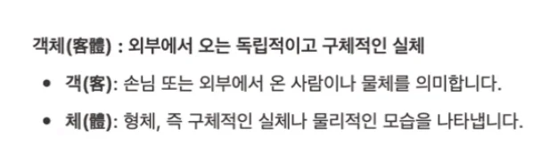
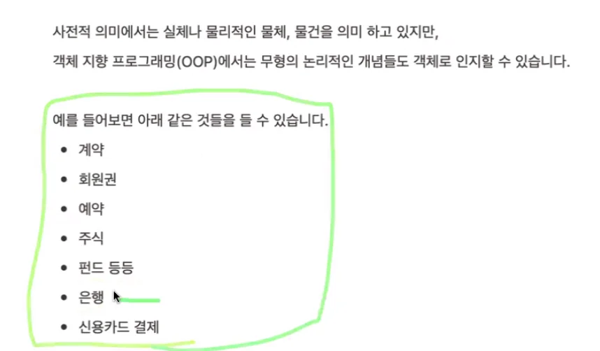

객체 지향은 이력서와 같다&#46;

계속 꾸준히 연습을 하면서 스킬을 길러야 한다&#46; 

### SOLID 

객체 지향은 인간의 사과와 관점에 어떤 것을 분류하려는 모델이다&#46;

지극히 인간의 관점으로 객체 지향이라는 개념만 해도 복잡하고 어렵다&#46;

객체 지향 → 컴퓨터, Java를 써서 표현

즉, 지극히 인간의 관점인 세계를 Java로 표현해야 하니, 

내가 지금 하려는게 자바 문법인지 객체 지향인지 헷갈려한다&#46;

스프링 프레임워크의 규칙을 지키면 이게 객체지향 및 디자인 패턴이다&#46; 

### 객체

자바 → 객체 지향 

단일 책임인 이상적인 개발 방식이다&#46;

이게 맞나? 라는 고민을 하는 것이 

시스템 전체의 설계를 생각하지 하고 기능을 설계 해야한다&#46;

현업에서도 추상 클래스 많이 쓴다&#46;

각각의 

계획은 엄청 났으나…

개발 공부 → 객체지향, 솔리드…

실무에서는 현실적인 이유, 

대용량 1초, 2초가 굉장히 중요하다&#46;

SOLID 원칙이 중요하다&#46;

이런 원칙들을 분석하고, 

다형성 

하나의 상위 개념에 아래의 하위 개념을 형성하는 구조를 말한다&#46;

예시) 자동차 

자동차 → 아반떼, K3, &#46;&#46;
