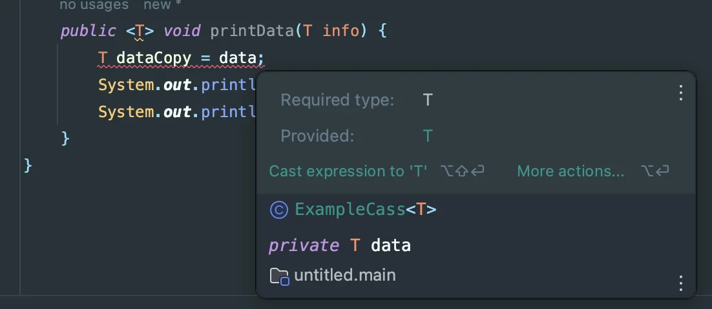
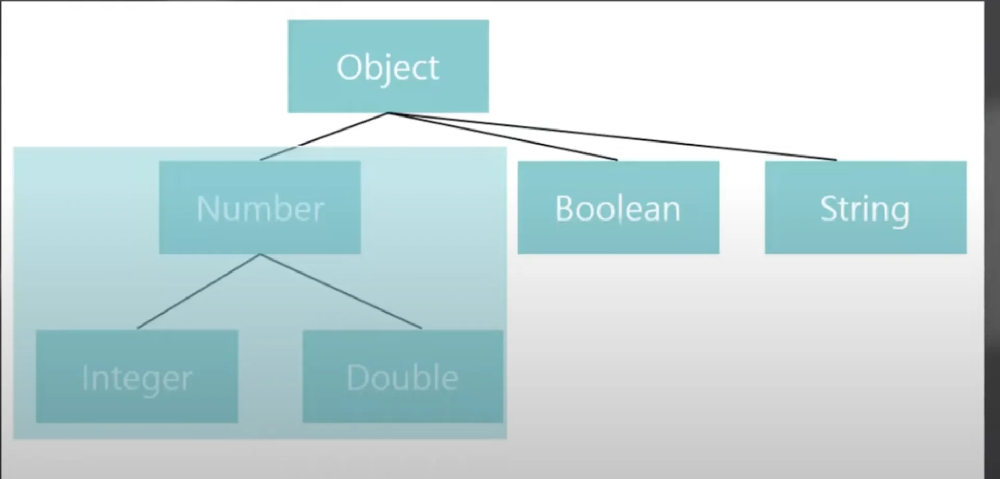
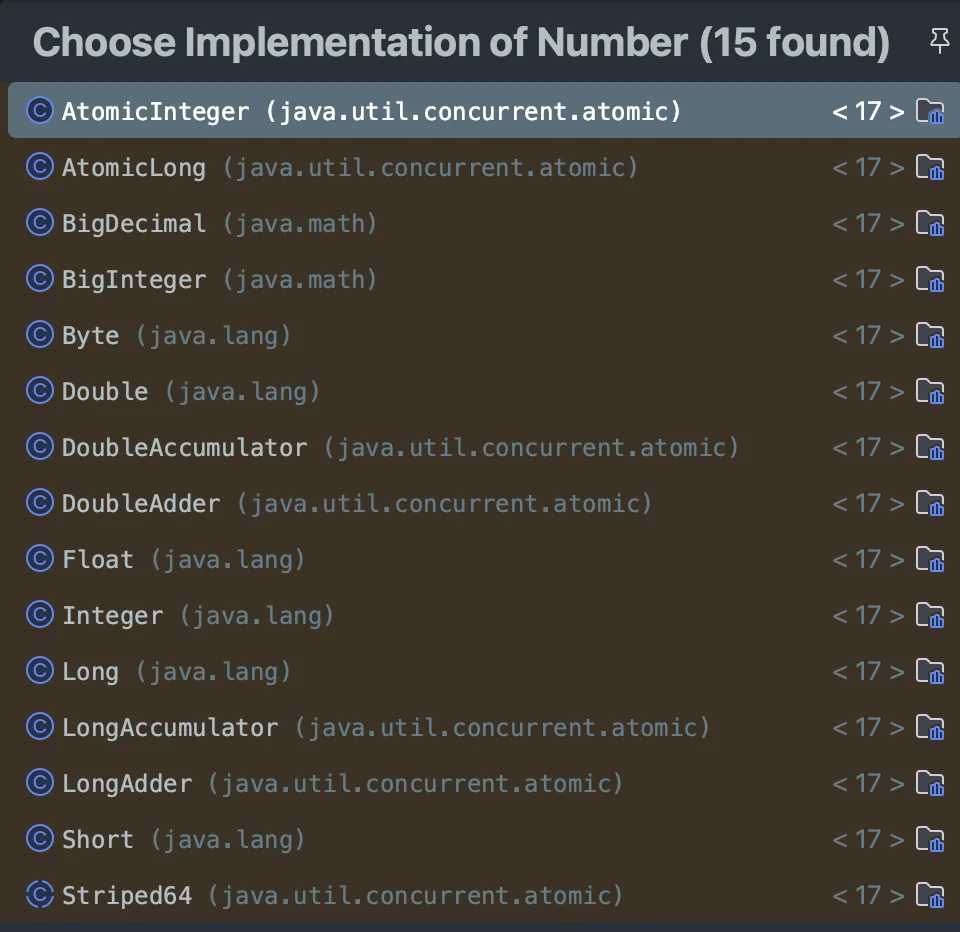
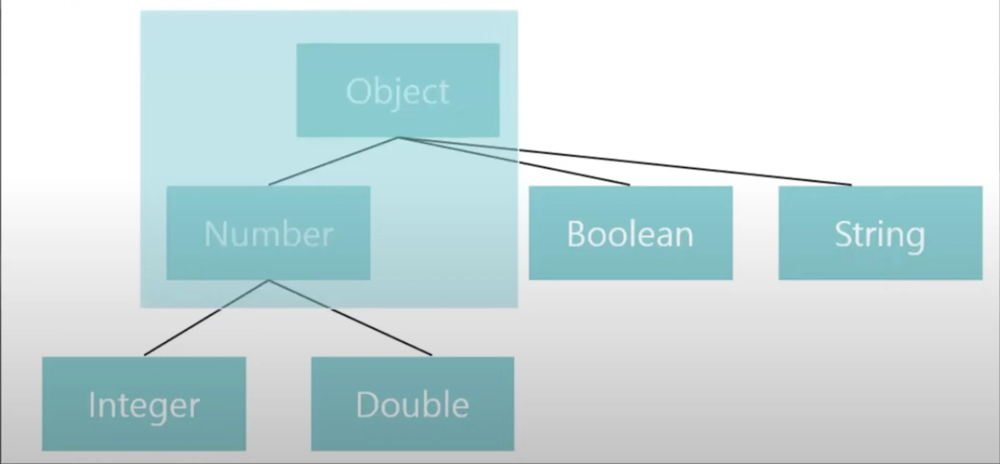
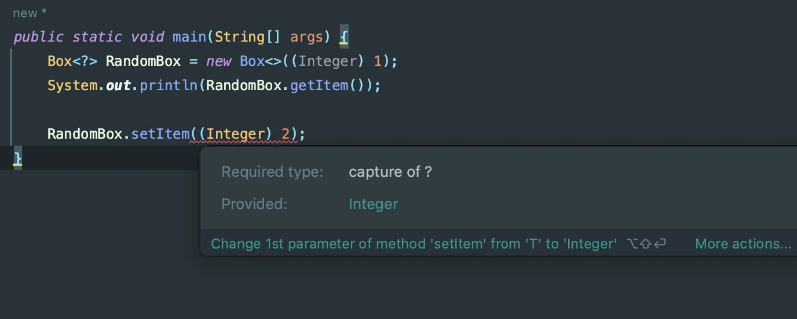
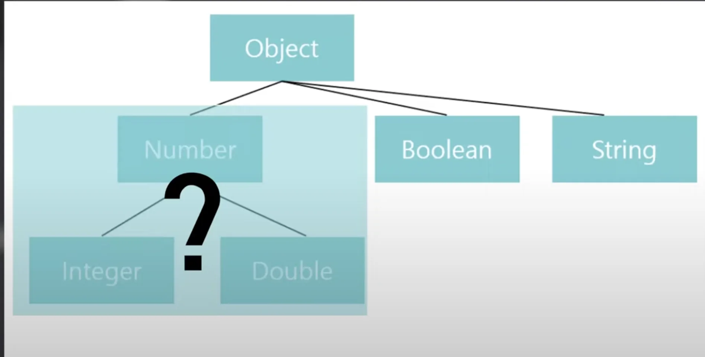

<details>
<summary>Reference</summary>

<a id="126eda9b0fe180938080c09454d9ee42"></a>

‣<br><a href="https://beautiful-college-c84.notion.site/cfff5d44130b4cd9baa33cdf1163daeb">페이지</a> 

<a id="125eda9b0fe1801b98d2e7affd37e87b"></a>

‣

<a id="125eda9b0fe180418104f22bf0503dca"></a>

‣<br>‣

</details>

<details>
<summary>‘제네릭’ 이란?</summary>

- 컴파일 타임에 타입을 할당하는 기술
    - 컴파일 타임에 <strong>타입 체크 </strong>→ 코드 <u>안정성을 높</u>여준다&#46;

    - 클래스, 메서드에서 사용할 <u>내부 데이터 타입</u>을 <strong><u>외부에서 지정</u></strong><strong>함</strong>

- 특정 키워드(타입 시그니처)로 타입을 묶어서 표현하고, 객체, 메서드 사용 시 타입 할당
    - <strong><code>&#60;&#62;</code></strong><strong> </strong><strong>안에 </strong>타입 매개변수를 선언하는 방식으로 사용 → <code>List</code><strong><code>&#60;T&#62;</code></strong>

    - 해당 객체의 타입은 컴파일 타임에 저장됨

    <details>
    <summary>ex) ArrayList</summary>

    <details>
    <summary><code>ArrayList&#60;E&#62;</code></summary>

    <a id="125eda9b0fe1800dabc9dfd6aa861d39"></a>

    ```java
    public class ArrayList<E> extends AbstractList<E>
            implements List<E>, RandomAccess, Cloneable, java.io.Serializable
    {
           . . .
    ```

    </details>

    - <code>ArrayList</code><strong><code>&#60;Integer&#62;</code></strong><code> list = new ArrayList</code><strong><code>&#60;Integer&#62;</code></strong><code>();</code>

    </details>

</details>

<details>
<summary>여러 타입 선언 가능&#58; <strong><code>&#60;T, E, K &#46;&#46;&#62;</code></strong></summary>

<a id="125eda9b0fe180b78513ee37b4301e19"></a>

```java
public interface Map<K, V> {
```

<a id="125eda9b0fe1802a857ad4b783ccdeba"></a>

```java
public class HashMap<K, V>  extends AbstractMap<K, V> implements Map<K, V>, Cloneable, Serializable {
```

<details>
<summary>ex)</summary>

<a id="125eda9b0fe180818199cf518c89660d"></a>

```java
public class GenericClass<T> {
    T ob;

    public GenericClass(T ob) {
        this.ob = ob;
    }

    void printType() {
        System.out.println(ob.getClass().getName());
    }
}

class GenericClass2<T, V> {
    T ob;
    V ob2;

    public GenericClass2(T ob, V ob2) {
        this.ob = ob;
        this.ob2 = ob2;
    }

    void printType() {
        System.out.println(ob.getClass().getName());
        System.out.println(ob2.getClass().getName());
    }
}

class Main {
    public static void main(String[] args){
        GenericClass<Integer> generic = new GenericClass<>(10);
        GenericClass<Double> generic2 = new GenericClass<>(10.0);

//        generic.printType();   // 출력: java.lang.Integer
//        generic2.printType();  // 출력: java.lang.Double

        GenericClass2<Integer,Double> gerneric3 = new GenericClass2<>(10, 10.0);

        gerneric3.printType(); 
        //  출력: 
        //    java.lang.Integer
				//    java.lang.Double
    }
}

```

</details>

</details>

<details>
<summary>제네릭 시그니처 &#58;<strong> </strong><strong><code>T</code></strong><strong>, </strong><strong><code>E</code></strong><strong>, </strong><strong><code>K</code></strong><strong>,  </strong><strong><code>V</code></strong> … ( 순서 상관없음)</summary>

- 물론 다른 명칭을 사용해도 가능함, 심지어 한글도 가능

</details>

<details>
<summary>장점</summary>

- 컴파일 타임 → 강력한 타입 검사?

- 타입 안정성 

- 타입 체크, 형변환 생략 → 코드 간결해짐

</details>

---

<details>
<summary>제네릭 클래스 </summary>

> 📌 
> 
> <a id="6512139806554fd18257e556ea7f72ef"></a>
> 
> 선언 
> 
> > <strong><u>클래스명</u></strong> 옆에 타입 매개변수 위치
> 
> <a id="c3ef871de94f45c287ee2dd39e3a2482"></a>
> 
> ```java
> class className<T> {
>      ...
> } 
> ```

</details>

<details>
<summary>제네릭 메서드 </summary>

> 📌 
> 
> <a id="569a41d3a0b6466fbc14dd1a0c9634ad"></a>
> 
> 선언 
> 
> > <strong><u>접근 지정자</u></strong> 와 <strong><u>반환 타입</u></strong> <strong>사이</strong>에 타입 매개변수 위치
> 
> <a id="125eda9b0fe180cb8079d9e0990c6006"></a>
> 
> ```java
> public <T> void functionName(T parameter) {
>         ...
> }
> ```

</details>

---

<details>
<summary>🧐 클래스에 선언된 제네릭 시그니처 <code>=</code> 메서드에 선언된 제네릭 시그니처</summary>

<details>
<summary>예시 코드 </summary>

<a id="125eda9b0fe18066a375e05ade18e305"></a>

```java
class ExampleCass<T> {
    private  T data;

    public ExampleCass(T data) {
        this.data = data;
    }

    public <T> void printData(T info) {
        T dataCopy = data;
        System.out.println(dataCopy);
        System.out.println(info);
    }
}
```

</details>

<details>
<summary><strong><u>오류) 함수의 매개변수 T</u></strong>가 <strong><u>클래스의 매개변수 T</u></strong>를 덮어씌운다&#46; </summary>

- 같은 시그니처의 타입 매개변수인 경후, <strong><u>함수의 타입이 우선</u></strong> 시 된다&#46; 



</details>

<details>
<summary>해결) 함수의 제네릭 시그니처 변경 </summary>

- 함수의 제네릭 시그치처&#58; T → E
    <a id="125eda9b0fe180f2923ac0002574a5af"></a>

    ```java
    public class ExampleClass<T> {
        private  T data;

        public ExampleClass(T data) {
            this.data = data;
        }

        public <E> void printData(E info) {
            T dataCopy = data;
            System.out.println(dataCopy);
            System.out.println(info);
        }
    ```

</details>

</details>

<details>
<summary><strong>제한된 제네릭  &#45; </strong>범위를 지정해 해당 타입만 사용</summary>

> 더욱 유연하게 클래스와 함수의 사용이 가능함

<details>
<summary>상한 경계&#58; <code>&#60;T extends Type&#62;</code></summary>

> 📌 
> 
> <a id="44d5ca83a3184865956598fd0594259e"></a>
> 
> <strong><code>&#60;T </code></strong><strong><code>extends</code></strong><strong><code> Tyep&#62;</code></strong>
> 
> - Type 과  자손 타입만 가능하도록 제한
> 
> <details>
> <summary>ex) <code>&#60;T extends Number&#62;</code></summary>
> 
> - Number → Integer, Double …
> 
> 
> 
> 
> 
> </details>

<details>
<summary>ex)  ArrayList(SimpleList) &#45; <strong><code>sum()</code></strong> 함수 구현</summary>

<a id="126eda9b0fe180e1b380dac89e0e9fbd"></a>

```java
static <T extends Number> double sum(SimpleList<T> simpleList){
    double sum = 0.0;
    for (int i = 0; i < simpleList.size(); i++) {
        T convertValue = simpleList.get(i);
        sum = convertValue.doubleValue();
    }
    return sum;
}
```

> <code>sum()</code> &#45; 숫자를 더하는 함수<br>따라서 숫자(<code>Number</code>) 와 그 이하의 자손(<code>Integer</code>, <code>Double</code> …)들만 타입으로 할당될 수 있도록 아래와 같이  <strong><code>extends</code></strong> 키워드 사용

- <code>&#60;T </code><strong><code>extends</code></strong><code> Number&#62;</code>
    - <code>T</code>&#58; Number 와 그 자손 타입만 대입 가능 

</details>

</details>

<details>
<summary>하한 경계&#58;<code> &#60;T super Type&#62;</code></summary>

> 📌 
> 
> <a id="a74198161ae74951b5b9ded8b0065629"></a>
> 
> <strong><code>&#60;T </code></strong><strong><code>super</code></strong><strong><code> Tyep&#62;</code></strong>
> 
> - Type 과  조상 타입만 대입 가능하도록 제한
> 
> <details>
> <summary>ex) <code>&#60;T super Number&#62;</code></summary>
> 
> - Number → Object
>     
> 
> </details>

</details>

</details>

<details>
<summary><strong>와일드 카드  &#45; </strong> <code>&#60;?&#62;</code>, 알 수 없는 타입 </summary>

<details>
<summary>와일드 카드</summary>

<details>
<summary>🤬 오류 &#45; 아래와 같이 setter 에서 컴파일 에러가 발생된다&#46;</summary>

- 타입 캐스팅 안됨



<details>
<summary>&#91; 코드 &#93;  와일드 카드 <strong><code>&#60;?&#62;</code></strong> 사용</summary>

<details>
<summary>&#91; 코드 &#93; Box</summary>

<a id="126eda9b0fe1800a8e33cd4303bdc509"></a>

```java
public class Box<T> {
    private T item;

    // 생성자
    public Box(T item) {
        this.item = item;
    }

    // 아이템을 가져오는 메서드
    public T getItem() {
        return item;
    }

    // 아이템을 설정하는 메서드
    public void setItem(T item) {
        this.item = item;
    }
}
```

</details>

<a id="126eda9b0fe1805b8a38cf6218465c10"></a>

```java
public static void main(String[] args) {
    Box<?> RandomBox = new Box<>((Integer) 1);
    System.out.println(RandomBox.getItem());

    RandomBox.setItem((Integer) 2);
}
```

</details>

</details>

- 이유는 <strong><u>생성된 객체의 타입</u></strong>이 <strong><u>확정하지 않았기 때문</u></strong>이다&#46;

- 따라서<strong><u> 타입 캐스팅하여 넣어준 값</u></strong>이 <strong><u>올바른 타입인지 판단할 수가 없</u></strong>어 컴파일 오류가 발생된다&#46; 

- 따라서 와일드 카드를 사용하기 위해서는 <strong><u>경계(범위) 지정</u></strong>해야 한다&#46; 

</details>

<details>
<summary>경계 와일드 카드</summary>

<details>
<summary>🤬 setter 와일드 카드 사용 제한 </summary>

- <strong>그 하위 클래스</strong> 타입의 객체를 참조할 수 있지만, <strong><u>타입 안정성</u></strong> 때문에 <u>새로운 값을 Setter(</u><u><code>setItem()</code></u><u>)으로 설정할 수 없</u>다&#46;

-  Java에서는 와일드카드로 선언된 제네릭 타입에 값을 설정하려 할 때 <u>타입 불일치 문제를 방지</u>하기 위해 <u>Setter 금지</u>하고 있다&#46; 

- 왜냐하면, 컴파일러는 <code>Box&#60;? extends Number&#62;</code>가 <strong><code>Box&#60;Integer&#62;</code></strong>, <strong><code>Box&#60;Double&#62;</code></strong><strong> </strong>또는 다른 <strong><u>Number의 하위 클래스</u></strong><strong><u>일 수 있기 때문</u></strong>에 Setter로 값을 설정하는 것이 안전하지 않다고 간주한다&#46; 

</details>

- 상한 경계 와일드 카드&#58; <code>&#60;? extends Type&#62;</code>
    <details>
    <summary>ex)  <code>&#60;? extends Number&#62;</code></summary>

    - Number와 그 하위 타입임은 보장하지만 구체적으로 확정은 불가능하다&#46; 

    

    </details>

- 하한 경계 와일드 카드&#58; <code>&#60;? super Type&#62;</code>

</details>

- 와일드카드 
    - 제한된 제네릭보다 조금 약한 제약 강도를 보이지만, 이 특성을 활용해 제네릭과 결합한다면 더욱 복잡한 제약조건을 부여할 수 있다&#46;

- 와일드 카드의 변성 특징

- pecs

</details>

---

<details>
<summary>제네릭, 배열을 사용한 ArrayList 구현</summary>


</details>
