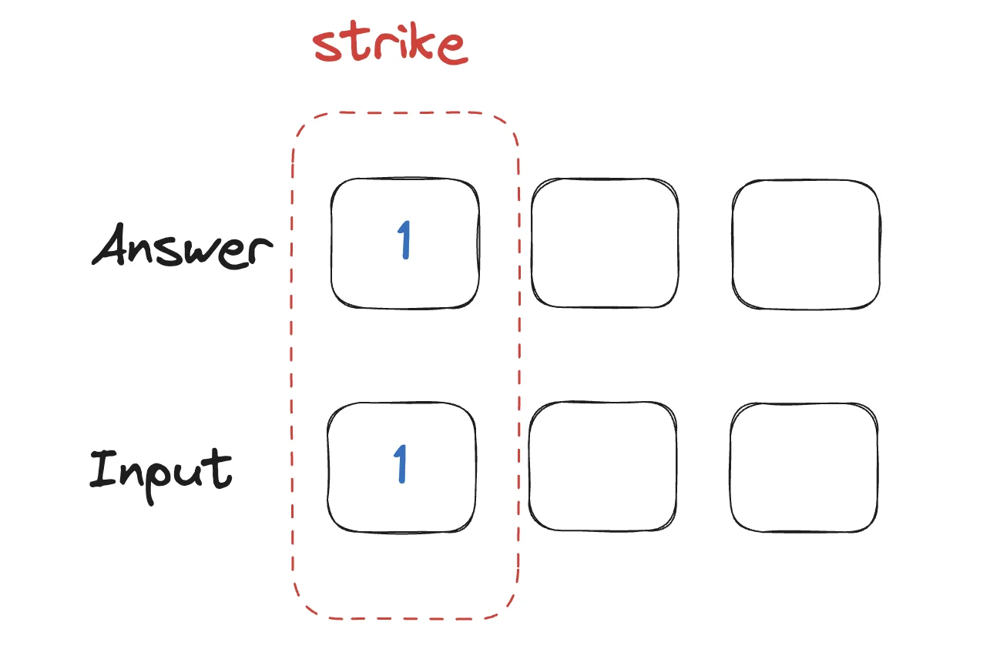
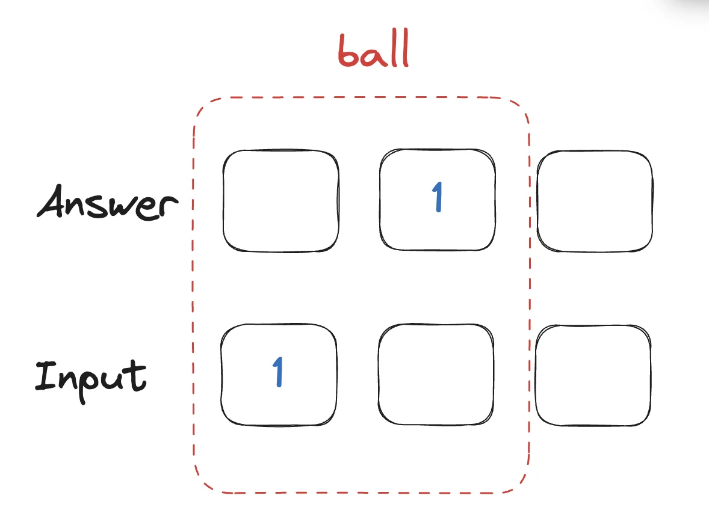
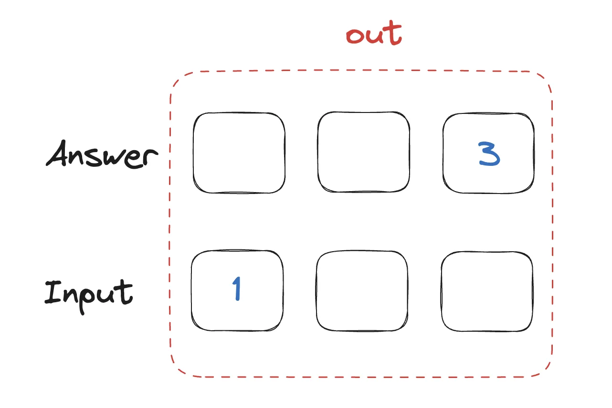

> 
> 
> <a id="a00a76fb507b486d8661efb8753d9174"></a>
> 
> <strong>내일배움캠프&#95;스프링 7기  &#45; 4주차 개인 프로젝트</strong>
> 
> 
> 
> - 기간&#58; 24년 10월 21일 &#126; 10월 27일
> 
> - <a href="https://beautiful-college-c84.notion.site/1182dc3ef51480f59802c1aec4bfa386?pvs=25">팀 노션 페이지 ( 16조 )</a>

<a id="126eda9b0fe1807c9bb8c6dc9f9eb90b"></a>

### 학습

> TIL, 데일리 스크랩

<a id="126eda9b0fe180e394add8f066947986"></a>

<a href="#/post/125eda9b-0fe1-805d-8f5b-e204d71b15af">페이지</a> &#45; 제네릭, 1Lv 구현

<a id="126eda9b0fe180f0afabff5293044ba7"></a>

<a href="#/post/127eda9b-0fe1-8090-91c4-fba1d564c718">페이지</a> &#45; 제네릭 ( 기본 )

<a id="129eda9b0fe180ec9059fdca51c39ad8"></a>

<a href="#/post/128eda9b-0fe1-8069-8252-d119e1c1a383">페이지</a> &#45; 자바 컨벤션

<a id="12aeda9b0fe18049a17dcc379cce2585"></a>

<a href="#/post/12aeda9b-0fe1-80fa-abe1-fbf8e8a1661f">페이지</a> &#45; 어댑터 패턴

<a id="126eda9b0fe1804197b4c89b375a76e7"></a>

<a href="#/post/12aeda9b-0fe1-80d9-857b-ead551ad966f">페이지</a> &#45; 전략 패턴

<a id="126eda9b0fe180f498a3dbf0123e5120"></a>

### 과제 &#45; 숫자 야구 게임

> ✏️ 
> 
> <a id="126eda9b0fe180d7877af0af51fd0d64"></a>
> 
> 발제 &#45; <a href="https://beautiful-college-c84.notion.site/1252dc3ef5148064a05de31e379136e8">페이지</a> 
> 
> <details>
> <summary>과제 해설</summary>
> 
> - 코드&#58; ‣
> 
> - 해설&#58; <a href="https://beautiful-college-c84.notion.site/12a2dc3ef51480d19be6c56ae9303c58">페이지</a> 
> 
> </details>

[GitHub &#45; gyungsubLee/Number&#95;Baseball&#95;Game&#58; 자바를 통한 간단한 야구 게임 구현]()

<a id="126eda9b0fe1808abb22fb8e3d0e2bb0"></a>

### Lv 1  &#45; 개발 완료

<details>
<summary>실행 예시</summary>

<a id="126eda9b0fe180d589bce626b07e093f"></a>

```java
< 게임을 시작합니다 >
숫자를 입력하세요
435
1스트라이크 1볼

숫자를 입력하세요
357
1스트라이크

숫자를 입력하세요
123
아웃

숫자를 입력하세요
dfg // 세 자리 숫자가 아니어서 올바르지 않은 입력값
올바르지 않은 입력값입니다

숫자를 입력하세요
199 // 9가 두번 사용되어 올바르지 않은 입력값
올바르지 않은 입력값입니다

숫자를 입력하세요
103 // 0이 사용되어 올바르지 않은 입력값
올바르지 않은 입력값입니다

숫자를 입력하세요
456
정답입니다!
```

</details>

<details>
<summary>코드 템블릿</summary>

<details>
<summary>&#91; 코드 &#93; BaseballGame</summary>

<a id="126eda9b0fe180eaaf1cfd2688b86559"></a>

```java
public class BaseballGame {

    // 객체 생성시 정답을 만들도록 함
    public BaseballGame() {

    }

    public int play() {
        while (true) {
            // 1. 유저에게 입력값을 받음
            // 2. 올바른 입력값을 받았는지 검증
            // 3. 게임 진행횟수 증가
            // 4. 스트라이크 개수 계산
            // 5. 정답여부 확인, 만약 정답이면 break 를 이용해 반복문 탈출
            // 6. 볼 개수 계산
            // 7. 힌트 출력
        }
        // 게임 진행횟수 반환
    }

    protected boolean validateInput(String input) {

    }

    private int countStrike(String input) {

    }

    private int countBall(String input) {

    }
}
```

</details>

<details>
<summary>&#91; 코드 &#93; BaseballGameDisplay</summary>

<a id="593f3b22e7bf4f91929cf92873353870"></a>

```java
public class BaseballGameDisplay {
    public void displayHint(int strike, int ball) {

    }
}
```

</details>

<details>
<summary>&#91; 코드 &#93; Main</summary>

<a id="126eda9b0fe18015b01cc972543b8431"></a>

```java
public class Main {
    public static void main(String[] args) {
        // BaseballGame 객체 생성 & 게임 시작
    }
}
```

</details>

</details>

---

<details>
<summary>요구사항</summary>

- [x] 정답 숫자 생성
    - 서로 다른 3자리 수

    - 1 &#126; 9,  0은 사용할 수 없음

    - 동일한 숫자는 사용될 수 없음<br>즉, 숫자는 중복되지 않아야 함

    - ex) <code>333</code>, <code>112</code>, <code>119</code>, <code>102</code> →  불가능

- [x] 정답을 맞추기 위해 숫자 입력
    - 서로 다른 3자리 수

    - 동일한 숫자 입력 X<br>즉, 숫자는 중복되지 않아야 함

    - 숫자만 입력 가능, 문자는 작성될 수 없음

- [x] 결과값 출력 및 게임 로직 적용
    - 정답과 입력값을 비교해 힌트를 “볼, 스트라이크, 아웃”으로 표시
        <details>
        <summary>스트라이크&#58; 같은 자리, 같은 숫자</summary>

        

        </details>

        <details>
        <summary>볼&#58; 다른 자리, 같은 숫자</summary>

        

        </details>

        <details>
        <summary>아웃&#58; 자리, 숫자 다름</summary>

        

        </details>

    - 입력한 3자리 숫자가 정답과 같은 경우, 게임 종료
        - ‘3 스트라이크’

    - 올바르지 않은 입력값, 예외처리
        - 입력값이 <strong><u>문자, 중복되는 값</u></strong>처럼 <u>요구사항과 맞지 않</u>을 경우

- [x] 게임 이어서하기
    - 정답을 맞출 때까지 계속해서 시도

    - 정답 맞추면, 축하메세지 출력

</details>

<details>
<summary>구현</summary>

> 🤨 
> 
> <a id="8a1a2632461e43718cba93851a66cc12"></a>
> 
> 우선 개발을 하긴 했으나, 겁나 하드코딩이다… 리펙토링 필요

<details>
<summary>🧐 중복 여부 체크 시, <code>List</code> or <code>HashSet</code>?</summary>

<details>
<summary>1차 작성 &#45; 아래와 같이 List를 사용하여 check함</summary>

<a id="127eda9b0fe180619780d877c6125ef1"></a>

```java
int[] check = new int[10];
```

</details>

- 리스트 인덱스, 해시테이블 값 조회&#58; O(1)
    - List&#91;index&#93;&#58; O(1)

    - HashSet&#46;contains(value)&#58; O(1)

<a id="127eda9b0fe18025b12acdbf16fe3f55"></a>

조회에 대한 연산 값이 동일하여 Set으로 자료구조를 변경함 

<a id="127eda9b0fe18035b9c1fdd18d364dc3"></a>

 

</details>

<details>
<summary>정답수 생성</summary>

<details>
<summary>요구사항</summary>

- 서로 다른 3자리수 ( 숫자 중복 불가 )

- 1 &#126; 9 만 가능 ( 0 불가)

</details>

<details>
<summary>1차 &#45; List</summary>

- check 배열을 통해 숫자를 체크함
    - 1 &#126; 9 까지 숫자가 할당되는 경우, check 배열의 index에 ‘1’할당

    - 다음 랜덤한 숫자 생성 후, 할당 전 <code>check&#91;랜덤한 숫자=1</code> 을 확인하여 중복수 인지 판단

- 재귀를 통해 반복 
    - 종료조건&#58; cnt = size 
        - size&#58; 입력받는 자릿수

        - cnt&#58; 재귀를 진행 횟수 

<a id="127eda9b0fe18098b546c636a634f482"></a>

```java
public class BaseballGame {
		static int size = 3;
		static int[]  check = new int[10];
		static int[]  answer = new int[size];
		
		
		// 객체 생성시 정답을 만들도록 함
		public BaseballGame() {
		    generateRecursiveAnswer(0);
		}
		
		// Answer 생성
		public void generateRecursiveAnswer(int cnt){
		    if(cnt == size) return;
		    while(true){
		        Random random = new Random();
		        int randomNumber = random.nextInt(9) + 1;
		        if(check[randomNumber] != 1){
		            check[randomNumber] =1;
		            answer[cnt]=randomNumber;
		            generateRecursiveAnswer(cnt+1);
		            break;
		        }
		    }
		}
		
	
		.  .  .
```

</details>

<details>
<summary>2차 &#45; ArrayList, HashSet</summary>

- ArrayList&#46;add()

- <code>HashSet&#46;contains(value)</code>&#58; 중복 판단 

<a id="127eda9b0fe1802d9454ccbb172e1504"></a>

```java
public class BaseballGame {

    static int digitCount;
    static int size = 3;
    static List<Integer>  answer = new ArrayList<>();
    private final Set<Integer>  checkUsedNumberOfAnswer = new HashSet<>();
    
    
    
    // 정답 생성 함수
    private void generateRecursiveAnswer(int cnt, Random random){
        if(cnt > size) return;
        while(true){
            int randomNumber = random.nextInt(9) + 1;
            if(!checkUsedNumberOfAnswer.contains(randomNumber)){
                checkUsedNumberOfAnswer.add(randomNumber);
                answer.add(randomNumber);
                generateRecursiveAnswer(cnt+1, random);
                break;
            }
        }
    }
    
	    .  .  .
    
```

</details>

</details>

<details>
<summary>입력값 유효검사</summary>

<details>
<summary>&#91; 코드 &#93; </summary>

<details>
<summary>입력값 유효성 검사 &#45; 정규식 사용</summary>

<a id="127eda9b0fe18023b692f1ee45a7bd2f"></a>

```java
// 입력값 유효성 검사
protected boolean isValidRangeByRegex(String inputStr) {
    if (inputStr.isEmpty()) {
        return false;
    }
    return inputStr.matches("^[1-9]$");
}
```

</details>

<details>
<summary>중복 검사 &#45; <code>Hashset&#46;contains(value)</code></summary>

<a id="127eda9b0fe1802a809dc4927141ae94"></a>

```java
// 중복 값 확인
if (isDuplicate(inputNumber)) {
    System.out.println("이미 입력된 숫자입니다. 다른 숫자를 입력하세요.");
    continue;
}
```

</details>

<a id="127eda9b0fe180ba963ee7f6cd166828"></a>

```java
public void play(Scanner sc, StringBuilder result){

		digitCount = 1;
		while (digitCount <= 3) {
		System.out.print("1~9 사이의 숫자를 입력하세요: ");
    String input = sc.nextLine();
    
    // 입력값 유효성 검사
    if (!isValidRangeByRegex(input)) {
        System.out.println("유효하지 않은 입력입니다. 1~9 사이의 숫자를 입력하세요.");
        continue;
    }
    
    // 형변환: String -> Integer
    int inputNumber = Integer.parseInt(input);

		
		// 중복 값 확인
		if (isDuplicate(inputNumber)) {
		    System.out.println("이미 입력된 숫자입니다. 다른 숫자를 입력하세요.");
		    continue;
		}
		
	   	.  .  .
```

</details>

</details>

<details>
<summary>두 값 비교 후, 힌트 표시</summary>

- 비교  → “스트라이크”, “볼”, “아웃” 출력
    <a id="127eda9b0fe180c795dadb23dbf092b7"></a>

    ```java
    // 두 값 비교 ( 값, 자릿수)
        // 1) 자리수, 값 동일       -> "스트라이크"
        // 2) 자리수 다름, 값 동일   -> "볼"
        // 3) 자리수, 값 다름       -> "아웃"
    public String compareAnswerAndInputNumForBaseballResult(int digitCount, int inputNumber){
        if(checkUsedNumberOfAnswer.contains(inputNumber)){
            if(answer.get(digitCount-1) ==  inputNumber) {
                return "스트라이크";
            }
            else return "볼";
        } else return "아웃";
    }
    ```

- 결과값(s) = “스트라이크”
    <a id="127eda9b0fe18055b419e1336453044e"></a>

    ```java
    String s = compareAnswerAndInputNumForBaseballResult(digitCount, inputNumber);
    System.out.println("결과: " +digitCount+ " "+ s);

    if("스트라이크".equals(s)){
        result.append(inputNumber);
        if(digitCount==3) {
            System.out.println("정답: " + result.toString());
            break;
        }
        checkUsedNumberOfInupt.add(inputNumber);  // check를 위해 Set에 입력값 추가
        digitCount++;
    }
    ```

</details>

<details>
<summary>게임이어서 하기 &#45; 반복여부 판단</summary>

- 초기화 함수 
    <a id="127eda9b0fe180bfa237c05980fa20a3"></a>

    ```java
    public void initializeConditions(Random random){
            digitCount = 1;
            result.setLength(0);
            answer.clear();
            checkUsedNumberOfAnswer.clear();
            checkUsedNumberOfInupt.clear();
        }
    ```

<a id="127eda9b0fe18001a18af0633cc0790d"></a>

```java
// 추가 계산 여부 판단 메서드
public static boolean shouldContinue(Scanner sc) {
    System.out.println("계임을 계속 하시겠습니까?  ( 계속하려면 'yes' 입력 )" );
    String isContinueGame = sc.next();
    return "yes".equalsIgnoreCase(isContinueGame);  // 대소문자 구분 X
}
```

- 리펙토링 필요
    - 중복&#58; 게임 시작, 게임 반복 로직

    <a id="127eda9b0fe180b2a43ce4ab43fe4626"></a>

    ```java
    public static void main(String[] args) {

        Scanner scanner = new S복anner(System.in);
        StringBuilder result = new StringBuilder();  // 최종 3자리 숫자를 저장할 StringBuilder
        Random random = new Random();

        // Lv1.BaseballGame 객체 생성 & 게임 시작
        BaseballGame baseballGame = new BaseballGame();
        baseballGame.play(scanner, random);

        // 게임 반복 여부 판단 후 반복
        while(shouldContinue(scanner)){
            baseballGame.play(scanner, random);
        }

    }
    ```

</details>

---

<details>
<summary>&#91; 전체 코드 &#93;</summary>

<details>
<summary>BaseballGame</summary>

<a id="127eda9b0fe180d88e3ce84bf2b63cfc"></a>

```java
package Lv1;

import java.util.*;

public class BaseballGame {

    static int digitCount;
    static int size = 3;

    static StringBuilder result = new StringBuilder();
    static List<Integer>  answer = new ArrayList<>();
    private final Set<Integer>  checkUsedNumberOfAnswer = new HashSet<>();
    private final Set<Integer>  checkUsedNumberOfInupt = new HashSet<>();  // 입력된 숫자를 저장할 Set (중복 방지)

    /**
     *  Answer 생성: 재귀 구현
     *    종료 조건: cnt > size
     */private void generateRecursiveAnswer(int cnt, Random random){
        if(cnt > size) return;
        while(true){
            int randomNumber = random.nextInt(9) + 1;
            if(!checkUsedNumberOfAnswer.contains(randomNumber)){
                checkUsedNumberOfAnswer.add(randomNumber);
                answer.add(randomNumber);
                generateRecursiveAnswer(cnt+1, random);
                break;
            }
        }
    }


    public void initializeConditions(Random random){
		    generateRecursiveAnswer(1, random);
        digitCount = 1;
        result.setLength(0);
        answer.clear();
        checkUsedNumberOfAnswer.clear();
        checkUsedNumberOfInupt.clear();
    }

    public void play(Scanner sc, Random random){
        initializeConditions(random);
        System.out.println("< 게임을 시작합니다 >");

        // System.out.print("자리수를 입력해 주세요");
        // size = sc.nextInt();

        while (digitCount <= 3) {

            System.out.print("1~9 사이의 숫자를 입력하세요: ");

            String input = sc.next();

            // 입력값 유효성 검사
            if (!isValidRangeByRegex(input)) {
                System.out.println("유효하지 않은 입력입니다. 1~9 사이의 숫자를 입력하세요.");
                continue;
            }

            // 형변환: String -> Integer
            int inputNumber = Integer.parseInt(input);

            // 중복 값 확인
            if (isDuplicate(inputNumber)) {
                System.out.println("이미 입력된 숫자입니다. 다른 숫자를 입력하세요.");
                continue;
            }

            String s = compareAnswerAndInputNumForBaseballResult(digitCount, inputNumber);
            System.out.println("결과: " +digitCount+ " "+ s);

            if("스트라이크".equals(s)){
                result.append(inputNumber);
                if(digitCount==3) {
                    System.out.println("정답: " + result.toString());
                    break;
                }
                checkUsedNumberOfInupt.add(inputNumber);  // check를 위해 Set에 입력값 추가
                digitCount++;
            }
        }
    }


    // 정규식을 사용하여 입력값 검사
        // 유효 범위: 1 ~ 9
    protected boolean isValidRangeByRegex(String inputStr) {
        if (inputStr.isEmpty()) {
            return false;
        }
        return inputStr.matches("^[1-9]$");
    }

    // 중복 검사
    protected boolean isDuplicate(int number) {
        if (checkUsedNumberOfInupt.contains(number)) {
            return true;
        }
        return false;
    }


    // 두 값 비교 ( 값, 자릿수)
    // 1) 자리수, 값 동일       -> "스트라이크"
    // 2) 자리수 다름, 값 동일   -> "볼"
    // 3) 자리수, 값 다름       -> "아웃"
    public String compareAnswerAndInputNumForBaseballResult(int digitCount, int inputNumber){
        if(checkUsedNumberOfAnswer.contains(inputNumber)){
            if(answer.get(digitCount-1) ==  inputNumber) {
                return "스트라이크";
            }
            else return "볼";
        } else return "아웃";
    }


//    private int countStrike(String input) {
//
//    }
//
//    private int countBall(String input) {
//
//    }
}
```

</details>

<details>
<summary>BaseballGame &#45; 주석 제거</summary>

- 이… 이게 보기 훨씬 깔끔하고 편한데… 

<a id="127eda9b0fe180ac8527f8534fd741d2"></a>

```java
package Lv1;

import java.util.*;

public class BaseballGame {

    static int digitCount;
    static int size = 3;

    static StringBuilder result = new StringBuilder();
    static List<Integer>  answer = new ArrayList<>();
    private final Set<Integer>  checkUsedNumberOfAnswer = new HashSet<>();
    private final Set<Integer>  checkUsedNumberOfInupt = new HashSet<>();  // 입력된 숫자를 저장할 Set (중복 방지)


    private void generateRecursiveAnswer(int cnt, Random random){
        if(cnt > size) return;
        while(true){
            int randomNumber = random.nextInt(9) + 1;
            if(!checkUsedNumberOfAnswer.contains(randomNumber)){
                checkUsedNumberOfAnswer.add(randomNumber);
                answer.add(randomNumber);
                generateRecursiveAnswer(cnt+1, random);
                break;
            }
        }
    }
    
    private boolean isValidRangeByRegex(String inputStr) {
        if (inputStr.isEmpty()) {
            return false;
        }
        return inputStr.matches("^[1-9]$");
    }

    private boolean isDuplicate(int number) {
        if (checkUsedNumberOfInupt.contains(number)) {
            return true;
        }
        return false;
    }

    private String compareAnswerAndInputNumForBaseballResult(int digitCount, int inputNumber){
        if(checkUsedNumberOfAnswer.contains(inputNumber)){
            if(answer.get(digitCount-1) ==  inputNumber) {
                return "스트라이크";
            }
            else return "볼";
        } else return "아웃";
    }

    private void initializeConditions(Random random){
		    generateRecursiveAnswer(1, random);
        digitCount = 1;
        result.setLength(0);
        answer.clear();
        checkUsedNumberOfAnswer.clear();
        checkUsedNumberOfInupt.clear();
    }

    public void play(Scanner sc, Random random){
        initializeConditions(random);
        System.out.println("< 게임을 시작합니다 >");

        while (digitCount <= 3) {

            System.out.print("1~9 사이의 숫자를 입력하세요: ");

            String input = sc.next();
            if (!isValidRangeByRegex(input)) {
                System.out.println("유효하지 않은 입력입니다. 1~9 사이의 숫자를 입력하세요.");
                continue;
            }

            int inputNumber = Integer.parseInt(input);
            
            if (isDuplicate(inputNumber)) {
                System.out.println("이미 입력된 숫자입니다. 다른 숫자를 입력하세요.");
                continue;
            }

            String s = compareAnswerAndInputNumForBaseballResult(digitCount, inputNumber);
            System.out.println("결과: " +digitCount+ " "+ s);

            if("스트라이크".equals(s)){
                result.append(inputNumber);
                if(digitCount==3) {
                    System.out.println("정답: " + result.toString());
                    break;
                }
                checkUsedNumberOfInupt.add(inputNumber);  // check를 위해 Set에 입력값 추가
                digitCount++;
            }
        }
    }
}

```

</details>

<details>
<summary>Main</summary>

<a id="127eda9b0fe1801b922cdfbb543c6326"></a>

```java
package Lv1;

import java.util.*;

public class Main {

    // 추가 계산 여부 판단 메서드
    public static boolean shouldContinue(Scanner sc) {
        System.out.println("계임을 계속 하시겠습니까?  ( 계속하려면 'yes' 입력 )" );
        String isContinueGame = sc.next();
        return "yes".equalsIgnoreCase(isContinueGame);  // 대소문자 구분 X
    }

    public static void main(String[] args) {

        Scanner scanner = new Scanner(System.in);
        StringBuilder result = new StringBuilder();  // 최종 3자리 숫자를 저장할 StringBuilder
        Random random = new Random();

        // Lv1.BaseballGame 객체 생성 & 게임 시작
        BaseballGame baseballGame = new BaseballGame();
        baseballGame.play(scanner, random);

        // 게임 반복 여부 판단 후 반
        while(shouldContinue(scanner)){
            baseballGame.play(scanner, random);
        }

    }
}
```

</details>

</details>

</details>

<a id="126eda9b0fe180389ecbce374933b7e6"></a>

### Lv 2 &#45; 개발 완료

<details>
<summary>요구사항</summary>

- [x] 입력값 validate
    > 🧐 Lv 1 &#45; 조건이랑 뭐가 차이가 있는거지? <br>→ 입력값 자릿수 수정 필요 

    - 3자리 수인지 자릿수를 검사

    - 중복된 숫자가 없는지 중복 숫자를 검사

    - 입력값에 숫자만 포함되어 있는지 검사

    - 유효하지 않은 값인 경우 “올바르지 않은 입력값입니다&#46;”를 출력

- [x] 출력 개선
    - 프로그램을 시작할 때 안내문구
        - 1 입력 → 게임 시작

        - 2 입력 → 게임 기록 조회

        - 3 입력 → 종료

    - 정답을 맞히는 경우, 아래 문구 다시 출력
        <a id="126eda9b0fe1809497dce41a45f512d7"></a>

        ```java
        // 예시
        환영합니다! 원하시는 번호를 입력해주세요
        1. 게임 시작하기 2. 게임 기록 보기 3. 종료하기
        1 // 1번 게임 시작하기 입력

        < 게임을 시작합니다 >
        숫자를 입력하세요
        .
        .
        .
        ```

</details>

<a id="12deda9b0fe180539f3ce31b7209e03b"></a>

### 피드백

<details>
<summary>객체 선언 시, 변수를 상위 형식의 타입으로 선언한다&#46;</summary>

<details>
<summary>문제 </summary>

<a id="221a84c9108e401a83b6be17971e624c"></a>

```java
HashSet<Character> uniqueDigits = new HashSet<>();
```

</details>

<details>
<summary>해결</summary>

<a id="6f5aecd20e404aad8aaabd950178cda3"></a>

```java
Set<Character> uniqueDigits = new HashSet<>();
```

</details>

</details>

<details>
<summary>스트라이크, 볼, 아웃 → <code>Enum</code> 타입으로 변경</summary>

<details>
<summary>&#91; 코드 &#93; &#60;Enum&#62; BaseballEventEnum</summary>

<a id="12deda9b0fe180b0b8fcc42d645dc4eb"></a>

```java
public enum BaseballEventEnum {
    STRIKE,
    BALL,
    OUT;
}
```

</details>

<details>
<summary>&#91; 코드 &#93; BaseballGame</summary>

<a id="a4f2b82e32604cf4a8f0fa44b9a9a0c3"></a>

```java
private BaseballEventEnum compareAnswerAndInputNumForBaseballResult(int digit, int inputNumber){
    if(checkUsedNumberOfAnswer.contains(inputNumber)){
        if(answer.get(digit) ==  inputNumber) return  BaseballEventEnum.STRIKE;
        else return BaseballEventEnum.BALL;
    } else return BaseballEventEnum.OUT;
}
```

<a id="12deda9b0fe180b6ba4ad232dba670e3"></a>

```java
private void startGame() {

		.  . .

		for (int i = 0; i < inputStr.length(); i++) {
		    int inputNumber = Character.getNumericValue(inputStr.charAt(i));
		    BaseballEventEnum result = compareAnswerAndInputNumForBaseballResult(i, inputNumber);
		
		    if((BaseballEventEnum.STRIKE).equals(result)) {
		        strikeCnt++;
		    } else if ((BaseballEventEnum.BALL).equals(result)){
		        ballCnt++;
		    } else if ((BaseballEventEnum.OUT).equals(result)) {
		        outCnt++;
		    }
		}
```

</details>

</details>

- 메서드 접근 제어자 &#45; 외부에서 접근이 필요하지 않는 메서드 모두 private로 변경

- 동일 클래스 내에 사용 시 static 변수 제거

<details>
<summary>주석 작성 &#45; javaDocs 형식</summary>

- <code>&#64;param</code> &#58; 메서드의 매개변수 설명

- <code>&#64;return</code> &#58; 메서드의 반환값 설명

- <code>&#64;link</code> &#58; 클래스나 메서드를 참조할 때 사용 (예&#58; &#64;link BaseballEventEnum)

- <code>&#64;see</code> &#58; 관련 정보로 연결<br>

</details>

<a id="126eda9b0fe180ffbe7bf7086c3591a6"></a>

### Lv 3 &#45; 개발 완료

<details>
<summary>요구사항</summary>

- [x] 게임 기록 통계
    - 지금 시도하는 게임이 몇 번째 게임인지 기록

    - 사용자가 정답을 맞힐 때까지의 “시도 횟수” 기록, <br>게임이 끝날을 때 총 시도 획수를 출력
        <details>
        <summary>프로그램 시작 및 정답을  맞히는 경우, 아래와 같은 안내 문구를 출력</summary>

        - Lv 2 와 동일

        <a id="126eda9b0fe18051acfcfdf1fcda0d1e"></a>

        ```java
        // 예시
        환영합니다! 원하시는 번호를 입력해주세요
        1. 게임 시작하기  2. 게임 기록 보기  3. 종료하기
        ```

        </details>

    <details>
    <summary>2 입력 →  게임의 시도 횟수 출력</summary>

    <a id="126eda9b0fe180f49a9beaf9cdf82d2b"></a>

    ```java
    1번째 게임 : 시도 횟수 - 14
    2번째 게임 : 시도 횟수 - 9
    3번째 게임 : 시도 횟수 - 12
    .
    .
    .
    ```

    </details>

- [x] 출력 개선
    - 실행 및 정답을 맞힌 경우, 표시되는 안내문구 선택지 개선
        - 3을 입력하면 게임이 종료

        - 이전의 게임 기록들도 초기화
            <a id="efedf62073a847d8bb07e8b7f951a93c"></a>

            ```java
            // 예시
            환영합니다! 원하시는 번호를 입력해주세요
            1. 게임 시작하기  2. 게임 기록 보기  3. 종료하기
            3 // 3번 종료하기 입력

            < 숫자 야구 게임을 종료합니다 >
            ```

    - 1, 2, 3 이외의 입력값에 대해서는 오류 메시지 노출
        <a id="126eda9b0fe18081b039c5a7fb8b2c57"></a>

        ```java
        // 예시
        환영합니다! 원하시는 번호를 입력해주세요
        1. 게임 시작하기  2. 게임 기록 보기  3. 종료하기
        4

        올바른 숫자를 입력해주세요!
        ```

</details>

<details>
<summary>구현</summary>

<details>
<summary>게임 기록 통계</summary>

<details>
<summary>&#91; 코드 &#93; </summary>

<a id="12deda9b0fe1802281ebe58fff7bc584"></a>

```java
public class BaseballGame {
		 private List<Integer> recordTryCount = new ArrayList<>();
		 
		 .  .  .
```

<a id="12deda9b0fe180588991da89ff088b40"></a>

```java
 		private void showGameRecords() {
		    if(recordTryCount.isEmpty()) {
		        System.out.println("기록된 게임이 없습니다. 게임을 시작 해주세요!");
		        return;
		    }
		
		    for (int i = 0; i < this.recordTryCount.size(); i++) {
		        System.out.println(i+1 + "번째 게임 : 시도 횟수 - " + recordTryCount.get(i));
		    }
		}
```

<a id="12deda9b0fe1805e865beb54543cb5dc"></a>

```java
	  private void startGame(){
        initCondition();

        System.out.println(answer.toString()); // 정답 확인
        System.out.println("< 게임을 시작합니다 >");

        int strikeCnt = 0, ballCnt = 0, outCnt = 0, tryCnt = 0;
        while(strikeCnt<3) {
            tryCnt++;
            String inputStr = sc.next();

            while(!validateInput(inputStr)){
                inputStr = sc.next();
            }

            for (int i = 0; i < inputStr.length(); i++) {
                int inputNumber = Character.getNumericValue(inputStr.charAt(i));
                BaseballEventEnum result = compareAnswerAndInputNumForBaseballResult(i, inputNumber);

                if((BaseballEventEnum.STRIKE).equals(result)) {
                    strikeCnt++;
                } else if ((BaseballEventEnum.BALL).equals(result)){
                    ballCnt++;
                } else if ((BaseballEventEnum.OUT).equals(result)) {
                    outCnt++;
                }
            }

            if ( strikeCnt == 3){
                recordTryCount.add(tryCnt);
                System.out.println("3 스트라이크! 정답입니다.");
                System.out.println();
                break;
            }

            System.out.println("스트라이크: " + strikeCnt + ", 볼: " + ballCnt +", 아웃: " + outCnt);

            strikeCnt =0;
            ballCnt=0;
            outCnt=0;
        }
    }
```

</details>

</details>

<details>
<summary>출력 개선</summary>

<details>
<summary>&#91; 코드 &#93;</summary>

<a id="12deda9b0fe1809ca16ff42df1529dbb"></a>

```java
private void handleMenuChoice(int menuChoice) {
    switch (menuChoice) {
        case 1:
            startGame();
            break;
        case 2:
            showGameRecords();
            break;
        case 3:
            exitGame();
            break;
        default:
            System.out.println("잘못된 선택입니다. 다시 시도해주세요.");
            break;
    }
}
```

<a id="12deda9b0fe1808ebe5dc46f4391e6fd"></a>

```java
private void exitGame() {
    System.out.println("게임을 종료하시겠습니까? (Y/N)");
    String response = sc.next();
    if (response.equalsIgnoreCase("Y")) {
        continueProgram = false; // 프로그램 종료
    } else {
        System.out.println("메뉴로 돌아갑니다.");
    }
}
```

<a id="12deda9b0fe18019be7df4e49f78b7cc"></a>

```java
public void play(){
    while (continueProgram) {
        System.out.println();
        System.out.println("환영합니다! 원하시는 번호를 입력해주세요");

        int menuChoice;
        do {
            System.out.println("1. 게임 시작하기 2. 게임 기록보기 3. 종료하기");
            menuChoice = sc.nextInt();
            handleMenuChoice(menuChoice);
        } while (menuChoice < 1 || menuChoice > 3);
    }

    System.out.println("< 숫자 야구 게임을 종료합니다 >");
}
```

</details>

</details>

</details>

<a id="126eda9b0fe1801781f4cda45498bcd0"></a>

### Lv 4 &#45; 개발 완료

<details>
<summary>요구사항</summary>

- [x] 게임 난이도 조절
    - 사용자로부터 난이도를 입력받고, 그에 따라 숫자의 자릿수를 조정

    - 자리수는 3, 4, 5자리 숫자 중에서 선택 가능

    - 3, 4, 5 이외의 값에 대해서는 예외처리

    - 자리수를 입력하면 자동으로 게임이 실행
        <a id="126eda9b0fe1802f8ffbeedf7d4bc615"></a>

        ```java
        // 예시
        환영합니다! 원하시는 번호를 입력해주세요
        0. 자리수 설정 1. 게임 시작하기  2. 게임 기록 보기  3. 종료하기
        0 // 0번 자리수 설정 입력

        설정하고자 하는 자리수를 입력하세요.
        3
        3자리수 난이도로 설정되었습니다.

        < 게임을 시작합니다 >
        숫자를 입력하세요
        .
        .
        .
        ```

</details>

<details>
<summary>구현 </summary>

<details>
<summary>&#91; 코드 &#93; </summary>

<a id="12deda9b0fe180eea523e2372e4fcfc0"></a>

```java
public class BaseballGame {

		private  int size  = 3;

				. . . 
				
	  private boolean validateInput(String input) {
	  
			  // 입력 받은 자리 수인지 확인
		    if (input.length() != size) {
		        System.out.println("올바르지 않은 입력값입니다. ( "+ size +" 자리 수가 아닙니다. )");
		        return false;
		    }
		    
		    . . .
		    
    }
    
    
    private void handleMenuChoice(int menuChoice) {
        switch (menuChoice) {
            case 0:
                setAnswerDigit();
                break;
          
          . . .
          
    } 
		    
		   
```

<a id="126eda9b0fe180d89f5edbfc5bf4c0d1"></a>

```java
  	private void setAnswerDigit() {
        System.out.println("설정하고자 하는 자리수를 입력하세요.");
        int inputInt  = sc.nextInt();;
        while(inputInt>5 || inputInt < 3){
            System.out.println("잘못된 입력입니다. 3 ~ 5 자리수 중 선택해 주세요.");
            sc.nextInt();
        }
        this.size = inputInt;

        System.out.println(inputInt + " 자리수 난이도로 설정 되었습니다.");
        System.out.println();
        this.startGame();
    }

```

<a id="12deda9b0fe1807ba0d0e5f7c8bfe99e"></a>

```java
		public void play(){
        while (continueProgram) {
            System.out.println();
            System.out.println("환영합니다! 원하시는 번호를 입력해주세요");

            int menuChoice;
            do {
                System.out.println("0. 자리수 설정 1. 게임 시작하기 2. 게임 기록보기 3. 종료하기");
                menuChoice = sc.nextInt();
                handleMenuChoice(menuChoice);
            } while (menuChoice < 0 || menuChoice > 3);
        }

        System.out.println("< 숫자 야구 게임을 종료합니다 >");
    }
```

</details>

</details>
