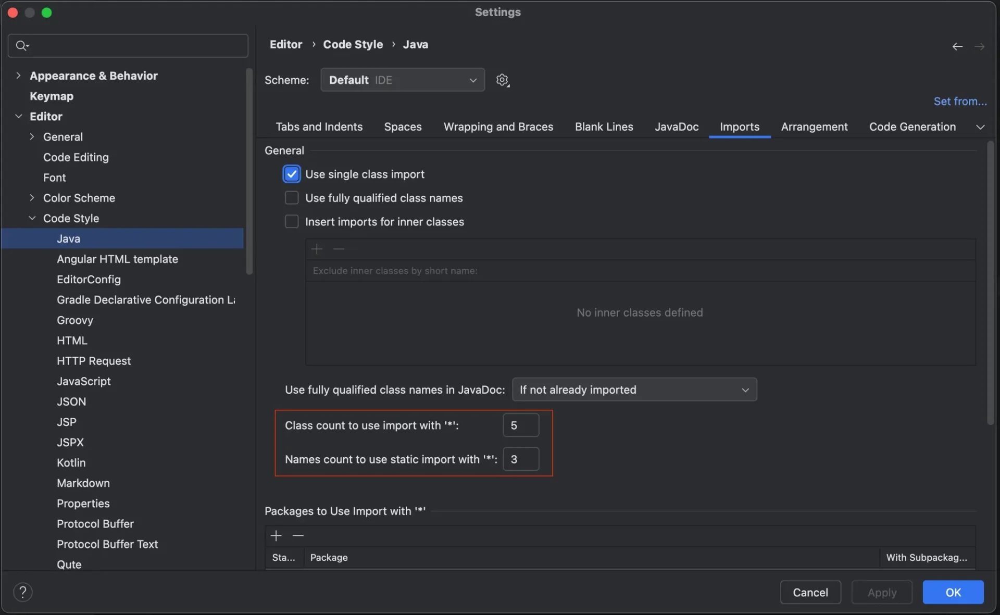

<details>
<summary>Reference</summary>

<a id="129eda9b0fe18068bf0fe7cb33cf3d89"></a>

<a href="https://beautiful-college-c84.notion.site/1292dc3ef51480e09234fe5b8ddea569">페이지</a> <br>

</details>

<a id="129eda9b0fe18016b321f442a51262e2"></a>

## 1&#46; 왜 자바 컨벤션을 지켜야 하는가?

---

<a id="129eda9b0fe18084a472e13be1a6eb66"></a>

혼자 개발을 한다면 모르겠으나, 어느 정도 규모가 있는 서비스를 하려면 여려 사람들과 함께 일을 할 수 밖에 없다&#46; 

<a id="129eda9b0fe180b0944bf9f07065b65e"></a>

그렇다면 공통되는 형식, 다른 사람들이 알아보기 쉽게 작업을 하는 것은 곧 일을 하는데 있어 더 효율적인 소통을 하며 작업에 대한 비용적 측면을 낮춘다&#46;

<a id="129eda9b0fe180bca344cd13bfaa5c31"></a>

따라서 다른사람이 이해하기 쉽게 공통되는 형식인 즉, 코드 컨벤션을 지켜며 코드를 작성해야 한다&#46;  

- ex) 일관된 들여쓰기, 변수 명명 규칙, 함수 정의 방식 등 

<a id="129eda9b0fe18082b5a7d0d46008ed49"></a>

### 장점

- 가독성 향상
    - 공통되는 형식을 통해 작성을하면, 읽는 사람이 읽고 이해하기 쉽다&#46; 

- 유지보수성 증가
    - 컨벤션을 지키지 않으면 코드가 복잡해지고 난잡 해져, 시간이 지날수록 수정 및 기능을 추가하기 어려워진다&#46;  이는 프로젝트가 커질수록 더욱 중요할 수 밖에 없는 요소이다&#46; 

- 협업 효율성 향상

- 일관된 코드 스타일
    - 컨벤션을 통해 프로젝트 전체의 코드 스타일을 일관되게 유지할 수 있다&#46; 

- 버그 발생 가능성 감소
    - 명확하고 일관된 코딩 스타일은 코드의 구조를 더 깔끔하게 하고, 실수나 버그가 발생할 가능성을 줄일 수 있다&#46;  특히 변수명, 함수명 등 을 명확하게 작성하면 코드의 의도를 파악하기 쉬워 실수를 방지할 수 있다&#46; 

- 코드 리뷰와 자동화 도구 연계
    - 많은 자동화 도구(정적 분석기 &#45; SonarQube 등)는 코드 컨벤션을 기반으로 코드 품질을 검사한다&#46; <br>따라서 일관된 스타일인 컨벤션을 지키면, 코드 리뷰와 코드 품질 검사 도구가 더 효율적으로 동작한다&#46; 

<a id="129eda9b0fe1801a9b86d65816f5cd22"></a>

## 2&#46; <code>Coding Convention</code> vs <code>Clean Code</code>

---

<a id="129eda9b0fe180f9a796c8c009b594f9"></a>

### Coding Convention 

- 개발자가 따라야 할 일련의 규칙과 스타일 가이드

- 주로 코드의 형식과 구조를 표준화하는데 중점을 두며, 팀 내에서 일관된 코딩 스타일을 유지하기 위한 규칙이다&#46; 
    <a id="129eda9b0fe18085aa7efd41b350f49f"></a>

    → 가독성, 유지보수성 ↑

<a id="129eda9b0fe180bcb191da04b709b6e8"></a>

### 특징

---

- 코드의 형식 규정
    - 들여쓰기, 공백, 괄호 위치, 주석 스타일, 함수 및 변수 명명 규칙 등

- 일관성 확보
    - 같은 프로젝트 내 모든 코드가 동일한 스타일을 유지 → 코드 리뷰, 협업 용이

- ‘도구’ 체크
    - Linter나 포매터 같은 자동화 도구로 컨벤션 준수 여부를 검사할 수 있음&#46;

<a id="129eda9b0fe180b7a7eed6622fa010a3"></a>

### 예시 

---

<a id="129eda9b0fe180dbaa75f233f4079008"></a>

자바 코딩 컨벤션

- 변수명&#58; 소문자 시작

- 클래스명&#58; 대문자 시작

- 중괄호 새로운 줄에 작성  (K&#38;B 스타일)

<a id="129eda9b0fe180efafc5db9561dce0c5"></a>

###  Clean Code

- 코딩 컨벤션의 일부분을 포함하지만, 그보다<u> 더 넓은 개념</u>으로 <strong><u>코드의 품질</u></strong>과 <strong><u>설계 철학</u></strong>에 관한 내용이다&#46;

- <strong><u>가독성, 유지보수성, 효율성, 명료성</u></strong> 등 을 고려한 좋은 코드 를 작성하는 데 중점은 둔다&#46;

- 단순히 형식을 넘어, 코드 자체를 <strong><u>직관적</u></strong>이고 <strong><u>명확</u></strong>하게 작성하는 것이 목적이다&#46; 

<a id="129eda9b0fe180d48164eaff12ddb57d"></a>

### 특징

---

- <code>가동성</code>&#58; 다른 사람도 <u>코드를 쉽게 이해</u> 할 수 있어야 한다&#46;

- <code>간결성</code>&#58; <u>불필요한 코드</u>나 <u>복잡성</u>을 <u>제거</u>하며 <u>코드를 명확</u>하게 유지해야 한다&#46;

- <code>함수 및 클래스 설계&#58;</code>  <u>한 함수는 하나의 역할만을 수행</u>해야 하며, <u>클래스 설계 시 하나 책임만을 담당</u>(SRP)하게 설계하야 한다&#46; 

- <code>의도 전달</code>&#58; <u>함수나 변수의 이름</u>만으로도 <strong><u>그 역할과 의도를 명확히 알 수 있</u></strong>어야 한다&#46; 

- <code>주석 최소화</code>&#58; <u>코드 자체에서 의도를 설명</u>해야 하며, <u>불필요한 주석 작성은 피해</u>야한다&#46; 
    - 대신, 중요한 부분이나 복잡한 로직에만 주석을 사용한다&#46; 

<a id="129eda9b0fe180f89f68cf658bf99512"></a>

### 예시

---

> <strong>클린 코드 원칙</strong> (로버트 C&#46; 마틴의 Clean Code 참조)

- 단위 함수&#58; 하나의 함수 → 하나의 역활

- <strong>명확한 변수명&#58; </strong><code>var1</code>, <code>temp</code><strong> → </strong><code>totalCost</code>, <code>userEmail</code>

- 중복제거&#58; 중복된 코드 제거 및 재사용↑

- 짧고 간결한 코드&#58; 불필요한 조건문이나 반복문을 제거, 코드 최대한 간결하게 유지 

<a id="129eda9b0fe180df8df6c5362ccc9325"></a>

### 차이점 요약

| <strong>항목</strong> | <strong>Coding Convention</strong> | <strong>Clean Code</strong> |
| --- | --- | --- |
| <strong>초점</strong> | 코드의 형식과 구조 (스타일, 명명 규칙) | 코드의 품질과 설계 (가독성, 효율성) |
| <strong>목적</strong> | 일관된 코딩 스타일을 유지 | 코드의 직관성, 유지보수성, 재사용성 향상 |
| <strong>주로 다루는 부분</strong> | 들여쓰기, 공백, 변수/함수 이름, 주석 등 | 함수 설계, 명확한 이름, 단순한 구조 |
| <strong>검사 방법</strong> | Linter, 포매터 같은 자동화 도구 | 코드 리뷰, 소프트웨어 설계 원칙 |
| <strong>팀 협업</strong> | 코드 스타일을 통일하여 협업 효율성 향상 | 협업 시 코드를 쉽게 이해하고 유지보수 가능 |

<a id="129eda9b0fe180729b42e364481f1bba"></a>

### 결론

> 두 개념은 서로 보안하는 관계를 가진다&#46; 즉, 컨벤션을 지키는 것은 클린코드를 작성하는 중요한 기초이다&#46; 

- Coding Convention
    - 일관된 코드 스타일을 유지하기 위한 규칙

    - 팀에서 일관성 있는 코드 스타일로 작성을 하여 협엽을 쉽게 하고, 유지보수 및 코드 리뷰를 더 원할하게 함

- Clean Code
    -  코드가 더 나은 설계, 가독성을 지향하도록 하는 철학

    - 코드를  <strong><u>명확</u></strong><strong>하고 </strong><strong><u>직관적</u></strong><strong>이며 </strong><strong><u>유지보수하기 쉽</u></strong><strong>도록</strong> 만드는 것

<a id="129eda9b0fe180179515e2cc1a6a98ba"></a>

## 3&#46; 방법

---

<a id="129eda9b0fe18037af1cc2833b6d98fb"></a>

###  네이밍

<details>
<summary><strong>표기법</strong></summary>

|  |  |  |  |
| --- | --- | --- | --- |
| 표기법 | 형식 | 예시 | 사용 예 |
| <strong>Camel Case</strong> | 첫 단어는 소문자, 이후 단어는 대문자 | <code>myVariableName</code> | 변수/메소드 |
| <strong>Pascal Case</strong> | 모든 단어의 첫 글자 대문자 | <code>MyClassName</code> | 클래스 |
| <strong>Snake Case</strong> | 단어 사이에 &#95;, 소문자 | <code>my&#95;variable&#95;name</code> |  |
| <strong>Upper Snake Case</strong> | 단어 사이에 &#95;, 대문자 | <code>MAX&#95;VALUE</code> | 상수 |
| <strong>Kebab Case</strong> | 단어 사이에 &#45;, 소문자 | <code>my&#45;variable&#45;name</code> | URL, CSS 클래스 |

</details>

> 📌 
> 
> <a id="751bed5f6f32496e9f4769d3c6a13d46"></a>
> 
> 기본적으로 네이밍은 <strong><code>Full&#45;Text</code></strong> 작성을 지향한다&#46;
> 
> <a id="129eda9b0fe1807a85a4e61a3c68dc3a"></a>
> 
> 다만, 조직마다 정의되어 있는 단어사전(컨벤션)이 있는 경우 사전에서 사용하고자 하는 단어를 찾아 네이밍한다&#46;
> 
> <a id="129eda9b0fe18035acd0e99d75a4ac09"></a>
> 
> ex) name&#58; 이름, 성명 → nm
> 
> <a id="129eda9b0fe180089c0bdf08712fee16"></a>
> 
> ex) User&#58; 사용자 → usr
> 
> <a id="129eda9b0fe1802a9ee8cfce52a209c7"></a>
> 
> ex) 사용자명 → usr &#43; nm = usrNm

<details>
<summary>패키지 </summary>

-  패키지 이름은 소문자를 사용

- 단어별 구문을 위해 언더스코어(&#95;)나 대문자를 포함하지 않음

<a id="129eda9b0fe180f9abc4e19cb0d52241"></a>

```java
// 좋은 예
package com.sparta.api
package com.sparta.userapi

// 나쁜 예
package com.sparta.user_api
package com.sparta.userApi
```

</details>

<details>
<summary>클래스, 인터페이스</summary>

<details>
<summary><strong>클래스 이름</strong></summary>

- <code>PascalCase</code>를 사용하여 작성

- 일반적으로 <strong>명사</strong>로 표현

- ex) <code>Customer</code>, <code>OrderManager</code>, <code>AccountService</code>

</details>

<details>
<summary><strong>인터페이스 이름</strong></summary>

- <code>PascalCase</code>를 사용하여 작성

- 명사 혹은 동작을 나타내는 경우 형용사를 사용

- ex) <code>Runnable</code>, <code>Serializable</code>

</details>

<a id="129eda9b0fe18032aa0bcd9880f193d0"></a>

```java
// 좋은 예
public class ContentHandler
public class ContentHandlerTest
public interface ContentHandlerFactory
public interface Closable

// 나쁜 예
public class contentHandler
public interface contenthandlerfactory
```

</details>

<details>
<summary>변수, 메소드</summary>

<details>
<summary>변수</summary>

- <code>camelCase</code> 형식을 사용

-  소문자로 시작

-  명확하고 구체적인 이름을 사용, 축약어 ❌

<a id="129eda9b0fe180a88a25d12277e15700"></a>

```java
// 좋은 예
private int userAge;

// 나쁜 예
private int a;
```

</details>

<details>
<summary>메서드 ( 예시 코드 확인 )</summary>

- <code>camelCase</code> 형식을 사용

- 보통 동사로 시작

- 메소드가 수행하는 동작을 명확 서술
    - ex) <code>calculateTotalAmount()</code>, <code>fetchCustomerDetails()</code>

<a id="129eda9b0fe1803fb865d38dc06c83a9"></a>

```java
// 좋은 예
동사사용 -> validateNumber()
동사 + 전치사 + 명사 -> mapToInt(), moveToDirectory(), copyToFile(), submitToExecutor()
전환메서드의 전치사 -> toString(), toModel();, fromTable(); of(),
Builder 패턴 적용한 클래스의 메서드의 전치사 -> User.build().withUserId(id);

// 보통 method 이름을 지을 때 대칭되는 기능을 만드는 경우가 많습니다.
add / remove
append / prepend
start / stop
begin / end
first / last
top / last

// 진위(참,거짓)를 나타내는 경우
isXXX / hasXXX / canXXX / exists / contains / equals
isNull(), isNumber(), hasConnection(), canSave() 등

public boolean hasConnetion() {
		return true;
}
```

</details>

</details>

<details>
<summary>상수</summary>

- 대문자와 언더바를 사용해 작성

- 모든 단어는 명확하게 분리

- ex)  <code>MAX&#95;RETRIES</code>, <code>DEFAULT&#95;TIMEOUT</code>
    <a id="129eda9b0fe180bdb37ed15a48cc619d"></a>

    ```java
    // 좋은 예
    public final int UNLIMITED = -1;
    public final String HTTP_EXPRESSION = “POST”;

    // 나쁜 예
    public final int unlimited = -1;
    public final String http_expression = “POST”;
    ```

</details>

<details>
<summary>임시변수</summary>

- 최대한 full&#45;text를 사용

- 중복되지 않도록 작성

<a id="129eda9b0fe18006b7a6feb8480c73a9"></a>

```java
// 좋은 예
InputParser inputParser = new InputParser();
OutputParser outputParser = new OutputParser();
ParserHandler parserHandler = new ParserHandler();

// 나쁜 예
InputParser p = new InputParser();
OutputParser parser = new OutputParser(); 
// 여러 종류의 parser가 동일한 {} 안에 있을 시 가독성이 떨어짐
 
ParserHandler ph = new ParserHandler();
// 약어를 사용할 시 정의되어 있거나 유추할 수 있는 약어로 작성
```

</details>

<a id="129eda9b0fe1804b9deefb3da74fe28a"></a>

### 선언

<details>
<summary>전처리(import)</summary>

- 와일드카드(<code>&#42;</code>) 없이, 사용하는 클래스 단위까지 작성

- 그렇지 않으면 해당 클래스가 참조될 때마다 import 되어있는 모든 자원을 할당받아 사용 → 낭비 

- <code>static import</code> → 와일드카드를 허용

<a id="129eda9b0fe180b7a1a4c5525143c0c3"></a>

```java
// 좋은 예
import java.util.List;
import java.util.ArrayList;
import static org.junit.jupiter.api.Assertions.*; 

// 나쁜 예
import java.util.*;

// 위와 같은 경우를 방지하려면 intellij-settings에서 아래 붉은 박스 안에 숫자를 증가시킵니다.
```



</details>

<details>
<summary>제한자 우선순위</summary>

|  |  |  |  |  |
| --- | --- | --- | --- | --- |
| 1 | 2 | 3 | 4 | 5 |
| public/protected/private | abstract | static | final | synchronized |

<a id="129eda9b0fe18079a3e5c25484111ea1"></a>

```java
// 좋은 예
public static final String CONFIG = "상수";
protected abstract String abstractMethod() {};

// 나쁜 예
public final static String CONFIG = "상수";
```

</details>

<details>
<summary>Annotation 선언</summary>

- 클래스, 인터페이스, 메서드, 생성자에 붙는 애너테이션은 선언 후 새줄 사용
    <a id="129eda9b0fe1802faa1ce2c6217ddcf0"></a>

    ```java
    // 좋은 예
    @Stable 
    private final byte[] value;

    // 나쁜 예
    @Serial private static final long serialVersionUID = -6849794470754667710L;
    ```

</details>

<details>
<summary>라인당 선언 수</summary>

- 한 줄에 여러 문장을 쓰지 않음
    <a id="129eda9b0fe180e0b93bdf7e73becd23"></a>

    ```java
    // 좋은 예
    private final byte coder; 
    private int hash;
    private int size;

    // 나쁜 예
    private final byte coder; private int hash;
    int length, size;
    ```

</details>

<details>
<summary>배열 대괄호 선언</summary>

- 한 줄에 여러 문장을 쓰지 않음
    <a id="129eda9b0fe180f68318faad9b5baff4"></a>

    ```java
    // 좋은 예
    String[] names;

    // 나쁜 예
    String names[];
    ```

</details>

<details>
<summary>Long 접미사 선언</summary>

- 소문자 사용 시 1과 구분하기 어려워 가독성이 떨어짐

- <code>L</code> 사용
    <a id="129eda9b0fe180f794d5d35f58b85782"></a>

    ```java
    // 좋은 예
    long base = 54423234211L;

    // 나쁜 예
    long base = 54423234211l;
    ```

</details>

<a id="129eda9b0fe1803b9c0fd50e49f38caf"></a>

### 들여쓰기 

> 각 코드 계층을 구분 → 일관성 유지

- 계층&#58; <code>tab(4space)</code>

- 클래스, 메서드, 제어문 등의 코드 블럭()이 생길 때마다 1단계를 더 들여씀
    <a id="129eda9b0fe1804ca330f8455b7c77c7"></a>

    ```java
    // 좋은 예
    public static Path of(URI uri) {
        String scheme = uri.getScheme();
        
        if (scheme == null) {
            throw new IllegalArgumentException("Missing scheme");
        }    

        if (scheme.equalsIgnoreCase("file")) {
            return FileSystems.getDefault().provider().getPath(uri);
        }    

        for (FileSystemProvider provider: FileSystemProvider.installedProviders()) {
            if (provider.getScheme().equalsIgnoreCase(scheme)) {
                return provider.getPath(uri);
            }
        }

        throw new FileSystemNotFoundException("Provider \"" + scheme + "\" not installed");
    }

    // 나쁜 예
    public static Path of(URI uri){
        String scheme =uri.getScheme();
        if(scheme == null){
         throw new IllegalArgumentException("Missing scheme");
        }    
        if (scheme.equalsIgnoreCase("file")){
    	     return FileSystems.getDefault().provider().getPath(uri);
        }    
        for(FileSystemProvider provider: FileSystemProvider.installedProviders()){
         if (provider.getScheme().equalsIgnoreCase(scheme)){
            return provider.getPath(uri);
         }
        }
        throw new FileSystemNotFoundException("Provider \"" + scheme + "\" not installed");
    }
    ```

<details>
<summary>중괄호 </summary>

> 줄의 마지막에 <code>{</code>로 쓰고 블럭을 닫았을 때 새줄로 <code>}</code>

<a id="129eda9b0fe180b4ae5de43894774842"></a>

```java
// 좋은 예
public static WritableByteChannel newChannel(OutputStream out) {
    Objects.requireNonNull(out, "out");

    if (out.getClass() == FileOutputStream.class) {
        return ((FileOutputStream) out).getChannel();
    }

    return new WritableByteChannelImpl(out);
}

// 나쁜 예
public final class Channels {

	public static WritableByteChannel newChannel(OutputStream out) 
	{
	    Objects.requireNonNull(out, "out");
	
	    if (out.getClass() == FileOutputStream.class) 
	    {
	        return ((FileOutputStream) out).getChannel();
	    }
	
	    return new WritableByteChannelImpl(out);
	}
}	
```

<details>
<summary>if, for, try 등 문법에 {}는 같은 줄에 작성</summary>

<a id="129eda9b0fe180e9a4ccea78a3734681"></a>

```java
// 좋은 예
if (line.startWith(WARNING_PREFIX)) {
    return LogPattern.WARN;
} else if (line.startWith(DANGER_PREFIX)) {
    return LogPattern.NORMAL;
} else {
    return LogPattern.NORMAL;
}

// 나쁜 예
if (line.startWith(WARNING_PREFIX)) {
    return LogPattern.WARN;
}
else if (line.startWith(DANGER_PREFIX)) {
    return LogPattern.DANGER;
}
else {
    return LogPattern.NORMAL;
}

// 좋은 예
try {
    writeLog();
} catch (IOException ioe) {
    reportFailure(ioe);
} finally {
    writeFooter();
}

// 나쁜 예
try {
    writeLog();
}
catch (IOException ioe) {
    reportFailure(ioe);
}
finally {
    writeFooter();
}
```

</details>

</details>

<a id="129eda9b0fe1801ab938c42cc115115c"></a>

### 줄바꿈

> ⚠️  무부별한 줄바꿈은 가독성을 헤칠 수 있다&#46; 꼭 규칙성과 통일성을 가지고 작성

- 줄바꿈은 작성한 명령어, 구문이 길어질 때 가독성을 위하여 내려쓴다&#46;

- <code>extends</code> , <code>implements</code> ,<code>throws</code> 선언 후

- 시작 소괄호(<code>(</code>) 선언 후

- 콤마(<code>,</code>) 후

- <code>&#46;</code> 전

- 연산자 전
    - <code>&#43;</code>, <code></code>, <code></code>, <code>/</code>, <code>%</code>

    - <code>==</code>, <code>&#33;=</code>, <code>&#62;=</code>, <code>&#62;</code>,<code>⇐</code>, <code>&#60;</code>, <code>&#38;&#38;</code>, <code>&#124;&#124;</code>

    - <code>&#38;</code>, <code>&#124;</code>, <code>^</code>, <code>&#62;&#62;&#62;</code>, <code>&#62;&#62;</code>, <code>&#60;&#60;</code>, <code>?</code>

    - <code>instanceof</code>


<a id="129eda9b0fe180f4acafd1063d3e8ea9"></a>

```java
// 예
public class longImplemnts implements 
	AutoClosable, Runnable, Serializable {
	
	public MyExampleClass() 
        throws IOException, IllegalArgumentException {

        // 소괄호 이후 줄바꿈
        performCalculation(
            10, 
            20, 
            "Result");

        // 콤마(,) 이후 줄바꿈
        List<String> items = Arrays.asList(
            "Apple", 
            "Banana", 
            "Cherry"
        );

        // 연산자 앞에서 줄바꿈
        int result = 5 
            + 10 
            - 2 
            * 3 
            / 4;

        boolean isValid = (result > 10) 
            && (result != 0) 
            || (result < 20);

        // 메소드 체이닝에서 . 전 줄바꿈
        String formattedString = new StringBuilder()
            .append("The result is: ")
            .append(result)
            .toString();
    }
	
	}
	
	
```

<a id="129eda9b0fe1804ab676e5ccfdfd85ec"></a>

### 빈줄

- 메소드 사이의 에는 빈줄로 구분
    <a id="129eda9b0fe1808b92b0f25132406ecb"></a>

    ```java
    // 좋은 예
    public void setId(int id) {
        this.id = id;
    }

    public void setName(String name) {
        this.name = name;
    }


    // 나쁜 예
    public void setId(int id) {
        this.id = id;
    }
    public void setName(String name) {
        this.name = name;
    }


    public void setAge(int age) {
        this.age = age;
    }
    ```

<a id="129eda9b0fe18067baecf3db00d17359"></a>

### 공백

- 빈줄을 포함하여 모든 줄은 탭이나 공백을 포함하지 않음

<details>
<summary><code>&#91;&#93;</code> 대괄호 작성 시 공백을 삽입</summary>

<a id="129eda9b0fe18022b216cbd050fa6bb9"></a>

```java
// 좋은 예
String[] spells = new String[] {"ㄱ", "ㄴ", "ㄷ"};

// 나쁜 예
String[]spells = new String[]{"ㄱ", "ㄴ", "ㄷ"};
```

</details>

<details>
<summary><code>{}</code> 중괄호, <code>()</code> 소괄호 작성 시 공백을 삽입</summary>

<a id="129eda9b0fe1806bb4bff97d4e5534c7"></a>

```java
// 좋은 예
public void print(String line) {
		...
}

// 나쁜 예
public void print(String line){
		...
}

// 좋은 예
public void example() {
    // if 문 - 소괄호 앞에 공백
    if (condition) {
        System.out.println("Condition is true");
    }

    // for 문 - 소괄호 앞에 공백
    for (int i = 0; i < 10; i++) {
        System.out.println("Iteration: " + i);
    }

    // while 문 - 소괄호 앞에 공백
    while (condition) {
        System.out.println("Still true");
    }

    // catch 문 - 소괄호 앞에 공백
    try {
        riskyOperation();
    } catch (Exception e) {
        System.out.println("Exception caught");
    }

    // synchronized 블록 - 소괄호 앞에 공백
    synchronized (this) {
        System.out.println("Synchronized block");
    }

    // switch 문 - 소괄호 앞에 공백
    switch (value) {
        case 1:
            System.out.println("Value is 1");
            break;
        case 2:
            System.out.println("Value is 2");
            break;
        default:
            System.out.println("Other value");
    }
}

// 나쁜 예
public void example() {
    if(condition){
        System.out.println("Condition is true");
    }

    for(int i=0;i<10;i++){
        System.out.println("Iteration: " + i);
    }

    while(condition){
        System.out.println("Still true");
    }

    try{
        riskyOperation();
    }catch (Exception e){
        System.out.println("Exception caught");
    }

    synchronized (this){
        System.out.println("Synchronized block");
    }

    // switch 문 - 소괄호 앞에 공백
    switch(value){ 
        case 1:
            System.out.println("Value is 1");
            break;
        case 2:
            System.out.println("Value is 2");
            break;
        default:
            System.out.println("Other value");
    }
 }
 
 // 좋은 예
 String message = (String) line;
 boolean flag = (condition1 && condition2) 
 
 // 나쁜 예
 String message = ( String ) rawLine;
 boolean flag = ( condition1&&condition2 ) 
```

</details>

<details>
<summary>이항/삼항 연상자 시 공백</summary>

<a id="129eda9b0fe1803aa06cd5ed41551d2d"></a>

```java
// 좋은 예
int finalScore += weight * rawScore - absentCount;
boolean flag = (isNew) ? "신규" : "기존";

// 나쁜 예
int finalScore += weight*rawScore-absentCount;
boolean flag = (isNew)?"신규":"기존";
```

</details>

<a id="129eda9b0fe180129dd9d4df2cb82f54"></a>

### 주석

> ⚠️ 주석은 꼭 <u>정보를 제공</u>하거나, <u>의도를 설명</u>하거나, <u>결과를 경고</u>하거나, <u>TODO를 작성</u>하거나, <u>API를 작성</u>할 때 사용

> 주석은 코드 관리와 가독성면에서 꼭 필요한 기능이지만,<br>불필요한 주석이 많아 진다면 오히려 코드가 더러워지거나 불필요한 오해를 일으킬 수 있다&#46;

<details>
<summary><strong>단일 줄 주석</strong>&#58; <code>//</code></summary>

<a id="129eda9b0fe1805a8996c69b0912c392"></a>

```java
// 사용자 로그인 상태 확인
if (user.isLoggedIn()) {
    // 처리 로직
}
```

</details>

<details>
<summary><strong>블록 주석</strong>&#58; <code>/&#42; &#42;/</code></summary>

<a id="129eda9b0fe18039bbd2e70dbcca5387"></a>

```java
/**
 * 주어진 채널에서 바이트를 디코딩하여 리더(reader)를 생성합니다.
 *
 * 생성된 스트림에는 최소 {@code minBufferCap} 바이트의 내부 입력 버퍼가 포함됩니다.
 * 스트림의 {@code read} 메서드는 필요에 따라 기본 채널에서 바이트를 읽어 버퍼를 채웁니다.
 * 채널이 바이트를 읽을 때 논블로킹(non-blocking) 모드에 있으면 {@link IllegalBlockingModeException}
 * 예외가 발생합니다. 생성된 스트림은 그 외에는 버퍼링되지 않으며, {@link Reader#mark mark} 또는 
 * {@link Reader#reset reset} 메서드를 지원하지 않습니다. 스트림을 닫으면 채널도 함께 닫힙니다
 *
 * @param  ch
 *         바이트를 읽을 채널
 *
 * @param  dec
 *         사용할 문자셋 디코더
 *
 * @param  minBufferCap
 *         내부 바이트 버퍼의 최소 용량, 
 *         또는 구현에 따라 기본 용량을 사용하려면 {@code -1}
 *
 * @return 새로운 리더(reader)
 * @throw  IOException
 */
public static Reader newReader(ReadableByteChannel ch,
                               CharsetDecoder dec,
                               int minBufferCap) throws IOException {
                               
```

</details>

---

<details>
<summary><strong>의도 설명</strong></summary>

- 왜 이 코드를 작성했는지, 어떤 의도를 가지고 있는지 설명

- 다른 개발자가 이 코드를 이해하는 데 도움을 줌
    <a id="129eda9b0fe18076b0cedf87df7da158"></a>

    ```java
    // 데이터베이스가 비동기적으로 업데이트되었는지를 확인하고 최신 상태를 가져오기 위함
    if (isDatabaseUpdated()) {
        refreshData();
    }
    ```

</details>

<details>
<summary> <strong>결과 경고</strong></summary>

- 특정 코드를 사용할 때 발생할 수 있는 문제나 부작용에 대해 경고
    <a id="129eda9b0fe180d2a5b0e46348256d0b"></a>

    ```java
    // WARNING: 이 메서드는 null 값을 반환할 수 있으므로 null 체크가 필요
    public String getUserName(int userId) {
        // ...
        return null; // 사용자가 존재하지 않을 때, null 반환
    }
    ```

</details>

<details>
<summary><strong>TODO 작성</strong></summary>

- 아직 구현하지 않았거나 나중에 개선할 사항에 대한 주석

- IDE(intelliJ)에서 TODO 확인 가능 
    <a id="129eda9b0fe180619248d6ee2729f7ff"></a>

    ```java
    // TODO: 이 메서드에 예외 처리를 추가
    public void processOrder(Order order) {
        // 주문 처리 로직
    }
    ```

</details>

<a id="129eda9b0fe1805b956ec3200ea749c1"></a>

### 예외처리

<details>
<summary>예외 사용</summary>

- 오류 처리는 반환 값을 확인하는 방식보다는 <strong>예외</strong>를 사용하는 것이 더 명확하고 유지보수하기 좋다&#46;

- 반환 값을 사용하면 오류 발생 여부를 확인하는 코드가 곳곳에 흩어져 코드의 흐름을 방해한다&#46;

- 예외는 오류가 발생했을 때 흐름을 명확하게 중단하고 처리할 수 있게 도와준다&#46;
    <a id="129eda9b0fe180d69100de15baa64334"></a>

    ```java
    // 좋은 예
    public int calculateDiscount(Customer customer) {
        if (customer == null) {
            throw new IllegalArgumentException("Customer cannot be null");
        }
        // 계산 로직
        return discount;
    }

    // 나쁜 예
    public int calculateDiscount(Customer customer) {
        if (customer == null) {
            return -1; // 오류를 반환 값으로 처리
        }
        // 계산 로직
        return discount;
    }
    ```

</details>

<details>
<summary>예외 무시 ❌</summary>

- 예외가 발생했을 때, 예외를 <strong>절대 빈 </strong><strong><code>catch</code></strong><strong> 블록</strong>으로 처리하거나 무시해서는 안된다&#46;

- 예외가 발생한 이유를 명확하게 이해하고 적절하게 처리해야 한다&#46;

- 그렇지 않으면 디버깅이 어렵고, 버그가 발생될 가능성이 커진다&#46; 
    <a id="129eda9b0fe1808285c3dff0d757120f"></a>

    ```java
    // 좋은 예
    try {
        // 위험한 작업
    } catch (Exception e) {
        // 예외를 기록하고 다시 던지거나 적절히 처리
        logger.error("Exception occurred", e);
        throw e;
    }

    // 나쁜 예
    try {
        // 위험한 작업
    } catch (Exception e) {
        // 아무것도 하지 않음
    }
    ```

</details>

<details>
<summary>복수할 수 있는 예외 와 복구할 수 없는 예외 구분</summary>

- <u>복</u><strong><u>구할 수 있는 예외</u></strong>는 <u>사용자에게 알</u>려주거나 <u>다른 방법으로 시도</u>하는 등의 방법으로 처리해야 함

- 반면, <strong><u>복구할 수 없는 예외</u></strong>는 바로 <u>로그를 기록</u>하고 다시 <u>예외를 던</u>지거나 <u>프로그램 종료</u>
    <a id="129eda9b0fe18081aefef102f1453b78"></a>

    ```java
    try {
        // 파일을 읽음
    } catch (FileNotFoundException e) {
        // 복구할 수 있는 예외: 파일을 다시 요청하거나 기본 파일을 사용
        System.out.println("File not found, please check the file path.");
    } catch (IOException e) {
        // 복구할 수 없는 예외: 로그를 기록하고 예외를 다시 던짐
        logger.error("IOException occurred while reading the file", e);
        throw new RuntimeException(e);
    }
    ```

</details>

<details>
<summary>호<strong>출자에게 문제를 알리기 위한 예외 던지기</strong></summary>

- 예외는 프로그램의 정상적인 흐름을 벗어나는 문제를 처리하는 메커니즘

- 호출자에게 문제가 발생했다는 사실을 알려주고, 필요하다면 이를 처리할 수 있는 기회 준다&#46;

- 따라서 예외를 던질 때는 의미 있는 메시지와 함께 던져야 한다&#46;
    <a id="129eda9b0fe1807fb594f5900ca787e4"></a>

    ```java
    // 메소드를 호출한 주체는 메소드가 전달한 예외처리할 의무가 있습니다.
    try {
    	file.openFile(path);
    } catch(FileNotFoundExcetion e) {
    	// 예외 처리
    	...
    }


    public void openFile(String filePath) throws FileNotFoundException {
        File file = new File(filePath);
        if (!file.exists()) {
            throw new FileNotFoundException("File not found at path: " + filePath);
        }
    }
    ```

</details>

<details>
<summary><strong>구체적인 예외를 처리</strong></summary>

- 너무 포괄적인 <code>catch(Exception e)</code> 구문보다는, 가능한 한 <strong>구체적인 예외</strong>를 처리하는 것이 좋음

- 구체적인 예외를 처리 →  예상치 못한 오류를 방지, 디버깅 용이

<a id="129eda9b0fe180ca88c3e869c2cff78a"></a>

```java
// 좋은 예
try {
    // 작업
} catch (FileNotFoundException e) {
    // 파일이 없을 때의 처리
} catch (IOException e) {
    // 입출력 오류 처리
}

// 나쁜 예
try {
   // 작업
} catch (Exception e) {
   // 오류 처리
}
```

</details>

<details>
<summary><code>null</code>을 전달하지도 반환하지도 마라</summary>

- <code>null</code>을 반환하면 호출하는 측에서 반드시 <code>null</code> 체크를 해야 함

-  이를 잊어버리면 <strong><code>NullPointerException</code></strong>(NPE)이 발생

- 코드가 복잡해지고 오류 발생 가능성이 커짐

- 따라서 <code>null</code> 대신에 의미 있는 값이나 <strong><u>빈 객체(Empty Object)</u></strong><u>, </u><strong><u>Optional</u></strong>을 반환
    <a id="129eda9b0fe18075aa02d91e1b322fe4"></a>

    ```java
    // 좋은 예
    public List<Item> getItems(Customer customer) {
        if (customer == null) {
            return Collections.emptyList();  // 빈 리스트 반환
        }
        return customer.getItems();
    }

    // 호출하는 쪽에서 null 체크 불필요
    for (Item item : getItems(customer)) {
        processItem(item);
    }

    // 좋은 예
    public Optional<Item> findItemById(int id) {
        Item item = findItemInDatabase(id);
        return Optional.ofNullable(item); // null 대신 Optional 반환
    }

    // 호출하는 쪽에서 더 명확하게 null 여부를 처리
    findItemById(123).ifPresent(item -> processItem(item));


    // 나쁜 예
    public List<Item> getItems(Customer customer) {
        if (customer == null) {
            return null;  // null 반환
        }
        return customer.getItems();
    }

    // 호출하는 쪽에서는 null 체크를 강제로 해야 함
    List<Item> items = getItems(customer);
    if (items != null) {
        for (Item item : items) {
            processItem(item);
        }
    }
    ```

</details>
