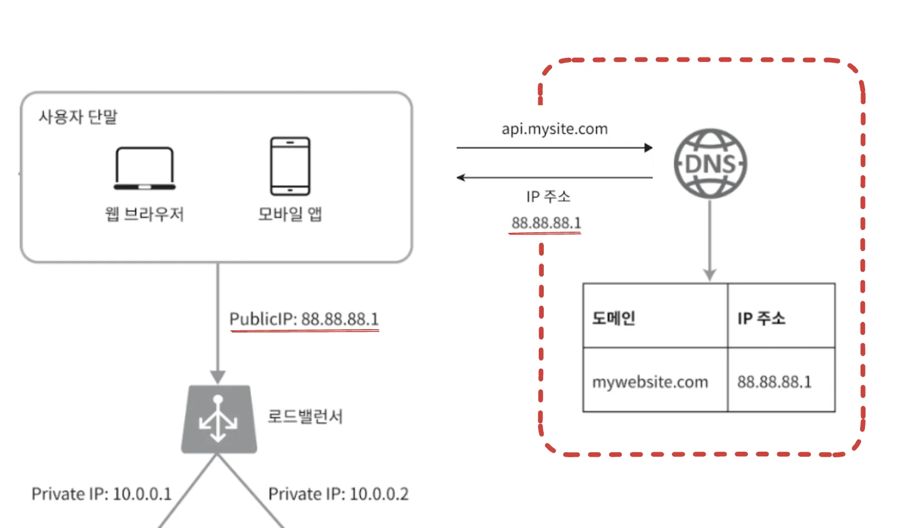
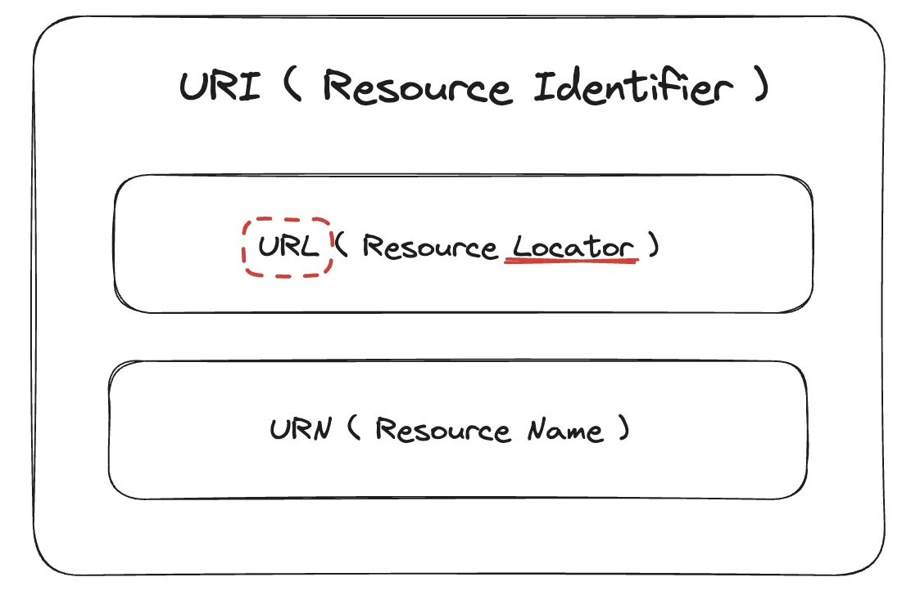
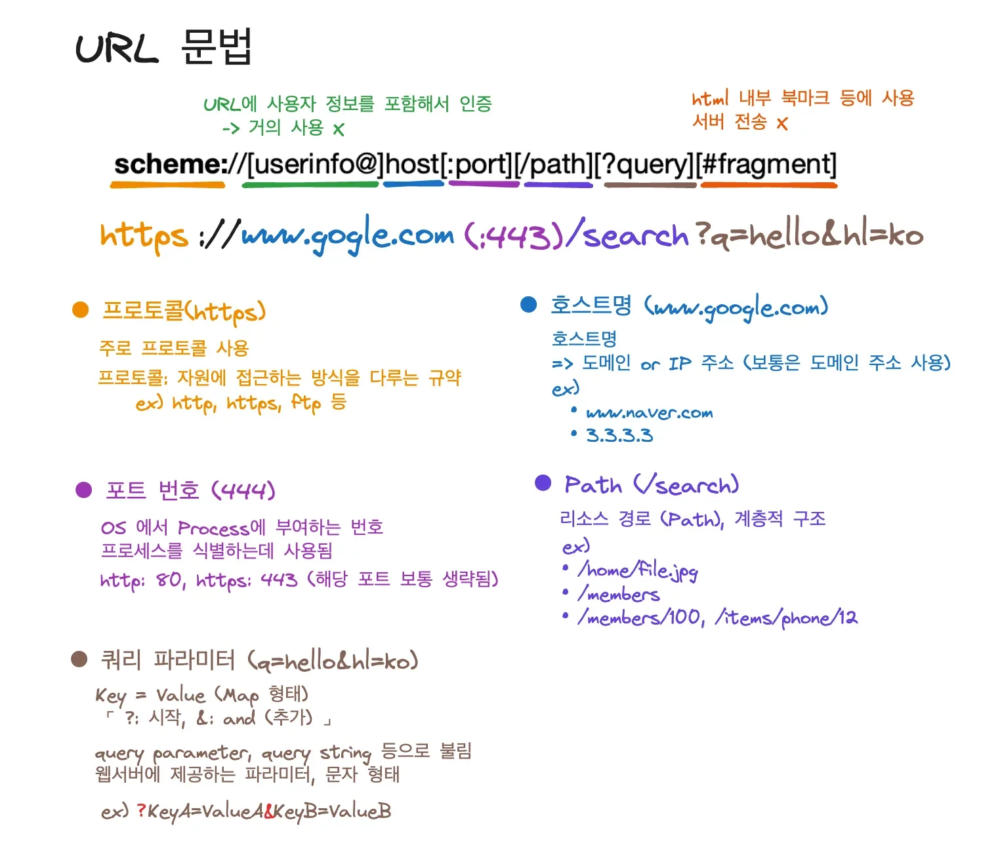
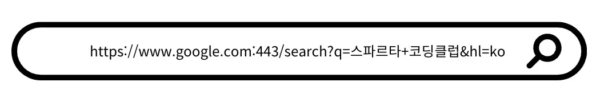
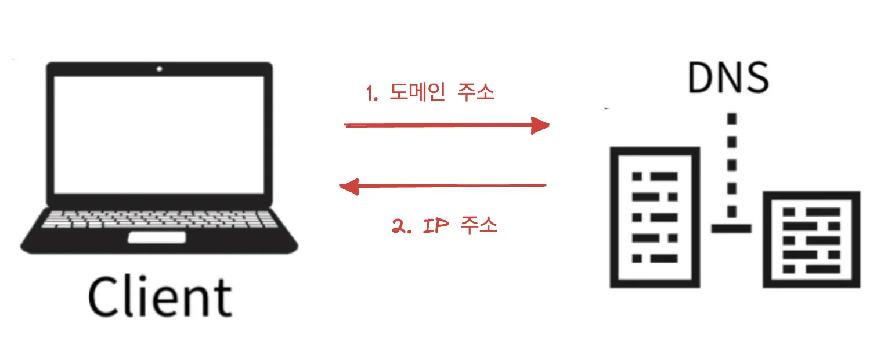
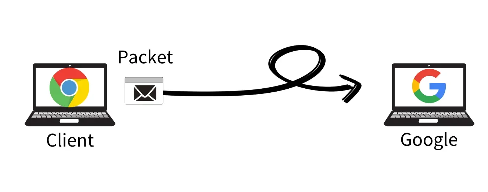
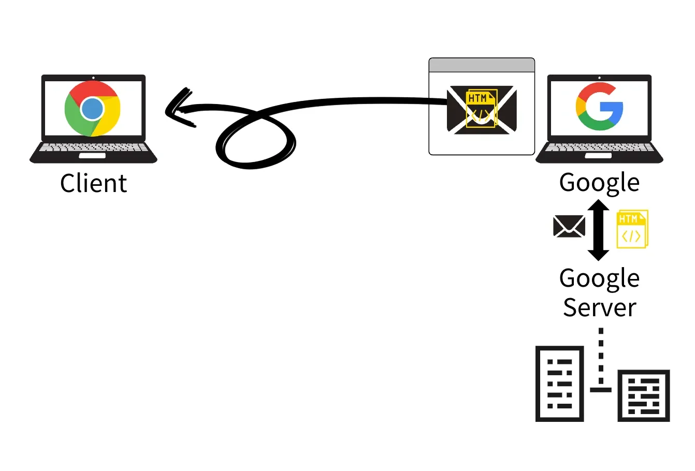
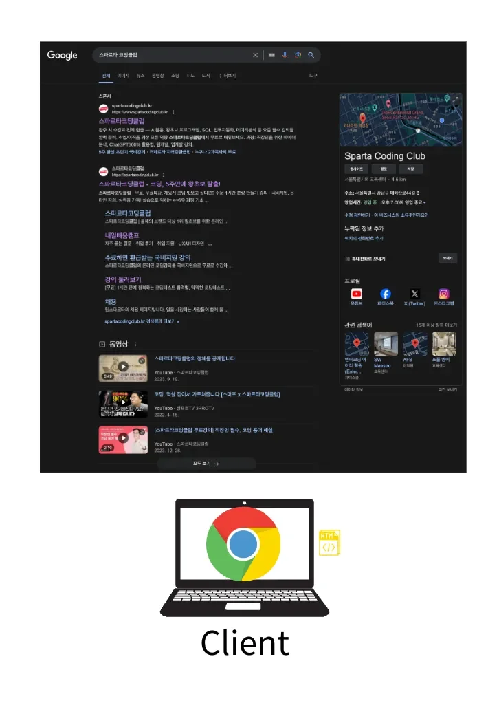

### DNS ( Domain Name System )

---

> 도메인 이름과 IP주소를 변환하는 역활을 수행 즉, 사람 이 읽을 수 있는 도메인 이름을 컴퓨터가 식별할 수 있는 IP 주소로 변환한다&#46; 

- 사용자가 website에 접속하면 DNS에서 해당하는 IP 주소를 받아  해당 IP 주소 서버에 요청을 보내 응답을 받아온다&#46; 

- 동일한 도메인 이름에 IP 주소 변경이 가능하다&#46;
    - DNS 서버에 등록된 IP 주소만 변경해주면 된다&#46; 

### URI ( Uniform Resource Identifier )

---

> 리소스를 식별하는 통합된 방법이다&#46;

- <code>Uniform</code>&#58; 리소스를 식별하는 통일된 방식을 의미

- <code>Resource</code>&#58; 자원, URL로 식별 가능한 모든 것(페이지, 텍스트, 이미지, 동영상, 파일 등)

- <code>Identifier</code>&#58; 식별자, 다른 항목과 구분하는데 있어 필요한 정보

### URN, URL

---

URL, URN

> 위치는 변할 수 있지만, 이름은 변하지 않는다&#46;

URL(<code>Locator</code>)&#58; 리소스가 있는<u> 위치를 지정</u>한다&#46;

> <strong> Uniform Resource </strong><strong><u>Locator</u></strong>

- 위치로 자원을 식별하기 때문에, 위치가 변경되면 식별할 수 없다&#46; 

URN(<code>Name</code>) &#58; 리소스에 이<u>름을 부여</u>한다&#46; 

> <strong>Uniform Resource</strong><strong><u> Name</u></strong>

- 이름으로 자원을 식별하기 때문에, 위치가 변경되어도 리소스 식별 가능하다&#46; 

- ex) urn&#58;isbn&#58;8940333284,  어느 책 isbn URN

- URN 이름만으로 리소스를 찾는 방식이 보편화 되지 않았다&#46;  즉, URL만을 사용한다&#46; 

- 따라서 URI를 URL과 같은 의미로 사용한다&#46;

URL 구조(문법) 

> ✏️ 
> 
> 
> 
> <strong>scheme&#58;&#91; // </strong><del><strong>&#91;user &#91;&#58;password&#93; &#64;&#93; </strong></del><strong>host &#91;&#58;port&#93;&#93; &#91;/path&#93; &#91;?query&#93; &#91;&#35;fragment&#93;</strong>

<strong><code>scheme</code></strong><strong> &#45;</strong> 프로토콜

주로 자원에 접근하는 프로토콜을 방식을 나타낸다&#46;

- 웹&#58; <code>http</code>, <code>https</code>, <code>ftp</code> 등

<code>user&#91;&#58;password&#93;</code>

- 사용자 정보

- 보안에 취약하기 때문에 사용되지 않음

<strong><code>host</code></strong><strong> &#45; 호스트 이름</strong>

- 요청을 보내기 위한 호스트의 <code>IP 주소</code> or <code>도메인 이름</code>

<strong><code>&#58;port</code></strong><strong> &#45; 포트 번호</strong>

- OS에서 Process에 부여하는 번호 프로세스를 식별하는데 사용된다&#46;

- http&#58; <code>80</code>, https&#58; <code>443</code> &#45; 해당 포트 번호는 보통 생략됨

<strong><code>/path</code></strong>

- 리소스의 경로(path)

- <strong><u>계층 구조</u></strong>로 구성
    - ex) <code>…/home/file&#46;jpg</code> , <code>…/members</code>

<strong><code>?query</code></strong><strong> &#45; 쿼리 파라미터(스트링)</strong>

- 웹 서버에서 제공하는 파라미터, 문자 형태 

- key = value 형태로  값을 넘김

- 시작&#58; <code>?</code>,  추가&#58; <code>&#38;</code>(and)

- ex) <code>?key1=value1&#38;key2=value2</code> 

<code>&#35;fragment</code>

- html 내부 북마크 용도

- 서버 전송 X

### 브라우저 URL 입력 시

---

내부 동작

1. URL 입력
    

1. DNS에서 해당하는 IP 주소 받아옴
    

1. 웹 브라우저에서 HTTP 요청 메세지를 생성 후,  요청 패킷에 담아 해당하는 IP 주소 서버로 전송
    - 위에는 도메인 주소가 ‘구글’ 이니, 구굴에 해당하는 IP 주소 받고 해당 서버로 전송함

    

1. 서버에서는 받아온 HTTP 요청 메세지를 기반으로 응답 메세지(HTTP 형식) 를 만들어 보냄
    

1. 클라이어트에서는 수신 받은 응답메세지를 통해 사용자에게 해당하는 리소스를 보여줌
    - 구글 검색 요청이기 때문에, 아래와 같이 해당하는 화면을 그려줌

    

