<a id="131eda9b0fe180439e62d6dd3ac33641"></a>

## Web Server

---

> 🧐 
> 
> <a id="256eda9b0fe180f9aabeedc9e88297c0"></a>
> 
> <code>Web Application</code> vs <code>WAS</code> ( <code>Web Application Server</code> )
> 
> <a id="256eda9b0fe180ac8565e2b9cda30075"></a>
> 
> 실제 <code>Web Server</code>도 Application 로직을 포함할 수 있다&#46; 
> 
> <a id="256eda9b0fe180bc9ac1d99a3bcfd148"></a>
> 
> 그러나 <code>WAS</code>에서 Application 코드를 실행하는 것이 더욱 특화 되어있다&#46; 
> 
> - Java에서는  <strong>Servlet Container</strong><strong> 기능이 제공되면 WAS의 역할을 하는 것이다&#46; </strong>

<a id="12feda9b0fe180af8c1aea9e1224fa71"></a>

### Web Server

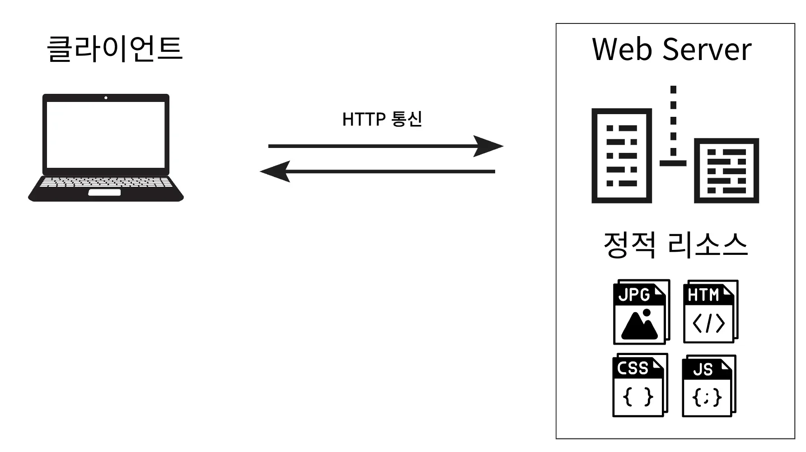

<a id="256eda9b0fe1806db2b4ea209e3bef7a"></a>

<strong>대표적인 Web Server</strong>

- NGINX
    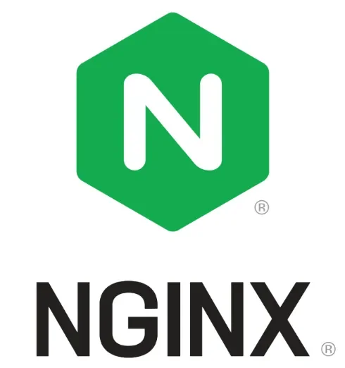

- Apache
    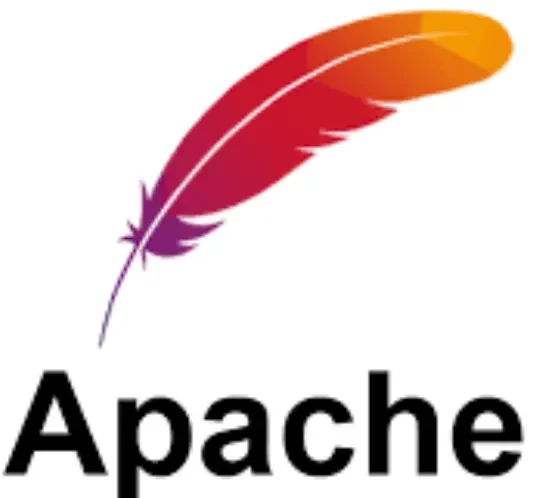

<a id="12feda9b0fe180b390a0c2ff206eae48"></a>

### WAS (Web Application Server)

> HTTP 기반으로 동작하며, 웹 서버의 기능을 포함한다&#46; <br>추가적으로 코드를 실행하여 <u>Application 로직을 수행</u>하고<u> DB와 상호작용하여 동적 컨텐츠를 생성</u>한다

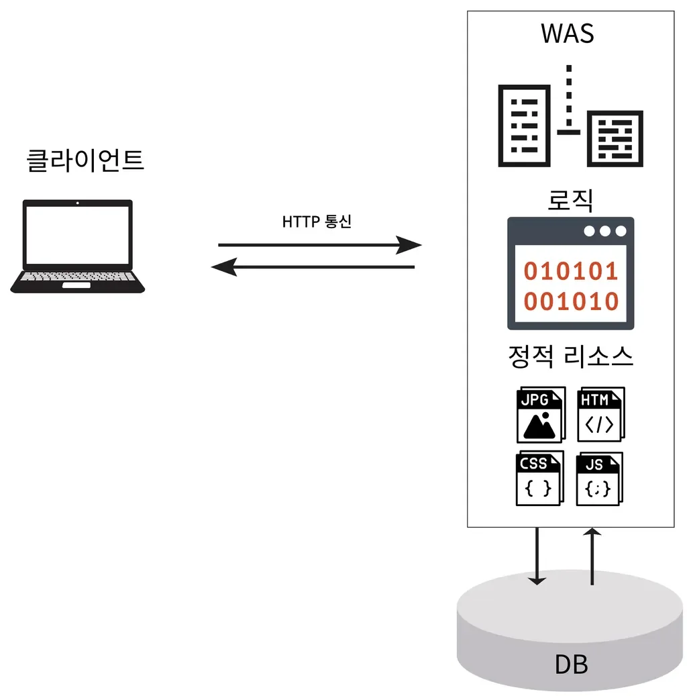

> 대표적인 WAS

1. Tomcat 
    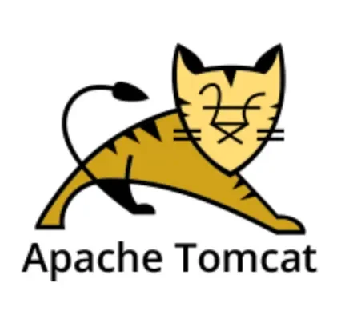

    - Spring Boot 내장

1. Jetty
    

1. Undertow
    

<a id="12feda9b0fe1807da8a0c0b02192e445"></a>

### Web System 구성

<details>
<summary>1&#46;  <strong>&#91; 🤬 Bad Case &#93; </strong>WAS만 사용 </summary>

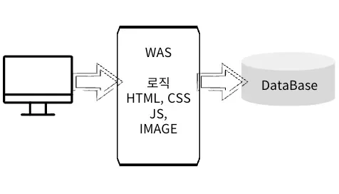

- 위 그림과 같이 WAS만을 사용하여 서버를 구성하는 경우, <br><strong>WAS가 너무 많은 역할을 담당</strong>하게 된다&#46; 
    - 서버 과부화 발생 → 다운 → 서비스 중지

- 가장 중요한 Application 로직이 정적 리소스로 인해 수행되지 않을 수 있다&#46;

- WAS에 장애가 발생되면 서비스에서 대응 방법이 없다&#46; 
    - WAS에서 화면과 Application 로직을 동시에 실행하기 때문에 서버 중지 시, 서비스 자체가 중단된다&#46; 

</details>

<details>
<summary>2&#46; <strong>&#91; 🫡 Basic Case &#93;</strong> 기본 웹 시스템 구성</summary>

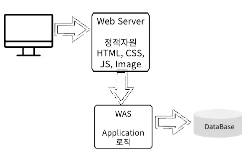

> 장점

1. 효율적 리소스 관리
    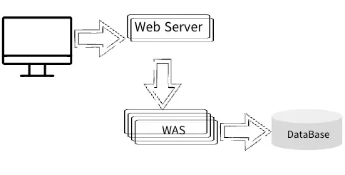

    - 정적 자원 사용 ↑&#58; Web Server, Scale Out

    - Application 자원 사용 ↑&#58;  WAS, Scale Out 

    > ❗ 
    > 
    > <a id="256eda9b0fe1805394aadb4d15be1f7c"></a>
    > 
    > Scale out 시 적절한 트래픽 분산 처리 및 빠른 서비스,  고가용성을 고려하려면 결국  데이터 센터, CDN, 로드벨런스, 데이터 계층 분산 등을 고려하면서 설계해야 한다&#46;

1. 오류 화면 제공 가능
    - 정적 자원을 관리하는 Web Server는 오류 발생 확률이 낮다&#46; 

    - WAS는 오류 발생 확률이 높고, 장애가 자주 발생한다&#46; 
        - DB와 상호작용하기 때문에, DB에 문제가 생겨도 장애가 발생한다&#46;

        <a id="131eda9b0fe18054949fc1180ad1c85f"></a>

        → 장애 발생 시, Web Server를 통해 오류 화면 송출 가능

    <a id="131eda9b0fe180438609e51f8a29d4be"></a>

      

</details>

> ✏️ 
> 
> <a id="256eda9b0fe180378ef3ec826c454995"></a>
> 
> <strong>대규모 시스템 설계 시</strong>
> 
> - 정적 리소스 → CDN을 통해 캐시 처리
> 
> - 웹 계층 → 로드벨런서로 서버에 트래픽 분산
> 
> - 데이터 계층 → DB &#45; 주•부(master, slave) 모델로 연산 처리 분산 

<a id="131eda9b0fe180758510d0678e87626a"></a>

## Servlet

---

<a id="12feda9b0fe1802aba9bc1e78ba69c32"></a>

### Servlet

> ✏️ 
> 
> <a id="256eda9b0fe18036a911f9ec4a9ac80d"></a>
> 
> Sevlet은 HTTP 프로토콜 기반 요청(Request) 및 응답(Response)을 편리하게 처리할 수 있게 해주는 기술이다&#46;
> 
> - 웹 애플리케이션 개발의 핵심 기술 중 하나이다&#46;
> 
> <a id="256eda9b0fe180208855dbdce0971e34"></a>
> 
> Java에서 Servlet은 HttpServlet 클래스를 상속 받아 구현된다&#46; 

<details>
<summary><code>서블릿</code> 사용 시 <strong><u>요청, 응답 시에  자동화 처리</u></strong>되는 부분들</summary>

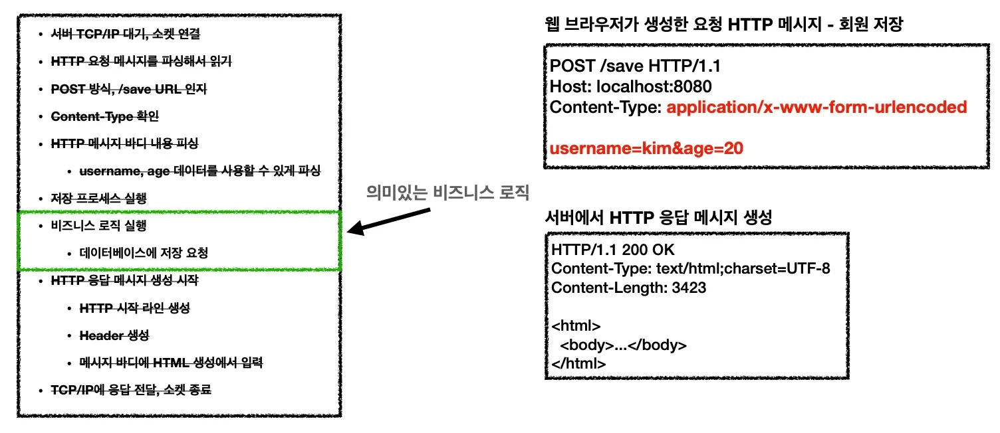

> 
> 
> - <del>서버 TCP/IP 대기, 소캣 연결</del>
> 
> <details>
> <summary><del>HTTP Request Message 필요한 형태로 변환하여 읽기</del></summary>
> 
> - <code>Start Line</code> &#45; HTTP Method 및 URL 분석 
> 
> - <code>Header</code> &#45; HTTP Header 분석
> 
> - <code>Body</code> &#45; HTTP Message Body 읽기 및 변환
>     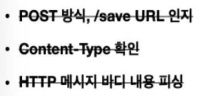
> 
> </details>
> 
> - <del>분석한 결과를 통한 프로세스 실행</del>
> 
> ---
> 
> - 비지니스 로직 실행
> 
> ---
> 
> <details>
> <summary><del>HTTP Response Message 생성</del></summary>
> 
> - HTTP <code>Start Line</code> 생성
> 
> - <code>Header</code> 생성
> 
> - HTTP <code>Message Body</code>에 응답 데이터를 요청한 형식에 맞춰 응답
> 
> - 처리가 불가하다면 예외처리
> 
> </details>
> 
> - <del>응답 전달</del>
> 
> - <del>연결 종료</del> 

-      &#58;  부분 외 전부 자동화 

- 즉, <strong>비지니스 로직 외 다 자동화 처리</strong> 가능하다&#46;

</details>

<a id="12feda9b0fe180f18147eb24677bd4cb"></a>

### Servlet 동작 순서

> ✏️ 
> 
> <a id="79f44a1d67304143a8354481f527c2f7"></a>
> 
> 예시 코드를 통해 서블릿이 어떻게 동작 하는지 학습한다&#46;

<details>
<summary>예시)  <code>service()</code></summary>

<a id="131eda9b0fe180978af3e26b2625b4e8"></a>

```java
// localhost:8080/example 
@WebServlet(name="ExampleServlet", urlPatterns = "/exmaple")
public class ExampleServlet extends HttpServlet { // HttpServlet을 상속받아 구현한다.
	
	@Override
	protected void service(
		HttpServletRequest request,  // HTTP 요청 정보를 쉽게 사용할 수 있게 만드는 Servlet
		HttpServletResponse response // HTTP 응답 정보를 쉽게 제공할 수 있게 만드는 Servlet
	) {
		// application logic
	}
}
```

- 얘전에 사용하던 코드 

- 스프링 사용 시, 간단하게 Anotation으로 가능

</details>

<details>
<summary>서블릿 동작 </summary>

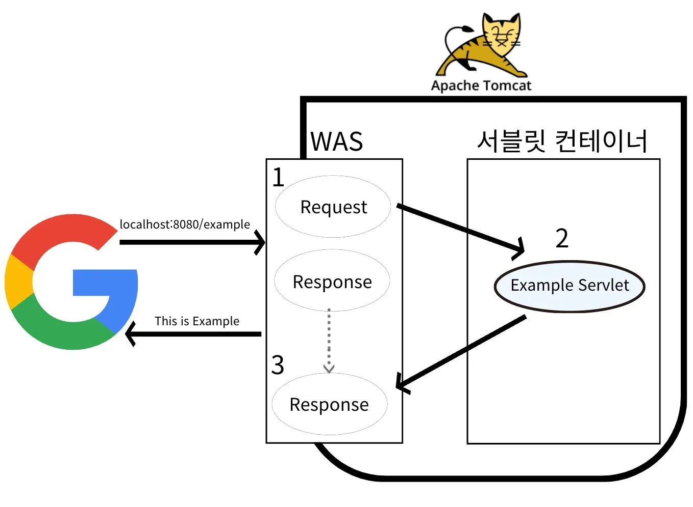

1. WAS는 HTTP 요청 메세지를 기반으로 새로운  Request, Response 객체 생성

1. WAS는 만들어진 Request, Response 객체를 서블릿 컨테이너에 넘겨주며 ExxampleServlet 객체를 호출

1. ExampleServlet에서 비지니스 로직 처리

1. 응답에 필요한 정보를 개발자가 입력

1. WAS는 Response 객체 정보(개발자가 입력한 정보)로 HTTP 응답 메세지 생성

</details>

<details>
<summary>개발자가 하는 일</summary>

1. Request 객체에 담겨있는 HTTP 요청 정보를 꺼내서 사용한다&#46; 
    - <code>/url/{pathVariable}</code> &#45;&#62; <code>&#64;PathVariable</code> 

    - <code>/url?query=value</code> → <code>&#64;RequestParam</code>

    - HTTP Message Body &#45;&#62; <code>&#64;RequestBody</code> 

1.  요청 정보(URL, Method, Message Body)를 통해 필요한 기능 ( 비지니스 로직 ) 을 수행한다&#46;

1.  생성된 Response 객체에 HTTP 응답 정보를 입력한다&#46; 

</details>

<a id="12feda9b0fe1804897b0fb6ccd364314"></a>

### Servlet Container

> ✏️ 
> 
> <a id="256eda9b0fe180eb8a13dcc0b39cb634"></a>
> 
> Servlet을 지원하는 WAS 내부에는 <u>서블릿 컨테이너</u> (Servlet Container)가 있다&#46; 서블릿 컨테이너는 서블릿을 <u>초기화, 생성, 관리, 호출, 종료</u>하는 역할을 수행한다

- <strong>Servlet 생명주기</strong>
    - Servlet은 서블릿 컨테이너가 생성 및 관리한다&#46; 

    - WAS ( 서블릿 컨테이너 포함)가 종료될 때 Servlet도 함께 종료된다&#46; 

- <strong>Servlet 객체 생성 시점</strong>
    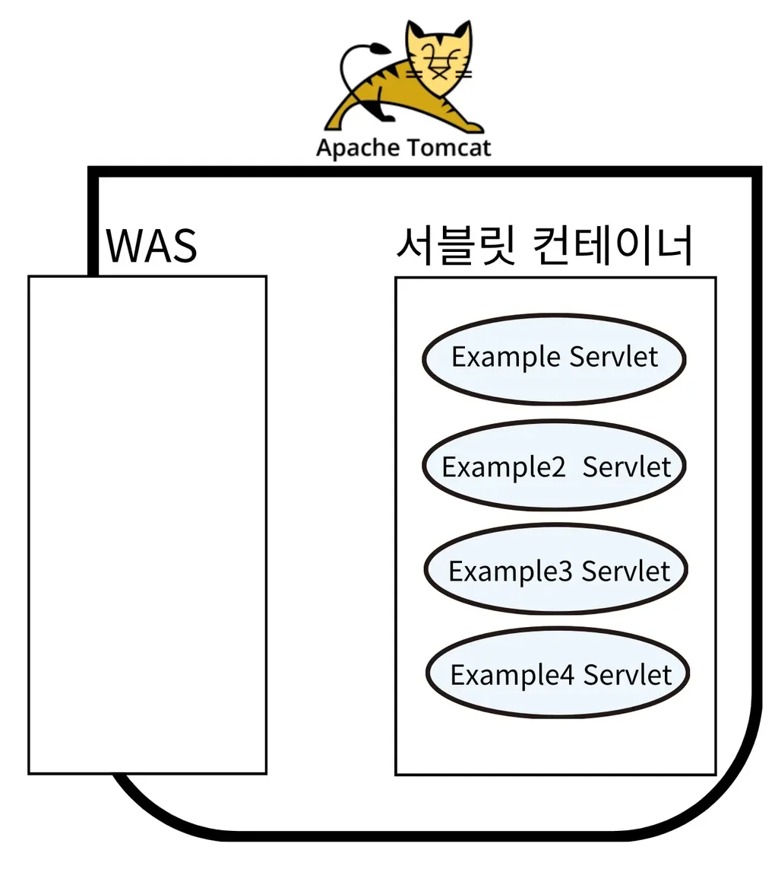

    <details>
    <summary>예시 코드</summary>

    <a id="256eda9b0fe180829570edc66a4883da"></a>

    ```java
    @WebServlet(name="ExampleServlet", urlPatterns = "/example")
    public class ExampleServlet extends HttpServlet { // HttpServlet을 상속받아 구현한다.
    	
    	@Override
    	protected void service(
    		HttpServletRequest request,  // HTTP 요청 정보를 쉽게 사용할 수 있게 만드는 Servlet
    		HttpServletResponse response // HTTP 응답 정보를 쉽게 제공할 수 있게 만드는 Servlet
    	) {
    		// application logic
    	}

    }
    @WebServlet(name="Example2Servlet", urlPatterns = "/example2")
    // 위 예시와 동일한 코드

    @WebServlet(name="Example3Servlet", urlPatterns = "/example3")
    // 위 예시와 동일한 코드

    @WebServlet(name="Example4Servlet", urlPatterns = "/example4")
    // 위 예시와 동일한 코드
    ```

    </details>

- <strong>Servlet Container 책임</strong>
    1. 서블릿 초기화, 생성, 관리, 호출, 종료 등의 역할 수행
        - Servlet 객체를 싱글톤으로 관리

    1. 동시 요청에 대한 처리를 위해 <code>Multi Thread</code> 지원

> 🧐 
> 
> <a id="256eda9b0fe18088bdccd663b71279dc"></a>
> 
> <strong><code>싱글톤</code></strong>
> 
> <a id="256eda9b0fe180cc94a8cff6a5fc1442"></a>
> 
> 싱글톤은 객체를 하나만 생성해  전역으로 인스턴스를 공유하여 사용하는 패턴을 의미한다&#46; 
> 
> <a id="256eda9b0fe1800ea8dcfbb6f4774288"></a>
> 
> 특정 클래스 인스턴스가 여러개 생성되지 않도록 하여 자원의 낭비를 방지하고, 인스턴스를 공유함으써 상태를 일관되게 유지할 수 있다&#46; 
> 
> - <strong>공유 변수 사용 주의 필요</strong>

- Servlet 객체를 <code>싱글톤</code> 으로 관리함
    - 하나의 인스턴스를 공유해서 사용함 

    - 이렇게 하나의 인스턴스를 공유해서 사용(싱글톤)하는 경우,<br> 멀티 쓰레드 환경에서는 공유 변수를 주의해서 써야한다&#46; 

- 동시 요청에 대한 처리를 위해 <code>Multi Thread</code>를 지원함
    - 쓰레드 풀 사용

<details>
<summary>Servlet 객체 생성 시점</summary>

- 서블릿 컨테이너가 알아서 생성해줌 → 가져다가 쓰면됨


</details>

<a id="131eda9b0fe180b8b99acd0319785416"></a>

## Thread

---

<a id="12feda9b0fe18066bcf5dc5e39a5934e"></a>

### Thread

> 📖 
> 
> <a id="256eda9b0fe1806fa9fbf3a276231469"></a>
> 
> 요청을 받고 응답을 반환하기까지 하나의 흐름을 처리하는 일꾼(흐름)
> 
> - Java에서 main method를 실행하면 main이라는 이름을 가진 Thread가 실행되며 하나의 Thread는 한번에 하나의 코드 라인만 수행한다&#46; 만약 동시 처리가 필요하다면 Thread를 추가적으로 생성 해야한다&#46;

- Servlet 객체 호출
    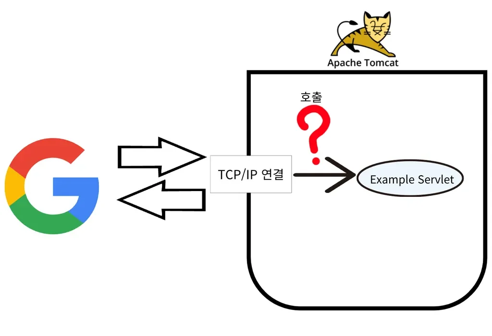

    - 클라이언트에서 Request가 전달되면 Thread가 Servlet 객체를 호출한다&#46; 

<details>
<summary><strong>Case 1) 단일 요청 &#45; Single Thread</strong></summary>

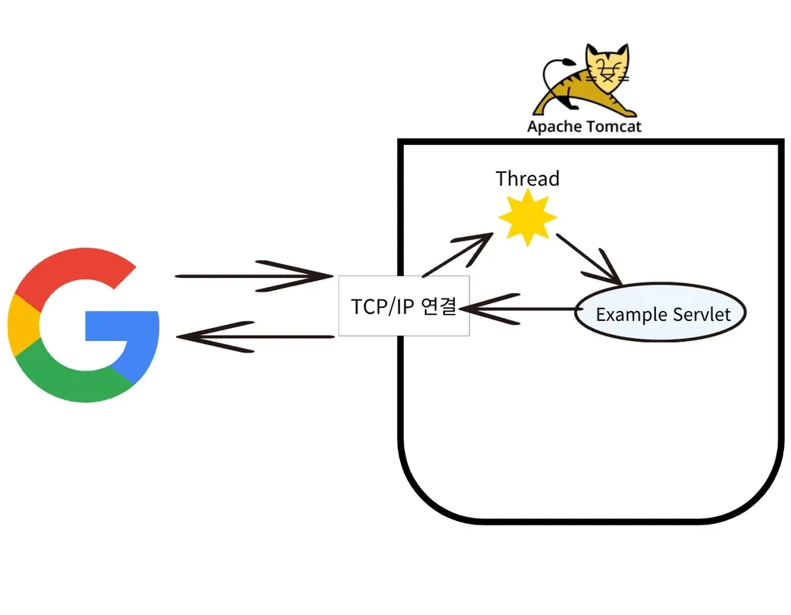

1. 클라이언트 요청 및 TCP/IP 연결

1. Thread 할당 후 Servlet 호출

1. 응답 후 Thread 반환

</details>

<details>
<summary><strong>Case 2) 동시 요청 &#45; Single Thread </strong><strong>&#91; </strong><strong>🤬 </strong><strong>Bad Case &#93;</strong></summary>

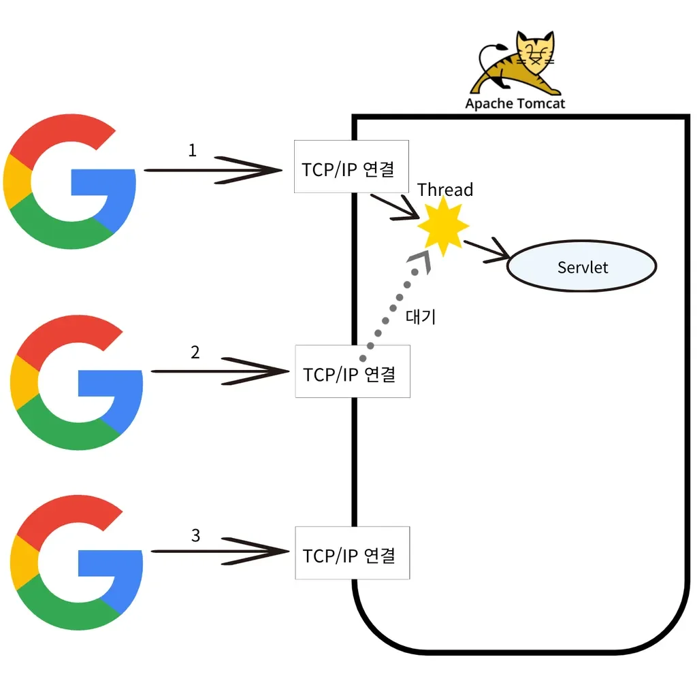

1. 첫번째 요청의 작업을 Single Thread가 수행중이다&#46;

1. 두번째, 세번째 요청이 들어오고 연결을 완료했다&#46;

1. Thread를 사용하기 위해 작업이 끝날때 까지 대기한다&#46;

1. 요청이 모두 사라질 때 까지 (대기 → 작업 수행 → 스레드 반환)작업을 반복한다&#46;

> ❗ 
> 
> <a id="256eda9b0fe1800b8673d5ec7d8d701a"></a>
> 
> 만약, 첫번째 요청의 작업이 지연되거나 Error가 발생된다면 모든 요청에 Time out 오류가 발생된다&#46; 
> 
> 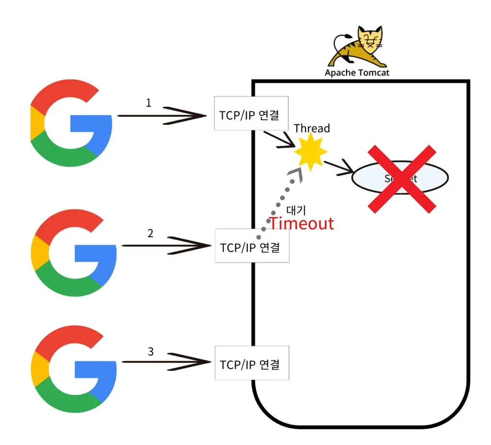

</details>

<a id="256eda9b0fe1808da1a7ca1d3c6d85e9"></a>

### Multi Thread

<details>
<summary><strong>Case 3) 동시 요청 &#45; Multi Thread</strong></summary>

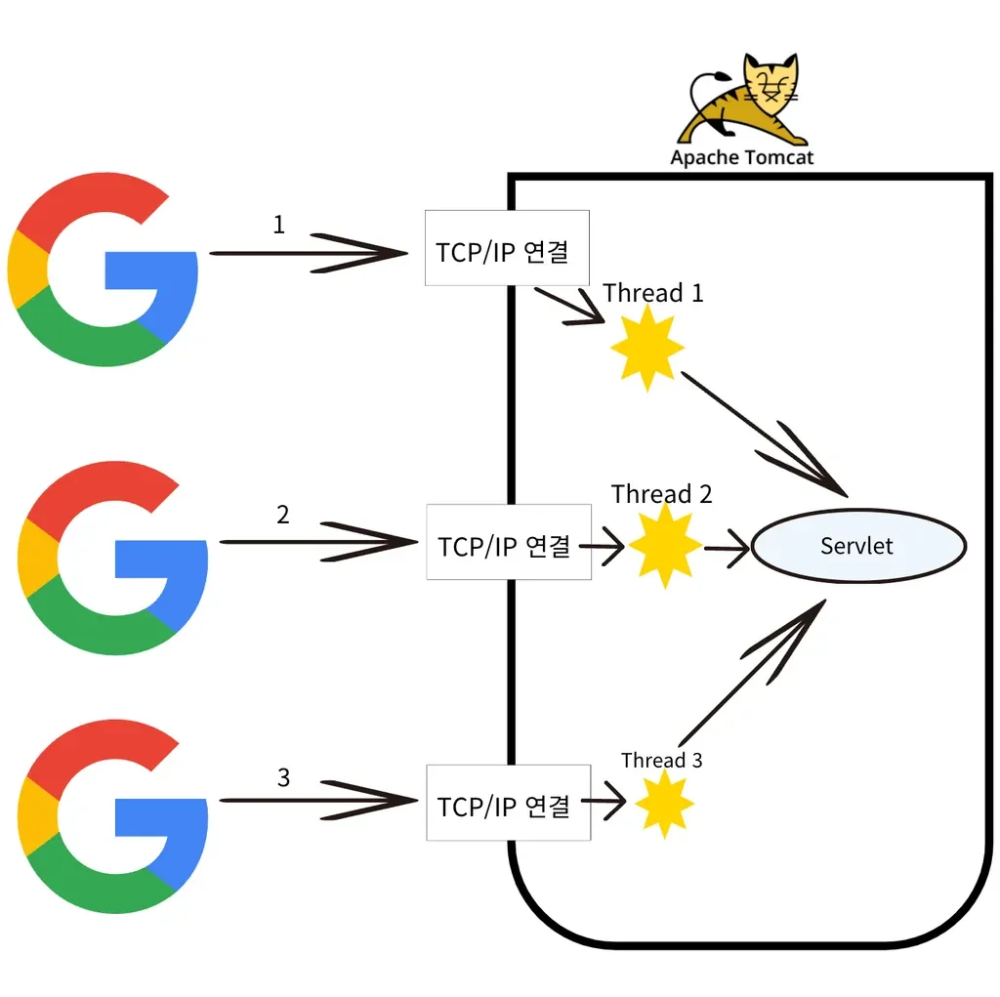

> ✏️ 
> 
> <a id="256eda9b0fe180029b75e901ade696d0"></a>
> 
> 요청이 들어올 때 마다 Thread를 생성한다&#46;<br>요청 처리가 완료되면 Thread를 종료한다&#46;

- 장점
    - 동시 요청을 처리할 수 있다&#46;

    - 하나의 Thread에 지연등의 문제가 발생하여도 나머지 Thread는 정상적으로 동작한다&#46;

- 단점
    - Thread 생성에 제한이 없고 생성 비용이 높다&#46;
        - 수많은 동시 요청이 발생하면 리소스(Memory, CPU 등)부족으로 서버가 다운된다&#46;

    - Thread를 사용하면 <code>Context Switching</code> 비용이 발생한다&#46;

</details>

<details>
<summary><strong>멀티 태스킹 진실</strong>, <code>Context Switching</code></summary>

> ✏️ 
> 
> <a id="256eda9b0fe180478955f662aa32fe5c"></a>
> 
> CPU(프로세서)는 한순간에 하나의 프로세스만 실행할 수 있다&#46; 

- 작업 관리자 ( 현재 실행 중인 프로세스 )
    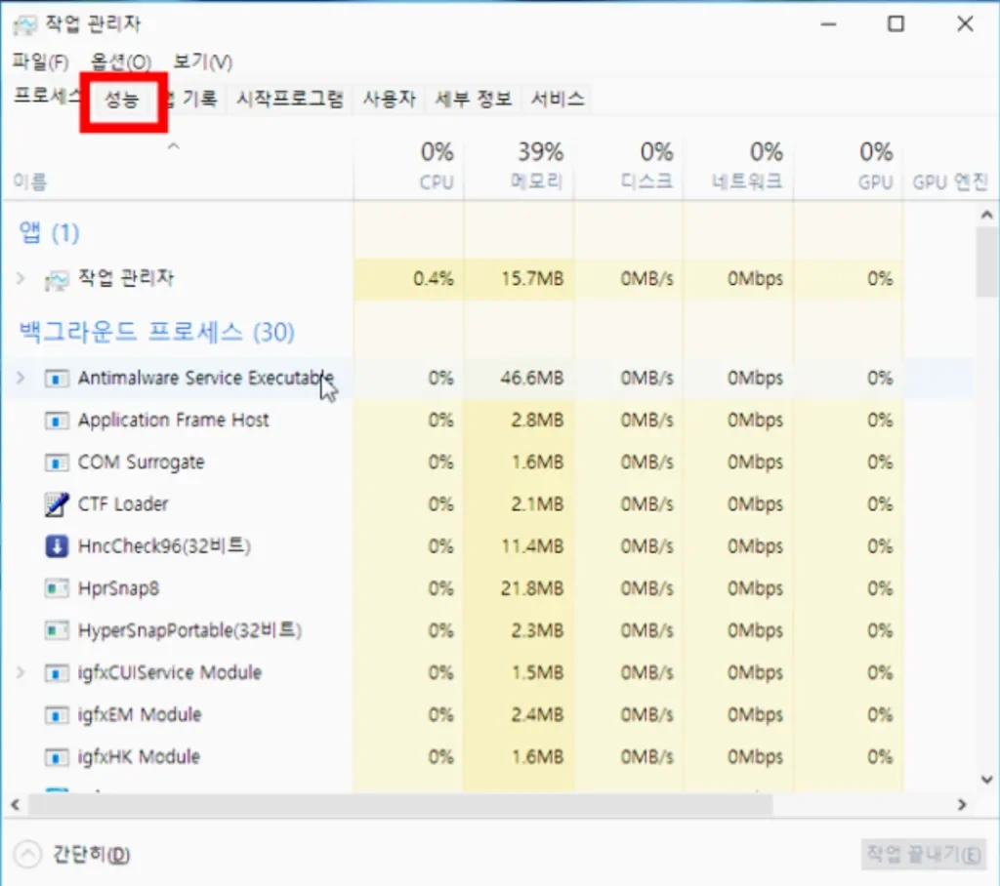

    - 작업 관리자에서 실행 중인 작업들은 모두 동시에 수행하는 것 처럼 보이지만 사실 엄청 짧은 시간에 실행 프로세스를 교체하면서 여러 작업을 수행한다&#46; 

- <strong>Context Switching</strong>
    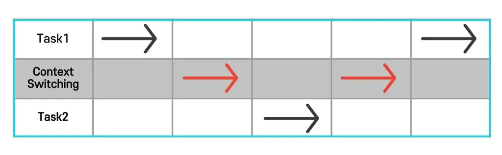

    - Task1에서 Task2로 Task2에서 Task1로 교체되는 시점마다 <strong><u>Task1이 Ready 상태로 돌아간다는 정보</u></strong>, <strong><u>진행정보</u></strong><strong>, </strong><strong><u>Task2가 어디부터 작업을 시작하면 되는지에 대한 정보</u></strong>들을 로딩할 시간이 필요하다&#46;

    - 해당 순간의 시점이 바로 <code>Context Switching</code> 이다&#46;

</details>

<details>
<summary><strong>Thread Pool</strong></summary>

> ✏️ 
> 
> <a id="256eda9b0fe1808ab87ad71f338305bf"></a>
> 
> Thread들을 재사용하여 자원의 효율성을 높인다&#46;

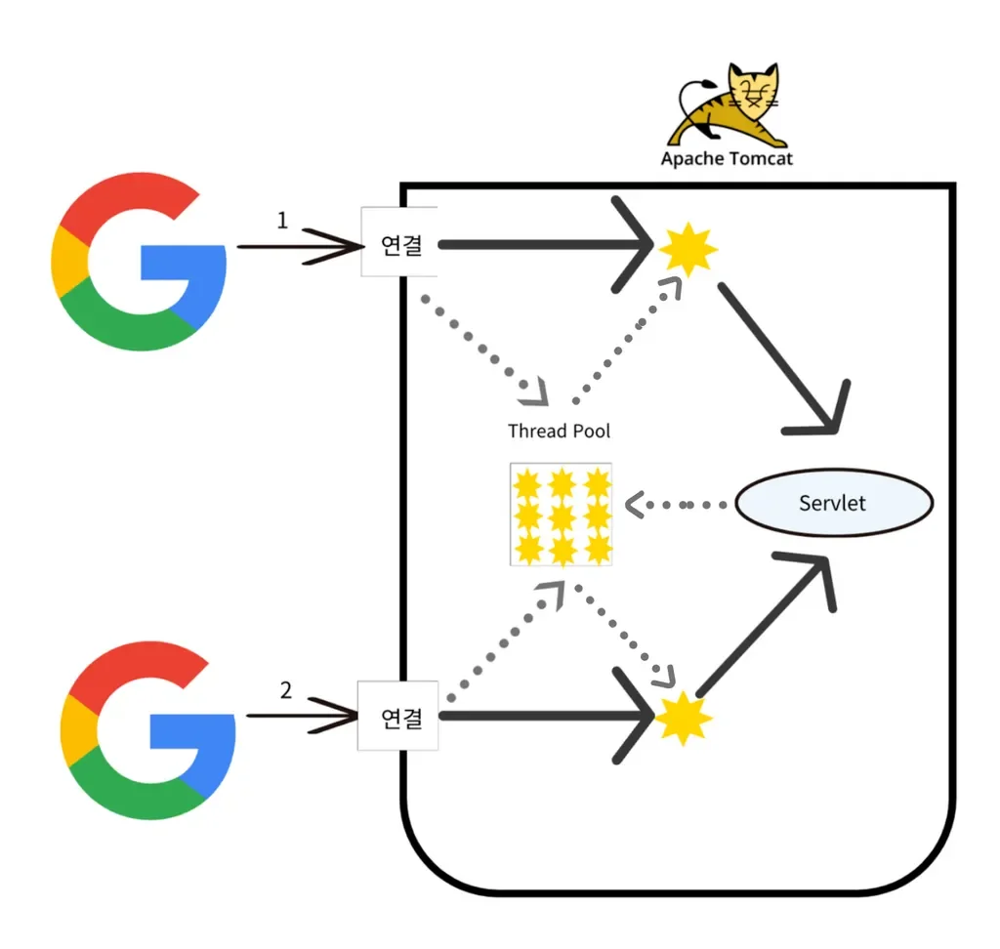

- 요청이 들어오면 Thread Pool에서 Thread를 받아 사용한다&#46;

- 사용 완료된 Thread는 Thread Pool에 반납한다&#46;

> ✏️ 
> 
> <a id="256eda9b0fe180cd88a6cfb47ec57f22"></a>
> 
> 만약 Thead Pool 에 존재하는 Thead가 모두 사용 중이라면, Thead Pool에 Thread가 반납될 동안 대기 상태에 놓인다&#46;

</details>

<a id="131eda9b0fe180d0b7adeb997624dd7d"></a>

## Rendering 방식

---

<a id="12feda9b0fe18001b533f446ec00f92c"></a>

### SSR ( Server Side Rendering )

> 📖 
> 
> <a id="256eda9b0fe1805fb122d6aa7dac831b"></a>
> 
> 서버에서 동적으로 HTML을 만들어 클라이언트에게 제공하는 기술
> 
> - 백엔드 개발자 영역에 속함
> 
> <a id="256eda9b0fe180a89ce0ffb61c02320d"></a>
> 
> Java에서는 <code>JSP</code>, <code>Thymeleaf</code>가 대표적으로 사용된다&#46; 

<details>
<summary>동작 흐름</summary>


1. 서버(WAS)에 HTML을 요청한다&#46; 

1. 서버(WAS)에서 로직을 거친 후 DB를 조회한다&#46; 

1. 조회 결과를 기반으로 HTML을 동적으로 생성한다&#46; 

1. 생성된 HTML을 응답한다&#46; 

</details>

<details>
<summary>장단점</summary>

- 장점
    1. 초기 페이지 로드 시 서버에서 완전히 렌더링된 HTML을 반환하여 첫 페이지 로딩이 빠르다&#46; 

    1. 검색 엔진 크롤러가 완전한 HTML을 즉시 수집할 수 있어 <code>SEO</code>에 유리하다&#46; 
        - ex) 전자상거래 사이트, 뉴스 사이트

- 단점
    1. 모든 요청에 대해 서버가 페이지를 렌더링해야 하므로, 높은 트래픽 상황에서 서버의 부하가 크게 증가할 수 있다&#46; 

    1. 초기 페이지 이외의 페이지들도 렌더링 후 반환되기 때문에 속도가 느리다&#46; 

</details>

<details>
<summary><strong>SEO ( Search Engine Optimization )</strong></summary>

- 검색 엔진에서 상위에 노출될 수 있도록 최적화하는 과정을 말한다&#46; 

</details>

<a id="12feda9b0fe180068937cf070af854e6"></a>

### CSR ( Client Side Rendering )

> 📖 
> 
> <a id="256eda9b0fe18090b684f1f68a73c090"></a>
> 
> 웹 브라우저에서 자바스크립트를 사용해 동적으로 HTML을 생성해 적용하는 기술
> 
> - 웹을 모바일 앱처럼 부분 변경 가능하다&#46; 
> 
> - 프론트 개발자 영역에 속한다&#46; 
> 
> - ex) React, Vue …

<details>
<summary>동작 흐름</summary>

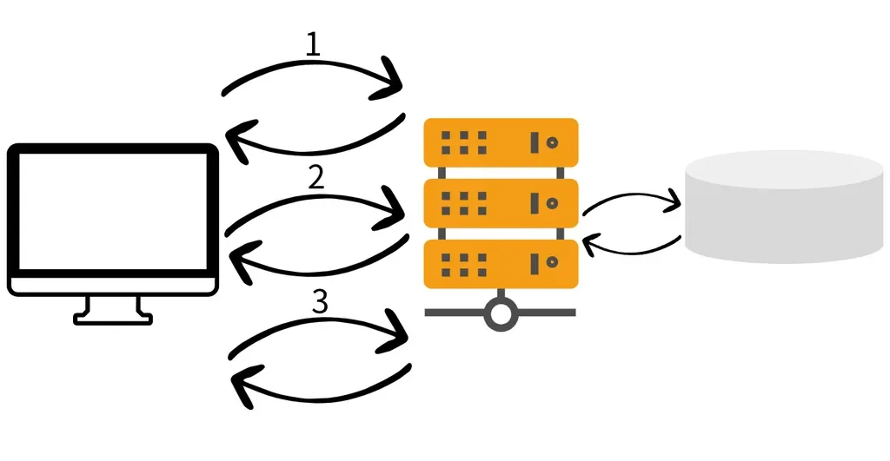

1. HTML 요청 → 비어있는 HTML을 응답받는다&#46; <br>JS가 존재하는 주소 링크를 응답한다&#46; 

1. 자바스크립트(클라이언트 로직, 렌더링 포함)를 요청하낟&#46; 

1. HTTP API 요청을 하고 화면에 필요한 데이터를 JSON 형태(다른 포맷도 가능)로 응답 받는다&#46;
    <a id="256eda9b0fe18089b932fd3efab63256"></a>

    ```java
    {
    		"name": "이경섭",
    		"job": "developer"
    }
    ```

1. 응답받은 JSON 데이터로 HTML을 동적으로 그린다&#46;

</details>

<details>
<summary>CSR 장단점</summary>

- 장점
    1. 클라이언트 측에서 렌더링하므로 사용자 인터렉션(상호작용)에 빠르게 반응할 수 있다&#46; 

    1. 초기 로딩 후에는 서버와 통신없이 빠르게 페이지 간 전환이 가능하다&#46; 

    - ex) Google Map, SNS Application

- 단점
    1. 초기 로딩 시 필요한 모든 자바스크립트 파일을 다운로드하고 실행하므로, 초기 로딩 시간이 길다&#46; 

    1. 검색 엔진 크롤러가 자바스크립트를 제대로 실행하지 못하면 SEO에 불리할 수 있다&#46;

</details>
