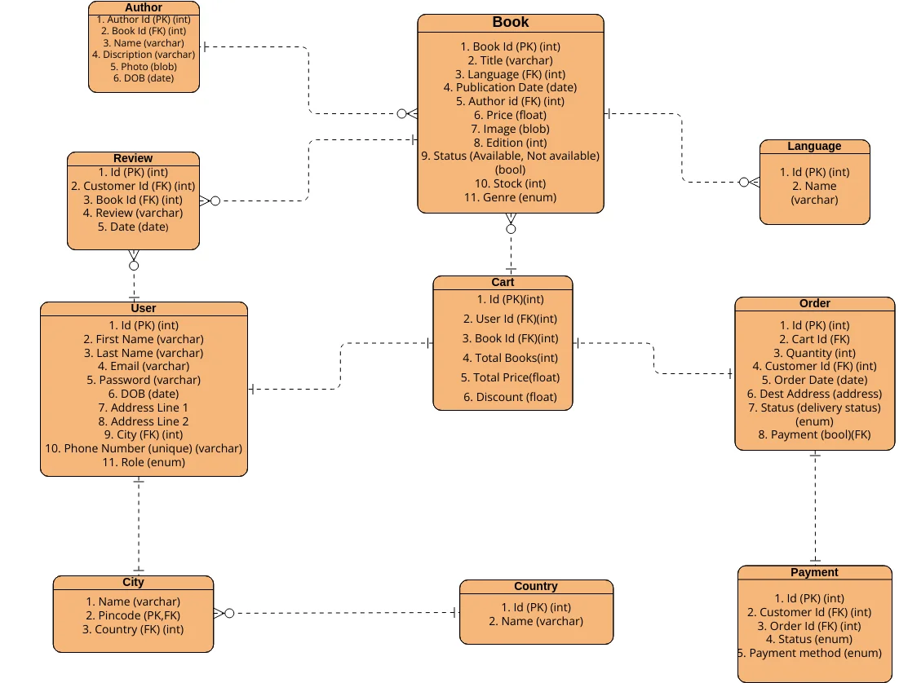
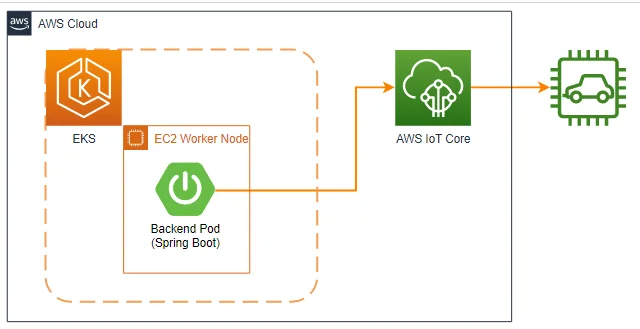
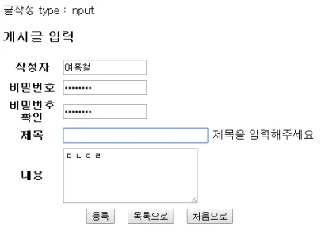
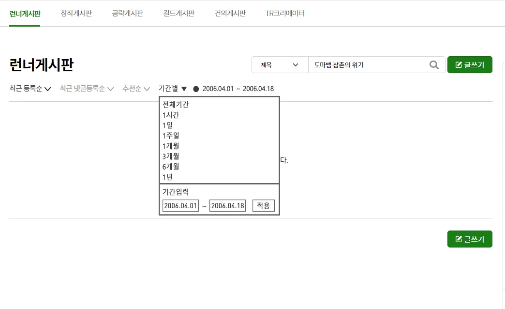

> 📌 
> 
> 
> 
> 내일배움캠프&#95;스프링 7기  &#45; 5 &#126; 6주차 개인 프로젝트
> 
> > 기간&#58; 24년 10월 29일 &#126; 11월 11일
> 
> - <a href="https://beautiful-college-c84.notion.site/4e3394b25ba94bf9a26be7a38454bf3b?pvs=25">팀 노션 페이지 ( 16조 )</a>

### 학습

- TIL, 데일리 스크랩
    

    <a href="#/post/12eeda9b-0fe1-8089-8e2f-c8cad7ad53da">페이지</a> 

    

    <a href="#/post/12feda9b-0fe1-808a-9b7a-c35478fa2a83">페이지</a> 

    

    <a href="#/post/130eda9b-0fe1-802e-8243-fbfbdad9734e">페이지</a> &#45; HTTP 1차 정리 

    

    <a href="#/post/135eda9b-0fe1-80e2-a2c1-d4b879de0f9d">페이지</a> &#45; 스프링 

    

    <a href="#/post/136eda9b-0fe1-80aa-9bcf-c6f7b411087d">페이지</a> &#45; 스프링 

    

    <a href="#/post/137eda9b-0fe1-8040-8295-efce584c770d">페이지</a> &#45; 과제 구현

- 강의
    

    <a href="#/post/12eeda9b-0fe1-8050-a68b-f51dffb05df2">페이지</a> 

- 피드백
    [피드백 정리](#/post/138eda9b-0fe1-8017-91ab-e3adeaa05665)

### 과제 &#45;  스케줄 관리 앱

> ✏️ 
> 
> 
> 
> 발제 &#45; <a href="https://beautiful-college-c84.notion.site/12d2dc3ef51480d89c51f24c0aa61c9d">페이지</a> 
> 
> 

> 
Goal &#58; <strong>제출 일정</strong>

> 
> 

> 
제출 링크

> 
> [내일배움캠프]()
> 
> 

> 
> 

> 
<strong>Lv&#46;0 설계 확인 &#45; </strong>11/01(금) 14&#58;00 까지

> 
> - 제출해야 할 것
>     -  <strong><u>API 명세서 작성하기</u></strong>
>         - API명세서는 프로젝트 root(최상위) 경로의 <code>README&#46;md</code> 에 작성
> 
>         

>         
참고) API 명세서 작성 가이드

> 
>         - API 명세서란 API명, 요청 값(파라미터), 반환 값, 인증/인가 방식, 데이터 및 전달 형식 등 API를 정확하게 호출하고 그 결과를 명확하게 해석하는데 필요한 정보들을 일관된 형식으로 기술한 것을 의미합니다&#46;
> 
>         - request 및 response는 <a href="https://namu.wiki/w/JSON">json(링크)</a> 형태로 작성합니다&#46;
> 
>         [책 등록](#/post/338eda9b-0fe1-81f9-87dc-c6a621a84b3a)
> 
>         [책 조회](#/post/338eda9b-0fe1-81aa-9e37-e003d2d546d9)
> 
>         [책 목록 조회](#/post/338eda9b-0fe1-81c4-ae5f-e02cd10bbdf7)
> 
>         [책 수정](#/post/338eda9b-0fe1-8158-82ef-d761cdd751c3)
> 
>         [책 삭제](#/post/338eda9b-0fe1-810c-96d5-c434da3a832b)
> 
>         > API 명세서 추천 무료 Tool
>         > 
>         > [Document your APIs in Postman &#124; Postman Learning Center]()
> 
>         

> 
>     - <strong><u>ERD 작성하기</u></strong>
>         - [ ] ERD는 프로젝트 root(최상위) 경로의 <code>README&#46;md</code> 에 첨부
> 
>         

>         
참고) ERD 작성 가이드

> 
>         
> 
>         - API 명세 작성을 통해 서비스의 큰 흐름과 기능을 파악 하셨다면 이제는 기능을 구현하기 위해 필요한 데이터가 무엇인지 생각해봐야합니다&#46;
>             - 이때, 구현해야 할 서비스의 영역별로 필요한 데이터를 설계하고 각 영역간의 관계를 표현하는 방법이 있는데 이를 ERD(Entity Relationship Diagram)라 부릅니다&#46;
> 
>         - ERD 작성간에 다음과 같은 항목들을 학습합니다&#46;
>             - E(Entity&#46; 개체)
>                 - 구현 할 서비스의 영역에서 필요로 하는 데이터를 담을 개체를 의미합니다&#46;
>                     - ex) <code>책</code>, <code>저자</code>, <code>독자</code>, <code>리뷰</code> 
> 
>             - A(Attribute&#46; 속성)
>                 - 각 개체가 가지는 속성을 의미합니다&#46;
>                     - ex) 책은 <code>제목</code>, <code>언어</code>, <code>출판일</code>, <code>저자</code>, <code>가격</code> 등의 속성을 가질 수 있습니다&#46;
> 
>             - R(Relationship&#46; 관계)
>                 - 개체들 사이의 관계를 정의합니다&#46;
>                     - ex) <code>저자</code>는 여러 권의 <code>책</code>을 집필할 수 있습니다&#46; 이때, 저자와 책의 관계는 일대다(1&#58;N) 관계입니다&#46;
> 
>         > ERD 추천 무료 Tool
>         > 
>         > [ERDCloud]()
> 
>         > ERD 추천 영상
>         > 
>         > [video](https://www.youtube.com/watch?v=jsOPr3QfMW0)
> 
>         

> 
>     - <strong><u>SQL 작성하기</u></strong>
> 
> 

> 
> 

> 
<strong>최종 제출 &#45; </strong>11/08(금) 14&#58;00 까지

> 
> - 제출해야 할 것
>     1. 과제
>         1. Github 링크 (Public)
> 
>         1. 트러블슈팅을 작성한 TIL
> 
>         1. 어디까지 구현했는지
> 
>         1. 어떤 부분을 고민했는지, 어려웠던 부분은 어디였는지
>             1. 해당 부분을 작성하시면 피드백 간, 튜터님께서 확인 후 피드백 해주실 예정입니다&#46;
> 
> 

> 
> 

> 
> 

> 
트러블 슈팅하는 법 

> 
> - 대기업의 트러블 슈팅 예시를 잠시 살펴보면서  어떤 형식으로 트러블 슈팅을 작성하면 좋을지 알아봅시다&#46;
> 
> - <strong><a href="https://www.lgcns.com/blog/cns-tech/aws-ambassador/40847/">LG CNS</a></strong><a href="https://www.lgcns.com/blog/cns-tech/aws-ambassador/40847/"> &#45; </a><strong><a href="https://www.lgcns.com/blog/cns-tech/aws-ambassador/40847/">AWS IoT Core Endpoint 신뢰하지 않는 인증서 오류 트러블슈팅</a></strong>
> 
> - 요약
>     - LG와 같은 대기업에서도 에러 발생 시 엄청난 테스트와 웹서치로 에러를 해결하는 것을 알 수 있습니다&#46;
> 
>     - 트러블 슈팅 형식은 아래와 같은 형식으로 진행된다는 것을 확인할 수 있습니다&#46;
>         - 개요
> 
>         - 트러블 슈팅
>             - 배경 &#58; 어떤 현상을 발견해서
> 
>             - 발단 &#58; 이런 장애가 생길 수 있다는 것을 인지했고,
> 
>             - 전개 &#58; 장애를 대응, 해결하던 와중에
> 
>             - 위기 &#58; 또 다른 장애 발견 또는 간단하게 해결할 수 없다는 것을 알게되어서,
> 
>             - 절정 &#58; 근본적인 해결을 위해 이런 방법으로 접근하였다&#46;
> 
>             - 결말 &#58; 따라서, 이런이런 방법을 통해 근본적으로 해결 및 앞으로 유지, 보수에 용이하게 개선하게 되었다&#46;
> 
>         

>         
예시

> 
>         - 배경 &#58; 개발 환경은 Spring boot로 개발된 Backend Pod가 EKS on EC2로 기동 중이었으며, Backend에서 IoT Core를 통해 IoT Device에 Rule을 내리는 기능이 개발 중이었습니다&#46;
>             
> 
>         - 발단 &#58; 이때 다음과 같은 에러가 발생합니다&#46; Backend에서 IoT Core로 API 통신을 위해 Endpoint로 연결을 시도 중, SSL&#58; CERTIFAICATE VERIFY FAILED 가 발생한 것입니다&#46;
> 
>         - 전개 &#58; 해당 엔드포인드에 접근해 보니 다음 그림과 같이 신뢰하지 않는 인증서였습니다&#46; 확인해 보니 구글 크롬, 사파리 등에서 더 이상 Symantec에서 발급한 인증서를 신뢰하지 않고 있었습니다&#46;
> 
>         - 위기 &#58; 이에 해당 인증서를 별도로 받아 keystore를 통해 신뢰하는 인증서에 추가해 보았으나,여전히 인증서 오류가 발생하였습니다&#46;
> 
>         - 절정 &#58; 여러 테스트 및 웹 서핑을 통해 원인을 찾아낼 수 있었습니다&#46; keystore로 인증서를 추가하더라도 2019년 4월 JDK(버전 12, 11, 8 및 7) 패치 이후로 Symantec 인증서를 신뢰하지 않도록 변경 되었던 것이었습니다&#46; 이를 Hedge 할 방법으론, java&#46;secure 파일에서 ‘jdk&#46;security&#46;caDistrustPolicies=SYMANTEC&#95;TLS’ 옵션을 제거(주석) 하는 것입니다&#46;
> 
>         - 결말 &#58; 하지만 위의 방법은 굳이 보안에 문제가 있어서 막은 것을 풀고 쓴다는 것이 찝찝했습니다&#46; 그리고 AWS는 Symantec 인증서 비신뢰 이슈가 발생하고 있는데 아무 조치도 하지 않고 있었을까? 하는 의문이 들었고, 역시 다른 경로(엔드포인트)가 존재했습니다&#46; AWS IoT Core의 서비스 엔드포인트는 원래 https&#58;//{account&#45;specific&#45;prefix}&#46;iot&#46;{region}&#46;amazonaws&#46;com 으로 Symantec 인증서를 사용하였으나, 위와 같이 많은 기업에서 신뢰하지 않게 되면서 새로운 서비스 엔드포인트https&#58;//{account&#45;specific&#45;prefix}&#45;ats&#46;iot&#46;{region}&#46;amazonaws&#46;com 을 생성하였고 이쪽을 사용하도록 권고하고 있었습니다&#46; 하지만 AWS CLI 명령어와 SDK의 Default는 여전히 Symantec 인증서가 사용되는 엔드포인트여서 발생한 문제였습니다&#46; 이에 Backend에서 사용하는 IoT Core 엔드포인트를 ATS로 변경하였고 모든 문제를 해결할 수 있었습니다&#46;
> 
>         

> 
> 

요구사항

> <strong>필수 기능 가이드</strong>

### Lv 0&#46; API 명세 및 ERD, SQL 작성   <code>필수</code>

- [x] <strong><u>API 명세서 작성하기</u></strong>
    - [x] API명세서는 프로젝트 root(최상위) 경로의 <code>README&#46;md</code> 에 작성

    

    
참고) API 명세서 작성 가이드

    - API 명세서란 API명, 요청 값(파라미터), 반환 값, 인증/인가 방식, 데이터 및 전달 형식 등 API를 정확하게 호출하고 그 결과를 명확하게 해석하는데 필요한 정보들을 일관된 형식으로 기술한 것을 의미합니다&#46;

    - request 및 response는 <a href="https://namu.wiki/w/JSON">json(링크)</a> 형태로 작성합니다&#46;

    [책 등록](#/post/12eeda9b-0fe1-8112-b6e5-fce523448f03)

    [책 조회](#/post/12eeda9b-0fe1-81da-9d04-c355af1c5c18)

    [책 목록 조회](#/post/12eeda9b-0fe1-8176-9d54-f996fa9615bf)

    [책 수정](#/post/12eeda9b-0fe1-8127-b3cb-fb4eec9c3206)

    [책 삭제](#/post/12eeda9b-0fe1-81f7-a9de-e774cc3afdcd)

    > API 명세서 추천 무료 Tool
    > 
    > [Document your APIs in Postman &#124; Postman Learning Center]()

    

- [x] <strong><u>ERD 작성하기</u></strong>
    - [x] ERD는 프로젝트 root(최상위) 경로의 <code>README&#46;md</code> 에 첨부

    

    
참고) ERD 작성 가이드

    

    - API 명세 작성을 통해 서비스의 큰 흐름과 기능을 파악 하셨다면 이제는 기능을 구현하기 위해 필요한 데이터가 무엇인지 생각해봐야합니다&#46;
        - 이때, 구현해야 할 서비스의 영역별로 필요한 데이터를 설계하고 각 영역간의 관계를 표현하는 방법이 있는데 이를 ERD(Entity Relationship Diagram)라 부릅니다&#46;

    - ERD 작성간에 다음과 같은 항목들을 학습합니다&#46;
        - E(Entity&#46; 개체)
            - 구현 할 서비스의 영역에서 필요로 하는 데이터를 담을 개체를 의미합니다&#46;
                - ex) <code>책</code>, <code>저자</code>, <code>독자</code>, <code>리뷰</code> 

        - A(Attribute&#46; 속성)
            - 각 개체가 가지는 속성을 의미합니다&#46;
                - ex) 책은 <code>제목</code>, <code>언어</code>, <code>출판일</code>, <code>저자</code>, <code>가격</code> 등의 속성을 가질 수 있습니다&#46;

        - R(Relationship&#46; 관계)
            - 개체들 사이의 관계를 정의합니다&#46;
                - ex) <code>저자</code>는 여러 권의 <code>책</code>을 집필할 수 있습니다&#46; 이때, 저자와 책의 관계는 일대다(1&#58;N) 관계입니다&#46;

    > ERD 추천 무료 Tool
    > 
    > [ERDCloud]()

    > ERD 추천 영상
    > 
    > [video](https://www.youtube.com/watch?v=jsOPr3QfMW0)

    

- [x] <strong><u>SQL 작성하기</u></strong>
    - [x] 설치한 데이터베이스(Mysql)에 ERD를 따라 테이블을 생성

    - [x] 필수 기능 가이드 개발에 필요한 테이블을 생성하는 query를 작성
        - [x] <code>Create</code>

    - [x] 일정 생성을 하는 query를 작성
        - [x] <code>Insert</code> 

    - [x] 전체 일정을 조회하는 query를 작성
        - [x] <code>Select</code> 

    - [x] 선택 일정을 조회하는 query를 작성
        - [x] <code>Select</code>

    - [x] 선택한 일정을 수정하는 query를 작성
        - [x]  <code>Update</code>

    - [x] 선택한 일정을 삭제하는 query를 작성
        - [x] <code>Delete</code>

    

    
참고) SQL 작성 가이드

    - 과제 프로그램의 root(최상위) 경로에<code>schedule&#46;sql</code> 파일을 만들고 query를 작성하세요&#46;

    

### Lv 1&#46; 일정 생성 및 조회  <code>필수</code>

- [x] <strong><u>일정 생성(일정 작성하기)</u></strong>
    - [x] 일정 생성 시, 포함되어야할 데이터
        - [x] <code>할일</code>, <code>작성자명</code>, <code>비밀번호</code>, <code>작성/수정일</code>을 저장

        - [x] <code>작성/수정일</code>은 날짜와 시간을 모두 포함한 형태

    - [x] 각 일정의 고유 식별자(ID)를 자동으로 생성하여 관리

    - [x] 최초 입력 시, 수정일은 작성일과 동일

    

    
<strong>※ 절대 프론트 만들지 마세요&#46; ※  &#91; View를 생각해보자면…&#33; &#93;</strong>

    

    

- [x] <strong><u>전체 일정 조회(등록된 일정 불러오기)</u></strong>
    - [x] 다음 조건을 바탕으로 등록된 일정 목록을 전부 조회
        - [x] <code>수정일</code> (형식 &#58; YYYY&#45;MM&#45;DD)

        - [ ] <code>작성자명</code>

    - [x] <code>수정일</code> 기준 내림차순으로 정렬하여 조회

    

    
<strong>※ 절대 프론트 만들지 마세요&#46; ※  &#91; View를 생각해보자면…&#33; &#93;</strong>

    

    

- [x] <strong><u>선택 일정 조회(선택한 일정 정보 불러오기)</u></strong>
    - [x] 선택한 일정 단건의 정보를 조회할 수 있습니다&#46;

    - [x] 일정의 고유 식별자(ID)를 사용하여 조회합니다&#46;

### v 2&#46; 일정 수정 및 삭제  <code>필수</code>

- [x] <strong><u>선택한 일정 수정</u></strong>
    - [x] 선택한 일정 내용 중 <code>할일</code>, <code>작성자명</code> 만 수정 가능
        - [x] 서버에 일정 수정을 요청할 때 <code>비밀번호</code>를 함께 전달합니다&#46;

        - [x] <code>작성일</code> 은 변경할 수 없으며, <code>수정일</code> 은 수정 완료 시, 수정한 시점으로 변경합니다&#46;

- [x] <strong><u>선택한 일정 삭제</u></strong>
    - [x] 선택한 일정을 삭제할 수 있습니다&#46;
        - [x] 서버에 일정 수정을 요청할 때 <code>비밀번호</code>를 함께 전달합니다&#46;

> 도전 기능 가이드

### Lv 3&#46; 연관 관계 설정  <code>도전</code>

- [ ] <strong><u>작성자와 일정의 연결</u></strong>
    - [ ] 설명
        - [ ] 동명이인의 작성자가 있어 어떤 작성자가 등록한 ‘할 일’인지 구별할 수 없음

        - [ ] 작성자를 식별하기 위해 이름으로만 관리하던 작성자에게 고유 식별자를 부여합니다&#46;

        - [ ] 작성자 테이블을 생성하고 일정 테이블에 FK를 생성해 연관관계를 설정해 봅니다&#46;

    - [ ] 조건
        - [ ] 작성자는 <code>이름</code> 외에 <code>이메일</code>, <code>등록일</code>, <code>수정일</code> 정보를 가지고 있습니다&#46;
            - [ ] 작성자의 정보는 추가로 받을 수 있습니다&#46;(조건만 만족한다면 다른 데이터 추가 가능)

        - [ ] 고유 식별자를 통해 작성자를 조회할 수 있도록 기존 코드를 변경합니다&#46;

        - [ ] 작성자의 고유 식별자가 일정 테이블의 외래키가 될 수 있도록 합니다&#46;

### Lv 4&#46; 페이지네이션  <code>도전</code>

- [ ] 설명
    - [ ] 많은 양의 데이터를 효율적으로 표시하기 위해 데이터를 여러 페이지로 나눕니다&#46; 
        - [ ] <code>페이지 번호</code>와 <code>페이지 크기</code>를 쿼리 파라미터로 전달하여 요청하는 항목을 나타냅니다&#46;

        - [ ] 전달받은 페이지 번호와 크기를 기준으로 쿼리를 작성하여 필요한 데이터만을 조회하고 반환

- [ ] 조건
    - [ ] 등록된 일정 목록을 <code>페이지 번호</code>와 <code>크기</code>를 기준으로 모두 조회

    - [ ] 조회한 일정 목록에는 <code>작성자 이름</code>이 포함

    - [ ] 범위를 넘어선 페이지를 요청하는 경우 빈 배열을 반환

    - [ ] Paging 객체를 활용할 수 있음

### Lv 5&#46; 예외 처리  <code>도전</code>

- [x] 설명
    - [x] 예외 상황에 대한 처리를 위해 <a href="https://developer.mozilla.org/ko/docs/Web/HTTP/Status"><code>HTTP 상태 코드(링크)</code></a>와 <code>에러 메시지</code>를 포함한 정보를 사용하여 예외를 관리할 수 있습니다&#46;
        - [x] 필요에 따라 사용자 정의 예외 클래스를 생성하여 예외 처리를 수행할 수 있습니다&#46;

        - [ ] <code>&#64;ExceptionHandler</code>를 활용하여 공통 예외 처리를 구현할 수도 있습니다&#46;

        - [x] 예외가 발생할 경우 적절한 HTTP 상태 코드와 함께 사용자에게 메시지를 전달하여 상황을 관리합니다&#46;

- [ ] 조건
    - [x] 수정, 삭제 시 요청할 때 보내는 <code>비밀번호</code>가 일치하지 않을 때 예외가 발생합니다&#46;

    - [x] 선택한 일정 정보를 조회할 수 없을 때 예외가 발생합니다&#46;
        - [ ] 잘못된 정보로 조회하려고 할 때 

        - [ ] 이미 삭제된 정보를 조회하려고 할 때

### Lv 6&#46; null 체크 및 특정 패턴에 대한 검증 수행  <code>도전</code>

- [ ] 설명
    - [ ] 유효성 검사
        - [ ] 잘못된 입력이나 요청을 미리 방지할 수 있습니다&#46;

        - [ ] 데이터의 <code>무결성을 보장</code>하고 애플리케이션의 예측 가능성을 높여줍니다&#46;

        - [ ] Spring에서 제공하는 <code>&#64;Valid</code> 어노테이션을 이용할 수 있습니다&#46;

- [ ] 조건
    - [ ] <code>할일</code>은 최대 200자 이내로 제한, 필수값 처리

    - [ ] <code>비밀번호</code>는 필수값 처리

    - [ ] 작성자의 <code>이메일</code> 정보가 형식에 맞는지 확인 

코드 

[Scheduler](https://github.com/gyungsubLee/Calendars)

[Lv.0  - API 명세 및 ERD, SQL 작성](#/post/12feda9b-0fe1-8059-bd6a-edba75fbdd5c)
