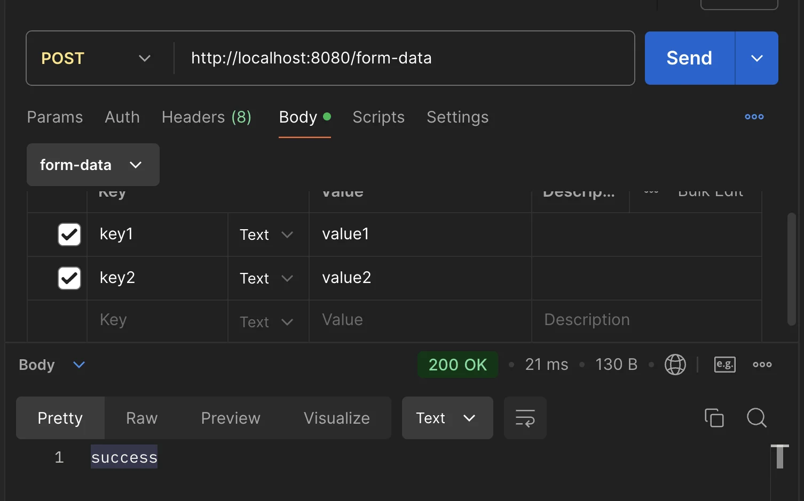
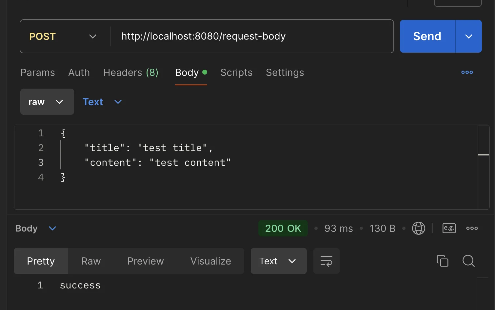

> ✏️ 
> 
> <a id="b7e84dbf92b84b39ab1295ce444308de"></a>
> 
> ### Client에서 Server로 Data를 전달하는 방법

> ☝🏻 
> 
> <a id="df1843635df74dcca58c62eeb20511d4"></a>
> 
> <strong><code>Query Parameter</code></strong><strong> </strong>와 <strong><code>HTML Form Data</code></strong><strong>는 </strong><strong><u>동일한</u></strong><u> 데이터 형식 (</u><u><code>key=value</code></u><u>)</u> 가지고 있다&#46; 
> 
> <a id="135eda9b0fe18000ba3cd183b0b3f1dd"></a>
> 
>    ⇒  value 접근&#58; <code>HttpServletRequest&#46;getParameter(”key”);</code>

<a id="135eda9b0fe180748356d81fa8a81f4d"></a>

### 1&#46;  <code>GET</code> &#43; <code>Query Parameter</code>(<code>Query String</code>)

<details>
<summary><strong>1&#46; 요청 URL&#58; </strong><strong> </strong><strong><u>쿼리 파라미터</u></strong></summary>

<a id="135eda9b0fe18094b81cd51f6f4f349e"></a>

```plaintext
http://localhost:8080/request-params?key1=value1&key2=value2
```

- <strong><code>?</code></strong>&#58; 시작

- <strong><code>&#38;</code></strong>&#58; and 

- 데이터 형태&#58;<strong><code>key</code></strong><strong><code>=</code></strong><strong><code>value</code></strong>

</details>

<details>
<summary>2&#46; 요청 및 응답 메세지 처리하기 </summary>

- 메핑되는 메서드에서 인자로 받아오는 <code>HttpServletRequest</code>를 통해 간단하게 <u>요청 메서지를 파싱</u> 할 수 있다&#46; 
    - <code>HttpServletRequest&#46;getParameter(key)</code>

- 또한 <code>HttpServletResponse</code>를 통해 <u>응답 메세지의 설정을 간편</u>하게 할 수 있다&#46; 
    - <code>response&#46;getWriter()&#46;write( {값} )</code>
        - 응답 메세지 <u>Body</u> 에 <u>값 입력</u>

---

<details>
<summary>&#91; 코드 &#93; RequestParamController &#45; <code>getParams()</code></summary>

<a id="135eda9b0fe180a3afede94e5ecefb21"></a>

```java
@Slf4j
@Controller
public class RequestParamController {

		@GetMapping("/request-params")
    public void getParams(
						            HttpServletRequest request,
												HttpServletResponse response
											 ) throws IOException {
															 
        String key1Value = request.getParameter("key1");
				String key2Value = request.getParameter("key2");
				
				log.info("key1Value={}, key2Value={}", key1Value, key2Value);
        response.getWriter().write("success");
    }
}
```

</details>

</details>

<a id="135eda9b0fe180078728d4654b0e380b"></a>

### 2&#46; <code>POST</code> &#43; <code>HTML Form</code> ( <code>x&#45;www&#45;form&#45;urlencoded</code> )

> HTTP Request Body ( <u>쿼리 파라미터 형식</u> )로 서버에 데이터 전달

<details>
<summary>1&#46; HTTP 요청 메세지 </summary>

- HTML Form을 통해 사용자에게 데이터를 받아옴
    - <strong>content&#45;type</strong>&#58; <code>application/x&#45;www&#45;form&#45;urlencoded</code>

<a id="135eda9b0fe180ed9bdbc4398ec8377f"></a>

```java
POST /form-data
content-type: application/x-www-form-urlencoded

key1=value1&key2=value2  // Body, 쿼리 파라미터 형식
```

</details>

<details>
<summary>2&#46; 요청 및 응답 메서지 처리</summary>

- 위와 동일하게 <code>HttpServletRequest&#46;getPameter(key)</code>를 통해 전달 받은 값을 받아올 수 있다&#46; 

- 응답도 동일하게 <code>HttpServletResponce</code>를 통해 쉽게 설정 가능하다&#46;

---

<details>
<summary>&#91; 코드 &#93; RequestParamController &#45; <code>requestBody()</code></summary>

<a id="135eda9b0fe180418408d720c9d30110"></a>

```java
@Slf4j
@Controller
public class RequestParamController {

		   . . .

    @PostMapping("/form-data")
    public void requestBody(
            HttpServletRequest request,
            HttpServletResponse response
    ) throws IOException {

        String key1Value = request.getParameter("key1");
        String key2Value = request.getParameter("key2");

        log.info("key1Value={}, key2Value={}", key1Value, key2Value);
        response.getWriter().write("success");
    }
}
```

<details>
<summary>postman 테스트 </summary>



</details>

</details>

</details>

<a id="135eda9b0fe18072b0efe0953c9f7668"></a>

### 3&#46; HTTP Request Body

> ☝🏻 
> 
> <a id="447e8fdedc84468aa11848f4c9b543ee"></a>
> 
> JSON을 Java 객체로 변환하려면 Jackson 과 같은 라이브러리를 사용해야 한다&#46; <br>Spring Boot는 기본적으로 Jackson 라이브러리의 ObjectMapper를 제공하며, <br>starter&#45;web에 포함되어 있다&#46;

- 데이터(JSON, Text, XML …)를 직접 HTTP Message Body에 담아 전달

- 주로 <code>&#64;RestController</code>에서 사용하며, <u>대부분 JSON 형식</u>으로 데이터를 전달한다&#46; 
    - <code>POST</code>,<code> PUT</code>, <code>PATCH</code> method에서 사용

    - <code>GET</code>, <code>DELETE</code> 사용 ❌ → <code>Path Variable</code>

---

<details>
<summary>&#91;  코드 &#93; Board</summary>

<a id="135eda9b0fe180afa9a3fb88a500a7d6"></a>

```java
@Getter
@Setter
public class Board {

	private String title;
	private String content;

```

</details>

<details>
<summary>&#91;  코드 &#93; RequestBodyController</summary>

<details>
<summary>🧐 UTF&#45;8 </summary>

- 유니코드 문자 인코딩 방식 중 하나로, 대부분의 웹 및 애플리케이션에서 가장 널리 사용되는 문자 인코딩 방식이다&#46;

-  UTF&#45;8은 모든 유니코드 문자를 표현할 수 있으며, 특히 <strong>다양한 언어와 특수 문자를 혼합해 사용할 때도 문제없이 표현</strong>할 수 있는 강력한 장점이 있다&#46;

- 특징
    <details>
    <summary><strong>가변 길이 인코딩 방식</strong></summary>

    - 각 문자를 <strong>1바이트에서 최대 4바이트까지 가변 길이로 표현</strong>

    - ex) 
        -  ASCII 문자(영문 대소문자, 숫자 등) →  <code>1바이트</code>

        - 한글이나 중국어와 같은 다중 바이트 문자들 → <code>2&#126;3바이트</code>

    </details>

    <details>
    <summary><strong>호환성</strong></summary>

    - ASCII와 호환
        <a id="135eda9b0fe1808e9639cc783240ad3e"></a>

        → 기존 ASCII 기반 시스템에서도 잘 동작함

    -  모든 ASCII 문자는 UTF&#45;8에서도 동일한 값으로 표현됨

    </details>

    <details>
    <summary><strong>전 세계 언어 지원</strong></summary>

    - 전 세계 모든 언어의 문자를 표현 가능
        <a id="135eda9b0fe18087bd80f6341501c383"></a>

        → 다국어 웹사이트와 애플리케이션 개발에 적합함

    </details>

    <details>
    <summary>주요 사용 사례</summary>

    - 웹
        - 대부분의 웹 페이지, 웹 서버에서 기본적으로 UTF&#45;8 인코딩을 사용함

    - 데이터베이스
        - 다국어 데이터를 지원해야 하는 데이터베이스에서 기본 인코딩으로 사용됨

    - 파일 저장 및 통신 
        - JSON, XML, HTML 같은 파일 형식에 표준으로 사용험

    </details>

- UTF&#45;8 예시
    <a id="135eda9b0fe18079a4dac042f84b5306"></a>

    ```plaintext
    •	문자 'A': 1바이트로 표현 (0x41)
    •	문자 '한': 3바이트로 표현 (0xED 0x95 0x9C)
    •	이모지 😊: 4바이트로 표현 (0xF0 0x9F 0x98 0x8A)
    ```

</details>

- HttpServletRequest<code>&#46;getInputStream()</code>

- StreamUtils<code>&#46;copyToString</code> ( 받아온 스트림 데이터, 변환할 형식 )
    - 입력 받은 스트림을 지정된 문자 인코딩 형식으로 String 데이터로 변환함
        - <code>request&#46;getInputStream()</code>&#58; 요청 메세지 바디에 담긴 스트림 값 가져옴

        - <code> StandardCharsets&#46;UTF&#95;8</code>&#58; 변환할 포멧으로 UTF&#45;8  명시

- <code>objectMapper&#46;readValue()</code>&#58;  JSON  → 자바 객체 ( Entity )

<a id="0eace88f06f7433e8bb537e5b378b230"></a>

```java
@Slf4j
@RestController
public class RequestBodyController {

    private ObjectMapper objectMapper = new ObjectMapper();

    @PostMapping("/request-body")
    public void requestBody (
                HttpServletRequest request,
                HttpServletResponse response
            ) throws IOException {

        ServletInputStream inputStream = request.getInputStream();
        String messageBody = StreamUtils.copyToString(inputStream, StandardCharsets.UTF_8);

        log.info("mesageBody={}", messageBody);

        Board board = objectMapper.readValue(messageBody, Board.class);

        log.info("board.getTitle={}, board.getContent()={}", board.getTitle(), board.getContent());

        response.getWriter().write("success");
    }
}
```

</details>

<details>
<summary>postman 테스트</summary>



</details>
