<a id="135eda9b0fe180009954ced83e2efa16"></a>

## Server에서 Client로 Data 전달하는 방법

> 📖 
> 
> <a id="135eda9b0fe180e18483c564863e50f0"></a>
> 
> Server에서 Client로 Data를 전달하는 방법은 <strong><u>정적 리소스</u></strong>, <strong><u>View Template</u></strong>, <strong><u>HTTP Message Body</u></strong> 세가지 방법이 있다&#46;

<details>
<summary>정적 리소스</summary>

- 변하지 않는 HTML, CSS, JS, Image 등 그대로 반환

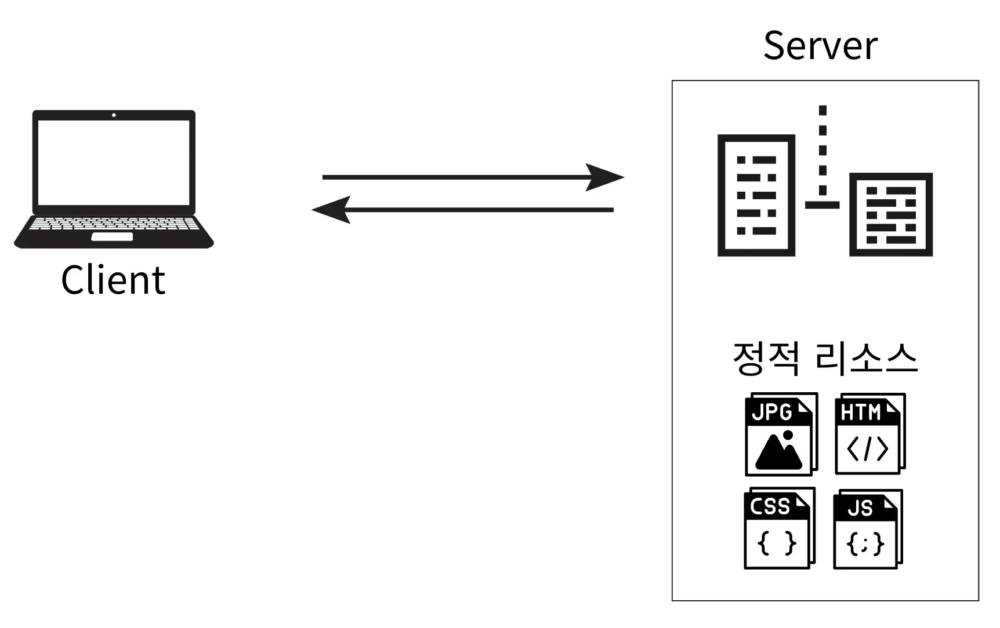

</details>

<details>
<summary>View Template</summary>

- SSR(Server Side Rendering) 방식에서의 View 반환

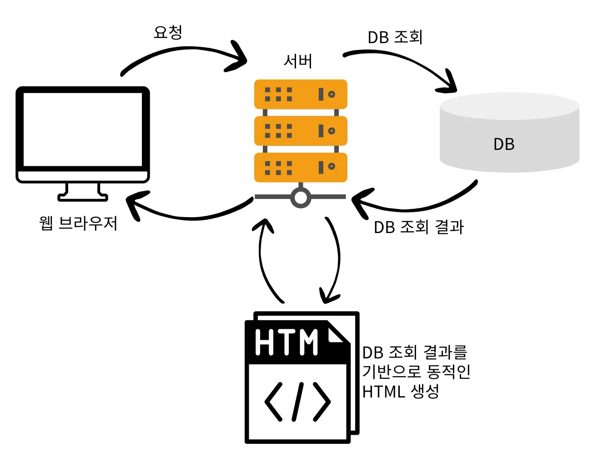

</details>

<details>
<summary>HTTP Message Body</summary>

- 응답 데이터를 직접 Message Body에 담아 반환

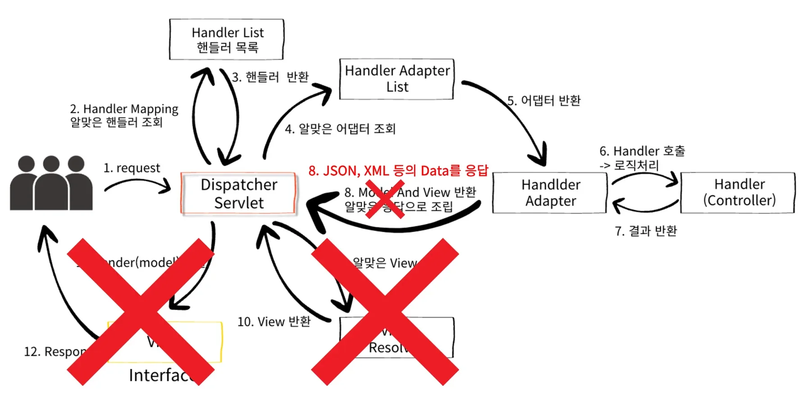

</details>

<a id="135eda9b0fe1805c8758fa61fdbe4038"></a>

## 정적 리소스

> 📖 
> 
> <a id="135eda9b0fe180a6a648e7dabaead53a"></a>
> 
> 웹 애플리케이션에서 변하지 않는 파일들
> 
> - ex) HTML, CSS, JavaScript, 이미지 파일들(JPG, PNG, GIF) 등

<details>
<summary><strong>Spring Boot의 정적 리소스 경로</strong></summary>

> 아래 경로들에 정적 리소스가 존재하면 서버에서 별도의 처리 없이 파일을 그대로 반환한다&#46;

- <code>/static</code>

- <code>/public</code>

- <code>/META&#45;INF/resources</code>

- <code>src/main/resources</code>
    - <code>/static</code>

</details>

<a id="135eda9b0fe180d98090f73430ceac70"></a>

<br>

- 저장되는 경로 
    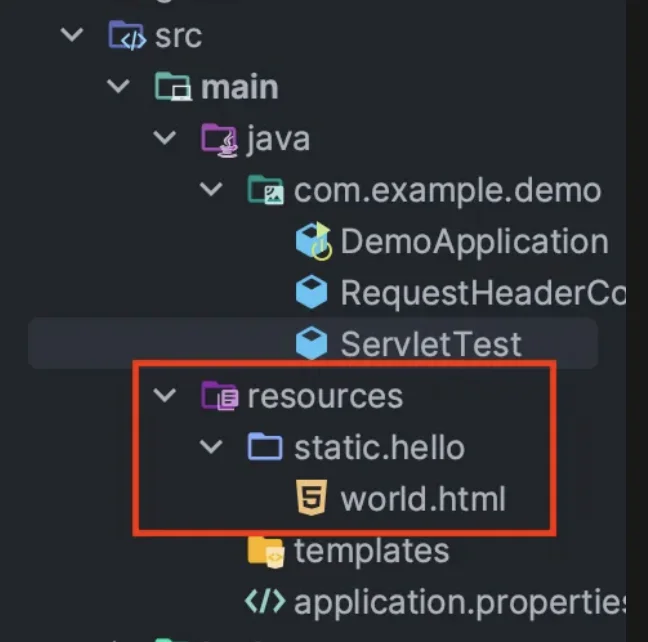

- 디렉토리 구조&#58; <code>src/main</code><u><code>/resources/static/</code></u><code>hello/world&#46;html</code> 
    <a id="136eda9b0fe1802ab62ce8c253638aa1"></a>

    → <code>http&#58;//localhost&#58;8080/hello/world&#46;html</code> URL로 리소스에 접근이 가능

    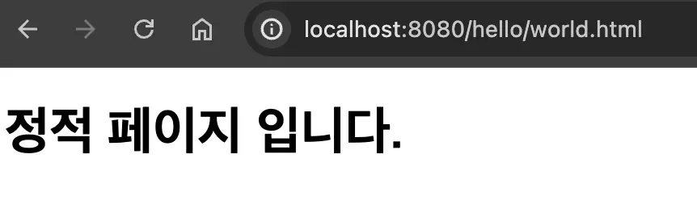

- <code>/static</code> 대신 <code>/public</code> 혹은 <code>/META&#45;INF/resources</code> 도 사용 가능


<a id="135eda9b0fe18040809dd15a1c9a425d"></a>

## View Template

> 📖 
> 
> <a id="135eda9b0fe180ca85e3c8b0d74daf22"></a>
> 
> Spring에서는 <u>Thymeleaf</u><u>, JSP</u>와 같은<strong><u> 템플릿 엔진</u></strong>을 사용해 <u>View Template을 생성</u> 할 수 있다 템플릿 엔진은 서버(Model)에서 데이터를 받아<u> 동적으로 View Template(HTML)을 생성</u>하여 클라이언트에 제공할 수 있다&#46; 

<details>
<summary>Spring Boot는 기본적으로 View Template 경로(<code>src/main/resources/templates</code>)를 설정한다&#46;</summary>

- 기본 설정 예시 ( 아래 내용을 자동으로 Spring Boot가 등록함)
    <a id="136eda9b0fe180789340d454fe314167"></a>

    ```java
    spring.thymeleaf.prefix=classpath:/templates/ 
    spring.thymeleaf.suffix=.html // or jsp
    ```

</details>

- build&#46;gradle에 Thymeleaf 의존성을 추가하면 <code>ThymeleafViewResolver</code>와 필요한 Spring Bean들이 자동으로 등록된다&#46;
    - <u>Thymeleaf</u>를 주로 사용한다&#46; 

<a id="136eda9b0fe180178a32ed5149b74414"></a>

### 사용

---

<details>
<summary><strong><code>&#64;Controller</code></strong><strong>의 응답으로 String을 반환</strong></summary>

> <code>&#64;ResponseBody</code>(<code>&#64;RestController</code>) 명시 ❌

<details>
<summary>&#91; 코드 &#93; Controller</summary>

<a id="136eda9b0fe1802cb198cd43c0646d72"></a>

```java
@Controller
public class ViewTemplateController {
	
		@RequestMapping("/response-view")
	  public String responseView(Model model) {
	      // key, value
	      model.addAttribute("data", "sparta");
	
	      return "thymeleaf-view";
	  }
}
```

</details>

<details>
<summary>&#91; 코드 &#93;  View 템플릿</summary>

<a id="4ba426185cfe4b23a272fc3cb11bb897"></a>

```java
<!DOCTYPE html>
<html xmlns:th="http://www.thymeleaf.org">
<head>
    <meta charset="UTF-8">
    <title>Hello</title>
</head>
<body>
    <h1>Thymeleaf</h1>
    <h2 th:text="${data}"></h2>
</body>
</html>
```

</details>

<details>
<summary>테스트</summary>

<a id="136eda9b0fe180f9a369df4efd16828f"></a>

<code>http&#58;//localhost&#58;8080/response&#45;view</code>

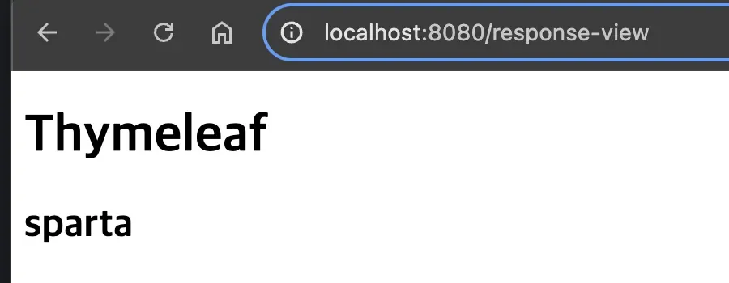

</details>

</details>

<details>
<summary>⚠️ <code>&#64;ResponseBody</code> 사용 시, <code>return String</code> 이 해당되는 view 템플릿을 찾는 것이 아닌,  HTTP Message Body에 입력된다&#46; </summary>

<a id="136eda9b0fe18042b56cfca2a4b9df4a"></a>

```java
@Controller
public class ViewController {
	
		@ResponseBody // @RestController = @Controller + @ResponseBody
		@RequestMapping("/response-body")
		public String responseBody() {
			return "thymeleaf-view";
		}
}
```

- postman
    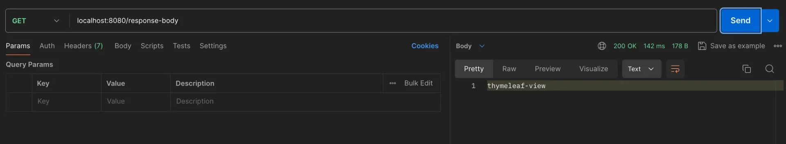

</details>

<details>
<summary>반환 타입이 void인 경우 ( 사용 ❌ )</summary>

- 잘 사용하지 않음

- &#64;Controller &#43; (&#64;ResponseBody, HttpServletResponse, OutputStream)과 같은 <u>HTTP Message Body를 처리하는 파라미터가 없</u>으면 RequestMapping URL을 참고하여 <strong><u>View Name으로 사용</u></strong>한다&#46;

<a id="136eda9b0fe18017984ad4314b80d91e"></a>

```java

@Controller
public class ViewTemplateController {
	
		// thymeleaf-view.html 과 Mapping된다.
	  @RequestMapping("/thymeleaf-view")
	  public void responseViewV2(Model model) {
	      model.addAttribute("data", "sparta");
	  }
}
```

- 메서드 Mapping url을 View의 path로 사용함

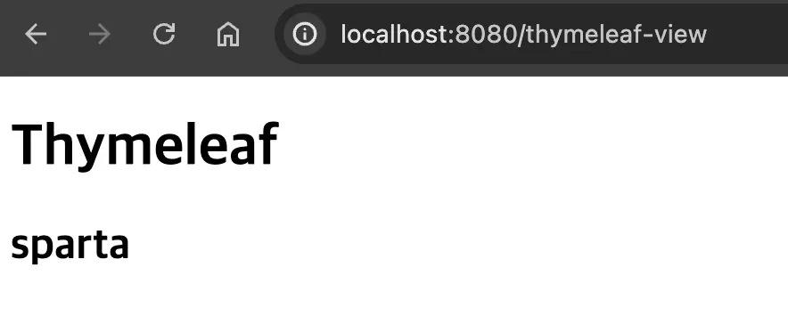

</details>

<a id="135eda9b0fe180238caacde478964a8b"></a>

## HTTP Message Body(응답)

> 📖 
> 
> <a id="60b49ddbf4014b1c96eda98b249ff656"></a>
> 
> REST API를 사용하는 경우 HTTP Message Body에 직접 Data를 JSON 형식으로 담아 전달한다&#46;

> ☝🏻 
> 
> <a id="137eda9b0fe18033b399fb17847fe0dd"></a>
> 
> 정적 HTML, View Template 또한 HTTP Message Body에 담겨서 전달된다&#46;<br>현재 설명하는 Response의 경우는 정적 HTML, View Template을 거치지 않고 직접 HTTP Response Message를 만들어 전달하는 경우를 말하는것이다&#46;

<details>
<summary><strong><code>Http</code></strong><strong><u><code>Servlet</code></u></strong><strong><code>Response</code></strong><strong> </strong></summary>

<a id="137eda9b0fe1803794ccf27ddb14acf9"></a>

```java
@Controller
public class ResponseBodyController {
	
		@GetMapping("/v1/response-body")
		public void responseBodyV1(
															HttpServletResponse response
														) throws IOException {
			
			response.getWriter().write("data");
		}
}
```

- Postman
    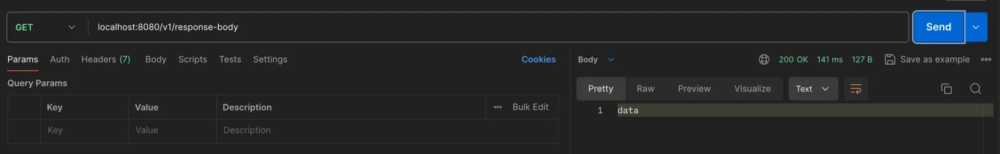

</details>

<details>
<summary><strong><code>&#64;ResponseBody</code></strong><strong> &#45; TEXT, JSON</strong></summary>

<details>
<summary><strong>TEXT</strong></summary>

<a id="137eda9b0fe1800d949be427956c4649"></a>

```java
// TEXT 데이터 통신
@ResponseBody
@GetMapping("/v3/response-body-text")
public String responseBodyText() {
		
	return "data"; // HTTP Message Body에 "data"
}
```

- postman 

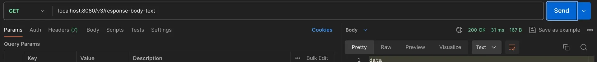

</details>

<details>
<summary><strong>JSON</strong></summary>

- <code>&#64;ResponseBody</code> 사용 시, 객체를 Message Converter(<code>MapingJackson2HttpMessageConverter</code>)가 자동으로 JSON으로 변환하여 메세지 바디에 넣어준다&#46; 

<a id="137eda9b0fe1803497a8e68d87356cf3"></a>

```java
@Data
@NoArgsConstructor // 기본 생성자
@AllArgsConstructor // 전체 필드를 인자로 가진 생성자
public class Tutor {

    private String name;
    private int age;

}
```

<a id="137eda9b0fe180c89311f9b2829b6a90"></a>

```java
// JSON 데이터 통신
@ResponseBody
@GetMapping("/v3/response-body-json")
public Tutor responseBodyJson() {
		
	Tutor tutor = new Tutor("wonuk", 100);
		
	return tutor; // HTTP Message Body에 Tutor Object -> JSON
}
```

- postman

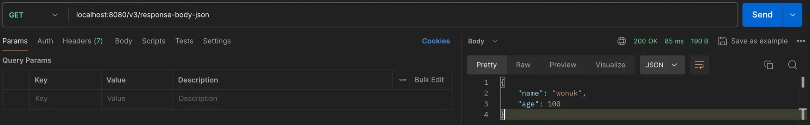

<a id="137eda9b0fe180fcbba8f690f6364892"></a>

```java
@ResponseStatus(HttpStatus.OK)
@ResponseBody
@GetMapping("/v4/response-body")
public Tutor responseBodyV4() {
		
	Tutor tutor = new Tutor("wonuk", 100);
		
	return tutor;
}
```

</details>

<details>
<summary><code>&#64;ResponseStatus</code> 통한 상태코드 지정</summary>

> ⚠️ 
> 
> <a id="9826a0a7a4c4469d98ee9c72de4af3c8"></a>
> 
> 응답 코드를 조건에 따라서 동적으로 변경할 수는 없다&#46;
> 
> <a id="137eda9b0fe18012a5a1f961e23c80c3"></a>
> 
> → <strong><code>ResponseEntity</code></strong><strong>는 가능</strong>

<a id="137eda9b0fe180ac9d8bf73dbdb44fa5"></a>

```java
@ResponseStatus(HttpStatus.OK)
@ResponseBody
@GetMapping("/v4/response-body")
public Tutor responseBodyV4() {
		
		Tutor tutor = new Tutor("wonuk", 100);
			
		return tutor;
}
```

- Postman
    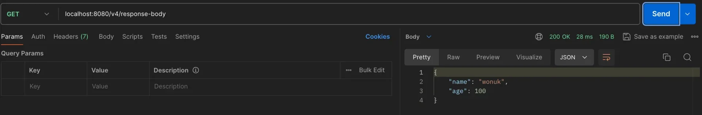

    - 

</details>

</details>

<details>
<summary><strong><u><code>Response</code></u></strong><strong><code>Entity&#60;&#62;</code></strong></summary>

<details>
<summary><code>ResponseEntity</code>는 <strong><code>HttpEntity</code></strong> 를 상속 받은 구현체로 응답만을 다루는 HttpEntity 객체이다&#46; 메세지의 header와 body  설정 가능하다&#46;</summary>

- <code>HttpEntity</code>는 <u>요청</u>과 <u>응답</u>을 모두 다룰 수 있다&#46;

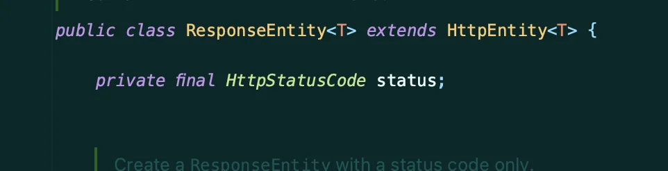

</details>

<details>
<summary><code>ResponseEntity&#60;&#62;</code>두 번째 파라미터에 Enum을 사용하여 상태 코드 설정 가능하다</summary>

<details>
<summary>&#60; Enum &#62; <code>HttpStatus</code></summary>

- 아래와 같이 상태코드가 이미 Enum 타입으로 다 정의가 되어있다&#46; <br>따라서 상황에 맞는 상태코드를 가져다가 쓰기만 하면된다&#46;

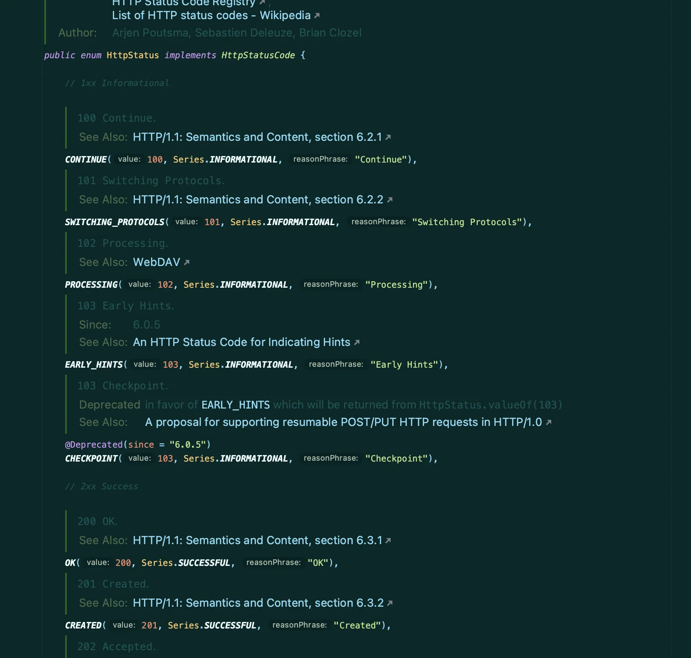

</details>

- ex) <code>return new ResponseEntity&#60;&#62;(tutor, HttpStatus&#46;OK);</code>

</details>

<details>
<summary>👍🏻 동적으로 응답 코드 변경 가능하다&#46; </summary>

<a id="137eda9b0fe1803e8cfaf79a64037299"></a>

```java
@ResponseBody
@GetMapping("/v5/response-body")
public ResponseEntity<Tutor> responseBody() {
		
		Tutor tutor = new Tutor("wonuk", 100);
		
		if (조건) {
			return new ResponseEntity<>(tutor, HttpStatus.OK);
		} else {
			return new ResponseEntity<>(tutor, HttpStatus.BAD_REQUEST);
		}
}

```

</details>

---

<details>
<summary>TEXT</summary>

<a id="137eda9b0fe180feb0bed9870b50b468"></a>

```java
@GetMapping("/v2/response-body")
public ResponseEntity<String> responseBodyV2() {
		
		return new ResponseEntity<>("data", HttpStatus.OK);
}
```

- Postman
    - Response Body에 data라는 문자열과 HttpStatus&#46;OK에 해당하는 상태 코드를 반환함

    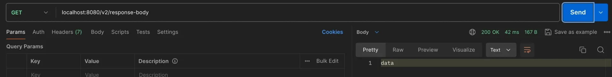

</details>

<details>
<summary><strong>Object ( </strong>SON)</summary>

- ResponseEntity에 <u>객체</u>와 <u>상태코드</u>를 반환함으로써 HTTP 응답 메세지를 간편하게 생성 및 전송가능하다&#46;

<a id="137eda9b0fe18028bf9dcc316c78b354"></a>

```java
@ResponseBody
@GetMapping("/v5/response-body")
public ResponseEntity<Tutor> responseBody() {
		
		Tutor tutor = new Tutor("wonuk", 100);
		
		return new ResponseEntity<>(tutor, HttpStatus.OK);
}
```

- postman

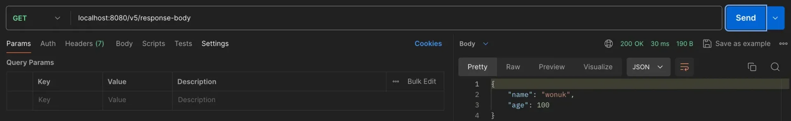

</details>

</details>
