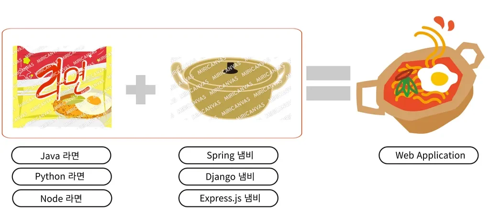
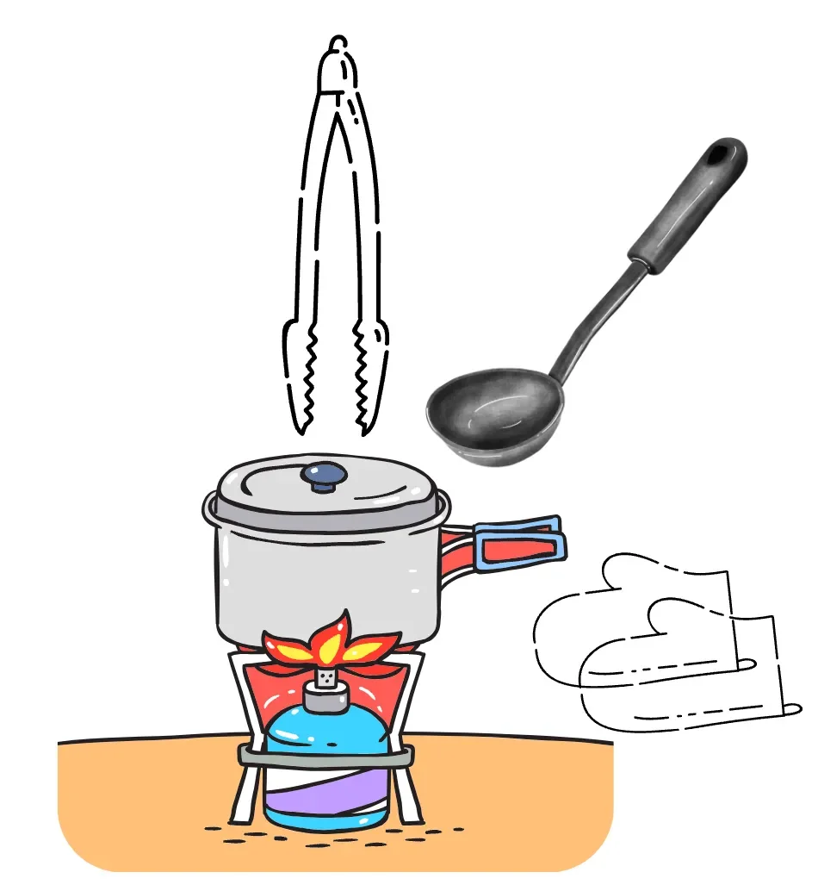

> 
> 
> 
> 
> 목차
> 
> - [Spring Framework](#25ceda9b0fe180a0bd0de6210679066e)
> - [Spring Boot](#25ceda9b0fe180218bc7e8c13a18f613)

## <strong>Spring Framework</strong>

---

> 📖 
> 
> 
> 
> Java Application Framework로 <strong><u>엔터프라이즈 애플리케이션 개발</u></strong>에 주로 사용된다&#46; 

> 🧐 
> 
> 
> 
> <strong>엔터프라이즈 애플리케이션</strong>
> 
> 
> 
> <strong><u>대규모로 복잡한 비지니스 프로세스와 데이터를 처리</u></strong>하는 애플리케이션

<strong>Spring Framework 등장 배경</strong>

- 대형 쇼핑몰 시스템 ( 엔터프라이즈 애플리케이션 )
    

    수백만명의 고객이 동시에 상품을 검색하고, 장바구니에 담고, 결제를 시도한다&#46; 이러한 시스템은 많은 사용자의 요청을 한꺼번에 처리해야 한다&#46;  즉, 서버의 성능, 신뢰성, 보안이 아주 중요해진다&#46; 

    

    그러나 이러한 요소들을 모두 고려하면서 비지니스 로직을 개발하는 것은 쉽지 않다&#46; 누군가가 이러한 복잡한 부분을 해결해 주는 개발 환경을 제공해준다면, 개발자는 <strong>비즈니스 로직</strong>에만 집중할 수 있게 된다&#46;

    

    이때 등장한 것이 바로 Spring Framwork이다&#46; 

    > ? 이것 만으로는 설득력이 부족하다&#46; 

    - Spring Framework는 서버 성능, 안정성, 보안 문제를 고도화된 수준으로 해결해준다&#46;

    - 개발자들은 복잡한 문제를 해결하는 대신, 비즈니스 로직 개발에 집중할 수 있게 되었다&#46;

<strong>Spring Framwork의 특징</strong>

- 애플리케이션의 다양한 구성 요소를 유연하게 연결하고 관리할 수 있도록 해준다&#46;

- Spring Framework는 누구나 사용할 수 있는 오픈소스 이다&#46;

- 모듈화되어 있어 필요에 따라 특정 기능만 선택적으로 사용할 수 있다&#46;

- <strong>Java언어의 가장 큰 특징인 </strong><u>객체 지향 언어의 특징</u><strong>을 살려낸 프레임워크</strong>이다&#46;
    - 캡슐화

    - 상속

    - 추상화

    - 다형성

<strong>비유) 라면 &#43; 냄비</strong>

- Web Application 이라는 라면을 끓인다(만든다)&#46;
    - 라면 &#58; Java

    - 냄비 &#58; Spring

## Spring Boot

---

> 📖 
> 
> 
> 
> Spring Framwork를 기반으로 <strong><u>편리하고 빠르게 애플리케이션을 개발 가능</u></strong>하도록 도와주는 도구이다&#46; 

<strong>Spring Boot의 등장 배경</strong>

- 스프링 프레임워크는 초기 설정과 구성 파일이 복잡하고 방대했다&#46; 

- 스프링 애플리케이션을 개발하고 배포하기 위해서는 여러 가지 의존성 관리와 서버 설정이 필요하다&#46; 

- 최소한의 노력으로 스프링 애플리케이션을 쉽게 개발하고 배포할 수 있는 방법이 필요했다&#46;

<strong>Spring Boot의 특징</strong>

- <strong>자동 구성</strong>(Auto&#45;configuration) 기능을 제공하여, 개발자가 복잡한 설정을 직접 처리할 필요 없이 기본 설정으로도 비즈니스 로직에 집중할 수 있게 해준다&#46;

- 내장 WAS(Tomcat)를 제공하여, 애플리케이션을 별도의 서버 설정 없이 바로 실행할 수 있다&#46;

- <code>spring&#45;boot&#45;starter&#45;web</code>를 <strong><u>빌드 관리 도구</u></strong>에 추가하면 웹 애플리케이션에 필요한 모든 종속성과 설정이 자동으로 구성된다&#46;

- 라이브러리들의 버전을 명시하지 않아도 <strong>호환 가능한 버전들을 찾아 자동으로 설정</strong>해준다&#46;
    - <strong>주의&#33;</strong> 버전 관련 문제를 100% 해결해 주는 것은 아니다&#46;

<strong>비유) 라면 &#43; 냄비 &#43; </strong><strong><u>조리도구</u></strong>

- Web Application 이라는 라면을 끓일 때(만들 때) 조리 도구 세트를 사용한다&#46;
    - 라면 &#58; Java

    - 냄비 &#58; Spring

    - 조리 도구 세트 &#58; Spring Boot

