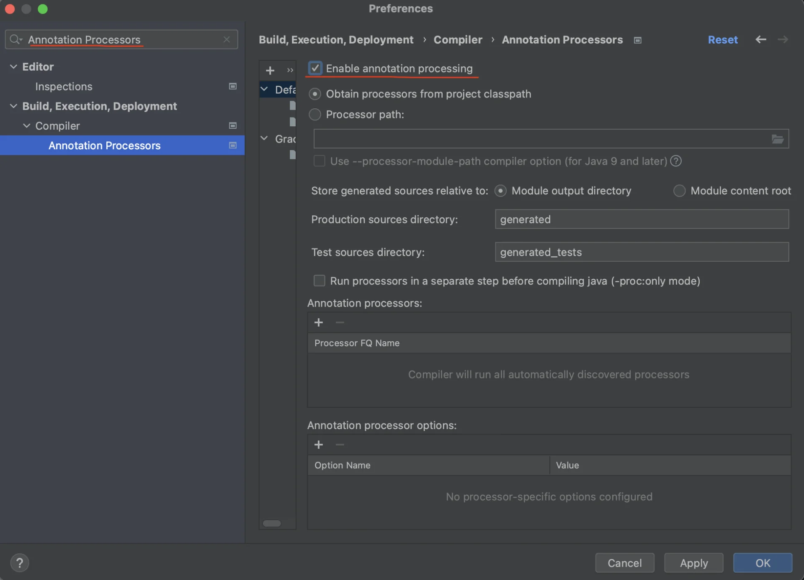
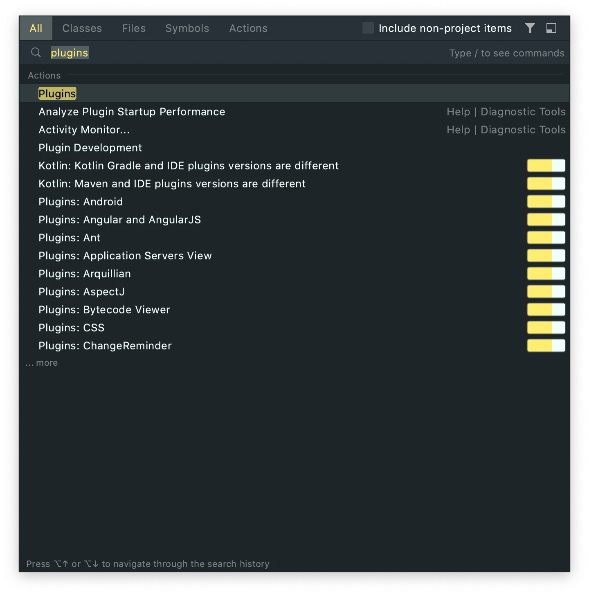
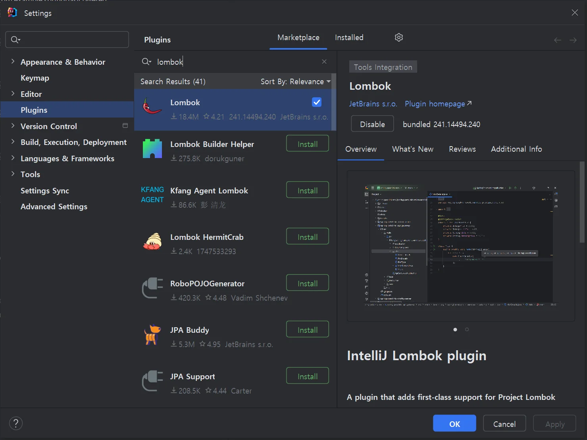
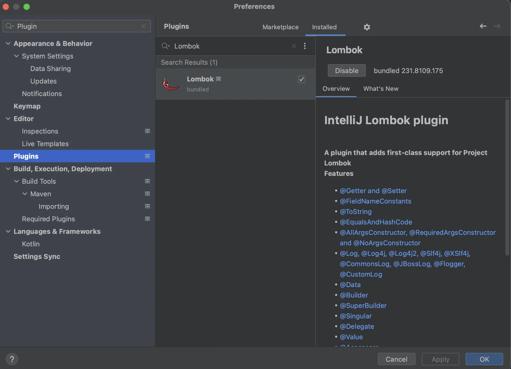

> 
> 
> <a id="25ceda9b0fe180dda231eba5ec18c6f3"></a>
> 
> 목차
> 
> - [Annotation](#25ceda9b0fe180d6aa30ec42b09b7e4c)
> - [Lombok](#25ceda9b0fe180d09e89eb071eaa52eb)

<a id="25ceda9b0fe180d6aa30ec42b09b7e4c"></a>

## <strong>Annotation</strong>

---

> 📖 
> 
> <a id="25ceda9b0fe180468336ceadf96a2d1f"></a>
> 
> <strong><u>코드에 메타데이터를 추가</u></strong>할 수 있는 기능을 제공하며 주로 <strong><u>코드에 특별한 의미를 부여</u></strong>하거나, <strong><u>컴파일러와 런타임에 특정 동작을 트리거</u></strong>하기 위해 사용된다&#46;
> 
> - 주석은 사람에게 정보를 제공하는 것이라면, 어노테이션은 특정 코드를 사용하는 <strong><u>프로그램에게 정보를 전달</u></strong>하는 것이다&#46; 

<details>
<summary><strong>어노테이션 정의</strong></summary>

> ✏️ 
> 
> <a id="25ceda9b0fe1806d8cc3e9e345f1b1fa"></a>
> 
> 어노테이션은 <code>&#64;</code> 기호로 시작하며, <strong><u>클래스, 메서드, 변수, 매개변수, 패키지 등에 추가</u></strong>할 수 있다&#46;

</details>

<details>
<summary><strong>내장 어노테이션</strong></summary>

- <strong><code>&#64;Override</code></strong>
    - 메서드가 상위 클래스나 인터페이스의 메서드를 오버라이드하고 있음을 나타낸다&#46; 
        - 이때 컴파일러는 메서드가 실제로 오버라이드하고 있는지 확인한다&#46;

- <strong><code>&#64;Deprecated</code></strong>
    - 해당 요소가 더 이상 사용되지 않음을 나타낸다&#46; 

    - 해당 어노테이션이 붙은 코드를 사용하면 컴파일 경고가 발생한다&#46;

- <strong><code>&#64;SuppressWarnings</code></strong>
    - 컴파일러 경고를 억제한다&#46; 
        - 사용되지 않는 변수에 대한 경고를 무시할 수 있다&#46;

</details>

<details>
<summary><strong>사용자 정의 어노테이션</strong></summary>

- 개발자가 필요에 따라 직접 어노테이션을 정의할 수 있다&#46; 

- 사용자 정의 어노테이션은 특정 메타데이터를 추가하거나, 

- <strong><code>AOP</code></strong><code>(Aspect&#45;Oriented Programming)</code> 같은 기술과 결합하여 다양한 기능을 구현할 수 있다&#46;

</details>

<a id="25ceda9b0fe180ac93dfd40ec2a1a9a8"></a>

<br>

<a id="25ceda9b0fe180d09e89eb071eaa52eb"></a>

## Lombok

---

> 📖 
> 
> <a id="25ceda9b0fe180418795c6aa1357de24"></a>
> 
> 보일러 플레이트 코드를 줄여주는 라이브러리로 <strong>자동으로 보일러 플레이트 코드를 생성</strong>하여 <strong><u>코드의 </u></strong><strong><u><code>가독성</code></u></strong><strong><u>과 </u></strong><strong><u><code>유지보수성</code></u></strong><strong><u>을 높</u></strong>여준다&#46;
> 
> - <code>Lombok</code>은 <strong>어노테이션 기반으로 동작</strong>하며 <strong><u>주로 </u></strong><strong><u>컴파일 시점에 소스 코드를 변환</u></strong>하여 <strong><u>필요한 메서드를 자동으로 생성</u></strong>한다&#46;

> 🧐 
> 
> <a id="25ceda9b0fe180c984caf88f2a489dd4"></a>
> 
> <strong>보일러플레이트 코드 (Boilerplate code)</strong>
> 
> - <code>getter/setter</code> 메서드, 생성자, toString 메서드 등과 같이 <strong><u>반복적으로 작성되는 코드</u></strong>를 뜻한다&#46;

<details>
<summary><strong>Lombok 설치하기</strong></summary>

> ✏️ <code>IntelliJ IDEA</code>와 같은 IDE에서는 Lombok의 기능을 제대로 활용할 수 있도록 <strong>플러그인을 제공</strong>하고 있다&#46; 이 플러그인을 설치하면,<strong><u> IDE에서 Lombok 어노테이션을 인식</u></strong>하고, <strong><u>해당 어노테이션에 의해 생성되는 메서드나 필드들을 자동으로 처리</u></strong>해 준다&#46;

1. IntelliJ 실행하기 (프로젝트 생성 or 실행 모두 가능)

1. 환경설정
    - Windows&#58; Ctrl &#43; Alt &#43; S

    - macOS&#58; command &#43; ,

1. 검색창에 &#34;Annotation Processors&#34; 입력 후, 우측 &#34;Enable annotation Processing&#34; 체크하고 OK 클릭
    

1. Shift 두 번 누르고 plugins 입력 후 엔터
    

    - 위 Shift를 두 번 눌러도 실행되지 않는다면, 환경설정 창에서 plugins 클릭 후 lombok 검색(아래 이미지는 lombok이 설치 완료된 상태입니다)
        

1. Lombok이 installed가 되지 않은 상태라면 아래처럼 생긴 아이콘의 우측 Install 버튼 클릭 → Intellij 재시작
    

1. 다시 Shift 두 번 누르고 plugins 입력 후 Enter

1. Lombok을 검색했을 때 installed 상태라면 설치 완료
    

</details>

<details>
<summary><strong>주요 Lombok Annotation</strong></summary>

<details>
<summary><strong><code>&#64;Getter</code></strong><strong>, </strong><strong><code>&#64;Setter</code></strong></summary>

> ✏️ 
> 
> <a id="25ceda9b0fe18004b09bc79b0d5c5e01"></a>
> 
> 클래스의 모든 필드에 대한 <code>getter</code>와 <code>setter</code> 메서드를 자동으로 생성한다&#46;

<a id="25ceda9b0fe18062b8d3f45f88847034"></a>

<strong>예시 코드</strong>

<a id="25ceda9b0fe180488702f3ec503af995"></a>

```java
@Getter
@Setter
public class User {
    private String name;
    private int age;
  
  /** 아래 코드를 @Getter, @Setter 어노테이션이 생성해준다.
    public String getName() {
	    return name;
    }

    public void setName(String name) {
	    this.name = name;
    }
    
    public int getAge() {
	    return age;
    }

    public void setAge(int age) {
	    this.age = age;
    }
    **/
}
```

- 위 코드에서 <code>getName()</code>, <code>setName(String name)</code>, <code>getAge()</code>, <code>setAge(int age)</code> 메서드가 자동으로 생성된다&#46;

</details>

<details>
<summary><strong><code>&#64;ToString</code></strong></summary>

> ✏️ 
> 
> > 객체의 <code>toString()</code> 메서드 자동 생성
> 
> - 기본적으로 클래스의 모든 필드를 포함하며, 특정 필드를 제외하거나 포맷을 지정할 수도 있다

<a id="25ceda9b0fe180ce90f1c24baadb8749"></a>

<strong>예시코드</strong>

<a id="25ceda9b0fe180a6ab09cc71b372e684"></a>

```java
@ToString
public class User {
    private String name;
    private int age;
}
```

- <code>toString()</code> 메서드는 객체를 String으로 변환해주는 역할을 수행한다

</details>

<details>
<summary><strong><code>&#64;EqualsAndHashCode</code></strong></summary>

> ✏️ 
> 
> > <code>equals()</code>, <code>hashCode()</code> 메서드 자동 생성
> 
> - 객체의 동일성과 해시 코드를 정의하는데 사용된다&#46;

> 🧐 
> 
> <a id="25ceda9b0fe180a4b6a6ed09c8bffb2d"></a>
> 
> <code>equals()</code>, <code>hashCode()</code> 사용 이유  ( 아래 포스팅 참조 )
> 
> <a id="25ceda9b0fe1806aa45ccd75b236c336"></a>
> 
> <code>해시 함수</code>를 사용해서 <strong><u>정수 기반의 해시 코드로 변환</u></strong>한 덕분에, <strong><u>해시 인덱스를 사용</u></strong><strong>하여  자료구조에 상관없이 비교 및 순회, 정렬이 가능해진다&#46; </strong>
> 
> - <a href="#/post/1c3eda9b-0fe1-818e-a32d-c11724ae5ddf">페이지</a> 
> 
> - <a href="#/post/1c3eda9b-0fe1-816d-978d-ebb48559f569">페이지</a> 

<a id="25ceda9b0fe1808c80d3ebbbf2852829"></a>

<strong>예시코드</strong>

<a id="25ceda9b0fe1808885bfdccc955ec68a"></a>

```java
@EqualsAndHashCode
public class User {
    private String name;
    private int age;
}
```

- <code>toString()</code> 메서드는 객체를 String으로 변환해주는 역할을 수행한다

</details>

<details>
<summary><strong><code>&#64;NoArgsConstructor</code></strong><strong>, <br></strong><strong><code>&#64;AllArgsConstructor</code></strong><strong>, <br></strong><strong><code>&#64;RequiredArgsConstructo</code></strong></summary>

> ✏️ 
> 
> - <strong><code>&#64;NoArgsConstructor</code></strong><strong>&#58; </strong>기본 생성자 자동 생성
> 
> - <strong><code>&#64;AllArgsConstructor</code></strong><strong>&#58; </strong>모든 필드를 매개변수로 하는 생성자 자동 생성
> 
> - <strong><code>&#64;RequiredArgsConstructor</code></strong><strong>&#58; </strong>필수(final) 필드만을 매개변수로 하는 생성자 자동 생성

<a id="25ceda9b0fe18090bb55da003de864f4"></a>

<strong>예시코드</strong>

<a id="25ceda9b0fe1800abaede91d71b0331b"></a>

```java
@NoArgsConstructor
@AllArgsConstructor
public class User {
    private String name;
    private int age;
}
```

</details>

<details>
<summary><strong><code>&#64;Data</code></strong></summary>

> ✏️ 
> 
> > <code>&#64;Getter</code>, <code>&#64;Setter</code>, <code>&#64;ToString</code>, <code>&#64;EqualsAndHashCode</code>,<code>&#64;RequiredArgsConstructor</code>를 한꺼번에 적용
> 
> - 주로 테스트 용도로 사용

<a id="25ceda9b0fe1806291aee5802d980431"></a>

<strong>예시코드</strong>

<a id="25ceda9b0fe1801babe1f6e59f55caa8"></a>

```java
@Data
public class User {
    private String name;
    private int age;
}
```

</details>

<details>
<summary><strong><code>&#64;Builder</code></strong></summary>

> ✏️ 
> 
> > 빌더 패턴을 적용하여 객체 생성
> 
> - 복잡한 객체 생성에 유용하며, 필드 이름을 명시적으로 지정하면서 객체를 생성할 수 있다&#46;

<a id="25ceda9b0fe18050badbfc8ea230e2a6"></a>

<strong>예시코드</strong>

<a id="25ceda9b0fe18035935de3f1ad842562"></a>

```java
@Builder
public class User {
    private String name;
    private int age;
}
```

<a id="25ceda9b0fe180f18b07deec587e3091"></a>

<br><strong>사용 예시</strong>

<a id="25ceda9b0fe180009ef6e56af13e7ae1"></a>

```java
User user = User.builder()
		          .name("John")
		          .age(30)
		          .build();
```

</details>

<details>
<summary><strong><code>&#64;Slf4j</code></strong></summary>

> ✏️ 
> 
> > 클래스에 로그를 남기기 위한 <code>Logger</code> 객체 자동 생성

<a id="25ceda9b0fe18082a5f4d46905dbef8f"></a>

<strong>예시코드</strong>

<a id="25ceda9b0fe1803abb5ae6a97b3f2d2b"></a>

```java
@Slf4j
public class UserService {
    public void logMessage() {
        log.info("This is a log message");
    }
}
```

</details>

</details>
