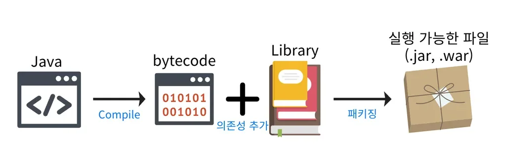
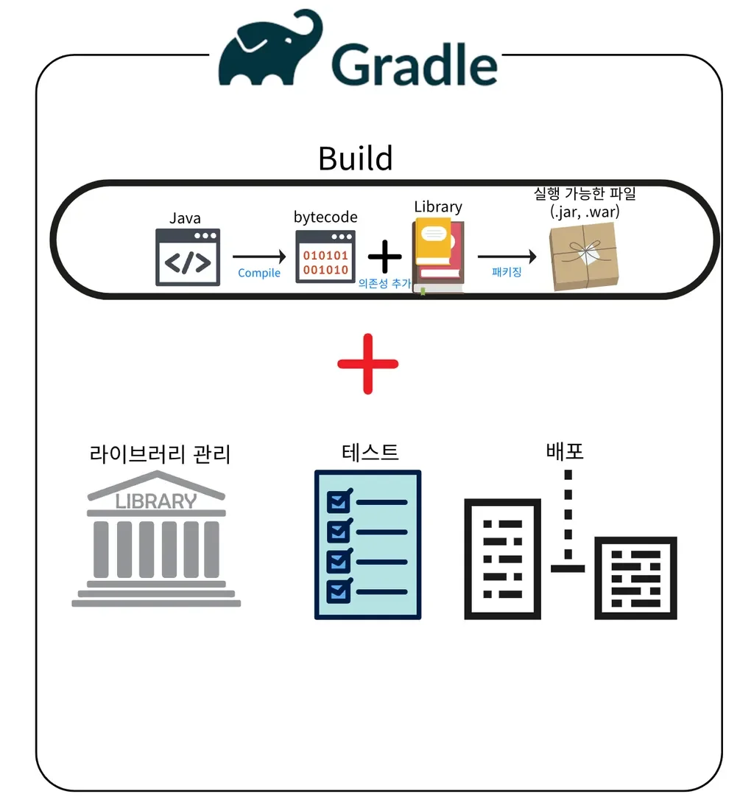
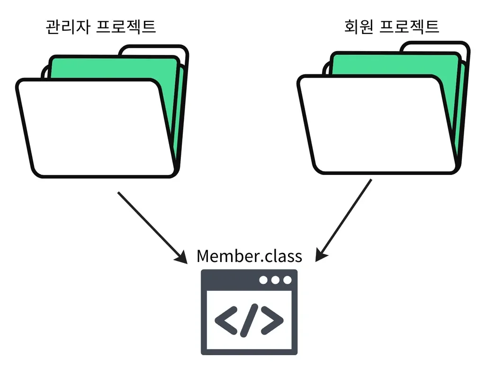

> 
> 
> 
> 
> 목차
> 
> - [Gradle](#25ceda9b0fe18051a515c1746b9ee7cb)
> - [build.gradle](#25ceda9b0fe1805fb0cddf16e0d52b34)

> ✏️ 

## <strong>Gradle</strong>

---

> 📖 
> 
> 
> 
> Java 와 유사한 문법 구조를 가진 <strong><u><code>Groovy</code></u></strong><strong><u> 기반의 스크립트 언어</u></strong>를 사용하며 <strong>다양한 소프트웨어를 빌드(Build) </strong>할 수 있는 <strong><u>유연한 빌드 자동화 도구</u></strong>이다&#46; 

<strong>빌드 ( Build )</strong>

> ✏️ 
> 
> 
> 
> 소스 코드를 컴퓨터가 실행 가능한 파일로 변환 해주는 작업

- 빌드에 필요한 과정

<strong>빌드 자동화 도구 &#45; Gradle</strong>

- 빌드, 라이브러리 관리, 테스트, 배포 등을 자동화 하여 수행한다&#46;

<strong>Gradle 특징</strong>

1&#46; 유연성

- 복잡한 빌드 시나리오를 처리할 수 있는 유연한 시스템을 제공한다&#46; 

- 빌드 스크립트를 통해 다양한 작업을 정의하고, 필요한 경우 커스터마이징 가능하다&#46; 

2&#46; 성능

- Build Cache
    - 빌드 결과물을 캐싱하여 재사용

    - 라이브러리 의존성을 캐싱하여 재사용

- 점진적 빌드
    - 마지막 빌드 호출 이후 변경된 부분만 빌드 

    - 변경되지 않은 부분은 캐시 결과를 검색해 재사용

- 데몬 프로세스
    - 다음 빌드 작업을 위해 백그라운드에서 대기하는 프로세스

    - 초기 빌드 이후부터는 빌드 실행 시 초기화 작업을 거치지 않는다&#46; 

3&#46; 멀티 프로젝트 빌드 지원

- 공통으로 사용하는 클래스를 모듈로 만들어 독립적인 각 프로젝트에서 사용 가능하도록 한다&#46;

4&#46; 설정 주입 방식

- 필요한 설정을 직접 프로젝트에 주입하는 방식

- 공통되는 정보는 묶어서 한번에 주입 가능

- 프로젝트 별로 설정을 다르게 주입 가능

## <strong>build&#46;gradle</strong>

---

> 📖 

d

> ✏️ 

- 

