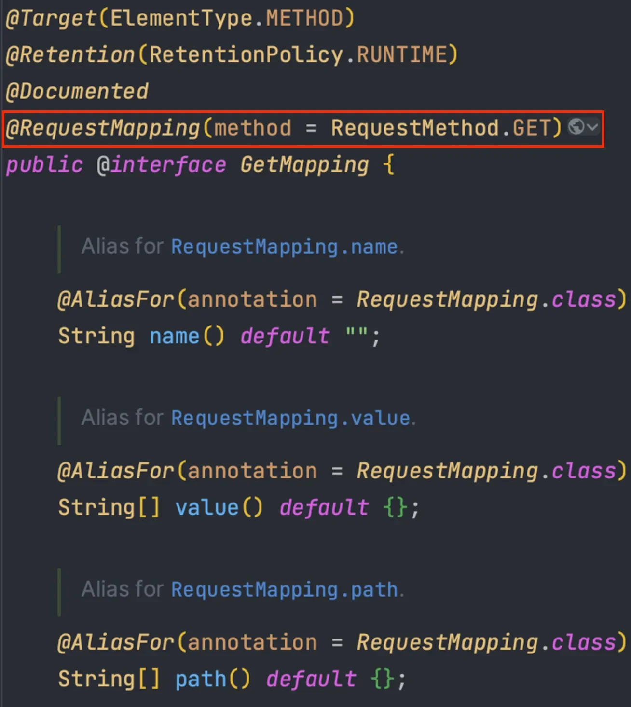
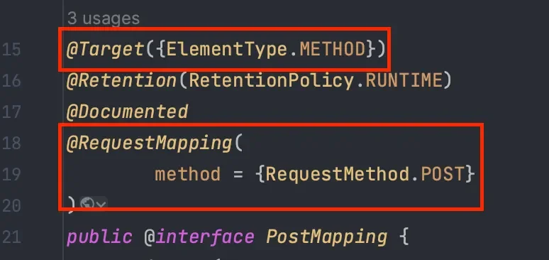
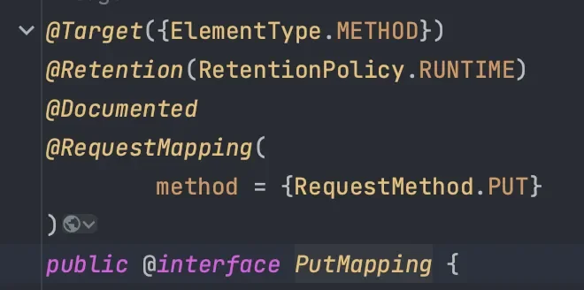
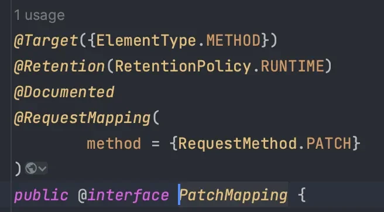
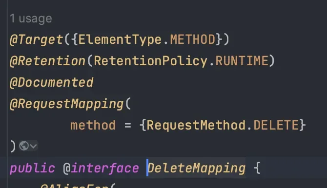
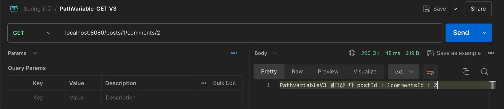
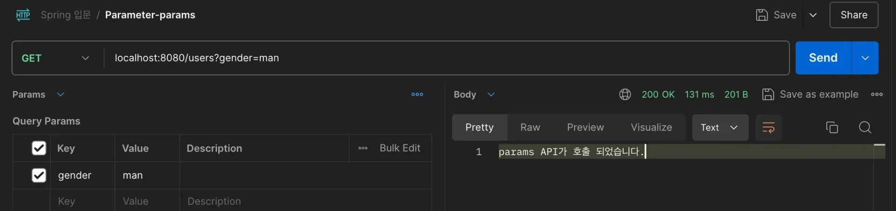
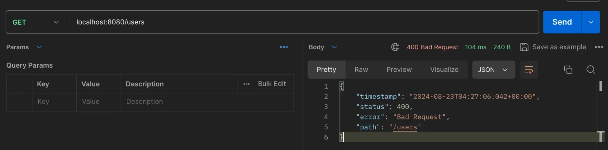
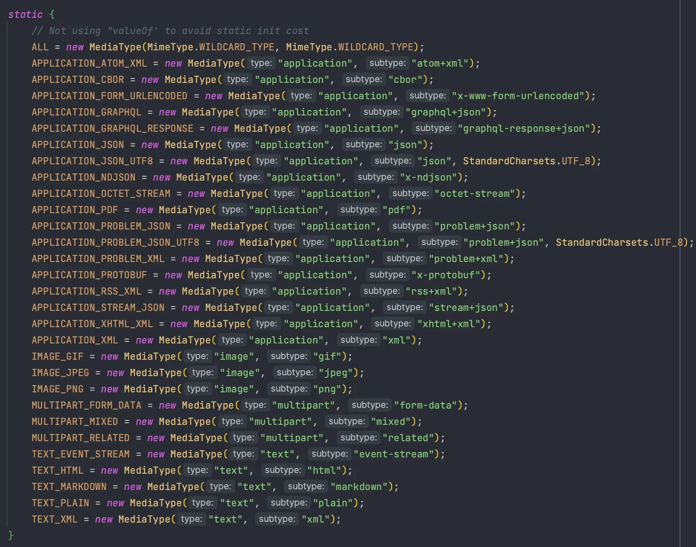

<a id="133eda9b0fe18035a9d4f6976fac5992"></a>

## 요청 매핑 &#45; <code>&#64;RequestMapping</code>, <code>HTTP 축약 매핑 메서드</code>

<details>
<summary>🧐 매핑(<code>Mapping</code>)이란?</summary>

<a id="133eda9b0fe180be8057f3c0d52a438d"></a>

어떤 값을 다른 값에 대응시키는 과정을 총칭한다&#46;

- A  와 B 매핑 
    <a id="b9ec16b2a1cd4bb89e35111499614abf"></a>

    → A 와 B가 대응(연결) 된다&#46; 

</details>

> 📖 
> 
> <a id="0064a224ea5245408ae6e9ed4a29c58a"></a>
> 
> <u>요청 메세지 </u><code>URL</code>, <code>Method</code> 등을 통해 <u>전달 받는 요청</u>과  <u>Controller 내부의 특정 Method</u>를 Mapping(연결) 해주는 역활을 한다
> 
> -  URL, Method, Header 등 여러 조건을 Mapping의 식별자로 사용할 수 있다&#46; 

<details>
<summary><strong>&#64;RequestMapping </strong></summary>

<details>
<summary>☝🏻 버전에 따른 리소스 식별 차이점</summary>

- <strong>Spring Boot 3&#46;0 버전 이하</strong>
    - URL path<code> /example, /example</code><strong><code>/</code></strong> 모두 허용(Mapping)

- <strong>Spring Boot 3&#46;0 버전 이상(현재 버전)</strong>
    - URL path <code>/example</code> 만 허용(Mapping)

</details>

- 속성값들을 설정할 때 배열 형태로 다중 설정이 가능하다
    - ex) <strong><code>&#64;RequestMapping(</code></strong><strong><code>{</code></strong><code>”/example”, “/example2”, “/example3”</code><strong><code>}</code></strong><strong><code>)</code></strong><strong> </strong>

- HTTP Method &#45; <code>POST</code>, <code>GET</code>, <code>PUT</code>, <code>PATCH</code>, <code>DELETE</code>, <code>HEAD </code>모두 허용함

- <code>method</code> 속성으로 HTTP 메서드를 지정 시, 동일한 URL에서 지정된 메서드의 요청만을 받는다&#46; 
    <details>
    <summary>ex) </summary>

    <a id="133eda9b0fe1801eb81ff710248cc033"></a>

    ```java
    @RestController
    public class RequestMappingController {

        // GET /v1 요청만을 처리함
        @RequestMapping(value = "/v1", method = RequestMethod.GET)
        public String exampleV1() {
    		      . . . 
        }
    }
    ```

    </details>

</details>

<details>
<summary>HTTP 축약 매핑 메서드</summary>

> <strong>내부적으로 </strong><strong><code>&#64;RequestMapping(method = RequestMethod&#46;</code></strong><strong><code>Method</code></strong><strong><code>)</code></strong><strong> 명시</strong>

---

<details>
<summary><strong><code>&#64;</code></strong><strong><code>Get</code></strong><strong><code>Mapping</code></strong></summary>



</details>

<details>
<summary><strong><code>&#64;</code></strong><strong><code>Post</code></strong><strong><code>Mapping</code></strong></summary>



</details>

<details>
<summary><strong><code>&#64;</code></strong><strong><code>Put</code></strong><strong><code>Mapping</code></strong></summary>



</details>

<details>
<summary><strong><code>&#64;</code></strong><strong><code>Patch</code></strong><strong><code>Mapping</code></strong></summary>



</details>

<details>
<summary><strong><code>&#64;</code></strong><strong><code>Delete</code></strong><strong><code>Mapping</code></strong></summary>



</details>

---

<details>
<summary>ex) GET 매핑 &#45; <code>&#64;GetMapping</code></summary>

<a id="133eda9b0fe18052ba4eed56bc9b9304"></a>

```java
@GetMapping(value = "/mapping-get-v2")
public String mappingGetV2() {
			return "ok";
}
```

</details>

</details>

<details>
<summary>🧐 <strong><code>&#64;RequestMapping</code></strong>, 축약 메서드(<strong><code>&#64;GetMapping</code></strong> … ) 차이</summary>

- 축약 매핑 메서드(<strong><code>&#64;GetMapping</code></strong> … )는 Target이 <strong><u>method Level</u></strong>이다&#46;

- 반면 <strong><code>&#64;RequestMaping</code></strong><strong>의 Target은 </strong><strong><u>class, method 레벨</u></strong><strong>이다&#46; </strong>

</details>

<details>
<summary> ⭐️ 실제 사용 방법</summary>

- URL &#45; <u>RESTful API 계층 구조</u> 
    - ex) <code>users/{userId}</code>, <code>category/{categoryId}/product/{productId}</code>

- <strong><u>공통된 prefix</u></strong>를 &#64;RequestMapping을 통해 class 레벨로 적용함
    - <code>&#64;RequestMapping(”/prefix”)</code>

<a id="133eda9b0fe180d99f0fd5cbfa5dcf06"></a>

```java
// 요청 url: '/prefix/v3'
@RequestMapping("/prefix")
@RestController
public class RequestMappingController {
		
		@GetMapping(value = "v3")
		public String exampleV3() {
				return "ok";
		}
```

<a id="133eda9b0fe180879825d5cc3e81e7d5"></a>

<br>

</details>

<a id="133eda9b0fe1808f995dc24000dabf3d"></a>

## &#64;PathVariable

> 📖 
> 
> <a id="22237654f1574f4c9ab52a41a57b1890"></a>
> 
> HTTP 특성 중 하나인 <u>비연결성을 해결</u>하기 위한 방법 중 하나이다&#46;
> 
> <a id="133eda9b0fe180b5b299e9f34437060b"></a>
> 
> <u>필요한 상태 정보를 URL에 넣어 전달</u>하며, <code>&#64;PathVariable</code>을 통해 <u>해당하는 파라미터 값을 받</u>아온다&#46; 

<details>
<summary>&#64;PathVariable</summary>

- 경로 변수(<code>path variable)</code>는 중괄호(<code>{}</code>)로 감싸 사용한다&#46;
    - ex) <code>/users/{userId}</code>

- 기본적으로 <code>&#64;PathVariable</code>로 설정된 <em><strong>경로 변수 </strong></em>는 <u>필수 값</u>이다&#46; 
    - 만약 값이 없다면 응답 상태코드 <code>404 Not Found</code> Error가 발생

- 최근 RESTful API로 설계하는 것이 API의 기준이 되면서 해당 Anotation의 사용 빈도가 증가했다&#46; → 많이 쓰니 잘 알아둬라

</details>

<details>
<summary>RESTful API 설계 예시</summary>

<details>
<summary>RESTful API 참고자료</summary>

- ‣

</details>

- postId 글의 comment 댓글 작성
    - POST &#43; <code>posts/{postId}/comments</code>

- postId 글의 comment 댓글 전체 조회
    - GET &#43; <code>posts/{postId}/comments</code>

- postId 글의 commentId 댓글 단건 조회
    - GET &#43; <code>posts/{postId}/comments/{commentId}</code>

- postId 글의 commentId 댓글 수정
    - PUT &#43; <code>posts/{postId}/comments/{commentId}</code>

- postId 글의 commentId 댓글 삭제
    - DELETE &#43; <code>posts/{postId}/comments/{commnetId}</code>

</details>

<details>
<summary>규칙 &#45; 사용 예시</summary>

<details>
<summary>1&#46; 기본 사용</summary>

<a id="133eda9b0fe1802ca0dbc41e65b31440"></a>

```java
@RequestMapping("/posts")
@RestController
public class PathVariableController {
	
	// postId로 된 post 단건 조회
	@GetMapping("/{postId}")
	public String pathVariableV1(@PathVariable("postId") Long data) {
		// logic
		String result = "PathvariableV1 결과입니다 : " + data;
		return result;
	}
}
```

</details>

<details>
<summary>2&#46; <code>파라미터 변수명</code> = <code>PathVariable 변수명</code>, 속성 값 생략 가능 </summary>

<a id="02c9bdeb6cd24171bc5ebb37f5b95ea6"></a>

```java
@RequestMapping("/posts")
@RestController
public class PathVariableController {
	
	// postId로 된 post 단건 조회
	@GetMapping("/{postId}")
	public String pathVariableV1(@PathVariable Long data) {
		// logic
		String result = "PathvariableV1 결과입니다 : " + data;
		return result;
	}
```

</details>

<details>
<summary>3&#46;  <strong><u>다중 사용</u></strong> 가능</summary>

<a id="e383af6946d148a2ac54c69857fd7071"></a>

```java
@RestController
public class PathVariableController {
	
	@GetMapping("/{postId}/comments/{commentId}")
	public String pathVariableV3(
																@PathVariable Long postId,
																@PathVariable Long commentId
															 ) {
		// logic
		String result = "PathvariableV3 결과입니다 postId : " + postId + "commentsId : " + commentId;
		return result;
	}
	
}
```



</details>

</details>

<a id="133eda9b0fe180608194c5e5dce32aac"></a>

## 특정 파라미터 매핑

> 📖 
> 
> <a id="19afddefc5d84d1b9801cea99e1215e6"></a>
> 
> 속성 설정을 통하여 <u>특정 헤더</u>, <u>특정 파라미터</u>와 Mapping 가능

<details>
<summary>1&#46; 특정 파라미터 매핑 &#45; <code>params</code></summary>

<details>
<summary><strong> 1&#46; key 값 </strong><strong><u>커스텀 가능</u></strong></summary>

- ex)
    - <code>params = &#34;gender&#34;</code>

    - <code>params = &#34;user&#34;</code>

    - <code>params = &#34;order&#34;</code>

</details>

<details>
<summary>2&#46; NOT(<code>&#33;</code> ) 조건 사용 가능</summary>

- ex) <code>params = &#34;&#33;gender&#34;</code>
    - gender가 없어야 한다&#46;

</details>

<details>
<summary>3&#46; <code>key=value</code> 조건 사용 가능</summary>

1. <code>params = &#34;gender=man&#34;</code>
    - gender=man 이어야 한다&#46;

1. <code>params = &#34;gender&#33;=man&#34;</code> 
    - params의 value값이 man가 아니여야 한다&#46;

</details>

<details>
<summary>4&#46; 배열로 여러 개의 속성 값 설정 가능</summary>

1. <code>params = {&#34;gender=man&#34;, &#34;gender=woman&#34;}</code>
    - gender  = man

    - gender = woman 

</details>

<a id="133eda9b0fe180c1a201d7bda9397ba2"></a>

```java
package com.example.springbasicannotation.controller;

import org.springframework.web.bind.annotation.GetMapping;
import org.springframework.web.bind.annotation.RestController;

@RestController
public class ParameterController {

    // parms 속성값 추가
    @GetMapping(value = "/users", params = "gender=man")
    public String params() {
        // logic
        String result = "params API가 호출 되었습니다.";
        return result;
    }

}
```

<details>
<summary>postman 테스트 </summary>

- 요청
    - Method&#58; <code>GET</code> 

    - URL&#58; <code>http&#58;//locahost&#58;8080/users</code><strong><code>?gender=man</code></strong>



<details>
<summary>🤬 파라미터 없이 요청 → <code>400 Bad Request</code></summary>

- 요청
    - Method&#58; <code>GET</code> 

    - URL&#58; <code>http&#58;//locahost&#58;8080/users</code>

    

</details>

</details>

</details>

<details>
<summary>2&#46; 특정 Header 매핑 &#45; <code>headers</code></summary>

<details>
<summary>ex) <code>haeders = “Content&#45;Type=application/json”</code></summary>

<a id="133eda9b0fe1803491d4d1cb81f2f6d7"></a>

```java
@RestController
public class ParameterController {
	
		// headers 속성값 추가
	  @PostMapping(value = "/users", headers = "Content-Type=application/json")
	  public String headers() {
	      // logic
	      String result = "headers API가 호출 되었습니다.";
	      return result;
	  }
}
```

</details>

</details>

<details>
<summary>3&#46; MediaType 매핑 &#45; consume(수용) </summary>


</details>

<details>
<summary>4&#46; MediaType 매핑 &#45; produces(제공) </summary>


</details>

> 위에 나오는 모든 MediaType은 Spring이 제공하는 Enum을 사용하면 됨
> 
> <details>
> <summary>Enum 보기 </summary>
> 
> 
> 
> </details>

<a id="133eda9b0fe18006883dd266c6557eef"></a>

## Spring이 지원하는 Parameter
