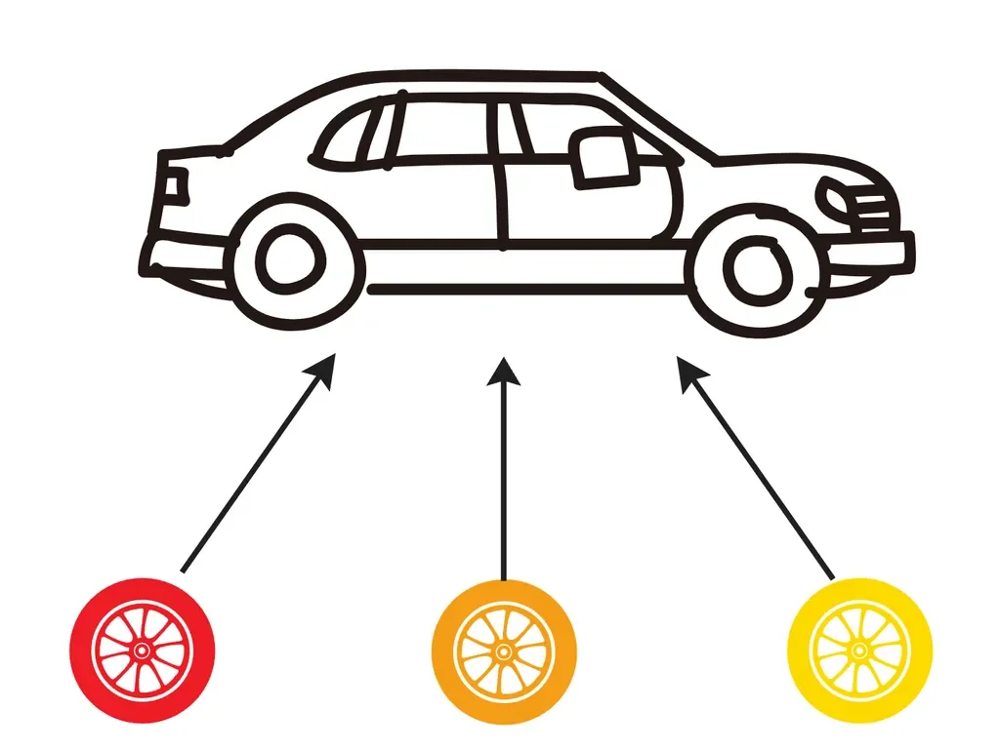
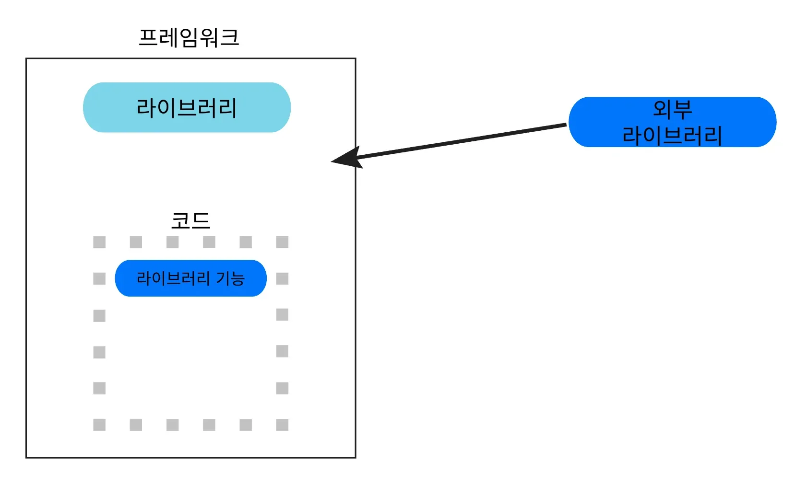

> 
> 
> 
> 
> 목차
> 
> - [프레임워크](#25beda9b0fe18019a494ce3da775db6d)
> - [라이브러리](#25beda9b0fe18038a9ebef1be5f51682)
> - [정리](#25beda9b0fe18030829fdfb4b5be8196)

## 프레임워크

---

> 📖 
> 
> 
> 
> 소프트웨어 개발을 간편하게 만들기 위한 소프트웨어 개발 환경이다&#46;
> 
> 
> 
> 
> 
> 프레임워크는 <code>frame(틀)</code>, <code>work(일하다)</code>의 합성어로 일하기 위한 공통된 기본 틀을 의미한다&#46; 즉, 고정된 형태를 통해 빠르게 서비스 구축이 가능하다&#46;  그러나 이에 따른 유연성은 떨어질 수 있다&#46;

장•단점

- 장점
    - 개발 프로젝트에 <strong><u>일관된 구조를 제공</u></strong>하여 <strong><u>코드의 일관성과 가독성을 높</u></strong>여주고, <strong><u>팀 협업을 편리</u></strong>하게 해준다&#46; 

    - 기본적으로 필요한 기능과 도구를 제공하여 <strong><u>개발자들이 핵심 비지니스 로직에 집중</u></strong> 가능하도록 한다&#46;

    - <strong>보안 관련 기능을 기본적으로 제공</strong>하여 보안 취약점을 방지하는데 도움을 준다&#46; 

    - 통합된 테스트 환경 및 도구를 제공하여 테스트를 쉽게 작성하고 실행 가능하도록 해준다 &#46;

    - 인기 있는 프레임워크는 방대한 커뮤니티 지원을 받으며, 다양한 문서 활용이 가능하다&#46; 

- 단점
    - 프레임워크는 광장히 복잡한 구조를 가지기 때문에, 처음 익히는데 시간이 많이 소요된다&#46;

    - 프레임워크의 새로운 버전이 기존 코드와 호환되지 않을 수 있다&#46; 

    - 정해진 규칙과 구조를 따르게 강제하여 자유롭게 변경하기 어려울 수 있다&#46;

## 라이브러리

---

> 📖 
> 
> 
> 
> 애플리케이션 <strong><u>개발에 필요한 </u></strong><strong><u>클래스, 함수 등을 모아 놓은 코드의 모음</u></strong>을 의미한다&#46; 마치 도서관에 있는 책처럼 개발자가 소프트웨어를 만들 때 필요에 따라 원하는 기능을 구한하기 위해 가져다 쓸 수 있는 일종의 도구 역할을 수행한다&#46; 

ex) &#91;비유&#93; 자동차 &#45; 바퀴

- 자동차의 바퀴는 다양한 브랜드가 존재하고, 필요한 타이어를 사용할 수 있다&#46; 

- 이와 같이 특정 기능들에 여러 라이브러리들이 존재하고 

장•단점

- 장점
    - 복잡한 코드를 직접 작성하지 않아 개발 생산성이 높아진다&#46; 

    - 검증된 라이브러리는 테스트와 커뮤니티 지원을 통해 안정성과 품질이 보장된다&#46;

- 단점
    - 라이브러리가 <strong>업데이트</strong><strong> 되거나 </strong><strong>지원이 중단</strong><strong>될 경우 </strong><strong><u>문제가 발생</u></strong>할 수 있다&#46;

    - <strong>버전 호환성 문제</strong>로 인해 <strong><u>다른 라이브러리나 기존 코드와 충돌이 발생</u></strong>할 수 있다&#46; 

    - 불필요한 기능을 포함한 라이브러리를 사용하면 비효율적이다&#46; 

    - 라이브러리 내부 구현을 직접 수정하기 어려워, 특정 요구사항에 맞게 조정하기 힘들 수 있다&#46;

## 정리

---

- <strong>프레임워크</strong>
    - 애플리케이션을 개발할 때 전체적인 구조(frame)를 잡기 위해 사용하는 것

    - 기본적으로 프레임워크 내에서 사용하는 라이브러리들이 존재한다&#46;

- <strong>라이브러리</strong>
    - 개발을 진행하는 과정에서 필요한 기능을 구현하기 위해 사용하는
