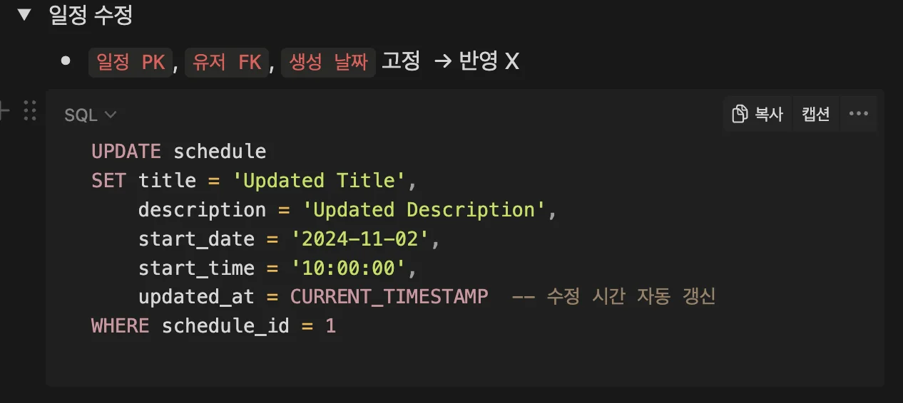
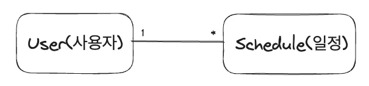
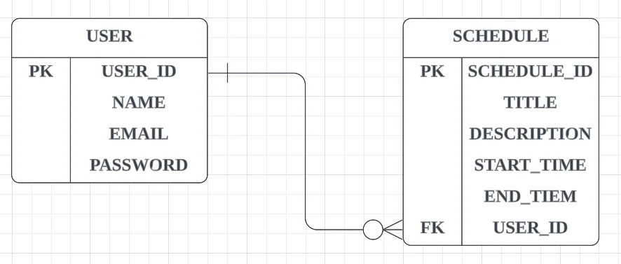
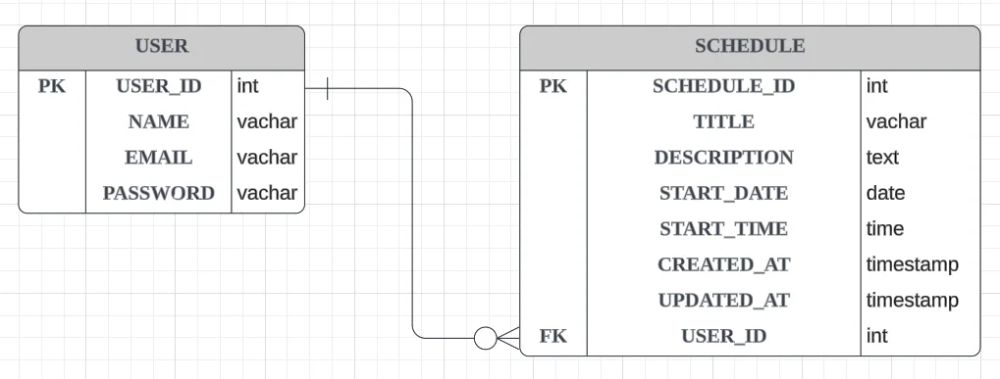
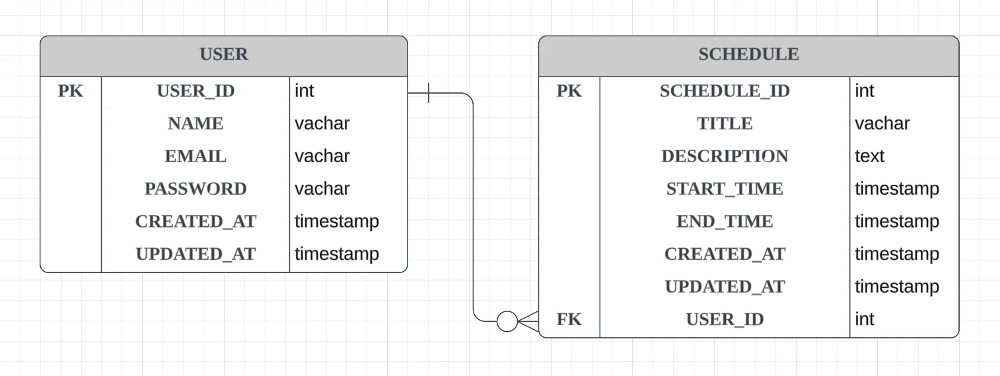

> 📌 
> 
> - [x] 이번 주 금요일까지 <code>Lv 0</code> 검사 받기
>     - [x] API 명세서 작성
> 
>     - [x] ERD 작성
> 
>     - [x] SQL 작성

<details>
<summary>의문점</summary>

<details>
<summary>질문1</summary>

- [x] 일정 테이블의 FK(외래키)로 사용할 유저의 id 값을 어떻게 클라이언트에서 받아서 넘겨주는가?

- 1) 쿼리 파라미터&#46;  → 어떻게 표시하는가? 

- 2) 메세지 바디 

- 둘다 사용해도 된다&#46; 
    - &#64;PathVariable   

    - &#64;RequsetParam 
        - 숨겨야 되는 경우, 메시지 바디에 넣어서 사용

</details>

<details>
<summary>질문2</summary>

- [x] 이미 리소스의 이름이 앞 계층에 명시 되었다&#46; 따라서 id 명시할때, id 만을 사용하는가<br>아니면 도메인Id를 사용하는가?
    - ex)
        - /api/users/{userId}

        - /api/schedules/{scheduleId}

    - 동시에 사용 시 구분을 위해서 명확하게 표현해야한다&#46;
        <a id="131eda9b0fe18020a87ee52935307975"></a>

        → Id로 명시하면, 스프링에서 옵션으로 다시 변수명을 수정해야 함

        <a id="131eda9b0fe18002a074d29a78255a69"></a>

        → 

    - 카멜케이스 사용 
        <a id="131eda9b0fe1800281f5df0e38b4d241"></a>

        → 자바에서는 변수명을 카멜케이스를 사용하여 작성한다&#46; 

        <a id="131eda9b0fe180bdbae7de9c595ca4e0"></a>

        → 따라서 DB에서 명명 방법처럼 <code>snake&#95;case</code>(<code>&#95;</code>) 를 사용하여 작성하는 경우, 중간에 카멜케이스로 변경을 해줘야 하기 때문에 올바르지 않음

</details>

<details>
<summary>질문3</summary>

- 유저 테이블에서 테이블 아이디 값 자동생성된다&#46;

- 회원 생성 시, 클라이언트로 유저의 컬럼의 아이디 값을 보관한다&#46;
    <a id="131eda9b0fe18098b0fbccc30d8b6177"></a>

    → 로그인 시에, 토큰에 회원을 식별하는 정보가 있고 해당 정보로 요청을 하는 건가?

</details>

<details>
<summary>질문 4 &#45; 201 상태 코드 사용</summary>

- [x] 🧐  201 created를 사용하는 것이 좋지 않나?  → 질문하기 
    <a id="131eda9b0fe180e59c5aec9a4254ec58"></a>

      → 201을 받은 적이 한번도 없음,  이미 <code>post</code>로 생성을 명시함

    <a id="131eda9b0fe1808f97c5d105d0f1e540"></a>

    따라서  하기 때문에 201을 사용하는 건 중복 표현

</details>

<details>
<summary>질문 5 &#45; <code>path variable</code>로 넘기는 id 값, body에 중복으로 담아서 요청</summary>

- [x] 🧐<code>path variable</code>로 <u>id 값</u>을 넘기는데 <code>body</code> 또 담아 넘기는 것은 중복 아닌가?

- [x] 🧐 회원 고유의 ID 값도 같이 반환해야 하는가? 
    - 중복 맞음, 둘 중 하나만 사용

    - path variable → userId 
        - request Body 에는 제외한다&#46; 그 반대도 성립 

</details>

<details>
<summary>질문 6</summary>

<a id="132eda9b0fe180a68f3dec0aa0919386"></a>

로그인을 진행하지 않고, 클라이언트도 붙이기 않기 때문에  간단하게 <code>/user</code>로 명시

> 🧐 보통 회원 가입 페이지에서  등록을 하기 때문에 <code>/signup</code> 이 맞는 설계아닌가? → 질문

<a id="132eda9b0fe180cc91b6fa7d9a352af9"></a>

→ 이후 그 상황에 대한 고민, 로그인으로 유저 정보를 인증할 시에는 맞는 표현이라고 하심

</details>

<details>
<summary>🧐 userId로 user를 명시하는데, users 라는 리소스를 엔트포인트에 넣어야 하는가?</summary>

- <code>/schedules/users/{userId}</code>

- 팀에 따라 다르다&#46; 소통 필요

- 넣는 것으로 계층을 구분한다&#46; 

</details>

<details>
<summary> 🧐 수정 시 필요없는 FK 값 같이 보내야 하는가? </summary>

<details>
<summary>고민 </summary>

-  수정, 조회 API의 엔드포인트에서 path variable로 전달하는 유저 리소스 및 userId를 제거하였다&#46; 

- 해당 값은 생성 시 DB에서 자동 생성되고 보관한다&#46; 즉, 변경이 되지 않는데 Request Body에  넣어서 같이 보내야 하는가?
    - 삭제는 상관없음

    - 수정 시, 이미 DB에 보관되고 변경되지 않는 FK 값인 userId를 일정 수정 데이터와 같이 보내야 하는가? 

</details>

<details>
<summary>해결</summary>



- 위 일정 업데이트 시, 작성한 쿼리를 보면 FK 값인 userId는 다루지 않는다&#46; 

- 따라서 해당 값은 필요하지 않다&#46; 

- 논리적으로 판단하면 제거하는 것이 옳다&#46;

- [ ] 🧐 그러나 url 상에서 유저에 속한 일정임을 명시하기 위해 표시해야 하는가?
    - 예시 url 
        - <code>users/{userId}/schedules/{scheduleId}</code>

        - <code>/schedules/{scheduleId}</code>

</details>

</details>

</details>

<details>
<summary>피드백 </summary>

- [x] null 가능성 → NULL 체크
    - 필수 값 여부와 중복된 표현 같음 → 질문

- [x] restful API 사용 시  복수형으로 사용해야 한다&#46;  
    - user → users

    - schedule → schedules

- [x] HTTP 상태코드  변경
    - 성공 &#45;  <code>200 OK</code> 
        - 다른 상태코드(<code>201</code>, <code>204</code> …) 는 잘 안쓴다&#46;

<details>
<summary>리소스 설계 시 순서 문제 고민 → 어떤 것을 먼저 서술할 것인가? </summary>

- users, schedules
    - 수정 및 삭제 시, 일정 PK 값만으로도 컬럼 구분이 가능하다&#46; 

    -  따라서 수정, 삭제 api에 유저 리소스를 삭제함
        - <code>/schedules/{scheduleId}</code> 

    - 가독성을 위해 <code>유저</code> 와 <code>일정</code>의  리소스 위치를 변경함
        - <code>/users/{userId}/schedules/{scheduleId}</code><br>→ <code>/schedules/{scheduleId}/users/{userId}</code>

</details>

<details>
<summary>시간 날짜 → 두개를 합쳐서 쓰는가?, 한번에 쓰는가? 고민 후 사용해야 한다&#46; </summary>

- 프론트에서 두 개를 합쳐 쓰는 경우가 많다면 
    - 나누면 일일이 합치는 연산을 추가로 해야한다 → 이 경우 붙여씀
        <a id="131eda9b0fe1805291ccffd8bdac06d8"></a>

        → 서비스를 보고서 트레이드 오프를 한다&#46; 

</details>

<details>
<summary>jpa를 잘 쓰려면 → 데이터베이스 공부 </summary>

- 쿼리를 잘써야만 더 고급상황에서 잘 다룰 수 있다&#46; 

</details>

<details>
<summary>Insert </summary>

- now 함수  → 포멧  → 4개 연산 
    - 비효율적 

    - 자바에서 로컬데이터 타입 가져와서 스프릿해서 넣어주는게 더 저렴한 연산처리가 된다&#46; 
        <a id="131eda9b0fe1800a8c03ee1b53f3d78e"></a>

        → 날짜만 가져오는 함수, 시간만 가져오는 함수 

        <a id="131eda9b0fe180d78e8addb36e74f3e0"></a>

        → now  → 시간 → 짤라서 

        <a id="131eda9b0fe1804e9fb0cfc8d856a965"></a>

        → curdate 함수 

        <a id="131eda9b0fe18085aeacf2c0158482ff"></a>

        → 시간함수 검색해서 잘 써보기 

        <a id="131eda9b0fe18074a826cfe917b75b87"></a>

        Mysql 날짜만 처리 → 2번연산 

        <a id="131eda9b0fe180428739fec0fe166c1c"></a>

        크게 차이 안남 → 편의성을 따라서 

        <a id="131eda9b0fe180ff90e2cf567a66722b"></a>

        고려사항 하드웨어 스펙 고려

        <a id="131eda9b0fe18062aaa3dbc8ebe8e2c1"></a>

        → DB 스펙이 안좋다&#46; 

        <a id="131eda9b0fe1807f90fdf0f52f911b02"></a>

        → 자바 CPU가 좋다 &#46;

        <a id="131eda9b0fe180b79d84d19943b99d5c"></a>

        → 그럼 자바에서 처리한다&#46; 

        <a id="131eda9b0fe1803ea0f1c7fa480593e9"></a>

        → 현실적으로는 자바가 더 싸다&#46; 메모리에서 

        <a id="131eda9b0fe1807fb90ec92d9741ace4"></a>

        → DB에서는 잘 안시킨다&#46; 

        <a id="131eda9b0fe180bfb49aeb5e26da7011"></a>

        → 자바에서 시간을 다루는 건 큰 비용을 든다&#46; 

</details>

</details>

---

<a id="12feda9b0fe1806d99c8f0f9f9854582"></a>

### 도메인



- 사용자 와 일정은 일대다 <code>1&#58;N</code> 의 관계를 갖는다&#46;
    - 한 명의 사용자는 여러 개 일정을 가질 수 있다&#46; 

<a id="130eda9b0fe18088947ce9aad4ab8273"></a>

### API 설계

---

<a id="137eda9b0fe180ecaeb3d4be0d436c9e"></a>

### 일정( Schedule )

[일정 등록](#/post/137eda9b-0fe1-81a9-98ed-dd92c4bfc6cf)

[일정 조회](#/post/137eda9b-0fe1-81f5-98c6-e3dfd0f4fe9b)

[전체 일정 조회](#/post/137eda9b-0fe1-81c9-ae01-d3c414bf1945)

[일정 수정](#/post/137eda9b-0fe1-8169-a23e-c392119f399b)

[일정 삭제](#/post/137eda9b-0fe1-817c-bd2f-ce40c798b634)

<details>
<summary>일정 등록 </summary>

| <strong>메소드</strong> | <strong>요청 URL</strong> |
| --- | --- |
| POST | /schedules |

<details>
<summary>요청 데이터</summary>

> <code>POST /schedules/users/{userId} HTTP 1&#46;1</code>

- startTime 값 하나만 입력 받을 시, endTime e도 동일하게 설정

- 처음 등록 시 createAt, updateAt  생성 시간으로 동일하게 등록됨

| 파라미터 | 타입 | 필수여부 | NULL CHECK | 설명 |
| --- | --- | --- | --- | --- |
| title | string | Y | NOT NULL |     일정 제목 |
| description | string | <code>N</code> | <code>NULLABLE</code> |     일정 설명 |
| startTitme | Timestamp | Y | NOT NULL | 일정 시작 시간 |
| endTime | Timestamp | Y | NOT NULL | 일정 마침 시간 |
| createdAt | Timestamp | Y | NOT NULL |    생성 시간 |
| updatedAt | Timestamp | Y | NOT NULL |     수정 시간 |

</details>

<details>
<summary>응답 데이터  </summary>

<details>
<summary>성공</summary>

> PRG 패턴 고려하여 설계

- <code>303 See Other</code>
    - redirect → 생성된 일정 상세보기  화면 
        - location&#58; 생성 일정 상세보기 url

- <code>200 OK</code>
    - 일정 생성 후, 생성된 일정 상세보기 보여줌 
        - GET 요청 

    | 파라미터 | 타입 | 필수여부 | NULL CHECK | 설명 |
    | --- | --- | --- | --- | --- |
    | scheduleId | int | Y | NOT NULL |     스케줄 id |
    | title | string | Y | NOT NULL |     일정 제목 |
    | description | string | <code>N</code> | <code>NULLABLE</code> |     일정 설명 |
    | startTitme | Timestamp | Y | NOT NULL | 일정 시작 시간 |
    | endTime | Timestamp | Y | NOT NULL | 일정 마침 시간 |
    | createdAt | Timestamp | Y | NOT NULL |    생성 시간 |
    | updatedAt | Timestamp | Y | NOT NULL |     수정 시간 |

</details>

<details>
<summary>실패</summary>

- <code>400 Bad Request</code>
    - 클라이언트에서 잘못된 문법으로 요청 보냄

</details>

</details>

<details>
<summary>예제 </summary>

<details>
<summary>요청 </summary>

<a id="137eda9b0fe18108982cc5b32717fd80"></a>

```json
{
		"title": "아침 회의",
		"description": "팀원들간의 인사 및 컨디션, 일정 확인",
		"startTime": "2024-11-01 09:00:00",
		"endTime": "2024-11-01 09:30:00",
		"createdAt": "2024-11-01 08:00:00",
		"updatedAt": "2024-11-01 08:00:00"
}
```

</details>

<details>
<summary>응답 </summary>

<a id="137eda9b0fe18175a05cce8c89e97dee"></a>

```json
{
		"scheduleId": 1,
		"title": "아침 회의",
		"description": "팀원들간의 인사 및 컨디션, 일정 확인",
		"startTime": "2024-11-01 09:00:00",
		"endTime": "2024-11-01 09:30:00",
		"createdAt": "2024-11-01 08:00:00",
		"updatedAt": "2024-11-01 08:00:00"
}
```

</details>

</details>

</details>

<details>
<summary>특정 일정 정보 조회</summary>

> 회원 정보 상세보기를 클릭 시 발생

| <strong>메소드</strong> | <strong>요청 URL</strong> |
| --- | --- |
| GET | /schedules/{scheduleId}/users/{userId} |
|  |  |

<details>
<summary>요청 데이터</summary>

- path variable로 일정 및 유저의 id 값 넘김

| 파라미터  | 타입 | 필수 여부 | NULL CHECK | 설명 |
| --- | --- | --- | --- | --- |
| scheduleId | int | Y | NOT NULL | 일정을 식별할 ID 값 |
| userId | int | Y | NOT NULL | 회원을 식별할 ID 값 |

</details>

<details>
<summary>응답 데이터 </summary>

<details>
<summary>성공</summary>

- <code>200 OK</code> &#45; 정상 응답

| 파라미터 | 타입 | 필수여부 | NULL CHECK | 설명 |
| --- | --- | --- | --- | --- |
| scheduleId | int | Y | NOT NULL |     스케줄 id |
| title | string | Y | NOT NULL |     일정 제목 |
| description | string | <code>N</code> | <code>NULLABLE</code> |     일정 설명 |
| startTitme | Timestamp | Y | NOT NULL | 일정 시작 시간 |
| endTime | Timestamp | Y | NOT NULL | 일정 마침 시간 |
| createdAt | Timestamp | Y | NOT NULL |    생성 시간 |
| updatedAt | Timestamp | Y | NOT NULL |     수정 시간 |

</details>

<details>
<summary>실패</summary>

- <code>400 Bad Request</code>
    - 잘못된 문법의 요청인경우 

- <code>404 Not Found</code>
    - 해당하는 회원이 없는 경우

</details>

</details>

<details>
<summary>예제 </summary>

- 요청  &#45; GET /user/<code>1</code>/schecule/<code>2</code> HTTP 1&#46;1

<details>
<summary>응답 </summary>

<a id="137eda9b0fe1813c873dff4c069ca075"></a>

```json
{
		"schedule_id": 2,
		"title": "저녁 회의",
		"description": "하루 일정 확인 및 스터디 진행",
		"startTime": "2024-11-01 19:00:00",
		"endTime": "2024-11-01 20:00:00",
		"createdAt": "2024-11-01 05:15:45",
		"updatedAt": "2024-11-01 06:13:43"
		"userId": 1;
},
```

</details>

</details>

</details>

<details>
<summary>일정 정보 조회</summary>

> 일정 전체보기 

| <strong>메소드</strong> | <strong>요청 URL</strong> |
| --- | --- |
| GET | /schedules/users/{userId} |

<details>
<summary>요청 데이터</summary>

- <code>path variable</code>로 유저의 id 값 넘김

| 파라미터  | 타입 | 필수 여부 | NULL CHECK | 설명 |
| --- | --- | --- | --- | --- |
| userId | int | Y | NOT NULL | 회원을 식별할 ID 값 |

</details>

<details>
<summary>응답 데이터</summary>

<details>
<summary>성공</summary>

- <code>200 Ok</code>

| 파라미터 | 타입 | 필수여부 | NULL CHECK | 설명 |
| --- | --- | --- | --- | --- |
| scheduleId | int | Y | NOT NULL |     스케줄 id |
| title | string | Y | NOT NULL |     일정 제목 |
| description | string | <code>N</code> | <code>NULLABLE</code> |     일정 설명 |
| startTitme | Timestamp | Y | NOT NULL | 일정 시작 시간 |
| endTime | Timestamp | Y | NOT NULL | 일정 마침 시간 |
| createdAt | Timestamp | Y | NOT NULL |    생성 시간 |
| updatedAt | Timestamp | Y | NOT NULL |     수정 시간 |

</details>

<details>
<summary>실패</summary>

- <code>400 Bad Request</code>

-  <code>404 Not Found</code>

</details>

</details>

<details>
<summary>예제</summary>

- 요청 
    - GET /user/<code>1</code>/schedule HTTP 1&#46;1

- 응답
    <a id="137eda9b0fe1813987cdc16ca0343d74"></a>

    ```sql
    results : {
    						0: {
    									"schedule_id": 1,
    									"title": "아침 회의",
    									"description": "아침 컨디션 확인 및 일정 공유",
    									"startTime": "2024-11-01 09:00:00",
    									"endTime": "2024-11-01 09:30:00",
    									"createdAt": "2024-11-01 05:10:45",
    									"updatedAt": "2024-11-01 06:10:43"
    									"userId": 1;
    							},,
    							 
    						1: {
    									"schedule_id": 2,
    									"title": "저녁 회의",
    									"description": "하루 일정 확인 및 스터디 진행",
    									"startTime": "2024-11-01 19:00:00",
    									"endTime": "2024-11-01 20:00:00",
    									"createdAt": "2024-11-01 05:15:45",
    									"updatedAt": "2024-11-01 06:13:43"
    									"userId": 1;
    							},
    							
    							 .  .  .
    				}
    ```

</details>

</details>

<details>
<summary>일정 정보 수정</summary>

<details>
<summary>🤬 1차 &#45; 수정 엔드포인트 설게</summary>

<a id="137eda9b0fe181fd956dc9b8af6b52ab"></a>

<code>/users/{userId}/schedules/{scheduleId}</code>

- 일정 id 값만으로 구분이 가능함

- 따라서 굳이 <code>userId</code>를 pathVariable로 넘길 이유가 없음

</details>

> 회원 정보 창에서 수정 버튼 클릭 시, 트리거 발생 

| <strong>메소드</strong> | <strong>요청 URL</strong> |
| --- | --- |
| PUT | /schedules/{scheduleId} |

<details>
<summary>요청 데이터 </summary>

> PUT /schedules/<code>{scheduleId}</code> HTTP 1&#46;0

- path variable로 <code>scheduleId</code> 넘김

| 파라미터 | 타입 | 필수여부 | NULL CHECK | 설명 |
| --- | --- | --- | --- | --- |
| title | string | Y | NOT NULL |     일정 제목 |
| description | string | <code>N</code> | <code>NULLABLE</code> |     일정 설명 |
| startTitme | Timestamp | Y | NOT NULL | 일정 시작 시간 |
| endTime | Timestamp | Y | NOT NULL | 일정 마침 시간 |
| createdAt | Timestamp | Y | NOT NULL |    생성 시간 |
| updatedAt | Timestamp | Y | NOT NULL |     수정 시간 |
| userId | int | Y | NOT NULL  |      회원 ID |

</details>

<details>
<summary>응답  데이터</summary>

<details>
<summary>성공</summary>

- <code>303 See Other</code>
    - 수정 후, 일정 상태보기 화면으로 redirect 

    - Location&#58; <code>schedule/{scheduleId}</code>

- <code>200 OK</code>
    - 일정 수정 후 해당 일정 상세보기 화면  GET 요청
        - <code>GET schedule/{scheduleId} HTTP 1&#46;1</code>

    | 파라미터 | 타입 | 필수여부 | NULL CHECK | 설명 |
    | --- | --- | --- | --- | --- |
    | scheduleId | int | Y | NOT NULL  |      일정 ID |
    | title | string | Y | NOT NULL |     일정 제목 |
    | description | string | <code>N</code> | <code>NULLABLE</code> |     일정 설명 |
    | startTitme | Timestamp | Y | NOT NULL | 일정 시작 시간 |
    | endTime | Timestamp | Y | NOT NULL | 일정 마침 시간 |
    | createdAt | Timestamp | Y | NOT NULL |    생성 시간 |
    | updatedAt | Timestamp | Y | NOT NULL |     수정 시간 |
    | userId | int | Y | NOT NULL  |      회원 ID |

</details>

<details>
<summary>실패</summary>

- <code>400 Bad Request</code>
    - 잘못된 클라이언트 요청 → 문법 오류

- <code>500 Internet Server Error</code>

</details>

</details>

<details>
<summary>예제  </summary>

<details>
<summary>요청</summary>

- PUT  schedule/<code>2</code>  HTTP 1&#46;1

<a id="137eda9b0fe1814e8cdeffa824ccdb5e"></a>

```json
{
		"title": "저녁 회의",
		"description": "하루 일정 확인 및 스터디 진행",
		"startTime": "2024-11-01 19:00:00",
		"endTime": "2024-11-01 20:00:00",
		"createdAt": "2024-11-01 05:15:45",
		"updatedAt": "2024-11-01 06:13:43"
		"userId": 1;
},
```

</details>

<details>
<summary>응답 </summary>

- <code>303 See Other</code>
    - redirect  수정된 일정 상세보기 페이지
        - location&#58;  /schedule/<code>2</code>

- <code>200 OK</code>
    - GET  /schedule/<code>2</code> HTTP 1&#46;1

    <a id="137eda9b0fe181afb13eead1db96b138"></a>

    ```json
    {
    		"schedule_id": 2,
    		"title": "저녁 회의",
    		"description": "하루 일정 확인 및 스터디 진행",
    		"startTime": "2024-11-01 19:00:00",
    		"endTime": "2024-11-01 20:00:00",
    		"createdAt": "2024-11-01 05:15:45",
    		"updatedAt": "2024-11-01 06:13:43"
    		"userId": 1;
    }
    ```

</details>

</details>

</details>

<details>
<summary>일정 삭제</summary>

<details>
<summary>🤬 1차 &#45; 삭제 엔드포인트 설게</summary>

<a id="137eda9b0fe181b3832bf82296fb39c5"></a>

<code>/users/{userId}/schedules/{scheduleId}</code>

- 일정 id 값만으로 구분이 가능함

- 따라서 굳이 <code>userId</code>를 pathVariable로 넘길 이유가 없음

</details>

| <strong>메소드</strong> | <strong>요청 URL</strong> |
| --- | --- |
| DELETE | /schedules/{scheduleId} |

<details>
<summary>요청 데이터</summary>

> <code>DELETE /schedules/{scheduleId} HTTP 1&#46;1</code>
> 
> - ex) DELETE /schedules/<code>1</code> HTTP 1&#46;1

</details>

<details>
<summary>응답 데이터 </summary>

<details>
<summary>성공</summary>

-  <code>200 Ok</code>
    - HTTP 1&#46;1 <code>200 OK</code>

    - <code>204</code>를 사용하여 명시 했으나, <br>실무에서는 <code>200 OK</code> 외 다른 상태코드는 잘 안쓴다고 하심

</details>

<details>
<summary>실패</summary>

- <code>400 Bad Request</code> 
    - 잘못된 문법으로 요청 

- <code>404 Not Found</code>
    - 해당하는 회원 존재 ❌

</details>

</details>

</details>

<details>
<summary>추가</summary>

<a id="130eda9b0fe18099a437d1886b0d1d87"></a>

### 회원 ( User )

[회원 등록](#/post/130eda9b-0fe1-813f-9f08-f9bd0e258258)

[회원 정보 조회](#/post/130eda9b-0fe1-81d7-916b-d5f57939447f)

[회원 정보 수정](#/post/130eda9b-0fe1-8143-aba8-d51a08149d38)

[회원 삭제](#/post/130eda9b-0fe1-81bf-8992-edeaba6e6aac)

---

<details>
<summary>회원 등록 </summary>

| <strong>메소드</strong> | <strong>요청 URL</strong> |
| --- | --- |
| POST | /users |

<details>
<summary>요청 데이터 </summary>

> <code>POST /users HTTP 1&#46;1</code> 

- 파라미터 JSON 형태로 넘김

| 파라미터 | 데이터 타입 | 필수 여부 | NULL CHECK | 설명 |
| --- | --- | --- | --- | --- |
| name | string | Y | NOT NULL | 회원 이름 |
| email | string | Y | NOT NULL, UNIQUE | 회원 이메일 |
| password | string | Y | NOT NULL | 회원 비밀번호 |
| createdAt | timestamp | Y | NOT NULL | 생성 일자 |
| updatedAt | timestamp | Y | NOT NULL | 수정 일자 |

</details>

<details>
<summary>응답 데이터</summary>

<details>
<summary>성공 </summary>

- <code>303 Found</code>
    - 요청 확인 후 로그인 페이지로 redirect

    - location&#58; /login

    - 본문 내용이 필요 없기 때문에  303으로 명시 

- <strong><code>201 Created</code></strong>
    | 파라미터 | 타입 | 필수 여부  | NULL CHECK | 설명 |
    | --- | --- | --- | --- | --- |
    | userId | Long | Y | NOT NULL | 회원 식별을 위한 고유 ID |

</details>

<details>
<summary>실패</summary>

- <code>400 Bad Request</code>

- <code>500 </code><strong><code>Internal Server Error</code></strong>

</details>

</details>

<details>
<summary>예제 </summary>

<details>
<summary>요청 </summary>

<a id="131eda9b0fe1802a9d5aea696dd3b8bb"></a>

```json
{
	 "name": "LEE",
	 "email": "test123@gmail.com",
	 "password": "1234" 
	 "createdAt": "2024-11-01",
	 "updatedAt": NULL
}
```

</details>

<details>
<summary>응답</summary>

<a id="131eda9b0fe18049bddfedfecd5af344"></a>

```json
{ 
	 "userId":  {자동 생성 값, AUTO_INCREMENT}
} 	
```

</details>

</details>

</details>

<details>
<summary>회원 정보 조회</summary>

> 회원 정보 상세보기를 클릭 시 발생

| <strong>메소드</strong> | <strong>요청 URL</strong> |
| --- | --- |
| GET | /users/{userId} |

<details>
<summary>요청 데이터 </summary>

> <code>GET /users/{userId} HTTP 1&#46;1</code>

- path variable로 유저를 식별할 id 값 넘김
    | 파라미터  | 타입 | 필수 여부 | NULL CHECK | 설명 |
    | --- | --- | --- | --- | --- |
    | userId | int | Y | NOT NULL | 회원을 식별할 ID 값 |

</details>

<details>
<summary>응답 데이터 </summary>

<details>
<summary>성공 </summary>

- <code>200 OK</code>

| 파라미터 | 타입 | 필수 여부 | NULL CHECK | 설명 |
| --- | --- | --- | --- | --- |
| userId | int | Y | NOT NULL | 회원 id |
| name | string | Y | NOT NULL | 회원 이름  |
| email | string | Y | NOT NULL,<br>UNIQUE | 회원 이메일 |
| password | string | Y | NOT NULL | 회원 패스워드 |
| createdAt | timestamp | Y | NOT NULL | 생성 일자 |
| updatedAt | timestamp | Y | NOT NULL | 수정 일자  |

</details>

<details>
<summary>실패</summary>

- <code>400 Bad Request</code>
    - 잘못된 문법의 요청인경우 

- <code>404 Not Found</code>
    - 해당하는 회원이 없는 경우

</details>

</details>

<details>
<summary>예제 </summary>

<details>
<summary>요청 </summary>

- 유저 식별을 위해 <code>path variable</code>로 id 값만 넘김 
    - GET /users/<code>1</code> HTTP 1&#46;1

</details>

<details>
<summary>응답 </summary>

<a id="131eda9b0fe18013996be1fe8e90d5d5"></a>

```json
{
	 "usrId": 1,
	 "name": "LEE",
	 "email": "test123@gmail.com",
	 "password": "1234" 
	 "createdAt": "2024-11-01",
	 "updatedAt": NULL
}
```

</details>

</details>

</details>

<details>
<summary>회원 정보 수정</summary>

> 회원 정보 창에서 수정 버튼 클릭 시, 트리거 발생
> 
> - 부분 수정으로 설계  →  <code>PATCH</code> 

| <strong>메소드</strong> | <strong>요청 URL</strong> |
| --- | --- |
| PATCH | /users/{userId} |

<details>
<summary>요청 데이터</summary>

> <code>PATCH /users/{userId} HTTP 1&#46;1</code>

> ⚠️ 
> 
> <a id="131eda9b0fe180f89622f1b20cafc8e7"></a>
> 
> <code>PATCH</code> 요청이기 때문에, 부분적으로 업데이트 가능 
> 
> <a id="49c73e04bd2848fb8fb8c744a8b98871"></a>
> 
> 따라서 빈 값으로 들어오는 경우, <u>예외 처리 필요</u>함

| 파라미터 | 타입 | 필수여부 | NULL CHECK | 설명 |
| --- | --- | --- | --- | --- |
| name | string | <code>N</code> | <code>NULLABLE</code> | 회원 이름 id |
| email | string | <code>N</code> | <code>NULLABLE</code> | 회원 id |
| password | string | <code>N</code> | <code>NULLABLE</code> |  회원 PW |
| updatedAt | timestamp | Y | NOT NULL | 수정 일자 |

</details>

<details>
<summary>응답 데이터 </summary>

<details>
<summary>성공</summary>

- <code>303 See Other</code>
    - 수정 후, 회원 상태보기 화면으로 redirect 

    - 회원 상세정보를 다시 GET 요청을 하기 때문에 본문 유지 필요 X<br> → 303으로 명시

    - location&#58; <code>/users/{userId}</code> &#45; 회원 정보 상세보기 화면 

- <code>200 OK </code>
    > <code>GET /user/{userId} HTTP 1&#46;1</code>
    > 
    > - 수정된 회원 정보 GET 요청 

    | 파라미터 | 타입 | 필수여부 | NULL CHECK | 설명 |
    | --- | --- | --- | --- | --- |
    | userId | int | Y | NOT NULL | 유저 아이디 |
    | name | string | Y | NOT NULL | 회원 이름  |
    | email | string | Y | NOT NULL,<br>UNIQUE | 회원 이메일 |
    | createdAt | timestamp | Y | NOT NULL | 생성 일자 |
    | updatedAt | timestamp | Y | NOT NULL | 수정 일자 |

</details>

<details>
<summary>실패</summary>

- <code>400 Bad Request</code>
    - 잘못된 클라이언트 요청 → 문법 오류

- <code>500 Internal Server Error</code>

</details>

</details>

<details>
<summary>예제 </summary>

<details>
<summary>요청 </summary>

> PATCH  /users/1 HTTP 1&#46;1

<a id="578a461fd08e4865beedc9b75a2d7c4f"></a>

```json
// 수정된 내용
{
	"name": "LEE2"
	"updatedAt": "2024-11-02 10:30:45"
}
```

</details>

<details>
<summary>응답 </summary>

<details>
<summary>성공 </summary>

- <code>200 OK</code>

<a id="94e608c812a14f7584a97182a4453917"></a>

```json

{
	 "user_id": 1
	 "name": "LEE2",
	 "email": "test123@gmail.com",
	 "password": "1234" 
	 "createdAt": "2024-11-01 09:32:40"
	 "updatedAt": "2024-11-02 10:30:45"
}
```

</details>

<details>
<summary>실패 </summary>

- <code>400 Bad Request</code>
    - 잘못된 클라이언트 요청 → 문법 오류

- <code>500 Internal Server Error</code>

</details>

</details>

</details>

</details>

<details>
<summary>회원 삭제</summary>

| <strong>메소드</strong> | <strong>요청 URL</strong> |
| --- | --- |
| DELETE | /users/{userId} |

<details>
<summary>요청 데이터 </summary>

- <code>path variable</code>로 유저를 식별할 id 값 넘김
    - DELETE /users/<code>1</code> HTTP 1&#46;1
        | 파라미터  | 타입 | 필수 여부 | NULL CHECK | 설명 |
        | --- | --- | --- | --- | --- |
        | userId | int | Y | NOT NULL | 회원을 식별할 ID 값 |

</details>

<details>
<summary>응답 데이터</summary>

- 성공&#58;  <code>200 OK</code>
    - 삭제 후, 반환할 본문이 없기 때문에 204로 명시 

- 실패
    - <code>400 Bad Request</code> 
        - 잘못된 문법으로 요청 

    - <code>404 Not Found</code>
        - 해당하는 회원 존재 ❌

</details>

</details>

---

<details>
<summary><code>생성 일자</code>, <code>수정 일자</code></summary>

- timestamp 형식
    - <strong>yyyy&#45;MM&#45;dd HH&#58;mm&#58;ss</strong>

- 처음 생성 시, <code>수정 일자</code>를 <code>생성 일자</code>과 동일하게 설정
    - 수정 시 업데이트

</details>

<a id="130eda9b0fe18059975ce7b7a7dda754"></a>

### 일정( Schedule )

[일정 등록](#/post/130eda9b-0fe1-8194-b40b-c21debee208b)

[일정 조회](#/post/130eda9b-0fe1-81c3-a458-c2e569c64fcb)

[전체 일정 조회](#/post/130eda9b-0fe1-813f-ad59-c2955f9218d2)

[일정 수정](#/post/130eda9b-0fe1-8147-b492-e0ac76a17ec1)

[일정 삭제](#/post/130eda9b-0fe1-8135-87a1-c9b8ca190a6c)

<details>
<summary>일정 등록 </summary>

| <strong>메소드</strong> | <strong>요청 URL</strong> |
| --- | --- |
| POST | /schedules/users/{userId} |

<details>
<summary>요청 데이터</summary>

> <code>POST /schedules/users/{userId} HTTP 1&#46;1</code>

- startTime 값 하나만 입력 받을 시, endTime e도 동일하게 설정

- 처음 등록 시 createAt, updateAt  생성 시간으로 동일하게 등록됨

| 파라미터 | 타입 | 필수여부 | NULL CHECK | 설명 |
| --- | --- | --- | --- | --- |
| title | string | Y | NOT NULL |     일정 제목 |
| description | string | <code>N</code> | <code>NULLABLE</code> |     일정 설명 |
| startTitme | Timestamp | Y | NOT NULL | 일정 시작 시간 |
| endTime | Timestamp | Y | NOT NULL | 일정 마침 시간 |
| createdAt | Timestamp | Y | NOT NULL |    생성 시간 |
| updatedAt | Timestamp | Y | NOT NULL |     수정 시간 |

</details>

<details>
<summary>응답 데이터  </summary>

<details>
<summary>성공</summary>

> PRG 패턴 고려하여 설계

- <code>303 See Other</code>
    - redirect → 생성된 일정 상세보기  화면 
        - location&#58; 생성 일정 상세보기 url

- <code>200 OK</code>
    - 일정 생성 후, 생성된 일정 상세보기 보여줌 
        - GET 요청 

    | 파라미터 | 타입 | 필수여부 | NULL CHECK | 설명 |
    | --- | --- | --- | --- | --- |
    | scheduleId | int | Y | NOT NULL |     스케줄 id |
    | title | string | Y | NOT NULL |     일정 제목 |
    | description | string | <code>N</code> | <code>NULLABLE</code> |     일정 설명 |
    | startTitme | Timestamp | Y | NOT NULL | 일정 시작 시간 |
    | endTime | Timestamp | Y | NOT NULL | 일정 마침 시간 |
    | createdAt | Timestamp | Y | NOT NULL |    생성 시간 |
    | updatedAt | Timestamp | Y | NOT NULL |     수정 시간 |

</details>

<details>
<summary>실패</summary>

- <code>400 Bad Request</code>
    - 클라이언트에서 잘못된 문법으로 요청 보냄

</details>

</details>

<details>
<summary>예제 </summary>

<details>
<summary>요청 </summary>

<a id="131eda9b0fe18184b851fce79ed94898"></a>

```json
{
		"title": "아침 회의",
		"description": "팀원들간의 인사 및 컨디션, 일정 확인",
		"startTime": "2024-11-01 09:00:00",
		"endTime": "2024-11-01 09:30:00",
		"createdAt": "2024-11-01 08:00:00",
		"updatedAt": "2024-11-01 08:00:00"
}
```

</details>

<details>
<summary>응답 </summary>

<a id="132eda9b0fe180c3ba67e6e9b9cf2c7e"></a>

```json
{
		"scheduleId": 1,
		"title": "아침 회의",
		"description": "팀원들간의 인사 및 컨디션, 일정 확인",
		"startTime": "2024-11-01 09:00:00",
		"endTime": "2024-11-01 09:30:00",
		"createdAt": "2024-11-01 08:00:00",
		"updatedAt": "2024-11-01 08:00:00"
}
```

</details>

</details>

</details>

<details>
<summary>특정 일정 정보 조회</summary>

> 회원 정보 상세보기를 클릭 시 발생

| <strong>메소드</strong> | <strong>요청 URL</strong> |
| --- | --- |
| GET | /schedules/{scheduleId}/users/{userId} |
|  |  |

<details>
<summary>요청 데이터</summary>

- path variable로 일정 및 유저의 id 값 넘김

| 파라미터  | 타입 | 필수 여부 | NULL CHECK | 설명 |
| --- | --- | --- | --- | --- |
| scheduleId | int | Y | NOT NULL | 일정을 식별할 ID 값 |
| userId | int | Y | NOT NULL | 회원을 식별할 ID 값 |

</details>

<details>
<summary>응답 데이터 </summary>

<details>
<summary>성공</summary>

- <code>200 OK</code> &#45; 정상 응답

| 파라미터 | 타입 | 필수여부 | NULL CHECK | 설명 |
| --- | --- | --- | --- | --- |
| scheduleId | int | Y | NOT NULL |     스케줄 id |
| title | string | Y | NOT NULL |     일정 제목 |
| description | string | <code>N</code> | <code>NULLABLE</code> |     일정 설명 |
| startTitme | Timestamp | Y | NOT NULL | 일정 시작 시간 |
| endTime | Timestamp | Y | NOT NULL | 일정 마침 시간 |
| createdAt | Timestamp | Y | NOT NULL |    생성 시간 |
| updatedAt | Timestamp | Y | NOT NULL |     수정 시간 |

</details>

<details>
<summary>실패</summary>

- <code>400 Bad Request</code>
    - 잘못된 문법의 요청인경우 

- <code>404 Not Found</code>
    - 해당하는 회원이 없는 경우

</details>

</details>

<details>
<summary>예제 </summary>

- 요청  &#45; GET /user/<code>1</code>/schecule/<code>2</code> HTTP 1&#46;1

<details>
<summary>응답 </summary>

<a id="131eda9b0fe18178957afd1c0c16957a"></a>

```json
{
		"schedule_id": 2,
		"title": "저녁 회의",
		"description": "하루 일정 확인 및 스터디 진행",
		"startTime": "2024-11-01 19:00:00",
		"endTime": "2024-11-01 20:00:00",
		"createdAt": "2024-11-01 05:15:45",
		"updatedAt": "2024-11-01 06:13:43"
		"userId": 1;
},
```

</details>

</details>

</details>

<details>
<summary>일정 정보 조회</summary>

> 일정 전체보기 

| <strong>메소드</strong> | <strong>요청 URL</strong> |
| --- | --- |
| GET | /schedules/users/{userId} |

<details>
<summary>요청 데이터</summary>

- <code>path variable</code>로 유저의 id 값 넘김

| 파라미터  | 타입 | 필수 여부 | NULL CHECK | 설명 |
| --- | --- | --- | --- | --- |
| userId | int | Y | NOT NULL | 회원을 식별할 ID 값 |

</details>

<details>
<summary>응답 데이터</summary>

<details>
<summary>성공</summary>

- <code>200 Ok</code>

| 파라미터 | 타입 | 필수여부 | NULL CHECK | 설명 |
| --- | --- | --- | --- | --- |
| scheduleId | int | Y | NOT NULL |     스케줄 id |
| title | string | Y | NOT NULL |     일정 제목 |
| description | string | <code>N</code> | <code>NULLABLE</code> |     일정 설명 |
| startTitme | Timestamp | Y | NOT NULL | 일정 시작 시간 |
| endTime | Timestamp | Y | NOT NULL | 일정 마침 시간 |
| createdAt | Timestamp | Y | NOT NULL |    생성 시간 |
| updatedAt | Timestamp | Y | NOT NULL |     수정 시간 |

</details>

<details>
<summary>실패</summary>

- <code>400 Bad Request</code>

-  <code>404 Not Found</code>

</details>

</details>

<details>
<summary>예제</summary>

- 요청 
    - GET /user/<code>1</code>/schedule HTTP 1&#46;1

- 응답
    <a id="131eda9b0fe180f6baf7d0c22266f56d"></a>

    ```sql
    results : {
    						0: {
    									"schedule_id": 1,
    									"title": "아침 회의",
    									"description": "아침 컨디션 확인 및 일정 공유",
    									"startTime": "2024-11-01 09:00:00",
    									"endTime": "2024-11-01 09:30:00",
    									"createdAt": "2024-11-01 05:10:45",
    									"updatedAt": "2024-11-01 06:10:43"
    									"userId": 1;
    							},,
    							 
    						1: {
    									"schedule_id": 2,
    									"title": "저녁 회의",
    									"description": "하루 일정 확인 및 스터디 진행",
    									"startTime": "2024-11-01 19:00:00",
    									"endTime": "2024-11-01 20:00:00",
    									"createdAt": "2024-11-01 05:15:45",
    									"updatedAt": "2024-11-01 06:13:43"
    									"userId": 1;
    							},
    							
    							 .  .  .
    				}
    ```

</details>

</details>

<details>
<summary>일정 정보 수정</summary>

<details>
<summary>🤬 1차 &#45; 수정 엔드포인트 설게</summary>

<a id="1ff241d693e24c44a6fa06a995176550"></a>

<code>/users/{userId}/schedules/{scheduleId}</code>

- 일정 id 값만으로 구분이 가능함

- 따라서 굳이 <code>userId</code>를 pathVariable로 넘길 이유가 없음

</details>

> 회원 정보 창에서 수정 버튼 클릭 시, 트리거 발생 

| <strong>메소드</strong> | <strong>요청 URL</strong> |
| --- | --- |
| PUT | /schedules/{scheduleId} |

<details>
<summary>요청 데이터 </summary>

> PUT /schedules/<code>{scheduleId}</code> HTTP 1&#46;0

- path variable로 <code>scheduleId</code> 넘김

| 파라미터 | 타입 | 필수여부 | NULL CHECK | 설명 |
| --- | --- | --- | --- | --- |
| title | string | Y | NOT NULL |     일정 제목 |
| description | string | <code>N</code> | <code>NULLABLE</code> |     일정 설명 |
| startTitme | Timestamp | Y | NOT NULL | 일정 시작 시간 |
| endTime | Timestamp | Y | NOT NULL | 일정 마침 시간 |
| createdAt | Timestamp | Y | NOT NULL |    생성 시간 |
| updatedAt | Timestamp | Y | NOT NULL |     수정 시간 |
| userId | int | Y | NOT NULL  |      회원 ID |

</details>

<details>
<summary>응답  데이터</summary>

<details>
<summary>성공</summary>

- <code>303 See Other</code>
    - 수정 후, 일정 상태보기 화면으로 redirect 

    - Location&#58; <code>schedule/{scheduleId}</code>

- <code>200 OK</code>
    - 일정 수정 후 해당 일정 상세보기 화면  GET 요청
        - <code>GET </code><code>schedule/{scheduleId</code><code>} HTTP 1&#46;1</code>

    | 파라미터 | 타입 | 필수여부 | NULL CHECK | 설명 |
    | --- | --- | --- | --- | --- |
    | scheduleId | int | Y | NOT NULL  |      일정 ID |
    | title | string | Y | NOT NULL |     일정 제목 |
    | description | string | <code>N</code> | <code>NULLABLE</code> |     일정 설명 |
    | startTitme | Timestamp | Y | NOT NULL | 일정 시작 시간 |
    | endTime | Timestamp | Y | NOT NULL | 일정 마침 시간 |
    | createdAt | Timestamp | Y | NOT NULL |    생성 시간 |
    | updatedAt | Timestamp | Y | NOT NULL |     수정 시간 |
    | userId | int | Y | NOT NULL  |      회원 ID |

</details>

<details>
<summary>실패</summary>

- <code>400 Bad Request</code>
    - 잘못된 클라이언트 요청 → 문법 오류

- <code>500 Internet Server Error</code>

</details>

</details>

<details>
<summary>예제  </summary>

<details>
<summary>요청</summary>

- PUT  schedule/<code>2</code>  HTTP 1&#46;1

<a id="131eda9b0fe1808680a7f9738d1fa4c7"></a>

```json
{
		"title": "저녁 회의",
		"description": "하루 일정 확인 및 스터디 진행",
		"startTime": "2024-11-01 19:00:00",
		"endTime": "2024-11-01 20:00:00",
		"createdAt": "2024-11-01 05:15:45",
		"updatedAt": "2024-11-01 06:13:43"
		"userId": 1;
},
```

</details>

<details>
<summary>응답 </summary>

- <code>303 See Other</code>
    - redirect  수정된 일정 상세보기 페이지
        - location&#58;  /schedule/<code>2</code>

- <code>200 OK</code>
    - GET  /schedule/<code>2</code> HTTP 1&#46;1

    <a id="132eda9b0fe180fb8da3cd06bf7fe096"></a>

    ```json
    {
    		"schedule_id": 2,
    		"title": "저녁 회의",
    		"description": "하루 일정 확인 및 스터디 진행",
    		"startTime": "2024-11-01 19:00:00",
    		"endTime": "2024-11-01 20:00:00",
    		"createdAt": "2024-11-01 05:15:45",
    		"updatedAt": "2024-11-01 06:13:43"
    		"userId": 1;
    }
    ```

</details>

</details>

</details>

<details>
<summary>일정 삭제</summary>

<details>
<summary>🤬 1차 &#45; 삭제 엔드포인트 설게</summary>

<a id="131eda9b0fe1807fba6ed5b455662e71"></a>

<code>/users/{userId}/schedules/{scheduleId}</code>

- 일정 id 값만으로 구분이 가능함

- 따라서 굳이 <code>userId</code>를 pathVariable로 넘길 이유가 없음

</details>

| <strong>메소드</strong> | <strong>요청 URL</strong> |
| --- | --- |
| DELETE | /schedules/{scheduleId} |

<details>
<summary>요청 데이터</summary>

> <code>DELETE /schedules/{scheduleId} HTTP 1&#46;1</code>
> 
> - ex) DELETE /schedules/<code>1</code> HTTP 1&#46;1

</details>

<details>
<summary>응답 데이터 </summary>

<details>
<summary>성공</summary>

-  <code>200 Ok</code>
    - HTTP 1&#46;1 <code>200 OK</code>

    - <code>204</code>를 사용하여 명시 했으나, <br>실무에서는 <code>200 OK</code> 외 다른 상태코드는 잘 안쓴다고 하심

</details>

<details>
<summary>실패</summary>

- <code>400 Bad Request</code> 
    - 잘못된 문법으로 요청 

- <code>404 Not Found</code>
    - 해당하는 회원 존재 ❌

</details>

</details>

</details>

</details>

<a id="130eda9b0fe18091aa13ecc5a5425f00"></a>

### 엔티티  설계 

---

<details>
<summary>1차 작성</summary>



<details>
<summary>사용자  &#45; User</summary>

- 고유한 사용자 ID&#58; <code>user&#95;id</code>

- 회원 비밀번호&#58; <code>password</code>

- 회원 이름&#58; <code>username</code>

- 회원 이메일&#58; <code>email</code>

</details>

<details>
<summary>일정 &#45; Schedule</summary>

- 고유한 일정 ID&#58; <code>schedule&#95;id</code>

- 일정 제목&#58; <code>title</code>

- 일정 설명&#58; <code>description</code>

- 시작 시간&#58; <code>start&#95;time</code>

- 종료 시간&#58; <code>end&#95;tiem</code>

- 해당 일정이 속한 사용자&#58; <code>user&#95;id</code>

</details>

<details>
<summary>연관관계</summary>

- 회원은 여러개의 일정을 가질 수 있다&#46; → 일대다,  <code>1</code>&#58;<code>N</code> 

</details>

- [x] 각 컬럼 &#45; 데이터 타입 설계 



> 일정에 대한 시간을 더 세분화 함

- 시작 시간 → 시작 날짜, 시작 시간

- 생성 시간 

- 업로드 시간 

</details>

> 요구사항을 준수하지 않아 다시 수정함

- 회원 &#45; <code>생성일</code>, <code>수정일</code>

- 일정 &#45; <code>시작 날,</code> <code>마지막 날</code> 



<a id="130eda9b0fe180a5bd35f5493408a9b1"></a>

## SQL

---

> MySQL을 기준으로 작성

<details>
<summary>회원 </summary>

<details>
<summary>테이블 생성</summary>

<a id="131eda9b0fe1809680ddc5d4741ba8f7"></a>

```sql
CREATE TABLE user (
    user_id INT PRIMARY KEY AUTO_INCREMENT,  -- PK
    name VARCHAR(50) NOT NULL,               -- 사용자 이름
    email VARCHAR(100) NOT NULL UNIQUE,      -- 이메일 주소 (고유값)
    password VARCHAR(255) NOT NULL           -- 비밀번호 (해시값 저장)
);
```

- name &#45; <code>varchar(50)</code> 
    - 사용자 이름은 한글, 영어를 고려 → <code>50</code> 로 명시 

- email &#45; <code>varchar(100)</code>

- password &#45; <code>varchar(255)</code>
    - 비밀번호는 암호화한 해시 값을 저장하기 때문에 <code>255</code>로 명시함
        - 해시 알고리즘&#58; <code>bcrypt</code>, <code>SHA&#45;256</code> 

</details>

<details>
<summary>회원 생성</summary>

<a id="131eda9b0fe180e0bc1dc043cf0bf883"></a>

```sql
INSERT INTO user ( name, email, password ) 
VALUES ( 'LEE', 'test@gamil.com', '1234' ):
```

</details>

<details>
<summary>회원 조회</summary>

<a id="131eda9b0fe18039bb4cd37aa54e2316"></a>

```sql
SELECT * FROM user WHERE user_id = 1;
```

</details>

<details>
<summary>회원 수정</summary>

<a id="131eda9b0fe1803abd7dd07789bf6552"></a>

```sql
UPDATE user
SET name = "LEE2"
WHERE user_id = 1;
```

</details>

<details>
<summary>회원 삭제</summary>

<a id="131eda9b0fe18038b8d0fa66d8ba6d4f"></a>

```sql
DELETE FROM user WHERE user_id = 1;
```

</details>

</details>

<details>
<summary>일정 </summary>

<details>
<summary>테이블 생성</summary>

<a id="131eda9b0fe180c28e75ec8338aa0ef1"></a>

```sql
CREATE TABLE schedule (
    schedule_id INT PRIMARY KEY AUTO_INCREMENT,   --PK
    title VARCHAR(255) NOT NULL,
    description TEXT,
    start_date DATE NOT NULL,           -- 날짜만 필요할 때 DATE
    start_time TIME,                     -- 시간만 필요할 때 TIME
    created_at TIMESTAMP DEFAULT CURRENT_TIMESTAMP,  -- 생성 시 자동으로 현재 일시가 기록됨
    updated_at TIMESTAMP DEFAULT CURRENT_TIMESTAMP ON UPDATE CURRENT_TIMESTAMP
    -- 수정될 때마다 자동으로 업데이트
    FOREIGN KEY (user_id) REFERENCES user(user_id)  --FK
);
```

</details>

<details>
<summary>일정 생성</summary>

<a id="131eda9b0fe180e288afea09f6692e82"></a>

```sql
INSERT INTO schedule ( title, description, start_date, start_time, user_id)
VALUES ('아침 회의', '아침 정기 회의 및 인사', '2024-11-01', '09:00:00', 1)
```

</details>

<details>
<summary>일정 조회</summary>

<details>
<summary>전체 일정 조회</summary>

<a id="131eda9b0fe1801f8fb5d22d4412fca6"></a>

```sql
SELECT * FROM schedule where user_id = 1;
```

</details>

<details>
<summary>특정한 일정 조회 </summary>

<details>
<summary>이전  와  두 개의 PK 값(<code>user&#95;id</code>, <code>schedule&#95;id</code>)을 조건으로 검색</summary>

- 일정의 컬럼을 구분하는데, <code>schedule&#95;id</code> 값이면 된다&#46;
    <a id="131eda9b0fe180bc9c18fd64f55e129a"></a>

    → 미세하게 더 느리다&#46;  → 대용량의 데이터를 처리 시, 문제가 된다&#46; 

- 해당 변경을 기반으로 API <code>삭제</code> 와 <code>수정</code> 엔트포인트에 유저 리소스(<code>users</code>) 삭제함
    - <code>users/{userId}</code>

<a id="131eda9b0fe1807cab2ae61d70fdfec1"></a>

```sql
SELECT FORM schedule where user_id = 1 AND schedule_id = 1;
```

</details>

<a id="131eda9b0fe180b5b215c0f1fd75f5bb"></a>

```sql
SELECT FORM schedule where schedule_id = 1;
```

</details>

</details>

<details>
<summary>일정 수정 </summary>

- <code>일정 PK</code>, <code>유저 FK</code>, <code>생성 날짜</code> 고정  → 반영 X

<a id="131eda9b0fe180fe9b2bd1c7387bdb4d"></a>

```sql
UPDATE schedule
SET title = 'Updated Title',
    description = 'Updated Description',
    start_date = '2024-11-02',
    start_time = '10:00:00',
    updated_at = CURRENT_TIMESTAMP  -- 수정 시간 자동 갱신
WHERE schedule_id = 1
```

</details>

<details>
<summary>특정 일정 삭제</summary>

<a id="131eda9b0fe180eda170e7a8f619f3e7"></a>

```sql
DELETE FROM schedule
WHERE schedule_id = 1;
```

</details>

</details>
