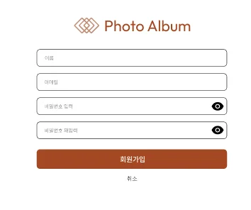
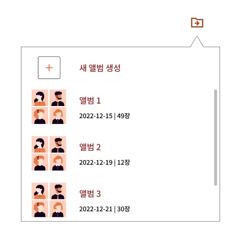
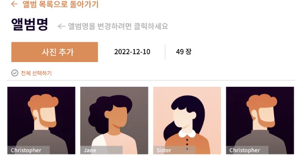
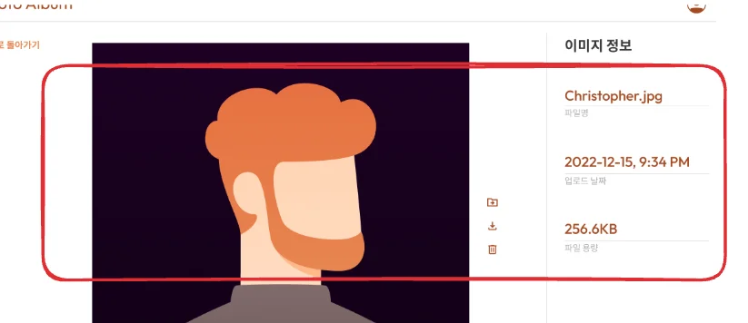
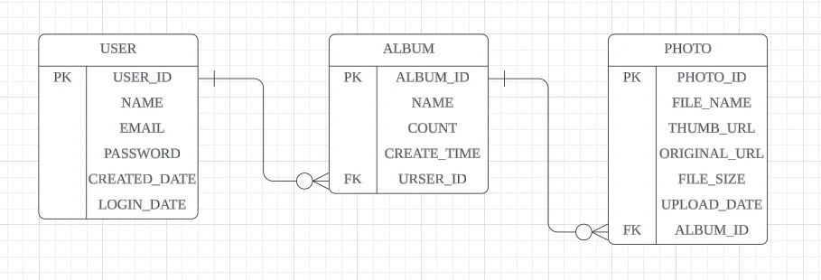

Reference

[백엔드 개발자라면 반드시 알아야하는 ERD로 관계형 데이터베이스 설계해보기 &#124; 개발자 취업 &#124; 개발자 이력서 &#124; 개발자 포트폴리오 &#124; MySQL 설계]()

와이어 프레임

[포토앨범](https://www.figma.com/design/RH28eMZbqITvcDLdTXfXeF/%ED%8F%AC%ED%86%A0%EC%95%A8%EB%B2%94?node-id=0-1&node-type=canvas)

## 와이어 프레임에서 데이터(컬럼) 분석하기 

---

- 회원가입 페이지 
    

- 이름

- 이메일 

- 비밀번호

- 앨범 생성 페이지
    

- 앨범 이름

- 사진 개수

- 앨범 생성 날짜

- 앨범 화면, 사진 상세보기 화면
    

- 파일명

- 썸네일 사진 URL ( 클라이언트에서 변환 )

- 오리지널 사진 URL

- 파일 크기

- 업로드 날짜

## ERD 설계하기

---

- 도메인 

- ERD 설계 
    > 📌 
    > 
    > - PK &#58; 각 컬럼을 구분하기 위한 고유한 ID 값
    > 
    > - FK&#58; 테이블의 연관관계를 명시하기 위한 컬럼
    >     - <code>N</code> 관계를 형성하는 테이블에서 <code>1</code> 관계의  테이블의 PK 값으로 설정함

    

    
유저 ( User )

    - &#91;PK&#93; 고유한 유저 ID&#58; <code>USER&#95;ID</code>

    - 이름&#58; <code>NAME</code>

    - 이메일&#58; <code>EMAIL</code>

    - 비밀번호&#58; <code>PASSWORD</code>

    - 생성한 날짜&#58; <code>CREATE&#95;DATE</code>

    - 로그인 날짜&#58; <code>LOGIN&#95;DATE</code>

    

    

    
앨범 ( Album )

    - &#91;PK&#93; 고유한 앨범 ID&#58; <code>ALBUM&#95;ID</code>

    - 앨범명&#58; <code>NAME</code>

    - 사진 개수&#58; <code>COUNT</code>

    - 생성일&#58; <code>CREATE&#95;NAME</code>

    - &#91;FK&#93; 유저 테이블 PK 값&#58; <code>USER&#95;ID</code>

    

    

    
사진 ( Photo )

    - &#91;PK&#93; 고유한 사진 ID&#58; <code>PHOTO&#95;ID</code>

    - 사진명&#58; <code>FILE&#95;NAME</code>

    - 썸네일 이미지&#58; <code>THUMB&#95;URL</code>

    - 원래 이미지&#58; <code>ORIGINAL&#95;URL</code>

    - 파일 크기&#58; <code>FILE&#95;SIZE</code>

    - 업로드 날짜&#58; <code>UPLOAD&#95;DATE</code>

    - &#91;FK&#93; 앨럼 테이블 PK 값&#58; <code>ALBUM&#95;ID</code>

    

    
