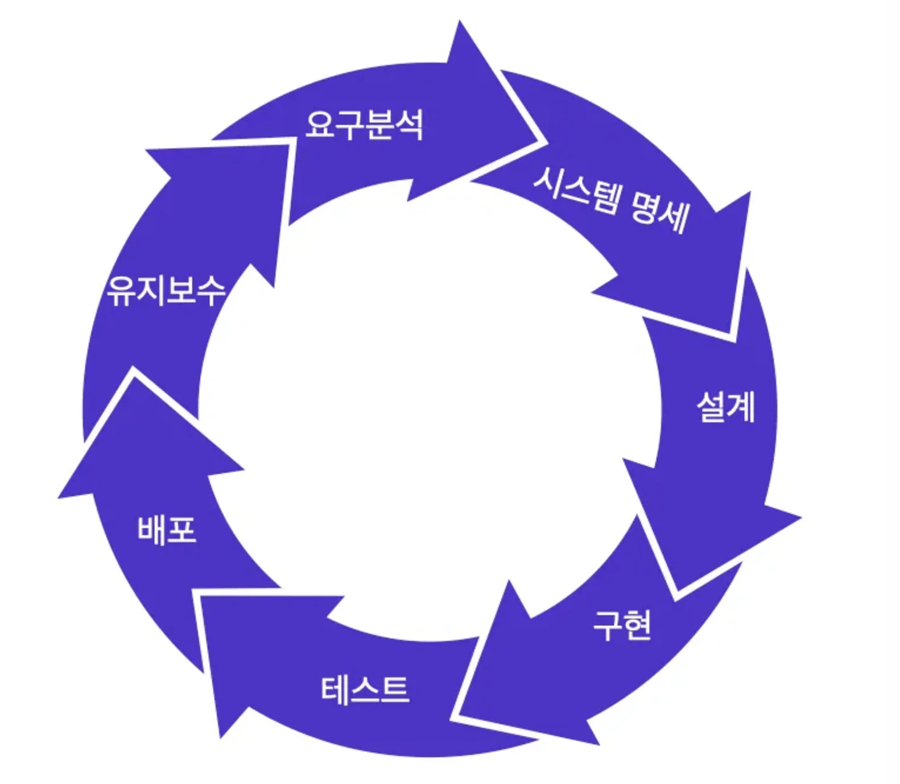
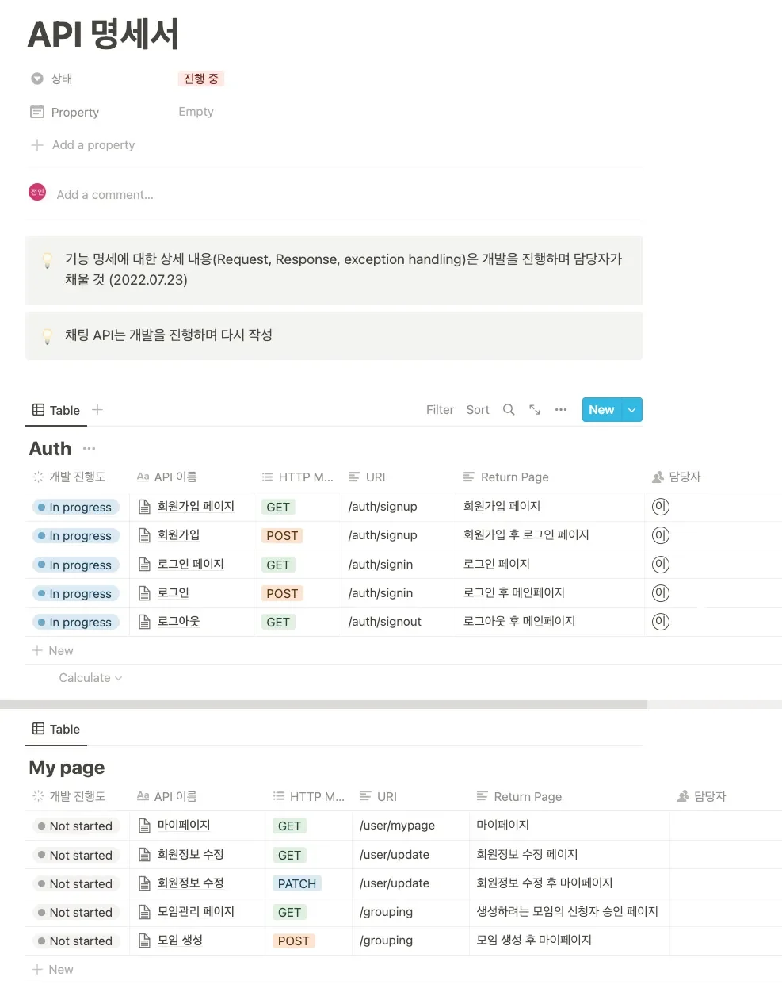
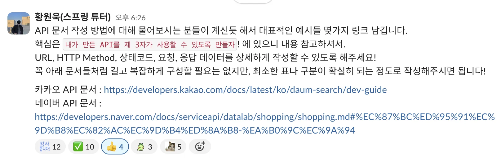

<a href="https://beautiful-college-c84.notion.site/1332dc3ef51480a48ec8f4b1f42e4749">페이지</a> 

## 실무에서의 업무 진행 프로세스

---

대부분은 위와 같은 프로세스로 업무를 하고 있다&#46;

### 1&#46; 요구사항 파악하기

요구사항을 파악하는 단계이다&#46;

기획자나 PO가 요구사항을 최전방에서 받고 정리를 한다&#46;

그리고 개발자 기능의 <u>개발 가능 여부</u>와 <u>작업 기간</u>에 대해서 논의를 한다&#46;

또한 백엔드 개발자는<u> 프론트 개발자와 어떻게 데이터를 주고 받을지</u>에 대해서도 협의를 하게 됩니다&#46;

### 2&#46; API 스펙 협의

스펙을 협의한다&#46;

<u>기획자</u>, 필요한 경우 프론트 개발자, <u>백엔드 개발자</u>가 모두 협의를 한다&#46;

이 때는 <u>백엔드 쪽에서 먼저 API 스펙을 정해서 커뮤니케이션</u> 해도 되고,

 또는 <u>프론트쪽에 원하는 형태가 있는지를 물어볼 수 있</u>다&#46; 

### 3&#46; API 명세서 작성

실제 API 명세를 작성하며 양식은 회사마다 팀마다 작성하는 사람마다 다르기 때문에

정해져 있는 형식은 없다&#46; 

다만 내용에는 반드시 <code>URI</code>, <code>Method</code>, <code>Request</code>, <code>Response</code>필수로 들어가야 하며, 추가적으로 예외 케이스 등을 표기할 수 있다&#46;

- 예제
    

    
API 명세서 1

    

    

    

    
API 명세서 2

    

    - 카카오 API 명세서 &#58; ‣

    - 네이버 API 명세서 &#58; ‣

    

### 4&#46; 개발

앞서 작성한 명세에 따라 API를 개발한다&#46; 

이 때 상황에 따라 Controller 레벨에서 정상 응답, 예외 응답을 바로 하드코딩으로 리턴하게 만들어 프론트 개발자에게 제공하기도 한다&#46; 

이 때 개발서버에만 배포하고 프론트 개발자에게 API를 공유하면 바로 연동하여 테스트를 진행할 수도 있다&#46; 

또는 <a href="https://speedscale.com/blog/api-mocking-tools/">Mock API 서비스</a>를 이용해서 제공할 수 도 있습니다&#46;

당연하지만 다음 단계에 QA가 있더라도 개발한 기능을 모두 테스트 한 후에 QA 요청을 해야 합니다&#46; 물론 테스트 코드를 작성하면 더 좋습니다&#46;

### 5&#46; 테스트 및 베포

회사마다 다르겠지만 개발 완료가 되면 QA에게 테스트를 요청하게 된다&#46;

QA가 버그나 요구사항에 맞지 않거나 누락된 부분을 리포팅 한다&#46; 

그러면 개발자는 확인하고 수정하여 다시 테스트 요청을 한다&#46; QA팀에서 확인 환료가 되면 베포를 미리 공지하고 최종 베포를 진행한다&#46; 

배포 현장

