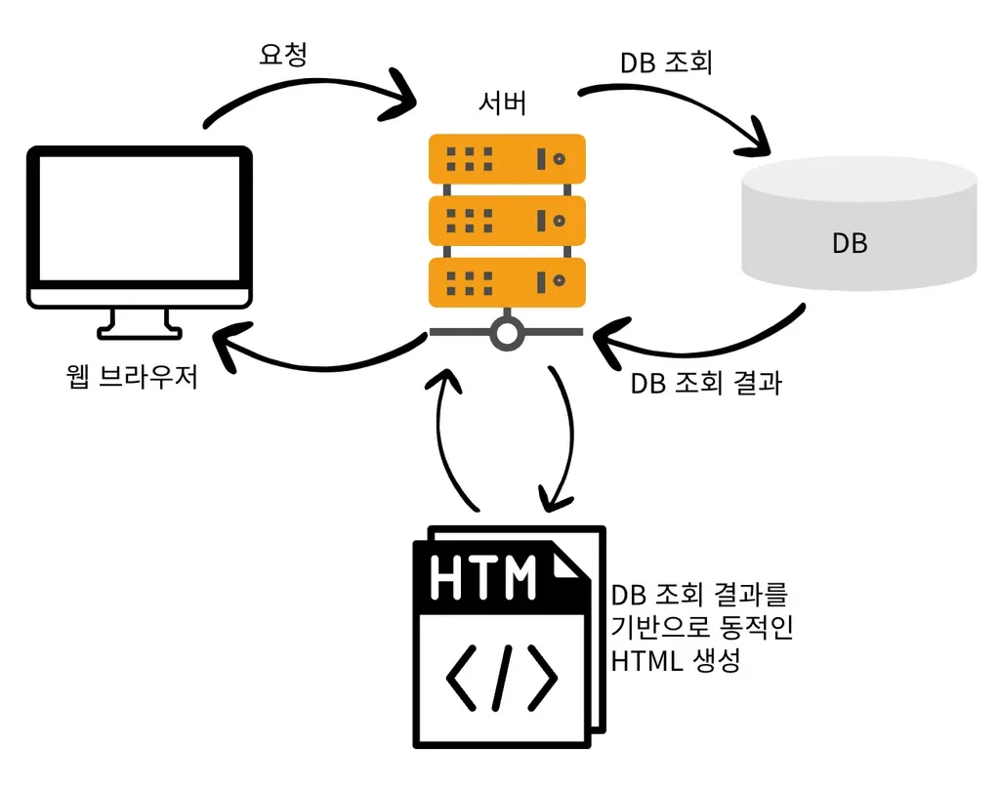

> 📌 
> 
> <details>
> <summary>요청 </summary>
> 
> - <strong><code>&#64;RequestParam</code></strong>
> 
> - <strong><code>&#64;ModelAttribute</code></strong>
> 
> - <strong><code>&#64;RequestBody</code></strong>
> 
> </details>
> 
> <details>
> <summary>응답</summary>
> 
> - <strong><code>정적 리소스</code></strong>
> 
> - <strong><code>View Template(&#64;Controller</code></strong>
> 
> - <strong> </strong><strong><code>&#64;ResponseBody</code></strong>
> 
> - <strong><code>ResponseEntity&#60;Object&#62;</code></strong>
> 
> </details>

<a id="135eda9b0fe180298afde1a57065a281"></a>

## Client 에서 Server로 데이터를 전달하는 3가지 방법

<a id="135eda9b0fe18051b8a1ca34d18e6c0c"></a>

### 1&#46; GET &#45; Query Parameter ( Query String)

- <code>http&#58;//localhost&#58;8080/tutor?name=wonuk&#38;age=100</code>

- 사용하는 어노테이션
    - <strong><code>&#64;RequestParam</code></strong><strong>, </strong><strong><code>&#64;ModelAttribute</code></strong>

<a id="135eda9b0fe180519a4fcf46311cd31b"></a>

### 2&#46; POST &#45; HTML Form ( x&#45;www&#45;form&#45;urlencoded )

<a id="137eda9b0fe18015a856c3b5341338e4"></a>

```plaintext
POST /form-data
content-type: application/x-www-form-urlencoded

key1=value1&key2=value2
```

- 사용하는 어노테이션
    - <strong><code>&#64;RequestParam</code></strong><strong>, </strong><strong><code>&#64;ModelAttribute</code></strong>

<a id="135eda9b0fe180128c99c5c0dffc7c7f"></a>

### 3&#46; HTTP Request Body

- 데이터(JSON, TEXT, XML 등)를 <u>직접 HTTP Message Body에 담</u>아서 사용

- 사용하는 어노테이션
    - <strong><code>&#64;RequestBody</code></strong>

<a id="135eda9b0fe1803ba945e5f0208f9f13"></a>

## <strong>Server(Spring)에서 HTTP 응답을 Client에 전달하는 세가지 방법</strong>

<a id="135eda9b0fe180b29cc5cdcea2fc49e1"></a>

### 1&#46; 정적 리소스

- 정적인 HTML, CSS, JS, Image 등을 변경없이 그대로 반환


<a id="135eda9b0fe18038b2b6dfb544dd3601"></a>

### 2&#46; View Template

- 서버에서 View를 렌더링하여 반환 (SSR, Server Side Rendering )

- 사용하는 어노테이션
    - <strong><code>&#64;Controller</code></strong>



<a id="135eda9b0fe180bf86b2c1f7dadfca1b"></a>

### 3&#46; HTTP Message Body

- 응답 데이터를 직접 Message Body에 담아 반환

- 사용하는 어노테이션
    - <strong><code>&#64;ResponseBody</code></strong><strong>, </strong><strong><code>ResponseEntity&#60;Object&#62;</code></strong>
        - <code>ResponseEntity</code><strong>  </strong>담아 객체 반환 시, 메세지 컨버터(<code>MapingJackson2HttpMessageConverter</code>) 가 자동으로 JSON으로 변환해준다&#46;

        - 응답 메세지의 상태 코드를 설정 가능하다&#46; 
            - <strong><code>ResponseEntity</code></strong><strong> </strong>사용 시 동적으로 상태코드 지정 가능하다&#46;  <br>( <code>&#64;ResponseStatus</code> 는 불가함 ) 

    
