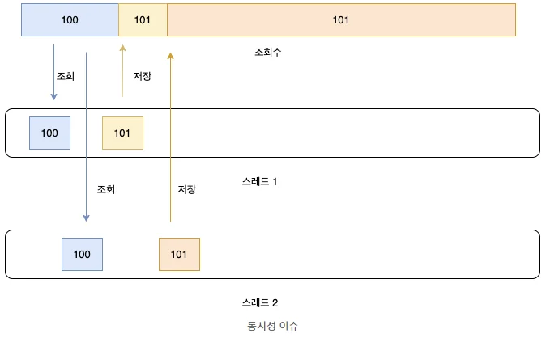
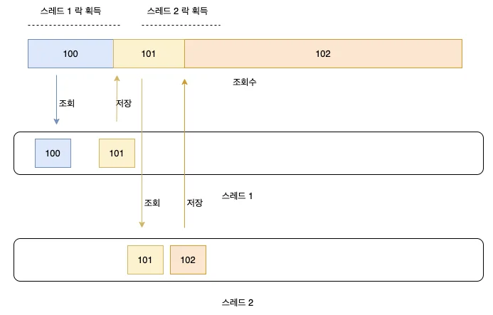
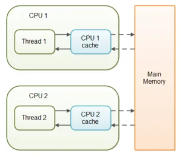
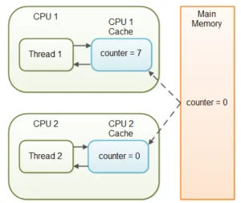
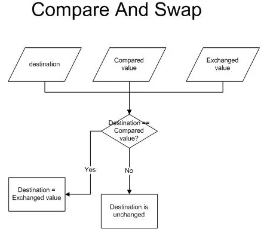

<details>
<summary>Reference</summary>

<a id="135eda9b0fe180ebb407c76e84373fec"></a>

<a href="https://beautiful-college-c84.notion.site/1332dc3ef514804a93c0e43b5ec8657c">페이지</a> 

<a id="150eda9b0fe180f09f7bcf24b71759f8"></a>

‣

<a id="135eda9b0fe180e3baf0f5a1987b0e62"></a>

‣

</details>

<a id="150eda9b0fe18023b490e983c49288e9"></a>

## 스레드란

- 프로세스
    - 특정 작업을 수행하는 소프트웨어를 프로그램이라고 한다&#46;

    - 프로그램이 실제로 실행되어, 메모리나 CPU와 같은 자원을 할당받으면 이를 프로세스라고 부름

    - 스레드는 이 프로세스를 구성하는 하나의 단위이다&#46;하나의 프로세스에는 여러 스레드가 작동하고 있을 수 있다&#46;

- 스레드
    - 스레드는 작업의 한 단위임

    - 프로세스는 독자적인 메모리를 할당받아서 서로 다른 프로세스끼리는 일반적으로 서로의 메모리 영역을 침범하지 못한다&#46;

    - 하지만 프로세스 내부에 있는 여러 스레드들은 서로 같은 프로세스 내부에 존재하고 있기 때문에 같은 자원을 공유하여 사용할 수 있다&#46;

    - 같은 자원을 공유할 수 있기 때문에 동시에 여러 가지 일을 같은 자원을 두고 수행할 수 있고, 이는 곧 병렬성의 향상으로 이어진다&#46;

    - 여러 스레드가 동시에 하나의 자원을 공유하고 있기 때문에 이 자원을 두고 여러 가지 문제점이 발생할 수 있다&#46;
        - 동시성 문제, 데드락과 같은 여러 가지 문제점을 해결해야 멀티스레드 환경에서 문제없는 프로그램을 제작할 수 있다&#46;

<a id="150eda9b0fe180a792e0c22e89b4f9ff"></a>

## 스레드 안정성이 깨지는 상황

1. 조회수 계산 프로그램

- 100명의 스레드로 각각 100번 조회했을 때
    <a id="7f9c1becfaa34f28bd478242d4728f99"></a>

    ```java
    public class CountingTest {
    	public static void main(String[] args) {
    		Count count = new Count();
    		for (int i = 0; i < 100; i++) {
    			new Thread(){
    				public void run(){
    					for (int j = 0; j < 100; j++) {
    						System.out.println(count.view());
    					}
    				}
    			}.start();
    		}
    	}
    }
    class Count {
    	private int count;
    	public int view() {return count++;}
    	public int getCount() {return count;}
    }
    ```

- 출력값 &#58; 10000번이 아닌, 더 적은 조회수가 나옴

- 이유 
    - 조회수를 증가시키는 로직이 두 번의 동작으로 이루어지는데 동시에 여러 스레드가 접근하여 첫 번째 동작할 때의 자원과 두 번째 동작할 때의 자원 상태가 변하기 때문이다&#46;

- 동작
    - Count 클래스의 view 메서드는 count&#43;&#43;이라는 동작을 진행한다&#46;

    - 그리고 count 변수의 값을 조회한다&#46;

    - 이후에 조회한 count변수 값에 1을 더한 값을 저장한다&#46;

- 결과
    - 이러한 동작들 사이사이에 여러 스레드가 접근하게 되면 동시성 이슈가 발생할 수 있다&#46;

    - 여러 스레드에서 동시에 count변수에 접근한다면 동시에 1번 동작을 진행하여 같은 count값을 조회할 것이고,두 개의 스레드가 1을 더하는 조회 로직을 실행한다고 해도 2가 더해지는 것이 아닌 1만 더해지는 동작이 발생할 수 있다&#46;



<a id="150eda9b0fe180f09f01e0bc42d7e79c"></a>

## 동시성을 제어하는 방법 &#58; Lock

- 여러 쓰레드가 write하는 상황일때



<a id="2a54b11a2876450ba3588a099bea306c"></a>

## 1&#46; 암시적 Lock &#58; synchronized

<a id="a92c220f2e4e47cf84db07a76fd5bd3c"></a>

<strong>&#91; 지정하여 Lock을 건다 &#93;</strong>

- Lock을 적용하게 되면 하나의 스레드가 해당 메서드를 실행하고 있을 때 다른 메서드가 해당 메서드를 실행하지 못하고 대기하게 된다&#46;

- 즉 한 번에 하나의 스레드만 접근할 수 있게 된다&#46; → 여러 스레드가 동시에 접근할 수 없게 만들어 동시성 이슈를 막을 수 있음

- 단점 &#58; 한 번에 하나의 스레드만 메서드를 실행시킬 수 있으므로 병렬성은 매우 낮아짐

- 문제가 된 view 메서드에 synchronized 키워드를 붙이면 암시적 락이 걸린다&#46;

<a id="ce351f60fca94218bd40ac852c547372"></a>

<strong>&#91; lock은 메서드, 변수에 각각 걸 수 있다 &#93;</strong>

- 메서드에 lock을 걸 경우 해당 메서드에 진입하는 스레드는 단 하나만 가능

- 변수에 lock을 걸 경우 해당 변수를 단 하나의 스레드만 참조할 수 있다&#46;

- 단, 변수에 lock을 걸기 위해선 해당 변수는 객체여야 한다&#46; int, long과 같은 기본형 타입에는 lock을 걸 수 없습니다&#46;

<a id="19d9ab8f328b4eb59797f84fa957e412"></a>

<strong>&#91; 암시적 Lock을 사용한 예제 &#93;</strong>

<a id="f475dc5030aa4f5fbeaea95aa8d5f9cb"></a>

1) 메서드 Lock

<a id="503c2de1e3a44e97a85d8a70b9150473"></a>

```javascript
class Count {
 private int count;
 public synchronized int view() {return count++;}
}
```

<a id="d8c3689fa7fa4cbebe10009a104087a1"></a>

2) 변수 Lock

<a id="2d836fd465254ef98549c16e4282b8c8"></a>

```javascript
class Count {
	 private Integer count = 0;
	 public int view() {
		 synchronized (this.count) {
			 return count++;
		 }
	 }
}
```

<a id="bc705550c9574b09b0c9eddac342e839"></a>

## 2&#46; 명시적 Lock &#58; ReentrantLock

<a id="954527cd18b84158a2d8e5c5814c8a47"></a>

<strong>&#91; synchronized 키워드 없이 명시적으로 ReentrantLock을 사용하는 Lock이다 &#93;</strong>

- 언제사용? 해당 Lock의 범위를 메서드 내부에서 한정하기 어렵거나, 동시에 여러 Lock을 사용하고 싶을 때 사용

- 직접적으로 Lock 객체를 생성하여 사용할 수 있다&#46;

- lock() &#58; 다른 스레드가 해당 lock() 메서드 시작점에 접근하지 못하고 대기

- unlock() &#58; 다른 메서드가 lock을 획득할 수 있게 된다&#46;

<a id="e0617bd1ee5647b88620d3c49aa65a5e"></a>

<strong>&#91; 명시적 Lock을 사용한 예제 &#93;</strong>

<a id="8b30d8cdcaf849dd88bf43fa252a319e"></a>

```javascript
public class CountingTest {
 	public static void main(String[] args) {
 		Count count = new Count();
 		for (int i = 0; i < 100; i++) {
 			new Thread(){
 				public void run(){
 					for (int j = 0; j < 1000; j++) {
 						count.getLock().lock();
 						System.out.println(count.view());
 						count.getLock().unlock();
 					}
 				}
 			}.start();
 		}
 	}
}
class Count {
 	private int count = 0;
 	private Lock lock = new ReentrantLock();
 	public int view() {
 		return count++;
 	}
 	public Lock getLock(){
 		return lock;
 	};
}
```

> 💡 
> 
> <a id="2fa1e765ecb845af8d87f715e8b96faa"></a>
> 
> ### 언제 synchoronized 식별자 사용?
> 
> <a id="fd817e7d1b4f40a28c005e4ad14e1ea8"></a>
> 
> 1&#46;하나의 객체에 여러개의 스레드가 접근해서 처리하고자 할때
> 
> <a id="227ae80c34a94e9b972afe0b338c8a06"></a>
> 
> 2&#46;static으로 선언한 객체에 여러 스레드가 동시에 사용할때
> 
> - 변수를 공유할땐 static 변수사용, 하지만 static변수는 객체 생성할 수 없음
> 
> - Atomic은 기존변수에 동시성 제어를 하는것이 아니라 AtomicType객체를 생성해서 해당 AtomicType객체에 대한 동시성을 제어하는 것이다&#46;
> 
> > 그러므로 새롭게 생성할 수 없는 Static변수나 기존 변수에 동시성을 제어하기 위해선 synchoronized 키워드를 붙여서 사용한다&#46;

<a id="150eda9b0fe1808086d0eaaac718ae7f"></a>

## 동시성을 제어하는 방법 &#58; Volatile

- volatile은 CPU 캐시 사용 막음 → 메모리에 접근해서 실제 값을 읽어오도록 설정 → 데이터 불일치를 막는다&#46;

- 자원의 가시성을 책임진다
    - 메인 메모리에 저장된 실제 자원의 값을 볼 수 있는 것

> 💡 
> 
> <a id="09a6cec8c6db4d588583926d2d24efb1"></a>
> 
> <strong>자원의 가시성</strong>
> 
> <a id="4f0a6f1c048548eba50b62f59ca6c9ea"></a>
> 
> 변수에 저장한 데이터를 읽었는데 이 데이터가 실제 데이터와 차이가 있을 수 있다&#46; 메인 메모리에 저장된 실제 자원의 값을 볼 수 있는 개념을 자원의 가시성이라한다&#46;

<a id="b8dfcb4bb58c493f9fe841059609d557"></a>

### &#35; 사용상황

- 멀티쓰레드 환경에서 하나의 쓰레드만 read&#38;write하고 나머지 쓰레드가 read하는 상황에 사용
    - Read &#58; CPU cache에 저장된 값X , Main Memory에서 읽는다&#46;

    - Write &#58; Main Memory에 까지 작성

- 가장 최신의 값 보장

<a id="f5ad8b357a094acc8f3951a2650d732f"></a>

### &#35; Java volatile가 필요한 이유?



- 멀티쓰레드 어플리케이션에서 volatile변수 사용 안할때 → Main Memory에서 읽은 변수 값을 CPU Cache에 저장

- 멀티쓰레드 환경에서 쓰레드가 변수값을 읽어올 때 각각의 CPU Cache에 저장된 값이 다르기 때문에 변수 값 불일치 문제가 발생

<a id="afdb6341210441d78b8e41b2782976f8"></a>

### &#35; Example

<a id="a113653a4e21470a95da73f7864c23d3"></a>

SharedObject를 공유하는 두 개의 Thread가 있다

<a id="5f2da367f4584ad7ba7cdb6c1cd9524a"></a>

2개의 Thread 가 각각 다른 CPU 코어를 사용하고 있는 상황이라고 가정했을때

<a id="a63ec2d1856344b088ace62c7bf53907"></a>

```javascript
public class SharedObject {
 public int counter = 0;
}
```

- Thread&#45;1는 counter 값을 더하고, 읽는 연산 (Read &#38; Write)

- Thread&#45;2는 counter 값을 읽기만(Only Read)

<a id="daffbe6d071c41ebb824f790816e702a"></a>

Thread&#45;1은 counter값을 증가시킨다&#46; 하지만 CPU Cache에만 반영, 실제로 Main Memory에는 반영X → Thread&#45;2는 count값으로 0을 가져오는 문제 발생



<a id="470eefce1b9b4f91afd76f1c0bd649ab"></a>

### &#35; 해결방법

- volatile 키워드를 추가 → Main Memory에 저장하고 읽어옴 → 변수 값 불일치 문제해결

<a id="6d6494d0ad67413f86c996ef13115db6"></a>

```javascript
public class SharedObject {
	public volatile int counter = 0;
}
```

<a id="54dc279955474d278757d8af4313cc8e"></a>

### &#35; volatile 성능

- volatile는 변수의 read와 write를 Main Memory에서 진행

- CPU Cache보다 Main Memory가 비용이 더 큼 (→ 변수 값 일치를 보장해야 하는 경우 사용 권장)

<a id="06d8a65c2ea64d4091602c533bc33c9a"></a>

### &#35; 정리

- volatile
    - Main Memory에 read &#38; write를 보장한다&#46;

- 상황
    - 하나의 쓰레드만 read&#38;write하고 나머지 쓰레드가 read하는 상황에 적합

    - 변수의 값이 최신의 값으로 읽어와야 하는 경우&#46;

- 성능
    - CPU Cache보다 Main Memory가 비용이 더 큼

<a id="8cb564eff9fe4e74aae6638a5b4a11c0"></a>

### &#35; 사례 &#58; 서버의 Graceful Shutdown (안전한 종료)

- 애플리케이션 서버에서는 종종 유지보수나 배포를 위해 서버를 종료해야 합니다&#46; 이때 중요한 것은 현재 진행 중인 요청을 완료하고, 새로운 요청을 받지 않도록 안전하게 종료하는 것입니다&#46; 이를 위해 <strong>종료 플래그</strong>를 두고 서버가 새로운 요청을 받지 않도록 제어합니다&#46;

- 서버에서 발생할 수 있는 동시성 문제
    - 서버가 종료 상태로 전환되었음에도 불구하고, 일부 스레드가 이를 인식하지 못하고 계속해서 요청을 처리하거나 대기할 수 있습니다&#46;

    - 이 경우, 메인 스레드가 종료 명령을 내려도 각각의 작업 스레드에서는 여전히 서버가 활성 상태로 인식하고 요청을 처리하게 됩니다&#46;

<a id="51f59c09568542158e2af28e2541dff4"></a>

### <code>volatile</code>을 활용한 Graceful Shutdown 구현

<a id="92b59ee752564fc695f4e013cf37ab28"></a>

```java

public class Server {
    private volatile boolean isRunning = true; // 서버 종료 플래그

    public void start() {
        System.out.println("Server started...");

        // 요청을 처리하는 여러 스레드 시뮬레이션
        while (isRunning) {
            // 요청 처리 로직
            System.out.println("Handling request...");

            try {
                Thread.sleep(1000); // 요청 처리 시간
            } catch (InterruptedException e) {
                Thread.currentThread().interrupt();
            }
        }

        System.out.println("Server stopped.");
    }

    public void stop() {
        System.out.println("Stopping server...");
        isRunning = false; // 종료 플래그 설정
    }
}

public class Main {
    public static void main(String[] args) throws InterruptedException {
        Server server = new Server();

        // 서버를 별도 스레드에서 시작
        Thread serverThread = new Thread(server::start);
        serverThread.start();

        // 서버가 5초 동안 실행된 후 종료
        Thread.sleep(5000);
        server.stop();
        serverThread.join();
    }
}
```

<a id="f20ae13715e84465b959d49cee8d643f"></a>

### 설명

- <code>isRunning</code> 변수를 <code>volatile</code>로 선언하여, <code>stop()</code> 메서드에서 <code>false</code>로 변경했을 때 메인 스레드뿐만 아니라 작업을 수행하는 스레드도 바로 <code>isRunning</code>이 <code>false</code>가 되었음을 인식하고 종료할 수 있습니다&#46;

- 만약 <code>volatile</code> 없이 <code>isRunning</code>을 선언했다면, <code>start()</code> 메서드의 작업 스레드가 여전히 <code>true</code>로 캐시된 값을 읽어 무한 루프에서 빠져나오지 못하고 종료되지 않을 수 있습니다&#46;

<a id="150eda9b0fe180188bc2cebf9ca85584"></a>

## 동시성을 제어하는 방법 &#58; Atomic

- java&#46;util&#46;concurrent&#46;atomic

- Atomic 클래스는 <strong>CAS(compare&#45;and&#45;swap)</strong>를 이용하여 동시성을 보장

- AtomicInteger는 synchronized 보다 적은 비용으로 동시성을 보장

> 💡 
> 
> <a id="f7ba1075ba9847108b4807fdf799be14"></a>
> 
> ### CAS (Compare&#45;and&#45;Swap) 원리
> 
> <a id="f23ab68201c0441e9ae73b27dd293ce3"></a>
> 
> CAS는 세 가지 값을 비교하고, 조건에 맞으면 값을 교체하는 연산입니다&#46; 일반적으로 <strong>기존 값 (expected)</strong>, <strong>새로운 값 (new)</strong>, <strong>현재 메모리 값 (current)</strong>을 비교하여 동작합니다&#46;
> 
> 1. <strong>비교</strong>&#58; 기존 값 (<code>expected</code>)과 현재 메모리 값 (<code>current</code>)을 비교합니다&#46;
> 
> 1. <strong>교체</strong>&#58; 만약 두 값이 같다면, 새로운 값 (<code>new</code>)으로 교체합니다&#46;
> 
> 1. <strong>반환</strong>&#58; 교체에 성공하면 <code>true</code>를 반환하고, 실패하면 <code>false</code>를 반환합니다&#46;
> 
> <a id="5d1ea4406aa74ae28f0b5c5748072114"></a>
> 
> 이 연산은 원자적이기 때문에 중간에 다른 스레드가 끼어들어도 안전하게 동작하며, <code>synchronized</code> 블록을 사용하는 것보다 더 가벼운 성능의 이점을 제공합니다&#46;

<a id="05dd2abc28ac496c9e408f462a3cd74e"></a>

### &#35; AtomicInteger 메서드

- addAndGet (int delta) &#58; 주어진 값을 현재 값에 원자 적으로 더합니다&#46;

- compareAndSet (int expect, int update) &#58; 현재 값이 예상 값과 같으면 원자 적으로 값을 지정된 업데이트 된 값으로 설정합니다&#46;

- get () &#58; 현재 값을 가져옵니다&#46;getAndAdd (int delta) &#58; 주어진 값을 현재 값에 원자 적으로 더합니다&#46;

- getAndIncrement () &#58; 현재 값을 원자 적으로 1 씩 증가시킵니다&#46; (현재값 반환 후 1씩 증가)

- incrementAndGet () &#58; 현재 값을 원자 적으로 1 씩 증가시킵니다&#46; (1씩 증가 후 현재값 반환)

- &#46;&#46;&#46;

<a id="9e50059311204dffbf0732875f2cd192"></a>

### &#35; Example

<a id="5927ced7497246e6a0131582c233999d"></a>

```javascript
public class AtomicIntExample {
		public static void main(String[] args) {
		ExecutorService executor = Executors.newFixedThreadPool(2);
		AtomicInteger atomicInt = new AtomicInteger();
		for(int i = 0; i < 10; i++){
			executor.submit(()->System.out.println("Counter- " + atomicInt.incrementAndGet())); // 1
		}
		executor.shutdown();
	}
}
```

<a id="442e04739f744165b0c5212f28e91f6a"></a>

```javascript
public class AtomicIntExample {
	public static void main(String[] args) {
		ExecutorService executor = Executors.newFixedThreadPool(2);
		AtomicInteger atomicInt = new AtomicInteger();
		CounterRunnable runnableTask = new CounterRunnable(atomicInt);
		for(int i = 0; i < 10; i++){
			executor.submit(runnableTask);
		}
		executor.shutdown();
	}
}
class CounterRunnable implements Runnable{
	AtomicInteger atomicInt;
	CounterRunnable(AtomicInteger atomicInt){
		this.atomicInt = atomicInt;
	}
	@Override
	public void run() {
		System.out.println("Counter- " + atomicInt.incrementAndGet());
	}
}
```

<a id="e0f9d38d85bf4be08b79e45642e64128"></a>

결과 &#58;

<a id="65a7212ea03d4a5aa5781357c56415e9"></a>

```javascript
Counter- 1
Counter- 2
Counter- 3
Counter- 4
Counter- 5
Counter- 6
Counter- 7
Counter- 8
Counter- 9
Counter- 10
```

<a id="5fa2941ea8654c10b0a3f7539a234327"></a>

### &#35; CAS(Compare And Swap)알고리즘



<a id="5f9a7d9073e04ea7980d030d6efd04ff"></a>

AtomicInterger를 Decompile 하여 요약한 내용

<a id="c09c3551fc064e7c9c0dcfc2af2a7e8e"></a>

```javascript
public class AtomicInteger extends Number implements java.io.Serializable {
	private volatile int value;

	public final int incrementAndGet() {
		int current;
		int next;
		do {
			current = get();
			next = current + 1;
		} while (!compareAndSet(current, next));
		return next;
	}

	public final boolean compareAndSet(int expect, int update) {
		return unsafe.compareAndSwapInt(this, valueOffset, expect, update);
	}
}
```

- incrementAndGet() 메소드 내부에서 <strong>CAS알고리즘 로직구현</strong>

- compareAndSet()의 결과 리턴 받아서 성공할때까지 while문 무한 루프를 돈다&#46;

- compareAndSet() 내부에서는 compareAndSwapInt()를 호출하여 메모리에 저장되어진 값과 현재 CPU캐시에 저장된 expect 값을 비교하여 동일한 경우만 변경하려는 값 update로 쓰기를 수행한다&#46;

- 다른 AtomicInteger 메소드 들도 거의 유사한 패턴으로 구현되어 있다&#46;

- volatile int value; 선언부 인데 voliatile는 변수의 가시성 문제를 해결하기 위해서 사용된다&#46;

- volatile 키워드가 붙어 있는 객체는 CPU캐시가 아닌 메인 메모리에서 값을 참조해온다&#46;

<a id="150eda9b0fe180f19cb8ce43158d0aa3"></a>

## synchronized, volatile, AtomicInteger 비교

<a id="1a6e9896ce1949cb84b18e8fc1224c56"></a>

<strong>synchronized</strong>

- 여러 쓰레드가 write하는 상황에 적합

- 가시성 문제해결 &#58; synchronized블락 진입전 후에 메인 메모리와 CPU 캐시 메모리의 값을 동기화 하기 때문에 문제가 없도록 처리

<a id="dff49d4b85b0403a87a4f47945c60865"></a>

<strong>volatile</strong>

- 하나의 쓰레드만 read&#38;write하고 나머지 쓰레드가 read하는 상황에 적합

- 가시성 문제해결 &#58; CPU 캐시 사용 막음 → 메모리에 접근해서 실제 값을 읽어오도록 설정
    - Read &#58; CPU cache에 저장된 값X , Main Memory에서 읽는다&#46;

    - Write &#58; Main Memory에 까지 작성

<a id="987609ea8e274d96afd28bd64e0cccd6"></a>

<strong>AtomicIntger</strong>

- 여러 쓰레드가 read&#38;write를 병행

- 가시성 문제해결 &#58; CAS알고리즘
    - <strong>현재 쓰레드에 저장된 값과 메인 메모리에 저장된 값을 비교 → 일치시 새로운 값으로 교체, 불일치시 실패하고 재시도</strong>

<a id="150eda9b0fe18008b5c8d37f34409866"></a>

## 스레드 안전한 객체 사용 구현체

<a id="e3ce74b8d21d433aa2ef053d08440ba8"></a>

### &#35; Concurrent 패키지

> 💡 
> 
> <a id="2e30faaad702480780c3f586d3d40e6f"></a>
> 
> Java의 <code>java&#46;util&#46;concurrent</code> 패키지는 스레드 안전한 객체를 제공하여 멀티스레딩 환경에서 데이터 경쟁을 방지하고, 효율적인 작업 처리를 가능하게 합니다&#46; 주요 클래스들은 다음과 같습니다&#58;

<a id="7dd78beb97a847b287dd994e7b3031ae"></a>

### 1&#46; <strong>Executor</strong>

- <strong>설명</strong>&#58; 작업 스레드를 관리하고, 스레드를 직접 생성하지 않고도 Runnable 작업을 비동기로 실행할 수 있도록 합니다&#46;

- <strong>특징</strong>&#58;
    - <code>Executor</code>는 <code>execute(Runnable command)</code> 메서드를 사용해 작업을 실행합니다&#46;

    - 주로 스레드 풀을 사용해 많은 작업을 효율적으로 처리하도록 합니다&#46;

- <strong>예시</strong>&#58;
    <a id="c9fadc2e1a6f4457ab16f7c60da85147"></a>

    ```java

    Executor executor = Executors.newFixedThreadPool(10);
    executor.execute(() -> System.out.println("Hello from Executor"));

    ```

---

<a id="68a368c9a90f4070bb79a4862a8d6647"></a>

### 2&#46; <strong>ExecutorService</strong>

- <strong>설명</strong>&#58; <code>Executor</code>의 확장 인터페이스로, 추가 기능이 있으며 작업의 상태를 제어하고 작업 완료를 기다리는 기능이 있습니다&#46;

- <strong>특징</strong>&#58;
    - <code>submit()</code> 메서드를 사용해 <code>Callable</code>과 <code>Runnable</code> 작업을 실행할 수 있습니다&#46;

    - <code>shutdown()</code>을 통해 모든 작업 완료 후 Executor를 종료할 수 있습니다&#46;

    - <code>awaitTermination()</code> 메서드로 모든 스레드가 완료될 때까지 대기할 수 있습니다&#46;

- <strong>예시</strong>&#58;
    <a id="11cc974175204941b9db213790a35fcf"></a>

    ```java

    ExecutorService executorService = Executors.newFixedThreadPool(10);
    executorService.submit(() -> System.out.println("Hello from ExecutorService"));
    executorService.shutdown();

    ```

---

<a id="a8a9a17614af4888af0d41722bbac046"></a>

### 3&#46; <strong>Future</strong>

- <strong>설명</strong>&#58; 비동기 작업의 결과를 나타내며, 작업이 완료될 때까지 결과를 가져오거나 대기할 수 있습니다&#46;

- <strong>특징</strong>&#58;
    - <code>get()</code> 메서드를 통해 결과를 가져오고, 작업이 완료될 때까지 대기할 수 있습니다&#46;

    - <code>isDone()</code>으로 작업 완료 여부를 확인할 수 있습니다&#46;

    - <code>cancel()</code>을 통해 작업을 취소할 수 있습니다&#46;

- <strong>예시</strong>&#58;
    <a id="0f79230f0e0f43cfbb572cff972e7a03"></a>

    ```java

    Future<Integer> future = executorService.submit(() -> {
        Thread.sleep(2000);
        return 42;
    });
    Integer result = future.get(); // 작업이 완료될 때까지 대기
    ```

---

<a id="8dec3559c46245b09720f85393f4cd84"></a>

### 4&#46; <strong>Callable</strong>

- <strong>설명</strong>&#58; 반환값이 있는 비동기 작업을 정의하는 함수형 인터페이스입니다&#46;

- <strong>특징</strong>&#58;
    - <code>Callable</code>은 <code>call()</code> 메서드를 통해 작업을 정의하며, <code>Runnable</code>과는 달리 값을 반환하거나 예외를 던질 수 있습니다&#46;

    - <code>submit(Callable task)</code> 메서드로 <code>ExecutorService</code>에서 실행할 수 있습니다&#46;

- <strong>예시</strong>&#58;
    <a id="5c64bcf4af484b37b1a77700d33fed11"></a>

    ```java

    Callable<String> callable = () -> "Hello from Callable";
    Future<String> future = executorService.submit(callable);
    System.out.println(future.get()); // "Hello from Callable" 출력
    ```

---

<a id="f986b455d9a1432f87dd4910802f19ae"></a>

### 5&#46; <strong>BlockingQueue</strong>

- <strong>설명</strong>&#58; 스레드 간 안전하게 데이터를 전달할 수 있는 큐입니다&#46; 생산자&#45;소비자 패턴에서 자주 사용됩니다&#46;

- <strong>특징</strong>&#58;
    - <code>put()</code>과 <code>take()</code> 메서드로 큐에 항목을 추가하거나 제거하며, 큐가 꽉 차거나 비었을 때 대기합니다&#46;

    - 예&#58; <code>ArrayBlockingQueue</code>, <code>LinkedBlockingQueue</code>, <code>PriorityBlockingQueue</code> 등 다양한 구현체가 있습니다&#46;

- <strong>예시</strong>&#58;
    <a id="0f5da22dd48a4467ba74c69f93e36de0"></a>

    ```java

    BlockingQueue<Integer> queue = new LinkedBlockingQueue<>(10);
    executorService.submit(() -> {
        try {
            queue.put(1); // 대기 후 큐에 삽입
        } catch (InterruptedException e) {
            Thread.currentThread().interrupt();
        }
    });
    executorService.submit(() -> {
        try {
            Integer item = queue.take(); // 대기 후 큐에서 항목 가져오기
            System.out.println("Consumed: " + item);
        } catch (InterruptedException e) {
            Thread.currentThread().interrupt();
        }
    });
    ```

---

<a id="150eda9b0fe18081937ed321daf286f6"></a>

## (보충강의) ABA Problem

> 💡 
> 
> <a id="ef53418638d84637ba88e73cd52b216a"></a>
> 
> ABA 문제는 멀티스레딩 환경에서 <strong>CAS (Compare&#45;And&#45;Swap)</strong> 같은 원자적 연산을 사용할 때 발생할 수 있는 문제입니다&#46; 이 문제는 <strong>메모리에 저장된 값이 일시적으로 변경된 후 다시 원래 값으로 돌아오는 상황</strong>에서 발생합니다&#46; CAS 연산은 보통 값을 비교하여 조건이 맞으면 새로운 값으로 업데이트하는데, ABA 문제가 발생하면 CAS 연산이 잘못된 판단을 내리게 됩니다&#46;

<a id="5a48671603fb4891ae0a3ab4eca7a40a"></a>

### ABA 문제의 발생 과정

<a id="3ee9a779cdc34d1f9deb7096a0a4d914"></a>

<strong>“값은 같아도 바뀐건데 바뀌지 않았다고 판단하는 문제”</strong>

1. 스레드1가 메모리 값 <code>A</code>를 읽습니다&#46;

1. 그 사이에 다른 스레드2가 메모리 값 <code>A</code>를 <code>B</code>로 바꿨다가 다시 <code>A</code>로 되돌립니다&#46;

1. 스레드1는 메모리 값을 다시 확인하며 값이 <code>A</code>로 변하지 않았다고 생각하고, CAS 연산을 수행합니다&#46;

1. 그러나 실제로는 값이 <code>A</code>에서 <code>B</code>로 바뀌었다가 다시 <code>A</code>로 돌아왔기 때문에, 스레드1가 본 값이 일관성이 없는 잘못된 값일 수 있습니다&#46;

<a id="b4d14a7e103a4f678db57e5af89671be"></a>

이러한 과정에서 스레드 A는 값이 잠시 변경되었다가 다시 원래 값으로 돌아온 것을 인지하지 못합니다&#46; 그 결과, CAS 연산이 성공적으로 완료되지만 실제로는 예상하지 못한 데이터 변경이 일어난 상황입니다&#46;

<a id="6070d56af2104c889f039c5245e6accf"></a>

### ABA 문제의 실제 사례

<a id="ee5db609b0914d34bb111cfe25cee6a6"></a>

ABA 문제는 주로 <strong>락&#45;프리 데이터 구조</strong>(예&#58; 스택, 큐 등)에서 발생할 수 있습니다&#46; 예를 들어, 스택에서 <code>push</code>와 <code>pop</code> 연산을 하는 도중 ABA 문제가 발생할 수 있습니다&#46;

1. 스레드 A는 스택의 최상단 노드의 값이 <code>A</code>인 것을 확인합니다&#46;

1. 스레드 B가 스택의 최상단 노드를 <code>A</code>에서 <code>B</code>로 변경한 다음, 다시 최상단을 <code>A</code>로 복원합니다&#46;

1. 스레드 A는 여전히 최상단 노드의 값이 <code>A</code>라고 생각하고, <code>A</code>와 비교해 성공적으로 pop 연산을 수행합니다&#46;

1. 이로 인해 데이터 무결성이 깨질 수 있습니다&#46;

<a id="d5dd3021fe074c63a0dd428d9c2e428c"></a>

### ABA 문제 해결 방법

1. <strong>Versioning (버전 관리)</strong>&#58; 값과 함께 버전 번호를 유지하여 값이 변경될 때마다 버전 번호도 함께 증가시키는 방법입니다&#46; CAS 연산에서는 값뿐만 아니라 버전 번호도 함께 비교하여, 값이 같더라도 버전 번호가 달라지면 연산을 거부할 수 있습니다&#46;
    - Java의 <code>AtomicStampedReference</code>는 이 방식을 사용하여 ABA 문제를 방지합니다&#46;

1. <strong>Double Compare&#45;And&#45;Swap (DCAS)</strong>&#58; 두 개의 값을 비교하는 CAS 연산을 사용하여 값과 상태를 동시에 비교하는 방법입니다&#46; 값과 함께 어떤 상태를 변경하고자 할 때 유용합니다&#46;

1. <strong>Garbage Collection (GC)</strong>와 함께 참조를 무효화하는 방식&#58; 일부 언어에서는 참조가 삭제될 때 자동으로 무효화됩니다&#46; 이 방식은 ABA 문제를 줄이지만, Java에서는 <code>AtomicStampedReference</code>나 <code>AtomicMarkableReference</code> 같은 구조를 주로 사용합니다&#46;

<a id="4b33cdf8b6f84720a1c9e3cd5c24a67f"></a>

### 예시 코드&#58; <code>AtomicStampedReference</code>를 통한 ABA 문제 해결

<a id="d976bd3170ca402ab89483047f038e56"></a>

```java
import java.util.concurrent.atomic.AtomicStampedReference;

public class ABAProblemExample {
    public static void main(String[] args) {
        AtomicStampedReference<Integer> atomicStampedRef = new AtomicStampedReference<>(100, 0);

        int initialStamp = atomicStampedRef.getStamp();
        Integer initialRef = atomicStampedRef.getReference();

        System.out.println("Initial Value: " + initialRef + " with Stamp: " + initialStamp);

        // ABA 문제 시뮬레이션
        atomicStampedRef.compareAndSet(100, 101, initialStamp, initialStamp + 1); // 값 변경
        atomicStampedRef.compareAndSet(101, 100, initialStamp + 1, initialStamp + 2); // 다시 원래 값으로 복원

        // 스레드가 원래 값이라고 가정하고 CAS 시도
        boolean success = atomicStampedRef.compareAndSet(100, 200, initialStamp, initialStamp + 1);

        System.out.println("CAS operation success: " + success); // 실패
        System.out.println("Final Value: " + atomicStampedRef.getReference() + " with Stamp: " + atomicStampedRef.getStamp());
    }
}


```

<a id="33682aa3533d43e8a58500692ad11292"></a>

### 설명

- <code>AtomicStampedReference</code>는 값과 함께 &#42;&#42;버전(스탬프)&#42;&#42;을 관리하여 ABA 문제를 방지합니다&#46;

- 예제에서 값은 다시 <code>100</code>으로 돌아왔지만, 스탬프 값이 변경되었기 때문에 마지막 <code>compareAndSet</code> 연산은 실패합니다&#46;

<a id="404be6e94c1842f3af2614dc310fc402"></a>

### 결론

<a id="b98bb0509c624d258fd7e40bda7f9ad7"></a>

ABA 문제는 CAS 연산이 수행되는 환경에서 발생할 수 있는 복잡한 동시성 문제입니다&#46; 이 문제는 <code>AtomicStampedReference</code>나 <code>AtomicMarkableReference</code>와 같은 추가 정보를 활용한 클래스들로 해결할 수 있으며, 고수준의 동시성 제어가 필요한 시스템에서는 이러한 방식을 통해 데이터 무결성을 보장할 수 있습니다&#46;

<a id="150eda9b0fe180a8b7a0f4757864ac89"></a>

## (보충강의) 멀티스레딩과 동시성 제어 면접 질문

<details>
<summary>&#34;스레드를 많이 쓸수록 항상 성능이 좋아질까요?&#34; &#45; <del>영준</del></summary>

<details>
<summary>답변</summary>

- 쓰레드를 많이 쓸수록 좋은게 아니라 반복문에서 오버헤드가 발생하기 때문에 무조건 좋은건 아니다

- 무조건 테스트를 해봐야 한다&#46;

- 스레드를 여러개 동시에 실행할때 컨텍스트 스위칭이 일어납니다&#46; (오버 헤드)
    - 프로세스 컨텍스트 스위칭 &#58; CPU 자원을 사용해서 연산을 하는데 그걸 작업할 수 있도록 전환하는 것을 컨텍스트 스위칭 (문맥 전환)

    - 쓰레드 컨텍스트 스위칭 &#58; 프로세스 컨텍스트 스위치이랑 비슷하지만 공유자원이 있기 때문에 비용이 훨씬 적다&#46; (그래도 비용이긴하다)

- I/O 바운드 작업이 많을때 병렬 스레드가 효과를 발휘한다&#46;
    - I/O 바운드 작업 &#58; 네트워크 요청/응답 , 파일 읽기/쓰기, 입력기기 입력, 출력기기 출력(system&#46;out&#46;println())

- CPU 바운드 작업이 대부분인 경우 병렬 스레드 효과가 없다&#46;

</details>

- 후속질문&#58; &#34;그렇다면 적절한 스레드 개수는 어떻게 결정해야 할까요?&#34;
    - CPU 코어 수에 맞추어서 스레드 개수를 결정해야 합니다&#46; (코어수 &#43; 1)

    - I/O 바운드 작업이냐 CPU 바운드 작업이냐에 따라 I/O 면 스레드수를 많이, CPU 면 적게

    - 사용 가능한 메모리 양 (힙 메모리 설정값 이상 넘지 않도록)

    - 실제 부하 테스트

- 심화질문&#58; &#34;CPU 바운드 작업과 I/O 바운드 작업에서 최적의 스레드 수가 다른 이유는 무엇일까요?&#34;
    - I/O 작업에서는 cpu가 대기하기 때문에 효율성이 다릅니다&#46;

</details>

<details>
<summary>&#34;스레드와 프로세스의 차이점을 설명해주세요&#46;&#34; &#45; 건우</summary>

<details>
<summary>답변</summary>

- 프로세스 &#58; 실행중인 프로그램

- 스레드 &#58; 프로그램에서 실행되는 작업의 단위

</details>

- 후속질문&#58; &#34;멀티스레드와 멀티프로세스 중 어떤 상황에서 어떤 것을 선택해야 할까요?&#34;
    - 멀티 스레드가 좋은 케이스
        - 작업간에 데이터 공유가 많은 경우

        - 컨텍스트 스위칭이 많은 경우

    - 멀티 프로세스가 좋은 케이스
        - 작업들 간에 안정성이 중요한 경우

- 심화질문&#58; &#34;스레드가 프로세스보다 컨텍스트 스위칭 비용이 적은 이유는 무엇인가요?&#34;
    - 프로세스 컨텍스트 크기가 훨씬 큽니다&#46;
        <a id="c9ae98e48d7f4ee481cb24e2ab1c40ff"></a>

        프로세스 컨텍스트&#58;

        - 프로그램 카운터 (PC)

        - 레지스터 값들

        - 스택 포인터

        - 메모리 매핑 정보

        - 페이지 테이블

        - 파일 디스크립터 테이블

        - 프로세스 전체의 메모리 공간

    - 스레드는 컨텍스트 크기가 작습니다&#46;
        <a id="9734b318ccd045099f45c333b3c78957"></a>

        스레드 컨텍스트&#58;

        - 프로그램 카운터 (PC)

        - 레지스터 값들

        - 스택 포인터

</details>

<details>
<summary>&#34;데드락이 무엇이고, 어떤 상황에서 발생하나요?&#34; &#45; <del>경섭</del></summary>

<details>
<summary>답변</summary>

<a id="1dbee982c1e542638fadbe564e40c78b"></a>

서로 자원을 요청하면서 무한대기하는 상황

</details>

- 후속질문&#58; &#34;데드락의 발생 조건 4가지를 알고 계신가요?&#34;
    - 상호 배제(Mutual Exclusion)&#58; 자원은 한 번에 한 프로세스만 사용 가능

    - 점유와 대기(Hold and Wait)&#58; 자원을 가진 상태에서 다른 자원을 기다림

    - 비선점(No Preemption)&#58; 다른 프로세스의 자원을 강제로 빼앗을 수 없음

    - 순환 대기(Circular Wait)&#58; 프로세스들이 순환 형태로 자원을 기다림&#34;

- 심화질문&#58; &#34;데드락을 예방하기 위한 방법들에는 어떤 것들이 있나요?&#34;
    - 4가지 조건중 하나를 제거한다&#46;

    - 모든 자원 한번에 할당하는것

    - 은행가 알고리즘

    - 주기적으로 데드락 검사 후 프로세스 강제종료

</details>

<details>
<summary>&#34;스레드 세이프란 무엇인가요?&#34; &#45; 상익</summary>

<a id="75de50a4cb234a5589bd398a7ca67a2b"></a>

여러 스레드가 동시에 해당 코드를 실행해도 문제가 발생하지 않는것

- 후속질문&#58; &#34;자바에서 스레드 세이프를 보장하는 방법들을 설명해주세요&#46;&#34;
    - synchronized, volatile, concurrent&#46;atomicXXX

- 심화질문&#58; &#34;synchronized 키워드와 volatile 키워드의 차이점은 무엇인가요?&#34;
    - synchronized 는 동시에 코드를 실행하지 못하도록 막아서 동기화 보장

    - volatile 은 가시성 확보 (CPU Cache 사용하지않고 메모리에서 직접 값을 수정하고 읽도록 하는)

</details>

<details>
<summary>&#34;race condition이 무엇인지 예시와 함께 설명해주세요&#46;&#34; &#45; <del>재현</del></summary>

<a id="06274584b03e47cca5084d8d4931fc20"></a>

하나의 자원을 2개이상의 스레드가 경쟁하는 상황

<a id="53ebce3f3f2e4671bc953d2ee9e06ea8"></a>

데드락이 예시입니다&#46;

- 후속질문&#58; &#34;race condition을 방지하기 위한 방법들은 무엇이 있나요?&#34;
    - 세마포어 뮤텍스(불변객체)

    - Lock, Atomic, CAS, 자료구조 등등…

- 심화질문&#58; &#34;mutex와 semaphore의 차이점을 설명해주실 수 있나요?&#34;

</details>

<details>
<summary>&#34;스레드 풀(Thread Pool)을 사용하는 이유는 무엇인가요?&#34; &#45; 단빈</summary>

<details>
<summary>답변</summary>

<a id="da18bb688c2949fd8542fe146ff78a53"></a>

스레드 생성이 비용이기 때문에 수를 정해놓고 미리 만들어놓는다&#33;

<a id="9201918650fa4c50bf273e9fb1dae4e2"></a>

스레드 필요할때 생성 비용이 발생하지 않는다&#46;

</details>

- 후속질문&#58; &#34;스레드 풀의 크기를 어떻게 설정하는 것이 좋을까요?&#34;
    - CPU 코어 수

    - I/O 바운드 작업이냐 CPU 바운드 작업이냐에 따라 I/O 면 스레드수를 많이, CPU 면 적게

    - 사용 가능한 메모리 양 (힙 메모리 설정값 이상 넘지 않도록)

- 심화질문&#58; &#34;캐시드 스레드 풀과 고정 크기 스레드 풀의 장단점을 비교해주세요&#46;&#34;

</details>

<details>
<summary>&#34;동기화(Synchronization)가 필요한 이유는 무엇인가요?&#34;</summary>

<details>
<summary>답변</summary>

<a id="90ad63f2d37d46ee8431e5b63ea28c8f"></a>

여러 스레드가 동시에 자원을 접근할때 일관성과 무결성을 보장하기 위해서

</details>

- 후속질문&#58; &#34;과도한 동기화의 문제점은 무엇인가요?&#34;
    - 성능이 저하 될 수 있다&#46; (대기 시간이 길어지고, 동기화로 인한 오버헤드 증가)

- 심화질문&#58; &#34;동기화 방식 중 낙관적 락과 비관적 락의 차이점을 설명해주세요&#46;&#34;

<a id="68ba8c12d2f4484a8d7356749befcaa4"></a>

```java
// 비관적 락 예시
public class PessimisticLockExample {
    private final Lock lock = new ReentrantLock();
    
    public void updateData() {
        lock.lock();  // 시작부터 락 획득
        try {
            // 데이터 처리 로직
            doSomething();
        } finally {
            lock.unlock();
        }
    }
}

// 낙관적 락 예시
@Entity
public class OptimisticLockExample {
    @Version
    private Long version;
    
    public void updateData() {
        // 락 없이 처리하다가 충돌 시에만 재시도
        doSomething();
        // 버전 체크는 JPA가 자동으로 수행
    }
}
```

</details>

<details>
<summary>&#34;스레드의 상태에는 어떤 것들이 있나요?&#34; &#45; <del>지연</del></summary>

<details>
<summary>답변</summary>

<a id="d8d04cfad8994114849be4cfc46f6c26"></a>

NEW, RUNNABLE, WAITING , TIME&#95;WAITING, BLOCKED, TERMINATED, 

</details>

- 후속질문&#58; &#34;스레드가 BLOCKED 상태가 되는 경우는 언제인가요?&#34;
    - 자원을 얻으려고 대기하고 있을때 (데드락 / 락걸려 있을때)

    - I/O 처리할때

    - 컨텍스트 스위칭 할때

- 심화질문&#58; &#34;WAITING 상태와 TIMED&#95;WAITING 상태의 차이점은 무엇인가요?&#34;
    - WAITING 다른 스레드 작업이 끝날때 까지 기다리는것

    - TIMED&#95;WAITING 잠깐 시간동안 대기하는것

</details>

<details>
<summary>&#34;컨텍스트 스위칭(Context Switching)이 무엇인가요?&#34;</summary>

- 후속질문&#58; &#34;컨텍스트 스위칭이 발생할 때 시스템에 어떤 영향을 미치나요?&#34;

- 심화질문&#58; &#34;컨텍스트 스위칭 비용을 줄이기 위한 방법들은 무엇이 있을까요?&#34;

</details>

<details>
<summary>&#34;스레드 로컬(Thread Local)을 사용하는 이유는 무엇인가요?&#34; &#45; 과제</summary>

- 후속질문&#58; &#34;스레드 로컬의 메모리 누수가 발생할 수 있는 상황은 언제인가요?&#34;

- 심화질문&#58; &#34;스레드 로컬과 synchronized의 성능 차이는 어떻게 되나요?&#34;

</details>

---

<details>
<summary>&#34;스레드를 많이 쓸수록 항상 성능이 좋아질까요?&#34;</summary>

- 쓰레드를 많이 쓸수록 좋은 것이 아니라 반복문에서 오버헤드가 발생하기 때문에 무조건 좋은 건 아니다&#46; 

- 무조건 테스트를 해봐야 한다&#46; 

- 스레드를 여러개 동시에 실행할 때 컨텍스트 스위칭이 일어난다&#46;  ( 오버 헤드 ) 
    - 프로세스 컨텍스트 스위칭&#58; CPU 자원을 사용해서 연산을 하는데 그걸 작업할 수 있도록 전환하는 것을 컨텍스트 스위칭 (문맥 전환)

    - 쓰레드 컨텍스트 스위칭&#58;  프로세스 컨텍스트 스위치랑 비슷하지만 공유자원이 있기 때문에 비용이 훨씬 적다  ( 그래도 비용이 든다&#46;)

- I/O 바운드 작업이 많을 때 병렬 처리가 효과를 발휘한다&#46; 
    - I/O 바운드 작업&#58; 네트워크 요청/응답, 파일 읽기/쓰기, 입력기기 입력, 출력기기 출력
        <a id="137eda9b0fe1803db016f64b90c3559e"></a>

        (system&#46;out&#46;println())

    - CPU 바운드 작업이 대부분인 경우 병렬 스레드 효과가  없다&#46; 

</details>

<details>
<summary>후속 질문) “적절한 스레드는 어떻게 정하나요?”</summary>

- 일반적 ) CPU 코어 수에 맞추어 스레드 개수를 결정해야 한다&#46;  ( 코어수 &#43;1 )
    - 테스트 당연히 해봐야 한다&#46; 

- I/O 바운드 작업, CPU 바운드 작업
    - I/O 바운드 작업 ↑ 

    - CPU 바운드 작업 ↓
        - I/O 작업에서는 CPU가 대기중인 상태가 많기 때문이다&#46; 

- 사용 가능한 메모리 양 (힙 메모리 설정값 이상 넘지 않도록 )

- 실제 부하 테스트 

</details>

<details>
<summary>심화 질문) “ ?“</summary>


</details>

---

<details>
<summary>“<u>스레드</u> 와 <u>프로세스</u>의 차이점”</summary>

- 프로세스&#58; 실행 중인 프로그램

- 스레드&#58; 프로그램에서 실행되는 작업의 단위

</details>

<details>
<summary>후속 질문) “멀티스레드, 멀티프로세스 중 어떤 상황에서 어떤 것을 선택해야 하는가?”</summary>

- 멀티 스레드가 좋은 케이스
    - 컨텍스트 스위칭 비용이 스레드가 훨씬 적기 떄문에, 작업 간 공유가 많으면 멀티 스레드가 더 좋다&#46; 

- 멀티 프로세스가 좋은 케이스 
    - 작업들 간의 안정성이 중요한 경우 

</details>

<details>
<summary>심화 질문) “스레드가 프로세스보다 컨텍스트 스위칭 비용이 적은 이유는 무엇인가?”</summary>

- 프로세스의 컨텍스트 크기가 훨씬 크다&#46; 따라서 컨택스트 스위칭 시 더 많은 비용이 든다&#46; 

<details>
<summary>프로세스 컨택스트 </summary>

- 프로그램 카운터 (PC)

- 레지스터 값들

- 스택 포인터

- 메모리 매핑 정보

- 페이지 테이블

- 파일 디스크립터 테이블

- 프로세스 전체의 메모리 공간

</details>

<details>
<summary>스레드 컨택스트</summary>

- 프로그램 카운터 (PC)

- 레지스터 값들

- 스택 포인터

</details>

</details>

---

<details>
<summary>“데드락 무엇이고, 어떤 상황에서 발생하나요?”</summary>

- 서로 자원을 요청하면서 무한 대기하는 상황을 말한다&#46;

</details>

<details>
<summary>후속 질문) 데드락의 발생 조건 4가지</summary>

- 상호 배제(Mutual Exclusion)&#58; 자원은 한 번에 한 프로세스만 사용 가능

- 점유와 대기(Hold and Wait)&#58; 자원을 가진 상태에서 다른 자원을 기다림

- 비선점(No Preemption)&#58; 다른 프로세스의 자원을 강제로 빼앗을 수 없음

- 순환 대기(Circular Wait)&#58; 프로세스들이 순환 형태로 자원을 기다림

</details>

<details>
<summary>심화 질문) “데드락 예방하기 위한 방법들에는 어떤 것들이 있나요?”</summary>

- 4가지 조건 중 하나를 제거한다&#46; 

- 모든 자원 한번에 할당한다&#46;  ( 이상적인 얘기  )

- <a href="https://velog.io/@minu-j/%EC%9A%B4%EC%98%81%EC%B2%B4%EC%A0%9C-%EB%A7%8C%ED%99%94%EB%A1%9C-%EC%95%8C%EC%95%84%EB%B3%B4%EB%8A%94-%EC%9D%80%ED%96%89%EC%9B%90-%EC%95%8C%EA%B3%A0%EB%A6%AC%EC%A6%98-%EA%B5%90%EC%B0%A9%EC%83%81%ED%83%9C-%ED%9A%8C%ED%94%BC-%EC%95%8C%EA%B3%A0%EB%A6%AC%EC%A6%98">은행가 알고리즘</a>

- 주기적으로 데드락 검사 → 데드락 해소 

</details>

---

<details>
<summary>“스레드 세이프란 무엇인가?”</summary>

<a id="137eda9b0fe180079274e2b7731c14a8"></a>

여러 스레드가 동시에 해당 코드를 실행해도 문제가 발생하지 않는 것

<details>
<summary>후속 질문) 자바에서 스레드 세이프를 보장하는 방법</summary>

- synchronized, volatile, cuncurrent&#46;atomic

</details>

<details>
<summary>심화질문&#58; synchronized 키워드와 volatile 키워드의 차이점</summary>

- synchronized → 동기화 보장

- volatile → 가시성 확보 
    - CPU Cache를 사용하지 ㅇ낳고, 메모리에서 직접 값을 

</details>

</details>

<details>
<summary>레이스 컨디션 </summary>

- 하나의 자원을 2개 이상의 스레드가 경쟁하는 상황
    - 데드락이 예시

- 후속 질문&#58; “race condition을 방지하기 위한 방법들은 무엇이 있나요?”
    - 세마포어, 불변객체

    - Lock, Atomic, CAS, 자료구조 등등

</details>

<details>
<summary>쓰레드 풀</summary>

<details>
<summary>쓰레드 풀의 크기를 어떻게 설정하는 것이 좋은가</summary>

- CPU 코어 수 

</details>

<a id="137eda9b0fe18028895edd5c2128b229"></a>

## 질문

---

- &#34;스레드를 많이 쓸수록 항상 성능이 좋아질까요?&#34;
    - 후속질문&#58; &#34;그렇다면 적절한 스레드 개수는 어떻게 결정해야 할까요?&#34;

    - 심화질문&#58; &#34;CPU 바운드 작업과 I/O 바운드 작업에서 최적의 스레드 수가 다른 이유는 무엇일까요?&#34;

- &#34;스레드와 프로세스의 차이점을 설명해주세요&#46;&#34;
    - 후속질문&#58; &#34;멀티스레드와 멀티프로세스 중 어떤 상황에서 어떤 것을 선택해야 할까요?&#34;

    - 심화질문&#58; &#34;스레드가 프로세스보다 컨텍스트 스위칭 비용이 적은 이유는 무엇인가요?&#34;

- &#34;데드락이 무엇이고, 어떤 상황에서 발생하나요?&#34;
    - 후속질문&#58; &#34;데드락의 발생 조건 4가지를 알고 계신가요?&#34;

    - 심화질문&#58; &#34;데드락을 예방하기 위한 방법들에는 어떤 것들이 있나요?&#34;

- &#34;스레드 세이프란 무엇인가요?&#34;
    - 후속질문&#58; &#34;자바에서 스레드 세이프를 보장하는 방법들을 설명해주세요&#46;&#34;

    - 심화질문&#58; &#34;synchronized 키워드와 volatile 키워드의 차이점은 무엇인가요?&#34;

- &#34;race condition이 무엇인지 예시와 함께 설명해주세요&#46;&#34;
    - 후속질문&#58; &#34;race condition을 방지하기 위한 방법들은 무엇이 있나요?&#34;

    - 심화질문&#58; &#34;mutex와 semaphore의 차이점을 설명해주실 수 있나요?&#34;

- &#34;스레드 풀(Thread Pool)을 사용하는 이유는 무엇인가요?&#34;
    - 후속질문&#58; &#34;스레드 풀의 크기를 어떻게 설정하는 것이 좋을까요?&#34;

    - 심화질문&#58; &#34;캐시드 스레드 풀과 고정 크기 스레드 풀의 장단점을 비교해주세요&#46;&#34;

- &#34;동기화(Synchronization)가 필요한 이유는 무엇인가요?&#34;
    <a id="137eda9b0fe1807d8106dcc0eb52f849"></a>

    여러 스레드가 동시에 자원을 접근할 떄, 일관성과 무결성을 보장하기 위해서

    - 후속질문&#58; &#34;과도한 동기화의 문제점은 무엇인가요?&#34;
        <a id="137eda9b0fe1807495e5c5bd0505c671"></a>

        너무 많이 대기하면 불필요한 비용이 들어 성능 저하가 발생할 수 있다&#46; <br>동기화로 인한 오버헤드 증가

    - 심화질문&#58; &#34;동기화 방식 중 낙관적 락과 비관적 락의 차이점을 설명해주세요&#46;&#34;
        - 비관적 락&#58; 미리 락을 걸어놓는 것 

        - 낙관적 락&#58; 예외가 발생 되었을 떄, 

- &#34;스레드의 상태에는 어떤 것들이 있나요?&#34;
    <a id="137eda9b0fe1807fb461f5c65134de81"></a>

    RUNNABLE, WAITING, TIME&#95;WATING, BLOCKED, TERMINATED

    <a id="137eda9b0fe1800090deeafc84cb0c86"></a>

    실행 중 상태, 웨이팅 작업, 준비된 자원 기다리는 상태, 실행이 종료된 상태

    - 후속질문&#58; &#34;스레드가 BLOCKED 상태가 되는 경우는 언제인가요?&#34;
        - 자원을 얻으려고 대기하고 있을 때(데드락/ 락 걸려 있을떄) 

        - I/O 처리할 떄

        - 컨텍스트 스위칭 할 때

    - 심화질문&#58; &#34;WAITING 상태와 TIMED&#95;WAITING 상태의 차이점은 무엇인가요?&#34;
        - WATING 다른 스레드 작업이 끝날 때까지 기다리는 것

        - TIMED&#95;WATING 잠깐 동안 대기하는 것 

- &#34;컨텍스트 스위칭(Context Switching)이 무엇인가요?&#34;
    - 후속질문&#58; &#34;컨텍스트 스위칭이 발생할 때 시스템에 어떤 영향을 미치나요?&#34;

    - 심화질문&#58; &#34;컨텍스트 스위칭 비용을 줄이기 위한 방법들은 무엇이 있을까요?&#34;

- &#34;스레드 로컬(Thread Local)을 사용하는 이유는 무엇인가요?&#34; ( 과제 ) 
    - 후속질문&#58; &#34;스레드 로컬의 메모리 누수가 발생할 수 있는 상황은 언제인가요?&#34;

    - 심화질문&#58; &#34;스레드 로컬과 synchronized의 성능 차이는 어떻게 되나요?&#34;

</details>
