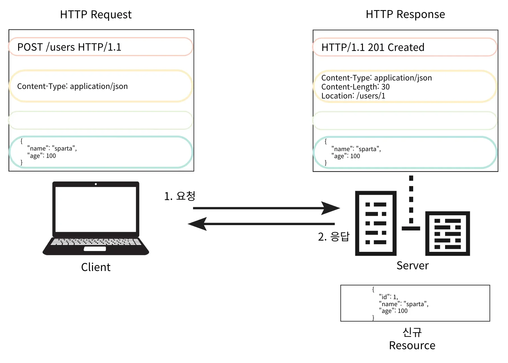
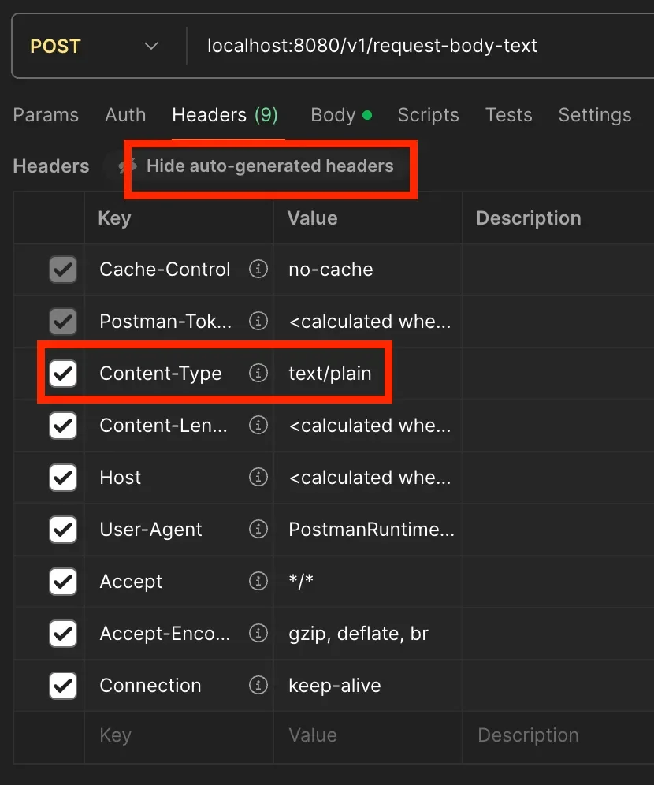
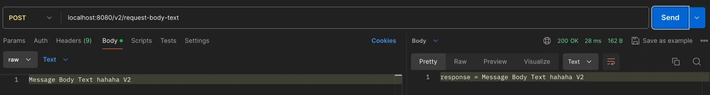
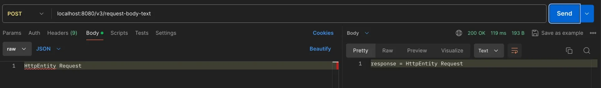
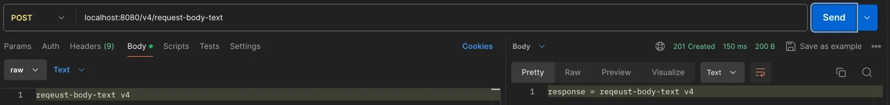
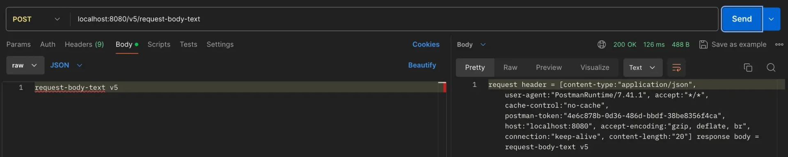

<a id="136eda9b0fe180738e35ce7b2636f5df"></a>

## HTTP Mesage Body ( 요청 )

<details>
<summary>복습 </summary>

- <code>&#64;RequestParam</code>  → <code>GET</code> &#43; <code>Query Parameter</code>

- <code>&#64;ModelAttribute</code> → <code>POST</code> &#43;  <code>HTML Form Data</code>( <code>x&#45;www&#45;form&#45;urlencoded</code> )

</details>

> 📖 
> 
> <a id="55cf1dfd89a94924995d892b48a1b6b2"></a>
> 
> 이번 챕터에는 <strong><u>HTTP Message Body</u></strong> 통해 <u>Data를 전달</u>하는 방법을 배운다&#46; 

- Request Body의 Data 바인딩

- RESTful API에서 줄 사용

- POST, PUT, PATCH 에서 주로 사용한다&#46; 
    - GET도 사용할 수 있지만 권장하지 않음 → Path Variable, Query Parameter

- <strong>JSON</strong>, XML, TEXT 등을 데이터 형식으로 사용함 


- HTTP Message 구조
    

- HTTP Request, Response 예시
    

    - 서버 
        > 직렬화, 역직렬화에서는 Jackson 라이브러리의 ObjectMapper를 사용한다&#46;

        - 요청&#58; JSON → Object

        - 응답&#58; Object → JSON

<a id="136eda9b0fe180b3baf9cbbd13b250bc"></a>

## TEXT

> 📖 
> 
> <a id="7a265b236dc942c0b96306ecc86146dd"></a>
> 
> HTTP Request Body에 Data가 전송되는 경우, <u>Http MessageConverter</u>를 통해 바인딩 된다&#46; 

> ☝🏻 
> 
> <a id="10094ceb22a34a7f94ed65ebcbf904aa"></a>
> 
> 현대에는 RESTful API를 주로 사용하기 때문에, 대부분 JSON 형식으로 데이터를 전달한다&#46; <br>즉, 해당 방법은 잘 사용하지 않는다&#46;

<a id="136eda9b0fe18003b7b4f93d44f84b4e"></a>

### 사용

---

<details>
<summary>&#91; 코드 &#93;</summary>

- <code>HttpServletRequest request</code>

- <code>request&#46;getInputStream()</code>

- <code>StreamUtils&#46;copyToString(inputStream, StandardCharsets&#46;UTF&#95;8)</code>

---

<a id="136eda9b0fe1802ca13ef45c7587a194"></a>

```java
@Slf4j
@Controller
public class RequestBodyStringController {
	
		@PostMapping("/v1/request-body-text")
	  public void requestBodyTextV1(
	          HttpServletRequest request,
	          HttpServletResponse response
	  ) throws IOException {
	
	      ServletInputStream inputStream = request.getInputStream();
	      String bodyText = StreamUtils.copyToString(inputStream, StandardCharsets.UTF_8);
	      
	      response.getWriter().write("response = " + bodyText);
	  }
}
```

</details>

<details>
<summary>postman 테스트 </summary>


</details>

<a id="136eda9b0fe18045beddf531553e0368"></a>

### ? 

---

<details>
<summary>Request Header Content&#45;Type &#58; <code>text/plain</code></summary>



</details>

<details>
<summary><strong>I/O 예시</strong></summary>

- <strong>InputStream(읽기)</strong> 파라미터 지원
    - HTTP Request Body Data 직접 조회

- <strong>OutputStream(쓰기)</strong> 파라미터 지원
    - HTTP Response Body 직접 결과 출력

---

- &#91; 코드 &#93;
    <a id="136eda9b0fe18029bcbff4e5be71bcd8"></a>

    ```java
    @PostMapping("/v2/request-body-text")
    public void requestBodyTextV2(
    				InputStream inputStream,
    				Writer responseWriter
    ) throws IOException { 
    		
    	String body = StreamUtils.copyToString(inputStream, StandardCharsets.UTF_8);
    	
    	responseWriter.write("response = " + bodyText);
    }
    ```

- postman 테스트 
    

</details>

<details>
<summary>HttpEntity ( 밑에서 다시 설명)</summary>

- HttpEntity를 사용 시, HttpMessageConverter 사용하여 Body를  바인딩한다&#46; 

- 요청 뿐만 아니라 응답까지 <code>HttpEntity</code> 하나만으로 사용 가능하다&#46; 

---

- &#91; 코드 &#93;
    <a id="136eda9b0fe180e28d60c5280fc6842b"></a>

    ```java
    @PostMapping("/v3/request-body-text")
    public HttpEntity<String> requestBodyTextV3( HttpEntity<String> httpEntity ) { 
    		
    	// HttpMessageConverter가 동작해서 아래 코드가 동작하게됨
    	String body = httpEntity.getBody();
    		
    	return new HttpEntity<>("response = " + body); // 매개변수 = Body Message	
    }
    ```

- postman 테스트
    

</details>

<a id="136eda9b0fe18082a571eff5a88ad42f"></a>

## HttpEntity

> 📖 
> 
> <a id="d22451e47bb24060ad53f8db3119ca51"></a>
> 
> <code>HttpEntity</code>는 <u>HTTP Header, Body 정보를 편리하게 조회</u>할 수 있도록 한다&#46; 

- HttpEntity 역할
    - Http Request Body Message를 직접 조회
        - HTTP 메세지의 <code>Body</code>와 <code>Header</code>의 데이터를 조회  및 설정 가능하게 하는 기술이다&#46; 

        - <code>Request Parameter(</code><u><code>URL</code></u><code>)</code>를 다루지는 않는다&#46;  

    - Request 뿐만 아니라 아니라 Response도 사용 가능

    - Response Header 직접 설정 가능

    - View를 반환하지 않음

---

<details>
<summary>&#91; 코드 &#93;</summary>

<a id="136eda9b0fe180819f02f5aefb4dda6d"></a>

```java
@Controller
public class RequestBodyStringController {
	
		@PostMapping("/v4/request-body-text")
	  public HttpEntity<String> requestBodyTextV4(RequestEntity<String> httpEntity) {
	
	      // HttpMessageConverter가 동작해서 아래 코드가 동작하게됨
	      String body = httpEntity.getBody();
	      // url, method 사용 가능
	
	      return new ResponseEntity<>("response = " + body, HttpStatus.CREATED); // Body Data, 상태코드
	  }
}
```

</details>

<details>
<summary>postman 테스트 </summary>



</details>

<a id="136eda9b0fe18048ba89ee99d29c2648"></a>

## &#64;RequestBody, &#64;ResponseBody

> 📖 
> 
> <a id="eb64a548a9a64f249954c68cb1a73cf5"></a>
> 
> <code>&#64;RequestBody</code>, <code>&#64;ResponseBody</code> 어노테이션을 사용하면 각각 <u>Request, Response 객체의 Body</u>에 간편하게 접근 가능
> 
> - <code>RequestEntity&#60;String&#62; httpEntity</code>, <code>httpEntity&#46;getBody()</code><br>→ <code>&#64;RequestBody</code>
> 
> - <code>new ResponseEntity&#60;&#62;(&#34;response = &#34; &#43; body</code>) → <code>&#64;ResponseBody</code> &#43; <code>return Sting</code>

<details>
<summary>주요 Anotation</summary>

- <code>&#64;RequestBody</code>
    - 요청 메세지 Body Data를 간편하게 조회 가능

- <code>&#64;RequestHeader</code>
    - 요청 헤더 정보 조회

- <code>&#64;ResponseBody</code>
    - 응답 메세지 바디에 값을 간편하게 전달 가능

    - View가 아닌 <u>데이터 반환</u>

</details>

---

<details>
<summary>&#91; 코드 &#93;</summary>

<a id="03093d0f848d463bb2f38c4be1586684"></a>

```java
@Controller // @RestController = @Controller + @ResponseBody
public class RequestBodyStringController {
	
	  @ResponseBody
	  @PostMapping("/v5/request-body-text")
	  public String requestBodyTextV5(
	          @RequestBody String body,
	          @RequestHeader HttpHeaders headers
	  ) {
	      // HttpMessageConverter가 동작해서 아래 코드가 동작하게됨
	      String bodyMessage = body;
	
	      return "request header = " + headers + " response body = " + bodyMessage;
	  }
}
```

</details>

<details>
<summary>postman 테스트 </summary>



</details>

- 요약
    - <u>요청 파라미터</u>, <u>HTML Form Data에 접근</u>하는 경우
        <a id="136eda9b0fe180bd873dc484899e20c1"></a>

        &#45;&#62; <code>&#64;RequestParam</code>, <code>&#64;ModelAttribute</code> 

    - Http Message Body에 접근하는 경우
        - &#64;RequestBody를 사용 (<strong>JSON</strong>, XML, TEXT)
