<a id="136eda9b0fe180ecbd89fc785a107af7"></a>

## <code>&#64;RequestPram</code>

> <strong><code>&#64;RequestPram</code></strong> 과 <strong><code>&#64;ResponseBody</code></strong>를 통해 <strong><u>HttpServlet을 사용하지 않</u></strong>고 <u><code>Anotation</code></u><u>으로 간편하게 처리</u><u> </u>가능함

> 🧐 
> 
> <a id="136eda9b0fe181a98414c0433321f76c"></a>
> 
> <code>?</code> 뒤에 오는 URL&#58; <strong><code>Query String</code></strong><strong>, </strong><strong><code>Qeury Parameter</code></strong><strong>, </strong><strong><code>Request Raram</code></strong> 이라 한다&#46; 
> 
> - ex)  http&#58;localhost&#58;8080?key=value

- URL에서 파라미터(<code>key=value</code>)로 데이터를 전달하는 방식

- 주로 GET 메서드에서 많이 사용

- <code>&#64;RequestParam</code> 을 사용하여 요청 파라미터 값에 쉽게 접근(Parameter Binding) 가능

<a id="136eda9b0fe18150b740e84f5934c3b8"></a>

### 사용

---

> 📌 
> 
> - 1&#46; <code>&#64;RequestParam(”속성값”)</code>&#58;  속성값으로 바인딩
> 
> - 2&#46; <code>&#64;RequestParam</code>&#58; 파라미터 이름으로 바인딩 (속성값 생략) 

<details>
<summary>1&#46; 기본 사용 &#45; 속성값으로 바인딩</summary>

<details>
<summary>&#91; 코드 &#93; </summary>

- 어노테이션, 속성값 명시

<a id="136eda9b0fe1817aa66cffd018c22def"></a>

```java
Slf4j
@Controller
public class RequestParamControllerV2 {

	@ResponseBody
	@GetMapping("/v1/request-param")
	public String requestParamV1 (
					@RequestParam("name") String userName,
					@RequestParam("age") int userAge													
	) {
		// logic
		log.info("name={}", userName);
    log.info("age={}", userAge);
		return "success";
	}
}
```

</details>

<details>
<summary>postman 테스트 </summary>

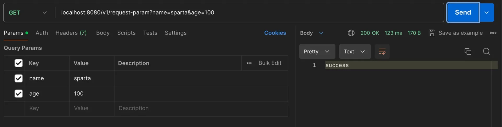

</details>

</details>

<details>
<summary>2&#46; 속성값 생략  (주로 사용) </summary>

<details>
<summary>&#91; 코드 &#93; </summary>

<a id="136eda9b0fe181f2bfa2fc506828730e"></a>

```java
// GET http://localhost:8080/v2/request-param?name=sparta&age=100
@ResponseBody
@GetMapping("/v2/request-param")
public String requestParamV2 (
				@RequestParam String name,
				@RequestParam int age													
) {
		// logic
		log.info("name={}", name);
	  log.info("age={}", age);
		return "success";
}
```

</details>

<details>
<summary>postman 테스트 </summary>

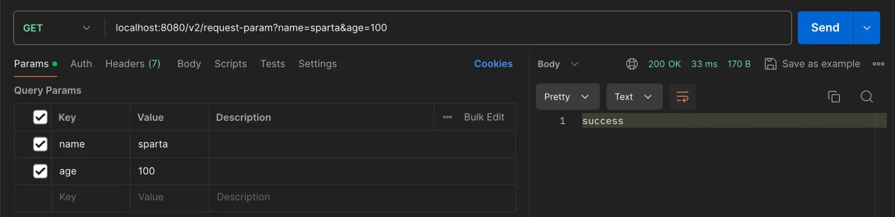

</details>

</details>

<details>
<summary>3&#46; 어노테이션, 속성값 생략  ( 권장 ❌ )</summary>

> <code>&#64;RequestParam</code> 생략 가능, 요청 파라미터와 매개변수 이름이 동일해야 함

<details>
<summary>&#91; 코드 &#93; </summary>

<a id="136eda9b0fe181f7bbe0cab99104a658"></a>

```java
// GET http://localhost:8080/v3/request-param?name=sparta&age=100
@ResponseBody
@GetMapping("/v3/request-param")
public String requestParamV3 (
				String name,
				int age													
) {
	// logic
	log.info("name={}", name);
  log.info("age={}", age);
	return "success";
}
```

</details>

<details>
<summary>postman</summary>

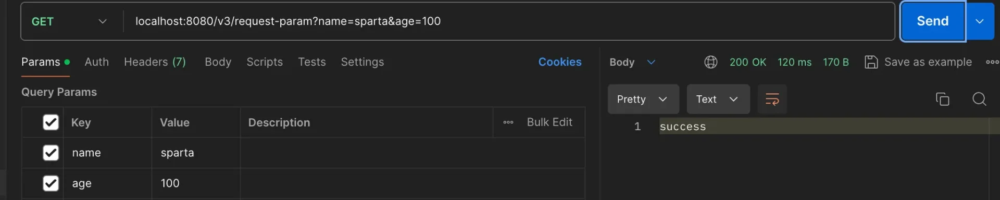

</details>

</details>

<a id="136eda9b0fe181cca94edda1b9642db1"></a>

### 속성

---

<details>
<summary>1&#46; 필수값(<code>required</code>)</summary>

- 파라미터 필수 값 설정

- API 스펙 규정  시 사용함

- 기본값 = true

---

<details>
<summary>&#91; 코드 &#93; </summary>

- <code>&#64;RequiredParam</code>&#45; <code>required</code> 기본값&#58; <code>true</code>
    - true로 설정된 파라미터 값이 요청에 존재하지 않으면 
        <a id="136eda9b0fe18165a2f5edf2f5b40a56"></a>

        → <code>400 Bad Request</code>, 클라이언트 요청 문법 오륲

<a id="136eda9b0fe181d490a8cfa40c994356"></a>

```java
@@ResponseBody
@GetMapping("/v4/request-param")
public String requestParam (
				@RequestParam(required = true) String name, // 필수
				@RequestParam(required = false) int age	// 필수가 아님										
) {
	// logic
	log.info("name={}", name);
  log.info("age={}", age);
	return "success";
}
```

</details>

<details>
<summary>postman</summary>

<details>
<summary><strong>ex 1)</strong> <code>http&#58;//localhost&#58;8080/v4/request&#45;param?name=sparta&#38;age=100</code> </summary>

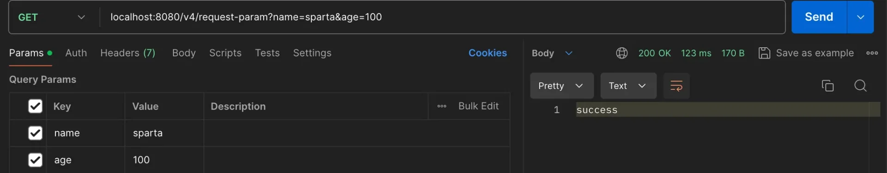

</details>

<details>
<summary>ex 2)   <code>http&#58;//localhost&#58;8080/v4/request&#45;param?age=100</code></summary>

- 필수값(<code>required=true</code>)인 name이 생략됨 →  <strong>400 Bad Request</strong>
    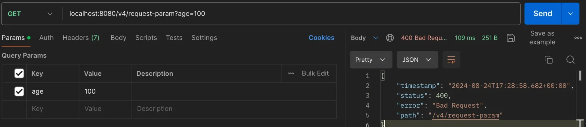

</details>

</details>

<details>
<summary> ⚠️  <strong><u>int</u></strong><strong> = </strong><strong><u><code>null</code></u></strong>, <code>http&#58;//localhost&#58;8080/v4/request&#45;param?name=sparta</code></summary>

- int 변수에 null 할당 → <code>500 Internal Server Error</code>

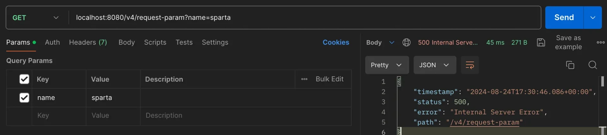

> ⚠️ 
> 
> <a id="136eda9b0fe1818da8cecba465b90a5d"></a>
> 
> <code>int</code> null 할당 불가
> 
> - 1) null 이 가능한 <code>Integer</code> 사용
> 
> - 2) default(<code>required=true</code>)로 설정 → 필수값이기 때문에 null 불가 

</details>

<details>
<summary> ⚠️  빈 문자열 </summary>

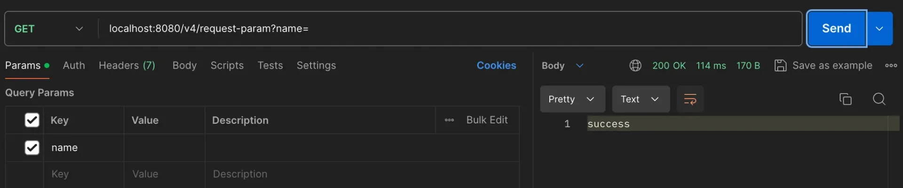

<a id="136eda9b0fe18110a603f1da018a90ab"></a>

위와 같이 value값 없이 요청을 보내면 빈 문자열(””)로 인식하여 아래와 값이 오류없이 빈 값으로 출력된다&#46; 

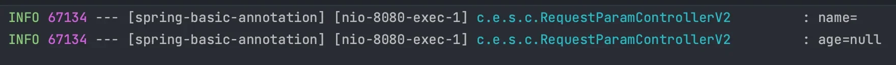

</details>

</details>

<details>
<summary>2&#46; 기본값(<code>defaultValue</code>)</summary>

- 파라미터 기본값 설정

- 요청에 파라미터 값이 없으면 기본값으로 할당됨

---

<details>
<summary>&#91; 코드 &#93; </summary>

<a id="136eda9b0fe1814092a1f3014ae9574c"></a>

```java
@ResponseBody
@GetMapping("/v5/request-param")
public String requestParam (
				@RequestParam(required = true, defaultValue = "sparta") String name,
		    @RequestParam(required = false, defaultValue = "1") int age											
) {
	// logic
	log.info("name={}", name);
  log.info("age={}", age);
	return "success"	
}

```

</details>

<details>
<summary>postman 테스트 </summary>


</details>

</details>

<details>
<summary>3&#46; Map </summary>

- 쿼리 파라미터들을 Map(<code>key=value</code>)에 담아 <code>&#46;get(key)</code> 으로 조회

---

<details>
<summary>&#91; 코드 &#93; </summary>

<a id="136eda9b0fe181cf9249da091c7e1a03"></a>

```java
// url = "/v6/request-param?name=sparta&age=20"
@GetMapping("/v6/request-param")
public String requestParamV6(
        @RequestParam Map<String, String> map
) {
    // logic
    log.info("name={}", map.get("name"));
    log.info("age={}", map.get("age"));

    return "success";
}
```

</details>

<details>
<summary>postman 테스트 </summary>

- 요청 URL &#45; <code>http&#58;//localhost&#58;8080/v6/request&#45;param?name=sparta&#38;age=100</code>

-  Map(<code>key=value</code>) 형태 
    - <code>map = { name&#58; sparta, age&#58; 100 }</code>

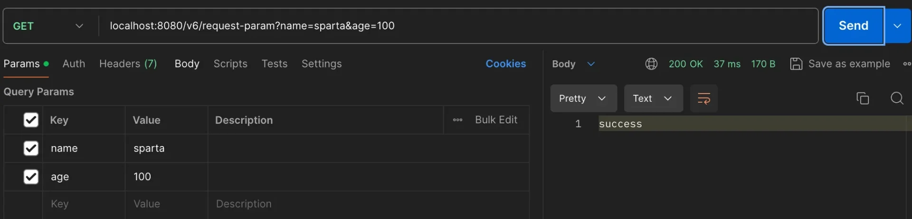

- 출력값

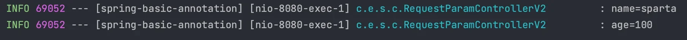

</details>

</details>

<details>
<summary>4&#46; MultiValueMap</summary>

> ☝🏻 
> 
> <a id="136eda9b0fe1817583d6e369a49f694c"></a>
> 
> 대부분 파라미터의 값은 한 개만 존재함 따라서 MultiValueMap의 경우는 잘 안씀

- 동일한 key를 가지는 쿼리 파라미터들은  value 값들을 List로 받아옴 
    <a id="136eda9b0fe181ffb9aec159979fdeaf"></a>

      ⇒  MultiValueMap 형태 (<code>key=&#91;value1, value2&#93;</code>)

---

<details>
<summary>&#91; 코드 &#93; </summary>

- 코드는 위 Map 과 동일하며, URL에 동일한 key를 가지는 쿼리 파라미터들이 추가됨
    - <code>name = sparta</code>, <code>name = wonuk</code>, <code>name = tutor</code>

<a id="136eda9b0fe18148b8b2d71a44093896"></a>

```java
// url = "http://localhost:8080/v6/request-param?name=sparta&name=wonuk&name=tutor&age=100"
@GetMapping("/v6/request-param")
public String requestParamV6(
        @RequestParam Map<String, String> map
) {
    // logic
    log.info("name={}", map.get("name"));
    log.info("age={}", map.get("age"));

    return "success";
}
```

</details>

<details>
<summary>postman 테스트 </summary>

- 요청 URL &#45; <code>http&#58;//localhost&#58;8080/v6/request&#45;param?</code><u><code>name</code></u><code>=sparta&#38;</code><u><code>name</code></u><code>=wonuk&#38;</code><u><code>name</code></u><code>=tutor&#38;age=100</code> 

- <code>{ name&#58; &#91;’sparta’, ‘wonuk’, ‘tutor’&#93;, age&#58;100 }</code>

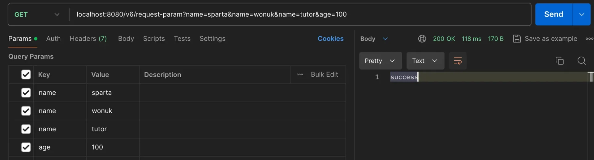

- 출력 값

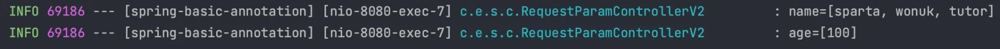

</details>

</details>

<a id="136eda9b0fe18083b645c455719a4527"></a>

## <code>&#64;ModelAttribute</code>

- 요청 파라미터를 받아 필요한 Object로 바인딩 해줌

- 주로 HTML 폼에서 전송된 데이터를 바인딩하고  HTTP Method POST인 경우에 사용됨

<a id="136eda9b0fe181bba30cd2705d09c073"></a>

### 사용

---

<details>
<summary>기존 코드</summary>

<details>
<summary>🧐<code>&#64;Data</code></summary>

> 아래의 Anotation을 자동으로 설정 해준다&#46; <br>보통 테스트 용도만 사용함 ( 실무 사용 X )

- <code>Getter</code>

- <code>&#64;Setter</code>

- <code>&#64;ToString</code>

- <code>&#64;EqualsAndHashCode</code>

- <code>&#64;RequiredArgsConstructer</code>

</details>

- <code>http&#58;//localhost&#58;8080/v1/tutor</code> &#43;  HTML form (<code>x&#45;www&#45;form&#45;urlencoded</code>)

<a id="136eda9b0fe18134b752f5a7a113c5dd"></a>

```java
@Data
public class Tutor {

	private String name;
	private int age;

}

@Controller
public class ModelAttributeController {

		@ResponseBody
	  @PostMapping("/v1/tutor")
	  public String requestParamV1(
	          @RequestParam String name,
	          @RequestParam int age
	  ) {
	      Tutor tutor = new Tutor();
	      tutor.setName(name);
	      tutor.setAge(age);
	
	      return "tutor name = " + name + " age = " + age;
	  }
}
```

</details>

<details>
<summary><code>&#64;ModelAttribute</code> 사용</summary>

- 기존 코드의 객체를 생성하고 setter를 이용한 값 주입을 자동화 처리할 수 있다&#46;
    - Form 데이터로 값을 받아오고, 형태가 동일한 경우 가능하다&#46; 

<a id="136eda9b0fe18166a0c7feadfcb2a32d"></a>

```java
@ResponseBody
@PostMapping("/v2/tutor")
public String modelAttributeV2(
				@ModelAttribute Tutor tutor													
) {
		
	String name = tutor.getName();
	int age = tutor.getAge();

	return "tutor name = " + name + " age = " + age;
}
```

</details>

<details>
<summary><code>&#64;ModelAttribute</code> 생략</summary>

- <code>&#64;RequestParam</code> 과 동일하게 <code>&#64;ModelAttribute</code>도 생략이 가능하다&#46; 

---

<details>
<summary>요청 메세지</summary>

- <code>http&#58;//localhost&#58;8080/v3/tutor</code>  &#43; HTML Form ( <code>x&#45;www&#45;form&#45;urlencoded</code>) 

<a id="136eda9b0fe1814cbb4ee5789c91bd8f"></a>

```plaintext
POST /v3/tutor
content-type: application/x-www-form-urlencoded

name=wonuk&age=100
```

</details>

<details>
<summary>&#91; 코드 &#93; </summary>

<a id="136eda9b0fe181829a25cc7e7b60d398"></a>

```java
@ResponseBody
@PostMapping("/v3/tutor")
public String modelAttributeV3(Tutor tutor) {

	String name = tutor.getName();
	int age = tutor.getAge();

	return "tutor name = " + name + " age = " + age;
}
```

</details>

</details>

<a id="136eda9b0fe1816a9513f28b32af3871"></a>

### 특성

---

<details>
<summary>동작 순서</summary>

1. 파라미터에 <code>&#64;ModelAttribute</code>가 있으면 파라미터인 Tutor객체를 생성한다&#46; 

1. 요청 파라미터에 이름으로 객체 필드의 Setter를 호출해 바인딩한다&#46; 
    - 파라미터 이름&#58; <code>name</code> &#45;&#62; <code>setName(value)</code>  메서드 호출

    - <u>파미터 이름</u>과 <u>필드 이름</u>이 반드시 같아야 한다&#46; 

</details>

<details>
<summary>⚠️ setter가 없는 경우,객체 필드에 값이 set 되지 않는다&#46; </summary>

<a id="136eda9b0fe181888065f8817791bd7a"></a>

```java
@Getter
public class Tutor {

	private String name;
	private int age;

}
```

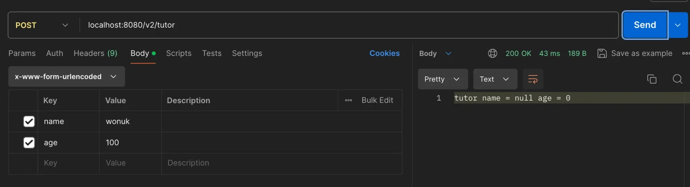

</details>

<details>
<summary>⚠️ 파라미터의 타입이 다른 경우</summary>

- 만약 요청 파라미터 <code>age</code> 에 <code>int</code>가 아닌 <code>String</code> 이 전달된다면?<br>→ <strong>BindException </strong><strong>발생</strong>

- <strong>이런 경우,</strong><strong> Validation(검증)</strong><strong>이 필요하다&#46; </strong>

---

- 요청 메세지&#58; <code>http&#58;//localhost&#58;8080/v2/tutor</code>&#43; HTML Form ( <code>x&#45;www&#45;form&#45;urlencoded</code> )
    <a id="136eda9b0fe181c99016ffc19e8eb1b2"></a>

    ```java
    POST /v2/tutor
    content-type: application/x-www-form-urlencoded
    	
    name=wonuk&age=nbcamp
    ```

    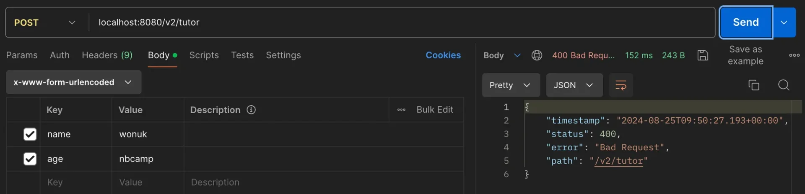

</details>

> ☝🏻 
> 
> <a id="1cdc7952697e4ff9b127e7f3b2af1be5"></a>
> 
> <code>&#64;RequestPram</code>, <code>&#64;ModelAttribute</code>  둘 모두 생략이 가능하다&#46;
> 
> <details>
> <summary><strong>기본 타입</strong>은 <code>&#64;RequestPram</code>으로 매핑된다&#46; </summary>
> 
> <a id="136eda9b0fe180c69decedefd93fffa5"></a>
> 
> ```java
> @ResponseBody
> @PostMapping("/v4/tutor")
> public String requestParamV2(
>         String name,
>         int age
> ) {
>     return "tutor name = " + name + " age = " + age;
> }
> ```
> 
> </details>
> 
> <details>
> <summary>나머지 경우(객체)는 모두 <code>&#64;ModelAttribute</code> 와 매핑한다&#46; </summary>
> 
> <a id="136eda9b0fe180a68554dd5b0b0e3a26"></a>
> 
> ```java
> @ResponseBody
> @PostMapping("/v3/tutor")
> public String modelAttributeV3(Tutor tutor) {
> 
> 	String name = tutor.getName();
> 	int age = tutor.getAge();
> 
> 	return "tutor name = " + name + " age = " + age;
> }
> ```
> 
> </details>
