> /icons/tag_gray.svg 
> 
> <a id="43f1023cc80847c4944d5f7fc2bf262a"></a>
> 
> CS 특강 &#45; 데이터 베이스
> 
> - 진행&#58;  이태현 튜터님
> 
> - 기간&#58; 24&#46;11&#46;06
> 
> - 자료&#58; <a href="https://beautiful-college-c84.notion.site/1362dc3ef51480f9a297d4a36288541b">페이지</a> 

<a id="136eda9b0fe180cf8c52ddf22a3d0736"></a>

## 서론&#58; 🧐 백엔드 엔지니어의 업무 영역은 어디까지 일까?

---

<a id="136eda9b0fe180e2a3f5d9df950b43f2"></a>

최근 들어 백엔드 엔지니어가 해야하는 업무는 API 개발만이 아닌, 서버관리, 데이터 모델링, 데이터베이스 관리, 서버 베포 등 그 영역이 점점 확대대고 있다&#46;

- 소규모의 규모인 경우 네트워크, 인프라까지 할 수 도 있다&#46; 

<a id="136eda9b0fe18036953ae68827a8cddd"></a>

처음 회사에 입사하게 된다면, 구현에 일부부터 시작할 가능성이 높다&#46;  ( 더 많은 업무를 할 수도 있다&#46; ) 

<a id="136eda9b0fe180b0a510c4b9b63908b9"></a>

구현만 잘하면 되는가? 그렇진 않다&#46; 

<a id="136eda9b0fe180e2bfb4d73c343e8f4b"></a>

기술들을 잘 사용할 수 있고, 관련 기초 지식을 기반으로 더 깊게 생각할 수 있어야 한다&#46; 

- 그 기술들을 지탱하고 있는 기반 지식을 일부 이해할 수 있고 점점 deep한 문제에 직면했을 때 동료들과 함께 해결하며 발전할 수 있는 개발자를 원한다&#46;

<a id="136eda9b0fe180128c8bd8dd334e82c3"></a>

# 1&#46; RDBMS 일반

---

<a id="173eda9b0fe180488370d4d85bce0e16"></a>

## 1&#46; RDB, RDBMS

<a id="136eda9b0fe18064a8ffce72aacbd20e"></a>

RDB(Relational Database &#45; 관계형 데이터베이스 )는 데이터를 테이블 형태로 저장하고, 이 테이블들 간의 관계를 기반으로 데이터를 관리할 수 있는 저장 공간이다&#46; 

<a id="173eda9b0fe18017b170e3b3fb6d42b9"></a>

RDBMS(Relational Database Management System &#45; 관계형 데이터베이스 관리 시스템)을 통해 데이터베이스를 관리하고 구조화된 쿼리 언어(Structured Query Language, SQL)를 사용하여 데이터를 삽입, 조회, 수정 , 삭제하는 작업 등을 수행할 수 있다&#46;

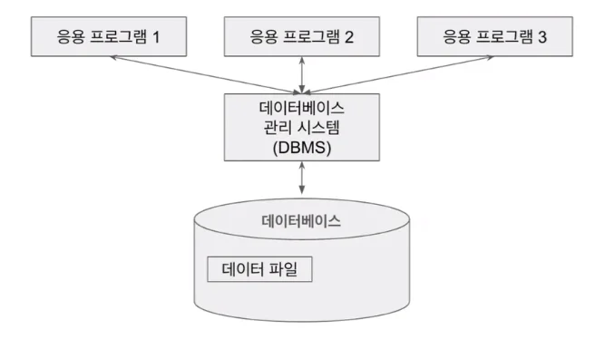

<a id="136eda9b0fe1802895b2c4253ade91af"></a>

## 2&#46; RDB 주요 기능

---

| <strong>기능</strong> | <strong>설명</strong> |
| --- | --- |
| <strong>데이터 정의<br>(Data Definition)</strong> | 데이터의 논리적, 물리적 구조를 정의하고 데이터간 관계와 연산를 명세할 수 있는 기능<br>&#45; 엔티티, 관계 등 |
| <strong>데이터 조작<br>(Data Manipulation)</strong> | 사용자가 자연 언어(인간이 사용하는 언어)에 가까운 수준으로 데이터를 검색, 변경, 삭제 가능<br>&#45; SQL |
| <strong>데이터 제어<br>(Data Control)</strong> | • <strong>동시성 제어 기능</strong>&#58; 사용자가 동시에 데이터를 사용하고자 할 때 감시, 감독하는 기능<br>• <strong>보안 권한 기능</strong>&#58; 데이터를 외부로부터 보호해야 하며 데이터의 사용 권한을 구분하여 사용<br>• <strong>무결성 및 제약조건 유지 기능</strong>&#58; 데이터가 변경, 수정되는 과정에서 데이터의 정확성과 일관성이 유지 |

<a id="136eda9b0fe1806c9023d61997c7f130"></a>

## 3&#46; RDBMS 특징

---

| <strong>특징</strong> | <strong>설명</strong> |
| --- | --- |
| <strong><code>무결성</code></strong> | <strong><u>중복된 데이터가 저장</u></strong><strong>되는 것을 </strong><strong>허용하지 않</strong><strong>는 성질</strong> |
| <strong><code>일관성</code></strong> | 서로 다른 정보가 구성한 데이터 형태로 일관되게 저장되는 성질 |
| <strong><code>회복성</code></strong> | <strong><u>장애가 발생</u></strong>하였을 시 <strong><u>원래 상태로 복구</u></strong>되어야 하는 성질 |
| <strong><code>보안성</code></strong> | 불법적인 노출, 변경, 손실로부터 <strong><u>보호</u></strong>되어야 하는 성질 |
| <strong><code>효율성</code></strong> | <strong><u>응답 시간, 저장 공간 활용 등이 최적화</u></strong>되어 사용자, 소프트웨어, 요구 조건 등을 만족시켜야 하는 성질 |

<details>
<summary>무결성  </summary>

- 중복된 데이터가 저장되는 것을 허용하지 않아야 한다&#46;

</details>

<details>
<summary>일관성 </summary>

- 서로 다른 정보가 구성한 데이터 형태로 일관되게 저장되어야 한다&#46;

</details>

<details>
<summary>회복성</summary>

- 장애가 발생하였을 시 원래 상태로 복구되어야 한다&#46;

</details>

<details>
<summary>보안성 </summary>

- 불법적 노출, 변경 손실로부터 보호되어야 한다&#46;

</details>

<details>
<summary>효율성 </summary>

- 응답 시간, 저장공간 활용 등이 최적화되어 사용자, 소프트웨어, 요구 조건 등을 만족 시켜야 한다

</details>

<a id="173eda9b0fe180f986b8e4248ece98cb"></a>

## 4&#46; 관계형 데이터베이스 종류

---

| <strong>데이터베이스</strong> | <strong>상용/오픈소스</strong> | <strong>개발사</strong> | <strong>특징</strong> |
| --- | --- | --- | --- |
| <strong><code>MySQL</code></strong> | 오픈소스 | 오픈소스 커뮤니티 | &#45; 빠른 읽기 성능과 확장성으로 대규모 웹 서비스에서 자주 사용 <br>&#45; 다양한 스토리지 엔진을 지원 |
| <strong><code>Oracle</code></strong> | 상용 | 오라클(Oracle) | &#45; 고급 보안 기능, 고성능, 데이터 백업, 복구와 같은 고급 기능을 제공<br>&#45; 데이터 안정성과 대용량 데이터 처리에 강점을 가지며, 대규모 시스템에서 주로 사용 |
| <strong><code>PostgreSQL</code></strong> | 오픈소스 | 버클리 대학교 | &#45; JSON, 배열과 같은 고급 데이터 타입 지원<br>&#45; 복잡한 쿼리 처리와 데이터 무결성 보장 |
| <strong><code>SQLite</code></strong> | 오픈소스 | 오픈소스 커뮤니티 | &#45; 메모리에 저장되는 데이터베이스 <br>&#45; 서버가 필요 없는 경량형 구조 |

<a id="173eda9b0fe1800c8ca3de70fa0bc008"></a>

## 5&#46; 스키마(Schema) &#58; 도식, 개념

---

> ✏️ 
> 
> <a id="24aeda9b0fe1808bb0b7e050e7d0ddfa"></a>
> 
> <code>스키마(Schema)</code>는 데이터베이스의 구성하는 <strong><u>요소(entity, 속성, 제약조건, 인덱스,  파일 위치 등)를 명세</u></strong>해서 <strong>어떻게 데이터베이스 설계할지 도식화</strong>한 것이다&#46;

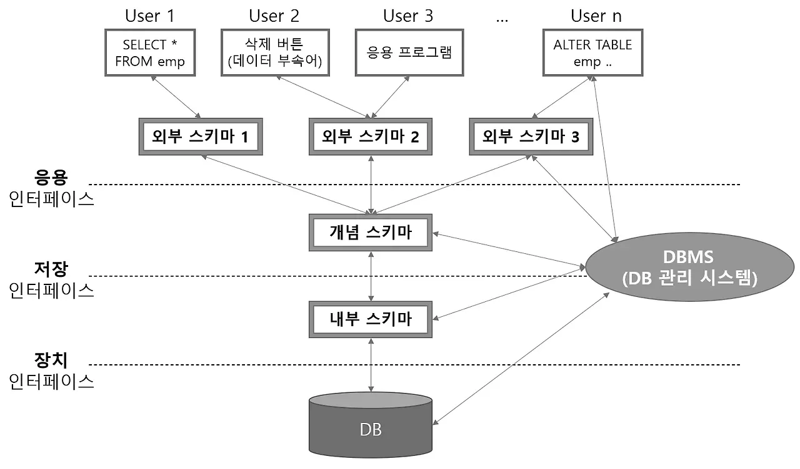

| <strong>스키마 종류</strong> | <strong>설명</strong> | <strong>특징</strong> | <strong>예시</strong> |
| --- | --- | --- | --- |
| <strong>외부 스키마</strong> | 사용자가 보는 데이터의 논리적 뷰를 정의하는 스키마 | &#45; 개별 사용자나 응용 프로그램이 필요로 하는 데이터만 볼 수 있게 정의 <br>&#45; 여러 사용자 그룹이 서로 다른 뷰를 가질 수 있음 | 고객 A가 볼 수 있는 주문 내역 화면, 직원 B가 볼 수 있는 직원 데이터 뷰 |
| <strong>개념 (논리) 스키마</strong> | 데이터베이스 전체의 논리적 구조를 정의하는 스키마 | &#45; 모든 데이터를 통합하여 전체적인 데이터 구조를 나타냄 <br>&#45; Entity, 관계, 제약 조건을 포함 | 고객 테이블과 주문 테이블 간의 관계 정의, 데이터 무결성 규칙 |
| <strong>내부 (물리) 스키마</strong> | 데이터가 실제로 저장되는 방식과 물리적 구조를 정의하는 스키마 | &#45; 데이터 저장 위치, 인덱스 구조, 파일 구성 등의 물리적 저장 방식 결정 <br>&#45; 데이터베이스의 성능 및 효율성을 고려한 저장 방식과 접근 경로 최적화 | 인덱스가 지정된 고객 데이터, 주문 테이블의 실제 저장 파일 |

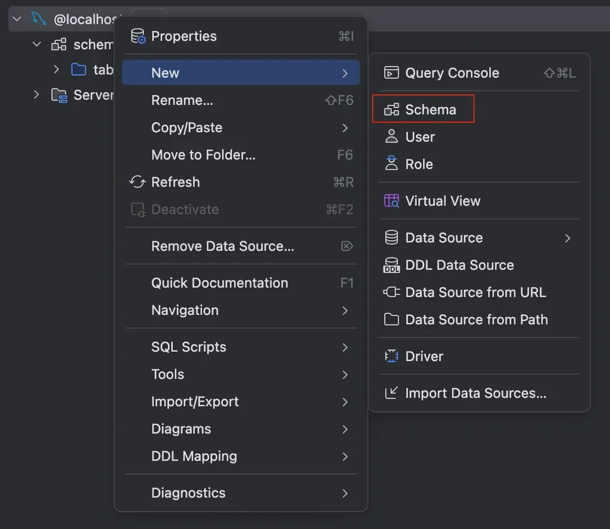

<a id="173eda9b0fe180fdaa9be4fd121fb730"></a>

# 2&#46; RDMBS 설계 &#45; 데이터 모델링

---

<a id="173eda9b0fe1809cb4a0fc390b12afd9"></a>

## 1&#46; &#91; 개념, 논리, 물리 &#93; 데이터 모델링 

> ✏️ 
> 
> <a id="24aeda9b0fe1801a80d1c1af940b9611"></a>
> 
> 관계형 데이터베이스 설계는 RDBS의 특징에 따라 <strong><u>논리 설계</u></strong><strong>와 </strong><strong><u>물리 설계</u></strong><strong>로 나눠 진행</strong>한다&#46;

<details>
<summary>🧐 <strong><code>객체지향</code></strong><strong> vs </strong><strong><code>데이터 모델링</code></strong></summary>

| <strong>구분</strong> | <strong><code>객체지향</code></strong> | <strong><code>데이터 모델링</code></strong> |
| --- | --- | --- |
| <strong>구성 요소</strong> | 클래스, 객체, 상속, 다형성 | 엔터티, 속성, 관계, 키, 정규화 |
| <strong>데이터와 기능</strong> | 속성과 메서드로 수행 가능 | 데이터만 가능하나 Procedure를 통해 부분적으로 가능 |
| <strong>재사용과 확장성</strong> | 상속과 다형성 제공 | &#45; |
| <strong>데이터 무결성 보장</strong> | 클래스의 속성 타입과 메서드 제약을 통해 객체 내 무결성 관리<br>&#42;&#42; 시스템적으로 무결성을 보장하지 않음으로 직접 중복을 확인해야 함 | 데이터베이스의 무결성 제약 조건 (기본키, 외래키, 제약조건 등)으로 테이블 간 데이터 일관성 유지<br>&#42;&#42; 시스템적으로 무결성을 보장 |
| <strong>상속과 관계 표현</strong> | 클래스 상속을 통해 상속 구조와 다형성 지원 | 데이터 모델링에서는 상속 개념이 없고, 관계를 외래키, 조인 등으로 표현 |
| <strong>데이터 접근 방식</strong> | 메서드를 통해 객체의 속성에 접근 (캡슐화) | Join을 통해 테이블의 데이터를 직접 조회 및 조작 |
| <strong>변경에 대한 유연성</strong> | 객체지향에서는 클래스와 객체 관계를 쉽게 변경 가능 | 데이터베이스의 테이블 구조나 관계를 변경하는 것은 더 복잡하고 많은 비용이 소요될 수 있음 |

</details>

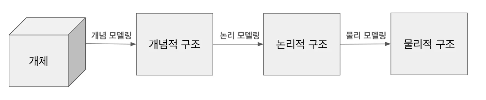

| <strong>분류</strong> | <strong>설명</strong> |
| --- | --- |
| <strong>개념 데이터 모델링</strong> | &#45; 구현하고자 하는 도메인 개체를 Entity로 추상화하는 단계<br>&#45; Entity와 속성, 관계를 도출 |
| <strong>논리 데이터 모델링</strong> | &#45; 개념 모델을 상세화하는 단계<br>&#45; Entity의 속성과 관계를 확정하고 <strong><code>논리 ERD</code></strong>(Entity Relationship Diagram)를 작성<br>&#45; <strong><u>엔터티의 속성, 도메인(데이터 타입), 길이, 제약 조건 등을 설계</u></strong>에 포함 |
| <strong>물리 데이터 모델링</strong> | &#45; 논리 모델을 바탕으로 실제 데이터베이스의 물리 스키마를 생성하는 단계<br>&#45; <strong><u>논리 ERD를 실제화</u></strong>시켜 테이블, 뷰, 시퀀스 등 물리 개체를 생성<br>&#45; <strong><u>index(인덱스), 저장 위치, 파일 구성 등을 포함</u></strong> |

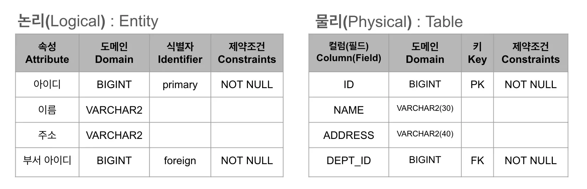

<a id="173eda9b0fe1803d949efdd03e7e5bff"></a>

## 2&#46; <strong>테이블 구성요소</strong>

---

<a id="639f132a3f974c858a32d9e61a3c78fc"></a>

### 1&#46; 컬럼 <strong>(Column/Field)</strong>

> ✏️ 
> 
> <a id="24aeda9b0fe1800fbaaad8b2bcd1ca30"></a>
> 
> 테이블의 구성 속성으로 데이터를 구분하고 저장하는 의미 단위이다&#46;

- ex) &#34;아이디&#34;, &#34;이름&#34;, &#34;주소&#34; 등

<a id="173eda9b0fe1801e8db2c515d5f86425"></a>

### 2&#46; 도메인 <strong>(Domain/Data Type)</strong>

> ✏️ 
> 
> <a id="24aeda9b0fe180a488c9d701061d7e21"></a>
> 
> 필드에 저장될 <strong><u>데이터의 유형을 지정</u></strong>한다&#46;

| <strong>유형</strong> | <strong>타입</strong> | <strong>Java 타입</strong> | <strong>설명</strong> |
| --- | --- | --- | --- |
| <code>숫자형</code> | TINYINT | byte | 1바이트의 정수(&#45;128&#126;127) |
|  | SMALLINT | short | 2바이트의 정수(&#45;32768&#126;32767) |
|  | MEDIUMINT | int | 3바이트의 정수(&#45;8388608&#126;8388607) |
|  | INT | int | 4바이트의 정수(&#45;2147483648 &#126; 2147483647) |
|  | <code>BIGINT</code> | <code>long</code> | 8바이트의 정수(&#45;9223372036854775808 &#126; 9223372036854775807) |
|  | FLOAT | float | 4바이트 부동 소수점 실수 |
|  | DOUBLE | double | 8바이트 부동 소수점 실수 |
|  | <code>DECIMAL</code> | <code>java&#46;math&#46;BigDecimal</code> | DECIMAL(전체 자릿수, 소수점 자릿수) 형식의 고정 소수점 실수 <br>(예&#58; DECIMAL(3&#46;2)는 소수점 이하 2자리인 총 3자릿수의 소수) |
| <code>문자형</code> | <code>CHAR</code> | <code>String</code> | 고정 길이 문자열 (최대 255자) |
|  | <code>VARCHAR</code> | <code>String</code> | 가변 길이의 문자열 (최대 65535자) |
|  | BLOB | byte&#91;&#93; | 이미지, 파일과 같은 대량 바이너리 데이터 <br>(최대 65,535byte) |
|  | <code>TEXT</code> | <code>String</code> | 대량 가변 길이 문자열 (최대 65,535자) |
| <code>시간형</code> ( 날짜 ) | DATE | java&#46;sql&#46;Date | YYYY&#45;MM&#45;DD 형식의 날짜 |
|  | TIME | java&#46;sql&#46;Time | HH&#58;MM형식의 시간 |
|  | <code>DATETIME</code> | <code>java&#46;sql&#46;Timestamp</code> | YYYY&#45;MM&#45;DD HH&#58;MM형식의 날짜와 시간 |
|  | <code>TIMESTAMP</code> | <code>java&#46;sql&#46;Timestamp</code> | YYYY&#45;MM&#45;DD HH&#58;MM형식의 날짜와 시간 |
| 기타 | <code>ENUM</code> | <code>enum</code> | 정해진 값 중 하나(예&#58; 남, 여) |
|  | GEOMETRY | Object | 지리 정보(예&#58; 좌표 데이터), 특정 라이브러리로 매핑 가능 |
|  | XML | java&#46;sql&#46;SQLXML | XML 데이터 |
|  | JSON | String | JSON 데이터 |

<a id="173eda9b0fe1807fb9d2dff94f1b9874"></a>

### 3&#46; 크기, 길이

> ✏️ 
> 
> <a id="24aeda9b0fe180279995fffa8713947f"></a>
> 
> 데이터 타입에 따라 저장할 수 있는 최대 길이 또는 크기를 설정한다&#46; 
> 
> - 데이터베이스 용량 관리 측면

- ex) <code>VARCHAR(50)</code>
    -  최대 50자의 문자열을 저장

<a id="173eda9b0fe180b2900cfaf39113f089"></a>

### 4&#46; 식별자 &#45; 키 ( Identifier &#45; Key )

> <strong><u>데이터의 무결성을 유지</u></strong>하고 레코드를 찾거나 순서대로 정렬할때 다른 레코드들과 구별하기 위한 속성

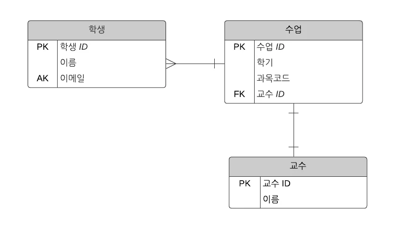

| <strong>용어</strong> | <strong>설명</strong> | <strong>예시</strong> |
| --- | --- | --- |
| <strong><code>후보키</code></strong> | 데이터베이스에서 각 레코드를 유일하게 식별할 수 있는 속성 집합 | 학생 테이블&#58; <code>학생ID</code>, <code>이메일</code> |
| <strong><code>기본키</code></strong> | 후보키 중에서 유일하게 선택된 속성으로, 각 레코드를 고유하게 식별 | 학생 테이블&#58; <code>학생ID</code> |
| <strong><code>외래키</code></strong> | 다른 테이블의 기본키를 참조하는 속성&#46; 관계를 형성하는 데 사용됨 | 수업 테이블에서 <code>교수ID</code>가<code> 교수</code> 테이블의 <code>교수ID</code>를 참조 |
| <strong><code>복합키</code></strong> | 두 개 이상의 속성을 결합하여 유일성을 제공하는 키 | 수업 테이블&#58; <code>학기</code>, <code>과목코드</code> |
| <strong><code>대체키</code></strong> | 기본키 대신 사용될 수 있는 후보키로, 기본키가 아닌 다른 유일 키 | 학생 테이블&#58; <code>이메일</code> |

<details>
<summary><code>🧐 유니크 키</code> vs <code>대체 키 </code></summary>

> ✏️ 
> 
> <a id="24aeda9b0fe180088d3de53d2cc722a9"></a>
> 
> <strong><code>대체키</code></strong><strong>는 </strong><strong><u>유니크 키의 하위 개념</u></strong><strong>이다</strong>
> 
> - 대체키는 <strong>후보키(Candidate Key)</strong> 중 기본키로 선택되지 않은 키이다&#46;
> 
> - 유니크 키는 <strong>데이터 무결성을 보장하기 위한 제약 조건</strong>으로 설계되며, 반드시 후보키일 필요는 없다&#46;

| <strong>구분</strong> | <strong>대체키(Alternate Key)</strong> | <strong>유니크 키(UNIQUE Key)</strong> |
| --- | --- | --- |
| <strong>개념</strong> | 기본키(Primary Key)가 아닌 <strong><u>고유성을 가진 후보키</u></strong>(Candidate Key) 중 하나&#46; | 테이블의 특정 열 또는 열 조합에 <strong><u>고유성을 보장하는 제약 조건</u></strong>&#46; |
| <strong>역할</strong> | 기본키를 보조하거나 대체할 수 있는 키&#46; | 데이터의 중복을 방지하기 위한 고유성 보장&#46; |
| <strong>제약 조건 사용</strong> | SQL에서는 <code>UNIQUE</code> 제약 조건을 통해 구현됨&#46; | 동일하게 <code>UNIQUE</code> 제약 조건을 통해 구현됨&#46; |
| <strong>의미적 차이</strong> | 설계 단계에서 &#34;키로 사용할 가능성&#34;이 있는 후보키로 정의됨&#46; | 데이터 무결성을 유지하기 위한 &#34;유일성 제약 조건&#34; |

</details>

<a id="24aeda9b0fe1802f8103c810ec3975fe"></a>

### 예제) SQL

<details>
<summary>기본 키 설정</summary>

<a id="173eda9b0fe1806b9781edace39e6451"></a>

```sql
-- 기본키 설정
ALTER TABLE 학생
ADD CONSTRAINT PK_학생 PRIMARY KEY (학생ID);
```

</details>

<details>
<summary>외래 키 설정</summary>

<a id="b636e2e2d9fe4d8f9f8f88533ca045d2"></a>

```sql
-- 외래키 설정
ALTER TABLE 수업
ADD CONSTRAINT FK_수업_교수 FOREIGN KEY (교수ID)
REFERENCES 교수 (교수ID)
ON DELETE CASCADE
ON UPDATE CASCADE;
```

</details>

<details>
<summary>유니크 키 설정</summary>

<a id="17c958f332574f0fb3af236e2bb7ea2e"></a>

```sql
-- 유니크키 설정
ALTER TABLE 학생
ADD CONSTRAINT UQ_학생_이메일 UNIQUE (이메일);
```

</details>

<details>
<summary>대체 키 설정</summary>

<a id="cafc24dd74c04f1d81809b68f48ec505"></a>

```sql
-- 대체키 설정
ALTER TABLE 학생
ADD CONSTRAINT 학생_Email UNIQUE (Email);
```

</details>

<details>
<summary>복합 키 설정</summary>

<a id="5b7f5acda4c945faad3a56e33b90f1e5"></a>

```sql
-- 복합키 설정
ALTER TABLE 수업
ADD CONSTRAINT PK_수업 PRIMARY KEY (학기, 과목코드);
```

</details>

<a id="173eda9b0fe180bfa55be9c7215a5912"></a>

### 5&#46; 제약 조건 ( Constraints )

> 필드의 데이터 무결성을 유지하기 위한 규칙을 설정

| <strong>제약조건</strong> | <strong>설명</strong> | <strong>예시</strong> |
| --- | --- | --- |
| <strong>기본키 <br>(Primary Key)</strong> | 테이블에서 각 레코드를 고유하게 식별하는 속성으로, 중복값과 NULL 값을 허용하지 않음&#46; | 학생 테이블&#58; <code>학생ID</code> |
| <strong>외래키 <br>(Foreign Key)</strong> | 다른 테이블의 기본키를 참조하여 관계를 형성하며, 참조 무결성을 유지&#46; | 수업 테이블에서 <code>교수ID</code>가<code> 교수</code> 테이블의 <code>교수ID</code>를 참조 |
| <strong>유니크 <br>(Unique)</strong> | 특정 컬럼의 값이 테이블 내에서 유일해야 함을 보장하며, 중복된 값을 허용하지 않음&#46; | 학생 테이블&#58; <code>이메일</code> |
| <strong>널 <br>(Not Null)</strong> | 특정 컬럼에 NULL 값을 허용하지 않도록 설정하여, 반드시 값을 입력해야 함&#46; | 학생 테이블&#58; <code>이름</code> |
| <strong>체크 제약조건 (Check)</strong> | 컬럼의 값이 특정 조건을 만족해야 함을 정의하여, 데이터 입력 시 유효성을 검증&#46; | <code>학생</code> 테이블의 <code>나이</code>가 0 이상이어야 함&#46; |
| <strong>기본값 제약조건 (Default)</strong> | 특정 컬럼에 값을 입력하지 않을 경우, 기본값으로 지정된 값을 자동으로 할당&#46; | <code>학생</code> 테이블의 <code>등록일</code> 컬럼에 현재 날짜를 기본값으로 설정&#46; |
| <strong>복합 제약조건 (Composite)</strong> | 두 개 이상의 컬럼에 동시에 적용되는 제약조건으로, 주로 복합키를 정의하는 데 사용됨&#46; | <code>수업</code> 테이블에서 <code>학기</code>와 <code>과목코드</code>의 조합으로 유니크 제약조건 설정 |

<a id="173eda9b0fe1804aa866ddb9170c2261"></a>

```sql
-- PK
CREATE TABLE 사용자 (
    사용자ID INT PRIMARY KEY,
    이메일 VARCHAR(100) UNIQUE
);

-- FK
CREATE TABLE 수업 (
    수업ID INT PRIMARY KEY,
    교수ID INT,
    FOREIGN KEY (교수ID) REFERENCES 교수(교수ID)
);

-- Unique
CREATE TABLE 사용자 (
    사용자ID INT PRIMARY KEY,
    이메일 VARCHAR(100) UNIQUE
);

-- Not Null
CREATE TABLE 직원 (
    직원ID INT PRIMARY KEY,
    이름 VARCHAR(50) NOT NULL
);

-- Check
CREATE TABLE 제품 (
    제품ID INT PRIMARY KEY,
    가격 DECIMAL(10, 2),
    할인율 INT CHECK (할인율 BETWEEN 0 AND 100)
);

-- Default
CREATE TABLE 주문 (
    주문ID INT PRIMARY KEY,
    상태 VARCHAR(20) DEFAULT '대기 중'
);

-- Composite
CREATE TABLE 학생_수업 (
    학생ID INT,
    수업ID INT,
    PRIMARY KEY (학생ID, 수업ID),
    FOREIGN KEY (학생ID) REFERENCES 학생(학생ID),
    FOREIGN KEY (수업ID) REFERENCES 수업(수업ID)
);
```

<a id="173eda9b0fe1803880bdd389913f7ea5"></a>

### <strong>5&#46;1 &#45; 외래키(FK) 제약조건</strong>

> ✏️ 
> 
> <a id="24aeda9b0fe18023b782ed6efeaee263"></a>
> 
> 외래키 제약조건은 <strong><u>부모 테이블과 자식 테이블 간의 관계를 정의</u></strong>하며, <strong><u>참조 무결성을 유지</u></strong>하기 위해 다양한 동작 옵션을 설정
> 
> - 해당 내용은 ORM에서도 설정으로 일부 가능

| <strong>옵션</strong> | <strong>설명</strong> | <strong>예시</strong> |
| --- | --- | --- |
| <strong><code>CASCADE</code></strong> | 부모 레코드가 삭제되거나 수정될 때, <br>관련된 자식 레코드도 함께 삭제되거나 수정 | 교수 테이블에서 <code>교수ID</code>가 삭제될 때, <br>수업 테이블의 해당 <code>교수ID</code>를 가진 레코드도 삭제 |
| <strong><code>RESTRICT</code></strong> | 부모 레코드가 삭제되거나 수정될 때, <br>자식 레코드가 존재하면 삭제나 수정이 제한 | 수업 테이블에서 <code>교수ID</code>를 가진 레코드가 존재하면 <br>교수 테이블에서 <code>교수ID</code> 삭제 불가&#46; |
| <strong><code>SET NULL</code></strong> | 부모 레코드가 삭제되거나 수정될 때, <br>자식 레코드의 외래키 컬럼 값을 NULL로 설정 | 교수 테이블에서 <code>교수ID</code>가 삭제될 때, <br>수업 테이블의 해당 <code>교수ID</code>를 NULL로 설정&#46; |
| <strong><code>SET DEFAULT</code></strong> | 부모 레코드가 삭제되거나 수정될 때, <br>자식 레코드의 외래키 컬럼 값을 기본값으로 설정 | 교수 테이블에서 <code>교수ID</code>가 삭제될 때, <br>수업 테이블의 <code>교수ID</code>를 기본값으로 설정&#46; |
| <strong><code>NO ACTION</code></strong> | 부모 레코드가 삭제되거나 수정될 때, <br>자식 레코드가 존재하면 아무런 동작도 수행 | 자식 레코드가 존재할 경우, <br>부모 레코드의 삭제나 수정가 거부됨 |

<a id="173eda9b0fe1809394a7dc61c3ea2f0c"></a>

```sql
-- CASCADE
ALTER TABLE 수업
ADD CONSTRAINT FK_수업_교수_CASCADE
FOREIGN KEY (교수ID)
REFERENCES 교수(교수ID)
ON DELETE CASCADE
ON UPDATE CASCADE

-- RESTRICT
ALTER TABLE 수업_RESTRICT
ADD CONSTRAINT FK_수업_교수_RESTRICT
FOREIGN KEY (교수ID)
REFERENCES 교수(교수ID)
ON DELETE RESTRICT
ON UPDATE RESTRICT;

-- SET NULL
ALTER TABLE 수업
ADD CONSTRAINT FK_수업_교수
FOREIGN KEY (교수ID)
REFERENCES 교수(교수ID)
ON DELETE SET NULL
ON UPDATE SET NULL;

-- SET DEFAULT
ALTER TABLE 수업
ADD CONSTRAINT FK_수업_교수
FOREIGN KEY (교수ID)
REFERENCES 교수(교수ID)
ON DELETE SET DEFAULT
ON UPDATE SET DEFAULT;

-- NO ACTION
ALTER TABLE 수업
ADD CONSTRAINT FK_수업_교수
FOREIGN KEY (교수ID)
REFERENCES 교수(교수ID)
ON DELETE NO ACTION
ON UPDATE NO ACTION;
```

<a id="173eda9b0fe180cb8de2cbf7c2072eba"></a>

### 6&#46; 기본값 ( Default Value )

> ✏️ 
> 
> <a id="24aeda9b0fe18054b405e6004d993fbb"></a>
> 
> 필드의 값이 입력되지 않았을 때 자동으로 저장될 기본 값을 지정
> 
> - 대부분 애플리케이션에서 수행

- ex) 필드의 기본값을 0 또는 특정 날짜 등을 설정
    <a id="173eda9b0fe180088344f67391135f92"></a>

    ```sql
    - 기본값 설정
    ALTER TABLE 학생
    ALTER COLUMN 등록일 SET DEFAULT CURRENT_DATE;
    ```

<a id="173eda9b0fe1802b9ebbfdaba2f7204c"></a>

## 3&#46; 설계 방법

---

> 📑 
> 
> <a id="24aeda9b0fe1808caf9aea0573886126"></a>
> 
> ex&#46; <strong><u>커머스 데이터 모델링</u></strong>을 한다고 가정

<a id="173eda9b0fe180eaa87bd89b43142c33"></a>

### 1&#46; Entity 추상화

- 비즈니스에 필요한 Entity들을 추상화하여 나열

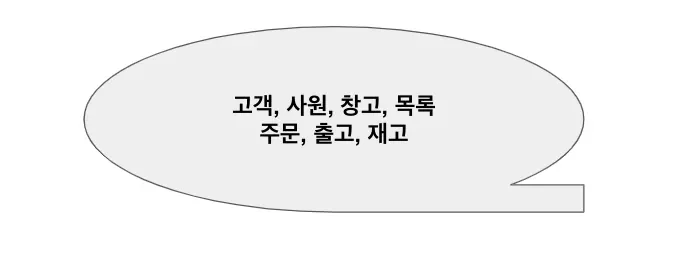

| <strong>분류 기준</strong> | <strong>Entity 타입</strong> | <strong>특징</strong> | <strong>해당 예시</strong> |
| --- | --- | --- | --- |
| <strong>유형 분류</strong> | 유형 Entity | 물리적 형태가 있고 안정적이며 지속적으로 활용됨 | 고객, 사원, 창고, 상품 |
|  | 개념 Entity | 물리적 형태는 없지만 관리해야 할 개념적 정보 | 주문, 출고 |
|  | 사건 Entity | 업무 수행에 따라 발생하며, 발생량이 많고 통계 자료로 활용됨 | 주문 상품, 출고 상품 |
| <strong>발생 시점 분류</strong> | 기본 Entity | 업무에 원래 존재하는 정보로, 독립적이며 다른 Entity 타입의 부모 역할 | 고객, 사원, 창고, 상품 |
|  | 중심 Entity | 기본 Entity로부터 발생하며 업무의 중심적 역할을 함 | 주문, 출고 |
|  | 행위 Entity | 두 개 이상의 부모 Entity 타입에서 발생하고 내용이 자주 변경되거나 데이터 양이 증가함 | 주문 상품, 출고 상품 |

<a id="173eda9b0fe180f2bd53c9c4baee2f02"></a>

### 2&#46; Entity 배치

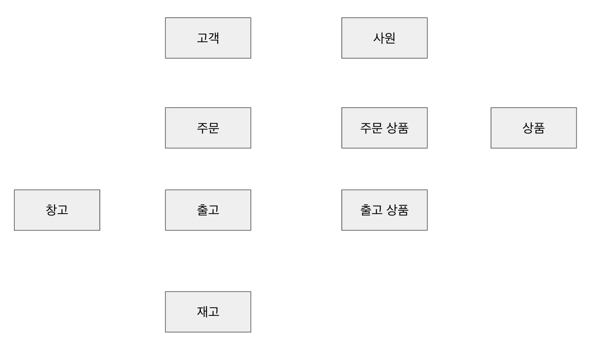

<a id="173eda9b0fe180abb949d28df7667ab6"></a>

### 3&#46; Entity 간 관계 설정

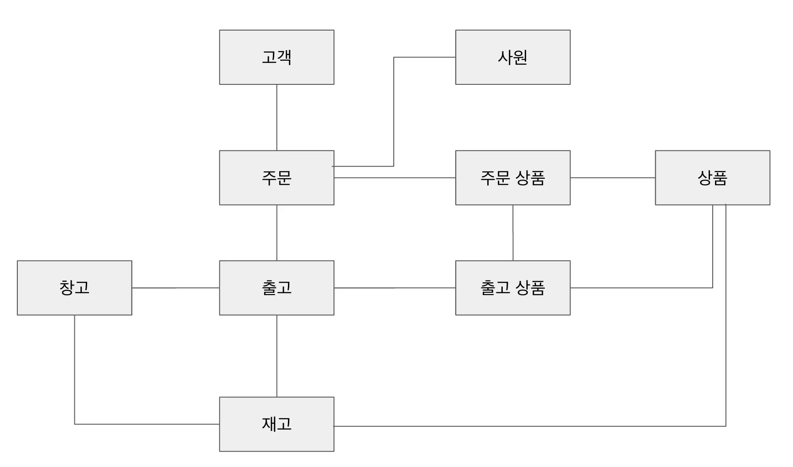

<a id="173eda9b0fe18012987bd3674f117cbb"></a>

### 4&#46; Entity 관계명 기술

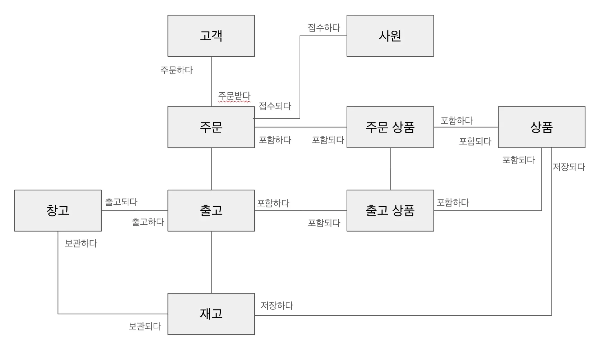

- Entity간 관계를 동사형태로 맺음

<a id="173eda9b0fe1808d93c4e631de251380"></a>

### 5&#46; Entity 관계 차수 표시

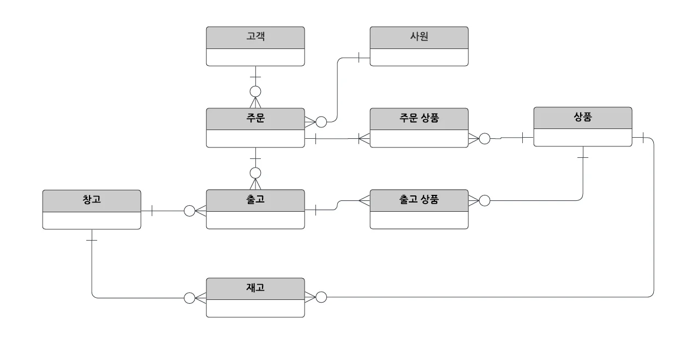

- 관계가 참여하는 성격 중 엔터티내에 인스턴스들이 얼마나 관계에 참여하는 지를 나타내는 관계차수

- (Cardinality &#45; 두 엔터티간 관계에서 참여자의 수)를 표현
    - <code>1&#58;1</code>, <code>1&#58;N</code>, <code>N&#58;M</code> …

<a id="173eda9b0fe1800982a1ec6a7dbbecdd"></a>

## 4&#46; 관계

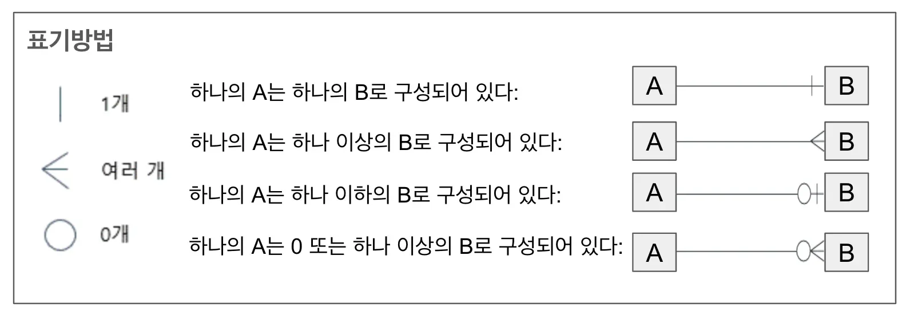

<a id="173eda9b0fe180ad986cf7584d0cb5e4"></a>

### 1&#46; &#91; 식별, 비식별 &#93; 관계

- 식별 관계
    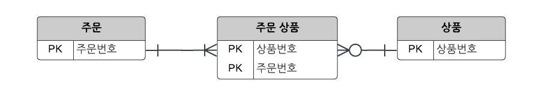

- 비식별 관계
    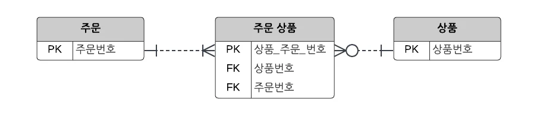

| <strong>구분</strong> | <strong>식별 관계 (Identifying Relationship)</strong> | <strong>비식별 관계 (Non&#45;Identifying Relationship)</strong> |
| --- | --- | --- |
| <strong>정의</strong> | 부모 식별자가 자식 식별자에 포함되어 복합 식별자로 사용 | 부모 주 식별자가 자식의 비식별자(일반 속성)으로 포함되어 사용<br>&#42;&#42; 개발 관점에서 <strong><u>엔티티간 관계를 느슨</u></strong>하게하여 <strong><u>의존성을 떨</u></strong>어뜨리기 위한 방법 |
| <strong>장점</strong> | 데이터의 정합성 유지를 DB에서 검증<br>(데이터의 일관성을 유지하는 것을 의미) | 구조 변경이 자유로움, <u>부모 데이터로부터 독립</u>함 |
| <strong>단점</strong> | 구조 변경이 어려움 | <strong><u>데이터 정합성</u></strong><strong>을 위한 </strong><strong>검수 필요</strong>, <strong><u>데이터 무결성</u></strong><strong>을 </strong><strong>보장하지 못</strong>함 |
| <strong>삭제 시 영향</strong> | <strong><u>부모가 삭제</u></strong>되면 <strong><u>자식도 삭제될 가능성</u></strong>(<code>CASCADE</code> 설정) | 부모가 삭제되어도 자식에는 직접 영향 없음 |
| <strong>ERD 표기법</strong> | 굵은 실선 | 점선 또는 얇은 실선 |

<a id="173eda9b0fe1803e9ae8df71619b3393"></a>

### 2&#46; 관계 유형

- 다양한 관계 유형
    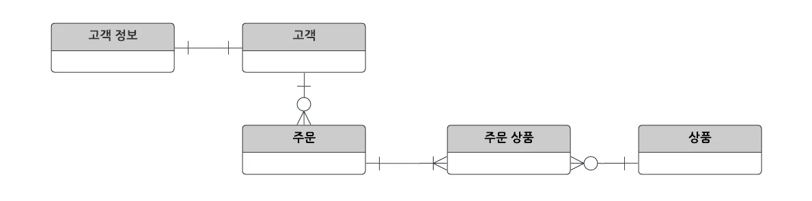

- 재귀 관계
    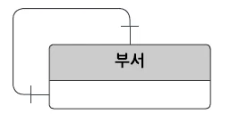

| <strong>관계 유형</strong> | <strong>설명</strong> |
| --- | --- |
| <strong>1&#58;1  (일대일)</strong> | 한 엔터티가 다른 엔터티에 하나의 인스턴스와 연결되는 관계<br><strong>→ 한 고객은 하나의 고객 정보를 가진다&#46;</strong> |
| <strong>1&#58;N (일대다)</strong> | 한 엔터티가 다른 엔터티에 여러 인스턴스와 연결되는 관계<br><strong>→ 한 고객은 여러 주문을 한다&#46;</strong> |
| <strong>N&#58;M (다대다)</strong> | 여러 엔터티가 서로 여러 인스턴스와 연결되는 관계<br>❗ <strong>중간 테이블(교차 테이블)을 통해 1&#58;N &#43; N&#58;1로 관계를 맺어 해소<br>→ 한 주문에는 여러 상품이 포함될 수 있으며 한 상품은 여러 주문에 포함될 수 있다&#46;</strong> |
| <strong>Recursive (재귀 관계)</strong> | 하나의 엔터티가 스스로와 관계를 맺는 경우<br><strong>→ 상위 부서는 하위 부서를 포함한다&#46;</strong> |

<a id="173eda9b0fe1805eb309cc1c1b5a8ec0"></a>

## 5&#46; 정규화 ( Normal Form )

---

> ✏️ 
> 
> <a id="f83f85520f3549a0a48b4574c38eb51a"></a>
> 
> 관계형 모델 설계를 보완하는 설계 이론으로 엔티티를 독립적으로 개선시켜 나가는 절차
> 
> <a id="173eda9b0fe1802b92bedb2eb477bfef"></a>
> 
> 정규화에 1차 목적은 <code>중복 데이터</code> 를 최소화하고, <code>데이터 무결성</code>을 보장하기 위함
> 
> <a id="173eda9b0fe18011adf4c15f7d2699b2"></a>
> 
> 또한, 데이터베이스 구조를 더 명확하게 만들어 <strong><u>데이터 관리와 확장을 용이</u></strong>하게 함

<details>
<summary>예시 테이블</summary>

| <strong>학번</strong> | <strong>이름</strong> | <strong>학과</strong> | <strong>과목코드</strong> | <strong>과목명</strong> | <strong>교수</strong> | <strong>성적</strong> |
| --- | --- | --- | --- | --- | --- | --- |
| 1001 | 김철수 | 컴퓨터공학 | CS101, CS102 | 프로그래밍, 데이터베이스 | 박교수, 이교수 | A, B |
| 1002 | 이영희 | 경영학 | BZ201, CS101 | 마케팅, 프로그래밍 | 최교수, 박교수 | B, C |

</details>

<a id="173eda9b0fe180028df3ca8364be0cbd"></a>

### <strong>1&#46; 제 1정규형(1NF)</strong>

<details>
<summary>&#91; 🤬 문제 &#93; 하나의 셀에 1개 이상(2개)의 데이터가 할당됨</summary>

| <strong>학번</strong> | <strong>이름</strong> | <strong>학과</strong> | <strong>과목코드</strong> | <strong>과목명</strong> | <strong>교수</strong> | <strong>성적</strong> |
| --- | --- | --- | --- | --- | --- | --- |
| 1001 | 김철수 | 컴퓨터공학 | CS101, CS102 | 프로그래밍, 데이터베이스 | 박교수, 이교수 | A, B |
| 1002 | 이영희 | 경영학 | BZ201, CS101 | 마케팅, 프로그래밍 | 최교수, 박교수 | B, C |

</details>

> ✏️ 
> 
> - 각 컬럼에 속성값을 <strong><u>중복 없이 분리</u></strong>한다&#46; 
>     - 하나의 셀에 1개의 데이터만 할당
> 
> - 모든 엔터티와 릴레이션은 <strong><u>1NF 요건을 충족</u></strong>해야 한다&#46; 

| <strong>학번</strong> | <strong>이름</strong> | <strong>학과</strong> | <strong>과목코드</strong> | <strong>과목명</strong> | <strong>교수</strong> | <strong>성적</strong> | <strong>학과사무실</strong> |
| --- | --- | --- | --- | --- | --- | --- | --- |
| 1001 | 김철수 | 컴퓨터공학 | CS101 | 프로그래밍 | 박교수 | A | 공학관 401호 |
| 1001 | 김철수 | 컴퓨터공학 | CS102 | 데이터베이스 | 이교수 | B | 공학관 401호 |
| 1002 | 이영희 | 경영학 | BZ201 | 마케팅 | 최교수 | B | 경영관 201호 |
| 1002 | 이영희 | 경영학 | CS101 | 프로그래밍 | 박교수 | C | 경영관 201호 |

<a id="173eda9b0fe18088aaf0cfa079ad44fa"></a>

### 2&#46; <strong>제 2정규형(2NF)</strong>

> ✏️ 
> 
> <a id="24aeda9b0fe180e6b298f2f38b102910"></a>
> 
> 주식별자에 <strong><u>부분 종속(Partial Dependency) 속성의 분리</u></strong>
> 
> <details>
> <summary>🧐 <code>부분적 종속성</code></summary>
> 
> 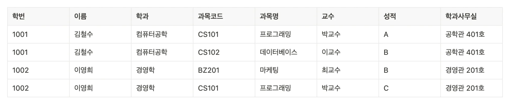
> 
> - <strong>부분적 종속성</strong>이란, <u>복합 식별자</u>(<code>학번</code>, <code>과목코드</code>)에 <strong><u>비주요 속성</u></strong>(<code>이름, 학과, 학과사무실</code>, <code>과목명, 교수</code>)이 의존하는 경우를 의미
> 
> 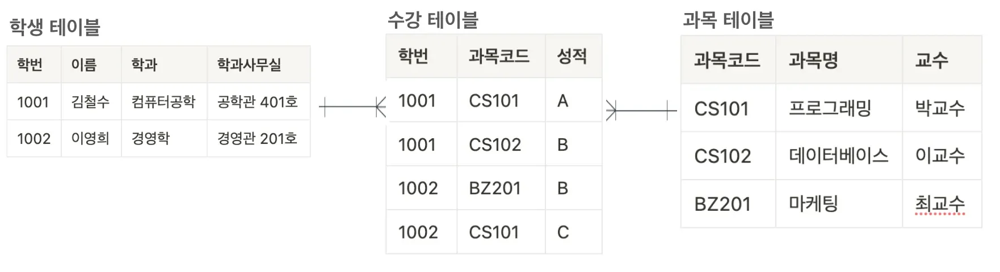
> 
> <a id="24aeda9b0fe18075b864c788c54d5d8e"></a>
> 
> 따라서 위와 같이 속성에 따른 테이블 분리가 필요함 ( 제 2 정규형 )
> 
> </details>


-  <code>학생 정보</code>와 <code>수강 정보</code> 분리

<a id="173eda9b0fe180778345d823187fd827"></a>

### <strong>3&#46; 제 3정규형(3NF)</strong>

> ✏️ 
> 
> <a id="24aeda9b0fe18007afa8fd365e509355"></a>
> 
> 속성에 <strong><u>이행적 종속(Transitive Dependency) 속성</u></strong>의 분리
> 
> <details>
> <summary>🧐 <code>이행적 종속성</code></summary>
> 
> 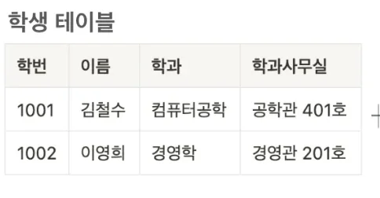
> 
> - 기본 식별자(<code>학번, 학과</code>)가 아닌 속성(<code>이름</code>,<code>학과, 학과사무실</code>)간에는 서로 종속될 수 없음’ 을 나타냄
> 
> 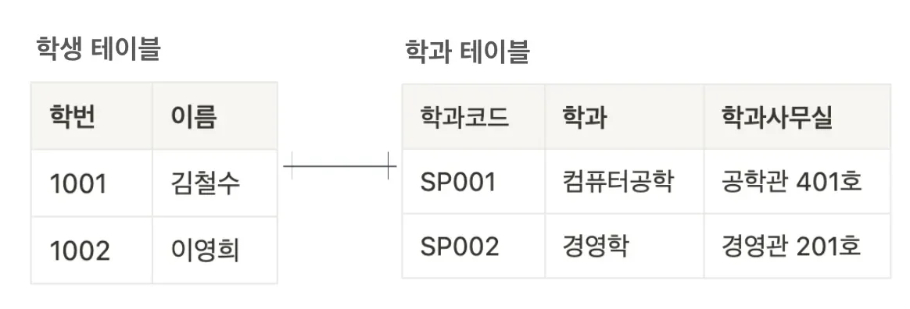
> 
> <a id="24aeda9b0fe180fd8562c515b2dac430"></a>
> 
> 따라서 위와 같이 분리 작업이 필요 ( 제 3 정규형 )
> 
> </details>


- <code>학생 정보</code>와 <code>학과 정보</code> 분리

<a id="173eda9b0fe180a6ba8ed7b3eca20e2f"></a>

### <strong>4&#46; 보이스코드 정규형(BCNF)</strong>

> ✏️ 
> 
> <a id="24aeda9b0fe180938b57db71024f88a3"></a>
> 
> <strong>복잡한 식별자 관계에 의해 발생하는 문제를 해결</strong>하기 위해 <strong><u>3차 정규화를 보완</u></strong>한 정규화
> 
> - 테이블에 <strong>식별자가 여러 개 존재</strong>하는 <strong><u>식별자 중복</u></strong><strong> 문제 해결</strong>한다&#46;
> 
> - 보이스&#45;코드 정규화 대상은<strong><u> 3차 정규화를 마친 테이블</u></strong>이  해당된다&#46;

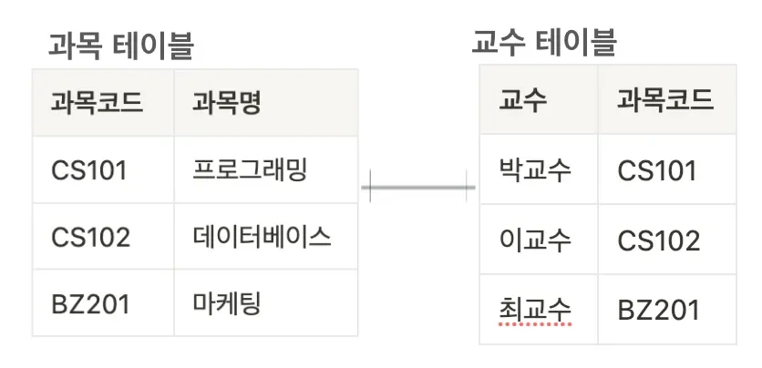

- 위 경우 <code>교수</code>는 하나의 강의만 담당한다는 비즈니스 요구가 필요하며 <strong><u>교수 이름만으로 과목을 결정</u></strong>한다&#46;

<a id="173eda9b0fe1804dbcaafb0ca6575a34"></a>

### <strong>5&#46; 반정규화</strong>

> ✏️ 
> 
> <a id="24aeda9b0fe180de8757ecc098a24479"></a>
> 
> <strong>성능 향상</strong>을 위해 <strong><u>정규화를 해제</u></strong>하는 작업 
> 
> - 추가 조인이 발생으로 인한 성능 저하를 감안하여 <br><strong>일부 중복을 허용</strong>하여 <strong><u>조인 연산을 줄임</u></strong><strong> 성능을 최적화</strong>

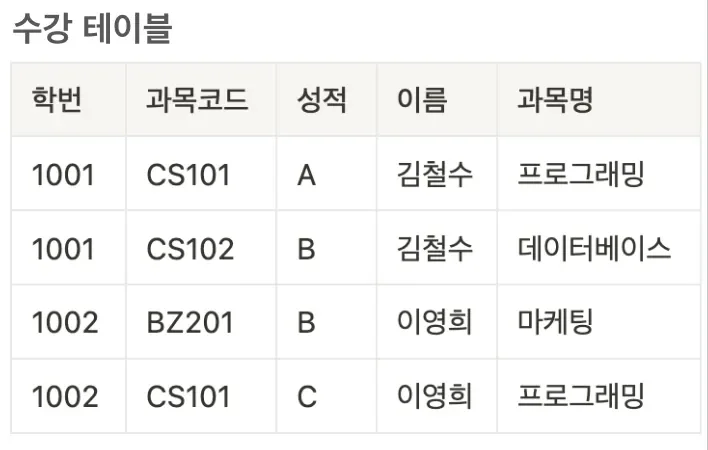

- <code>수강 정보</code> 에 <code>학생 이름</code> 과<code>과목명</code> 을 반정규화

<a id="173eda9b0fe1805c997fc74bfe850388"></a>

# 3&#46; 트랜잭션, 락

---

<a id="136eda9b0fe1807a9ba4ed1a05c41f70"></a>

## 1&#46; 트랜잭션 ( Transaction )

> ✏️ 
> 
> <a id="24aeda9b0fe1803993c1e77bceb6b37e"></a>
> 
> <code>트랜잭션</code>은 <strong>데이터베이스에서 </strong><strong><u>일련의 작업들을 하나의 단위로 묶</u></strong><strong>은 작업 단위</strong>로 <strong>데이터를 올바르게 보장</strong>하기 위해 고안된 방법이다&#46;
> 
> - DB 서버에 <strong>여러 개의 클라이언트로부터 </strong><strong><u>동시에 엑세스가 발생</u></strong>하는 상황이나 <strong>DB 서버 또는 응용 프로그램이 </strong><strong><u>갱신(write 연산)을 처리하는 도중에 중단되는 사태</u></strong>에서 <strong>데이터의 부정합을 방지</strong>하고자 착안되었다&#46; 
> 
> - DBMS는 트랜잭션이 <u><code>ACID</code></u><u> 유지</u>할 수 있도록 지원한다&#46; 
> 
> - 동시에 두개의 트랜잭션이 수행될 때 무결성 제약조건으로 일관성이 깨지는 현상을 감지 할 수 없는데, 이럴 땐 <strong>동시 접근에 대한 일관성을 유지</strong>하기 위해 <strong><u>동시성 제어 알고리즘을 사용</u></strong>한다&#46;

<a id="136eda9b0fe18009b528ed35d5e13020"></a>

### ex) 은행 계좌 이체 

<a id="136eda9b0fe1801cbd34f9d2f2291094"></a>

```sql
-- 은행에서 계좌 이체를 수행할 때, 돈을 송금하는 계좌의 잔액 감소와 
수신 계좌의 잔액 증가가 하나의 트랜잭션으로 처리 되어야 한다. 
두 작업이 모두 완료되거나 둘 다 취소 되어야만 데이터의 일관성이 유지 된다.

BEGIN TRANSACTION
  1. A 계좌를 읽는다 (잔고 확인 - SELECT)
	2. B 계좌를 읽는다 (잔고 확인 - SELECT)
	3. A계좌 10000을 인출 (계좌 인출 - UPDATE)
	4. B계좌 10000을 입금 (계좌 입금 - UPDATE)
	6. A 계좌 기록 (계좌 기록 - UPDATE)
	7. B 계좌 기록 (계좌 기록 - UPDATE)
COMMIT or ROLLBACK TRANSACTION

COMMIT 
-- transaction이 정상적으로 수행되었을 때 데이터를 영구적으로 저장하기 위한 명령어
ROLLBACK
-- transcation 중 오류, 장애가 발생하였을 때 이전 수행 단계를 모두 취소하고 transaction 종료
```

<a id="161eda9b0fe180598275fdbaf7f94460"></a>

### 트랜잭션 특징&#58; <code>ACID</code>

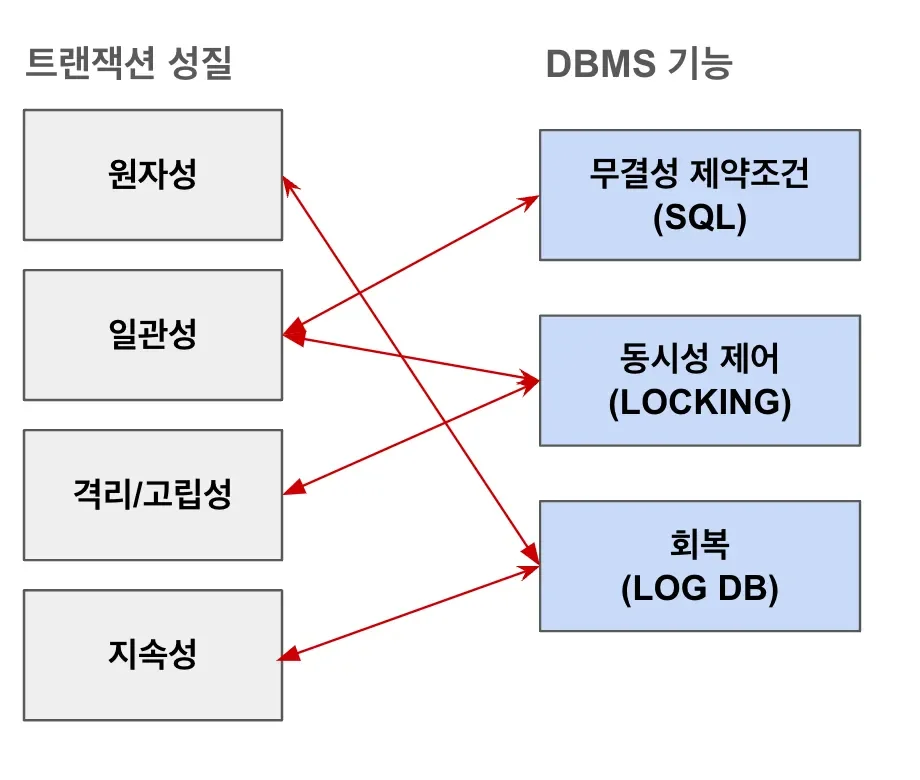

<details>
<summary><strong>원자성</strong> ( <strong>Atomicity </strong>)</summary>

- <strong><u>트랜잭션</u></strong>이 <strong><u>원자처럼 더 이상 쪼개지지 않는 하나의 단위</u></strong>로 동작해야 한다는 것을 말한다&#46; 

- 트랜잭션 내 모든 작업이 완전히 수행되거나 전혀 수행되지 않아야 한다&#46;  ( <code>Commit</code> or <code>Rollback</code>)
    - 트랜잭션 중간에 작업을 멈추면(or 실패하면) 회복(<code>recovery</code>) 알고리즘을 이용하여 변경 내용을 취소한다&#46; 

</details>

<details>
<summary><strong>일관성</strong> ( <strong>Consistency ) </strong></summary>

- 테이블이 생성될 때 <code>CREATE문</code>과 <code>ALTER문</code>의 무결성 제약조건을 통해 명시한다&#46;

- <strong><u>트랜잭션이 완료</u></strong>된 후, <strong><u>데이터베이스는 항상 일관된 상태를 유지</u></strong>해야 한다&#46; 

</details>

<details>
<summary><strong>격리/고립성 ( Isolation )</strong></summary>

- 데이터베이스는 <strong><u>공유가 목적</u></strong>이기 때문에 <strong><u>여러 트랜잭션이 동시에 수행</u></strong>된다&#46;  
    <a id="24aeda9b0fe18011906ccf69de79b17b"></a>

    따라서 동시에 수행되는 트랜잭션은 상호 존재를 모르고 독립적으로 수행되어야 한다&#46; 

    <a id="24aeda9b0fe180668708d05fb621f199"></a>

    이를, 격리성(Isolation)이라고 한다 &#46;

- 격리성을 유지하기 위해서는 트랜잭션이 변경 중인 임시 데이터를 다른 트랜잭션이 읽고 쓸 때 제어가 핋요하다&#46; 

</details>

<details>
<summary><strong>지속성 ( Durability )</strong></summary>

- 트랜잭션이 정상적으로 완료 혹은 부분 완료한 데이터는 데이터베이스에 기록된다&#46; 

- DBMS 시스템은 작업한 애용을 로그에 기록하고, 문제 발생 시 로그 파일을 이용해서 복구 작업을 수행한다&#46;

</details>

<a id="173eda9b0fe180f5844dd1e25ee2bf02"></a>

## 2&#46; 격리 수준 ( Isolation Level )

> ✏️ 
> 
> <a id="24aeda9b0fe180168110d5d92d3774dd"></a>
> 
> <code>격리 수준</code>은 <strong><u>동시에 여러 트랜잭션이 실행</u></strong><strong>될 때 </strong><strong>트랜잭션 간의 </strong><strong><u>간섭 정도를 조절</u></strong><strong>하는 설정</strong>이다&#46;  ( DMBS마다 다르다&#46; )
> 
> - 트랜잭션의 <strong>격리 수준(간섭 정도)를 </strong><strong><u>level 별</u></strong><strong>로 나눠 구분</strong>한다&#46;
> 
> - <strong>격리 수준</strong>에 따라 <strong>데이터의 일관성 및 성능에 영향</strong>을 준다&#46; 
>     - <strong><u>격리 수준이 높</u></strong>아질 수록 <strong><u>동시성은 낮</u></strong>아지며, <strong><u>데이터 일관성은 높</u></strong>아진다&#46;
> 
>     -  동시성이 낮아 질수록 성능이 떨어진다&#46; ( 병렬처리 불가)

> 🗣 
> 
> 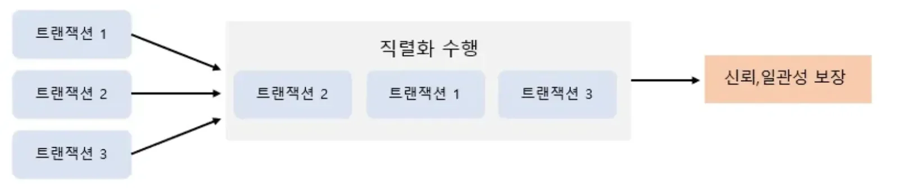
> 
> <a id="4e3a8845a1fa4f2a878b7c1133ff03f2"></a>
> 
> <strong><code>동시성 제어</code></strong><strong> 는 </strong><strong><code>병행 제어</code></strong><strong> 라고도 불리며 한번에 들어온 복수의 트랜잭션을 </strong><strong>직렬화 수행하여 </strong><strong><u>데이터 일관성을  보장</u></strong><strong>한다&#46;</strong>

<a id="173eda9b0fe180dd9739f45c22eaa0f4"></a>

### 격리 수준

| <strong>격리 수준</strong> | <strong>설명</strong> | <strong>조회 시</strong> | 발생되는 문제 | <strong>DBMS 기본</strong> |
| --- | --- | --- | --- | --- |
| <strong><code>Read<br>Uncommitted</code></strong><strong> (level 0)</strong> | &#45; 트랜잭션이 커밋되지 않은 데이터도 다른 트랜잭션에서 읽기 허용 | 공유 LOCK 없음 | • <code>Dirty Read</code><br>• <code>Non&#45;Repeatable Read</code> <br>• <code>Phantom Read</code> | MongoDB |
| <strong><code>Read <br>Committed<br></code></strong><strong>(level 1)</strong> | &#45; 트랜잭션이 커밋된 데이터만 다른 트랜잭션에서 읽기 허용 | 공유 LOCK 설정 후 완료 시 해제 | • <code>Non&#45;Repeatable Read</code> <br>• <code>Phantom Read</code> | Oracle |
| <strong><code>Repeatable<br>Read</code></strong><strong><br>(level 2)</strong> | &#45; 트랜잭션이 시작할 때 읽은 데이터를 트랜잭션 동안 일관되게 유지<br>&#45; 같은 트랜잭션 내에서 같은 데이터를 반복 조회해도 값이 변하지 않음 | 공유 Lock 설정 후 트랜잭션 끝까지 유지 | • <code>Phantom Read</code> | Mysql<br>MariaDB |
| <strong><code>Serializable</code></strong><strong><br>(level 3)</strong> | &#45; 트랜잭션을 직렬화하여 실행<br>&#45; 완벽한 격리 수준을 보장 | 공유 Lock 설정 후 트랜잭션 끝까지 유지 | 없음 |  |

<a id="173eda9b0fe180a98a54ce01fbdc2ded"></a>

### 발생되는 문제

<a id="24aeda9b0fe18079b7f6e2b88a21d766"></a>

### <strong>1&#46; </strong><strong><code>Dirty Read</code></strong>

> ✏️ 
> 
> - 커밋되지 않은 데이터가 읽힐 수 있다&#46;
>     <a id="24aeda9b0fe18077b27af992e5491870"></a>
> 
>     → 데이터 정합성 문제

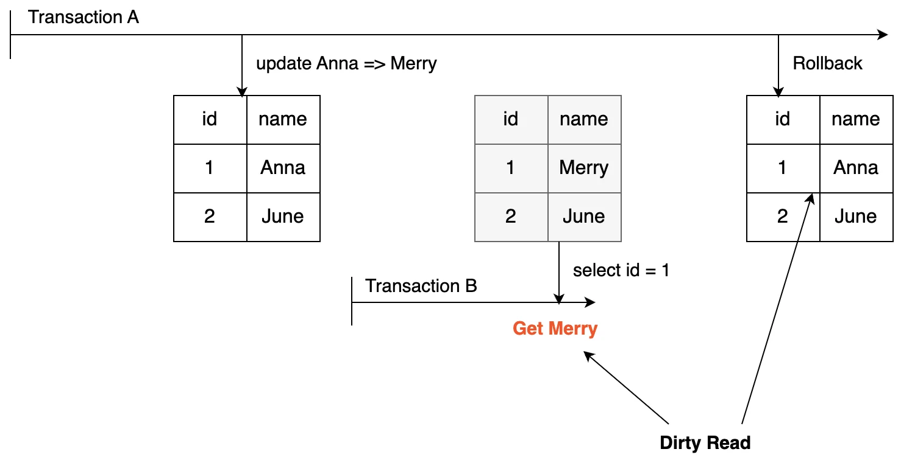

<a id="24aeda9b0fe180abb031e5ae10321c11"></a>

### <strong>2&#46; </strong><strong><code>Non&#45;Repeatable Read</code></strong>

> ✏️ 
> 
> - 한 트랜잭션이 조회한 데이터가 <strong><u>다른 트랜잭션에 의해 삽입/수정</u></strong>되어 commit 되었을 경우, <strong>동일한 데이터를 다시 조회하면 이전과 결과 달</strong>라진다&#46;

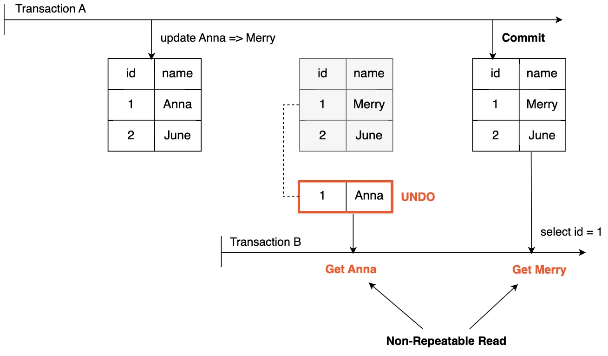

<a id="24aeda9b0fe18072b3a2c09fe9c5b131"></a>

### <strong>3&#46; </strong><strong><code>Phantom Read</code></strong>

> ✏️ 
> 
> <a id="24aeda9b0fe180d88ed2cbb4636c61b7"></a>
> 
> 서로 다른 트랜잭션이 동일한 조건으로 조회했을 때, <strong>트랜잭션의 종료 시점</strong>에 따라 <strong><u>다른 트랜잭션에 의해 삽입/수정</u></strong>되어 <strong>commit한 조회 결과가 달라질 수 있</strong>다&#46; 

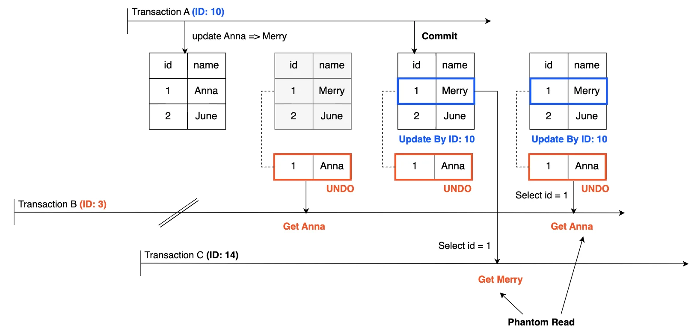

<a id="173eda9b0fe1803a8a43d74fd5902eba"></a>

## 3&#46; 락 ( Lock )

> ✏️ 
> 
> <a id="4311df99ff2449f48ff3d2ab29eb9509"></a>
> 
> <code>락</code>은 <strong>동시에 여러 트랜잭션이 동일한 데이터를 수정하거나 읽</strong><strong>을 때 발생할 수 있는</strong><strong> </strong><strong><u>충돌을 방지</u></strong>하기 위해 데이터베이스에서 제공하는 기능이다 ( 동시성 문제 )
> 
> - 트랜잭션이 <strong>특정 데이터, 테이블에 락을 걸</strong>면 <strong>다른 트랜잭션은 이 </strong><strong><u>데이터에 접근할 수 없</u></strong><strong>거나 </strong><strong><u>제한된 접근만 가</u></strong><u>능</u>하다

<a id="173eda9b0fe180258937ec3f6f3cc1ba"></a>

### Lock 유형

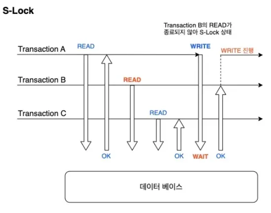

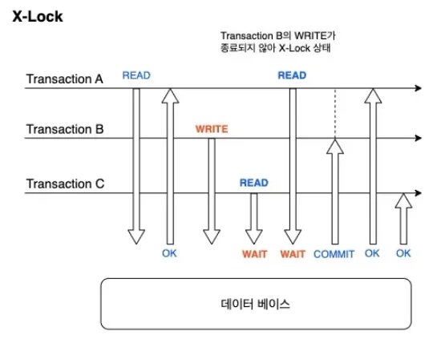

| <strong>Lock 유형</strong> | <strong>설명</strong> |
| --- | --- |
| <strong><code>S&#45;Lock</code></strong><strong><br>(Shared Lock &#58; 공유 락)</strong> | &#45; 읽기 작업 시 사용 <br>&#45; 다른 트랜잭션이 동시에 해당 데이터를 읽을 수 있도록 허용하면서, 해당 데이터를 블로킹(blocking)하여 쓰기 작업은 제한 |
| <strong><code>X&#45;Lock</code></strong><strong><br>(Exclusive Lock &#58; 배타 락)</strong> | &#45; 쓰기 작업 시 사용<br>&#45; 락이 활성화되어 있는 동안에는 다른 트랜잭션이 해당 데이터를  블로킹(blocking)하여 읽고 쓰기 불가&#46; 즉, 한번에 하나의 트랜잭션만 수정 가능 |

<details>
<summary>ex)  Lock 예시</summary>

> 온라인 쇼핑몰에서 재고 수량을 업데이트하는 트랜잭션이 실행 중일 때

- 해당 상품 정보를 읽는 다른 트랜잭션은 공유 락이 걸려 수량 확인만 가능

-  쓰기 작업은 배타 락이 풀릴 때까지 대기

</details>

<a id="173eda9b0fe180c2845fc9768c155c4e"></a>

### <strong>Lock 수준</strong>

| <strong>Lock 수준</strong> | <strong>설명</strong> |
| --- | --- |
| <strong><code>행 락</code></strong><strong><br>(Row&#45;Level Lock)</strong> | 특정 행에만 락을 거는 방식으로, 테이블 락에 비해 동시성이 높아져 성능이 좋음 |
| <strong><code>테이블 락</code></strong><strong><br>(Table&#45;Level Lock)</strong> | 테이블 전체에 락을 거는 방식으로, 여러 트랜잭션이 같은 테이블에 접근할 때 충돌을 피할 수 있지만 동시성이 낮아질 수 있음 |

<a id="173eda9b0fe180fa9320d23e27453f7c"></a>

### <strong>데드락 (DeadLock)</strong>

> ✏️ 
> 
> <a id="24aeda9b0fe180edb42ed9e536ff0b46"></a>
> 
> 여러 트랜잭션이 점유된 자원에 lock이 해제될 때까지 무한히 대기하는 상태로 시스템이 종료될 수 있는 문제

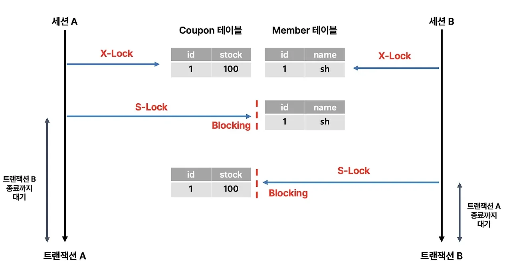

| <strong>발생 조건</strong> | <strong>설명</strong> |
| --- | --- |
| <code>상호 배제</code><br>(Mutual Exclusion) | 자원은 한 번에 한 트랜잭션만이 사용할 수 있다&#46; |
| <code>보유 대기</code><br>(Hold and Wait) | 최소 하나의 자원을 보유한 상태에서 다른 자원을 기다리는 트랜잭션이 존재한다&#46; |
| <code>비선점</code><br>(No Preemption) | 한 번 할당된 자원은 사용이 완료되어 자발적으로 해제될 때까지 선점할 수 없다&#46; |
| <code>순환 대기</code><br>(Circular Wait) | 각 트랜잭션이 순환적으로 다음 트랜잭션이 요청하는 자원을 보유하고 있다&#46; |

- 위 조건 모두를 충족할 때 데드락이 발생할 수 있다&#46;

<a id="173eda9b0fe18007a082c2cd052119c7"></a>

### 데드락 해결 방법

| <strong>방법 예시</strong> | <strong>설명</strong> |
| --- | --- |
| 자원 할당 순서 정하기 | &#45; 자원에 우선순위를 부여하고 트랜잭션들이 이 순서에 따라 자원을 요청하게 함으로써 순환 대기 조건을 방지 |
| 데드락 탐지 및 회복 | &#45; 시스템이 데드락을 감지하고, 데드락에 빠진 트랜잭션 중 하나를 선택하여 롤백시키는 방법<br>&#45; 데드락이 발생한 후에 대응하므로, 시스템의 데드락 탐지 알고리즘의 효율성이 중요 |
| 자원 요청 시 대기 | &#45; 트랜잭션이 필요한 모든 자원을 한꺼번에 요청하고, 모든 자원이 사용 가능할 때까지 대기하는 방식으로 데드락을 예방 |
| 자원 선점 | &#45; 특정 조건 하에 시스템이 트랜잭션으로부터 자원을 강제로 회수(선점)하여 다른 트랜잭션에 할당<br>&#45; 선점된 트랜잭션의 작업을 준단시키고 롤백해야하는 경우 발생할 수 있음 |
