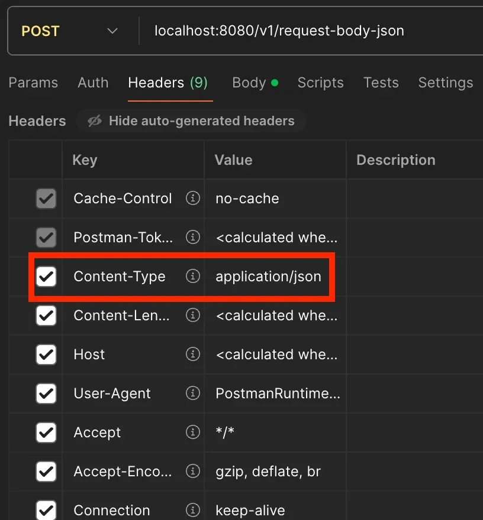
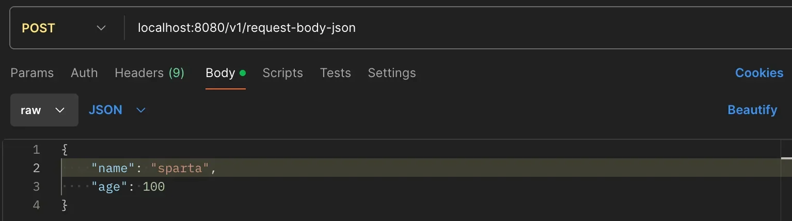
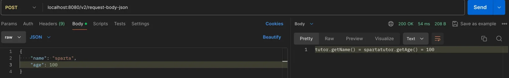
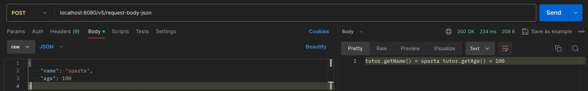
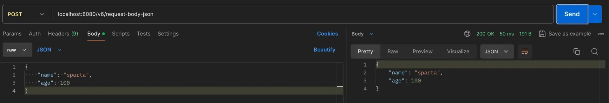
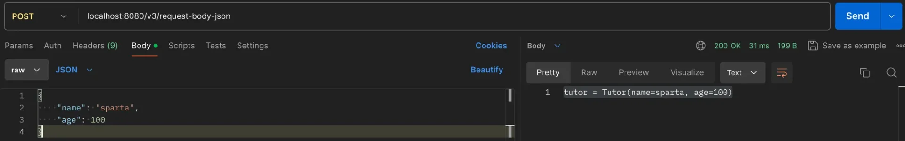
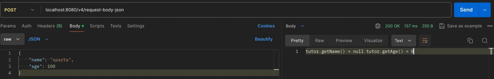
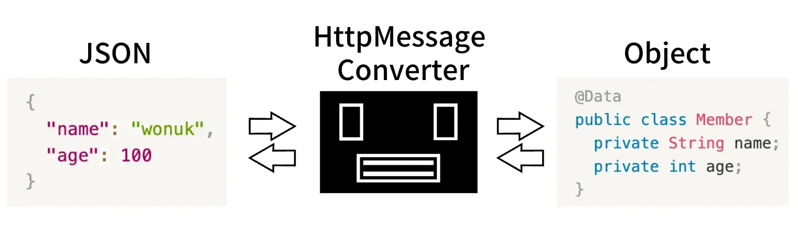

<a id="135eda9b0fe180c8857ed93227f1bd3f"></a>

## JSON

---

> 📖 
> 
> <a id="466d64875f7f443a88a33b7cc58d9d3f"></a>
> 
> <code>&#64;RestController</code> 에서 가장 많이 사용되는 데이터 형식이며
> 
> <a id="136eda9b0fe1808f9955c21a33ef2735"></a>
> 
> 대부분의 API는 <code>Request</code>, <code>Response</code> 모두 JSON 형태로 통신한다&#46;

> ☝🏻 
> 
> <a id="b0f25237f73f4698a64d54a0dddd307e"></a>
> 
> JSON 형태로 데이터를 전송할 때는, 요청 메세지 Header의  Content&#45;type에 <strong><code>application/json</code></strong><strong>을 명시해야 한다&#46;</strong>
> 
> <a id="136eda9b0fe18099911dcf751e052d8e"></a>
> 
> 해당 타입 명시를 통해 올바른 메세지 컨버터(<code>MappingJackson2HttpMessageConverter</code>)가 동작될 수 있으며, 그로인해 JSON 데이터가 올바르게 해석되어 변환될 수 있다&#46; 

<a id="136eda9b0fe180a09d7bff008b84af05"></a>

### 사용

---

<details>
<summary><strong>HttpServletRequest</strong></summary>

<a id="136eda9b0fe1806ba32eddfbd62183cd"></a>

<code>HttpServletRequest</code>을 통해 전달 받은 <u>스트림 데이터(요청 메시지 바디)</u>를 가져와 <u>문자열로 변환(UTF&#45;8) </u>후,<u> ObjectMapper(Jackson 라이브러리)를 사용</u>하여<u> 객체로 변환</u>한다&#46; 

---

<details>
<summary>&#91; 코드 &#93;</summary>

<a id="7efc48a8a01643b79bc744ded4a48355"></a>

```java
@Data
public class Tutor {
	private String name;
	private int age;
}


@RestController
public class JsonController {
	
		private ObjectMapper objectMapper = new ObjectMapper();
	
		@PostMapping("/v1/request-body-json")
		public void requestBodyJsonV1(
					HttpServletRequest request, 
					HttpServletResponse response
		) throws IOException {
	
				// request body message를 Read
				ServletInputStream inputStream = request.getInputStream();
				
				// UTF-8 형식의 String으로 변환
				String requestBody = StreamUtils.copyToString(inputStream, StandardCharsets.UTF_8);
		
				// String(Json) Request Body를 ObjectMapper를 사용하여 객체로 변환 
				Tutor tutor = objectMapper.readValue(requestBody, Tutor.class);
				
				// 응답
				response.getWriter().write("tutor" + tutor);
		}
}
```

</details>

<details>
<summary>postman 테스트 </summary>





</details>

</details>

<details>
<summary><strong>&#64;RequestBody</strong></summary>

<a id="136eda9b0fe180ee80ccd7889c61faab"></a>

<code>&#64;RequestBody</code> 사용 시, <u>바로 Body의  json 데이터를 받</u>아와 objectMapper를 통해 객체로 변환(<code>readValue()</code>)이 가능하다&#46; 

---

<details>
<summary>&#91; 코드 &#93;</summary>

<a id="84f4a362165341dc8f998a4869c9894a"></a>

```java
@RestController
public class JsonController {
	
		private ObjectMapper objectMapper = new ObjectMapper();
	
		@PostMapping("/v2/request-body-json")
	  public String requesBodytJsonV2(@RequestBody String requestBody) throws IOException {
	
	      Tutor tutor = objectMapper.readValue(requestBody, Tutor.class);
	
	      return "tutor.getName() = " + tutor.getName() + "tutor.getAge() = " + tutor.getAge();
	  }
}
```

</details>

<details>
<summary>postman 테스트 </summary>



</details>

</details>

<details>
<summary><strong>HttpEntity</strong></summary>

- HttpEntity 사용 시, 자동으로 객체 변환 해줌
    - <code>&#46;getBody()</code>&#58; body 데이터 조회

- 객체로 자동 변환되기 때문에, getter를 통해 객체의 필드 값을 조회 가능하다&#46; 
    - <code>tutor&#46;getName()</code>, <code>tutor&#46;getAge()</code>

---

<details>
<summary>&#91; 코드 &#93;</summary>

<a id="148c6e485952494c9e9abd113e6ed495"></a>

```java
@RestController  // @Controller + @ResponseBody
public class JsonController {
	
		@PostMapping("/v5/request-body-json")
	  public String requestBodyJsonV5(
	          HttpEntity<Tutor> httpEntity
	  ) {
	      // 값을 꺼내서 사용해야한다!
	      Tutor tutor = httpEntity.getBody();
	
	      return "tutor.getName() = " + tutor.getName() + " tutor.getAge() = " + tutor.getAge();
	  }
}
```

</details>

<details>
<summary>postman 테스트 </summary>



</details>

</details>

<details>
<summary><strong>&#64;ResponseBody</strong></summary>

- <strong><code>&#64;ResponseBody</code></strong><strong> 사용 시, View를 조회하지 않고 </strong><strong><u>return 값을 자동으로 body에 입력</u></strong><strong> 가능하다&#46; </strong>

- 응답에도 <code>HttpMessageConverter</code>가 동작한다
    - <code>MaapingJackson2HttpMessageConverter</code>가 응답 객체인 Tutor가 JSON으로 변환하여 Body에 담는다&#46; 

- HttpEntity를 사용헤도 된다&#46; 

---

<details>
<summary>&#91; 코드 &#93;</summary>

<a id="bff0ee00fa244c79aba7c06fecd47bec"></a>

```java
@Controller
public class JsonController {
	
		@ResponseBody // @RestController = @Controller + @ResponseBody
		@PostMapping("/v6/request-body-json")
	    public Tutor requestJson(@RequestBody Tutor tutor) {
	        return tutor;
	  }
		
}
```

</details>

<details>
<summary>postman 테스트 </summary>



</details>

</details>

<a id="136eda9b0fe180f4b7accadd2f3e32d8"></a>

### ? 

---

<details>
<summary><strong>ObjectMapper 제거</strong></summary>

<details>
<summary>🧐 <strong><code>&#64;RequestBody</code></strong><strong> 사용 시 </strong> <strong>Object를 Mapping</strong>할 수 있다&#46;</summary>

- <code>&#64;RequestBody</code> 어노테이션을 사용하면 <strong>Object를 Mapping</strong>할 수 있으며

- <code>HttpEntity&#60;&#62;</code>, <code>&#64;RequestBody</code>를 사용하면 <strong>HTTPMessageConverter</strong>가 Request Body의 Data를  String이나 정의한 객체로 변환 헤준다&#46; 
    - <code>MappingJackson2HttpMessageConverter</code>
        <a id="136eda9b0fe1806e8791e52dba8d2417"></a>

        → JSON to Object의 Mapping  가능

</details>

---

<details>
<summary>&#91; 코드 &#93;</summary>

<a id="841aa17545664651b2a783ad68168adc"></a>

```java
@RestController
public class JsonController {
	
		@PostMapping("/v3/request-body-json")
		public String requestBodyJsonV3(@RequestBody Tutor tutor) {
			
			Tutor requestBodyTutor = tutor;
	
			return "tutor = " + requestBodyTutor;
		}
}
```

</details>

<details>
<summary>postman 테스트 </summary>



</details>

</details>

<details>
<summary><strong><code>&#64;RequestBody</code></strong><strong>는 생략 불가능</strong></summary>

- <strong><code>&#64;RequestBody</code></strong><strong> </strong>생략 시, <strong><code>&#64;ModelAttribute</code></strong><strong>으로 처리된다&#46;</strong>
    - <strong><u>요청 파라미터</u></strong><strong>를 처리하여 </strong><strong><u>body로 데이터 전송 시 읽어오지 못</u></strong><strong>한다&#46;</strong>

---

<details>
<summary>&#91; 코드 &#93;</summary>

<a id="cf44cf6ab7bc4b62826747c443f2ec96"></a>

```java
@Slf4j
@RestController
public class JsonController {
	
	@PostMapping("/v4/request-body-json")
  public String requestBodyJsonV4(Tutor tutor) { // @RequestBody 생략시 @ModelAttribute가 된다.

      Tutor requestBodyTutor = tutor;

      return "tutor.getName() = " + requestBodyTutor.getName() + " tutor.getAge() = " + requestBodyTutor.getAge();
  }
	
}
```

</details>

<details>
<summary>postman 테스트 </summary>



</details>

</details>

<a id="136eda9b0fe180e18198d3b9802d6cec"></a>

## HTTPMessageConverter

---

> 📖 
> 
> <a id="136eda9b0fe18080bfdaec32a40072f7"></a>
> 
> Spring Framework에서 HTTP 요청과 응답을 변환하는 인터페이스<br>클라이언트와 서버 간에 데이터를 주고받을 때, 요청 데이터를 자바 객체로 변환하거나 자바 객체를 응답 본문으로 변환하는 역할을 수행한다&#46;

> ☝🏻 
> 
> <a id="22c66e1ae1a7457f8bac46fab69e1a16"></a>
> 
> <code>JSON</code> 처리 시 <code>MappingJackson2HttpMessageConverter</code> 사용하여 변환을 하는데, <br>이는 <code>HTTPMessageConverter</code>  구현체 중 하나이다&#46; 



> 데이터를 Obejct로 변환한다&#46; 대표적으로 JSON을 변환한다&#46;

- <code>&#64;RequestBody</code>
    - <u>요청 데이터</u> &#43; <u>Request Header를 참고</u>하여 <em>Object로 변환</em>
        - Reqeust Header&#45;Content&#45;Type &#58;<code> application/json</code>(전달할 데이터 형식)

        - HTTP Request <code>Body(JSON Data)</code> 
            <a id="136eda9b0fe1803b918ced9730b80e75"></a>

            ⇒  Converter(Jackson) → <code>Object</code>

- <code>&#64;ResponseBody</code>
    - <u>응답 데이터</u> &#43; <u>Accept Header를 참고</u>하여 원하는 <u>데이터 형식으로 변환</u>
        - <code>Object</code> → <strong><u>Converter(Jackson)</u></strong> → HTTP Response <code>Body(JSON Data)</code>

        - Response Header&#45;Accept &#58; <code>application/json</code>(허용할 데이터 형식)

<a id="136eda9b0fe180fc91b1e2d02c575d55"></a>

### 요약

- 요청 데이터는 <code>&#64;RequestBody</code>를 사용해서 바인딩

- <code>&#64;RequestBody</code> 생략 불가능
    - 생략 시, <code>&#64;ModelAttribute</code>가 적용됨

- <code>HttpMessageConverter</code>를 통해 요청, 응답 데이터 모두 변환 가능
    - JSON  &#45; <code>MappingJackson2HttpMessageConverter</code> 사용 
        - <code>HttpMessageConverter</code>의 구현체 중 하나

        - Request Header Content&#45;Type&#58; <code>application/json</code>
            - <u>Header의 타입</u>을 통해 <u>어떤 Converter가 동작되어야 하는지 판별</u>됨
