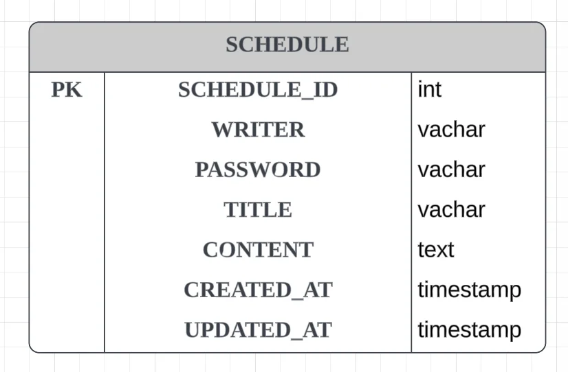
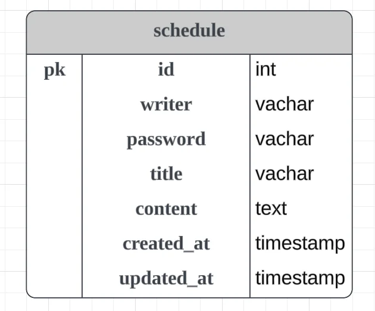

> 📌 
> 
> <a id="aaca03c1112147fd83ac1d4f32d39bf5"></a>
> 
> 스프링 기초 주차 과제인 일<u>정관리 앱</u> 제출을 받은 피드백 내용 정리
> 
> <details>
> <summary>피드백</summary>
> 
> [경섭님 작성해주신 내용 기반으로 피드백 전달 드립니다 :)](https://github.com/gyungsubLee/Scheduler/issues/1)
> 
> </details>

<a id="138eda9b0fe1803e9984e2d1e7655a63"></a>

## 피드백

---

<a id="138eda9b0fe180a8b4d8e62f40a616d3"></a>

### 1) 데이터베이스 명명 규칙

<details>
<summary>reference</summary>

<a id="138eda9b0fe180ad8e9dc1a111e0a766"></a>

‣<br>

</details>

> 대부분 기업에서는 기업 내에 컨벤션이 있다고 함

<details>
<summary><strong>Naming Conventions</strong></summary>

- 따옴표 사용 X 
    - ex) <code>“FirstName”</code>

- 공백 X
    - ex) <code>All Employees</code>

- 소문자
    - 테이블, 뷰, 컬럼 &#46; 및 기타 모든 것 포함

- 데이터 타입 X
    - ex) <code>…text</code>, <code>…timestamp</code>

- 단어 사이는 underscores(<code>&#95;</code>) 로 구분 &#58; <code>Snake Case</code>
    - ex) wordCount → <code>word&#95;count</code>

- 약어 사용 X →  완전한 영단어 사용
    - ex) mid&#95;nm → <code>middle&#95;name</code>

- 전체 단어보다 통용되는 약어 사용
    - ex) Internationalization → <code>i18n</code>

- 예약어 X
    - 사용중인 데이터베이스에서 예약어로 간주되는 단어는 사용하지 않는다&#46;

    - ex) user, locak, table 등의 예약어 사용 X

</details>

<details>
<summary><strong>주요 필드</strong></summary>

- 기본 키
    - 기본 키 필드의 이름은 <strong>id</strong>로 작성한다&#46;

    - SQL 문에서 필드 이름은 명시적으로 수식되어야 하므로 네임스페이스 형태로 접두사를 붙이는 것은 좋지 않다&#46;

- 외래키 
    - <strong>참조된 테이블의 이름과 참조된 필드의 이름 조합</strong>
        - team 테이블의 id 필드&#58; team&#95;id

        - person 테이블의 id 필드&#58; person&#95;id

        <a id="138eda9b0fe18061ae80d394c47f107e"></a>

        ```sql
        CREATE TABLE team_member (
        		team_id int NOT NULL REFERENCES team(id),
        		person_id int NOT NULL REFERENCES person(id),

           		. . .
        ```

</details>

---

<a id="138eda9b0fe180baa9f5d3470343d431"></a>

처음 작성한 ERD 



<a id="138eda9b0fe180139546fedd9e990ad4"></a>

수정한 ERD



<a id="138eda9b0fe180bcba26f500b78065cd"></a>

### 2) 컨트롤러 인터페이스 X

<details>
<summary>reference</summary>

<a id="138eda9b0fe180298dc6dc761bcabf8e"></a>

‣

<a id="138eda9b0fe180eba6acf5dacb8e1e32"></a>

‣<br>‣

<a id="138eda9b0fe18064bdc9c97693a075a9"></a>

‣<br>

</details>

<a id="138eda9b0fe1806cbb27c2d3fd320023"></a>

interface의 사용 목적은 다형성의 활용이다&#46;

<a id="338eda9b0fe18036a2dff63ebd496bdf"></a>

즉, OCP와 같은 원칙을 만족하면서 코드의 확장성을 높이기 위해서 사용한다&#46; 

<a id="338eda9b0fe180c68333c7a2e0198aed"></a>

그러나 Controller 같은 경우, 사용자의 요청을 받아서 Service 로직으로 넘기고 결과 값을 받아오는 책임을 담당하는 계층이다&#46; 

<a id="338eda9b0fe1801f8c0afb92e2c924f1"></a>

따라서 복잡하게 추상화하여 설계를 해야하는 경우는 거의 없다&#46;

<a id="338eda9b0fe1805aa2c8fb307d8a0927"></a>

그러므로 controller 계층에 interface를 사용한 추상화는 불필요한 낭비이므로 권장되지 않는다&#46;

<a id="138eda9b0fe1808d8ce5c1294044e4a6"></a>

### 3) setter 사용 지양

<details>
<summary>reference</summary>

<a id="86bd03234121462da673ddc4668c616c"></a>

‣

</details>

<a id="138eda9b0fe180bb87ece1d6dd54bc76"></a>

### Setter 메서드의 단점

- 값의 <u>변경 의도</u>를 <u>파악하기 힘들</u>다
    <a id="138eda9b0fe180b6856af4d37151129a"></a>

    ```sql
    public Member updateMember(long id) {
        final Member member = findById(id);
        member.setFistName("value");
        member.setLastName("value");
        member.setAge("value");
        return member;
    }
    ```

    <a id="138eda9b0fe180a68251c580f16ce8d9"></a>

     Member의 정보를 변경하는 코드로 setter 메소드들이 나열 되어있다&#46;

    <a id="138eda9b0fe180ee917fec474e3ed5ce"></a>

    그러나 setter를 나열한 것만으로 <strong><u>어떤 의도로 데이터를 변경하는지 명확히 알 수 없</u></strong>다&#46;

- 객체의 <u>일관성을 유지하기 어렵</u>다&#46; 
    <a id="138eda9b0fe18030bbd1f7a62514f62d"></a>

    자바 빈 규약을 따르는 Setter는 <code>public</code>으로 언제든지 변경할 수 있는 상태가 된다&#46; 

    <a id="138eda9b0fe180849cfaf219f40a1630"></a>

    따라서<strong><u> 모든 곳에서 접근하여 변경</u></strong>할 수 있기 때문에, 객체의 일관성을 유지하기 어렵다&#46; 

<a id="138eda9b0fe180fab2b6f0a15f7abb0c"></a>

### 해결책

- 생성자 오버로딩
    <a id="138eda9b0fe18091b45cd09beb3d7a1e"></a>

    ```java
    public class Member {
        private String name;
        private String age;
        
        public Member(String name){
    	    	this.name = name;
        }
        
        public Member(String name,int age){
    	    	this.name = name;
    	    	this.age = age;
        }
    ```

    <a id="138eda9b0fe180419ad5f1e902cf6a32"></a>

    <u>멤버변수가 많</u>고 <u>다양한 생성자를 가져</u>야 한다면 <u>코드가 길</u>어지고 <u>가독성이 떨</u>어진다&#46;

    <a id="138eda9b0fe180209ae3ece988d1e5cf"></a>

    → Builder 패턴 사용

- Builder 패턴
    <a id="138eda9b0fe1808eb66dd3ac1dd19f68"></a>

    ```java
    public class Member {
        private String name;
        private String age;
        
        @Builder
        public Member(String name, int age){
        	this.name = name;
            this.age = age;
        }
    ```

    <a id="138eda9b0fe1804e92f3cee3247e2268"></a>

    빌더 패턴을 사용하여 요구사항에 맞게 <u>필요한 데이터만 사용하여 유연하게 클래스 생성이 가능</u>하다&#46;

    <a id="138eda9b0fe18082a310fcd3cd72c0d3"></a>

    <u>전체 생성자 하나만을 가지는 형태</u>로 구현되기 때문에<u> 유지보수  및 가독성이 향상</u>된다&#46; 

    <a id="138eda9b0fe180a0a9f2d4e57d175bfc"></a>

    또한 <u>객체를 생성할 때 인자 값의 순서가 상관없다</u>는 장점이 있다&#46; 

- 정적 팩토리 메서드
    <a id="138eda9b0fe1809b885af3e13fab8290"></a>

    ```java
    // 댓글 확인후 수정했습니다 감사합니다!
    public class Member {
        private String name;
        private String age;
        
        public static Member createMember(String name, int age){
    	    	Member member = new Member();
    	    	member.name = name;
    	      member.age = age;
    	      return member;
        }
    ```

    <a id="138eda9b0fe1800fac10d4900ef88393"></a>

    생성자를 대신하여 정적 팩토리 메서드를 사용하여 클래스를 생성하면 <code>메서드명</code>을 통해 명시적으로 표현할 수 있다&#46;

    - <code>Member&#46;createMember(name, age)</code>

<a id="138eda9b0fe180e6bbddc276ab5fcb8e"></a>

### 4) <u>엔티티에 DTO 를 넣</u>게되면 <u>DTO에 의존</u>하게 된다&#46; 이는 좋지 못한 코드 습관이다&#46;

<details>
<summary>reference</summary>

<a id="f633793a045049c4b75759908b5ce847"></a>

‣

</details>

<a id="138eda9b0fe1804dba63c0686d9654bb"></a>

### 🤬 피드백 받은 코드  &#45; 엔티티 생성자의 파라미터로 DTO를 넘겨 값을 생성한다&#46;

<a id="138eda9b0fe180b58316dae18ad04fec"></a>

```java
@Getter
@Setter
@NoArgsConstructor
public class Schedule {
    private Long id;
    private String writer;
    private String password;
    private String title;
    private String content;
    private LocalDateTime createdAt;
    private LocalDateTime updatedAt;

		// 엔티티가 DTO에 의존하게 된다. 
    public Schedule(ScheduleRequestDto scheduleRequestDto) {
        this.writer = scheduleRequestDto.getWriter();
        this.password = scheduleRequestDto.getPassword();
        this.title = scheduleRequestDto.getTitle();
        this.content = scheduleRequestDto.getContent();
    }

    public void update(String writer, String title) {
        this.writer = writer;
        this.title = title;
    }
}
```

- 엔티티 내부 생성자에 DTO를 통해 값을 가져와 엔티티를 생성하도록 작성했다&#46; 

- 이는 해당 엔티티 와 DTO가 의존성을 형성하므로 해당하는 DTO가 변경되면 엔티티 로직도 영향을 받게 되는 좋지 못한 코드이다&#46;

<a id="138eda9b0fe180d4ac6dcdc84c8fea77"></a>

### 해결

<a id="338eda9b0fe1800ba0f4f082a1befeb6"></a>

```java
// 엔티티가 DTO에 의존하게 된다. 
@Builder
public Schedule(String writer, String password, String title, String content) {
    this.writer = writer;
    this.password = password;
    this.title = title;
    this.content = content;
}
```

- 직접 필드의 값을 할당하여 의존성을 분리한다&#46; 


<a id="138eda9b0fe1802f80b1dd8c603b2d1d"></a>

### 5) <u>엔티티에 필수값이 있음</u>에도 <code>&#64;NoArgsConstructor</code> 를 <u>습관적으로 쓰는 것</u>은 좋지 못한 습관이다&#46;

<details>
<summary>reference</summary>

<a id="92b0e43493fe4ac1a68a09d5d2194b2d"></a>

‣

</details>

<a id="338eda9b0fe1806497fff4f59bdb6482"></a>

### 왜 <code>&#64;NoArgsConstructor</code> 를 사용하는가?

<details>
<summary><strong>이유 1&#46; JPA 스펙 요구사항 충족</strong></summary>

> 엔티티 클래스는  <strong><u>public 또는 protected 기본 생성자</u></strong><strong>를 가져야 한다&#46; </strong>

<a id="338eda9b0fe1805bba63d433ddb8cdb7"></a>

JPA 스펙에서는 위와 같은 규칙이 있다&#46;<br>왜냐하면 <strong><u>JPA는 객체를 생성</u></strong>할 때 <strong>new 키워드가 아니라 </strong><strong><u>리플렉션을 사용</u></strong>하기 때문이다&#46;

<a id="338eda9b0fe18033ac57e892dd104302"></a>

```java
Member member = Member.class.getDeclaredConstructor().newInstance();
```

- 이때 <strong>파라미터가 없는 생성자</strong>가 없으면 생성 자체가 불가능하다&#46;

</details>

1. <strong>Hibernate 프록시 (Lazy Loading)</strong><br>Hibernate 같은 구현체는 <strong><u>지연 로딩(Lazy Loading)</u></strong>을 위해
    <a id="338eda9b0fe180d2a265e019e3b7449e"></a>

    실제 엔티티 대신 <strong>프록시 객체</strong>를 생성한다&#46;

    <a id="338eda9b0fe18028abefc88e5cbebf85"></a>

    ```java
    Member proxy = entityManager.getReference(Member.class, id);
    ```

    - 프록시 객체는 <strong><u>내부적으로 기본 생성자로 객체를 먼저 만</u></strong>든 뒤, 필요한 시점에 데이터를 채운다&#46;

1. <strong>리플렉션 기반 프레임워크 호환</strong>
    <a id="338eda9b0fe180f088f8fe413bbf71d4"></a>

    JPA뿐 아니라 다양한 프레임워크들이 <strong><u>리플렉션으로 객체를 생성</u></strong><strong>한다&#46; 이때도 동일하게 </strong><strong>기본생성자가 필요</strong><strong>하다&#46; </strong>

    - 예시 
        - Jackson (JSON → 객체 변환)

        - Spring Data

        - Hibernate

<a id="338eda9b0fe180228559c41a659e2ca3"></a>

### 왜 protected 접근자를 사용하는 것이 좋은가?

> 
> 
> - 외부에서 무분별한 생성 방지
> 
> - JPA는 접근 가능 (리플렉션 사용)

<details>
<summary>🧐 Java의 <code>protected</code> 접근 범위</summary>

- <strong>같은 패키지</strong>

- <strong>상속 관계 (다른 패키지라도 허용)</strong>

<a id="338eda9b0fe1805e8956fa6552977bf1"></a>

그 외 접근불가

</details>

<a id="338eda9b0fe180a682bdff3dcff9be57"></a>

엔티티의 연관 관계에서 지연 로딩의 경우에는 실제 엔티티가 아닌 프록시 객체를 통해서 조회를 한다&#46; 

<a id="338eda9b0fe180358fcbd39d10960f84"></a>

프록시 객체를 사용하기 위해서 JPA 구현체는, 실제 엔티티의 기본 생성자를 통해 프록시 객체를 생성하는데, 이 때 접근 권한이 private이면 프록시 객체를 생성할 수 없다&#46;

- 즉시로딩으로 구현하게 되면, 접근 권한과 상관없이 프록시 객체가 아닌 실제 엔티티를 생성하므로 문제가 생기지 않는다&#46;

<a id="138eda9b0fe18053a07efe49883157c2"></a>

### SQL 에서 <u>전체 컬럼 조회</u> 시 , <code>&#42;</code>보다는 직<u>접 컬럼을 명시</u>하는 것이 더 좋다&#46;  

<details>
<summary>reference</summary>

<a id="033b44b8ca1942b69405a0c7a8052f94"></a>

‣

</details>

> 
> 
> <a id="338eda9b0fe18064a21ac26f8d475f3b"></a>
> 
> <code>SELECT &#42;</code>는 <strong>불필요한 데이터 조회, 스키마 변화 취약, 실행 계획 비효율</strong> 때문에 <strong><u>지양</u></strong>된다

<a id="338eda9b0fe180b7b606dd3ef39288b9"></a>

### <strong>1&#46; 불필요한 데이터 조회 (성능 문제)</strong>

<a id="338eda9b0fe18013bc38f767e6109bbb"></a>

### <strong>문제 상황</strong>

<a id="338eda9b0fe1800fbbeaf6da7c8643ce"></a>

```java
SELECT * FROM users;
```

- DB는 해당 테이블의 모든 컬럼을<strong> 전부 읽어서 네트워크로 전송한다&#46;</strong>

- 만약 컬럼이 20개 이고 2개의 데이터(id, name)만 필요한 경우 불필요한 비용이 증가된다&#46; 
    - <strong>디스크 I/O 증가</strong>

    - <strong>네트워크 비용 증가</strong>

    - <strong>특히 대용량 / JOIN / API 응답에서 치명적</strong>

<a id="338eda9b0fe1807699edc514cf23546c"></a>

### 개선

<a id="338eda9b0fe180eb83d7fa76cd1a0f4f"></a>

```java
SELECT id, name FROM users;
```

-  필요한 데이터만 읽고 전송

<a id="338eda9b0fe18003bd3adf3c9b60d9fd"></a>

### 2&#46; <strong>실행 계획 최적화 방해 (Index 활용 제한)</strong>

<a id="338eda9b0fe180c090d8c3730459ba30"></a>

DB는 가능한 경우 <strong>Index Only Scan</strong>을 사용한다&#46;

<a id="338eda9b0fe1805c8ececfc213a42f5c"></a>

```java
SELECT id FROM users WHERE id = 1;
```

- id만 필요하면 index에서 바로 조회 (테이블 접근 없음)

- 하지만 <code>SELECT &#42;</code>때문에, 전체 컬럼 필요 
    <a id="338eda9b0fe180928ca8fd27629ef3b3"></a>

    → 결국 테이블(Heap) 접근 발생

    - index 장점 사라짐

    - 쿼리 성능 저하

<a id="338eda9b0fe180a091e2fab253ce2b62"></a>

### 3&#46; <strong>스키마 변경에 취약 (유지보수 문제)</strong>

<a id="338eda9b0fe180b888fafd2be20340ff"></a>

<strong><br>문제 상황</strong>

<a id="338eda9b0fe180e6a09acf170fa0eb11"></a>

```java
SELECT * FROM users;
```

- 이 상태에서 컬럼이 추가되면?
    <a id="338eda9b0fe1808c9fbbcf527fdf06a5"></a>

    → <strong>기존 코드 결과가 바뀜</strong>

<a id="138eda9b0fe18058b480e98f02e55dcc"></a>

## 추가사항

---

<a id="138eda9b0fe180e49d90eac54e609f50"></a>

### 1&#46; 404 Error 코드에 대한 고민

<details>
<summary>reference</summary>

<a id="138eda9b0fe18031a778f4f68757a09b"></a>

‣

</details>

<a id="138eda9b0fe18030ad80cd09e8a2bf3d"></a>

이 부분에 대해서는 급하게 API 명세서를 만드느라 404 오류에 대한 부분을 명시하지 않았더니 <br>나온 얘기 같다&#46;  추천해주신 글을 봤는데, 내용은 알고 있는 것하고 큰 차이는 없었다&#46; 

<a id="138eda9b0fe1803a92ebe20b8ae50098"></a>

  → API 명세서에 오류 상황 표시하기<br>

<a id="138eda9b0fe180d4b776d1704002dacf"></a>

### 2&#46; <code>Optional</code> 사용을 통한 NPE 방지

[Optional을 통한 NPE 처리](#/post/13beda9b-0fe1-80d8-a510-dc35d1d3987b)

<a id="138eda9b0fe18079960be8c3bbbc037e"></a>

### 3&#46; 메서드 네이밍 

<details>
<summary>reference</summary>

<a id="138eda9b0fe1806fa294dc15d64d545a"></a>

‣

</details>

<a id="13beda9b0fe18071a38bff8f8d7c2e16"></a>

### 조회 ( Read )

<a id="13beda9b0fe1800cbe52ff6d7d4580a8"></a>

<code>findBy&#46;&#46;&#46;</code>, <code>getBy&#46;&#46;&#46;</code>, <code>fetchBy&#46;&#46;&#46;</code>, <code>searchBy&#46;&#46;&#46;</code>

<details>
<summary><code>Find…</code><strong> &#45; </strong><em><strong><code>nullable</code></strong></em><em><strong> </strong></em><em>한 데이터를 조회  </em></summary>

<a id="13beda9b0fe18074a7eac179f1b9ec64"></a>

```java
public interface SearchUserPort {
	Optional<User> findByUserId(Long userId);
    ...
}
```

</details>

<details>
<summary><code>Get…</code> &#45;  <em><code>not null</code></em><em> 데이터를 조회</em></summary>


</details>

<details>
<summary><code>Search…</code> &#45; 검색,  페이지네이션 기능이 함께 구현</summary>

<a id="13beda9b0fe180b99781f198315e7d03"></a>

```java
Page<User> search(UserSearchQuery query, Pageable pageable);
```

</details>

<details>
<summary><code>&#46;&#46;&#46;SearchQuery</code> &#45; 검색하고자 하는 조건이 포함</summary>

<a id="13beda9b0fe180be8fabde9c952c0981"></a>

```java
@Getter
public class UserSearchQuery {
	private final List<Long> userIds;
    private final String userName;
    private final String mobile;
    private final String email;
    private final ZonedDateTime lastLogginedAtFrom;
    private final ZonedDateTime lastLogginedAtTo;
}
```

</details>

<a id="13beda9b0fe1803db7c6e02a7875469c"></a>

### 4&#46; &#64;Valid를 사용한 검증 

[@Valid  - Bean Validation](#/post/138eda9b-0fe1-80e9-b72d-cef85dc88546)
