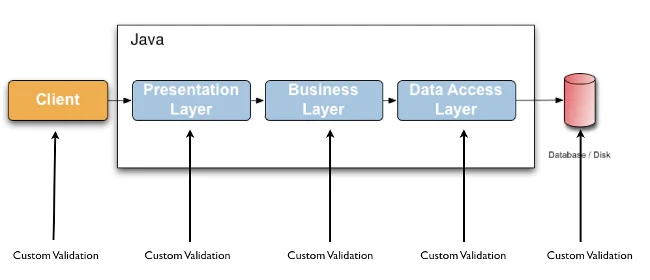
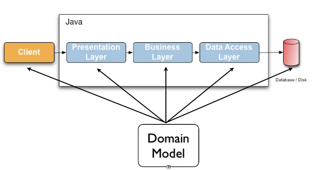
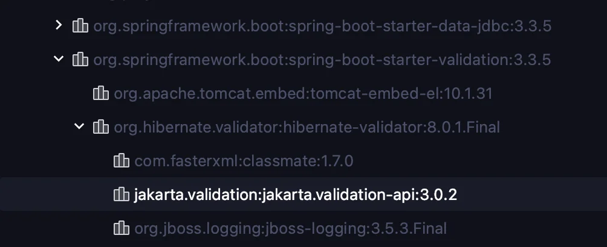
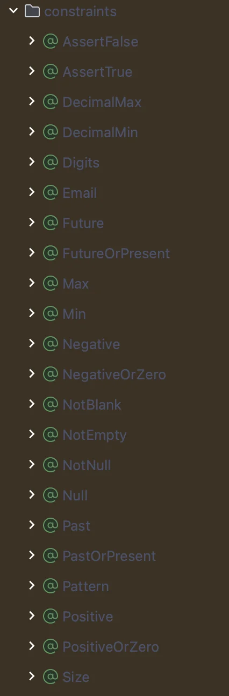
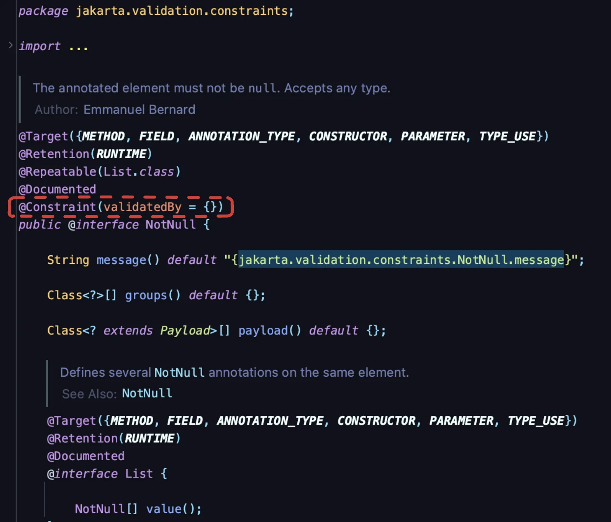
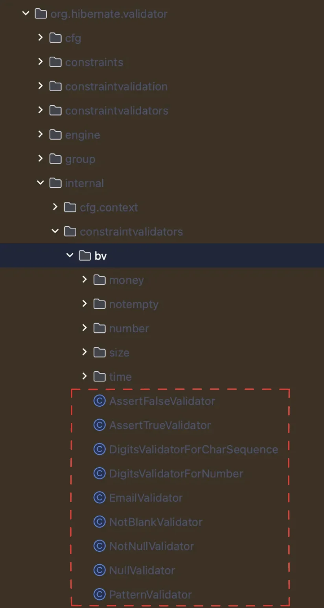
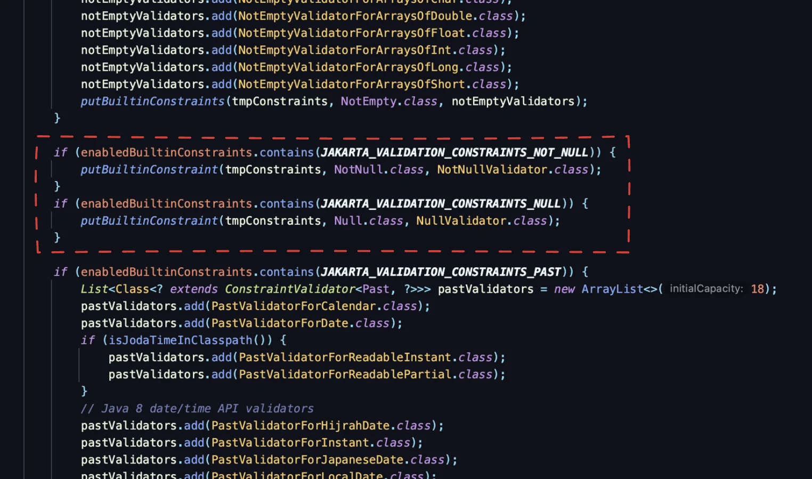

<details>
<summary>reference</summary>

- ‣

- ‣

- ‣<br>

</details>

<a id="13beda9b0fe18005a58ec74080c56b7c"></a>

### 내가 작성한 코드 

- 필수 값 검증을  강의 코드를 참조하여 아래와 같이<u> if 문을 통해 null 값을 체크</u>하는 방법으로 진행했다&#46;  
    <a id="138eda9b0fe180f9ba15ded5b2648d14"></a>

    ```java
    // 필수 값(작성자, 제목) 검증
    if (writer == null || title == null ){
        throw new ResponseStatusException(HttpStatus.BAD_REQUEST, "일정 수정 시 제목과 내용은 필수 입력값 입니다.");
    }
    ```

<a id="13beda9b0fe180a9aba0cd2b990b71fe"></a>

그러나 스프링에서는  Bean Validation (<code>&#64;Valid</code>)을 통해 Anotation으로 간단하게 처리 가능하다

<a id="138eda9b0fe180e182cac855ea931bde"></a>

### 🧐 왜 <code>&#64;Valid</code>를 사용하는 것인가?

1. 단순한 검증을 하더라도 검증관련 로직이 길어진다&#46;
    <a id="13beda9b0fe180e7a626e4f618c17ed0"></a>

    ```java
    if (itemDTO == null) {
        throw new IllegalArgumentException("상품 정보가 존재하지 않습니다.");
    }

    if (itemDTO.getItemName() == null || itemDTO.getItemName().isEmpty()) {
        throw new IllegalArgumentException("상품 이름은 필수값 입니다.");
    }

    if (itemDTO.getQuantity() == null) {
        throw new IllegalArgumentException("상품 개수는 필수 입니다.");
    }

    if (itemDTO.getQuantity() < 5) {
        throw new IllegalArgumentException("최소 상품 개수는 5 이상 이어야 합니다.");
    }

    if (itemDTO.getQuantity() > 500) {
        throw new IllegalArgumentException("상품은 500 이하로 저장할 수 있습니다.";
    }
    ```

1. 검증 로직이 중복으로 여러 Layer에 존재하며,  Layer에 검증 로직이 섞여있기 때문에 추적이 어렵고, 애플리케이션이 복잡해진다&#46;
    

<a id="13beda9b0fe180cf8a85cf0944a9a3b0"></a>

### 👍🏻 <code>&#64;Valid</code> 사용을 통한 해결



<a id="13beda9b0fe18046a37cee40bab49901"></a>

검증 로직을 통합하고, Layer에서 분리하여 관리할 수 있다&#46; 

<a id="13beda9b0fe180fd9f06f892cf98872c"></a>

```java
public ResponseEntity<String> save(@Valid @RequestBody ItemDTO itemDTO) {
    itemService.save(itemDTO);
    return new ResponseEntity<>(HttpStatus.CREATED);
}
```

<a id="13beda9b0fe180f6b9c9e7002d70c721"></a>

### Bean Validation

<details>
<summary>validation 의존성 추가 </summary>

<a id="138eda9b0fe180d1af1ae73a4977bcd0"></a>

```groovy
// Gradle
implementation 'org.springframework.boot:spring-boot-starter-validation'
```

</details>

<details>
<summary>라이브러리 확인해보기</summary>

- spring boot starter validation
    - <strong><code>Hibernate Validator</code></strong><strong>가 </strong><strong><code>Jakarta Bean Validation</code></strong><strong>의 구현체이다&#46;</strong>



<details>
<summary>주요 Anotation</summary>



</details>

</details>

---

<details>
<summary>🧐 interface의 메서드에 <code>{}</code> 블록이 존재할 수 있는 이유는? </summary>

- 의문점 발생 코드
    <a id="13beda9b0fe180d38a46c21df169cc1b"></a>

    ```java
    public interface ConstraintValidator<A extends Annotation, T> {

    	default void initialize(A constraintAnnotation) {}
    ```

- 이유
    - 자바 8부터 interface에 default 메서드와 static 메서드가 허용 되었기 때문에<br>인터페이스에서 메서드의 기본 구현을 제공할 수 있게 되었다&#46;

    - 위 코드에서 initialize 메서드는 default 키워드가 사용되어 기본 구현을 가진다&#46;<br>따라서 구현하는 클래스에서<strong> </strong><strong><code>default 메서드</code></strong>는 <strong><u>꼭 오버라이드하지 않아도 된</u></strong>다&#46; 

    - 즉, 인터페이스를 구현하는 클래스는 이 메서드를 <u>그대로 사용</u>할 수 있거나 <u>필요에 따라 오버라이드</u>할 수 있다&#46;

<details>
<summary>ex)</summary>

<a id="13beda9b0fe18083a901d4bdb508e5d3"></a>

```java
public interface Example {
    default void sayHello() {
        System.out.println("Hello from default method!");
    }
}
```

<a id="13beda9b0fe18008ba7ec681ce060ba8"></a>

```java
public class ExampleImpl implements Example {
    // default 메서드인 sayHello 메서드를 구현하지 않아도 자동으로 기본 메서드가 적용된다. 
}

public class Main {
    public static void main(String[] args) {
        Example example = new ExampleImpl();
        example.sayHello(); // 출력: Hello from default method!
    }
}

```

<a id="13beda9b0fe1808c819acda1387bce1b"></a>

<br>

</details>

</details>

<details>
<summary>Anotation 살펴보기 ( <code>&#64;Constraint</code> )</summary>

<a id="13beda9b0fe180c08159ef7e3ec3a908"></a>

<code>&#64;Constraint</code> 어노테이션에 있는 <strong><code>validateBy</code></strong><strong> 정보에 구현체를 넣어서 검증이 진행된다&#46;<br>그러나 jakarta validation 에 기본 구성으로 나와있는 어노테이션들은 모두 구현체 정보가 존재하지 않는다&#46; 그럼 어디에 구현체 정보가 존재하는 것 인가?</strong>



</details>

<details>
<summary>Jakarta Validation API 구현체  &#45; <code>Hibernate Validator</code></summary>

<details>
<summary><code>org&#46;hibernate&#46;validator&#46;internal&#46;constraintvalidators&#46;bv</code></summary>



</details>

<details>
<summary>&#60; interface &#62; <code>ConstraintValidator</code></summary>

<a id="13beda9b0fe1806ea8b6f18cf042bc28"></a>

```java
package jakarta.validation;
	
import java.lang.annotation.Annotation;
import jakarta.validation.constraintvalidation.SupportedValidationTarget;


public interface ConstraintValidator<A extends Annotation, T> {

		default void initialize(A constraintAnnotation) {
		}
	
		boolean isValid(T value, ConstraintValidatorContext context);
}
```

</details>

<details>
<summary><code>&#64;NotNull</code>의 구현체인 <code>NotNullValidator</code></summary>

- <strong>ConstraintValidator</strong> 인터페이스에 <strong>isValid</strong>를 구현하여 검증 로직을 만든다&#46;


</details>

</details>

<details>
<summary><strong><code>jakarta validation 어노테이션</code></strong><strong>과 </strong><strong><code>hibernate 검증 클래스</code></strong><strong>  연결</strong></summary>

> <code>org&#46;hibernate&#46;validator&#46;internal&#46;metadata&#46;core&#46;ConstraintHelper&#46;java</code>

- <code>ConstraintHelper&#46;java</code>를 살펴보면 아래 코드에서 <code>&#64;NotNull</code> 과 구현체인 <code>NotNullValidator</code>을 연결 해주는 것을 확인할 수 있다&#46; 



</details>

---

<details>
<summary>Spring 에서 <code>&#64;Valid</code> 동작 원리</summary>


<a id="13beda9b0fe18043aff4d25f08960908"></a>

client에서 요청을 받으면 DispatcherServlet을 통해 Controller가 호출된다&#46;

<a id="13beda9b0fe1803bb381fef9b58255e7"></a>

이 과정에서  Dispatcher Servlet 에서 <code>&#64;Valid</code> 를 찾아 검증을 진행한다&#46; 

> 참조 블로그 글에   더 자세한 내용이 서술되어 있으나, 이해를 하지 못해 우선 여기까지만 정리한다&#46; 

</details>

<a id="13beda9b0fe1809693b9ed3af80425e5"></a>

### 사용법

<details>
<summary><code>&#64;Valid</code> 사용법</summary>

<details>
<summary>의존성 추가</summary>

<a id="13beda9b0fe18099ac5eeb082eaecbdd"></a>

```groovy
// Gradle
implementation 'org.springframework.boot:spring-boot-starter-validation'
```

</details>

<details>
<summary>클래스에 Jakarta Validation Anotation 적용하기 </summary>

<a id="13beda9b0fe1802e84c5cab9b0547fde"></a>

```java
public class ItemDTO {

		@NotNull
		private Long id;
	
		@NotBlank
		private String itemName;
	
		@NotNull
		@Min(1)
		@Max(100)
		private Integer quantity;
	
}
```

</details>

<details>
<summary>Controller애서 <code>&#64;Valid</code> 사용</summary>

<a id="13beda9b0fe180b1ae42c501b8e93402"></a>

```java
@RestController
@RequiredArgsConstructor
@RequestMapping(value = "/item")
public class ItemController {

		private final ItemService itemService;
	
		@PostMapping(value = "/save")
		public ResponseEntity<String> save(@Valid @RequestBody ItemDTO itemDTO) {
			itemService.save(itemDTO);
			return new ResponseEntity<>(HttpStatus.CREATED);
		}
}
```

</details>

> ✏️ 
> 
> - 검증할 객체에 해당하는 검증 Anotation 적용
> 
> - 컨트롤러의 인자로 넘기는 해당 객체에 <code>&#64;Valid</code> 붙이기 

</details>

<details>
<summary><code>Custom Anotaion</code></summary>

> 기본으로 제공되는 검증 외에 <u>별도로 검증 로직을 추가</u>

- 예시)  <u>커스템 Anotaion</u> 및 <u>커스텀 Validator 구현체</u>  만들기 
    > 위에서 알아본 기본 Anotaion의 방식을 그대로 따라하면 된다&#46;

    <details>
    <summary>커스텀 Anotation  &#45; <code>&#64;Phone</code></summary>

    <a id="13beda9b0fe180b298faf4d3ec612e4e"></a>

    ```java
    @Target(FIELD)
    @Retention(RUNTIME)
    @Constraint(validatedBy = {PhoneValidator.class})
    @Documented
    public @interface Phone {
    		String message() default "휴대폰 번호가 올바르지 않습니다.";
    		Class<?>[] groups() default {};
    		Class<? extends Payload>[] payload() default {};
    }
    ```

    </details>

    <details>
    <summary>커스텀 Validator 구현체 &#45;  <code>PhoneValidator</code></summary>

    - 위 <code>Hibernate Validator</code> 구현체에서 살펴봤듯이 <code>ConstraintValidator</code>를 구현하여 커스텀 Validator를 만들 수 있다&#46; 

    <a id="13beda9b0fe1802f9f9bf0eb7c9faa8a"></a>

    ```java
    public class PhoneValidator implements ConstraintValidator<Phone, String> {

    		@Override
    		public boolean isValid(String value, ConstraintValidatorContext context) {
    			Pattern pattern = Pattern.compile("\\d{3}-\\d{4}-\\d{4}");
    			Matcher matcher = pattern.matcher(value);
    			return matcher.matches();
    		}
    }
    ```

    </details>

    <details>
    <summary>사용 &#45; <strong>UserDTO</strong></summary>

    <a id="13beda9b0fe180889f93e6c429ead60d"></a>

    ```java
    public class UserDTO {

    	private Long id;

    	@NotEmpty
    	private String name;

    	@Phone
    	private String phone;

    }
    ```

    </details>

    > ✏️ 
    > 
    > - ConstraintValidator 를 구현하는 Validator를 만들어 isValid 메소드를 구현
    > 
    > - Custom Annotation을 만들어 validatedBy에 클래스 정보를 넣어 연결
    > 
    > - 클래스에 해당 Anotation 적용

</details>

> 아래 내용들은 나중에 따로 분리하여 정리 
> 
> - &#64;Valid 예외처리
> 
> - &#64;Valid 에선 안되는 것들
> 
> - &#64;Validated 동작 원리
> 
> - &#64;Validated 사용법
> 
> - &#64;Validated 예외처리
