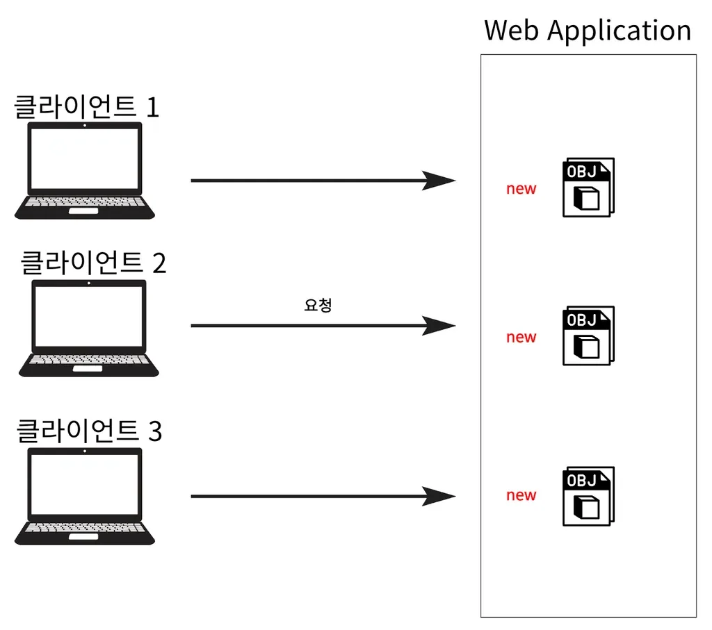
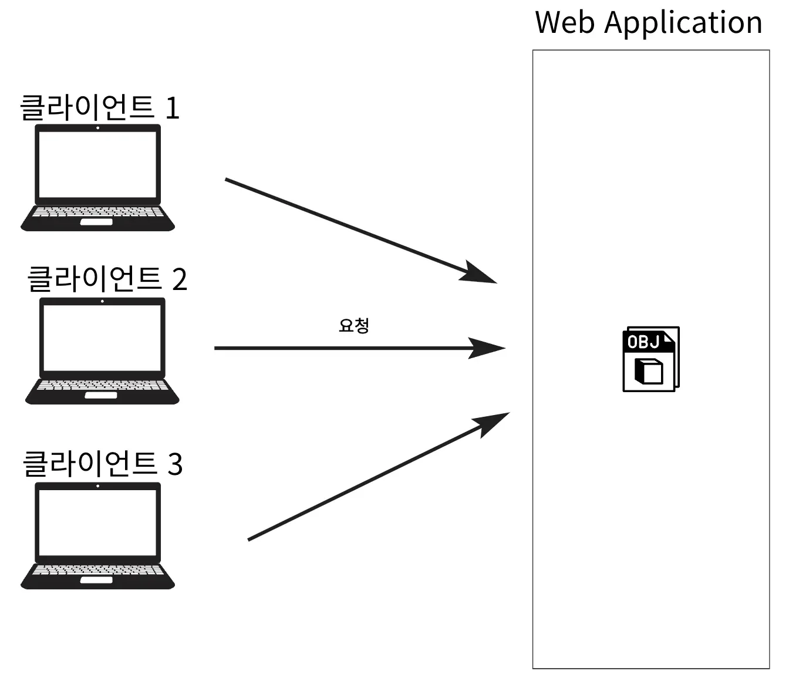
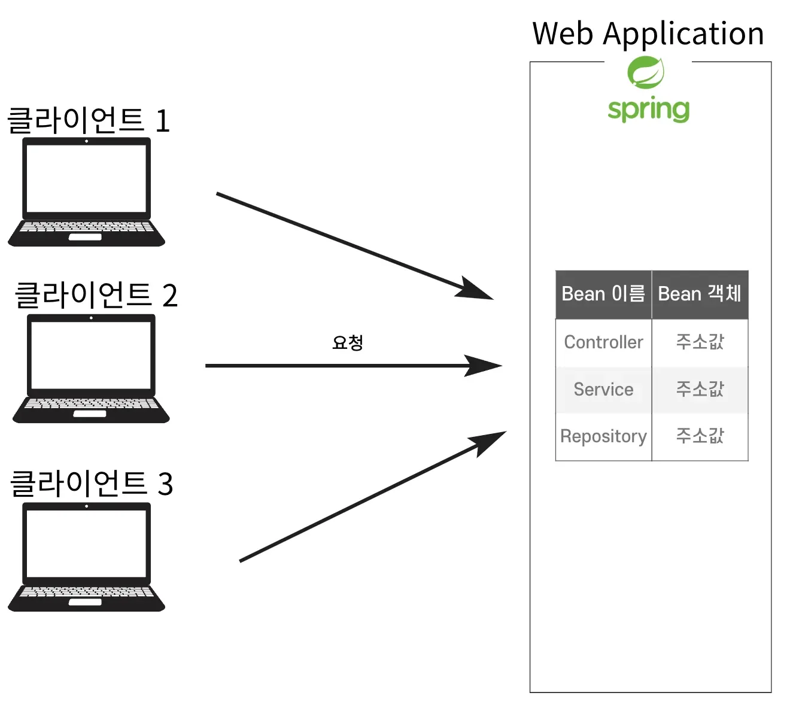

<a id="13ceda9b0fe180a9b687e945350a1174"></a>

## 싱글톤 패턴 ( Singleton Parttern )

> 📖 
> 
> <a id="fd8a9faac3e241b3b0b6df77221d7e3e"></a>
> 
> 클래스의 인스턴스가 오직 하나만 생성되도록 보장하는 디자인패턴

<details>
<summary>싱글톤 패턴의 등장 배경</summary>

- Web Application은 불특정 다수의 고객이 동시에 많은 요청을 보낸다&#46; 
    

    - 위와 같이 매 요청마다 새로 객체가 생성 및 소멸 시,  많은 자원이 낭비된다&#46; 

    - 이를 해결하기 위해 싱글톤 패턴이 등장하게 되었다&#46; 

- 싱글톤 패턴
    

    - 객체 인스턴스가 하나만 생성되고 생성된 인스턴스만 공유해서 사용한다&#46; 
        - 하나의 객체를 생성하여 공유하기 때문에, 한번의 생성 비용만 사용된다&#46; 

        - 따라서 그만큼 리소스를 절약할 수 있다&#46;

</details>

<details>
<summary>간단한 싱글톤 코드 구현</summary>

- static으로 인스턴스 변수 선언

- 기본 생성자를 <strong><u>private</u></strong>로 선언하여 외부에서 생성자 호출 시, 오류가 발생 되도록 함

- getter를 통해 조회 시, 해당하는  <u>인스턴스가 생성되지 않았을 때만 인스턴스를 생성</u>하고, <u>해당 인스턴스가 존재</u>하는 경우 <u>해당 인스턴스를 반환</u>하여 하나의 인스턴스만 생성 및 관리되도록 함

---

- &#91; 코드 &#93;
    <a id="13ceda9b0fe180919b6ed26a55fbaf51"></a>

    ```java
    public interface Singleton {
    	void showMessage();
    }

    public class SingletonImpl implements Singleton {
        private static SingletonImpl instance;

        // private 생성자를 통해 외부에서 객체 생성을 방지
        private SingletonImpl() {}

        // public으로 설정하여 인스턴스가 필요하면
        // getInstance 메서드를 통해 인스턴스에 접근하도록 만듦
        public static SingletonImpl getInstance() {
            // 인스턴스가 없을 때만 생성
            if (instance == null) {
                instance = new SingletonImpl();
            }
            return instance;
        }

        @Override
        public void showMessage() {
            System.out.println(instance.toString());
        }
    }
    ```

</details>

<details>
<summary><strong>🤬 싱글톤 패턴의 문제점</strong></summary>

> ☝🏻 
> 
> <a id="58f2181c79424ddf83879ffcb4c5e464"></a>
> 
> 아래와 같이 싱글톤 패턴은 유연성이 떨어져 <u>안티패턴</u>으로 불리기도 한다&#46;

- 멀티스레드 환경에서의 동기화 문제
    - <u>단순한 싱글톤 패턴 구현</u>은 <u>멀티스레드 환경에서 안전하지 않</u>아서 <strong><u>동기화 이슈가 발생</u></strong>할 수 있다&#46;

- 테스트 어려움
    -  싱글톤 객체는<u> 전역 상태를 유지</u>하기 때문에 <u>단위 테스트를 독립적으로 수행하기 어렵다&#46;</u>

- 의존성 주입 어려움
    - <u>다른 객체와의 의존성 관리가 어려워 </u><u>객체 간 결합도가 높</u>아질 수 있다&#46;

- 구현 클래스에 의존해야 한다&#46; ( DIP, OCP 위반 )
    <details>
    <summary>ex) </summary>

    <details>
    <summary>&#91; 코드 &#93;</summary>

    <a id="13ceda9b0fe18009bb13e5e9f4c800da"></a>

    ```java
    public class MainApp {
        public static void main(String[] args) {
        
           // 첫 번째 싱글톤 인스턴스 요청, 구현클래스.getInstance();
            Singleton instance1 = SingletonImpl.getInstance();
            instance1.showMessage(); // 인스턴스 주소값 출력

            // 두 번째 싱글톤 인스턴스 요청, 구현클래스.getInstance();
            Singleton instance2 = SingletonImpl.getInstance();
            instance2.showMessage(); // 인스턴스 주소값 출력
            
            // 다른 구현체로 바꾸려면 DIP, OCP 위반
            Singleton instance3 = SingletonImplV2.getInstance();
            instance3.showMessage();
        }
    }
    ```

    </details>

    ---

    <details>
    <summary>DIP 위반</summary>

    - 상위 모듈이 하위 모듈에 의존하지 않고, 추상화된 인터페이스에 의존해야 한다,<br>즉, 객체의 의존성을 인터페이스나 추상 클래스에 두고 구체적인 구현체에 의존하지 않도록 해야한다&#46; 

    <details>
    <summary>그러나 아래의 코드는 구현 클래스인 SingletonImpl에 직접 의존하고 있다&#46; </summary>

    <a id="13ceda9b0fe180c5bc0de17d334333e0"></a>

    ```java
    Singleton instance1 = SingletonImpl.getInstance()
    ```

    </details>

    - 따라서  SingletonImpl이 아닌 다른 구현체 SingletonImplV2로 바꾸고 싶다면 MainApp의 코드 자체를 수정해야 한다&#46; <br>즉, MainApp이 구체적인 클래스에 의존하고 있으므로 DIP를 위반한다&#46; <br>

    </details>

    <details>
    <summary>OCP 위반</summary>

    - MainApp 코드가 특정 싱글톤 구현체에 의존하고 있기 때문에, 새로운 구현체를 도입하려면 MainApp의 코드를 수정해야 한다&#46; 

    - 즉, SingletonImpl에서 SingletonImplV2로 변경하려면 코드가 수정되므로 OCP를 위반하게 된다&#46;

    </details>

    </details>

</details>

<details>
<summary>😁 Spring의 싱글톤 컨테이너를 통한 해결</summary>



> <strong>스프링</strong> <u>IoC(Inversion of Control) 컨테이너</u>는 <strong><u>싱글톤 패턴의 문제점들을 해결</u></strong>하면서 객체(<strong><u>Spring Bean)</u></strong>를 싱글톤으로 관리한다&#46;

- 스레드 안정성
    > 스레드 안정성이란 여러 스레드가 동시에 특정 자원(여기서는 빈)에 접근할 때, 그 객체가 불안정 상태에 빠지지 않고 올바르게 동작할 수 있음을 말한다&#46; 

    - <strong>Spring Container</strong>가 <strong><u>하나의 객체(싱글톤 빈)</u></strong>를 <strong><u>여러 스레드에서 동시에 접근</u></strong>하더라도 <u>안전하게 동작</u>하도록 관리한다&#46;
        - 개발자가 직접 동기화 메커니즘(<code>synchronized</code>…)을 구현하지 않더라도, Spring은 싱글톤 빈을 적절히 관리하여 객체의 상태가 불안정해지는 상황을 방지한다&#46;

- 의존성 주입 (DI)
    - Spring은 컨테이너가 <strong><u>객체(빈)의 생성 및 초기화를 관리</u></strong>하고, <strong><u>필요 시 의존성 주입을 통해 싱글톤 객체의 의존성을 외부에서 설정</u></strong>할 수 있게 한다&#46; 이를 통해 코드가 인터페이스에 의존적이게 되어 <u> DIP 및 OCP를 준수</u>할 수 있다&#46; 

- 테스트 용이성 
    - Spring에서는 <code>&#64;Primary,</code> <code>&#64;Profile</code>, <code>&#64;Qualifier</code> 등과 같은 기능을 사용하여 다른 환경에서 쉽게 교체 가능한 빈을 생성할 수 있다&#46; <br>이로인해 단위 테스트 시 더 쉽게 객체를 모킹하거나 대체할 수 있다&#46;

    - <u>테스트용 설정 파일</u>이나 <code>&#64;TestConfiguration</code>을 사용해 테스트 환경에 맞춘 빈 정의가 가능하다&#46; 

- <strong>빈의 라이프사이클 관리</strong>
    - 싱글톤 빈의 라이프사이클(생성, 초기화, 소멸)을 관리하여 메모리 누수를 방지하고 객체의 수명을 안전하게 관리한다&#46; 
        - 개발자가 직접 객체의 소멸 로직을 작성할 필요가 없다&#46; 

    - <code>&#64;PostConstruct</code> 및 <code>&#64;PreDestroy</code>  애노테이션을 사용하여 객체 초기화 및 소멸 시 추가 작업을 쉽게 정의할 수 있다&#46; 

- 구연 유연성
    - 스프링에서 빈의 생성 방식을 XML 구성 파일이나 자바 기반의 &#64;Configuration 클래스를 통해 설정할 수 있어 코드 수정 없이 객체의 구성과 생성 방식을 변경할 수 있다&#46; 

    - 이는 코드의 수정 없이 새로운 구현체를 도입할 수 있도록 하여 OCP를 만족하게 한다&#46;

</details>

<a id="13ceda9b0fe180a39a03eb8180466333"></a>

## 싱글톤 패턴의 주의점

> 📖 
> 
> <a id="13ceda9b0fe180908f87cc231d7ba80d"></a>
> 
> 객체의 인스턴스를 하나만 생성하여 공유하기 때문에, 객체의 상태를 유지(stateful)하면 안된다&#46;

<details>
<summary>상태 유지(stateful)의 문제점</summary>

- 데이터 불일치, 동시성 문제 발생 

---

<details>
<summary>&#91; 코드 &#93; StatefulSingleton</summary>

- 객체에 상태 유지&#58; value

<a id="13ceda9b0fe1803c9ed8e8eef457ac70"></a>

```java
public class StatefulSingleton {
    private static StatefulSingleton instance;
    
    // 상태를 나타내는 필드
    private int value;

    // private 생성자
    private StatefulSingleton() {}

    // 싱글톤 인스턴스를 반환하는 메서드
    public static StatefulSingleton getInstance() {
        if (instance == null) {
            instance = new StatefulSingleton();
        }
        return instance;
    }

    // 상태 변경 메서드 ( Setter )
    public void setValue(int value) {
        this.value = value;
    }

    // 상태를 반환하는 메서드 ( Getter )
    public int getValue() {
        return this.value;
    }
}
```

</details>

<details>
<summary>&#91; 코드 &#93; MainApp</summary>

- <strong><u>동일한 인스턴스를 공유 ( 싱글톤 )</u></strong>하기 때문에, 중간에 상태 값이 변경 시 다른 클라이언의 상태값도 변경된다&#46; 
    - 클라이언트 1 → Value = 42

    - 클라이언트 2 → Value = 100

    - 클라이언트 1에서 Value 값 조회 시, 100

<a id="9f34f785489b44b78dec82f524064643"></a>

```java
public class MainApp {
    public static void main(String[] args) {
        // 클라이언트 1: 싱글톤 인스턴스를 가져와서 상태를 설정
        StatefulSingleton client1 = StatefulSingleton.getInstance();
        client1.setValue(42);
        System.out.println("클라이언트 1이 설정한 값: " + client1.getValue());

        // 클라이언트 2: 동일한 싱글톤 인스턴스를 사용해 상태를 변경
        StatefulSingleton client2 = StatefulSingleton.getInstance();
        client2.setValue(100);
        System.out.println("클라이언트 2가 설정한 값: " + client2.getValue());

        // 클라이언트 1이 다시 값을 확인
        System.out.println("클라이언트 1이 다시 확인한 값: " + client1.getValue());
    }
}
```

</details>

<details>
<summary>출력 결과</summary>

<a id="13ceda9b0fe18008b8d9f3d7ec3bbe4d"></a>

```java
클라이언트 1이 설정한 값: 42
클라이언트 2가 설정한 값: 100
클라이언트 1이 다시 확인한 값: 100
```

</details>

</details>

> ☝🏻 
> 
> <a id="88a6e255974b480b995822c7dffb12fd"></a>
> 
> <strong><u>Spring Bean</u></strong><strong>은 항상 </strong><strong><u>무상태(stateless)</u></strong><strong>로 설계를 해야한다&#46;</strong>
