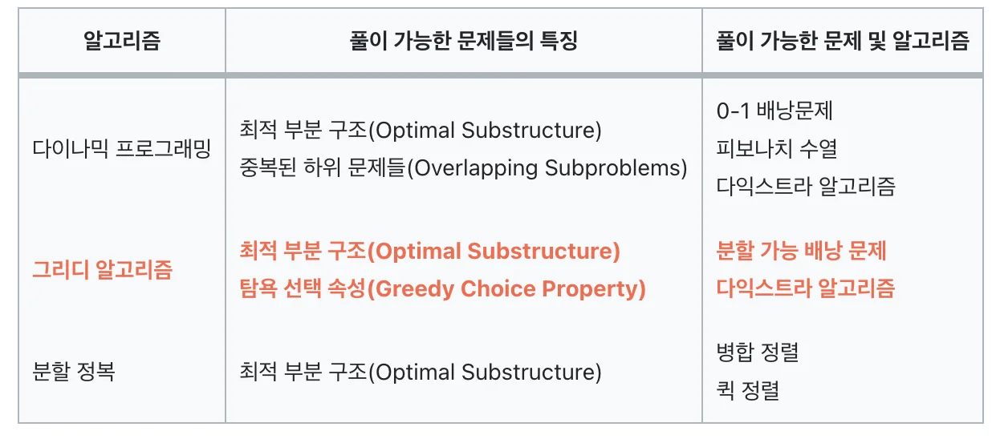
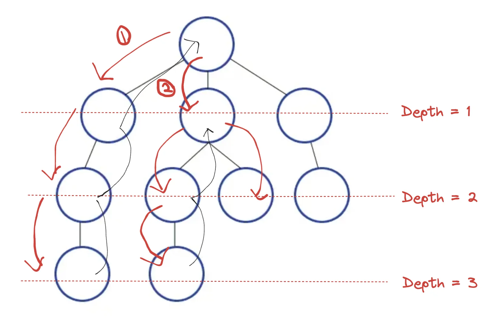
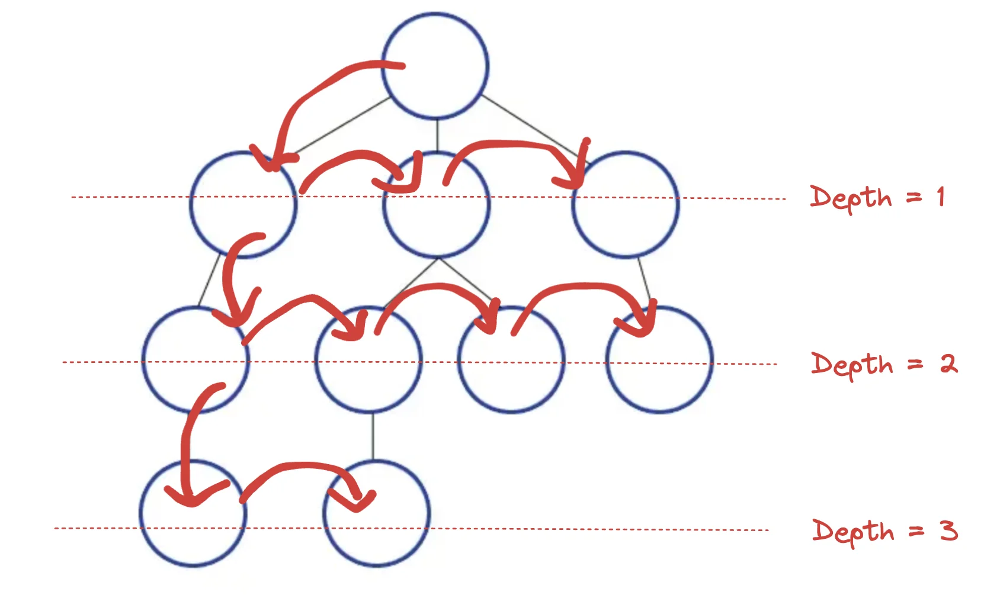

> 📌 
> 
> <a id="dacd947105a645d0804103e7635cf422"></a>
> 
> 알고리즘 특강  &#45; 심회 세션 ( BFS, DFS )
> 
> - 진행&#58; 김재연 튜터님 
> 
> - 기간&#58; 24&#46;11&#46;13 ( 수 ) 

> ☝🏻 
> 
> <a id="414bdab46dd640638a64815a9808526f"></a>
> 
> 항상 제한사항을 먼저 인지하고 어떤 알고리즘을 사용할 것인지 결정해야 한다&#46; 

<a id="13deda9b0fe180ca9c00d15a416019fa"></a>

## 그리디 알고리즘 ( 탐욕법 )

---

> 📌 
> 
> <a id="92498c1358e349b29e0edfd792a20c1c"></a>
> 
> 이전 정리 내용 
> 
> - ‣
> 
> - ‣

<a id="13deda9b0fe180b997ade848ef5204c5"></a>

각 단계에서 최적이라 생각되는 것을 선택’해 나가는 방식으로 진행하여 최종적인 해당에 도달하는 알고리즘이다&#46; 

- 항상 최적의 값을 보장하는 것이 아니기 때문에, <u>분기마다 최적의 값에 가까운 ‘근사 값’을 선택</u>하여 답을 구한다&#46;

---

<details>
<summary><a href="https://school.programmers.co.kr/learn/courses/30/lessons/42862">문제 1</a> </summary>

<a id="13deda9b0fe180b38ec2d5b54462fa90"></a>

```java
 class Solution {
    public int solution(int n, int[] lost, int[] reserve) {
        int answer = n;  // 일단 정답으로 모든 학생이 들을 수 있는 최대의 수로 설정함
        
        int[] people = new int[n+1];  // 학생을 상태를 나타내는 배열 생성, 1부터 시작하기 때문에 크기를 n+1로 정함
        
        for( int l : lost ){  // 체육복을 잃어버린 학생들의 상태 표시 = -1
            people[l]--;  
        }
        
        for( int r : reserve ){ // 여벌의 체육복을 가지는 학생들의 상태 표시 = 1
            people[r]++;
        }
        
        for(int i= 1; i<=n; i++){
            if(people[i] == -1) {   // 체육복이 없을 시 근접한 학생 탐색
                if( (i-1) >= 1 && [people[i-1] == 1) {  // 앞 학생이 있는 경우
                    people[i-1]--;
                    people[i]++; 
                } else if (i+1 <= n && people[i+1] == 1){  // 뒤 학생이 있는 경우
                    people[i+1]--;
                    people[i]++;
                } else {   // 앞, 뒤 둘다 없으므로 해당 학생은 수업 참여가 불가능함 따라서 뺴준다. 
	                 answer--;
                }
            }
        }
        return answer;
    }
}
```

</details>

<a id="13deda9b0fe180b5a180f1fd68ff9574"></a>

## DP ( 동적 계획법 )

---

> 📌 
> 
> <a id="825df0aff0d94645893c96bdc2a52c80"></a>
> 
> 이전 정리 내용 
> 
> - ‣
> 
> - ‣

<a id="13deda9b0fe18061ba1ef9da32a10da2"></a>

Dynamic Programming의 줄임말로, 작은 문제들을 풀면서 그 결과를 저장해 나가 ( 메모제이션 )

<a id="13deda9b0fe180cb8a5ee761642e8042"></a>

전체 문제를 해결하는 알고리즘이다&#46; 

- f(n) = f(n&#45;1) &#43; f(n&#45;2)

---

<details>
<summary><a href="https://school.programmers.co.kr/learn/courses/30/lessons/12914">문제 2</a> </summary>

- 문제가 쉬운 관계로 따로 정리 안함

<a id="13deda9b0fe18024a2b0d0165da03855"></a>

```java
class Solution {
    public int solution(int n) {
        int answer = 0;
        
        int[] dp = new int[n + 1];  // 최대 2000가지 경우의 수를 기록할 배열 생성
        
        if (n <= 2) {   // n 이 2 이하일 경우    
            return n;   // 그대로 n 반환
        }
        
        dp[1] = 1;  // n이 1일 경우 값 대입
        dp[2] = 2;  // n이 2일 경우 값 대입
        
        for (int i=3; i<=n; i++) {
            dp[i] = (dp[i-1] + dp[i-2]) % 1234567;    // n의 크기에 따른 적절한 값 대입
        }
        
        return dp[n];
    }
}
```

</details>

<a id="13deda9b0fe180c99bb4d77eda182c4a"></a>

### 그리디 알고리즘 vs DP ( 동적 계획법 )

---

|  |  |  |
| --- | --- | --- |
| <strong>분류</strong> | <strong>그리디 알고리즘(Greedy Algorithm)</strong> | <strong>동적 계획법(DP&#58; Dynamic Programming)</strong> |
| <strong>설명</strong> | 각 단계에서 최적의 선택을 하는 방식으로 문제를 해결하는 방식 | 작은 문제의 해를 메모이제이션하여 중복 계산을 피하고, 이를 이용하여 큰 문제를 해결하는 방식 |
| <strong>중복 부분 문제</strong> | 중복 부분 문제 해결 X | 중복 부분 문제 해결 O |



<a id="13deda9b0fe18079ac29fa59cfc1c619"></a>

## DFS  ( 깊이 우선 탐색 )

---



> depth를 기준으로 하나의 탐색 경로의 끝 범위까지 탐색 후, 되돌아와서 다시 탐색을 진행하는 방법이다&#46;

- 구현&#58; 스택, 재귀
    - 재귀 구현 시, <u>종료 조건</u> 과 <u>파라미터 값을 설정</u>이 중요하다&#46;
        - 깊이, 타겟(목표값)… 외 문제조건에 따라 추가

---

<details>
<summary><a href="https://school.programmers.co.kr/learn/courses/30/lessons/43165">문제 3</a></summary>

<a id="13deda9b0fe1801aaea0dbb6e3d5515d"></a>

```java
class Solution {
    
    int answer = 0; // 정답 초기화
    
    public int solution(int[] numbers, int target) {
        dfs(0, 0, target, numbers); // dfs 호출
        return answer;
    }
    
    private void dfs(
        int level,      // 단계 (인덱스)
        int sum,        // 현재 단계까지의 숫자들의 총합.
        int target,     // 목표값
        int[] numbers   // 사용할 배열
    ) {
		    // 배열의 길이와 단계가 같을 경우 == 모든 배열을 순회한 이후일 경우
        if (level == numbers.length) {  
		        // 현재까지 숫자들의 총합이 목표값과 같을 경우
            if (sum == target) {    
                answer++;       // 정답값 + 1
            }
            // 모든 배열을 순회했으므로 더 이상 아래 DFS를 수행하지 않고 종료.
            return;         
        }
        
        // 배열 안의 숫자를 더했을 경우
        dfs(level+1, sum + numbers[level], target, numbers);
        // 배열 안의 숫자를 뺐을 경우
        dfs(level+1, sum - numbers[level], target, numbers);
    }
    
    
}
```

</details>

<a id="13deda9b0fe1801c8aa7d56c40808877"></a>

## BFS ( 넓이 우선 탐색 )

---



> 하나의 depth에 있는 모든 경우를 탐색 후, 다음 depth ( level ) 로 넘어가 탐색하는 방법이다&#46; 

- 구현&#58; 큐
    1. 탐색 시작 노드를 <u>큐에 삽입</u>하고 <u>방문 처리</u>한다&#46;

    1. 큐에서 노드를 꺼낸 뒤 해당 노드의 인접 노드 중 방문하지 않은 노드를 모두 큐에 삽입하고 방문처리한다&#46; 

    1. 2번 과정을 수행할 수 없을 때까지 반복한다&#46;

- BFS는 최단 경로를 찾거나, 노드 간의 최단 거리를 등을 구하는데 활용된다&#46;

---

<details>
<summary><a href="https://school.programmers.co.kr/learn/courses/30/lessons/1844">문제 4</a> &#45; BFS</summary>

<a id="13deda9b0fe180f9a7cae3e5c30941a0"></a>

```java
import java.util.*;

class Solution {
    
    int[] dx = {0, 0, 1, -1};   // 좌, 우 이동
    int[] dy = {1, -1, 0, 0};   // 상, 하 이동
    int answer; // 정답 초기화
    
    public int solution(int[][] maps) {
        int row = maps.length;  // 가로
        int col = maps[0].length;   // 세로
        
        int[][] visited = new int[row][col];
        visited[0][0] = 1;  // 시작 거리 : 1
        bfs(visited, maps);
        if (visited[row-1][col-1] == 0) {   // 목적지가 0이라면 == 목적지에 도착하지 못했다면
            return -1;
        }
        return answer;
    }
    
    private void bfs(int[][] visited, int[][] maps) {
        Queue<int[]> queue = new LinkedList<>();
        queue.offer(new int[]{0,0});    // 초기 시작 좌표
        
        while(!queue.isEmpty()) {
            int[] position = queue.poll();
            int x = position[0];
            int y = position[1];
            
            for (int i=0; i<4; i++) {
                int nx = x + dx[i];
                int ny = y + dy[i];
                
                if (nx >= 0 && nx < maps.length && ny >= 0 && ny < maps[0].length // [nx][ny] 가 maps 범위 내에 있고
                    && visited[nx][ny] == 0 // 아직 방문하지 않은 map이고
                    && maps[nx][ny] == 1    // 벽으로 이루어지지 않은 좌표일 경우
                   ) {
                    visited[nx][ny] = visited[x][y] + 1;    // 현재 좌표까지 소요된 거리 + 1
                    if (nx == maps.length-1 && ny == maps[0].length-1) {    // 현재 좌표가 목적지 경우
                        answer = visited[nx][ny];   // 정답에 현재 좌표까지 소요된 거리를 대입
                        return;     // 탐색 종료
                    }
                    queue.offer(new int[]{nx, ny});     // 새로운 시작 좌표 추가
                }
            }
        }
      
    }
```

</details>

<a id="13deda9b0fe18009aecdc9dd3933cac2"></a>

## DFS vs BFS

---

> DFS, BFS 이전 정리 내용
> 
> - ‣
> 
> - ‣

- 풀이 시 주의점
    - 이전 탐색한 내용을 다시 탐색하지 않기 위해, 방문 정보를 표시해야 한다&#46;
        - 정석) 주어지는 map 과 동일한 check 배열 생성

        - 이전 풀이 시, 주어지는 map 값에 표시함

- DFS로 가능한 문제들은 BFS로도 풀이할 수 있다&#46; (그 역도 가능)
    <a id="13deda9b0fe180948691d7aa6e2dfa0b"></a>

    따라서 문제의 상황에 맞춰 더 최적화된 방식으로 진행해야 한다&#46; 

    - DFS &#45; 경로의 특징을 저장
        - ex)  <br>각 정점에 숫자가 적혀있고 a부터 b까지 가는 경로를 구하는데<br> 경로에 같은 숫자가 있으면 안 된다는 문제 등 각 경로의 특징을 저장해둬야 할 때

    - BFS &#45; 최단거리
        - ex) 
            - 미로 찾기 등 최단거리를 구해야 할 경우, 깊이 우선 탐색으로 경로를 검색한다면 처음으로 발견되는 해답이 최단거리가 아닐 수 있지만, 너비 우선 탐색으로 현재 노드에서 가까운 곳부터 찾기 때문에 경로를 탐색 시 먼저 찾아지는 해답이 곧 최단거리이기 때문에, BFS로 풀이하는 것이 더 연산적으로 이점이 있다&#46;
