> 📌 
> 
> <a id="12a8da1ca00048409352d70c8d32c3ee"></a>
> 
> CS 특강 &#45; 알고리즘 세션
> 
> - 진행&#58; 김재연 튜터님
> 
> - 기간&#58; 24&#46;10&#46;14

<details>
<summary>Reference</summary>

<a id="14beda9b0fe180e98f3de80e5cb913dc"></a>

<a href="https://beautiful-college-c84.notion.site/11f2dc3ef51480069295d9a37dfcaf32">페이지</a> 

<a id="14beda9b0fe180d8946cf320930b2f88"></a>

‣

<a id="14beda9b0fe180f8bcd1e38bc51c49be"></a>

‣

</details>

<a id="157eda9b0fe180848de9fb8db7e1882e"></a>

## 1&#46; 알고리즘

> 📖 
> 
> <a id="157eda9b0fe180c09f8edc23347230fc"></a>
> 
> <strong>알고리즘</strong>
> 
> <a id="ea64355ebf0849528fec87789b2340af"></a>
> 
> 알고리즘은 특정 문제를 해결하거나 작업을 수행하기 위한 단계적 절차 또는 규칙의 집합입니다&#46; <br>주어진 입력을 받아 목표한 출력을 생성하는 논리적인 과정을 포함합니다&#46;
> 
> <a id="e245c8a747a640cfa078e4cb6322a402"></a>
> 
> <strong>즉, 얼마나 효율적으로, 얼마나 빠르게 결과를 만들어 낼 수 있는지 방법을 찾아가고 연구하는게 알고리즘이라고 할 수 있습니다&#46; </strong>

<a id="157eda9b0fe18053affdccee927b4d47"></a>

### 1&#46;1&#46; 알고리즘의 필요성

- 개발적 관점
    - 복잡한 문제를 효율적이고 효과적으로 해결&#46;

    - 문제 풀이의 과정을 더 안전하고, 빠르고, 수행하기 쉽도록 도와줌&#46;

- 취업 준비생의 관점
    - 알고리즘 풀이를 코딩 테스트에 이용하는 경우가 많다&#46; (특히 대기업)

    - 포트폴리오에서의 복잡한 동작을 효율적으로 풀어냈을 때 성능 개선에 대한 어필이 가능하다&#46;

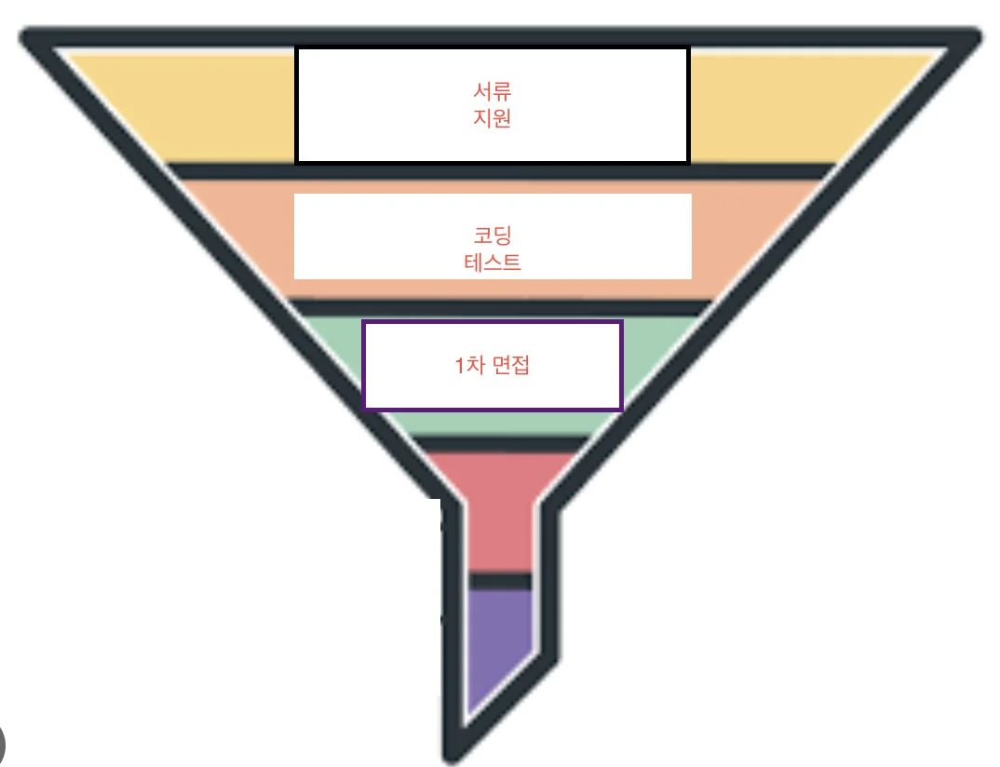

<a id="157eda9b0fe180c08d2ef6720b6570fc"></a>

### 개발자의 능력과 자질

<a id="157eda9b0fe180c58517f04a445a9fdd"></a>

개발자는 끝없는 효율성을 고민하는 존재입니다&#46;

<a id="157eda9b0fe1802f9518d6dc560dbdd0"></a>

그냥 어떻게든 코드가 돌아가기만 해서는 안되고 효율적으로 그리고 빠르게 안정적으로 돌아가게 설계해야 합니다&#46;

<a id="157eda9b0fe180179489c2221f0ca0b3"></a>

이렇게 알뜰살뜰 코드 효율을 높이면 컴퓨터 2대로 돌려야할 프로그램을 1대로 처리할 수 있고 이는 비용 절감으로 이어집니다&#46;

<a id="157eda9b0fe180569ac0cc972c2dccf3"></a>

<strong>생각 이상으로 컴퓨터 장비(서버) 비용이 만만치 않습니다&#46; </strong>

<a id="157eda9b0fe180b5bfcae0d8d578e704"></a>

그렇기 때문에 몸값 비싼 개발자를 뽑으려하는 것 입니다&#46;

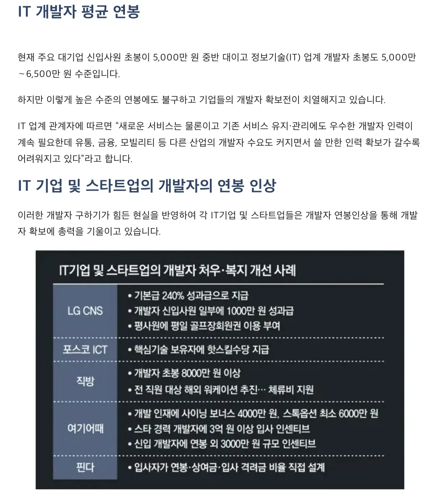

<a id="14beda9b0fe1807392c4f2bef1570200"></a>

### 1&#46;2&#46; 알고리즘 활용 예시

- 탐색 알고리즘
    - 포털 사이트의 검색 기능

- 정렬 알고리즘
    - 데이터 정렬

- 최단 경로 알고리즘 (다익스트라 알고리즘)
    - 가장 빠른 길찾기

<a id="157eda9b0fe18079afafe005349a3918"></a>

### 1&#46;3&#46; 알고리즘 준비 방법

1. 코드카타의 목적은 자바 문법과 익숙해지기
    1. 우리가 앞으로 사용할 스프링을 사용하는 자바와 친숙해지기 위해서<br>스프링 개발자 뽑을 때 코테로 자바만 사용하는 회사 &#58; 네이버 웹툰, 한화생명, 신세계 등<br>요즘 <strong>점점 더 늘어가는 분위기</strong><br>

1. 정해진 시간에 꾸준히 문제를 풀기 
    1. 알고리즘은 사고력입니다&#46; <br>단기간 안에 향상 시킬 수 없기 때문에 단순 암기가 아닌 <strong>반복 학습이 중요합니다&#46;</strong>

    1. 실력이 가장 절정일 때가 최종 프로젝트 마무리한 직후일텐데, 그때 빠르게 cs 및 스프링 자바 면접을 준비하고 바로 회사에 지원하는 것이 가장 효율이 좋다고 생각합니다&#46;

    1. 저 시기에 코딩 테스트까지 준비하려고 하면 너무 빠듯할 수 있기 때문에 내배캠을 진행하면서 코드카타 시간에 꾸준히 알고리즘 문제를 풀어보는 것이 중요합니다&#46;

    1. 당장 문제 풀기 어려우니, ‘개념만 계속 보다보면 언젠가는 이해되는 날이 올거야’ 라는 생각을 할 수도 있는데, 그것보단 풀지 못하더라도 계속해서 문제를 접하는 것이 더욱 도움이 됩니다&#46;

<a id="157eda9b0fe1808eb2e5d964278868c8"></a>

### 1&#46;4  코딩 테스트 풀이 과정

1. 문제를 꼼꼼하게 읽는다&#46;
    1. 문제 이해 (모수의 범위 확인)

    1. 사용할 알고리즘과 그에 맞는 시간 복잡도 확인

1. 코드를 작성해보려고 시도한다&#46;

1. 실패&#46;

1. 정답을 확인한다&#46;

1. 풀이를 이해하려고 한다&#46;

1. 해당 문제에 사용된 알고리즘이 있다면 어떤 것인지 찾아본다&#46;

1. 사용된 알고리즘을 공부한다&#46;

1. 충분히 문제 해답을 이해 및 암기 했다면 해당 문제를 다시 풀어본다&#46;

<details>
<summary>ex) 수학도둑의 문제 중 유명한 달팽이 문제 &#58;</summary>

<a id="197fd1b881c04998a0edb05497341ad1"></a>

```javascript
15 CM 의 막대기를 달팽이가 오르려고 한다.
달팽이는 하루동안 3 CM 씩 올라가고
자는 동안 2 CM 씩 내려간다.
달팽이가 막대기를 올라가는데 몇 일이 걸릴 것인가?

정답: 13일
```

</details>

<details>
<summary>코딩 테스트 문제</summary>

<a id="a617a0beb4fe44f49a601595dfa5409a"></a>

```plaintext
[ 문제 ]

땅 위에 달팽이가 있다. 이 달팽이는 높이가 V미터인 나무 막대를 올라갈 것이다.

달팽이는 낮에 A미터 올라갈 수 있다. 하지만, 밤에 잠을 자는 동안 B미터 미끄러진다. 

단, 정상에 올라간 후에는 미끄러지지 않는다.

달팽이가 나무 막대를 모두 올라가려면, 며칠이 걸리는지 구하는 프로그램을 작성하시오.

[ 입력 ]

첫째 줄에 세 정수 A, B, V가 공백으로 구분되어서 주어진다. (1 ≤ B < A ≤ V ≤ 1,000,000,000)

[ 출력 ]

첫째 줄에 달팽이가 나무 막대를 모두 올라가는데 며칠이 걸리는지 출력한다.
```

</details>

<a id="157eda9b0fe180979becf9e7a9647f7f"></a>

코딩 테스트 문제를 풀다보면 ‘이게 무슨 소리지?’, ‘이거 코테가 아니라 비문학 아니야?’ 라는 생각이 많이 듭니다&#46;

1. 문제의 내용을 요약하거나 최대한 길게 풀어서 정리합니다&#46;<br>(해결하고자 하는 내용, 제시된 조건을 분리해서 정리하면 보다 편리함)

1. 문제를 해결하기 위해서 어떻게 동작이 이뤄져야 하는지<strong> </strong>먼저 정리합니다&#46;

<a id="157eda9b0fe18084a9ace84bf75885d8"></a>

```javascript
A = 올라갈 수 있는 거리
B = 미끄러지는 거리
V = 나무막대 길이
하루에 올라 갈 수 있는 거리 A - B

** 참고 **
남은 거리가 A 보다 짧으면 미끄러지는 거리를 고려하지 않아도됨


1. A를 담을 수 있는 변수를 선언한다
2. B를 담을 수 있는 변수를 선언한다.
3. V를 담을 수 있는 변수를 선언한다.
4. 올라가는 데 걸리는 일 수를 구한다.
   밤에는 올라갈 일이 없으니 도착은 낮만 고려하면 될 듯
```

<a id="157eda9b0fe180c886c0f4a01cea3493"></a>

### 1&#46;5  코딩 테스트 연습 풀이

1. 한글로 작성된 내용을 코드로 옮긴다&#46;

1. 일반화 시킬수 있는 규칙을 찾는다&#46;

<a id="157eda9b0fe18024bb1cda3d9b580655"></a>

```javascript
A = 올라갈 수 있는 거리
B = 미끄러지는 거리
V = 나무막대 길이
하루에 올라 갈 수 있는 거리 A - B

** 참고 **
남은 거리가 A 보다 짧으면 미끄러지는 거리를 고려하지 않아도됨


1. A를 담을 수 있는 변수를 선언한다.
2. B를 담을 수 있는 변수를 선언한다.
3. V를 담을 수 있는 변수를 선언한다.
4. 올라가는 데 걸리는 일 수를 구한다.
   밤에는 올라갈 일이 없으니 도착은 낮만 고려하면 될 듯

N일차에 올라간 거리    
1일차 낮 = A
2일차 낮 = A - B + A
3일차 낮 = A - B + A - B + A
4일차 낮 = A - B + A - B + A - B + A
5일차 낮 = A - B + A - B + A - B + A - B + A 
.
.
.
.
N일차 낮 = (A - B) * (N - 1) + A

V = (A - B) * (N - 1) + A
V = AN - A - BN + B + A
V = AN - BN + B
V = N * (A-B) + B
V - B = N * (A-B)

올라가는 데 걸리는 일 수 구하는 공식
N = (V-B)/(A-B)

나머지가 있으면 다음날 등반 완료
남은 거리가 A 보다 짧으면 미끄러지는 거리를 고려하지 않아도됨

if ((V-B)/(A-B) 나머지 있으면 N + 1)
```

<a id="157eda9b0fe180808ad4ecf338c8d396"></a>

## 2&#46; 자료 구조

> 💡 <strong>자료 구조</strong>
> 
> <a id="89ad921175ae490685a5dcbc7c284fcf"></a>
> 
> 자료 구조는 효율적인 접근 및 수정을 가능하게 하는 자료의 조직, 관리, 저장을 의미합니다&#46;
> 
> <a id="a99b8009fe354d7e9fe3206c33c5ecbc"></a>
> 
> 더 정확히 말해, 데이터 값의 모임, 또 데이터 간의 관계, 그리고 데이터에 적용할 수 있는 함수나 명령을 의미합니다&#46;
> 
> <a id="a16fac7563f44b28877f43d0a116eec8"></a>
> 
> 자료 구조는 데이터 값의 모임, 또 데이터 간의 관계, 그리고 데이터에 적용할 수 있는 함수나 명령을 의미합니다&#46;
> 
> <a id="05572a704dcf4ec9aa3ada8f2dfc7785"></a>
> 
> <br>어떤 자료 구조를 선택하느냐에 따라 효율적인 알고리즘 사용이 가능합니다&#46;

<a id="157eda9b0fe1807d9bdaeafe91cffa2d"></a>

### 2&#46;1&#46; 자료구조의 필요성

- 개발적 관점
    - <strong>효율적인 데이터 관리</strong>&#58; 데이터의 효율적인 저장과 검색을 가능하게 하여 처리 시간을 줄이고 성능을 향상시킵니다&#46;

    - <strong>데이터 조직</strong>&#58; 데이터를 논리적으로 구성하여 이해하고 접근하기 쉽게 만듭니다&#46;

    - <strong>재사용성</strong>&#58; 일반적인 데이터 구조는 여러 응용 프로그램에서 재사용할 수 있어 개발 시간과 노력을 절약합니다&#46;

    - <strong>알고리즘 최적화</strong>&#58; 적절한 데이터 구조의 선택은 데이터를 처리하는 알고리즘의 효율성에 상당한 영향을 미칠 수 있습니다&#46;

- 취업 준비생의 관점
    - 알고리즘 풀이에 많이 사용됩니다&#46; 입력 받은 데이터를 어느 형태로 처리할지 고민하게 되는데, 이 때 자료 구조를 알고 있다면 고민이 빨리 해소되겠죠?

<a id="14beda9b0fe18090ba22f48248f87857"></a>

### 2&#46;2&#46; 자료 구조의 종류

> 💡 자료 구조는 아래 사진 외에도 여러가지가 있습니다&#46; 인터넷에 자료가 많으니, 궁금하다면 찾아봅시다&#33;

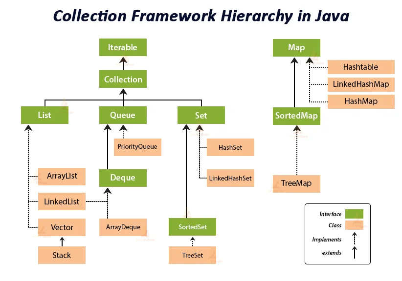

<details>
<summary>배열 (Array)</summary>

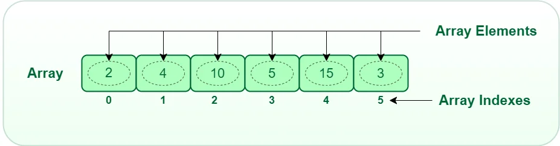

- 배열은 동일한 자료형의 원소들을 <strong>연속적인 메모리 공간</strong>에 저장하는 자료 구조입니다&#46; 

- 배열의 크기는 고정되어 있으며,<strong> </strong><strong>선언 시에 크기를 지정해야 합니다&#46;</strong>

<details>
<summary>예제 코드</summary>

<a id="11cc10944736424da8cafe7183367cec"></a>

```javascript
int[] age; // 배열 선언
age = new int[5]; // 메모리 할당 == 크기 지정

int[] age = new int[5]; 

// 배열 초기화
age[0] = 12;
age[1] = 4;
age[2] = 5;
age[3] = 2;
age[4] = 5;

int[] age = {12, 4, 5, 2, 5};
```

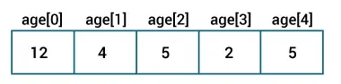

</details>

</details>

<details>
<summary>리스트 (ArrayList)</summary>

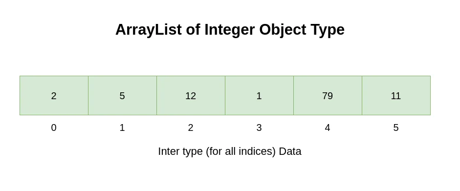

- <strong>배열과 ArrayList는 인덱스로 원소를 관리한다는 점은 동일하지만, ArrayList는 </strong><strong>크기를 동적으로 지정할 수 있습니다&#46;</strong>

- 원시 타입(primitive type)이 아닌 Wrapper Class 만 사용 가능합니다&#46;

<details>
<summary>예제 코드</summary>

<a id="2e864f9d398848a2a3200818cd33a509"></a>

```java
int, long, double, float, char
Integer, Long, Double, Float, String, Character

ArrayList<Integer> integerList = new ArrayList<>(); // Integer 리스트 생성

ArrayList<String> stringList = new ArrayList<>(); // String 리스트 생성

integerList.add(1);
integerList.add(3);
integerList.add(2);
integerList.add(4);
integerList.add(4);

integerList.size(); 5

int element = integerList.get(3); // ?
```

</details>

</details>

<details>
<summary>세트 (HashSet)</summary>

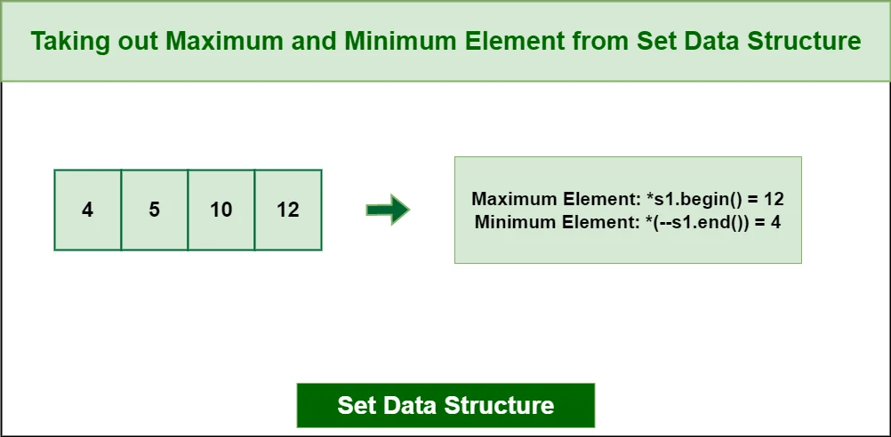

- 중복된 원소를 저장할 수 없습니다&#46;

- <strong>원소들의 순서가 존재하지 않습니다&#46;</strong>

<details>
<summary>예제 코드</summary>

<a id="68284d8b823b4720a513b9145bbe1ab1"></a>

```java
HashSet<Integer> numberSet = new HashSet<>(); // Integer Set 생성

numberSet.add(2);
numberSet.add(4);
numberSet.add(6);
numberSet.add(2);

numberSet.size() // ?
```

</details>

</details>

<details>
<summary>맵 (HashMap)</summary>

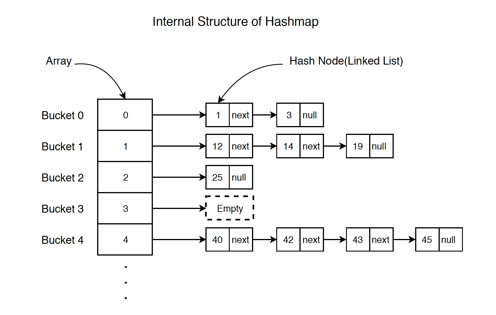

- HashMap은 데이터를 저장할 때 키(Key)와 밸류(Value)가 짝을 이루어 저장됩니다&#46;

- HashMap의 키(Key) 값은 중복될 수 없고, 밸류(Value) 값은 중복이 가능합니다&#46;

- <strong>원소들의 순서가 존재하지 않습니다&#46;</strong>

<details>
<summary>예제 코드</summary>

<a id="37213e9ac1f842448716131156c3d5c0"></a>

```java
// Key: String, Value: Integer 타입 HashMap 생성
HashMap<String, Integer> languageMap = new HashMap<>();

languageMap.put("Java", 8);
languageMap.put("JavaScript", 1);
languageMap.put("Python", 3);

languageMap.get("JavaScript") // ?
```

</details>

</details>

<details>
<summary>스택(Stack)</summary>

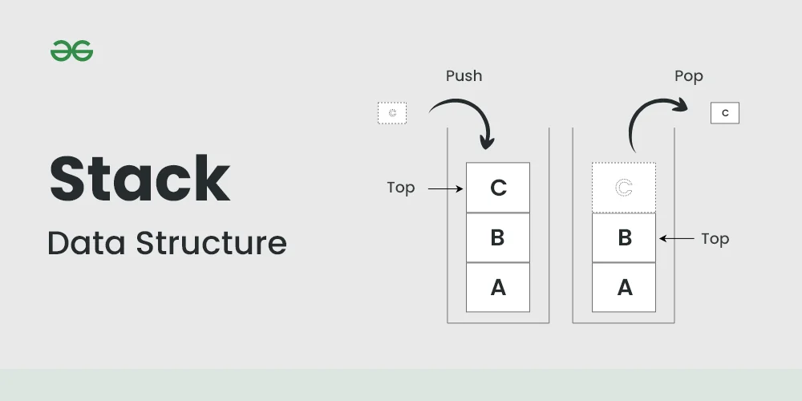

<a id="450cea88bfb84711877fb2e76e23c9ef"></a>

마지막으로 입력한 값이 제일 먼저 출력되는 자료 구조입니다&#46; <br>이것을 <strong>LIFO(Last In First Out)</strong>, 또는 반대로 <strong>FILO(First In Last Out)</strong>이라고 부릅니다&#46;

<a id="9321632a85134ffdbc86eb1966e86d9f"></a>

데이터를 입력하는 <code>push</code>와 데이터를 출력하는 <code>pop</code> 기능이 있습니다&#46;

<details>
<summary>예제 코드</summary>

<a id="26a505357614442686fb78c635334529"></a>

```java

Stack<Integer> stacks = new Stack<>(); // Integer Stack 생성

Stack<String> animals = new Stack<>(); // String Stack 생성

Stack<String> animals = new Stack<>();

animals.push("Dog");
animals.push("Horse");
animals.push("Cat");

animals.peek(); // ?
animals.size(); // ?

animals.pop(); // ?
animals.size(); // ?
```

</details>

</details>

<details>
<summary>큐(Queue)</summary>

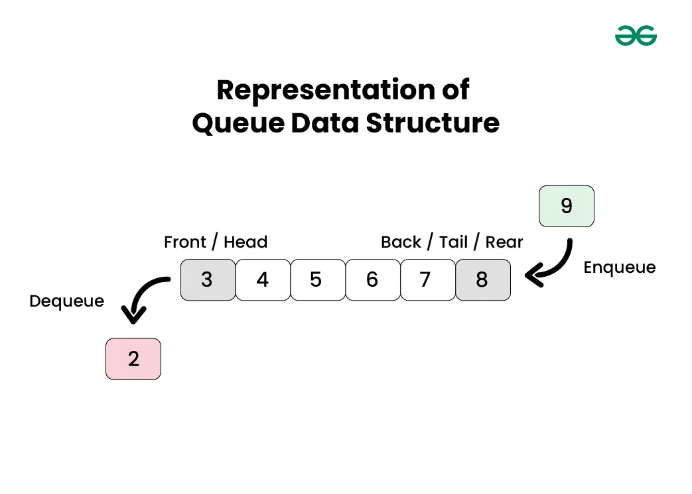

<a id="afccf339d04f42eea7e4e88fd0237e89"></a>

제일 먼저 입력한 값이 가장 먼저 출력되는 자료 구조입니다&#46;<br><strong>FIFO(First In First Out)</strong>이라고 부릅니다&#46;

<a id="06e1e2f1ccaa4f43889eb923f5b8444a"></a>

데이터를 입력하는 <code>enqueue</code>&#91;인큐&#93;와 데이터를 출력하는 <code>dequeue</code>&#91;디큐&#93; 기능이 있습니다&#46;

<details>
<summary>예제 코드</summary>

<a id="27d7f2625723499085aed9572774c0b9"></a>

```java
Queue<String> languages = new LinkedList<>();

// 원소 추가
languages.add("Python");
languages.add("Java");
languages.add("C");
System.out.println("LinkedList: " + languages); // [ Python, Java, C ]

// 첫번째 원소 출력
String str1 = languages.peek(); // ?

// 첫번째 원소 출력 및 삭제
String str2 = languages.poll(); // ?
System.out.println("LinkedList after poll(): " + languages); // ?

// 원소 추가
boolean result = languages.offer("Swift");
System.out.println("LinkedList after offer(): " + languages); // ?


add() : 큐가 꽉 찬 경우 IllegalStateException 에러 발생
offer() : 큐가 꽉 찬 경우 false 반환
```

</details>

</details>

<a id="157eda9b0fe18023908cf342c2addd74"></a>

## <strong>3&#46; 시간 복잡도</strong>

<a id="157eda9b0fe180afb7d3da06fa0e404e"></a>

시간 복잡도는 주로 Big&#45;O 표기법을 사용하여 나타냅니다&#46;

- <strong>알고리즘이 실행될 때 필요한 ‘입력 값’과 ‘연산 수행 시간’에 따라 ‘효율적인 알고리즘’을 나타내는 척도를 의미합니다&#46;</strong>

- 즉, 입력 값이 커질수록 알고리즘의 수행 시간이 어떻게 증가하는지에 따른 지표를 의미합니다&#46;

- 시간 복잡도는 ‘빅오 표기법(Big&#45;O notation)’를 통해 표현하며, ‘수치가 작을수록 효율적인 알고리즘’을 의미합니다&#46;

> <strong>공간 복잡도(Space Complexity)란?알고리즘이 실행될 때 필요한 ‘메모리 공간의 양’을 의미합니다&#46;</strong>즉 알고리즘의 효율성을 판단하는 데 사용되며 일반적으로 메모리 사용량이 적을수록 더 효율적인 알고리즘이라고 할 수 있습니다&#46;

<a id="157eda9b0fe180b19c8fd071ab1ca087"></a>

&#91; 요약 &#93;

- 시간 복잡도 &#58; 입력되는 n의 크기에 따라 실행되는 조작의 수

- 공간 복잡도 &#58; 알고리즘이 실행될 때 사용하는 메모리 양

<a id="157eda9b0fe1802eaad5f3339aab6544"></a>

### <strong>3&#46;1&#46; 빅오(Big&#45;O) 표기법</strong>

<a id="157eda9b0fe1800ea32ff30ea0aabd8c"></a>

<strong>알고리즘의 입력 크기에 대해 수행 시간이 어떤 방식으로 증가하는지를 표기하는 것으로 최악의 경우의 시간 복잡도를 의미합니다&#46;</strong>

- <strong>이를 분석함으로써 알고리즘을 설계할 때 최악의 성능을 예측하고 최악의 경우에도 어느 정도의 실행 속도를 보장함을 확인합니다&#46;</strong>

<a id="157eda9b0fe180aa9546ee3291dd275a"></a>

여기서 측정되는 복잡성에는 <strong>시간 복잡도</strong>와 <strong>공간 복잡도</strong>가 있다&#46;

<a id="157eda9b0fe18026ad7fc208808d702c"></a>

빅오 표기법을 통해 성능을 개선하거나 적절한 알고리즘을 선택할 수 있습니다&#46;

<a id="157eda9b0fe18072844cc11094216c4b"></a>

### <strong>3&#46;2&#46; 빅오(Big&#45;O) 복잡성 차트</strong>

<a id="157eda9b0fe180e4b8d7d344c7c8d489"></a>

빅오 표기법을 이용하여 알고리즘의 시간 복잡도를 분석하면, 입력 크기가 커질 때 어떤 알고리즘이 더 효율적인지 비교할 수 있습니다&#46;

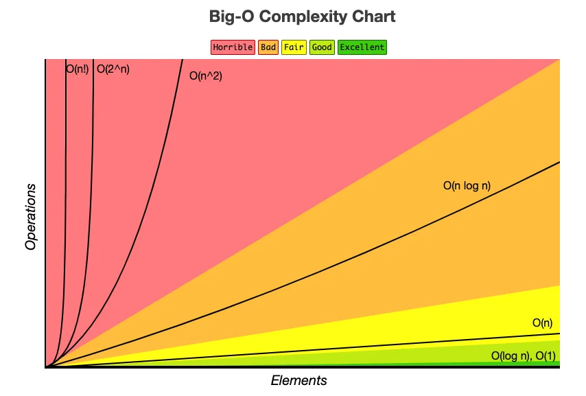

<a id="157eda9b0fe180d29a06f1d5fea6d97c"></a>

<strong>ALT</strong>

|  |  |  |  |  |
| --- | --- | --- | --- | --- |
| <strong>표기법</strong> | <strong>이름</strong> | <strong>시간 복잡도</strong> | <strong>설명</strong> | <strong>예시</strong> |
| <strong>O(1)</strong> | 상수 | 상수 시간 | 입력 크기와 상관없이 일정한 실행 시간을 가집니다&#46; | 배열에서 원소 하나 찾기, Map에서 특정 Key값에 대한 Value 찾기 |
| <strong>O(logn)</strong> | 로그 | 로그 시간 | 입력 크기가 증가함에 따라 실행 시간이 로그함수의 형태로 증가합니다&#46; | 이진 탐색 알고리즘 |
| <strong>O(n)</strong> | 선형 | 선형 시간 | 입력 크기와 비례하는 실행 시간을 가집니다&#46; | 선형 탐색 알고리즘, <br>1차 for문 |
| <strong>O(nlogn)</strong> | 로그 선형 | 선형 로그 시간 | 입력 크기가 증가함에 따라 실행 시간이 로그함수와 선형 함수의 곱의 형태로 증가합니다&#46; | 병합 정렬, 힙 정렬 알고리즘 |
| <strong>O(n^2)</strong> | 이차 | 이차 시간 | 입력 크기의 제곱에 비례하는 실행 시간을 가집니다&#46; | 선택 정렬, 버블 정렬, 퀵 정렬 알고리즘, 2차 for문 |
| <strong>O(2^n)</strong> | 지수 | 지수 시간 | 입력 크기의 지수에 비례하는 실행 시간을 가집니다&#46; | 부분집합 |
| <strong>O(n&#33;)</strong> | 계승 | 팩토리얼 시간 | 입력 크기의 팩토리얼에 비례하는 실행 시간을 가집니다&#46; | 외판원 문제 |

<a id="157eda9b0fe180f5b0def87e671d6334"></a>

## 4&#46; 실전 연습

<a id="157eda9b0fe180c38ab4ea4e4ad23329"></a>

<a href="https://programmers.co.kr/">https&#58;//programmers&#46;co&#46;kr/</a>

<details>
<summary>선형 탐색 &#45; <a href="https://school.programmers.co.kr/learn/courses/30/lessons/120899">https&#58;//school&#46;programmers&#46;co&#46;kr/learn/courses/30/lessons/120899</a></summary>

<a id="cc8d63964b164b0d80ccf935ee17f1d2"></a>

```java
import java.util.*;

class Solution {
    public int[] solution(String s) {
        int[] answer = new int[s.length()];
        
        // answer[0] = -1;
        // for (int i=1; i<s.length(); i++) {
        //     char c = s.charAt(i);
        //     boolean flag = false;
        //     for (int j=0; j<i; j++) {
        //         if (c == s.charAt(j)) {
        //             answer[i] = i - j;
        //             flag = true;
        //         }
        //     }
        //     if (!flag) {
        //         answer[i] = -1;
        //     }
        // }
        
        
        Map<Character, Integer> charMap = new HashMap<>();
        
        for (int i=0; i<s.length(); i++) {
            char c = s.charAt(i);
            if (charMap.get(c) == null) {
                charMap.put(c, i);
                answer[i] = -1;
            } else {
                int idx = charMap.get(c);
                answer[i] = i - idx;
                charMap.put(c, i);
            }
        }
        
        return answer;
    }
}
```

</details>

<details>
<summary>Map 자료구조 활용 &#45; <a href="https://school.programmers.co.kr/learn/courses/30/lessons/120896">https&#58;//school&#46;programmers&#46;co&#46;kr/learn/courses/30/lessons/120896</a></summary>

<a id="ea57d3aec0244829a678746305f8f2c9"></a>

```java
import java.util.*;

class Solution {
    public String solution(String s) {
        StringBuilder answer = new StringBuilder();
        Map<Character, Integer> map = new HashMap<>();
        
        for (int i=0; i < s.length(); i++) {
            char c = s.charAt(i);
            
            // if (map.get(c) == null) {
            //     map.put(c, 1);
            // } else {
            //     map.pug(c, 2);
            // }
            
            map.put(c, map.getOrDefault(c, 0) + 1);
        }
        
        List<Character> once = new ArrayList<>();
        map.forEach((key, value) -> {
            if (value == 1)
                once.add(key);
        });
        Collections.sort(once);
        for (Character ch : once) {
            answer.append(ch.toString());
        }

        return answer.toString();
    }
}
```

</details>

<details>
<summary>스택/큐 활용 &#45; <a href="https://school.programmers.co.kr/learn/courses/30/lessons/12906">https&#58;//school&#46;programmers&#46;co&#46;kr/learn/courses/30/lessons/12906</a></summary>

<a id="01ad17f72a884a478ac73219e14e539e"></a>

```java
import java.util.*;

public class Solution {
    public int[] solution(int []arr) {
        int[] answer;
        Stack<Integer> stack = new Stack<>();
        Queue<Integer> queue = new LinkedList<>();
        
        queue.add(arr[0]);
        stack.push(arr[0]);
        for (int i=1; i<arr.length; i++) {
            Integer element = stack.peek();
            if (element != arr[i]) {
                stack.push(arr[i]);
                queue.add(arr[i]);
            }
        }
        
        answer = new int[queue.size()];
        for (int i=0; i<answer.length; i++) {
            answer[i] = queue.poll();
        }
        
        return answer;
    }
}
```

</details>

<details>
<summary>HashSet 활용 &#45; <a href="https://school.programmers.co.kr/learn/courses/30/lessons/1845?language=java">https&#58;//school&#46;programmers&#46;co&#46;kr/learn/courses/30/lessons/1845?language=java</a></summary>


</details>

<details>
<summary>시간 복잡도 및 Map 자료구조 활용 2 &#45; <a href="https://school.programmers.co.kr/learn/courses/30/lessons/142086">https&#58;//school&#46;programmers&#46;co&#46;kr/learn/courses/30/lessons/142086</a></summary>

<a id="1bf5fb575c3a4868a35da0a75a71c956"></a>

```java
import java.util.*;

class Solution {
    public int[] solution(String s) {
        int[] answer = new int[s.length()];
        
        // O(N^2)
        answer[0] = -1;
        for (int i=1; i<s.length(); i++) {
            char c = s.charAt(i);
            boolean flag = false;
            for (int j=0; j<i; j++) {
                if (c == s.charAt(j)) {
                    answer[i] = i - j;
                    flag = true;
                }
            }
            if (!flag) {
                answer[i] = -1;
            }
        }
        
        // O(N)
//         Map<Character, Integer> charMap = new HashMap<>();
        
//         for (int i=0; i<s.length(); i++) {
//             char c = s.charAt(i);
//             if (charMap.get(c) == null) {
//                 charMap.put(c, i);
//                 answer[i] = -1;
//             } else {
//                 int idx = charMap.get(c);
//                 answer[i] = i - idx;
//                 charMap.put(c, i);
//             }
//         }
        
        return answer;
    }
}
```

</details>

<details>
<summary><del>쉬운 BFS &#45; </del><del><a href="https://school.programmers.co.kr/learn/courses/30/lessons/120866">https&#58;//school&#46;programmers&#46;co&#46;kr/learn/courses/30/lessons/120866</a></del></summary>

<a id="1db21a40c561448faf23069e6ee13173"></a>

```java
class Solution {
    public int solution(int[][] board) {
        int answer = 0;
        int height = board.length;
        int width = board[0].length;
        boolean[][] myBoard = new boolean[height][width];
        
        
        for (int i=0; i<height; i++) {
            for (int j=0; j<width; j++) {
                if (board[i][j] == 1) {
                    bfs(i, j, myBoard);
                }
            }
        }
        
        for (int i=0; i<height; i++) {
            for (int j=0; j<width; j++) {
                if (!myBoard[i][j]) {
                    answer++;
                }
                System.out.print(myBoard[i][j] + " ");
            }
            System.out.println();
        }
        
        return answer;
    }
    
    private void bfs(int i, int j, boolean[][] myBoard) {

        
        int[] dx = {0, 0, -1, -1, -1, 1, 1, 1};
        int[] dy = {-1, 1, 0, -1, 1, 1, -1, 0};
        myBoard[i][j] = true;
        for (int k=0; k<8; k++) {
            int nx = i + dx[k];
            int ny = j + dy[k];
            
            if (nx >= 0 && ny >= 0 && nx < myBoard.length && ny < myBoard[0].length && !myBoard[nx][ny]) {
                myBoard[nx][ny] = true;
            }
        }
    }
}
```

</details>
