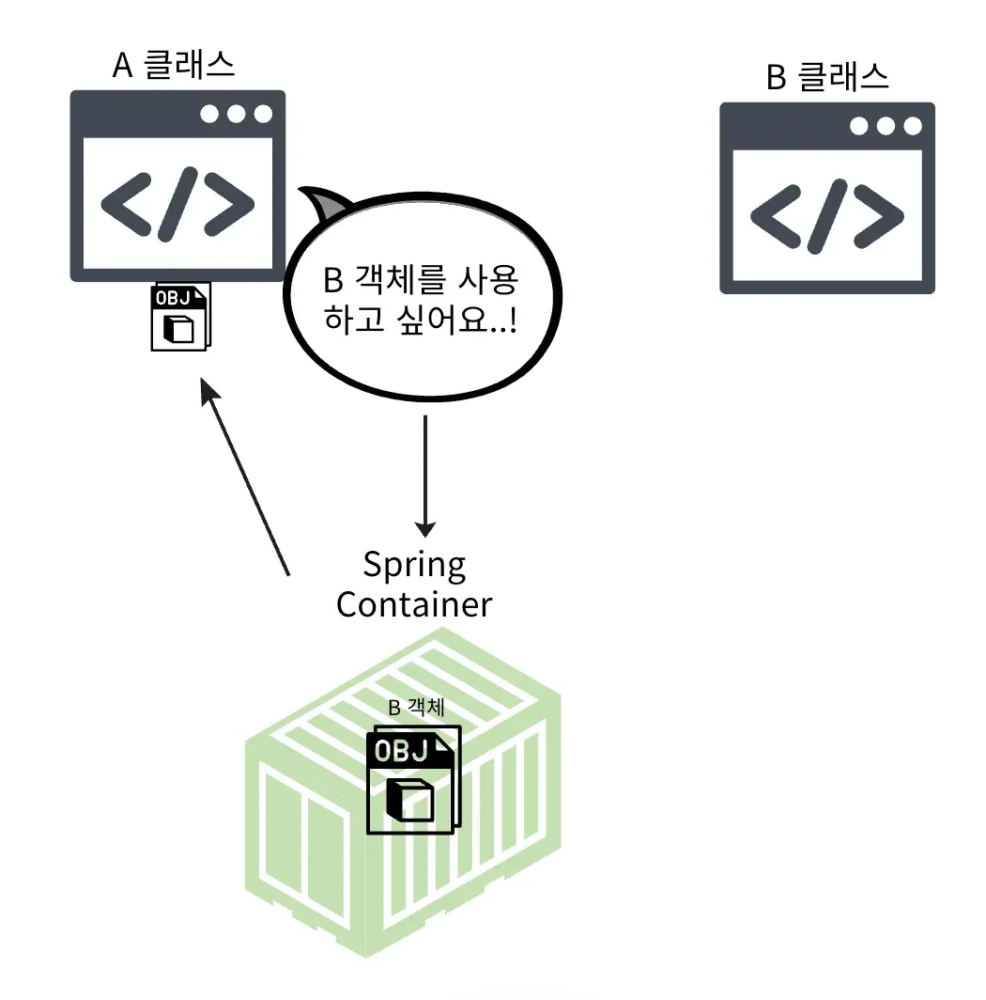
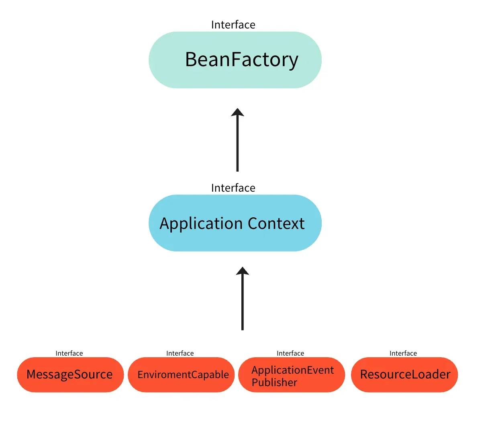

<a id="13ceda9b0fe1808097dcccd73311d041"></a>

## Spring Container

> 📖 
> 
> <a id="500a488ca59046cabc9cd8153a3760f7"></a>
> 
> Spring 앱에서 빈(객체)의 라이프 사이클(생성, 관리, 소멸)을 관리한다&#46; <br>앱 시작 시, 컴포넌트 스캔 및 설정 파일을 통해 빈으로 등록된 클래스들을 읽어와  생성 및 주입하는 모든 과정을 컨트롤한다&#46;

<details>
<summary>✎ Spring Container를 사용하면 <u>인터페이스에만 의존</u>하는 설계가 가능해진다</summary>

<a id="13ceda9b0fe1806ea411dbaf1b22943d"></a>

스프링 컨테이너는 의존성 주입(Dependency Injection)을 통해 객체 간의 의존성을 자동으로 관리한다&#46;  즉,  객체가 어떤 구현체를 사용할지는 컨테이너에서 결정되고 주입된다&#46; 따라서 클래스는 구체적인 구현체를 몰라도 된다&#46; 이는 객체가 인터페이스에만 의존하게끔 설계할 수 있음을 의미한다&#46; 



- Spring Container에서 객체(Bean) 생성 및 관리하고 의존성을 주입함

</details>

<details>
<summary>✏ <strong>Spring Container의 종류</strong></summary>



- BeanFactory
    - Spring Container의 최상의 인터페이스

    - Spinrg Bean을 관리하고 조회함
        [BeanFactory 코드 분석 ( 정리 전 )](#/post/13ceda9b-0fe1-805f-bcee-cc71f402f567)

- ApplicationContext
    - BeanFactory의 확장된 형태(implements)

    - Application 개발에 필요한 다양한 기능을 추가적으로 제공
        - 국체화, 환경변수 분리, 이벤트, 리소스 조회 

> 🥸 
> 
> <a id="ee9d8ff2124a4486b6a10afcd3f9dff5"></a>
> 
> 일반적으로 ApplicationContext를 사용하기 때문에 ApplicationContext를 Spring Container 라 표현한다&#46;

</details>

<a id="13ceda9b0fe1809999ccf8254e60962c"></a>

## Spring Bean

> 📖 
> 
> <a id="fb0b265b90f9423cbc8df1d1817bfe5b"></a>
> 
> Spring 컨테이너가 <u>관리하는 객체</u>를 의미한다&#46; 객체 Bean라 명시를 하면 스프링에서 해당 객체를 Bean으로 인식하여 <u>생성, 초기화, 의존성 주입</u> 등을 컨테이너를 통해 관리한다&#46; 

<details>
<summary>✎ Spring Bean</summary>

- <code>new</code> 키워드 대신 사용

- Spring Container가 제어한다&#46;

</details>

<details>
<summary>✎  특징</summary>

- Spring 컨테이너에 의해 생성되고 관리된다&#46;

- 기본적으로 Singleton으로 설정되기 때문에 하나의 자원을 공유한다&#46;
    - 따라서 공유 변수 등 사용에 주의해야함

- 의존성 주입(DI)를 통해 다른 객체들과 의존 관계를 맺을 수 있다&#46; 

- <u>생성, 초기화, 사용, 소멸</u>의 생명주기를 가진다&#46;

</details>

<details>
<summary>🧐 빈(Bean) 등록 방법</summary>

> 뒤 챕터에서 자세히 다룸

- XML, <strong>Java Annotation</strong>, Java 설정파일 등을 통해 Bean으로 등록할 수 있다채&#46;

<details>
<summary>ex) XML</summary>

- XML로 Bean 등록
    <a id="13ceda9b0fe1807bab15f4a133aa61cb"></a>

    ```java
    <beans>
        <!-- myBean이라는 이름의 Bean 정의 -->
        <bean id="myBean" class="com.example.MyBean" />
    </beans>
    ```

- Spring Container(applicationContext) 에서 Bean 가져옴 
    <a id="13ceda9b0fe180c286cdccde3f407305"></a>

    ```java
    public class MyApp {
        public static void main(String[] args) {
            // Spring 컨테이너 생성 
            ApplicationContext context = new ClassPathXmlApplicationContext("applicationContext.xml");
           
            // Bean 가져옴
            MyService myService = context.getBean("myService", MyService.class);
            myService.doSomething();
        }
    }
    ```

</details>

<details>
<summary>ex) Anotation </summary>

- 빈 등록 ( <code>&#64;Component</code> )
    <a id="13ceda9b0fe180a683facd39acb17723"></a>

    ```java
    // @Componenet를 통해 빈 등록
    		// @Controller, @Service, @Repository -> 내부에 @Component가 포함됨
    @Component
    public class MyService {

        public void doSomething() {
            System.out.println("Spring Bean 으로 동작");
        }
        
    }
    ```

- 의존성 자동 주입 ( <code>&#64;Autowired</code> ) 
    - 롬봄 사용 시, <code>&#64;RequiredArgsConstructor</code>를 통해 간단한게 가능 

    <a id="13ceda9b0fe1801f9d63e980af527f0b"></a>

    ```java
    @Component
    public class MyApp {

        private final MyService myService;

        @Autowired // 의존성 자동 주입
        public MyApp(MyService myService) {
            this.myService = myService;
        }

        public void run() {
            myService.doSomething();
        }
    } 
    ```

- 컴포넌트 스캔 ( <code>&#64;CompnentScan</code> )
    - Bean으로 등록된 클래스들을 스캔해 빈 컨테이너에서 관리(생성, 초기화, 의존성 주입 등)

    <a id="13ceda9b0fe180f694c4f4c24199054c"></a>

    ```java
    // com.example 패키지를 스캔하여 Bean 등록
    @Configuration
    @ComponentScan(basePackages = "com.example")
    public class AppConfig {

        public static void main(String[] args) {
            AnnotationConfigApplicationContext context = new AnnotationConfigApplicationContext(AppConfig.class);
            MyApp app = context.getBean(MyApp.class);
            app.run();
        }
        
    }
    ```

</details>

<details>
<summary>ex) Java 설정파일 ( 수동 등록 )</summary>

- 설정 파일(<code>&#64;Configuration</code>)을 만들어 <code>&#64;Bean</code>을 통해 해당하는 클래스의 생성 메서드를 빈으로 등록함

<a id="13ceda9b0fe180a29397d7d7514184f7"></a>

```java
@Configuration
public class AppConfig {

    @Bean
    public MyService myService() {
        return new MyService();
    }
}
```

- 아래와 같이 컨테이너에서 수동으로 등록한 빈을 가져와 사용 가능함
    - 수동으로 빈을 명시하기 때문에, 자동 등록 시에 필요한 <u><code>&#64;ComponentScan</code></u><u> 설정</u>이 필요하지 않음

    <a id="13ceda9b0fe1802e92c5cf28bf11209c"></a>

    ```java
    public class MyApp {
        public static void main(String[] args) {
            // Spring 컨테이너에서 Bean을 가져옴
            AnnotationConfigApplicationContext context = new AnnotationConfigApplicationContext(AppConfig.class);
            MyService myService = context.getBean(MyService.class);
            myService.doSomething();
        }
    }
    ```

</details>

</details>
