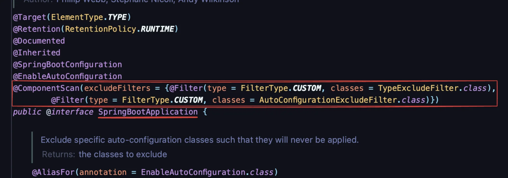

<a id="13ceda9b0fe1804c9deeee4dbbde6bfb"></a>

## 빈 자동 등록 &#45; <code>&#64;ComponentScan</code>

> 📖 
> 
> <a id="4ec8066fe22642d287b4b40004107924"></a>
> 
> Spring에서 특정 패키지 내에서 <code>&#64;Component</code> (<code>&#64;Service</code>, <code>&#64;Repository</code>, <code>&#64;Controller</code>)  Anotation이 붙은 클래스를 자동으로 검색하고, 이를 Bean으로 등록하는 기능이다&#46;<br>직접 빈을 등록 (수동 빈 등록) 하지 않고 자동으로 빈이 등록되고 관리된다&#46; 

<details>
<summary>&#64;ComponentScan</summary>

- 특정 패키지 내에 <strong><code>&#64;Component</code></strong> Annotation이 붙은 클래스를 자동으로 찾아서 <strong>Spring Bean</strong>으로 등록한다&#46;
    - 간편하게 Annotaion을 사용하여 Bean으로 등록하기 때문에, 코드가 간결해지고 유지보수가 쉬워진다&#46; 

- 스캐닝 범위는 주로 애플리케이션의 루트(최상위) 패키지에 시작된다&#46;
    - 최상위 루트 클래스에 <code>&#64;SpringBootApplication</code> 선언돼 있으며 <br><code>&#64;ComponentScan</code>은 <code>&#64;SpringBootApplication</code> 내부에 로직에 존재한다&#46;
        

</details>

<details>
<summary><strong>&#64;ComponentScan의 속성</strong></summary>

- basePackages
    - 특정 패키지 스캔 시, 배열로 여러 클래스 설정 가능

    - ex) <code>&#64;ComponentScan(basePackages = {&#34;com&#46;example&#34;, &#34;com&#46;another&#34;})</code>

- <strong>basePackageClasses</strong>
    - 특정 클래스가 속한 패키지를 기준으로 스캔 가능

    - ex) <code>&#64;ComponentScan(basePackageClasses = MyApp&#46;class)</code>

- <strong>excludeFilters</strong>
    - 스캔에서 제외할 클래스를 필터링 가능

    - ex) <code>&#64;ComponentScan(excludeFilters = &#64;ComponentScan&#46;Filter(SomeClass&#46;class))</code>

- <strong>includeFilters</strong>
    - 특정 조건에 맞는 클래스만 스캔하여 포함 가능

    - ex) <code>&#64;ComponentScan(includeFilters = &#64;ComponentScan&#46;Filter(Service&#46;class))</code>

</details>

<details>
<summary>컴포넌트 스캔 동작 순서 </summary>

1. Spring Application이 실행되면 <code>&#64;ComponentScan</code>에서  지정된 패키지(하위 요소들까지)를 탐색한다&#46;

1. 해당 패키지에서 <code>&#64;Component</code> 또는 Annotation이 붙은 클래스를 찾는다&#46;

1. 찾은 클래스는 Spring 컨테이너에 빈으로 등록한다&#46;

1. 등록된 빈은 <strong><u>의존성 주입(DI)</u></strong>과 같은 방식으로 다른 빈과 연결된다&#46; 

</details>

<a id="13ceda9b0fe180bbb695da91e0269325"></a>

## 빈 수동 등록 &#45; <code>&#64;Configuration</code>, <code>&#64;Bean</code>

> 📖 
> 
> <a id="0316930d1a06474d9f9917bc5f9fcf87"></a>
> 
> 빈을 등록하는 수동 방법
> 
> - 설정 파일 &#45; <code>&#64;Configuration</code>
> 
> - 수동 빈 등록 &#45;  <code>&#64;Bean</code>

> 위에서 알아본 <code>&#64;ComponentScan</code>, <code>&#64;Component</code>가 <u>자동으로 빈을 등록</u>하는 방법이다&#46;

<details>
<summary>수동 Bean 등록</summary>

- <code>&#64;Configuration</code> 이 있는 클래스를 Bean으로 등록하고 해당 클래스를 파싱해서  <code>&#64;Bean</code> 이 있는 메서드를 찾아 Bean을 생성한다&#46; 이때 해당 메서드의 이름으로 Bean의 이름이 설정된다&#46;
    ---

    <details>
    <summary>&#91; 코드 &#93;  TestServiceImpl &#45; 빈으로 등록할 클래스</summary>

    <a id="13ceda9b0fe180b0a956f137438960af"></a>

    ```java
    // 인터페이스
    public interface TestService {
        void doSomething();
    }

    // 인터페이스 구현체
    public class TestServiceImpl implements TestService {
        @Override
        public void doSomething() {
            System.out.println("Test Service 메서드 호출");
        }
    }
    ```

    </details>

    <details>
    <summary>&#91; 코드 &#93;  AppConfig  &#45; 수동 빈 등록</summary>

    <a id="b66ca5fdc30344299cd6cfa805111f8a"></a>

    ```java
    // 수동으로 빈 등록
    @Configuration
    public class AppConfig {
        
        // TestService 타입의 Spring Bean 등록
        @Bean
        public TestService testService() {
            // TestServiceImpl을 Bean으로 등록
            return new TestServiceImpl();
        }
    }
    ```

    </details>

    <details>
    <summary>&#91; 코드 &#93;  MainApp  &#45; 빈 등록 확인</summary>

    <a id="d37145418a084f7583accfe6a06e0a58"></a>

    ```java
    // Spring Bean으로 등록이 되었는지 확인
    public class MainApp {
        public static void main(String[] args) {
            // Spring ApplicationContext 생성 및 설정 클래스(AppConfig) 등록
            ApplicationContext context = new AnnotationConfigApplicationContext(AppConfig.class);

            // 등록된 TestService 빈 가져오기
            TestService service = context.getBean(TestService.class);

            // 빈 메서드 호출
            service.doSomething();
        }
    }
    ```

    </details>

</details>

> ☝🏻 
> 
> <a id="67e25cb274434a7f86a7a963802840fb"></a>
> 
> 수동으로 Bean을 등록할 때는 항상 <code>&#64;Configuration</code>과 함께 사용해야 Bean이 싱글톤으로 관리된다&#46; <u>CGLIB 라이브러리</u>와 연관이 있다&#46;

<a id="13ceda9b0fe18093b271f9889d0b20b9"></a>

## Bean 충돌

> 📖 
> 
> <a id="13ceda9b0fe180d4af13ed05f343102f"></a>
> 
> Bean 등록 방법에는 수동, 자동 두가지가 존재하며 Bean은 각각의 이름으로 생성된다&#46; <br>이때 이름이 같은 Bean을 등록하면 충돌이 발생된다&#46; 

<details>
<summary>자동 Bean 등록 vs 자동 Bean 등록</summary>

<details>
<summary>&#91; 코드 &#93;  &#60; interface &#62; ConflictService</summary>

<a id="8eac8f4c08e041c0ade708edc4e110f6"></a>

```java
public interface ConflictService {
    void test();
}
```

</details>

<details>
<summary>&#91; 코드 &#93;  ConflictServiceV1 &#45; 자동 빈 등록 1 </summary>

<a id="062ba821ea744800956410918973a049"></a>

```java
// Bean의 이름을 service로 설정
@Component("service")
public class ConflictServiceV1 implements ConflictService {
    @Override
    public void test() {
        System.out.println("Conflict V1");
    }
}
```

</details>

<details>
<summary>&#91; 코드 &#93;  ConflictServiceV2 &#45; 동일한 이름으로 자동 빈 등록 2</summary>

<a id="1284694988744023856861a27dd25c9c"></a>

```java
// Bean의 이름을 service로 설정
@Component("service")
public class ConflictServiceV2 implements ConflictService {
    @Override
    public void test() {
        System.out.println("Conflict V2");
    }
}void test();
}
```

</details>

<details>
<summary>&#91; 코드 &#93;  ConflictApp &#45; 🤬  <strong>ConflictingBeanDefinitionException</strong> 발생</summary>

<a id="7e327244cfcd4cb7b0545c7efb4b36b2"></a>

```java
// componentScan의 범위를 conflict 패키지 하위로 설정
@ComponentScan(basePackages = "com.example.springconcept.conflict")
public class ConflictApp {
    public static void main(String[] args) {
        ApplicationContext context = new AnnotationConfigApplicationContext(ConflictApp.class);

        // Service 빈을 가져와서 실행
        ConflictService service = context.getBean(ConflictService.class);

        service.test();
    }
}
```

</details>

</details>

<details>
<summary>자동 Bean 등록 vs 수동 Bean 등록</summary>

<details>
<summary>&#91; 코드 &#93;  ConflictServiceV1 &#45; 자동 빈 등록</summary>

<a id="fbfb6f9b12f04e62b20e94b5c14ca92f"></a>

```java
// conflictService 이름으로 Bean 생성
@Component
public class ConflictService implements MyService {
    @Override
    public void doSomething() {
        System.out.println("ConflictService 메서드 호출");
    }
}
```

</details>

<details>
<summary>&#91; 코드 &#93; ConflictServiceV2, ConflictAppConfig &#45; 수동 빈 등록</summary>

<a id="04ac535d5bae4d25afb734ace5bd972f"></a>

```java
public class ConflictServiceV2 implements MyService {
    @Override
    public void doSomething() {
        System.out.println("ConflictServiceV2 메서드 호출");
    }
}
```

<a id="d654fb4d3e0a4eadb2ac0ceaaffafd57"></a>

```java
// 수동으로 Bean 등록
@Configuration
public class ConflictAppConfig {
		
		// conflictService 이름으로 Bean 생성
    @Bean(name = "conflictService")
    MyService myService() {
        return new ConflictServiceV2();
    }

}
```

</details>

<details>
<summary>&#91; 코드 &#93;  ConflictApp2 &#45; 오버라이딩 오류 발생</summary>

<a id="240510fd089e490eaa2fc160bffee343"></a>

```java
@ComponentScan(basePackages = "com.example.springconcept.conflict2")
public class ConflictApp2 {
    public static void main(String[] args) {
        ApplicationContext context = new AnnotationConfigApplicationContext(ConflictApp2.class);

        // Service 빈을 가져와서 실행
        MyService service = context.getBean(MyService.class);

        service.doSomething();
    }
}
```

- <code>수동 Bean 등록</code>이 <code>자동 Bean 등록</code> 보다 <strong><u>더 높은 우선순위</u></strong>를 가진다 &#46;
    - <u>이름이 동일</u>한 경우 <u>수동 Bean으로 오버라이딩</u>됨
        <details>
        <summary>설정 변경(application&#46;properties)</summary>

        <a id="13ceda9b0fe180c08625f1d451cda116"></a>

        ```java
        // 수동, 자동 Bean을 동시에 등록할 때 이름이 같으면 수동 Bean이 오버라이딩
        spring.main.allow-bean-definition-overriding=true 

        // 기본값
        spring.main.allow-bean-definition-overriding=false
        ```

        </details>

    - 의도한 결과라면 다행이지만, 아닌 경우가 대부분이기 때문에  설계와는 다르게 동작한다&#46;  → 오류 발생

</details>

</details>
